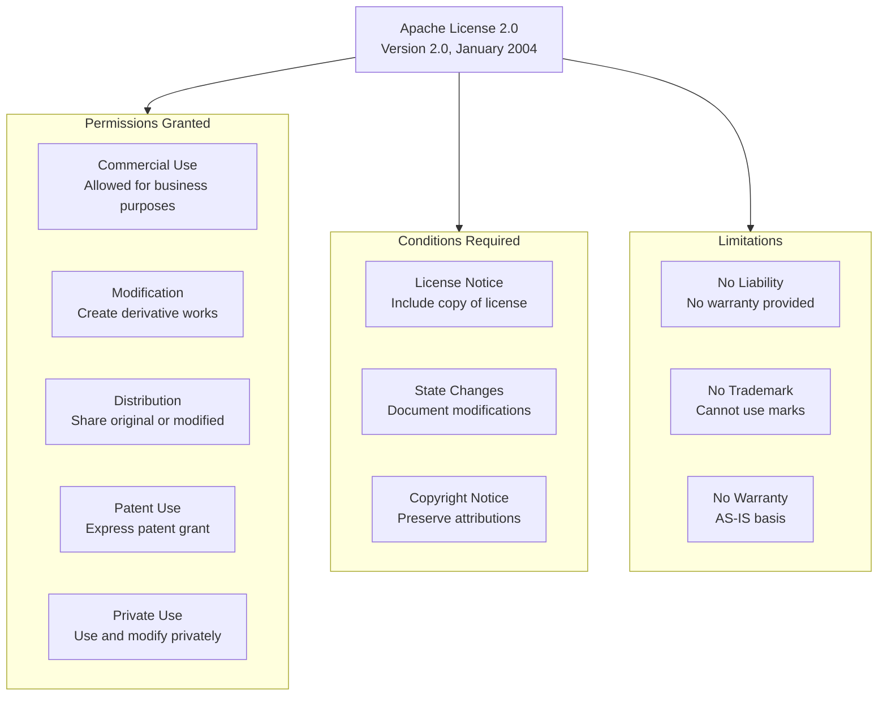
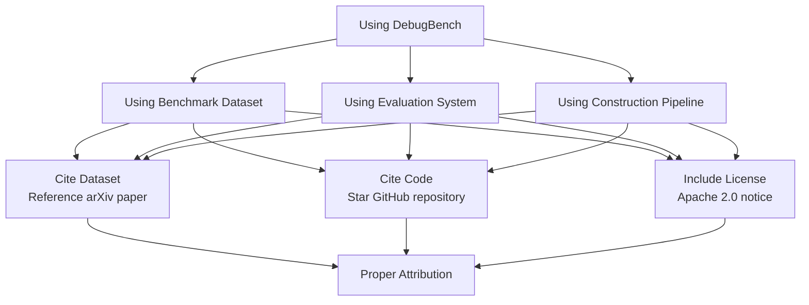
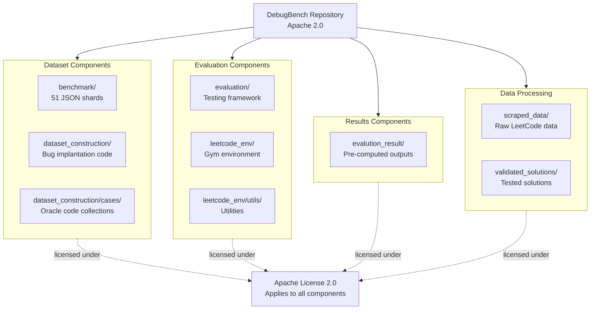
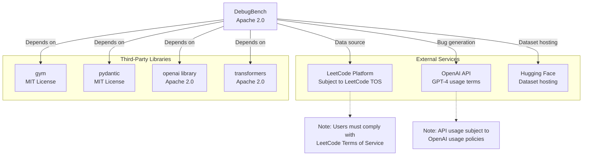
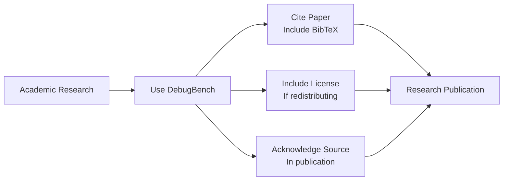
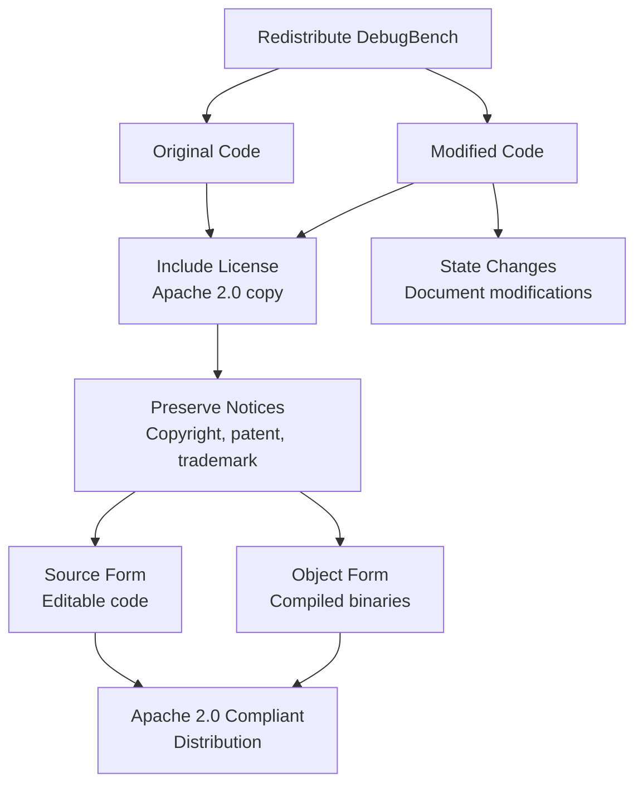

<!-- source: DeepWiki mcp.deepwiki.com · repo thunlp/DebugBench · page 9 License and Citation · fetched 2026-11-02 -->

# License and Citation

<details>
<summary>Relevant source files</summary>

The following files were used as context for generating this wiki page:

- [LICENSE](LICENSE)
- [README.md](README.md)

</details>


This page provides licensing information for the DebugBench project and guidance on how to properly cite the work in academic publications. For information about getting started with the benchmark, see [Quick Start Guide](#1.2). For details on accessing the dataset, see [Accessing the Dataset](#3.5).

## License Overview

DebugBench is released under the Apache License 2.0, an open-source permissive license that allows both commercial and non-commercial use, modification, and distribution of the software. The license provides clear terms for use, reproduction, and redistribution while protecting contributors from liability.

### License Type: Apache 2.0



**License Scope Across Components**

Sources: [LICENSE:1-201](), [README.md:1-57]()

### Copyright Information

The copyright holder for DebugBench is **Runchu Tian** (2023). The copyright notice is included in the license file and applies to all components of the repository.

**Copyright Notice:**
```
Copyright [2023] [Runchu Tian]

Licensed under the Apache License, Version 2.0 (the "License");
you may not use this file except in compliance with the License.
You may obtain a copy of the License at

    http://www.apache.org/licenses/LICENSE-2.0
```

Sources: [LICENSE:189-195]()

### Key License Terms

The Apache License 2.0 includes the following key provisions:

| Term | Description | License Section |
|------|-------------|-----------------|
| **Copyright License** | Perpetual, worldwide, non-exclusive, royalty-free license to reproduce, prepare derivative works, display, perform, sublicense, and distribute | Section 2 |
| **Patent License** | Express grant of patent rights for contributions | Section 3 |
| **Redistribution** | May redistribute in any medium with modifications, provided license is included and changes are stated | Section 4 |
| **Contributions** | Contributions submitted are under the same license terms | Section 5 |
| **Disclaimer of Warranty** | Work provided "AS IS" without warranties | Section 7 |
| **Limitation of Liability** | Contributors not liable for damages | Section 8 |

Sources: [LICENSE:66-174]()

## Citation Information

When using DebugBench in academic research, please cite the original paper. The official citation and contact information are provided below.

### BibTeX Entry

```bibtex
@misc{tian2024debugbench,
      title={DebugBench: Evaluating Debugging Capability of Large Language Models}, 
      author={Runchu Tian and Yining Ye and Yujia Qin and Xin Cong and Yankai Lin and Zhiyuan Liu and Maosong Sun},
      year={2024},
      eprint={2401.04621},
      archivePrefix={arXiv},
      primaryClass={cs.SE}
}
```

Sources: [README.md:46-54]()

### Paper Information

| Field | Value |
|-------|-------|
| **Title** | DebugBench: Evaluating Debugging Capability of Large Language Models |
| **Authors** | Runchu Tian, Yining Ye, Yujia Qin, Xin Cong, Yankai Lin, Zhiyuan Liu, Maosong Sun |
| **Year** | 2024 |
| **arXiv ID** | 2401.04621 |
| **Primary Class** | cs.SE (Software Engineering) |

Sources: [README.md:47-53]()

### Attribution Requirements

When using DebugBench components, users should:



**Attribution Flow for Different Use Cases**

Sources: [README.md:40-44]()

## Component-Level Licensing

The Apache 2.0 license applies uniformly across all components of the DebugBench repository:



**Repository Structure with License Scope**

| Component | Path | License | Notes |
|-----------|------|---------|-------|
| Benchmark Dataset | `benchmark/` | Apache 2.0 | 4,253 buggy code instances |
| Oracle Code | `dataset_construction/cases/` | Apache 2.0 | Source correct solutions |
| Evaluation Framework | `evaluation/` | Apache 2.0 | LeetCode testing system |
| Environment | `leetcode_env/` | Apache 2.0 | Gym-based environment |
| Pre-computed Results | `evalution_result/` | Apache 2.0 | Baseline model outputs |

Sources: [README.md:26-36](), [LICENSE:1-201]()

## External Dependencies and Data Sources

While DebugBench itself is licensed under Apache 2.0, it integrates with external services and uses third-party data sources that have their own terms:



**External Dependencies and Their Licenses**

### Data Source Attribution

The benchmark dataset is derived from LeetCode community solutions:
- **Source**: LeetCode platform (https://leetcode.com/)
- **Content**: Code snippets posted after June 2022
- **Terms**: Subject to LeetCode Terms of Service
- **Processing**: Bugs implanted using GPT-4

Users should be aware that while the DebugBench processing and framework are under Apache 2.0, the original LeetCode problem descriptions and test cases remain subject to LeetCode's terms.

Sources: [README.md:15-22]()

## Contact and Support

For questions about licensing, usage, or citations:

| Contact Method | Details |
|----------------|---------|
| **Email** | trc20@mails.tsinghua.edu.cn |
| **GitHub Issues** | Open an issue at the repository |
| **Hugging Face** | https://huggingface.co/datasets/Rtian/DebugBench |

**Recommended Actions:**
- **Star the repository** if you find DebugBench helpful
- **Cite the paper** in your publications
- **Contact via email** for specific questions
- **Open GitHub issues** for bugs or feature requests

Sources: [README.md:44]()

## Usage Guidelines

### For Academic Research



**Academic Usage Flow**

When using DebugBench for academic purposes:

1. **Citation Required**: Include the BibTeX citation in your paper
2. **Attribution**: Acknowledge DebugBench in your methodology section
3. **Dataset Reference**: Cite the Hugging Face dataset when using benchmark data
4. **Modifications**: If you extend or modify the benchmark, state the changes clearly

Sources: [README.md:40-44]()

### For Commercial Use

The Apache 2.0 license explicitly permits commercial use:

| Permission | Description | Requirement |
|------------|-------------|-------------|
| **Commercial Use** | Use in commercial products/services | Must include license notice |
| **Modification** | Create modified versions | Must state changes made |
| **Distribution** | Distribute original or modified | Must include license copy |
| **Private Use** | Use internally without distribution | No special requirements |
| **Patent Rights** | Use any patents in contributions | Granted by license |

**Requirements for Commercial Distribution:**
1. Include a copy of the Apache 2.0 license
2. Preserve copyright notices from the original work
3. State any modifications made to the original files
4. Include a NOTICE file if one exists

Sources: [LICENSE:89-121]()

### For Educational Use

Educational institutions may use DebugBench freely:

- Use in coursework and assignments
- Include in teaching materials
- Modify for educational purposes
- Share with students

**Best Practice**: Encourage students to cite the paper when using DebugBench in projects or research.

Sources: [README.md:40-44](), [LICENSE:1-201]()

## Redistribution Terms

If redistributing DebugBench or derivative works:



**Redistribution Compliance Workflow**

### Required Steps for Redistribution

1. **Include License**: Provide a copy of the Apache License 2.0 ([LICENSE:1-201]())
2. **Preserve Notices**: Keep all copyright, patent, trademark notices ([LICENSE:100-104]())
3. **State Changes**: Mark modified files with change notices ([LICENSE:97-98]())
4. **Attribution**: Include attribution notices if present ([LICENSE:106-121]())

Sources: [LICENSE:89-128]()

## Warranty and Liability

The Apache License 2.0 includes important disclaimers:

### Disclaimer of Warranty

```
Unless required by applicable law or agreed to in writing, Licensor 
provides the Work (and each Contributor provides its Contributions) 
on an "AS IS" BASIS, WITHOUT WARRANTIES OR CONDITIONS OF ANY KIND, 
either express or implied, including, without limitation, any 
warranties or conditions of TITLE, NON-INFRINGEMENT, MERCHANTABILITY, 
or FITNESS FOR A PARTICULAR PURPOSE.
```

### Limitation of Liability

```
In no event and under no legal theory, whether in tort (including 
negligence), contract, or otherwise, unless required by applicable 
law (such as deliberate and grossly negligent acts) or agreed to in 
writing, shall any Contributor be liable to You for damages.
```

**Key Points:**
- No warranty provided for the software
- Software provided "as is"
- Contributors not liable for damages
- User assumes all risks of use

Sources: [LICENSE:143-163]()

## Summary

| Aspect | Details |
|--------|---------|
| **License** | Apache License 2.0 |
| **Copyright** | Runchu Tian (2023) |
| **Permissions** | Commercial use, modification, distribution, patent use, private use |
| **Conditions** | Include license, state changes, preserve copyright notices |
| **Limitations** | No liability, no trademark rights, no warranty |
| **Citation** | arXiv:2401.04621 (tian2024debugbench) |
| **Contact** | trc20@mails.tsinghua.edu.cn |
| **Repository** | https://github.com/thunlp/DebugBench |
| **Dataset** | https://huggingface.co/datasets/Rtian/DebugBench |

Sources: [README.md:1-57](), [LICENSE:1-201]()