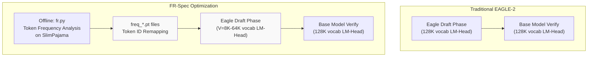
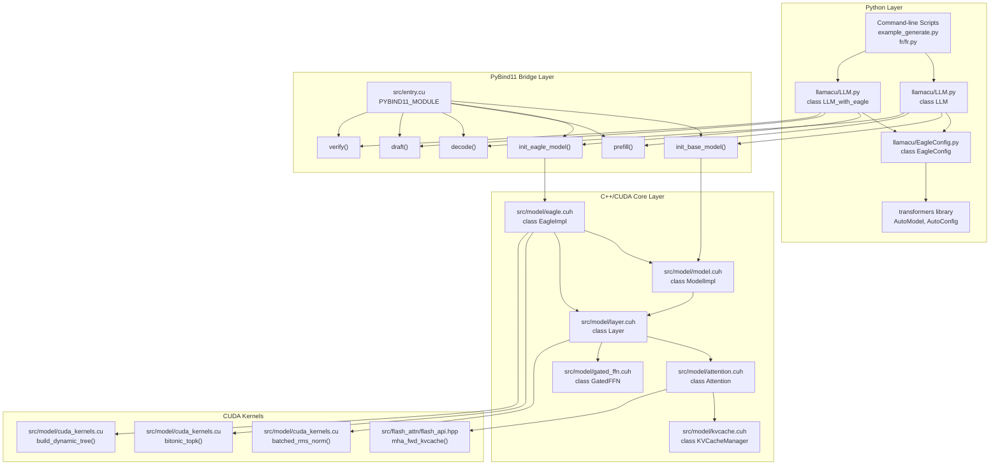
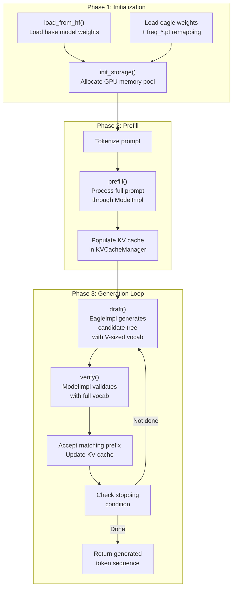

<!-- source: DeepWiki mcp.deepwiki.com · repo thunlp/FR-Spec · page 1 Overview · fetched 2026-11-02 -->

# Overview

Relevant source files

The following files were used as context for generating this wiki page:

- [README.md](README.md)
- [src/flash_attn/flash_api.hpp](src/flash_attn/flash_api.hpp)

## Purpose and Scope

This document provides a high-level introduction to FR-Spec (Frequency-Ranked Speculative Sampling), a system for accelerating Large Language Model (LLM) inference through vocabulary optimization in speculative decoding. This overview covers the system's goals, core innovation, architectural layers, and major components.

For detailed installation instructions, see [Installation](#2.1). For the complete architecture and component interactions, see [System Architecture](#3). For the core FR-Spec optimization technique, see [FR-Spec Optimization](#6).

**Sources:** [README.md:1-16]()

## What is FR-Spec?

FR-Spec is a C/CUDA implementation of frequency-ranked speculative sampling for LLM inference acceleration. The system addresses a performance bottleneck in EAGLE-2 speculative decoding: the LM-Head computation during the draft phase. By leveraging the long-tail distribution of token frequencies in natural language, FR-Spec reduces the effective vocabulary size during drafting, achieving **1.12x speedup over EAGLE-2** and **1.5x+ speedup over baseline autoregressive decoding**.

Key characteristics:

- **No retraining required**: Uses pre-computed token frequency statistics from corpus analysis
- **Quality preservation**: Maintains generation quality by focusing on high-frequency tokens that dominate typical outputs
- **Simple implementation**: Adds vocabulary reduction layer on top of existing EAGLE-2 architecture
- **Production-ready**: Integrated into SGLang framework and supports multiple model families (LLaMA3, Qwen2)

**Sources:** [README.md:5-15](), [README.md:133-138]()

## Core Innovation: Frequency-Ranked Vocabulary

The fundamental insight behind FR-Spec is that the LM-Head computation (projecting hidden states to vocabulary logits) becomes a bottleneck when using speculative decoding with large vocabularies (typically 128K tokens). Analysis of the SlimPajama corpus reveals that token frequency follows a long-tail distribution: a small subset of tokens (8K-64K) accounts for the vast majority of generated text.

FR-Spec exploits this by:

1. **Offline frequency analysis**: Processing large corpora to identify the most frequent `V` tokens (typically 8K, 16K, 32K, or 64K)
2. **Vocabulary remapping**: Creating a token ID remapping that reorders the vocabulary by frequency
3. **Reduced LM-Head during drafting**: Computing logits only for the top-V tokens during EAGLE's draft phase
4. **Full verification**: Using the complete base model with full vocabulary for verification

This approach reduces the LM-Head matrix multiplication from `hidden_dim × vocab_size` to `hidden_dim × V` during drafting, where `V << vocab_size`.

**Diagram: FR-Spec Vocabulary Reduction Strategy**

**Sources:** [README.md:9-13](), [README.md:58-84]()

## System Architecture Layers

FR-Spec implements a three-tier architecture that separates user-facing APIs, system integration, and performance-critical computation:

**Diagram: FR-Spec System Architecture with Code Entities**

### Python Layer

The Python layer provides user-facing APIs and integrates with the HuggingFace ecosystem:

- **`llamacu/LLM.py`**: Contains the `LLM` base class for standard decoding and `LLM_with_eagle` for speculative decoding with FR-Spec optimization
- **`llamacu/EagleConfig.py`**: Configuration management class `EagleConfig` that extends HuggingFace's `PretrainedConfig`
- **`fr/fr.py`**: Token frequency analysis script that processes datasets to generate `freq_*.pt` remapping files
- **`examples/example_generate.py`**: Demonstration script showing basic usage

### PyBind11 Bridge Layer

The bridge layer in `src/entry.cu` exposes C++/CUDA functionality to Python through `PYBIND11_MODULE` definition. Key entry points include:

| Function | Purpose | Returns |
|----------|---------|---------|
| `init_base_model()` | Initialize base transformer model from HuggingFace weights | Model handle |
| `init_eagle_model()` | Initialize EAGLE drafter with FR-Spec token remapping | Eagle handle |
| `prefill()` | Process initial prompt and populate KV cache | Hidden states |
| `decode()` | Generate single token autoregressively | Token logits |
| `draft()` | Generate candidate token tree using EAGLE with reduced vocab | Draft tree |
| `verify()` | Verify candidates in parallel and accept matching prefix | Accepted tokens |

### C++/CUDA Core Layer

The core layer implements the transformer model and speculative decoding logic:

- **`ModelImpl` class**: Base transformer implementation with layer-by-layer forward pass
- **`EagleImpl` class**: EAGLE drafter that extends the base model with speculative tree generation
- **`Layer` class**: Single transformer block combining attention and feed-forward computation
- **`Attention` class**: Multi-head attention with rotary positional embeddings and KV caching
- **`GatedFFN` class**: Gated feed-forward network with SiLU activation
- **`KVCacheManager` class**: Manages key-value cache allocation and access patterns

### CUDA Kernel Layer

Performance-critical operations are implemented as specialized CUDA kernels:

- **`mha_fwd_kvcache()`**: Flash Attention kernel for efficient attention computation with KV cache
- **`bitonic_topk()`**: Bitonic sort-based top-k selection for candidate token filtering
- **`build_dynamic_tree()`**: Constructs the token prediction tree structure for speculative decoding
- **`batched_rms_norm()`**: RMS normalization with batched processing

**Sources:** [src/entry.cu](), [README.md:42-50](), High-level architecture diagrams

## Inference Pipeline

The FR-Spec inference pipeline consists of three phases: initialization, prompt processing, and iterative generation with draft-verify cycles:

**Diagram: FR-Spec Inference Pipeline with Function Calls**

### Initialization Phase

1. **Model loading**: The `load_from_hf()` function loads base model weights from HuggingFace format into the appropriate tensor layouts
2. **Eagle loading**: EAGLE drafter weights are loaded along with `freq_*.pt` files containing the token ID remapping
3. **Memory allocation**: `init_storage()` pre-allocates approximately 80% of GPU memory as a memory pool, divided between base model KV cache and EAGLE KV cache

### Prefill Phase

1. **Tokenization**: Input prompt is tokenized using the model's tokenizer
2. **Forward pass**: The `prefill()` function executes a full forward pass through all `Layer` instances in `ModelImpl`
3. **KV population**: The `KVCacheManager` stores key-value pairs for all prompt tokens, enabling efficient subsequent generation

### Generation Loop

The generation loop alternates between drafting candidate tokens and verifying them:

1. **Draft phase**: `draft()` calls `EagleImpl` to iteratively generate a tree of candidate tokens. The EAGLE drafter uses the reduced vocabulary (V tokens) during LM-Head computation, stored in the token remapping loaded from `freq_*.pt`

2. **Verify phase**: `verify()` uses `ModelImpl` to process all tree positions in parallel with the full vocabulary. The base model's LM-Head uses the complete 128K vocabulary for accurate verification

3. **Acceptance**: The system compares draft predictions with ground truth, accepts the longest matching prefix, and updates the KV cache accordingly

4. **Iteration**: The loop continues until a stopping condition is met (EOS token, max length, etc.)

**Sources:** [README.md:86-93](), High-level inference pipeline diagram, [src/entry.cu]()

## Performance Characteristics

FR-Spec achieves significant speedups across multiple model families and benchmarks:

| Configuration | Baseline (tokens/s) | EAGLE-2 (tokens/s) | FR-Spec (tokens/s) | Speedup vs EAGLE-2 |
|---------------|---------------------|--------------------|--------------------|-------------------|
| LLaMA3-8B | ~40 | ~60 | ~67 | 1.12x |
| LLaMA3.2-1B | ~120 | ~180 | ~202 | 1.12x |

The speedup comes from three sources:

1. **Reduced LM-Head computation**: Draft phase computes logits for V tokens instead of full vocabulary (8K-64K vs 128K)
2. **Maintained acceptance rate**: Token frequency analysis ensures high-frequency tokens are retained, preserving the acceptance rate of EAGLE-2
3. **Efficient memory access**: Reduced vocabulary size improves cache locality during logit computation

The system maintains generation quality, as measured by correctness on Human Eval (code generation) and GSM8K (mathematical reasoning) benchmarks. This is because the reduced vocabulary contains the tokens most likely to be generated, and the full base model verification ensures no quality loss.

**Sources:** [README.md:17-22](), [README.md:9-13]()

## Supported Models and Benchmarks

### Model Support

FR-Spec currently supports:

- **LLaMA3-8B-Instruct** with pre-computed frequency statistics available at `thunlp/LLaMA3-Instruct-8B-FR-Spec`
- **LLaMA3.2-1B-Instruct** with pre-computed frequency statistics at `thunlp/LLaMA3.2-Instruct-1B-FR-Spec`
- **Qwen2-7B-Instruct** with pre-computed frequency statistics at `thunlp/Qwen2-7B-Instruct-FR-Spec`

Custom models can be supported by running the `fr/fr.py` script to generate token frequency statistics from a representative corpus.

### Evaluation Benchmarks

The system is evaluated on three benchmarks, each located in the `scripts/<benchmark>/` directory structure:

- **Spec-Bench**: General text generation benchmark measuring throughput and quality across diverse prompts
- **Human Eval**: Code generation benchmark measuring functional correctness of generated Python code
- **GSM8K**: Mathematical reasoning benchmark with grade-school math problems

Evaluation scripts include:
- `run_baseline.sh`: Standard autoregressive decoding
- `run_eagle.sh`: EAGLE-2 speculative decoding
- `run_eagle_fr_spec.sh`: FR-Spec optimized EAGLE
- `speed_up.sh`: Computes tokens/second and speedup ratios
- `check_correctness.sh`: Validates functional correctness on Human Eval and GSM8K

**Sources:** [README.md:54-84](), [README.md:96-110]()

## External Dependencies

FR-Spec integrates with several external systems:

| Dependency | Purpose | Integration Point |
|------------|---------|-------------------|
| **HuggingFace Transformers** | Model weight loading, tokenization, configuration | Python layer via `llamacu/EagleConfig.py` |
| **PyTorch with CUDA** | Tensor operations, Python-CUDA integration | Build system in `setup.py` |
| **NVIDIA CUTLASS** | Optimized CUDA templates for linear algebra | Submodule at `src/cutlass/`, used by Flash Attention |
| **Cerebras SlimPajama** | Training corpus for frequency analysis | Accessed by `fr/fr.py` via HuggingFace datasets |

The build system in `setup.py` requires specifying the CUDA architecture (e.g., `arch="80"` for A100 GPUs) to compile optimized kernels for the target hardware.

**Sources:** [README.md:42-50](), [README.md:66-82](), High-level component dependencies diagram

## Next Steps

To get started with FR-Spec:

1. Follow the [Installation](#2.1) guide to set up your environment
2. Try the [Quick Start Example](#2.2) to generate text with FR-Spec
3. Learn about [Preparing Token Frequency Statistics](#2.3) to optimize for your use case
4. Explore the [System Architecture](#3) for deeper understanding of the implementation

For detailed documentation on specific components, see:
- [Core Model Components](#4) for transformer implementation details
- [Speculative Decoding](#5) for draft-verify pipeline mechanics  
- [FR-Spec Optimization](#6) for the vocabulary reduction strategy
- [CUDA Kernels](#7) for performance-critical GPU operations

---

