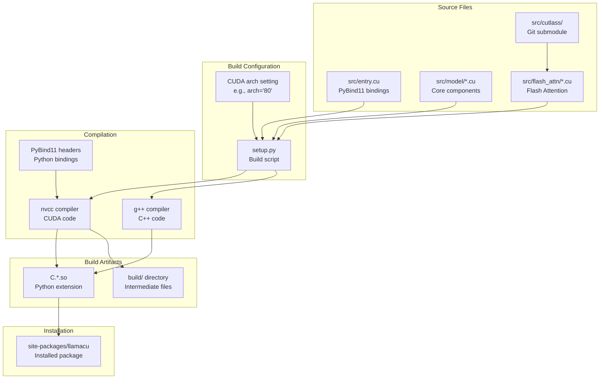
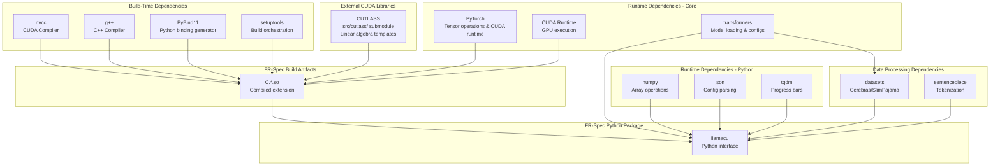
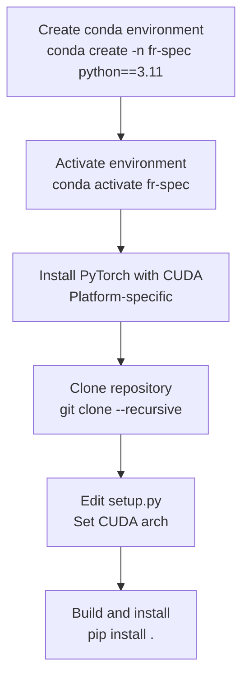

<!-- source: DeepWiki mcp.deepwiki.com · repo thunlp/FR-Spec · page 10 Build System and Dependencies · fetched 2026-11-02 -->

# Build System and Dependencies

<details>
<summary>Relevant source files</summary>

The following files were used as context for generating this wiki page:

- [.gitignore](.gitignore)
- [.gitmodules](.gitmodules)
- [README.md](README.md)
- [models/.gitkeep](models/.gitkeep)
- [src/flash_attn/flash_api.hpp](src/flash_attn/flash_api.hpp)

</details>


This page documents the FR-Spec build system, including the compilation process for C++/CUDA components, external dependencies, and CUDA architecture configuration. This covers the toolchain setup, PyBind11 integration, and dependency management required to build and run FR-Spec.

For information about the CUTLASS library specifically, see [CUTLASS Integration](#10.1). For the overall project organization, see [Project Structure](#10.2).

## Purpose and Scope

FR-Spec uses a hybrid Python/C++/CUDA architecture requiring careful build configuration. The build system compiles high-performance CUDA kernels and wraps them in a Python extension module using PyBind11. This page covers:

- Build process and setup.py configuration
- Required dependencies and their roles
- CUDA compute architecture configuration
- Installation procedures and build artifacts

---

## Build Process Overview

The FR-Spec build system follows a standard Python extension module pattern with CUDA compilation. The process transforms C++/CUDA source files into a loadable Python module.



**Build Process Flow:**

The build begins with `setup.py`, which orchestrates compilation of all CUDA and C++ source files. The CUTLASS submodule provides optimized linear algebra templates used by Flash Attention. PyBind11 headers enable C++/CUDA functions to be called from Python. The CUDA architecture setting must match the target GPU's compute capability. Compilation produces intermediate files in `build/` and a final `.so` shared library that gets installed into the Python environment.

Sources: [README.md:42-50](), [.gitmodules:1-4](), [src/flash_attn/flash_api.hpp:1-10]()

---

## Build Configuration

The build is configured through `setup.py`, which must be edited before installation to specify the CUDA compute architecture.

### CUDA Architecture Setting

The most critical configuration is the CUDA compute architecture (`arch` parameter). This must match your GPU's compute capability:

| GPU Family | Example Models | Compute Capability | arch Setting |
|-----------|---------------|-------------------|--------------|
| Ampere | A100, A30, A10 | 8.0 | `arch="80"` |
| Ada Lovelace | RTX 4090, L40 | 8.9 | `arch="89"` |
| Hopper | H100, H200 | 9.0 | `arch="90"` |
| Turing | RTX 2080, T4 | 7.5 | `arch="75"` |
| Volta | V100 | 7.0 | `arch="70"` |

**Configuration in setup.py:**

The user must manually edit `setup.py` and modify the `arch` parameter before running `pip install`. This setting is passed to the CUDA compiler and affects kernel optimization.

```
# From README.md installation instructions:
vim setup.py # change arch="80" to other code for your platform
```

**Finding Your GPU's Compute Capability:**

Reference: https://developer.nvidia.com/cuda-gpus#compute

The incorrect architecture setting will result in:
- Runtime errors if too high for the GPU
- Suboptimal performance if too low (missing optimizations)
- Compilation failures if invalid

Sources: [README.md:48]()

---

## Dependency Graph

FR-Spec has dependencies at three layers: build-time, runtime, and data processing.



Sources: [README.md:42-50](), [.gitmodules:1-4]()

---

## Core Dependencies

### PyTorch and CUDA

**PyTorch** serves multiple critical roles:
- Provides the CUDA runtime and memory management
- Supplies tensor data structures for Python-C++ interop
- Handles device synchronization and stream management
- Must be installed with CUDA support matching the system's CUDA version

Installation varies by platform (see https://pytorch.org):

```bash
# Example for CUDA 11.8
pip install torch --index-url https://download.pytorch.org/whl/cu118
```

The C++/CUDA code uses PyTorch's C++ API headers for tensor manipulation and CUDA kernel launches.

Sources: [README.md:46]()

### PyBind11

**PyBind11** generates the Python bindings that expose C++/CUDA functions to Python. It handles:
- Type conversion between Python and C++ types
- Memory management across the Python-C++ boundary
- Exception translation
- Documentation string generation

The entry point is in `src/entry.cu`, which uses PyBind11 macros to define the Python module interface. PyBind11 is included automatically when building with setuptools.

Sources: [README.md:49]()

### HuggingFace Transformers

The **transformers** library provides:
- Model weight loading from HuggingFace Hub
- Configuration management (AutoConfig)
- Tokenizer interfaces
- Pre-trained model compatibility

FR-Spec loads base model weights and EAGLE drafter weights using the transformers library, then transfers them to the custom CUDA implementation.

Sources: [README.md:62-64]()

### Data Processing Libraries

For token frequency analysis (see [Token Frequency Analysis](#6.1)):

**datasets (Cerebras):**
- Provides access to SlimPajama corpus
- Used by `fr/fr.py` to analyze token distributions
- Required only for generating new frequency statistics

**sentencepiece:**
- Tokenization for text processing
- Model-specific tokenizer loading

These dependencies are only needed when generating new token frequency files, not for inference.

Sources: [README.md:68-82]()

---

## CUTLASS Integration

CUTLASS is NVIDIA's collection of CUDA C++ template abstractions for high-performance linear algebra. FR-Spec uses CUTLASS for optimized GEMM (General Matrix Multiply) operations in Flash Attention.

### Submodule Configuration

CUTLASS is included as a Git submodule:


**Submodule Initialization:**

The `--recursive` flag during cloning ensures CUTLASS is fetched:

```bash
git clone https://github.com/thunlp/FR-Spec.git --recursive
```

If cloned without `--recursive`:

```bash
git submodule update --init --recursive
```

Sources: [.gitmodules:1-4](), [README.md:47]()

### CUTLASS Usage in Flash Attention

Flash Attention kernels use CUTLASS for:
- Optimized matrix multiplication templates
- Numeric type conversions (FP16, BF16)
- Memory layout transformations
- Tensor core utilization

The header `src/flash_attn/flash_api.hpp` includes CUTLASS types:

```cpp
#include <cutlass/numeric_types.h>  // Line 7
```

CUTLASS provides the `cutlass::half_t` and related types used throughout the Flash Attention implementation for mixed-precision computation.

Sources: [src/flash_attn/flash_api.hpp:7]()

---

## Installation Process

### Step-by-Step Installation

The installation follows a standard Python package build workflow:



**Complete Installation Commands:**

```bash
# 1. Create environment
conda create -n fr-spec python==3.11 && conda activate fr-spec

# 2. Install PyTorch (see https://pytorch.org for your platform)
# Example for CUDA 11.8:
pip install torch --index-url https://download.pytorch.org/whl/cu118

# 3. Clone with submodules
git clone https://github.com/thunlp/FR-Spec.git --recursive && cd FR-Spec

# 4. Configure CUDA architecture
vim setup.py  # Change arch="80" to match your GPU

# 5. Build and install
pip install .
```

Sources: [README.md:42-50]()

### Build Artifacts

The build process generates several artifacts:

| Artifact | Location | Purpose |
|----------|----------|---------|
| Compiled module | `C.cpython-*.so` | Python extension library |
| Intermediate objects | `build/temp.*/` | Compiled `.o` and `.cu.o` files |
| Build metadata | `build/lib.*/` | Staging area for installation |
| Installed package | `site-packages/llamacu/` | Final Python package |

The `.gitignore` file excludes these build artifacts from version control:

```
build/          # Build directory
*.so            # Shared objects
dist/           # Distribution packages
*.egg-info/     # Package metadata
```

Sources: [.gitignore:10-28](), [.gitignore:165]()

---

## Directory Structure and Build Relevance

The repository is organized to separate source code, build configuration, and runtime assets:

```mermaid
graph TB
    ROOT["FR-Spec/<br/>Repository root"]
    
    subgraph "Source Code (Compiled)"
        SRC["src/<br/>C++/CUDA source"]
        ENTRY["src/entry.cu<br/>PyBind11 module entry"]
        MODEL_SRC["src/model/<br/>Core components"]
        FLASH_SRC["src/flash_attn/<br/>Flash Attention"]
        CUTLASS_SRC["src/cutlass/<br/>Submodule"]
    end
    
    subgraph "Python Package (Not Compiled)"
        LLAMACU["llamacu/<br/>Python wrapper"]
        FR["fr/<br/>Token frequency tools"]
    end
    
    subgraph "Build Configuration"
        SETUP["setup.py<br/>Build script"]
        GIT_MODULES[".gitmodules<br/>Submodule config"]
    end
    
    subgraph "Runtime Assets"
        MODELS["models/<br/>Model weights<br/>(user-provided)"]
        EXAMPLES["examples/<br/>Usage scripts"]
        SCRIPTS["scripts/<br/>Evaluation"]
    end
    
    subgraph "Build Artifacts (Ignored)"
        BUILD["build/<br/>Intermediate files"]
        DIST["dist/<br/>Distribution packages"]
        SO["*.so<br/>Compiled extensions"]
    end
    
    ROOT --> SRC
    ROOT --> LLAMACU
    ROOT --> FR
    ROOT --> SETUP
    ROOT --> GIT_MODULES
    ROOT --> MODELS
    ROOT --> EXAMPLES
    ROOT --> SCRIPTS
    ROOT --> BUILD
    ROOT --> DIST
    ROOT --> SO
    
    SRC --> ENTRY
    SRC --> MODEL_SRC
    SRC --> FLASH_SRC
    SRC --> CUTLASS_SRC
```



### Compiled vs. Interpreted Components

**Compiled during build:**
- `src/entry.cu` - Main PyBind11 entry point
- `src/model/*.cu` - ModelImpl, EagleImpl, Attention, FFN, Layer
- `src/flash_attn/*.cu` - Flash Attention kernels
- CUTLASS templates (header-only, compiled into usage sites)

**Interpreted at runtime:**
- `llamacu/*.py` - Python API (LLM, LLM_with_eagle classes)
- `fr/fr.py` - Token frequency analysis script
- `examples/*.py` - Usage examples
- `scripts/*.sh` - Evaluation automation

### Ignored Directories

The `.gitignore` excludes runtime and build artifacts:

**Model weights** (`models/*`): Too large for Git, user must download separately from HuggingFace or other sources.

**Build artifacts** (`build/`, `dist/`, `*.so`): Generated during compilation, platform-specific.

**Python bytecode** (`__pycache__/`, `*.pyc`): Generated at runtime.

**Checkpoints** (`checkpoints/*`): Generated during training/fine-tuning.

These exclusions keep the repository focused on source code.

Sources: [.gitignore:1-219](), [models/.gitkeep:1]()

---

## Development and Testing Dependencies

For development and evaluation, additional dependencies are required beyond core inference:

### Evaluation Frameworks

| Package | Purpose | Required For |
|---------|---------|--------------|
| `human-eval` | Code generation benchmark | Code correctness evaluation |
| `datasets` | Dataset loading | Benchmark data access |
| `evaluate` | Metric computation | Pass@k, BLEU, etc. |

### Development Tools

| Tool | Purpose |
|------|---------|
| `pytest` | Unit testing (if present) |
| `black` / `clang-format` | Code formatting |
| `cuda-gdb` | CUDA kernel debugging |
| `nsys` / `nvprof` | Performance profiling |

These are not required for basic inference but are needed to run the evaluation scripts in `scripts/`.

Sources: [README.md:95-112]()

---

## Common Build Issues and Solutions

### Issue: Wrong CUDA Architecture

**Symptom:** Runtime error about unsupported compute capability

**Solution:** Edit `setup.py` and set `arch` to match your GPU. Verify with:
```bash
nvidia-smi --query-gpu=compute_cap --format=csv
```

### Issue: CUTLASS Submodule Missing

**Symptom:** Build error about missing `cutlass/` headers

**Solution:** Initialize submodules:
```bash
git submodule update --init --recursive
```

### Issue: PyTorch CUDA Mismatch

**Symptom:** Import error about CUDA version mismatch

**Solution:** Ensure PyTorch's CUDA version matches system CUDA:
```bash
python -c "import torch; print(torch.version.cuda)"
nvcc --version
```

### Issue: Compilation Memory Exhaustion

**Symptom:** Build hangs or crashes during NVCC compilation

**Solution:** Limit parallel builds:
```bash
pip install . -v --no-build-isolation -j 4
```

Sources: [README.md:48]()

---

## Build System Comparison

FR-Spec's build approach follows common patterns for CUDA-accelerated Python packages:

| Project | Build Tool | CUDA Integration | Python Binding |
|---------|-----------|------------------|----------------|
| FR-Spec | setuptools + nvcc | Direct CUDA compilation | PyBind11 |
| PyTorch | CMake + setuptools | Custom build system | PyBind11 + C10 |
| Flash-Attention-2 | setuptools + nvcc | Similar to FR-Spec | PyBind11 |
| xFormers | setuptools + CMake | Hybrid build | PyBind11 |

FR-Spec's approach is straightforward: `setup.py` directly invokes `nvcc` for CUDA files and uses setuptools' native extension building. This simplicity aids debugging but requires manual CUDA architecture configuration.

---

## Summary

The FR-Spec build system compiles high-performance CUDA kernels into a Python extension module. Key requirements:

1. **CUDA architecture must be configured** in `setup.py` before installation
2. **CUTLASS submodule must be initialized** via `git clone --recursive`
3. **PyTorch with CUDA support** must match the system CUDA version
4. **HuggingFace transformers** provides model weight loading
5. **Build artifacts** are platform-specific and excluded from version control

The build process produces a `C.*.so` shared library that the `llamacu` Python package imports, exposing CUDA-accelerated inference functions to Python code.

Sources: [README.md:42-50](), [.gitmodules:1-4](), [.gitignore:1-219]()

---

