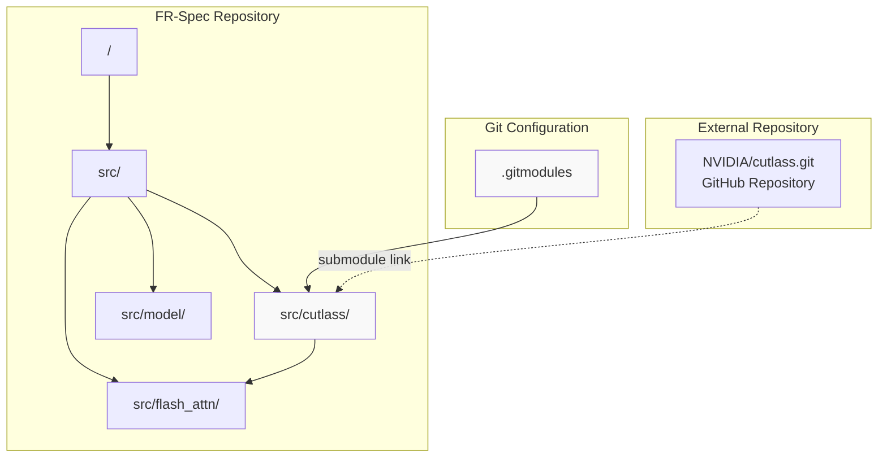
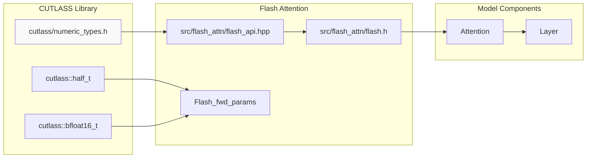
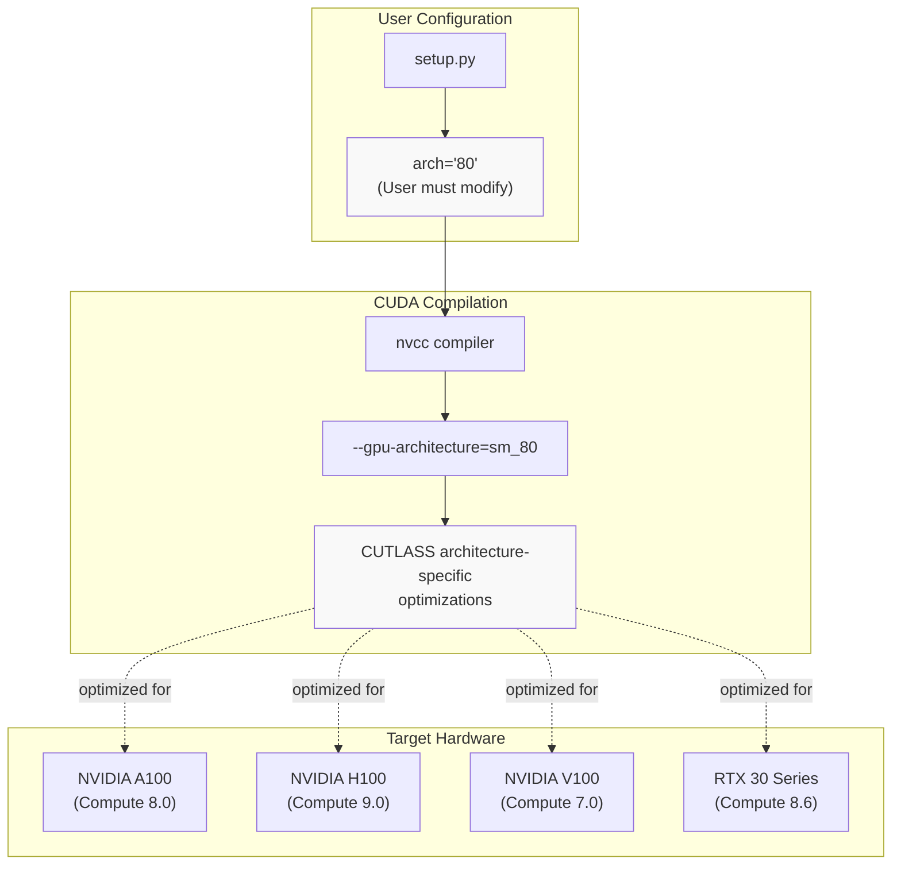
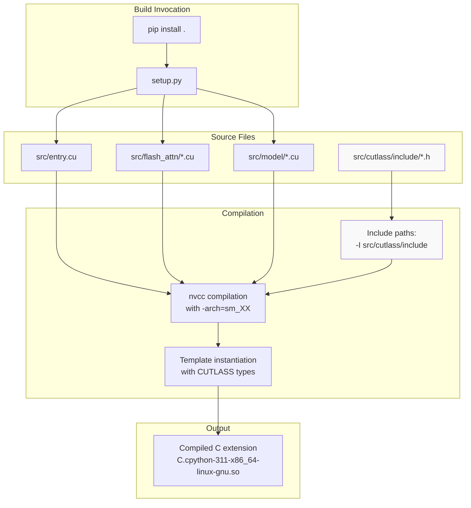
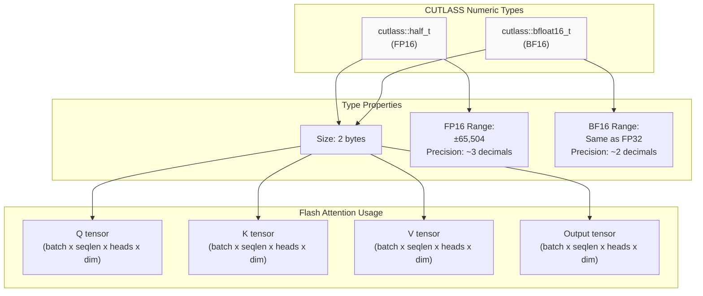
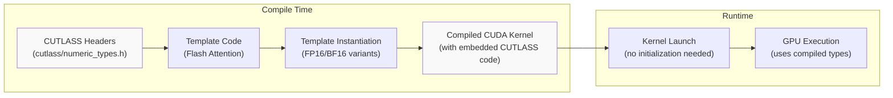

<!-- source: DeepWiki mcp.deepwiki.com · repo thunlp/FR-Spec · page 10.1 CUTLASS Integration · fetched 2026-11-02 -->

# CUTLASS Integration

<details>
<summary>Relevant source files</summary>

The following files were used as context for generating this wiki page:

- [.gitmodules](.gitmodules)
- [README.md](README.md)
- [src/flash_attn/flash_api.hpp](src/flash_attn/flash_api.hpp)

</details>


## Purpose and Scope

This document describes how NVIDIA CUTLASS (CUDA Templates for Linear Algebra Subroutines) is integrated into the FR-Spec codebase. CUTLASS provides optimized CUDA template libraries for high-performance linear algebra operations that are critical to the Flash Attention implementation. This page covers the submodule setup, build configuration, and how CUTLASS types and primitives are used throughout the CUDA kernel layer.

For information about the Flash Attention kernels that use CUTLASS, see [7.1](#7.1). For overall build system configuration, see [10](#10).

---

## CUTLASS Overview

CUTLASS is NVIDIA's collection of CUDA C++ template abstractions for implementing high-performance matrix multiplication (GEMM) and related computations on NVIDIA GPUs. In FR-Spec, CUTLASS serves as a foundational library that provides:

- **Numeric Types**: Data type abstractions for FP16, BF16, and other precision formats
- **Memory Layout Templates**: Efficient tensor memory layout patterns
- **Optimized Linear Algebra Primitives**: High-performance GEMM kernels
- **CUDA Best Practices**: Architecture-specific optimizations for different GPU compute capabilities

The library is particularly critical for the Flash Attention implementation, which requires precise control over data types and memory access patterns to achieve optimal performance.

**Sources:** [README.md:1-140](), [src/flash_attn/flash_api.hpp:1-305]()

---

## Integration Architecture

CUTLASS is integrated into FR-Spec as a Git submodule, allowing the codebase to track a specific version of the library while keeping the repository size manageable.

### Submodule Configuration



**Diagram: CUTLASS Submodule Structure**

The submodule configuration is defined in the repository root:

| Configuration File | Path | Purpose |
|-------------------|------|---------|
| `.gitmodules` | Repository root | Defines submodule URL and local path |
| `src/cutlass/` | Source directory | Local checkout of CUTLASS library |

The `.gitmodules` file specifies:
- **Submodule name**: `src/cutlass`
- **Remote URL**: `https://github.com/NVIDIA/cutlass.git`
- **Local path**: `src/cutlass`

**Sources:** [.gitmodules:1-4]()

### Cloning with Submodules

When users clone the FR-Spec repository, they must use the `--recursive` flag to automatically initialize and fetch the CUTLASS submodule:

```bash
git clone https://github.com/thunlp/FR-Spec.git --recursive
```

This ensures that the `src/cutlass/` directory is populated with the CUTLASS library code. Without the `--recursive` flag, the directory will exist but be empty, causing compilation failures.

**Sources:** [README.md:47]()

---

## CUTLASS Usage in Flash Attention

The primary use of CUTLASS in FR-Spec is within the Flash Attention implementation. CUTLASS provides the numeric type definitions and memory layout abstractions that Flash Attention requires for its optimized attention computation.

### Numeric Type Integration



**Diagram: CUTLASS Type Usage Flow**

The Flash Attention API includes CUTLASS numeric types at the top of its header file:

```cpp
#include <cutlass/numeric_types.h>
```

This include provides access to:
- `cutlass::half_t` - FP16 (half-precision floating point) type
- `cutlass::bfloat16_t` - BF16 (brain floating point) type
- Conversion utilities between different precision formats
- Arithmetic operations optimized for each type

**Sources:** [src/flash_attn/flash_api.hpp:7]()

### Precision Format Selection

The Flash Attention implementation supports both FP16 and BF16 precision formats. The `is_bf16` parameter controls which numeric type is used throughout the computation:

| Parameter | CUTLASS Type | Use Case |
|-----------|--------------|----------|
| `is_bf16 = false` | `cutlass::half_t` | Standard FP16 precision |
| `is_bf16 = true` | `cutlass::bfloat16_t` | BF16 for better numerical stability |

The precision selection is configured when setting up Flash Attention parameters:

```cpp
void set_params_fprop(Flash_fwd_params &params,
                      bool is_bf16,
                      // ... other parameters
```

The `is_bf16` flag is stored in the parameters structure and used throughout the attention computation to dispatch to the appropriate CUTLASS-optimized kernels.

**Sources:** [src/flash_attn/flash_api.hpp:13-46]()

### Template Dispatch with FP16_SWITCH

The Flash Attention kernel launcher uses a compile-time template mechanism to dispatch to the correct precision:

```cpp
void run_mha_fwd(Flash_fwd_params &params, cudaStream_t stream, bool force_split_kernel=false) {
    FP16_SWITCH(!params.is_bf16, [&] {
        HEADDIM_SWITCH(params.d, [&] {
            BOOL_SWITCH(params.is_causal, Is_causal, [&] {
                // ... kernel dispatch
            });
        });
    });
}
```

The `FP16_SWITCH` macro (defined in Flash Attention's static switch utilities) selects the CUTLASS numeric type at compile time:
- If `!params.is_bf16` is true → uses `cutlass::half_t` (FP16)
- If `!params.is_bf16` is false → uses `cutlass::bfloat16_t` (BF16)

This template-based approach allows the compiler to generate specialized code for each precision format, maximizing performance by eliminating runtime type checks.

**Sources:** [src/flash_attn/flash_api.hpp:133-145]()

---

## CUDA Architecture Configuration

CUTLASS templates are highly optimized for specific GPU architectures. The build system must be configured to target the correct compute capability for optimal performance.

### Architecture Specification



**Diagram: CUDA Architecture Configuration Flow**

Before building FR-Spec, users must edit `setup.py` to specify their GPU's compute capability:

```bash
vim setup.py # change arch="80" to other code for your platform
```

Common compute capability values:

| GPU Architecture | Compute Capability | arch Value |
|-----------------|-------------------|------------|
| NVIDIA V100 | 7.0 | "70" |
| NVIDIA A100 | 8.0 | "80" |
| RTX 30 Series (e.g., 3090) | 8.6 | "86" |
| NVIDIA H100 | 9.0 | "90" |

The architecture specification is critical because CUTLASS templates include architecture-specific optimizations:
- **Tensor Core Usage**: Different generations have different tensor core capabilities
- **Shared Memory Size**: Architecture-dependent memory configurations
- **Warp-level Primitives**: Generation-specific instruction sets
- **Register Allocation**: Optimal register usage varies by architecture

Setting the wrong architecture may result in:
- Compilation errors if features are unavailable
- Suboptimal performance if optimizations don't match the hardware
- Runtime errors if instructions are not supported

**Sources:** [README.md:48]()

---

## Build Process Integration

CUTLASS is compiled as part of the FR-Spec build process through the Python extension module build system.

### Compilation Flow



**Diagram: CUTLASS Build Integration**

The build process:

1. **Include Path Setup**: `setup.py` adds `src/cutlass/include/` to the compiler's include path
2. **Header Resolution**: When Flash Attention source files include `<cutlass/numeric_types.h>`, the compiler finds it in the CUTLASS submodule
3. **Template Instantiation**: CUTLASS templates are instantiated during compilation based on the types used in Flash Attention
4. **Architecture-Specific Code Generation**: The NVCC compiler generates optimized code for the specified GPU architecture
5. **Linking**: The compiled CUDA code is linked into a Python extension module (`.so` file)

The build system does not link against pre-built CUTLASS binaries. Instead, CUTLASS is a header-only template library, so all CUTLASS code is compiled directly into the FR-Spec extension module.

**Sources:** [README.md:42-50]()

---

## Memory Layout and Data Types

CUTLASS provides sophisticated memory layout abstractions that the Flash Attention implementation leverages for optimal memory access patterns.

### Data Type Properties



**Diagram: CUTLASS Data Types in Attention Tensors**

The choice between FP16 and BF16 affects both memory usage and numerical behavior:

| Property | FP16 (`cutlass::half_t`) | BF16 (`cutlass::bfloat16_t`) |
|----------|--------------------------|------------------------------|
| Exponent bits | 5 | 8 (same as FP32) |
| Mantissa bits | 10 | 7 |
| Dynamic range | ±65,504 | Same as FP32 |
| Precision | Higher for small values | Better for large values |
| Overflow risk | Higher | Lower |
| Conversion from FP32 | Lossy | Truncation (simpler) |

BF16 is often preferred for LLM inference because:
- It maintains FP32's dynamic range, reducing overflow issues
- Conversion from FP32 weights is simpler (just truncate mantissa)
- Modern GPUs (Ampere and later) have native BF16 tensor core support

**Sources:** [src/flash_attn/flash_api.hpp:46]()

---

## Parameter Configuration with CUTLASS Types

The Flash Attention parameter structure stores pointers and metadata using CUTLASS-compatible data types.

### Flash_fwd_params Structure

The `Flash_fwd_params` structure holds all parameters needed for the attention forward pass. While the structure definition is not shown in the provided files, we can infer its usage from the parameter setup function:

```cpp
void set_params_fprop(Flash_fwd_params &params,
                      bool is_bf16,
                      // ... sizes
                      const size_t b,
                      const size_t seqlen_q,
                      const size_t seqlen_k,
                      // ... device pointers
                      void* q,
                      void* k,
                      void* v,
                      void* out,
                      // ... other parameters
```

Key aspects of parameter configuration:

1. **Type Flag Storage**: The `is_bf16` flag is stored in `params.is_bf16` to indicate which CUTLASS numeric type should be used
2. **Void Pointers**: Input/output tensors are passed as `void*` pointers, allowing the same interface for both FP16 and BF16
3. **Type Dispatch**: The actual type is resolved at kernel launch time through template specialization

**Sources:** [src/flash_attn/flash_api.hpp:13-131]()

### Stride and Layout Configuration

CUTLASS requires precise stride information for tensor layouts:

```cpp
params.q_row_stride = h * d;      // Stride between consecutive rows in Q
params.k_row_stride = h_k * d;    // Stride between consecutive rows in K
params.v_row_stride = h_k * d;    // Stride between consecutive rows in V
params.q_head_stride = d;         // Stride between heads in Q
params.k_head_stride = d;         // Stride between heads in K
params.v_head_stride = d;         // Stride between heads in V
```

These strides define the memory layout:
- **Row stride**: Distance (in elements) between the start of one sequence position and the next
- **Head stride**: Distance between the start of one attention head and the next
- **Batch stride**: Distance between different batch elements (set conditionally based on contiguous memory assumption)

CUTLASS uses these stride values to generate efficient memory access patterns that maximize memory bandwidth utilization and cache locality.

**Sources:** [src/flash_attn/flash_api.hpp:53-72]()

---

## Initialization and Runtime Behavior

CUTLASS does not require explicit initialization at runtime. As a template library, all CUTLASS functionality is instantiated at compile time and embedded directly into the compiled kernels.

### No Runtime Initialization Required

Unlike some GPU libraries that require initialization calls (e.g., cuBLAS with `cublasCreate`), CUTLASS types and templates are purely compile-time constructs:



**Diagram: CUTLASS Compile-Time vs Runtime Behavior**

This compile-time-only approach provides several benefits:
- **Zero Runtime Overhead**: No initialization or teardown cost
- **Static Optimization**: All CUTLASS code is fully optimized by the compiler
- **Type Safety**: Type checking happens at compile time
- **No Library Versioning Issues**: CUTLASS code is embedded in the binary

**Sources:** [src/flash_attn/flash_api.hpp:1-305]()

---

## Version and Compatibility

The specific version of CUTLASS used by FR-Spec is determined by the Git submodule commit hash. Users can verify or update the CUTLASS version:

```bash
# Check current CUTLASS version
cd src/cutlass
git log -1

# Update to latest CUTLASS (if needed)
git pull origin main
cd ../..
git add src/cutlass
git commit -m "Update CUTLASS submodule"
```

### Compatibility Considerations

When updating CUTLASS or modifying the integration:

1. **CUDA Version**: Ensure CUTLASS version is compatible with the installed CUDA toolkit
2. **GPU Architecture**: Newer CUTLASS versions may require newer GPU architectures
3. **API Stability**: CUTLASS APIs can change between versions; Flash Attention code may need updates
4. **Template Compilation Time**: Newer CUTLASS versions with more features may increase compile times

The FR-Spec repository pins a specific CUTLASS commit that has been tested for compatibility with the Flash Attention implementation and target GPU architectures.

**Sources:** [.gitmodules:1-4](), [README.md:47]()

---

## Summary

CUTLASS integration in FR-Spec is structured as follows:

| Aspect | Implementation |
|--------|---------------|
| **Integration Method** | Git submodule at `src/cutlass/` |
| **Primary Use Case** | Numeric types for Flash Attention (FP16/BF16) |
| **Compilation Model** | Header-only template library, compiled into extension module |
| **Configuration Required** | CUDA architecture specification in `setup.py` |
| **Runtime Initialization** | None required (compile-time only) |
| **Version Control** | Pinned submodule commit |

The CUTLASS integration is essential for FR-Spec's high-performance attention computation, providing the numeric type infrastructure and memory layout abstractions that enable the Flash Attention implementation to achieve optimal GPU utilization.

**Sources:** [.gitmodules:1-4](), [src/flash_attn/flash_api.hpp:1-305](), [README.md:42-50]()

---

