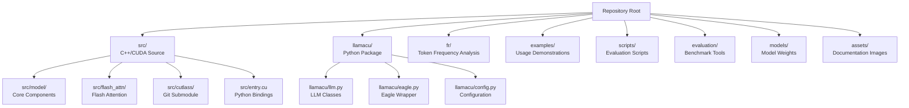
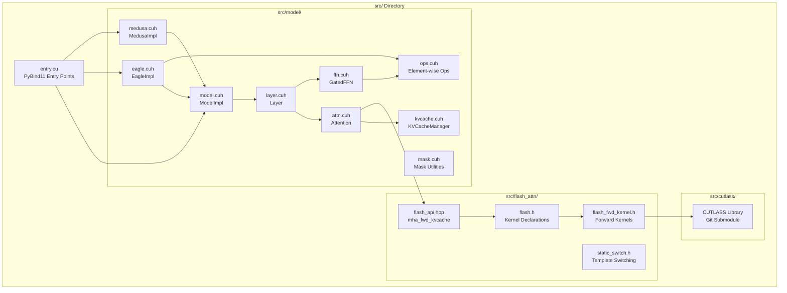
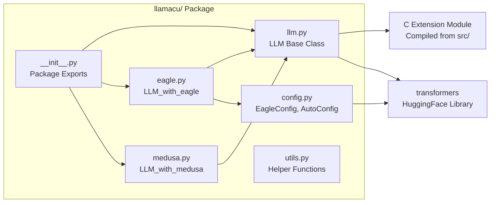
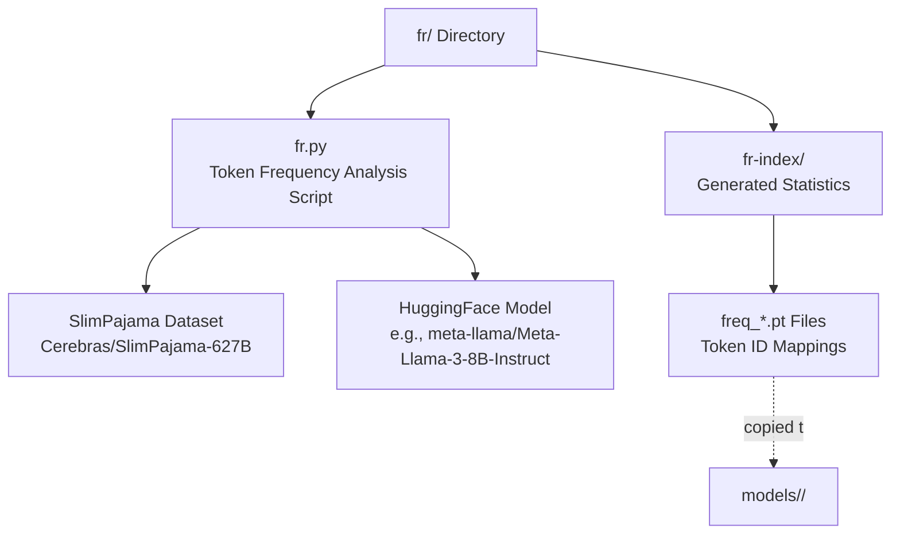
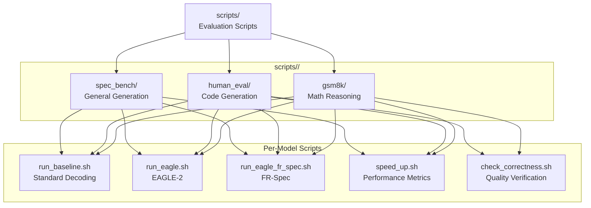
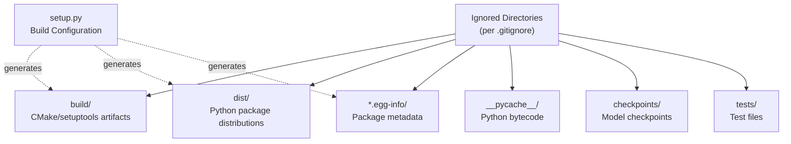
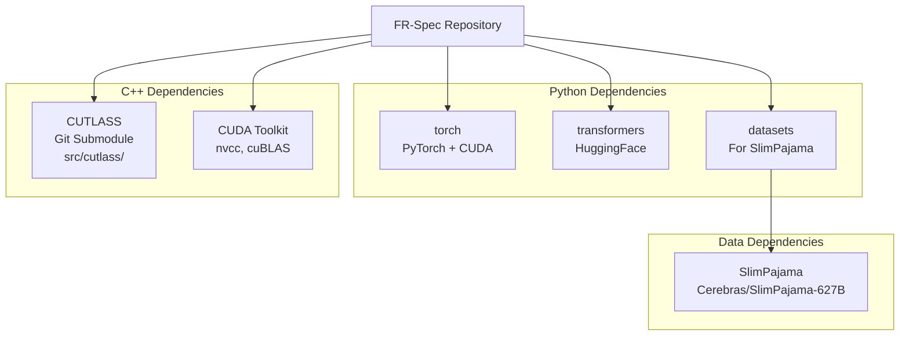

<!-- source: DeepWiki mcp.deepwiki.com · repo thunlp/FR-Spec · page 10.2 Project Structure · fetched 2026-11-02 -->

# Project Structure

<details>
<summary>Relevant source files</summary>

The following files were used as context for generating this wiki page:

- [.gitignore](.gitignore)
- [README.md](README.md)
- [models/.gitkeep](models/.gitkeep)
- [src/flash_attn/flash_api.hpp](src/flash_attn/flash_api.hpp)

</details>


This document provides an overview of the FR-Spec repository organization, describing the purpose of each directory and how components are organized. For information about the build process and compilation, see [Build System and Dependencies](#10). For details on CUTLASS integration specifically, see [CUTLASS Integration](#10.1).

## Repository Layout Overview

The FR-Spec repository follows a hybrid architecture with C++/CUDA implementation wrapped in Python interfaces. The structure separates source code, Python packages, evaluation scripts, and external dependencies into distinct directories.



**Sources:** [README.md:1-140](), [.gitignore:1-219]()

## Source Directory (src/)

The `src/` directory contains all C++/CUDA implementation code. This is the performance-critical layer compiled into a Python extension module.

### C++/CUDA Components



**Sources:** [README.md:42-50](), [src/flash_attn/flash_api.hpp:1-305]()

### Key Source Files

| File Path | Purpose |
|-----------|---------|
| `src/entry.cu` | PyBind11 module definition, provides `init_base_model`, `init_eagle_model`, `prefill`, `decode`, `draft`, `verify` functions |
| `src/model/model.cuh` | `ModelImpl` class - base transformer implementation |
| `src/model/eagle.cuh` | `EagleImpl` class - speculative drafter with tree building |
| `src/model/medusa.cuh` | `MedusaImpl` class - alternative multi-head drafter |
| `src/model/attn.cuh` | `Attention` class - multi-head attention with RoPE |
| `src/model/ffn.cuh` | `GatedFFN` class - gated feed-forward network |
| `src/model/layer.cuh` | `Layer` class - transformer block combining attention and FFN |
| `src/model/kvcache.cuh` | `KVCacheManager` - manages key-value cache memory |
| `src/flash_attn/flash_api.hpp` | `mha_fwd_kvcache` - Flash Attention API wrapper |
| `src/flash_attn/flash_fwd_kernel.h` | CUDA kernel implementations for Flash Attention |
| `src/cutlass/` | NVIDIA CUTLASS library (Git submodule) for optimized linear algebra |

**Sources:** [README.md:128](), [src/flash_attn/flash_api.hpp:5-6]()

## Python Package (llamacu/)

The `llamacu/` directory is the Python package that wraps the compiled C extension and provides high-level APIs for text generation.



**Sources:** [README.md:49]()

### Python Module Organization

| File | Primary Classes/Functions | Purpose |
|------|---------------------------|---------|
| `llamacu/llm.py` | `LLM` class | Base model interface with `prefill()`, `decode()`, `generate()` methods |
| `llamacu/eagle.py` | `LLM_with_eagle` class | Extends `LLM` with `draft()` and `verify()` for speculative decoding |
| `llamacu/medusa.py` | `LLM_with_medusa` class | Alternative speculative decoding with Medusa heads |
| `llamacu/config.py` | `EagleConfig`, `AutoConfig` | Configuration classes compatible with HuggingFace `transformers` |
| `llamacu/utils.py` | Utility functions | Helper functions for weight loading, tokenization |

**Sources:** [README.md:1-140]()

## Data Processing (fr/)

The `fr/` directory contains tools for generating token frequency statistics from corpora, which enable the FR-Spec optimization.



**Sources:** [README.md:59-84]()

### Token Frequency Analysis Workflow

The `fr.py` script performs the following operations:

1. Loads a language model tokenizer from HuggingFace
2. Processes `num_lines` from the SlimPajama dataset
3. Counts token frequencies across the corpus
4. Ranks tokens by frequency
5. Generates `freq_<vocab_size>.pt` files for each specified vocabulary size (e.g., 8192, 16384, 32768, 65536)

**Command-line interface:**
```bash
python fr.py --model_name <name> --model_path <path> --num_lines <n> --vocab_size <sizes>
```

**Sources:** [README.md:66-82]()

## Examples and Usage Demonstrations (examples/)

The `examples/` directory contains sample scripts demonstrating how to use FR-Spec for text generation.

| File | Purpose |
|------|---------|
| `examples/example_generate.py` | Basic text generation example using `LLM_with_eagle` class |

**Usage:**
```bash
cd examples
python example_generate.py
```

**Sources:** [README.md:88-93]()

## Evaluation Infrastructure (scripts/ and evaluation/)

The repository includes comprehensive evaluation infrastructure for benchmarking FR-Spec against baselines.

### Scripts Directory Structure



**Sources:** [README.md:97-112]()

### Evaluation Directory

The `evaluation/` directory contains benchmark implementations and evaluation utilities, modified from [Spec-Bench](https://github.com/hemingkx/Spec-Bench).

| Component | Description |
|-----------|-------------|
| Spec-Bench | General text generation benchmark |
| Human Eval | Code generation evaluation (pass@k metrics) |
| GSM8K | Mathematical reasoning evaluation (accuracy metrics) |

**Sources:** [README.md:126]()

## Model Storage (models/)

The `models/` directory stores downloaded model weights and token frequency statistics.

### Expected Directory Structure

```
models/
├── meta-llama/
│   └── Meta-Llama-3-8B-Instruct/
│       ├── config.json
│       ├── model-*.safetensors
│       ├── tokenizer.json
│       ├── freq_8192.pt
│       ├── freq_16384.pt
│       ├── freq_32768.pt
│       └── freq_65536.pt
└── .gitkeep
```

The directory is excluded from version control (see [.gitignore:216-217]()) but contains a `.gitkeep` file to maintain the directory structure.

**Download Sources:**
- Base models: HuggingFace model hub (e.g., `meta-llama/Meta-Llama-3-8B-Instruct`)
- FR-Spec statistics: [thunlp/LLaMA3-Instruct-8B-FR-Spec](https://huggingface.co/thunlp/LLaMA3-Instruct-8B-FR-Spec)
- Eagle weights: Loaded from HuggingFace or local paths

**Sources:** [README.md:54-84](), [models/.gitkeep:1](), [.gitignore:216-217]()

## Build Artifacts and Ignored Directories

Several directories are created during build or runtime but excluded from version control.



**Sources:** [.gitignore:1-219]()

### Build Artifacts

| Directory/Pattern | Purpose | Created By |
|-------------------|---------|------------|
| `build/` | Intermediate compilation artifacts | `setup.py` during `pip install` |
| `dist/` | Python package distributions (wheels, sdist) | `setup.py build` commands |
| `*.egg-info/` | Package metadata | setuptools |
| `__pycache__/` | Python bytecode cache | Python interpreter |
| `*.so` | Compiled shared library (C extension) | `setup.py` compilation |

**Sources:** [.gitignore:5-27, 165-219]()

### Runtime Directories

| Directory | Purpose | Status |
|-----------|---------|--------|
| `checkpoints/` | Model training checkpoints (if training) | Exists but ignored (except `.gitkeep`) |
| `tests/` | Test files during development | Exists but ignored |
| `models/` | Downloaded model weights | Exists but ignored (except `.gitkeep`) |

**Sources:** [.gitignore:211-217]()

## Configuration and Documentation Files

### Root-Level Files

| File | Purpose |
|------|---------|
| `README.md` | Main documentation with installation, usage, and citation |
| `setup.py` | Build configuration, specifies CUDA architecture (e.g., `arch="80"`) |
| `.gitignore` | Specifies files/directories excluded from version control |
| `.gitmodules` | Git submodule configuration (for CUTLASS) |
| `LICENSE` | MIT License |

**Sources:** [README.md:1-140]()

## External Dependencies

The project depends on several external libraries and datasets:



**Installation requirements:**
- Python 3.11
- PyTorch with CUDA support
- CUDA-capable GPU (specify architecture in `setup.py`)
- Git with submodule support (`--recursive` clone)

**Sources:** [README.md:42-50]()

## File Type Distribution

The repository contains multiple file types serving different purposes:

| File Type | Location | Purpose |
|-----------|----------|---------|
| `.cu` files | `src/` | CUDA kernel implementations with host code |
| `.cuh` files | `src/model/` | CUDA header files with class definitions |
| `.h`, `.hpp` files | `src/flash_attn/` | C++ header files |
| `.py` files | `llamacu/`, `fr/`, `examples/`, `scripts/` | Python source code |
| `.sh` files | `scripts/` | Shell scripts for evaluation |
| `.pt` files | `models/` | PyTorch tensors with token frequency data |
| `.md` files | Root | Markdown documentation |

**Sources:** [README.md:1-140](), [.gitignore:166-172]()