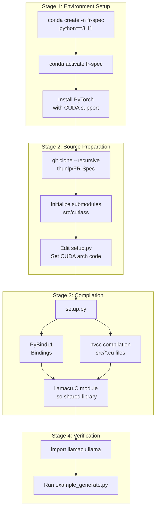
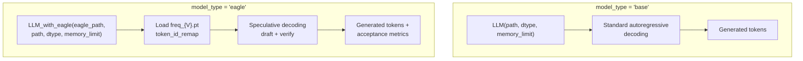
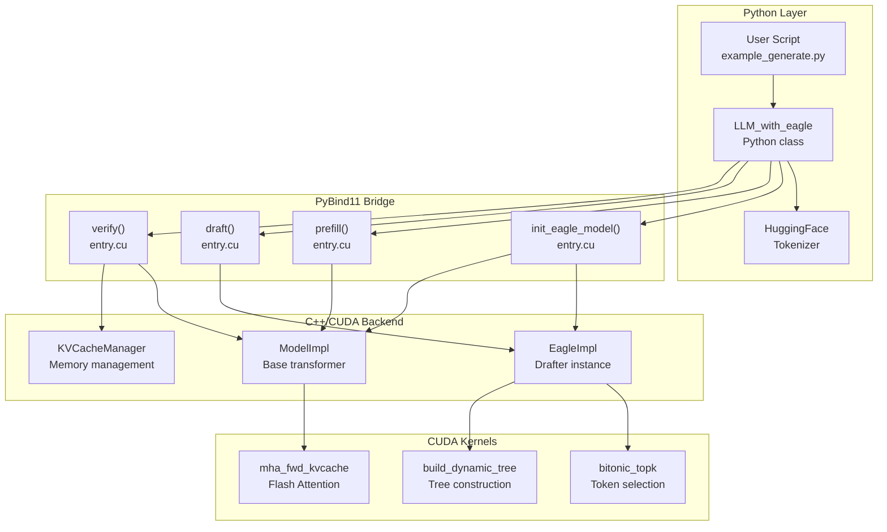

<!-- source: DeepWiki mcp.deepwiki.com · repo thunlp/FR-Spec · page 2 Getting Started · fetched 2026-11-02 -->

# Getting Started

<details>
<summary>Relevant source files</summary>

The following files were used as context for generating this wiki page:

- [README.md](README.md)
- [examples/example_generate.py](examples/example_generate.py)
- [src/flash_attn/flash_api.hpp](src/flash_attn/flash_api.hpp)

</details>


This page guides you through installing FR-Spec, configuring the system for your hardware, and running your first text generation. By the end of this guide, you will have a working FR-Spec installation capable of accelerated inference using frequency-ranked speculative sampling.

For detailed information about specific subsystems, see [Installation](#2.1), [Quick Start Example](#2.2), and [Preparing Token Frequency Statistics](#2.3). For understanding the underlying architecture, see [System Architecture](#3).

---

## Prerequisites

Before installing FR-Spec, ensure your system meets these requirements:

| Requirement | Details |
|------------|---------|
| **Operating System** | Linux (tested on Ubuntu) |
| **GPU** | NVIDIA GPU with CUDA support |
| **CUDA Toolkit** | Compatible with PyTorch version |
| **Python** | 3.11 (recommended) |
| **Disk Space** | ~20GB for models + dependencies |
| **Memory** | 16GB+ RAM recommended |

**Sources:** [README.md:42-50]()

---

## Installation Overview

The FR-Spec installation process involves three main stages: environment setup, source compilation, and dependency resolution. The system uses a hybrid architecture where Python interfaces with a compiled C++/CUDA backend through PyBind11 bindings.



**Sources:** [README.md:42-50]()

---

## Step-by-Step Installation

### 1. Create Python Environment

Create an isolated Conda environment with Python 3.11:

```bash
conda create -n fr-spec python==3.11
conda activate fr-spec
```

### 2. Install PyTorch

Install PyTorch with CUDA support matching your system configuration. Visit https://pytorch.org to generate the appropriate command for your platform.

Example for CUDA 11.8:
```bash
pip install torch torchvision torchaudio --index-url https://download.pytorch.org/whl/cu118
```

### 3. Clone Repository with Submodules

The `--recursive` flag is critical as it initializes the CUTLASS submodule required for Flash Attention:

```bash
git clone https://github.com/thunlp/FR-Spec.git --recursive
cd FR-Spec
```

The CUTLASS submodule provides optimized CUDA templates used in [src/flash_attn/]().

### 4. Configure CUDA Architecture

Edit `setup.py` to specify your GPU's compute capability. This determines which GPU instructions the compiler can use:

```bash
vim setup.py  # Change arch="80" to your GPU's compute capability
```

**CUDA Compute Capability Reference:**

| GPU Architecture | Compute Capability | setup.py Value |
|-----------------|-------------------|----------------|
| A100 | 8.0 | `arch="80"` |
| A10, RTX 3090 | 8.6 | `arch="86"` |
| H100 | 9.0 | `arch="90"` |
| V100 | 7.0 | `arch="70"` |

Find your GPU's compute capability at: https://developer.nvidia.com/cuda-gpus#compute

### 5. Compile and Install

Run the setup script to compile CUDA kernels and create the Python extension module:

```bash
pip install .
```

This compiles:
- [src/entry.cu]() - PyBind11 bindings
- [src/model/]() - Core transformer components
- [src/flash_attn/]() - Flash Attention kernels

The output is a shared library (`llamacu.C.so`) that Python imports as the `C` module.

**Sources:** [README.md:42-50](), [src/flash_attn/flash_api.hpp:1-10]()

---

## First Text Generation Workflow

After installation, the basic workflow for text generation involves four key stages: model initialization, weight loading, storage allocation, and generation.

```mermaid
graph LR
    subgraph "1. Initialize"
        IMPORT["from llamacu.llama<br/>import LLM"]
        CONFIG["AutoConfig.from_pretrained()"]
        TOKENIZER["AutoTokenizer.from_pretrained()"]
        CREATE_LLM["llm = LLM(path, dtype, memory_limit)"]
    end
    
    subgraph "2. Prepare Input"
        PROMPT["prompt = 'Beijing is the'"]
        TOKENIZE["input_ids = tokenizer(prompt)"]
        TO_GPU["input_ids.cuda().int()"]
    end
    
    subgraph "3. Setup Storage"
        INIT_STORAGE["llm.init_storage()"]
        LOAD_WEIGHTS["llm.load_from_hf()"]
    end
    
    subgraph "4. Generate"
        GENERATE["llm.generate(input_ids, num_tokens)"]
        DECODE_OUT["tokenizer.decode(output)"]
    end
    
    IMPORT --> CONFIG
    CONFIG --> TOKENIZER
    TOKENIZER --> CREATE_LLM
    CREATE_LLM --> PROMPT
    PROMPT --> TOKENIZE
    TOKENIZE --> TO_GPU
    TO_GPU --> INIT_STORAGE
    INIT_STORAGE --> LOAD_WEIGHTS
    LOAD_WEIGHTS --> GENERATE
    GENERATE --> DECODE_OUT
```



**Sources:** [examples/example_generate.py:1-46]()

---

## Running the Quick Start Example

The repository includes [examples/example_generate.py]() demonstrating basic usage. Before running it, you must configure the model paths.

### Configuration Parameters

Edit [examples/example_generate.py:6-13]() to set:

| Parameter | Purpose | Example Value |
|-----------|---------|---------------|
| `path` | Base model directory | `"/path/to/Llama-3.2-1B-instruct"` |
| `eagle_path` | Eagle drafter + FR-Spec data | `"/path/to/LLaMA3.2-Instruct-1B-FR-Spec"` |
| `dtype` | Inference precision | `torch.float16` or `torch.bfloat16` |
| `cuda_graph` | Enable CUDA graph optimization | `True` (recommended) |
| `num_generate` | Tokens to generate | `100` |
| `model_type` | Inference mode | `"base"` or `"eagle"` |
| `V` | FR-Spec vocabulary size | `16384`, `32768`, `65536`, or `-1` |

### Model Types Comparison



### Running the Example

After configuring paths:

```bash
cd examples
python example_generate.py
```

**Expected Output (EAGLE mode):**
```
average accept length: 4.23
Beijing is the capital of China and one of the most populous cities...
```

The "average accept length" metric indicates how many tokens are accepted per speculative decoding iteration. Higher values (3-5) indicate effective speculation.

**Sources:** [examples/example_generate.py:1-46]()

---

## Token Frequency Statistics Setup

FR-Spec's core optimization requires token frequency data that determines which vocabulary subset to use during drafting. This data is model-specific and corpus-derived.

### Option 1: Download Pre-computed Statistics

Download pre-computed frequency statistics from HuggingFace:

| Model | HuggingFace Repository |
|-------|------------------------|
| Llama-3-8B-Instruct | [thunlp/LLaMA3-Instruct-8B-FR-Spec](https://huggingface.co/thunlp/LLaMA3-Instruct-8B-FR-Spec) |
| Llama-3.2-1B-Instruct | [thunlp/LLaMA3.2-Instruct-1B-FR-Spec](https://huggingface.co/thunlp/LLaMA3.2-Instruct-1B-FR-Spec) |
| Qwen2-7B-Instruct | [thunlp/Qwen2-7B-Instruct-FR-Spec](https://huggingface.co/thunlp/Qwen2-7B-Instruct-FR-Spec) |

Each repository contains multiple `freq_{vocab_size}.pt` files:
- `freq_8192.pt` - Top 8K most frequent tokens
- `freq_16384.pt` - Top 16K most frequent tokens
- `freq_32768.pt` - Top 32K most frequent tokens
- `freq_65536.pt` - Top 64K most frequent tokens

### Option 2: Generate Custom Statistics

Generate frequency statistics for a different model or corpus using [fr/fr.py]():

```bash
cd fr
python fr.py --model_name llama3-8b-instruct \
             --model_path meta-llama/Meta-Llama-3-8B-Instruct \
             --num_lines 1000000 \
             --vocab_size 16384 32768 65536
```

**Parameters:**
- `--model_name`: Identifier for output files
- `--model_path`: HuggingFace model identifier or local path
- `--num_lines`: SlimPajama corpus lines to analyze (default: 1,000,000)
- `--vocab_size`: List of vocabulary sizes to generate

The script outputs to `fr-index/{model_name}/freq_{vocab_size}.pt`.

### Loading Frequency Data

The frequency data is loaded in [examples/example_generate.py:33-38]():

```python
# Load frequency-ranked token mapping
with open(f'{eagle_path}/freq_{V}.pt', 'rb') as f:
    token_id_remap = torch.tensor(torch.load(f, weights_only=True), 
                                   dtype=torch.int32, device="cpu")

# Register with Eagle implementation
llm._load("token_id_remap", token_id_remap, cls="eagle")
```

The `token_id_remap` tensor maps reduced vocabulary indices to full vocabulary token IDs, enabling the Eagle drafter to compute logits only for the most frequent V tokens.

**Sources:** [README.md:58-84](), [examples/example_generate.py:33-38]()

---

## Component Interaction During Generation

Understanding how components interact during generation helps diagnose issues and optimize performance.



**Sources:** [examples/example_generate.py:1-46](), [src/flash_attn/flash_api.hpp:207-304]()

---

## Verification and Troubleshooting

### Verify Successful Installation

Test that the C module loads correctly:

```python
python -c "from llamacu.llama import LLM; print('Installation successful')"
```

### Common Issues

| Issue | Cause | Solution |
|-------|-------|----------|
| `ImportError: cannot import name 'C'` | Compilation failed or wrong arch | Check setup.py arch setting, reinstall |
| `CUDA out of memory` | Model too large for GPU | Reduce `memory_limit` parameter (e.g., 0.8) |
| `RuntimeError: CUDA error` | Arch mismatch | Verify setup.py arch matches GPU |
| File not found: `freq_*.pt` | Missing frequency data | Download from HuggingFace or run fr.py |
| Low acceptance rate (<2.0) | Vocabulary size mismatch | Try different V values (16384, 32768) |

### Performance Expectations

On A100 GPU with Llama-3-8B-Instruct:

| Method | Tokens/sec | Speedup |
|--------|-----------|---------|
| Baseline | ~45 | 1.0x |
| EAGLE-2 | ~72 | 1.6x |
| FR-Spec (V=32768) | ~81 | 1.8x |

**Sources:** [README.md:17-22]()

---

## Next Steps

After completing this Getting Started guide:

1. **Run Evaluations** - See [Evaluation and Benchmarking](#9) to reproduce paper results
2. **Understand Architecture** - See [System Architecture](#3) for technical details
3. **Optimize Performance** - See [FR-Spec Optimization](#6) for vocabulary tuning
4. **Integrate into Applications** - See [Python API Reference](#8) for programmatic usage

For detailed installation instructions, see [Installation](#2.1). For a walkthrough of the example script, see [Quick Start Example](#2.2). For generating custom frequency statistics, see [Preparing Token Frequency Statistics](#2.3).

---

