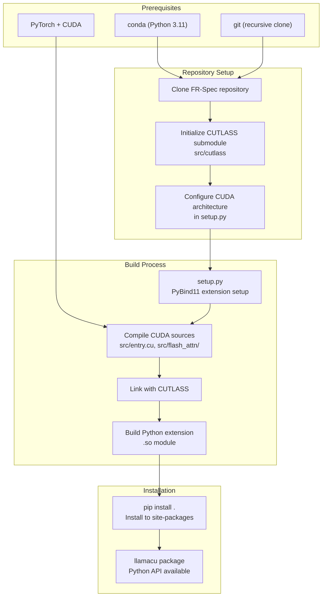
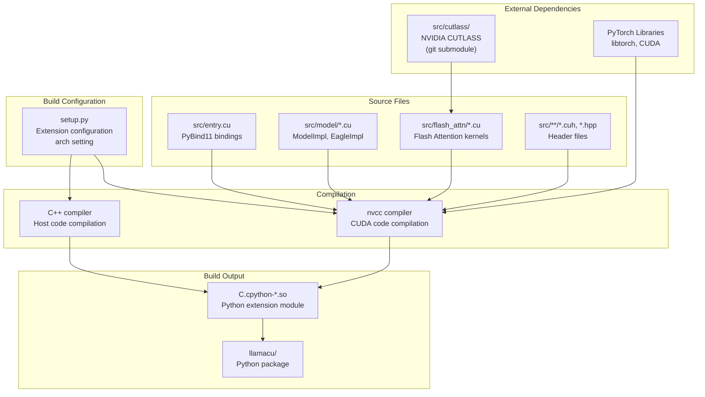
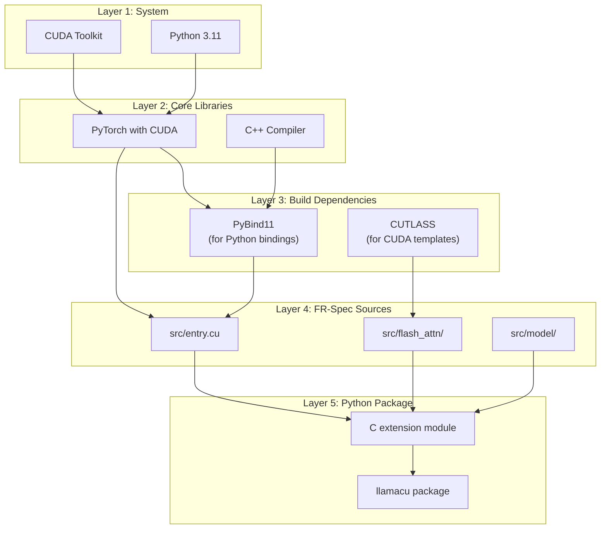

<!-- source: DeepWiki mcp.deepwiki.com · repo thunlp/FR-Spec · page 2.1 Installation · fetched 2026-11-02 -->

# Installation

<details>
<summary>Relevant source files</summary>

The following files were used as context for generating this wiki page:

- [.gitmodules](.gitmodules)
- [README.md](README.md)
- [src/flash_attn/flash_api.hpp](src/flash_attn/flash_api.hpp)

</details>


This document provides detailed instructions for installing FR-Spec from source, including environment setup, dependency configuration, and CUDA architecture settings. Installation involves compiling C++/CUDA source files into a Python extension module that can be imported by the `llamacu` package.

For information about running your first generation after installation, see [Quick Start Example](#2.2). For details about preparing token frequency statistics required by FR-Spec optimization, see [Preparing Token Frequency Statistics](#2.3).

---

## Prerequisites

FR-Spec requires the following components to be installed and properly configured before building from source:

| Component | Requirement | Notes |
|-----------|-------------|-------|
| **Python** | 3.11 | Specified in conda environment setup |
| **PyTorch** | Latest compatible version | Must match CUDA version |
| **CUDA Toolkit** | 11.8 or 12.x | Must match PyTorch CUDA version |
| **GPU** | NVIDIA GPU with compute capability 7.0+ | Architecture determines compilation target |
| **Git** | 2.13+ | For recursive submodule cloning |
| **C++ Compiler** | GCC 7+ or Clang | For compiling C++/CUDA code |

### GPU Compute Capability

The target GPU's compute capability determines the CUDA architecture code used during compilation. Common architectures:

| GPU Series | Architecture Code | Compute Capability |
|------------|-------------------|-------------------|
| RTX 30xx (Ampere) | `86` | 8.6 |
| RTX 40xx (Ada Lovelace) | `89` | 8.9 |
| A100 | `80` | 8.0 |
| H100 | `90` | 9.0 |
| V100 | `70` | 7.0 |

Check your GPU's compute capability at the [NVIDIA CUDA GPUs page](https://developer.nvidia.com/cuda-gpus#compute).

**Sources:** [README.md:45-50]()

---

## Installation Process Overview

The following diagram shows the complete installation pipeline from prerequisites through to a functional Python package:



**Sources:** [README.md:42-50](), [.gitmodules:1-4]()

---

## Step-by-Step Installation

### Step 1: Create Conda Environment

Create a new conda environment with Python 3.11:

```bash
conda create -n fr-spec python==3.11
conda activate fr-spec
```

The environment name `fr-spec` can be customized to your preference.

### Step 2: Install PyTorch

Install PyTorch with CUDA support matching your system configuration. Visit [pytorch.org](https://pytorch.org) to get the appropriate installation command for your platform. For example:

```bash
# For CUDA 11.8
pip install torch torchvision torchaudio --index-url https://download.pytorch.org/whl/cu118

# For CUDA 12.1
pip install torch torchvision torchaudio --index-url https://download.pytorch.org/whl/cu121
```

Verify PyTorch can detect your GPU:

```bash
python -c "import torch; print(torch.cuda.is_available())"
```

### Step 3: Clone Repository with Submodules

Clone the FR-Spec repository recursively to include the CUTLASS submodule:

```bash
git clone https://github.com/thunlp/FR-Spec.git --recursive
cd FR-Spec
```

The `--recursive` flag is critical as it initializes the CUTLASS submodule at [src/cutlass]() which is required for Flash Attention compilation.

If you already cloned without `--recursive`, initialize submodules manually:

```bash
git submodule update --init --recursive
```

### Step 4: Configure CUDA Architecture

Edit [setup.py]() to set the target CUDA architecture for your GPU. Locate the `arch` variable and change it from the default `"80"` to your GPU's architecture code:

```bash
vim setup.py  # or use any text editor
```

Find and modify the architecture setting. For example, for RTX 30xx series (Ampere):

```python
# Change from:
arch = "80"

# To (for RTX 30xx):
arch = "86"
```

Common architecture codes:
- `"70"` for V100
- `"80"` for A100
- `"86"` for RTX 30xx
- `"89"` for RTX 40xx
- `"90"` for H100

**Important:** Using the wrong architecture code will result in either compilation errors or suboptimal performance. The compiled binary will not run on GPUs with different compute capabilities.

### Step 5: Build and Install

Install FR-Spec using pip, which will compile the C++/CUDA extension and install the package:

```bash
pip install .
```

This command:
1. Reads [setup.py]() configuration
2. Compiles C++/CUDA source files in [src/]() directory
3. Links against CUTLASS library from [src/cutlass]()
4. Builds the PyBind11 extension module
5. Installs the `llamacu` package to your environment

The compilation process may take 5-15 minutes depending on your system.

**Sources:** [README.md:42-50]()

---

## Build System Architecture

The following diagram shows how source files are compiled into the final Python extension:



**Sources:** [.gitmodules:1-4](), [README.md:48-49](), [src/flash_attn/flash_api.hpp:1-10]()

---

## Dependency Chain

Understanding the dependency hierarchy helps diagnose installation issues:



**Sources:** [src/flash_attn/flash_api.hpp:7-8](), [.gitmodules:1-4]()

---

## Verification

After installation, verify that FR-Spec is correctly installed:

### Import Test

```bash
python -c "import llamacu; print('FR-Spec installed successfully')"
```

### Check Extension Module

Verify the compiled C extension module is accessible:

```bash
python -c "import llamacu.C as C; print('C extension loaded')"
```

If this command succeeds, the PyBind11 module defined in [src/entry.cu]() has been successfully compiled and can be imported.

### Check CUDA Availability

Ensure PyTorch detects CUDA:

```bash
python -c "import torch; print(f'CUDA available: {torch.cuda.is_available()}'); print(f'CUDA version: {torch.version.cuda}')"
```

**Sources:** [README.md:86-93]()

---

## Troubleshooting

### Common Installation Issues

| Issue | Cause | Solution |
|-------|-------|----------|
| `nvcc: command not found` | CUDA Toolkit not in PATH | Add CUDA bin directory to PATH environment variable |
| `torch not found` | PyTorch not installed | Install PyTorch with CUDA support before FR-Spec |
| `CUTLASS headers not found` | Submodule not initialized | Run `git submodule update --init --recursive` |
| Compilation fails with arch error | Wrong compute capability | Update `arch` in setup.py to match your GPU |
| `ImportError: cannot import name 'C'` | Extension not compiled | Rebuild with `pip install --force-reinstall .` |
| Runtime CUDA errors | Mismatched CUDA versions | Ensure PyTorch CUDA version matches system CUDA |

### Architecture Mismatch Symptoms

If the compiled binary's architecture doesn't match your GPU:
- **Error:** `no kernel image is available for execution on the device`
- **Solution:** Recompile with correct `arch` setting in setup.py

### CUTLASS Submodule Issues

The CUTLASS submodule at [src/cutlass]() provides optimized CUDA templates used by Flash Attention ([src/flash_attn/flash_api.hpp:7-8]()). If compilation fails with missing CUTLASS headers:

```bash
cd src/cutlass
git submodule status  # Verify submodule is initialized
cd ../..
pip install --force-reinstall .
```

**Sources:** [README.md:42-50](), [.gitmodules:1-4](), [src/flash_attn/flash_api.hpp:7-8]()

---

## Next Steps

After successful installation:

1. **Run a basic example:** See [Quick Start Example](#2.2) to generate text with FR-Spec
2. **Prepare frequency data:** See [Preparing Token Frequency Statistics](#2.3) to download or generate token frequency files required for FR-Spec optimization
3. **Download model weights:** Obtain HuggingFace model weights and EAGLE drafter weights as described in [README.md:54-57]()

For understanding how the compiled C extension integrates with Python, see [Python to CUDA Bridge](#3.1). For details on the overall system architecture, see [System Architecture](#3).

**Sources:** [README.md:42-93]()

---

