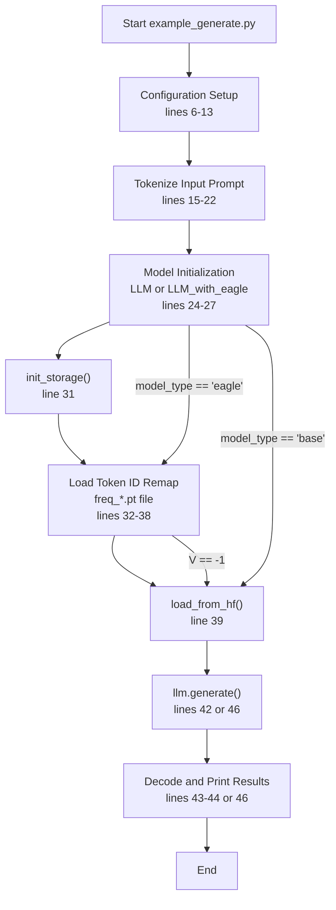
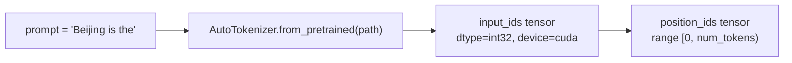
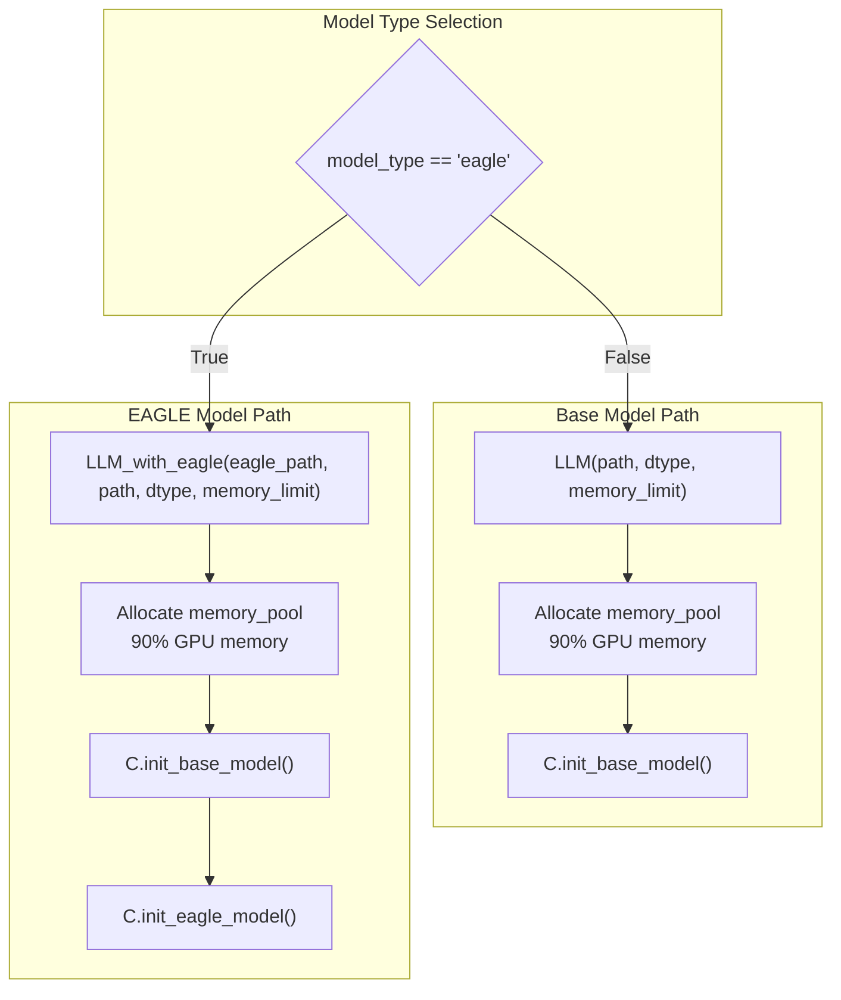
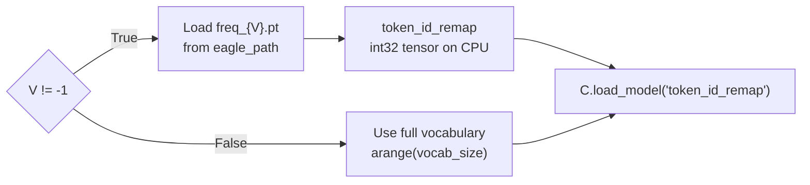
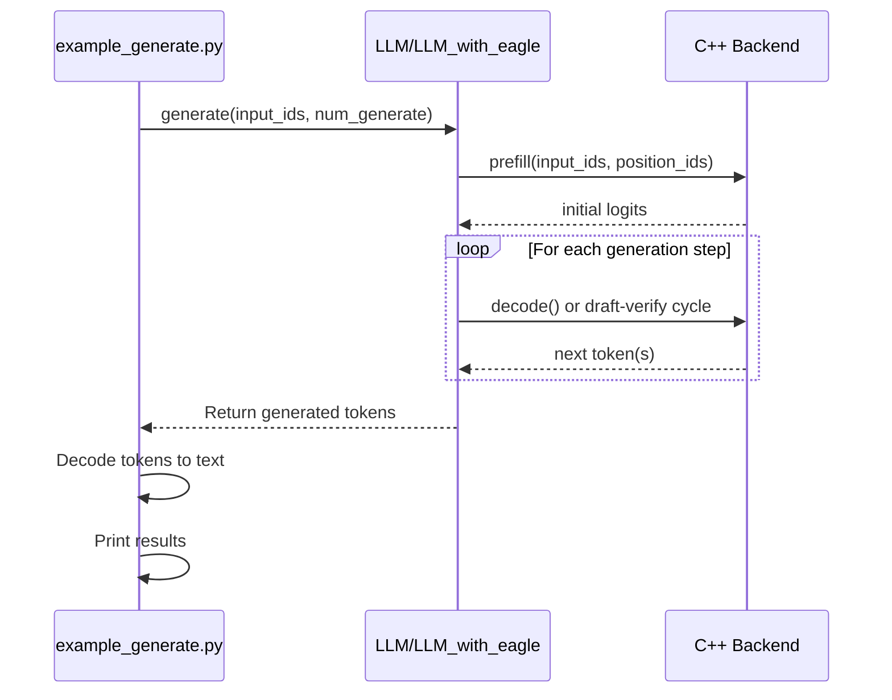

<!-- source: DeepWiki mcp.deepwiki.com · repo thunlp/FR-Spec · page 2.2 Quick Start Example · fetched 2026-11-02 -->

# Quick Start Example

<details>
<summary>Relevant source files</summary>

The following files were used as context for generating this wiki page:

- [examples/example_generate.py](examples/example_generate.py)
- [llamacu/llama.py](llamacu/llama.py)

</details>


## Purpose and Scope

This page provides a step-by-step walkthrough of the `example_generate.py` script, demonstrating basic text generation with FR-Spec. The example covers both baseline generation and EAGLE-based speculative decoding with optional frequency-ranked vocabulary optimization. 

For installation instructions and environment setup, see [Installation](#2.1). For details on preparing token frequency statistics for FR-Spec optimization, see [Preparing Token Frequency Statistics](#2.3). For comprehensive API documentation, see [Python API Reference](#8).

---

## Example Script Overview

The `example_generate.py` script provides a minimal working example that demonstrates:
- Loading a base transformer model or an EAGLE-augmented model
- Configuring FR-Spec vocabulary reduction (V parameter)
- Generating text from a prompt
- Measuring acceptance rates for speculative decoding

**Sources:** [examples/example_generate.py:1-46]()

---

## Execution Flow

The following diagram illustrates the complete execution flow of the example script:



**Sources:** [examples/example_generate.py:1-46]()

---

## Configuration Parameters

The example script begins with configuration parameters that control model behavior:

| Parameter | Type | Default | Description |
|-----------|------|---------|-------------|
| `path` | str | Required | Path to base HuggingFace model directory |
| `eagle_path` | str | Required | Path to EAGLE drafter model directory (includes FR-Spec frequency files) |
| `dtype` | torch.dtype | `torch.float16` | Inference precision (float16 or bfloat16) |
| `cuda_graph` | bool | `True` | Enable CUDA graph optimization for decode phase |
| `num_generate` | int | `100` | Number of tokens to generate |
| `model_type` | str | `"eagle"` | Model variant: `"base"` for standard decoding, `"eagle"` for speculative decoding |
| `Bench` | bool | `True` | Enable benchmarking mode (not used in this example) |
| `V` | int | `16384` | Vocabulary size for FR-Spec reduction. Use `-1` to disable FR-Spec optimization |

**Sources:** [examples/example_generate.py:6-13]()

### FR-Spec Vocabulary Size (V Parameter)

The `V` parameter controls the frequency-ranked vocabulary size:
- `V = -1`: Standard EAGLE without vocabulary reduction (uses full vocabulary)
- `V = 8192, 16384, 32768, 65536`: FR-Spec with reduced vocabulary containing the V most frequent tokens
- Smaller V values provide faster LM-Head computation but may reduce draft accuracy
- Typical values: 8K-64K tokens (vs. full vocabulary of ~128K tokens for Llama models)

**Sources:** [examples/example_generate.py:13]()

---

## Input Preparation

The example prepares input by tokenizing a prompt and creating position IDs:



The tokenization process:
1. Load tokenizer from HuggingFace model path [examples/example_generate.py:16]()
2. Convert prompt string to token IDs [examples/example_generate.py:18]()
3. Convert to int32 CUDA tensor (required by C++ backend)
4. Create position_ids as sequential indices [examples/example_generate.py:22]()

**Sources:** [examples/example_generate.py:15-22]()

---

## Model Initialization

The script initializes either a base LLM or an EAGLE-augmented LLM based on `model_type`:



### Base Model Initialization

For standard decoding (`model_type = "base"`):
- Creates `LLM` instance with model path and configuration [examples/example_generate.py:27]()
- Allocates memory pool (90% of GPU memory in this example) [examples/example_generate.py:27]()
- Calls `C.init_base_model()` to initialize C++ backend [llamacu/llama.py:45-59]()

### EAGLE Model Initialization

For speculative decoding (`model_type = "eagle"`):
- Creates `LLM_with_eagle` instance with both eagle_path and base path [examples/example_generate.py:25]()
- Initializes base model and EAGLE drafter in C++ backend
- Allocates KV cache budget split between base model and drafter

**Sources:** [examples/example_generate.py:24-27](), [llamacu/llama.py:20-59]()

---

## Storage and Weight Loading

After model initialization, the script performs three critical steps:

### Step 1: Initialize Storage

```python
llm.init_storage()
```

This allocates KV cache and intermediate buffers within the pre-allocated memory pool. The function returns `max_total_length`, the maximum sequence length supported by available memory.

**Sources:** [examples/example_generate.py:31](), [llamacu/llama.py:63-64]()

### Step 2: Load Token ID Remap (EAGLE Only)

For EAGLE models with FR-Spec enabled (`V != -1`):



The token ID remap file (`freq_{V}.pt`) contains the indices of the V most frequent tokens, sorted by frequency. This allows the EAGLE drafter to compute logits only for frequent tokens during drafting.

**Sources:** [examples/example_generate.py:32-38]()

### Step 3: Load Model Weights

```python
llm.load_from_hf()
```

This loads all model weights from the HuggingFace checkpoint format and transfers them to the C++ backend:
- Embedding layer weights [llamacu/llama.py:127]()
- Transformer layer weights (attention and FFN parameters)
- LM-Head weights
- Rotary embedding inverse frequencies [llamacu/llama.py:130-138]()

For EAGLE models, this also loads the drafter-specific weights from `eagle_path`.

**Sources:** [examples/example_generate.py:39](), [llamacu/llama.py:125-138]()

---

## Text Generation

After initialization and loading, the script calls the `generate()` method:



### Base Model Generation

For `model_type = "base"`:
1. Call `llm.generate(input_ids, num_generate)` [examples/example_generate.py:46]()
2. Returns a list of token IDs
3. Decode using tokenizer and print [examples/example_generate.py:46]()

### EAGLE Model Generation

For `model_type = "eagle"`:
1. Call `llm.generate(input_ids, num_generate)` [examples/example_generate.py:42]()
2. Returns tuple: `(tokens, acceptance_lengths)` [examples/example_generate.py:42]()
   - `tokens`: Generated token ID sequence
   - `acceptance_lengths`: List of accepted tokens per draft-verify iteration
3. Calculate average acceptance length [examples/example_generate.py:43]()
4. Decode tokens to text and print [examples/example_generate.py:44]()

The average acceptance length indicates speculative decoding efficiency. Higher values mean more draft tokens are accepted per verification step.

**Sources:** [examples/example_generate.py:41-46](), [llamacu/llama.py:174-197]()

---

## Running the Example

To execute the example script:

### Prerequisites

1. Install FR-Spec following [Installation](#2.1)
2. Download or prepare models:
   - Base model (e.g., Llama-3.2-1B-Instruct) from HuggingFace
   - EAGLE drafter model with FR-Spec frequency files
3. Update paths in the script:
   - Line 6: Set `path` to your base model directory
   - Line 7: Set `eagle_path` to your EAGLE model directory

### Execution

```bash
cd examples
python example_generate.py
```

### Expected Output

**Base Model:**
```
Beijing is the capital of China and one of...
```

**EAGLE Model with FR-Spec:**
```
average accept length: 4.23
Beijing is the capital of China and one of...
```

The acceptance length of ~4.23 indicates that on average, 4-5 draft tokens are accepted per verification step, resulting in significant speedup over baseline decoding.

**Sources:** [examples/example_generate.py:1-46]()

---

## Configuration Variations

The example can be easily modified to explore different configurations:

| Modification | Lines to Change | Effect |
|--------------|-----------------|--------|
| Switch to base model | Line 11: `model_type = ["base", "eagle"][0]` | Standard autoregressive decoding without speculation |
| Disable FR-Spec | Line 13: `V = -1` | EAGLE uses full vocabulary (slower but potentially higher accuracy) |
| Reduce vocabulary more | Line 13: `V = 8192` | Faster drafting, may reduce acceptance rate |
| Change prompt | Line 15: `prompt = "Your text here"` | Generate from different starting text |
| Generate longer sequences | Line 10: `num_generate = 500` | Produce more tokens (limited by KV cache size) |
| Use bfloat16 | Line 8: `dtype = torch.bfloat16` | Alternative precision (requires Ampere+ GPU) |
| Disable CUDA graph | Line 9: `cuda_graph = False` | Useful for debugging (slight performance cost) |

**Sources:** [examples/example_generate.py:6-15]()

---

## Class and Function Reference

The following table maps high-level operations to their implementations:

| Operation | Python Class/Method | C++ Backend Function |
|-----------|---------------------|----------------------|
| Model initialization | `LLM.__init__()` | `C.init_base_model()` |
| EAGLE initialization | `LLM_with_eagle.__init__()` | `C.init_eagle_model()` |
| Memory allocation | `LLM.init_storage()` | `C.init_storage()` |
| Weight loading | `LLM._load()` | `C.load_model()` |
| Prefill phase | `LLM.prefill()` | `C.prefill()` |
| Decode phase | `LLM.decode()` | `C.decode()` |
| EAGLE draft phase | `LLM_with_eagle.draft()` | `C.draft()` |
| EAGLE verify phase | `LLM_with_eagle.verify()` | `C.verify()` |
| Text generation | `LLM.generate()` | Orchestrates prefill/decode or draft/verify |

For detailed API documentation, see [LLM Class](#8.1) and [Speculative Decoding Classes](#8.2).

**Sources:** [llamacu/llama.py:20-197](), [examples/example_generate.py:1-46]()

---

