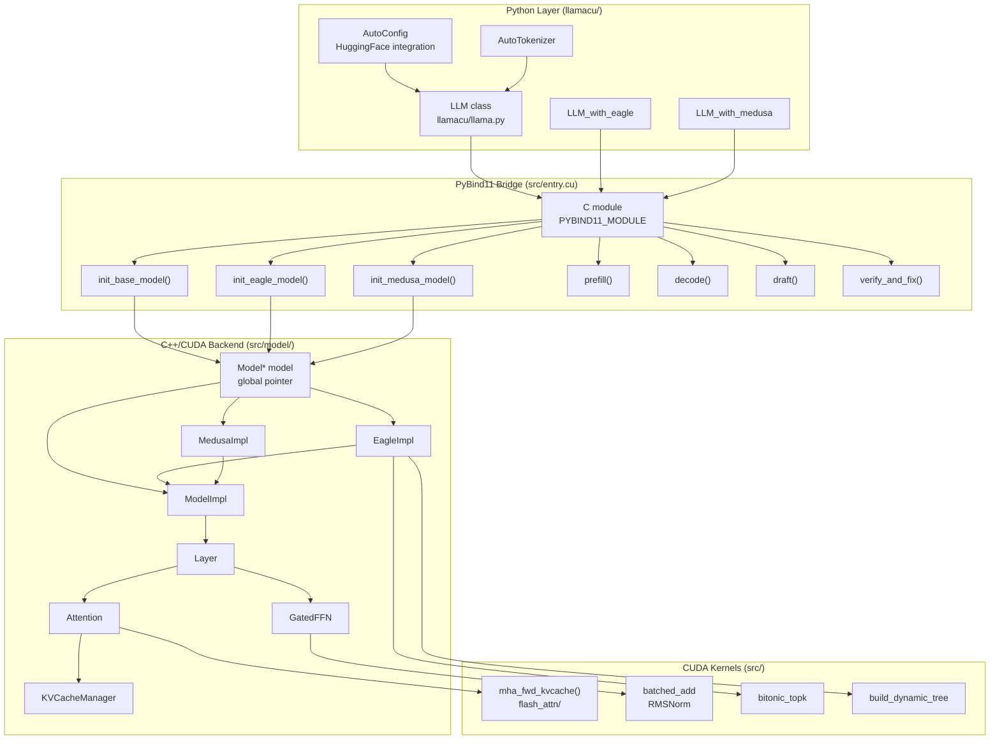
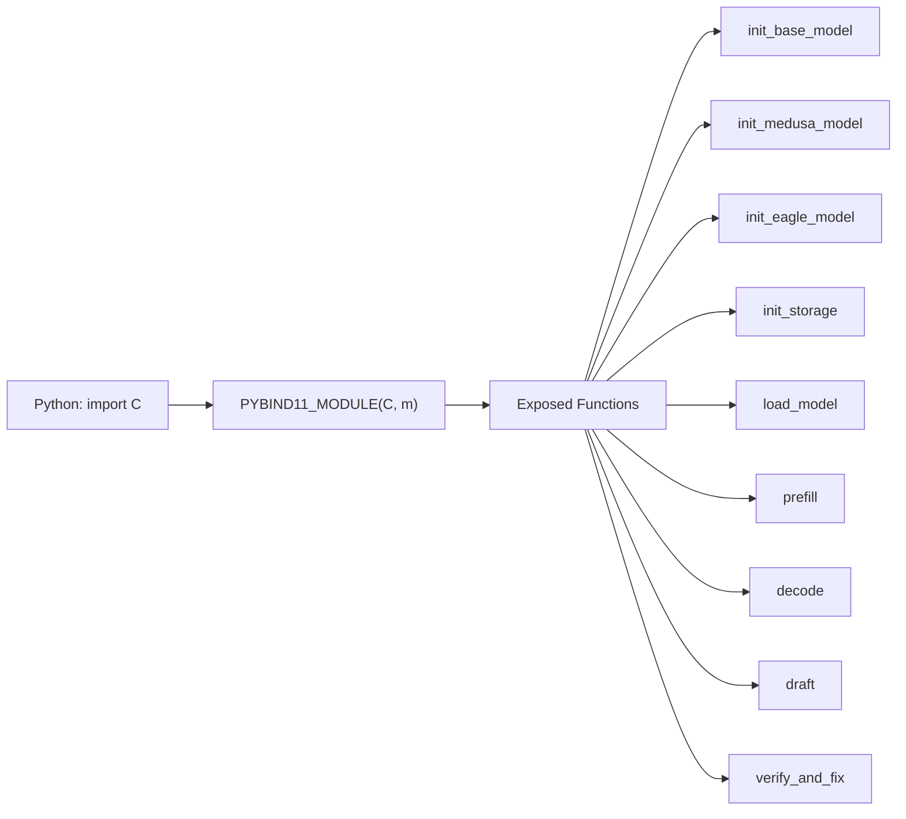
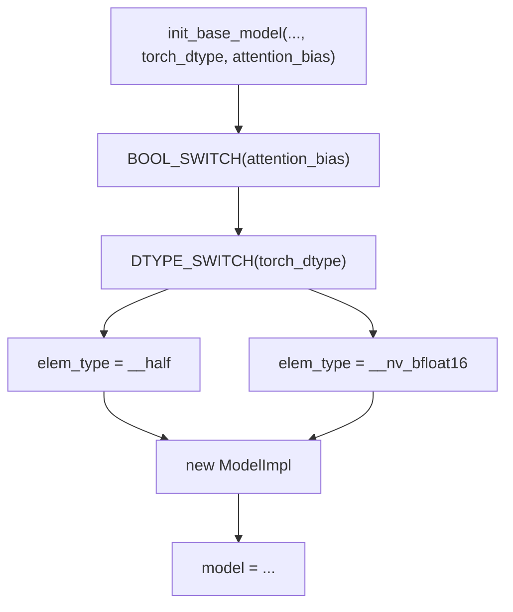
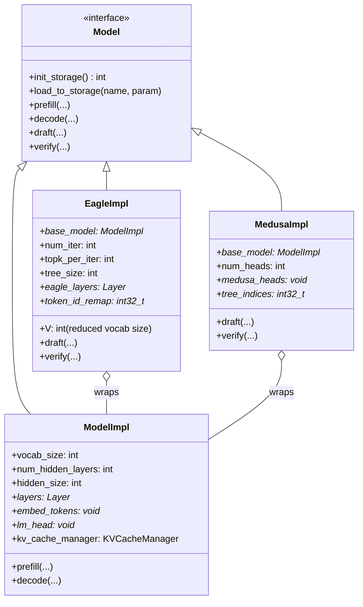
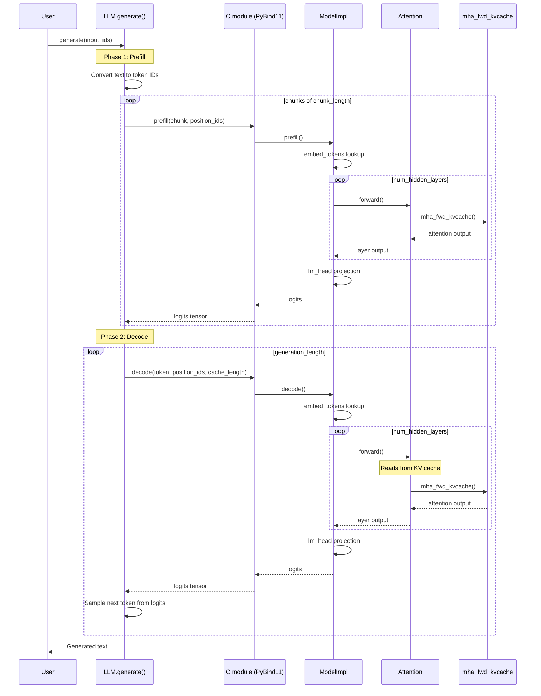
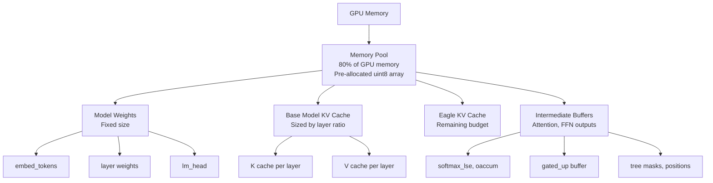
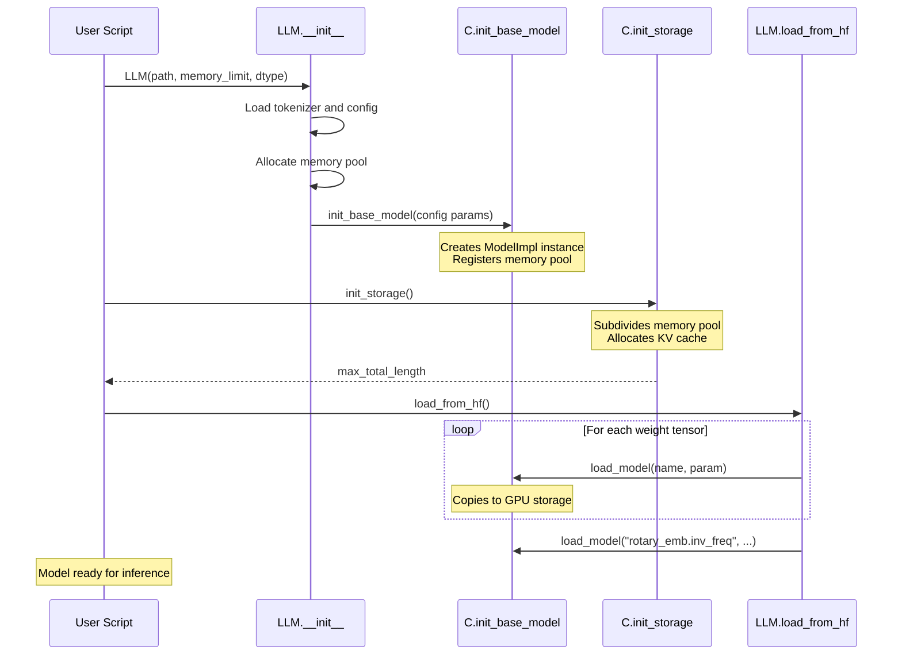

<!-- source: DeepWiki mcp.deepwiki.com · repo thunlp/FR-Spec · page 3 System Architecture · fetched 2026-11-02 -->

# System Architecture

<details>
<summary>Relevant source files</summary>

The following files were used as context for generating this wiki page:

- [README.md](README.md)
- [llamacu/llama.py](llamacu/llama.py)
- [src/entry.cu](src/entry.cu)
- [src/flash_attn/flash_api.hpp](src/flash_attn/flash_api.hpp)

</details>


## Purpose and Scope

This document describes the overall architecture of FR-Spec, explaining how the Python interface, PyBind11 bridge, and C++/CUDA backend work together to provide accelerated LLM inference with frequency-ranked speculative sampling. The architecture follows a three-tier design where high-level Python APIs invoke optimized CUDA kernels through a thin C++ bridge layer.

For detailed information about specific subsystems:
- Python-CUDA bridging mechanisms: see [Python to CUDA Bridge](#3.1)
- Memory allocation and KV cache management: see [Memory Management](#3.2)
- Base transformer implementation: see [ModelImpl: Base Transformer](#4.1)
- Speculative decoding details: see [Speculative Decoding](#5)

**Sources:** [README.md:1-140](), [src/entry.cu:1-184](), [llamacu/llama.py:1-198]()

---

## Three-Tier Architecture

FR-Spec implements a layered architecture that separates concerns between user-facing APIs, language interoperability, and high-performance computation:



**Diagram 1: Three-Tier Architecture and Component Hierarchy**

The architecture consists of:

1. **Python Layer**: Provides high-level APIs compatible with HuggingFace transformers
2. **PyBind11 Bridge**: Marshals data between Python and C++, manages type conversions
3. **C++/CUDA Backend**: Implements core inference logic with optimized CUDA kernels

**Sources:** [src/entry.cu:1-184](), [llamacu/llama.py:20-198]()

---

## Python Layer Components

The Python layer in `llamacu/` provides user-facing classes that integrate with the PyTorch and HuggingFace ecosystems:

### LLM Class

The `LLM` class [llamacu/llama.py:20-198]() serves as the base interface for model inference:

| Component | Type | Purpose |
|-----------|------|---------|
| `tokenizer` | `AutoTokenizer` | Converts text to token IDs |
| `config` | `AutoConfig` | Stores model hyperparameters |
| `memory_pool` | `torch.nn.Parameter` | Pre-allocated GPU memory buffer |
| `logits` | `torch.Tensor` | Output buffer for model predictions |
| `dtype` | `torch.dtype` | Computation precision (FP16/BF16) |

Key methods:
- `__init__()`: Initializes model configuration and calls `C.init_base_model()` [llamacu/llama.py:45-59]()
- `init_storage()`: Allocates memory pools via `C.init_storage()` [llamacu/llama.py:63-64]()
- `load_from_hf()`: Loads weights from HuggingFace checkpoint [llamacu/llama.py:125-138]()
- `prefill()`: Processes initial prompt [llamacu/llama.py:140-150]()
- `decode()`: Generates next tokens [llamacu/llama.py:152-172]()
- `generate()`: End-to-end text generation loop [llamacu/llama.py:174-197]()

### Memory Pool Initialization

The Python layer allocates a contiguous GPU memory buffer representing 80% of available GPU memory [llamacu/llama.py:37-38]():

```python
self.memory_limit = int(torch.cuda.get_device_properties(0).total_memory * memory_limit)
self.memory_pool = torch.nn.Parameter(torch.empty(self.memory_limit, dtype=torch.uint8, device="cuda"))
```

This pointer is passed to C++ for internal memory management (detailed in [Memory Management](#3.2)).

**Sources:** [llamacu/llama.py:20-198]()

---

## PyBind11 Bridge Interface

The file `src/entry.cu` defines the Python-C++ interface using PyBind11. It exposes a module named `C` that Python code imports [src/entry.cu:174-184]().

### Module Definition



**Diagram 2: PyBind11 Module Interface**

### Global Model Pointer

A global pointer tracks the currently active model instance [src/entry.cu:32]():

```cpp
Model* model;
```

This pointer is polymorphic and can point to:
- `ModelImpl<elem_type, has_attention_bias>`: Base transformer
- `EagleImpl<elem_type, has_attention_bias>`: EAGLE speculative decoder (wraps ModelImpl)
- `MedusaImpl<elem_type, has_attention_bias>`: Medusa speculative decoder (wraps ModelImpl)

### Type-Generic Initialization

The bridge uses C++ template metaprogramming to support multiple data types and configurations:



**Diagram 3: Type-Parameterized Initialization Flow**

The macros `DTYPE_SWITCH` [src/entry.cu:10-19]() and `BOOL_SWITCH` [src/entry.cu:21-30]() enable compile-time specialization for:
- Data type: FP16 (`__half`) or BF16 (`__nv_bfloat16`)
- Attention bias: Present (Qwen2) or absent (LLaMA)

### Function Signatures

| Function | Parameters | Return | Purpose |
|----------|------------|--------|---------|
| `init_base_model` | memory_limit, memory_pool, vocab_size, num_layers, hidden_size, ... | void | Creates `ModelImpl` instance |
| `init_eagle_model` | num_layers, intermediate_size, num_iter, topk_per_iter, V, ... | void | Wraps ModelImpl with EagleImpl |
| `init_medusa_model` | num_heads, num_layers, topk_per_head, tree_size, V, ... | void | Wraps ModelImpl with MedusaImpl |
| `init_storage` | none | int | Allocates internal buffers, returns max sequence length |
| `load_model` | name, param | void | Copies weight tensor to GPU storage |
| `prefill` | input_length, history_length, input, position_ids, output | void | Processes prompt tokens |
| `decode` | input_length, padded_length, input, position_ids, cache_length, mask_2d, output, cuda_graph | void | Generates next tokens |
| `draft` | tree_draft_ids, tree_position_ids, cache_length, attn_mask, tree_parent | void | Generates speculative token candidates |
| `verify_and_fix` | num_tokens, pred, gt, position_ids, cache_length, attn_mask, tree_parent | int | Validates predictions, returns acceptance count |

All pointer parameters use `std::uintptr_t` for cross-language compatibility [src/entry.cu:34-172]().

### CUDA Graph Support

The `decode` function supports CUDA graph capture for reduced kernel launch overhead [src/entry.cu:142-164]():

- First call with `cuda_graph=true`: Captures kernel sequence into `graph`
- Subsequent calls: Replays captured graph via `cudaGraphLaunch`
- Graph is recreated if input dimensions change

**Sources:** [src/entry.cu:1-184]()

---

## C++/CUDA Backend Organization

The C++/CUDA backend implements three main model classes:



**Diagram 4: C++ Model Class Hierarchy**

### ModelImpl: Base Transformer

`ModelImpl<elem_type, has_attention_bias>` implements a standard decoder-only transformer:
- Embedding layer: Token ID → hidden states
- N transformer layers: Self-attention + FFN
- LM-Head: Hidden states → vocabulary logits
- RoPE (Rotary Position Embeddings): Position encoding
- KV Cache: Stores past attention keys/values

See [ModelImpl: Base Transformer](#4.1) for detailed documentation.

### EagleImpl: Speculative Decoder

`EagleImpl<elem_type, has_attention_bias>` [src/entry.cu:97-128]() extends ModelImpl with speculative decoding:
- **Drafting**: Generates K candidates per iteration using Eagle layers
- **Tree Building**: Constructs prediction tree from candidates
- **Verification**: Base model validates predictions in parallel
- **FR-Spec Optimization**: Reduces vocabulary from full size to V (8K-64K tokens)

Key parameters passed during initialization [src/entry.cu:97-128]():
- `num_layers`: Number of Eagle layers
- `num_iter`: Iterations per draft phase
- `topk_per_iter`: Candidates selected per iteration
- `tree_size`: Maximum positions in prediction tree
- `V`: Reduced vocabulary size for LM-Head

See [EAGLE Implementation](#5.1) for detailed documentation.

### MedusaImpl: Alternative Speculative Decoder

`MedusaImpl<elem_type, has_attention_bias>` [src/entry.cu:70-95]() uses multiple prediction heads:
- Each head predicts next token at different future positions
- Uses pre-computed tree structure
- Alternative to EAGLE with different accuracy/speed tradeoffs

See [Medusa Implementation](#5.2) for detailed documentation.

**Sources:** [src/entry.cu:32-128]()

---

## Data Flow Through the System

The following diagram shows how a text generation request flows through all three layers:



**Diagram 5: End-to-End Generation Data Flow**

### Prefill Phase

1. **Python**: `LLM.prefill()` tokenizes input and chunks it [llamacu/llama.py:140-150]()
2. **Bridge**: `prefill()` converts Python tensors to raw pointers [src/entry.cu:138-140]()
3. **C++**: `ModelImpl.prefill()` processes all tokens in parallel, populating KV cache
4. **CUDA**: Flash Attention computes attention efficiently [src/flash_attn/flash_api.hpp:207-304]()
5. **Return**: Final token logits returned to Python

### Decode Phase

1. **Python**: `LLM.decode()` passes single token and updated cache length [llamacu/llama.py:152-172]()
2. **Bridge**: `decode()` optionally uses CUDA graph for replay [src/entry.cu:142-164]()
3. **C++**: `ModelImpl.decode()` processes token with cached keys/values
4. **CUDA**: Flash Attention reads from KV cache for efficient computation
5. **Return**: Next token logits returned to Python

### Speculative Decode Phase (EAGLE)

When using `LLM_with_eagle`, the decode phase is replaced by draft-verify loop:

1. **Draft**: `C.draft()` generates prediction tree using Eagle layers
2. **Verify**: Base model processes all tree positions in parallel via `C.decode()`
3. **Accept**: `C.verify_and_fix()` compares predictions with ground truth
4. **Return**: Multiple accepted tokens (speedup!)

See [Draft-Verify Pipeline](#5.3) for detailed documentation.

**Sources:** [llamacu/llama.py:140-197](), [src/entry.cu:138-172]()

---

## Memory and Computation Resources

### Memory Allocation Strategy



**Diagram 6: GPU Memory Layout**

The Python layer allocates a large contiguous buffer [llamacu/llama.py:37-38](), which C++ subdivides:

1. **Fixed Allocations**: Model weights loaded from checkpoint
2. **KV Cache**: Split between base and Eagle models proportionally by layer count
3. **Dynamic Buffers**: Attention outputs, FFN intermediates, draft tree structures

The `init_storage()` function [src/entry.cu:130-132]() computes maximum sequence length based on available memory after weight allocation.

### Compute Resources

- **CUDA Streams**: Single `calc_stream` for all operations [src/entry.cu:142-164]()
- **Tensor Cores**: Used automatically by CUTLASS for FP16/BF16 matrix operations
- **Flash Attention**: Memory-efficient attention with optimal memory access patterns [src/flash_attn/flash_api.hpp:207-304]()
- **Kernel Fusion**: Element-wise operations fused to reduce memory bandwidth

**Sources:** [llamacu/llama.py:37-38](), [src/entry.cu:130-132](), [src/flash_attn/flash_api.hpp:1-304]()

---

## Configuration and Initialization Sequence

### Initialization Order



**Diagram 7: Model Initialization Sequence**

### Configuration Parameters

The `LLM` class reads model architecture from HuggingFace config [llamacu/llama.py:32]():

| Parameter | Example (Llama3-8B) | Purpose |
|-----------|---------------------|---------|
| `vocab_size` | 128256 | Token vocabulary size |
| `num_hidden_layers` | 32 | Number of transformer blocks |
| `hidden_size` | 4096 | Hidden dimension |
| `intermediate_size` | 14336 | FFN intermediate dimension |
| `num_attention_heads` | 32 | Query heads |
| `num_key_value_heads` | 8 | Key/Value heads (GQA) |
| `head_dim` | 128 | Dimension per head |
| `rms_norm_eps` | 1e-5 | RMSNorm epsilon |
| `rope_theta` | 500000.0 | RoPE base frequency |

These parameters are passed to `C.init_base_model()` [llamacu/llama.py:45-59]() which constructs the appropriate `ModelImpl` template instantiation.

### Architecture Detection

FR-Spec detects model architecture to apply architecture-specific optimizations [llamacu/llama.py:44]():

- **LLaMA models**: No attention bias (`has_attention_bias = false`)
- **Qwen2 models**: QKV projection has bias (`has_attention_bias = true`)

This is encoded at compile-time via template parameters for zero-overhead specialization.

**Sources:** [llamacu/llama.py:20-59](), [src/entry.cu:34-68]()

---

## Summary

FR-Spec's three-tier architecture provides:

1. **Python Layer**: Easy-to-use APIs compatible with HuggingFace ecosystem
2. **PyBind11 Bridge**: Efficient marshaling with type-generic C++ templates
3. **C++/CUDA Backend**: Optimized kernels with template specialization

Key design principles:
- **Single memory pool**: Reduces allocation overhead and fragmentation
- **Polymorphic model pointer**: Enables seamless switching between base/Eagle/Medusa
- **Template metaprogramming**: Compile-time specialization for data types and configurations
- **CUDA graph support**: Reduces CPU overhead during decode
- **Modular design**: Clean separation between base model and speculative extensions

For implementation details of each subsystem, refer to the child pages under System Architecture.

**Sources:** [README.md:1-140](), [src/entry.cu:1-184](), [llamacu/llama.py:1-198](), [src/flash_attn/flash_api.hpp:1-304]()

---

