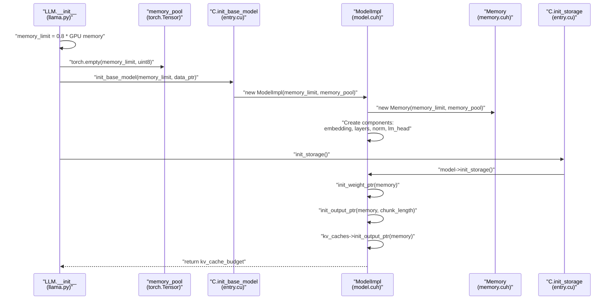
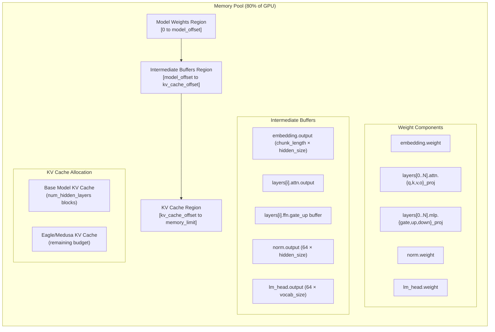
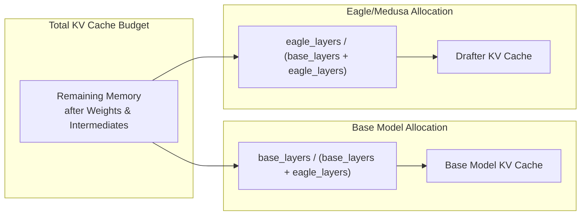
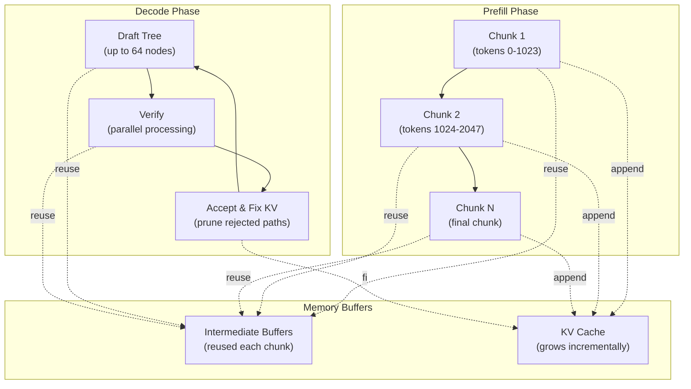
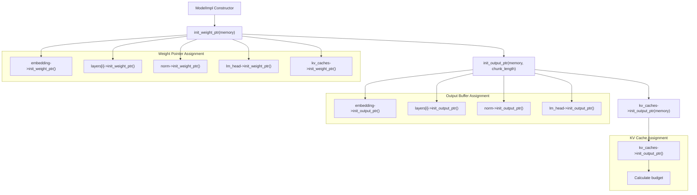

<!-- source: DeepWiki mcp.deepwiki.com · repo thunlp/FR-Spec · page 3.2 Memory Management · fetched 2026-11-02 -->

# Memory Management

<details>
<summary>Relevant source files</summary>

The following files were used as context for generating this wiki page:

- [llamacu/llama.py](llamacu/llama.py)
- [src/entry.cu](src/entry.cu)
- [src/model/model.cuh](src/model/model.cuh)

</details>


## Purpose and Scope

This document describes the memory management system in FR-Spec's C++/CUDA backend. It covers the pre-allocated memory pool strategy, the subdivision of memory among model weights, KV caches, and intermediate buffers, and the initialization flow that sets up these memory regions. 

For details on KV cache data structures and rotary embeddings, see [4.2](#4.2). For information about CUDA kernel execution and streams, see [7](#7).

---

## Overview

FR-Spec uses a **pre-allocation strategy** where approximately 80% of available GPU memory is allocated upfront as a single contiguous buffer. This memory pool is then subdivided among different components without additional dynamic allocations during inference. This approach:

- Eliminates allocation overhead during inference
- Provides predictable memory usage
- Allows fine-grained control over memory distribution
- Enables efficient memory reuse for intermediate computations

The Python layer allocates the memory pool and passes it to the C++ layer via PyBind11, where the `Memory` class manages pointer arithmetic and region assignments.

**Sources:** [llamacu/llama.py:20-65](), [src/entry.cu:34-68](), [src/model/model.cuh:47-81]()

---

## Memory Pool Initialization Flow

The memory pool is created and distributed through a multi-stage initialization process involving both Python and C++ layers.

### Initialization Sequence



**Sources:** [llamacu/llama.py:36-64](), [src/entry.cu:34-68](), [src/entry.cu:130-132](), [src/model/model.cuh:105-110]()

### Stage 1: Python-Level Allocation

The `LLM` class in `llamacu/llama.py` performs the initial allocation:

```python
self.memory_limit = int(torch.cuda.get_device_properties(0).total_memory * memory_limit)
self.memory_pool = torch.nn.Parameter(
    torch.empty(self.memory_limit, dtype=torch.uint8, device="cuda"),
    requires_grad=False
)
```

The `memory_limit` parameter (default 0.8) controls what fraction of GPU memory to allocate. The pool is allocated as a `torch.uint8` tensor to allow byte-level addressing.

**Sources:** [llamacu/llama.py:37-38]()

### Stage 2: C++ Model Construction

The Python layer passes the memory pool pointer to `init_base_model` in `entry.cu`:

```cpp
C.init_base_model(
    self.memory_limit,
    self.memory_pool.data.data_ptr(),
    // ... model config parameters
)
```

The C++ side constructs a `ModelImpl` instance, which creates the `Memory` management object:

```cpp
memory = new Memory(memory_limit, memory_pool);
```

**Sources:** [llamacu/llama.py:45-59](), [src/entry.cu:34-68](), [src/model/model.cuh:71]()

### Stage 3: Storage Initialization

After model construction, Python calls `init_storage()` which subdivides the memory pool:

**Sources:** [llamacu/llama.py:63-64](), [src/entry.cu:130-132](), [src/model/model.cuh:105-110]()

---

## Memory Region Layout

The memory pool is divided into three primary regions allocated sequentially:

### Memory Map Diagram



**Sources:** [src/model/model.cuh:83-110]()

### Region 1: Model Weights

The first region stores all model weights in contiguous memory. The `init_weight_ptr` method assigns pointers for each component:

- **Embedding**: `vocab_size × hidden_size` elements
- **Layer weights** (per layer):
  - Attention: `q_proj`, `k_proj`, `v_proj`, `o_proj`
  - FFN: `gate_proj`, `up_proj`, `down_proj`
  - Norms: `input_layernorm`, `post_attention_layernorm`
- **Final norm**: `hidden_size` elements
- **LM head**: `hidden_size × vocab_size` elements
- **Rotary embeddings**: Position encoding tables

**Sources:** [src/model/model.cuh:83-91]()

### Region 2: Intermediate Buffers

The second region stores outputs of forward pass computations. The `init_output_ptr` method allocates space sized for `chunk_length` tokens (typically 1024) to handle chunked prefill:

- **Embedding output**: `chunk_length × hidden_size`
- **Per-layer outputs**: `chunk_length × hidden_size`
- **Attention intermediate**: QKV projections, attention weights
- **FFN intermediate**: Gated activation outputs
- **Final norm output**: `64 × hidden_size` (sized for decode, not prefill)
- **LM head output**: `64 × vocab_size`

The 64-token sizing for norm/lm_head outputs reflects the maximum expected decode batch size (e.g., tree verification in speculative decoding).

**Sources:** [src/model/model.cuh:93-103]()

### Region 3: KV Cache

The remaining memory is allocated to KV caches. The `KVCacheManager` determines how much space is available after weights and intermediates:

```cpp
int64_t kv_cache_offset = init_output_ptr(memory, chunk_length, memory->model_offset);
kv_cache_offset = kv_caches->init_output_ptr(memory, kv_cache_offset);
return this->kv_caches->budget;
```

The `budget` returned represents the maximum sequence length supportable given the available KV cache memory. This value is stored in Python as `self.max_total_length`.

**Sources:** [src/model/model.cuh:105-110](), [llamacu/llama.py:63-64]()

---

## KV Cache Budget Management

### Budget Calculation

The KV cache budget is computed based on remaining memory after weights and intermediates:

```
kv_cache_budget = (memory_limit - kv_cache_offset) / bytes_per_token / num_layers
```

Where `bytes_per_token` depends on:
- Number of KV heads: `num_key_value_heads`
- Head dimension: `head_dim`
- Data type: 2 bytes for FP16/BF16
- Two tensors (K and V)

```
bytes_per_token = num_key_value_heads × head_dim × 2 (K and V) × 2 (bytes per element)
```

**Sources:** [src/model/model.cuh:73-74]()

### Split Between Base Model and Speculative Drafter

When using speculative decoding (EAGLE or Medusa), the KV cache budget is split proportionally by layer count:



For example, with a 32-layer base model and 4-layer Eagle drafter:
- Base model receives: `32/(32+4) = 88.9%` of KV cache budget
- Eagle receives: `4/(32+4) = 11.1%` of KV cache budget

**Sources:** Based on system architecture (not directly visible in provided files)

---

## Memory Management During Inference

### Prefill Phase

During prefill, the input sequence is processed in chunks of `chunk_length` tokens (default 1024) to avoid exceeding intermediate buffer capacity:

```python
for i in range(0, input_ids.numel(), self.chunk_length):
    C.prefill(
        min(input_ids.numel() - i, self.chunk_length), i,
        input_ids.view(-1)[i:].data_ptr(),
        position_ids.view(-1)[i:].data_ptr(),
        self.logits.data_ptr()
    )
```

Each chunk reuses the same intermediate buffer memory, while KV cache grows incrementally.

**Sources:** [llamacu/llama.py:142-149]()

### Decode Phase

During decode, the memory layout is optimized for speculative decoding with tree-structured candidates:

- **Input tokens**: Up to 64 tokens (tree nodes) processed in parallel
- **Intermediate buffers**: Sized for 64 tokens
- **KV cache**: Grows by accepted tokens only
- **Padded length**: Rounded to 128-token boundaries for Flash Attention efficiency

```python
padded_length = (cache_length[0].item() + 128 - 1) // 128 * 128
```

**Sources:** [llamacu/llama.py:152-172](), [llamacu/llama.py:162]()

### Memory Reuse Pattern



**Sources:** [llamacu/llama.py:140-172](), [src/model/model.cuh:135-164]()

---

## Memory Pointer Management

### Weight Loading

The `load_to_storage` method copies weights from CPU/host memory into the pre-allocated GPU memory pool:

```cpp
void load_to_storage(std::string name, void* ptr) {
    if (name.substr(0, 18) == "model.embed_tokens") {
        embedding->load_to_storage(name, ptr);
    } else if (name.substr(0, 10) == "model.norm") {
        norm->load_to_storage(name, ptr);
    } else if (name.substr(0, 7) == "lm_head") {
        lm_head->load_to_storage(name, ptr);
    }
    // ... layer weights
}
```

Each component's `load_to_storage` method performs a `cudaMemcpy` from the host pointer to its assigned region in the GPU memory pool.

**Sources:** [src/model/model.cuh:112-133](), [src/entry.cu:134-136]()

### Python-Side Weight Preparation

The Python layer prepares weights before passing them to C++:

```python
def _load(self, name, param, dtype=None, cls=None):
    if dtype is None:
        if 'rotary_emb' in name:
            dtype = torch.float32
        else:
            dtype = self.dtype
    
    param = param.contiguous().to(dtype)
    C.load_model(name, param.data_ptr())
```

The `.contiguous().to(dtype)` call ensures the tensor is in the correct memory layout and data type before the pointer is passed to C++.

**Sources:** [llamacu/llama.py:66-86]()

---

## Memory Optimization Techniques

### 1. Single Allocation Strategy

By allocating all memory upfront, FR-Spec avoids:
- Fragmentation from repeated allocations
- Allocation overhead during inference
- Potential out-of-memory errors mid-inference

### 2. Buffer Reuse

Intermediate buffers are reused across:
- Different chunks during prefill
- Different decode iterations
- Different tree nodes during speculative decoding

### 3. Padded Lengths

Cache lengths are padded to multiples of 128 to optimize Flash Attention performance:

```python
padded_length = (cache_length[0].item() + 128 - 1) // 128 * 128
```

This alignment ensures coalesced memory access patterns in CUDA kernels.

**Sources:** [llamacu/llama.py:162]()

### 4. Lazy Output Buffers

The norm and lm_head output buffers are sized for 64 tokens (decode batch size), not `chunk_length`, because:
- Prefill only needs the final token's logits
- Decode processes at most 64 tokens (speculative tree size)

This saves significant memory in the intermediate region.

**Sources:** [src/model/model.cuh:101]()

---

## Key Memory Management Classes

### Memory Class

The `Memory` class (defined in `src/model/memory.cuh`, not provided but referenced) manages:
- Pointer arithmetic within the memory pool
- Region boundary tracking (`model_offset`, `kv_cache_offset`)
- Allocation methods for weights and buffers

**Sources:** [src/model/model.cuh:2](), [src/model/model.cuh:27](), [src/model/model.cuh:71]()

### KVCacheManager

The `KVCacheManager` class manages:
- Per-layer KV cache allocation
- Budget calculation
- Rotary embedding storage
- Cache access during prefill/decode

**Sources:** [src/model/model.cuh:40](), [src/model/model.cuh:73]()

### ModelImpl Memory Flow



**Sources:** [src/model/model.cuh:83-110]()

---

