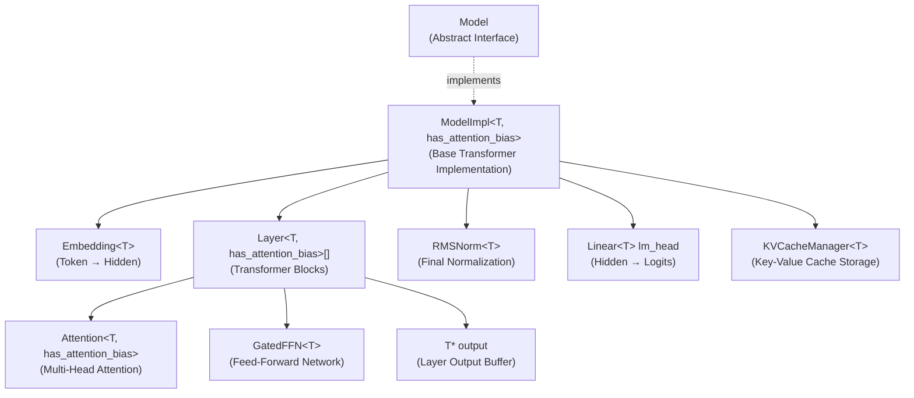
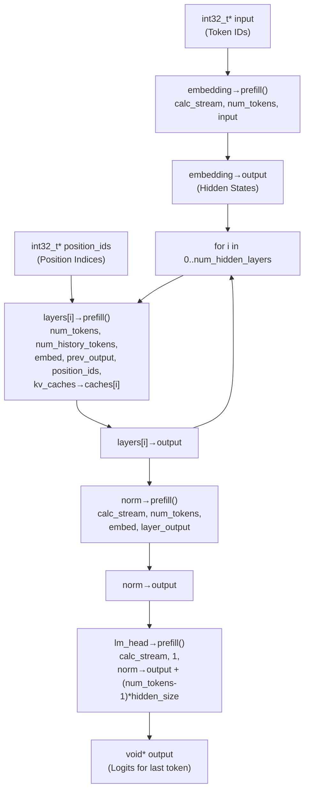
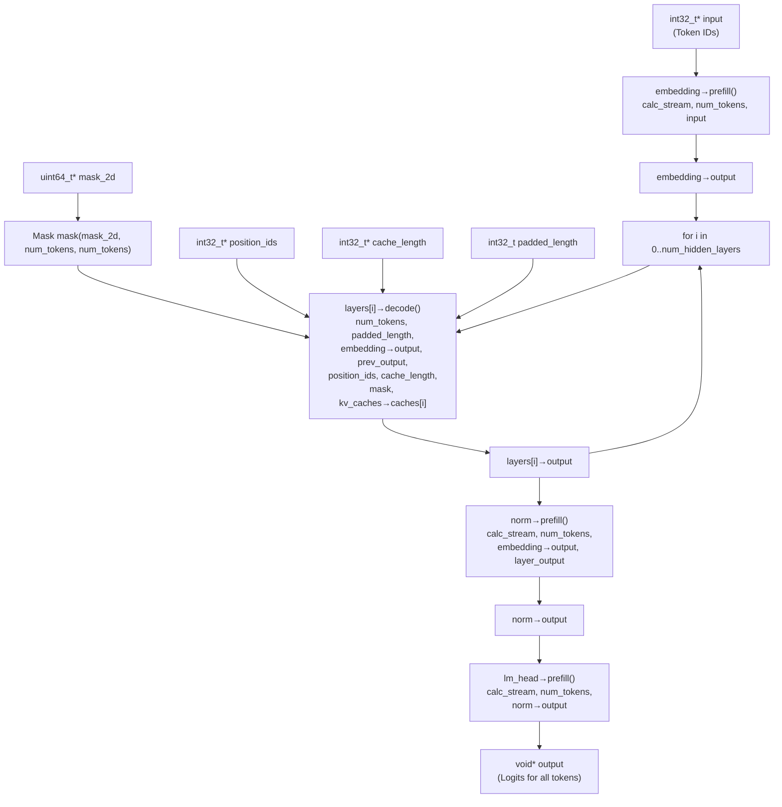
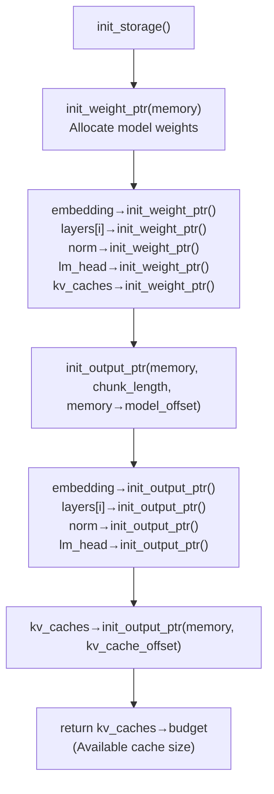
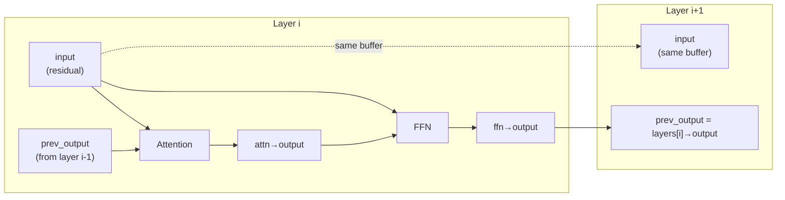

<!-- source: DeepWiki mcp.deepwiki.com · repo thunlp/FR-Spec · page 4 Core Model Components · fetched 2026-11-02 -->

# Core Model Components

<details>
<summary>Relevant source files</summary>

The following files were used as context for generating this wiki page:

- [src/model/layer.cuh](src/model/layer.cuh)
- [src/model/model.cuh](src/model/model.cuh)

</details>


## Purpose and Scope

This document provides an overview of the base transformer model implementation in FR-Spec's C++/CUDA backend. The core model components include the fundamental building blocks used for LLM inference: embeddings, attention mechanisms, feed-forward networks, normalization layers, and language modeling heads. These components form the foundation for both standard generation and speculative decoding.

For details about how these components integrate with the Python interface, see [Python to CUDA Bridge](#3.1). For speculative decoding extensions built on top of these components, see [Speculative Decoding](#5). Individual component details are covered in child pages: [ModelImpl](#4.1), [Attention Mechanism](#4.2), [Feed-Forward Networks](#4.3), and [Transformer Layers](#4.4).

## Component Hierarchy

The base transformer model is implemented through a hierarchical component structure:



**Component Responsibilities:**

| Component | Type | Responsibility |
|-----------|------|----------------|
| `Model` | Interface | Defines abstract operations: `prefill`, `decode`, `draft`, `verify` |
| `ModelImpl<T, has_attention_bias>` | Implementation | Orchestrates all components for transformer inference |
| `Embedding<T>` | Token Processing | Maps token IDs to hidden state vectors |
| `Layer<T, has_attention_bias>` | Block | Combines attention and FFN with residual connections |
| `Attention<T, has_attention_bias>` | Mechanism | Implements multi-head attention with KV caching |
| `GatedFFN<T>` | Network | Implements gated feed-forward with SiLU activation |
| `RMSNorm<T>` | Normalization | Applies RMS normalization |
| `Linear<T>` (lm_head) | Projection | Projects hidden states to vocabulary logits |
| `KVCacheManager<T>` | Memory | Manages KV cache for all layers |

Sources: [src/model/model.cuh:14-168](), [src/model/layer.cuh:1-52]()

## ModelImpl Structure

The `ModelImpl` template class implements the base transformer architecture. It is parameterized by data type `T` (typically `half` for FP16) and an optional `has_attention_bias` boolean flag.

### Configuration Parameters

[src/model/model.cuh:47-81]() shows the initialization parameters:

| Parameter | Type | Purpose |
|-----------|------|---------|
| `memory_limit` | `int64_t` | Total GPU memory available for allocation |
| `memory_pool` | `void*` | Pre-allocated GPU memory pool pointer |
| `vocab_size` | `int` | Size of token vocabulary |
| `num_hidden_layers` | `int` | Number of transformer layers |
| `hidden_size` | `int` | Hidden state dimension |
| `intermediate_size` | `int` | FFN intermediate dimension |
| `num_attention_heads` | `int` | Number of query attention heads |
| `num_key_value_heads` | `int` | Number of key/value heads (for GQA) |
| `head_dim` | `int` | Dimension per attention head |
| `rms_norm_eps` | `float` | Epsilon for RMS normalization stability |
| `chunk_length` | `int` | Maximum sequence chunk for prefill |

### Member Components

The `ModelImpl` class [src/model/model.cuh:40-45]() contains:

```
Memory* memory                        // Memory allocation manager
KVCacheManager<T>* kv_caches         // KV cache for all layers
Embedding<T>* embedding              // Token embedding layer
std::vector<Layer<T, has_attention_bias>*> layers  // Transformer blocks
RMSNorm<T>* norm                     // Final layer normalization
Linear<T>* lm_head                   // Language modeling head
```

Sources: [src/model/model.cuh:25-81]()

## Execution Flow

### Prefill Phase

During prefill, the model processes the initial prompt tokens to populate the KV cache:



**Key Observations:**
- Prefill processes `num_tokens` in parallel through all layers [src/model/model.cuh:135-148]()
- Each layer updates its KV cache with `num_tokens` entries
- Only the last token's logits are computed (`num_tokens - 1` offset) for efficiency
- `num_history_tokens` parameter tracks existing cache entries for position calculation

Sources: [src/model/model.cuh:135-148](), [src/model/layer.cuh:42-45]()

### Decode Phase

During decode, the model generates one token at a time (or multiple tokens in speculative decoding):



**Key Observations:**
- Decode computes logits for all `num_tokens`, enabling batch verification [src/model/model.cuh:150-164]()
- `mask_2d` controls attention patterns for tree-structured token sequences
- `padded_length` parameter optimizes Flash Attention for non-power-of-2 sequence lengths
- `cache_length` tracks the current position in the KV cache

Sources: [src/model/model.cuh:150-164](), [src/model/layer.cuh:47-50]()

## Memory Layout and Initialization

### Storage Initialization Sequence

The `init_storage()` method [src/model/model.cuh:105-110]() allocates memory in a specific order:



**Memory Allocation Order:**
1. **Model Weights**: Allocated first via `init_weight_ptr()` for all components
2. **Intermediate Buffers**: Allocated via `init_output_ptr()` for activation tensors
3. **KV Cache**: Allocated last with remaining budget after weights and buffers

The `chunk_length` parameter determines the maximum activation buffer size for prefill operations. The returned KV cache budget indicates how many tokens can be cached.

Sources: [src/model/model.cuh:83-110]()

### Weight Loading

The `load_to_storage()` method [src/model/model.cuh:112-133]() uses regex-based name matching to route weights to components:

| Name Pattern | Target Component | Example |
|--------------|------------------|---------|
| `model.embed_tokens` | `embedding` | `model.embed_tokens.weight` |
| `model.norm` | `norm` | `model.norm.weight` |
| `lm_head` | `lm_head` | `lm_head.weight` |
| `rotary_emb` | `kv_caches->rotary_embedding` | `model.layers.0.self_attn.rotary_emb.inv_freq` |
| `model.layers.<idx>.*` | `layers[idx]` | `model.layers.20.self_attn.q_proj.weight` |

The layer routing uses regex pattern `model\.layers\.(\d+)\.(.*)` to extract the layer index and forward the remaining name to the layer component.

Sources: [src/model/model.cuh:112-133]()

## Component Interaction Patterns

### Residual Connections

The `Layer` class manages residual connections implicitly. Each layer receives:
- `input`: The original input hidden states (for residual addition)
- `prev_output`: The previous layer's output

The attention and FFN components add their outputs to the input buffer in-place [src/model/layer.cuh:42-50]().

### Data Flow Between Components



The `embedding->output` buffer is reused throughout all layers as the `input` parameter, while `prev_output` is updated to point to each layer's output sequentially [src/model/model.cuh:136-140](), [src/model/model.cuh:152-156]().

Sources: [src/model/model.cuh:135-164](), [src/model/layer.cuh:10-51]()

## Abstract Interface

The `Model` interface [src/model/model.cuh:14-23]() defines the contract for all model implementations:

```cpp
virtual int init_storage() = 0;
virtual void load_to_storage(std::string name, void* ptr) = 0;
virtual void prefill(int32_t num_tokens, int32_t num_history_tokens, 
                     int32_t* input, int32_t* position_ids, void* output) = 0;
virtual void decode(int32_t num_tokens, int32_t padded_length, 
                    int32_t* input, int32_t* position_ids, 
                    int32_t* cache_length, uint64_t* mask_2d, void* output) = 0;
virtual void draft(int32_t *tree_draft_ids, int32_t *tree_position_ids, 
                   int32_t *cache_length, uint64_t* attn_mask, 
                   int32_t* tree_parent) = 0;
virtual int verify(int32_t num_tokens, int32_t* pred, int32_t* gt, 
                   int32_t* position_ids, int32_t* cache_length, 
                   uint64_t* attn_mask, int32_t* tree_parent) = 0;
```

**Method Purposes:**
- `init_storage()`: Allocate GPU memory and return KV cache budget
- `load_to_storage()`: Load a single weight tensor by name
- `prefill()`: Process initial prompt tokens
- `decode()`: Generate next token(s) with attention masking
- `draft()`: Generate candidate tokens (speculative decoding only)
- `verify()`: Validate and accept candidate tokens (speculative decoding only)

The base `ModelImpl` implements the first four methods. The `draft()` and `verify()` methods throw exceptions [src/model/model.cuh:166-167]() and are overridden by speculative decoding extensions like `EagleImpl` (see [EAGLE Implementation](#5.1)).

Sources: [src/model/model.cuh:14-23](), [src/model/model.cuh:166-167]()

## Template Parameters

The `ModelImpl` class uses two template parameters:

| Parameter | Type | Purpose | Common Values |
|-----------|------|---------|---------------|
| `T` | typename | Data type for activations and weights | `half` (FP16), `__nv_bfloat16` (BF16) |
| `has_attention_bias` | bool | Whether attention includes bias terms | `false` for most LLaMA-style models, `true` for others |

The `has_attention_bias` flag is propagated to all `Layer` and `Attention` instances [src/model/model.cuh:25-26](), [src/model/model.cuh:77](), [src/model/layer.cuh:9-10]() to enable conditional compilation of bias-related code paths.

Sources: [src/model/model.cuh:25-26](), [src/model/layer.cuh:9-18]()

---

