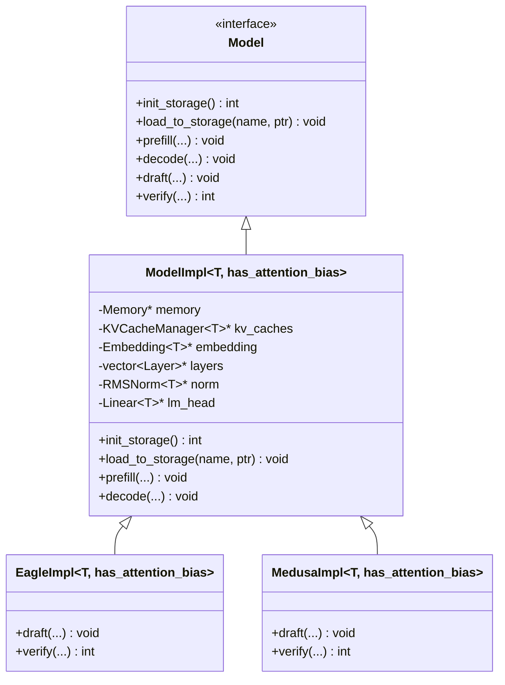
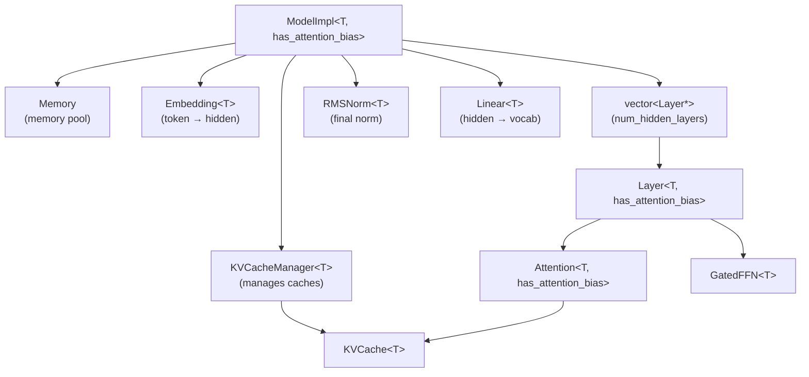
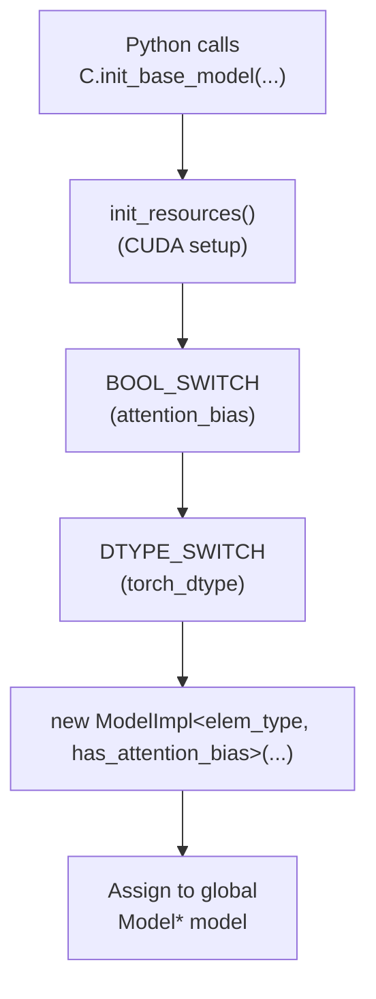
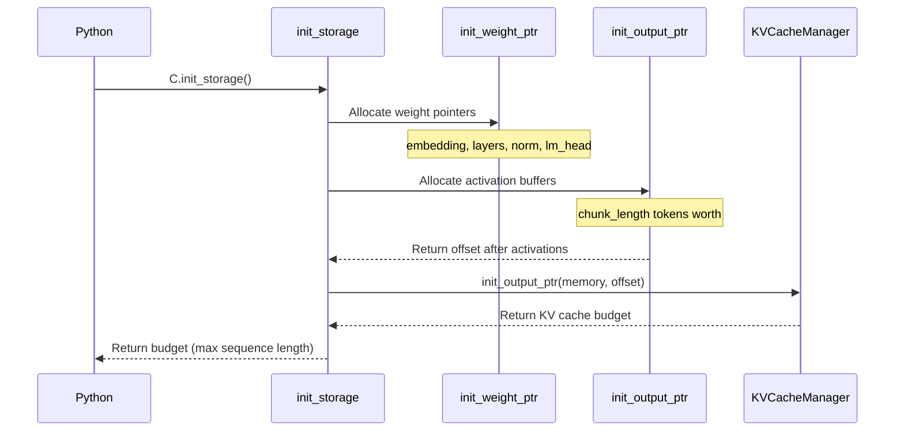
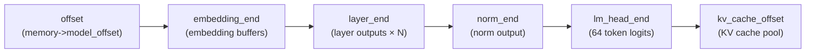
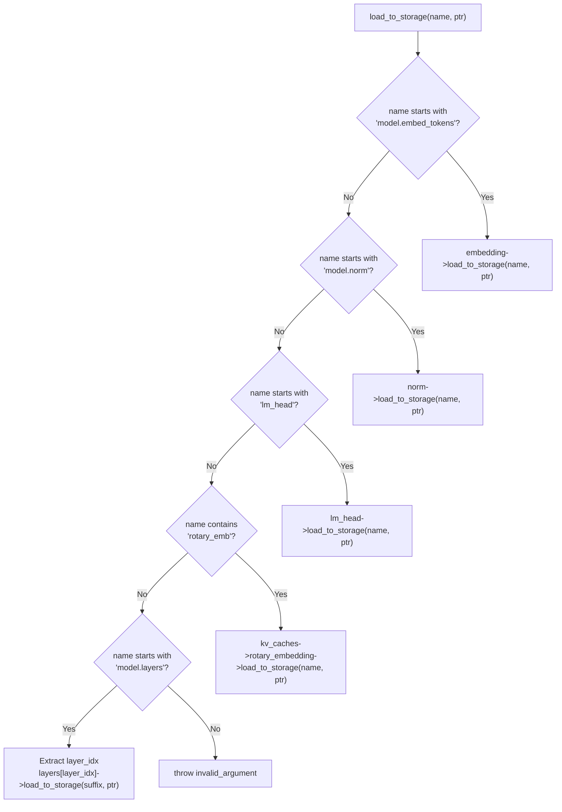
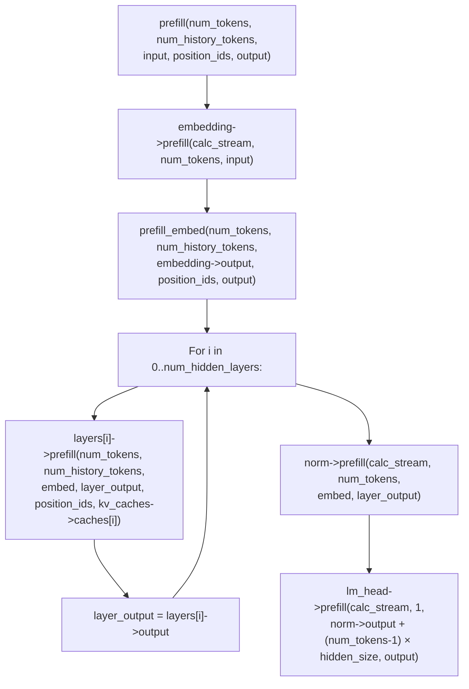
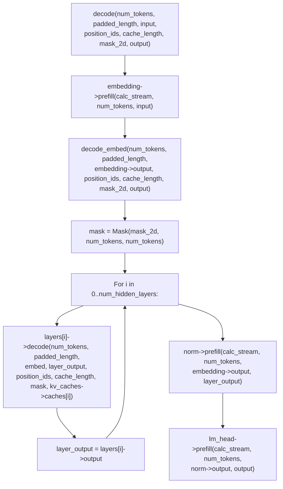
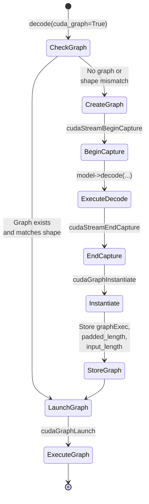
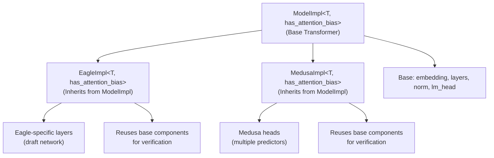

<!-- source: DeepWiki mcp.deepwiki.com · repo thunlp/FR-Spec · page 4.1 ModelImpl: Base Transformer · fetched 2026-11-02 -->

# ModelImpl: Base Transformer

<details>
<summary>Relevant source files</summary>

The following files were used as context for generating this wiki page:

- [src/entry.cu](src/entry.cu)
- [src/model/model.cuh](src/model/model.cuh)

</details>


## Purpose and Scope

This document provides detailed technical documentation for the `ModelImpl` class, which implements the base transformer model in FR-Spec. `ModelImpl` serves as the foundation for all inference operations and is extended by speculative decoding implementations like `EagleImpl` and `MedusaImpl`.

The `ModelImpl` class is responsible for:
- Initializing transformer architecture components (embedding, layers, normalization, LM head)
- Managing GPU memory allocation for weights and activations
- Loading model weights from HuggingFace format
- Executing prefill operations (processing input prompts)
- Executing decode operations (generating new tokens)
- Maintaining KV cache for efficient autoregressive generation

For information about speculative decoding extensions that build on `ModelImpl`, see [EAGLE Implementation](#5.1) and [Medusa Implementation](#5.2). For details on individual transformer components, see [Attention Mechanism](#4.2), [Feed-Forward Networks](#4.3), and [Transformer Layers](#4.4).

---

## Class Structure

### Template Parameters and Inheritance

`ModelImpl` is a template class defined in [src/model/model.cuh:25-168]() with two parameters:

```cpp
template <typename T, bool has_attention_bias=false>
struct ModelImpl : Model
```

| Parameter | Purpose | Valid Values |
|-----------|---------|--------------|
| `T` | Element type for weights and activations | `__half` (FP16) or `__nv_bfloat16` (BF16) |
| `has_attention_bias` | Whether attention layers include bias terms | `true` or `false` |

The class inherits from the abstract `Model` interface [src/model/model.cuh:14-23](), which defines the standard operations that all model variants must implement.

**ModelImpl Class Hierarchy**



Sources: [src/model/model.cuh:14-26](), [src/entry.cu:32-68]()

---

## Component Members

### Core Configuration

The `ModelImpl` class stores architecture hyperparameters as member variables [src/model/model.cuh:29-37]():

| Member | Type | Description |
|--------|------|-------------|
| `vocab_size` | `int` | Size of token vocabulary |
| `num_hidden_layers` | `int` | Number of transformer layers |
| `hidden_size` | `int` | Dimension of hidden states |
| `intermediate_size` | `int` | Dimension of FFN intermediate layer |
| `num_attention_heads` | `int` | Number of query attention heads |
| `num_key_value_heads` | `int` | Number of key-value heads (for GQA) |
| `head_dim` | `int` | Dimension per attention head |
| `rms_norm_eps` | `float` | Epsilon value for RMSNorm stability |
| `chunk_length` | `int` | Maximum sequence length for memory allocation |

### Component Pointers

The transformer architecture is decomposed into specialized components [src/model/model.cuh:40-45]():

| Member | Type | Purpose |
|--------|------|---------|
| `memory` | `Memory*` | Memory pool manager for GPU allocations |
| `kv_caches` | `KVCacheManager<T>*` | Manages key-value caches across layers |
| `embedding` | `Embedding<T>*` | Token embedding lookup table |
| `layers` | `vector<Layer<T, has_attention_bias>*>` | Transformer layers (attention + FFN) |
| `norm` | `RMSNorm<T>*` | Final layer normalization |
| `lm_head` | `Linear<T>*` | Output projection to vocabulary |

**Component Relationship Diagram**



Sources: [src/model/model.cuh:27-45]()

---

## Initialization

### Constructor

The `ModelImpl` constructor [src/model/model.cuh:47-81]() initializes all components with the provided configuration:

```cpp
ModelImpl(
    int64_t memory_limit,
    void* memory_pool,
    int vocab_size,
    int num_hidden_layers,
    int hidden_size,
    int intermediate_size,
    int num_attention_heads,
    int num_key_value_heads,
    int head_dim,
    float rms_norm_eps,
    int chunk_length
)
```

**Initialization Steps:**

1. Store configuration parameters [src/model/model.cuh:60-69]()
2. Create `Memory` manager with pre-allocated pool [src/model/model.cuh:71]()
3. Create `KVCacheManager` for all layers [src/model/model.cuh:73]()
4. Create `Embedding` layer [src/model/model.cuh:75]()
5. Create `num_hidden_layers` transformer layers in a loop [src/model/model.cuh:76-78]()
6. Create final `RMSNorm` [src/model/model.cuh:79]()
7. Create `Linear` LM head [src/model/model.cuh:80]()

### Instantiation from Python

The `ModelImpl` is instantiated through the `init_base_model` function in [src/entry.cu:34-68](), which uses template metaprogramming to select the correct specialization:

**Template Instantiation Flow**



The `DTYPE_SWITCH` macro [src/entry.cu:10-19]() selects between `__half` (FP16) and `__nv_bfloat16` (BF16) based on the `torch_dtype` parameter (0 for FP16, otherwise BF16).

The `BOOL_SWITCH` macro [src/entry.cu:21-30]() compiles two versions of the code, one with and one without attention bias.

Sources: [src/entry.cu:34-68](), [src/entry.cu:10-30](), [src/model/model.cuh:47-81]()

---

## Memory Allocation

### Storage Initialization

After construction, the `init_storage()` method [src/model/model.cuh:105-110]() allocates GPU memory for all weights, activations, and KV caches:

**Memory Allocation Sequence**



### Weight Pointer Initialization

The `init_weight_ptr()` method [src/model/model.cuh:83-91]() assigns memory addresses for model weights from the pre-allocated pool. This creates pointers but does not load actual weight data yet:

1. `embedding->init_weight_ptr(memory)` - allocates space for embedding table
2. For each layer: `layers[i]->init_weight_ptr(memory)` - allocates layer weights
3. `norm->init_weight_ptr(memory)` - allocates normalization parameters
4. `lm_head->init_weight_ptr(memory)` - allocates output projection weights
5. `kv_caches->init_weight_ptr(memory)` - allocates rotary embedding tables

### Activation Buffer Allocation

The `init_output_ptr()` method [src/model/model.cuh:93-103]() allocates workspace buffers for intermediate activations during forward passes. The allocation is sized for `chunk_length` tokens (typically the maximum sequence length):



Note that the LM head is allocated for only 64 tokens [src/model/model.cuh:101](), not `chunk_length`, as it's primarily used in decode mode which processes fewer tokens.

Sources: [src/model/model.cuh:83-110]()

---

## Weight Loading

### Load Dispatch

The `load_to_storage()` method [src/model/model.cuh:112-133]() routes weight tensors from Python to the appropriate component based on the parameter name:

**Weight Name Routing**



### Layer Weight Extraction

For layer weights, the method uses regex to extract the layer index from names like `model.layers.20.attn.q_proj.weight` [src/model/model.cuh:121-129]():

```cpp
std::regex layer_regex("model\\.layers\\.(\\d+)\\.(.*)");
std::smatch matches;
if (std::regex_search(name, matches, layer_regex)) {
    int layer_idx = std::stoi(matches[1]);      // e.g., "20"
    layers[layer_idx]->load_to_storage(matches[2], ptr);  // e.g., "attn.q_proj.weight"
}
```

This delegates the remaining name parsing to the individual `Layer` object, which further routes to `Attention` or `GatedFFN` components.

Sources: [src/model/model.cuh:112-133]()

---

## Prefill Operation

### Purpose and Flow

Prefill processes the initial input prompt to populate the KV cache before autoregressive generation begins. The operation processes all prompt tokens in parallel.

**Prefill Execution Pipeline**



### Implementation Details

The prefill is split into two methods:

1. **`prefill()`** [src/model/model.cuh:145-148]() - Entry point that converts token IDs to embeddings:
   - Calls `embedding->prefill()` to look up token embeddings
   - Delegates to `prefill_embed()` for transformer processing

2. **`prefill_embed()`** [src/model/model.cuh:135-143]() - Core transformer computation:
   - Iterates through all `num_hidden_layers` layers sequentially
   - Each layer processes embeddings and updates KV cache
   - Uses residual connections: each layer receives original embedding + previous output
   - Final normalization applies to last layer output
   - LM head projects only the **last token** (at index `num_tokens - 1`) to vocabulary space

**Key Parameters:**

| Parameter | Purpose |
|-----------|---------|
| `num_tokens` | Number of tokens in input prompt |
| `num_history_tokens` | Length of existing KV cache (0 for fresh prompt) |
| `input` | Token IDs (shape: `[num_tokens]`) |
| `position_ids` | Position indices for rotary embeddings |
| `output` | Output logits for next token prediction (shape: `[vocab_size]`) |

Note that prefill only computes logits for the last position [src/model/model.cuh:142](), as earlier positions are not needed for generation.

Sources: [src/model/model.cuh:135-148]()

---

## Decode Operation

### Purpose and Flow

Decode generates new tokens autoregressively, processing one or more tokens at a time (batch size > 1 is used during speculative decoding verification).

**Decode Execution Pipeline**



### Implementation Details

The decode operation is also split into two methods:

1. **`decode()`** [src/model/model.cuh:161-164]() - Entry point that converts token IDs to embeddings:
   - Calls `embedding->prefill()` (same as prefill, just a lookup)
   - Delegates to `decode_embed()` for transformer processing

2. **`decode_embed()`** [src/model/model.cuh:150-159]() - Core transformer computation:
   - Creates `Mask` object from 2D attention mask [src/model/model.cuh:151]()
   - Iterates through all layers, calling `layer->decode()` instead of `layer->prefill()`
   - Unlike prefill, the LM head projects **all tokens** to vocabulary space [src/model/model.cuh:158]()

**Differences from Prefill:**

| Aspect | Prefill | Decode |
|--------|---------|--------|
| Attention mask | Causal (lower triangular) | Custom 2D mask for tree attention |
| KV cache append | Batch append | Selective append based on mask |
| LM head tokens | 1 (last token) | `num_tokens` (all positions) |
| Typical batch size | 1 (single prompt) | Variable (1 for normal, N for verification) |

### Attention Mask Handling

The `mask_2d` parameter [src/model/model.cuh:151]() is a 2D binary mask stored as `uint64_t` bitfields. Each row specifies which KV cache positions a query can attend to. This enables:
- Tree-structured attention during speculative decoding verification
- Efficient packed representation (64 positions per uint64_t)

Sources: [src/model/model.cuh:150-164]()

---

## CUDA Graph Optimization

The Python binding layer in [src/entry.cu:142-164]() optionally wraps decode calls in CUDA graphs to reduce kernel launch overhead:

**CUDA Graph Capture Flow**



**Graph Invalidation:**

The CUDA graph is recreated when either `input_length` or `padded_length` changes [src/entry.cu:144-158](), as these dimensions affect tensor shapes throughout the computation. When invalidated:
1. Existing graph is destroyed
2. New graph is captured via `cudaStreamBeginCapture`
3. One full decode pass is recorded
4. Graph is instantiated and stored for future launches

This optimization is particularly effective during autoregressive generation where the same operation (decode with 1 token) is repeated many times with identical shapes.

Sources: [src/entry.cu:142-164]()

---

## Speculative Decoding Stubs

The base `ModelImpl` class provides stub implementations for speculative decoding methods [src/model/model.cuh:166-167]():

```cpp
void draft(...) { throw std::runtime_error("Draft is not supported"); }
int verify(...) { throw std::runtime_error("Verify is not supported"); }
```

These methods are part of the `Model` interface but are only implemented in subclasses:
- `EagleImpl` implements draft and verify for EAGLE-2 speculative decoding
- `MedusaImpl` implements draft and verify for Medusa-style speculative decoding

The base model operates in standard autoregressive mode without speculation.

Sources: [src/model/model.cuh:166-167]()

---

## Relationship to Other Components

### Extended by Speculative Decoders

`ModelImpl` serves as the base class for speculative decoding implementations:

**Inheritance and Composition Pattern**



When `init_eagle_model()` or `init_medusa_model()` is called [src/entry.cu:97-128](), the existing `ModelImpl` instance is passed to the speculative decoder constructor, which wraps it and adds draft-specific components.

### Memory Sharing

All components share the same `Memory` pool [src/model/model.cuh:27](), enabling efficient memory reuse between base model and speculative extensions. The memory allocation strategy is coordinated in the initialization phase to ensure all components fit within the available GPU memory budget.

Sources: [src/entry.cu:97-128](), [src/model/model.cuh:27]()

---

## Summary Table

| Operation | Method | Purpose | Output |
|-----------|--------|---------|--------|
| Initialization | `ModelImpl()` constructor | Create component hierarchy | Configured model instance |
| Memory setup | `init_storage()` | Allocate GPU memory | KV cache budget |
| Weight loading | `load_to_storage()` | Copy weights from Python | None (side effect) |
| Prompt processing | `prefill()` | Process input prompt | Logits for next token |
| Token generation | `decode()` | Generate new token(s) | Logits for all positions |
| Graph optimization | `decode()` with `cuda_graph=True` | Reduce launch overhead | Same as decode |

Sources: [src/model/model.cuh:25-168](), [src/entry.cu:34-164]()

---

