<!-- source: DeepWiki mcp.deepwiki.com · repo thunlp/FR-Spec · page 4.2 Attention Mechanism · fetched 2026-11-02 -->

# Attention Mechanism

<details>
<summary>Relevant source files</summary>

The following files were used as context for generating this wiki page:

- [README.md](README.md)
- [src/flash_attn/flash_api.hpp](src/flash_attn/flash_api.hpp)
- [src/model/attn.cuh](src/model/attn.cuh)

</details>


## Purpose and Scope

This document details the `Attention` component in FR-Spec's transformer architecture. The `Attention` struct implements multi-head attention with support for grouped-query attention (GQA), rotary position embeddings (RoPE), KV caching, and Flash Attention optimization. This component is used by transformer layers to compute attention over token sequences during both prefill (prompt processing) and decode (token generation) phases.

For information about how attention fits into the complete transformer layer, see [4.4](#4.4). For Flash Attention kernel implementation details, see [7.1](#7.1). For KV cache management, see [3.2](#3.2).

## Architecture Overview

The `Attention` struct is a templated component that encapsulates all operations required for computing multi-head attention in a transformer model.

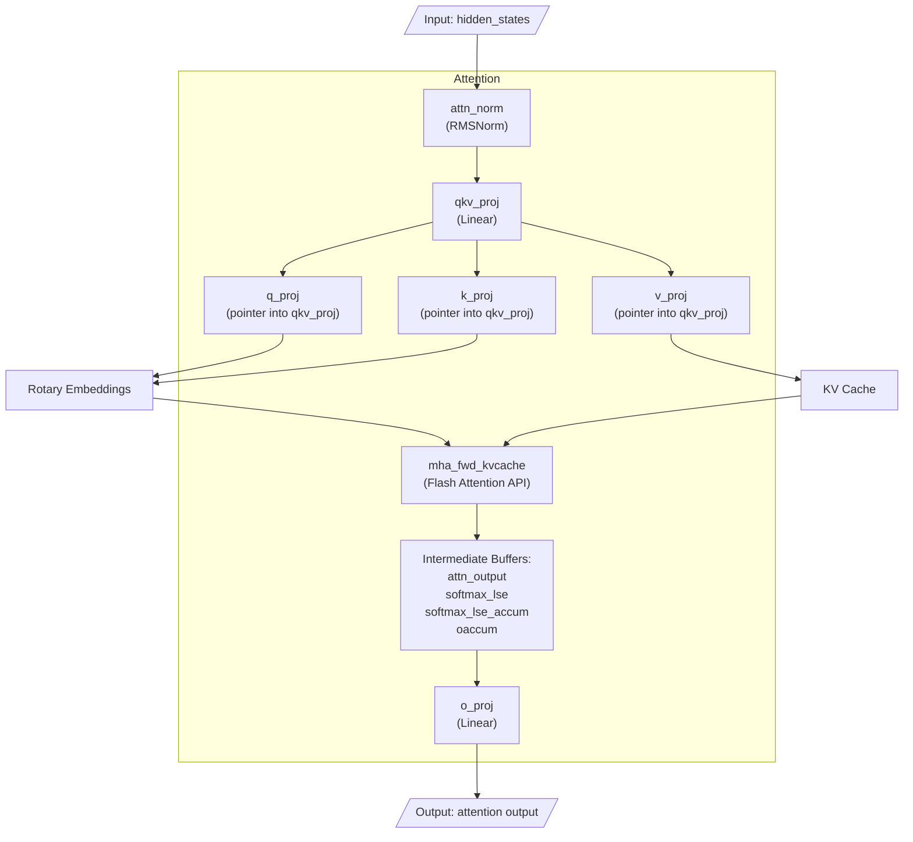

**Sources:** [src/model/attn.cuh:57-87]()

### Template Parameters

| Parameter | Description |
|-----------|-------------|
| `T` | Element type (e.g., `half` for FP16, `__nv_bfloat16` for BF16) |
| `has_attention_bias` | Boolean flag indicating whether attention projections include bias terms |

**Sources:** [src/model/attn.cuh:57]()

### Key Member Variables

| Member | Type | Purpose |
|--------|------|---------|
| `hidden_size` | `int` | Dimension of input/output hidden states |
| `num_attention_heads` | `int` | Number of query heads |
| `num_key_value_heads` | `int` | Number of key/value heads (for GQA) |
| `head_dim` | `int` | Dimension of each attention head |
| `attn_norm` | `Norm<T>*` | Pre-attention RMS normalization |
| `qkv_proj` | `Linear<T>*` | Combined QKV projection |
| `q_proj`, `k_proj`, `v_proj` | `Linear<T>*` | Pointers into `qkv_proj` for separate Q, K, V access |
| `o_proj` | `Linear<T>*` | Output projection |
| `softmax_lse` | `float*` | Log-sum-exp for softmax computation |
| `softmax_lse_accum` | `float*` | Accumulated LSE for split-KV |
| `oaccum` | `float*` | Accumulated output for split-KV |

**Sources:** [src/model/attn.cuh:59-72]()

## Component Initialization

### Constructor

The `Attention` constructor initializes all sub-components but does not allocate GPU memory. Memory allocation occurs separately via `init_weight_ptr` and `init_output_ptr`.

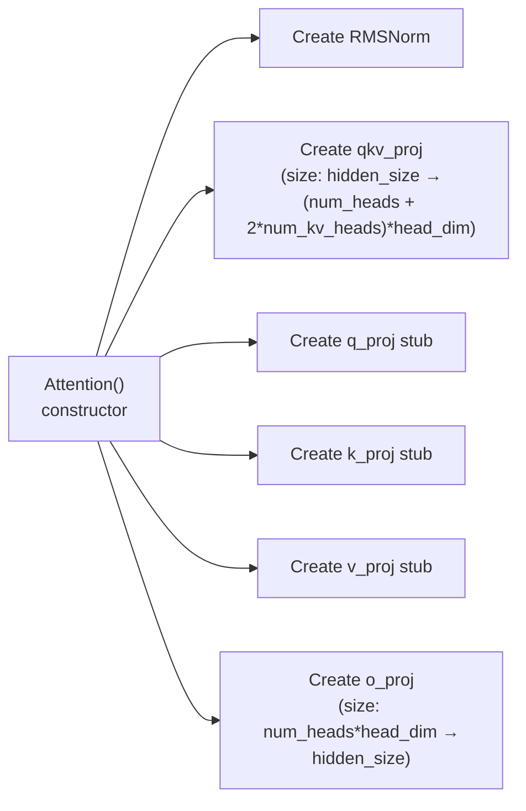

**Sources:** [src/model/attn.cuh:74-87]()

### Weight Pointer Initialization

The `init_weight_ptr` method sets up pointers to model weights stored in the memory pool. The QKV projection weights are stored contiguously, with separate logical views for Q, K, and V.

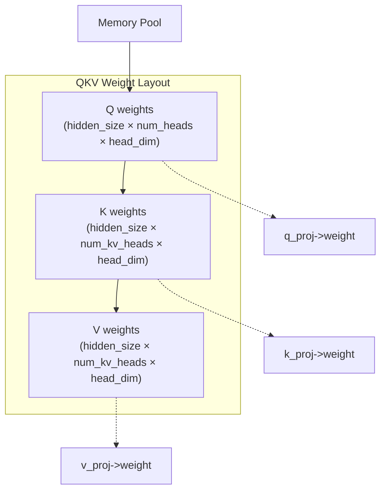

The weight pointer setup uses offset arithmetic to create separate views:

- `q_proj->weight = qkv_proj->weight`
- `k_proj->weight = q_proj->weight + hidden_size * num_attention_heads * head_dim`
- `v_proj->weight = k_proj->weight + hidden_size * num_key_value_heads * head_dim`

If `has_attention_bias` is true, bias pointers are set up similarly.

**Sources:** [src/model/attn.cuh:89-102]()

### Output Buffer Allocation

The `init_output_ptr` method allocates intermediate buffers required for attention computation:

| Buffer | Size | Purpose |
|--------|------|---------|
| `attn_output` | `num_tokens × num_heads × head_dim × sizeof(T)` | Attention output before final projection |
| `softmax_lse` | `num_tokens × num_heads × sizeof(float)` | Log-sum-exp for softmax |
| `softmax_lse_accum` | `num_tokens × num_heads × sizeof(float)` | Accumulated LSE for split-KV attention |
| `oaccum` | `num_tokens × num_heads × head_dim × sizeof(float)` | Accumulated output for split-KV attention |

**Sources:** [src/model/attn.cuh:104-120]()

## QKV Projections and Grouped-Query Attention

The attention mechanism supports Grouped-Query Attention (GQA) where the number of key/value heads (`num_key_value_heads`) can be less than the number of query heads (`num_attention_heads`). This reduces memory bandwidth and KV cache size.

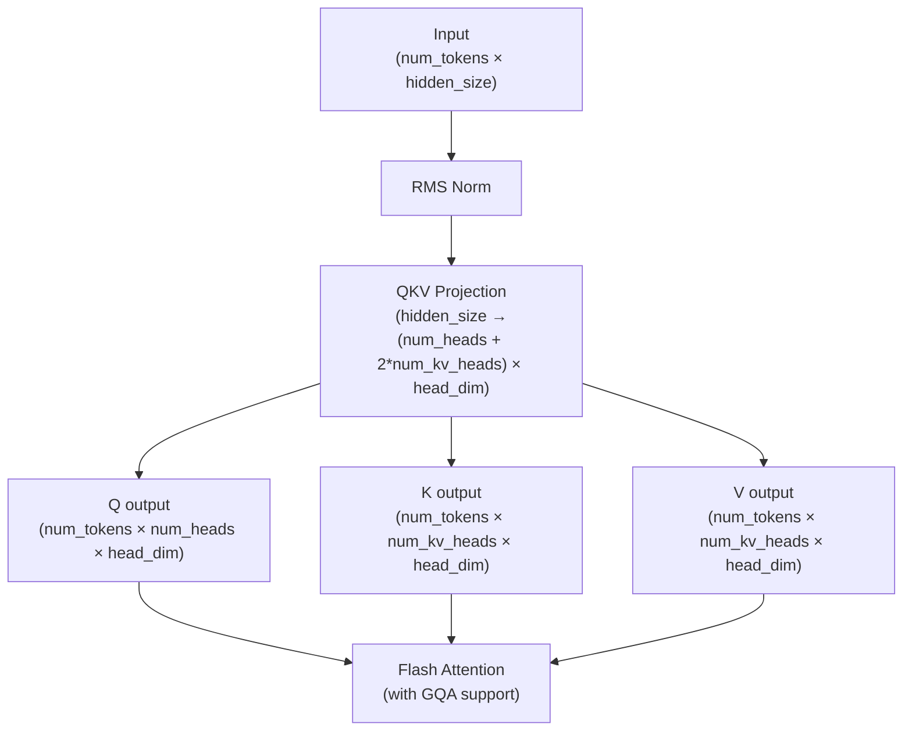

The ratio `num_attention_heads / num_key_value_heads` determines the number of query heads that share each key/value head. For example, with 32 query heads and 8 KV heads, each KV head is shared by 4 query heads.

**Sources:** [src/model/attn.cuh:82-86](), [src/flash_attn/flash_api.hpp:86-88]()

## Rotary Position Embeddings

Rotary Position Embeddings (RoPE) are applied to query and key tensors to inject position information. The rotary embedding operation is provided by the KV cache's `rotary_embedding` component.

During prefill:
```
rotary_embedding->prefill(stream, num_tokens, num_attention_heads, num_key_value_heads, q_output, k_cache, position_ids)
```

During decode:
```
rotary_embedding->prefill(stream, num_tokens, num_attention_heads, num_key_value_heads, q, k, position_ids)
```

The `position_ids` array specifies the position of each token in the sequence, allowing the model to understand relative positions even when processing tokens out of order (e.g., in speculative decoding).

**Sources:** [src/model/attn.cuh:146](), [src/model/attn.cuh:190]()

## KV Cache Integration

The attention mechanism integrates tightly with the KV cache to enable efficient autoregressive generation. During inference, previously computed key and value tensors are cached to avoid redundant computation.

### Copy to KV Cache

The `copy_to_kvcache_kernel` copies newly computed K and V tensors into the KV cache at the appropriate positions:

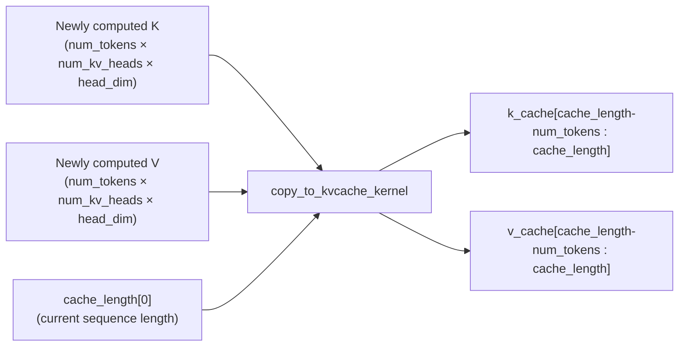

**Sources:** [src/model/attn.cuh:13-20](), [src/model/attn.cuh:42-46]()

### Prefill vs Decode KV Cache Handling

**Prefill:** Keys and values are written directly to cache during the K/V projection:
```
k_proj->prefill(stream, num_tokens, attn_norm->output, k_cache)
v_proj->prefill(stream, num_tokens, attn_norm->output, v_cache)
```

**Decode:** Keys and values are computed first, then copied to cache:
```
// Compute Q, K, V
qkv_proj->prefill(stream, num_tokens, attn_norm->output)
// Apply RoPE
rotary_embedding->prefill(stream, num_tokens, ...)
// Copy K, V to cache
copy_to_kvcache(stream, num_tokens, k, v, kv_cache, cache_length)
```

**Sources:** [src/model/attn.cuh:144-145](), [src/model/attn.cuh:182-192]()

## Flash Attention Integration

FR-Spec uses a modified version of Flash Attention v2 for efficient attention computation. The integration point is the `mha_fwd_kvcache` function, which provides a specialized API for KV cache scenarios.

### mha_fwd_kvcache API

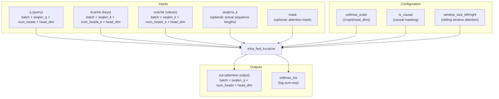

**Sources:** [src/flash_attn/flash_api.hpp:207-304]()

### Key Parameters

| Parameter | Purpose |
|-----------|---------|
| `is_bf16` | Whether to use BF16 (true) or FP16 (false) precision |
| `batch_size` | Number of sequences in batch (typically 1 for inference) |
| `seqlen_q` | Length of query sequence |
| `seqlen_k` | Total length of key/value cache |
| `seqlen_knew` | Number of new tokens being added (for decode) |
| `num_heads` / `num_heads_k` | Number of query and key/value heads (for GQA) |
| `seqlens_k` | Optional per-sequence actual lengths (enables variable-length batching) |
| `mask` | Optional 2D attention mask |
| `softmax_lse_accum` / `oaccum` | Buffers for split-KV attention |

**Sources:** [src/flash_attn/flash_api.hpp:207-231]()

### Split-KV Optimization

For decode operations with long sequences, Flash Attention can use split-KV to improve parallelism. When `seqlens_k` is provided, the kernel automatically uses `num_splits = 4` to process the KV cache in parallel chunks.

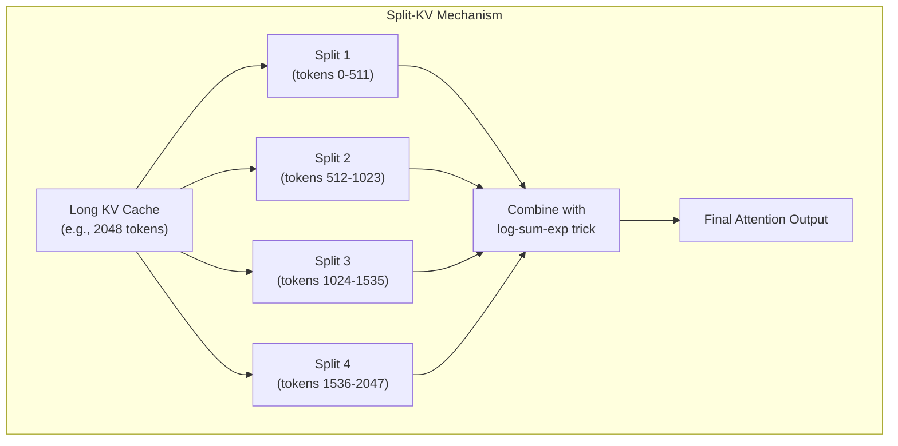

**Sources:** [src/flash_attn/flash_api.hpp:289-295](), [src/flash_attn/flash_api.hpp:189-204]()

## Prefill Operation

The `prefill` method processes multiple tokens simultaneously during the initial prompt processing phase.

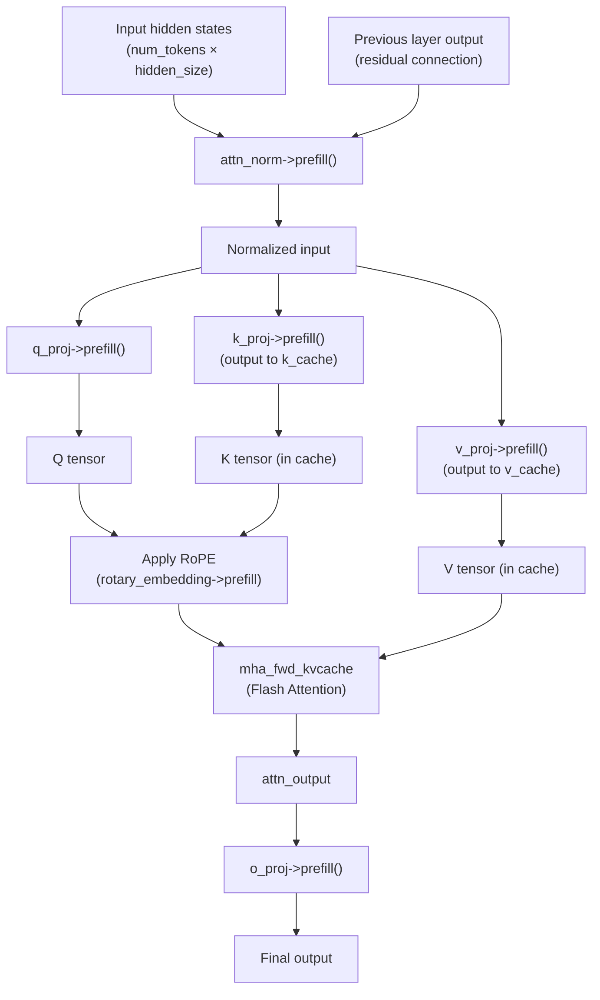

### Prefill Flow Details

1. **Normalization:** Apply RMS normalization to input with residual from previous layer
2. **QKV Projection:** Project normalized input to Q, K, V tensors
   - K and V are written directly to KV cache
3. **Rotary Embeddings:** Apply RoPE to Q and K tensors based on position IDs
4. **Flash Attention:** Compute attention with full bidirectional mask
5. **Output Projection:** Project attention output back to hidden dimension

**Sources:** [src/model/attn.cuh:138-176]()

### Prefill Flash Attention Parameters

During prefill, the attention operates over the full prompt:
- `seqlen_q = num_tokens` (number of tokens in prompt)
- `seqlen_k = num_history_tokens + num_tokens` (total cache length)
- `is_causal = true` (typically, for autoregressive models)
- `mask = nullptr` (causal mask is handled internally)

**Sources:** [src/model/attn.cuh:148-172]()

## Decode Operation

The `decode` method processes tokens during autoregressive generation. It handles both single-token decode and batched multi-token decode (for speculative decoding).

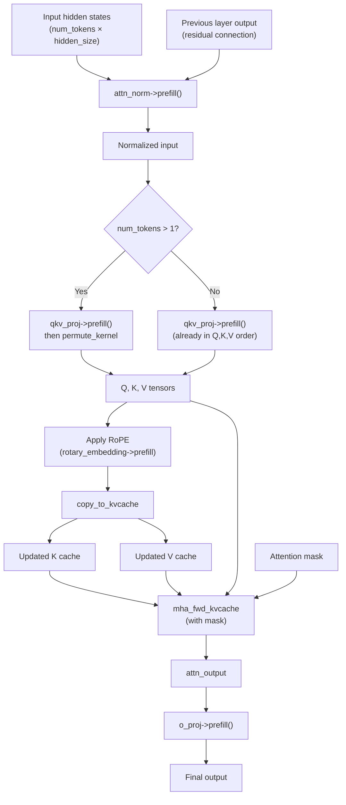

### Decode Flow Details

1. **Normalization:** Apply RMS normalization
2. **QKV Projection:** 
   - If `num_tokens == 1`: Compute QKV directly (already in correct layout)
   - If `num_tokens > 1`: Compute QKV in interleaved format, then permute to separate Q, K, V
3. **Rotary Embeddings:** Apply RoPE to Q and K
4. **Copy to Cache:** Copy new K and V to KV cache
5. **Flash Attention:** Compute attention over all cached keys/values with optional mask
6. **Output Projection:** Project to hidden dimension

**Sources:** [src/model/attn.cuh:178-222]()

### Permute Optimization

For batched decode (multiple tokens), the QKV projection outputs are in interleaved format: `[Q0, K0, V0, Q1, K1, V1, ...]`. The `permute_kernel` rearranges this to `[Q0, Q1, ..., K0, K1, ..., V0, V1, ...]` for efficient cache copying.

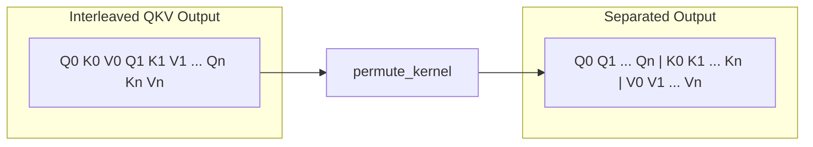

**Sources:** [src/model/attn.cuh:22-39](), [src/model/attn.cuh:182-183]()

### Decode Attention Mask

During decode, an attention mask may be provided to support speculative decoding with tree-structured token candidates. The mask determines which positions can attend to which other positions.

**Sources:** [src/model/attn.cuh:178](), [src/model/attn.cuh:207]()

## Memory Layout and Buffer Management

The attention component allocates several intermediate buffers for computation:

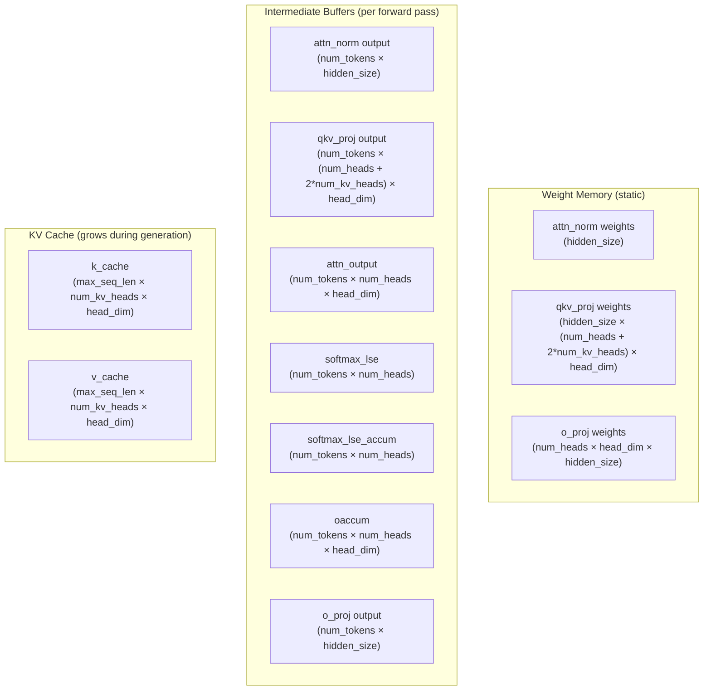

### Buffer Allocation Strategy

Buffers are allocated by the `init_output_ptr` method, which:
1. Allocates each buffer sequentially in the memory pool
2. Returns the maximum offset used, accounting for potential overlaps
3. Some buffers (like `softmax_lse_accum` and `oaccum`) are only used during split-KV attention

**Sources:** [src/model/attn.cuh:104-120]()

### Memory Reuse

The attention component reuses the same output buffers across multiple forward passes. Buffer contents are overwritten on each call to `prefill` or `decode`, so no explicit clearing is needed.

**Sources:** [src/model/attn.cuh:111](), [src/model/attn.cuh:117]()

## Code Entity Reference

### Key Types and Functions

| Entity | Location | Purpose |
|--------|----------|---------|
| `Attention<T, has_attention_bias>` | [src/model/attn.cuh:57-223]() | Main attention component struct |
| `copy_to_kvcache_kernel` | [src/model/attn.cuh:13-20]() | CUDA kernel to copy K/V to cache |
| `permute_kernel` | [src/model/attn.cuh:22-39]() | CUDA kernel to separate interleaved QKV |
| `mha_fwd_kvcache` | [src/flash_attn/flash_api.hpp:207-304]() | Flash Attention entry point |
| `set_params_fprop` | [src/flash_attn/flash_api.hpp:13-131]() | Configure Flash Attention parameters |
| `run_mha_fwd` | [src/flash_attn/flash_api.hpp:133-145]() | Dispatch Flash Attention kernel |

**Sources:** [src/model/attn.cuh](), [src/flash_attn/flash_api.hpp]()

---

