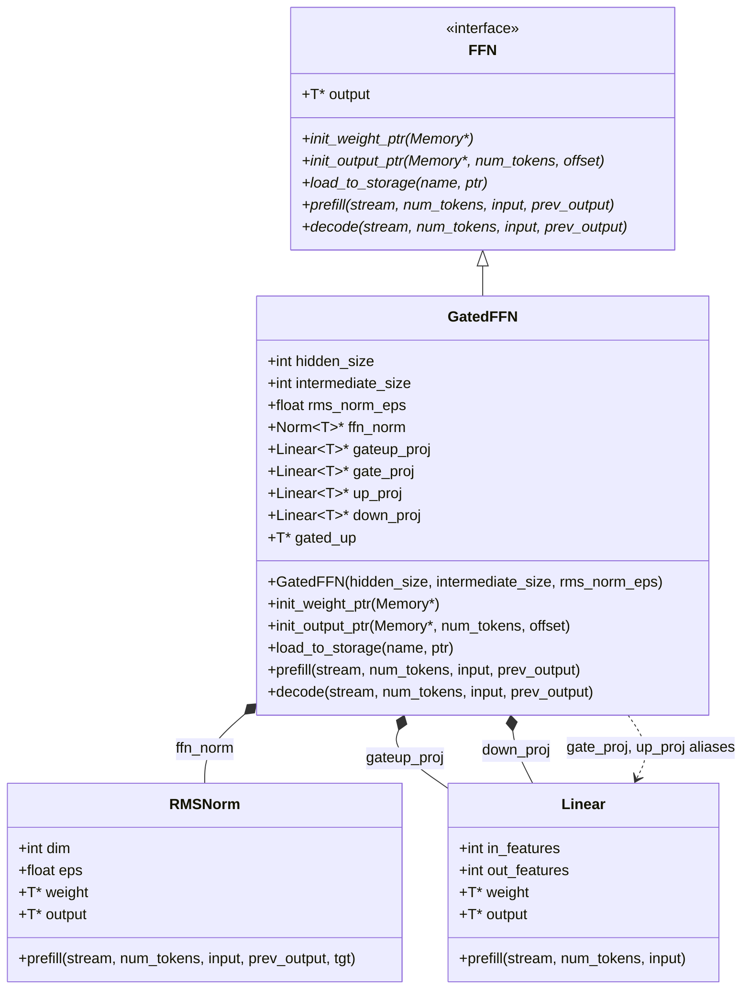
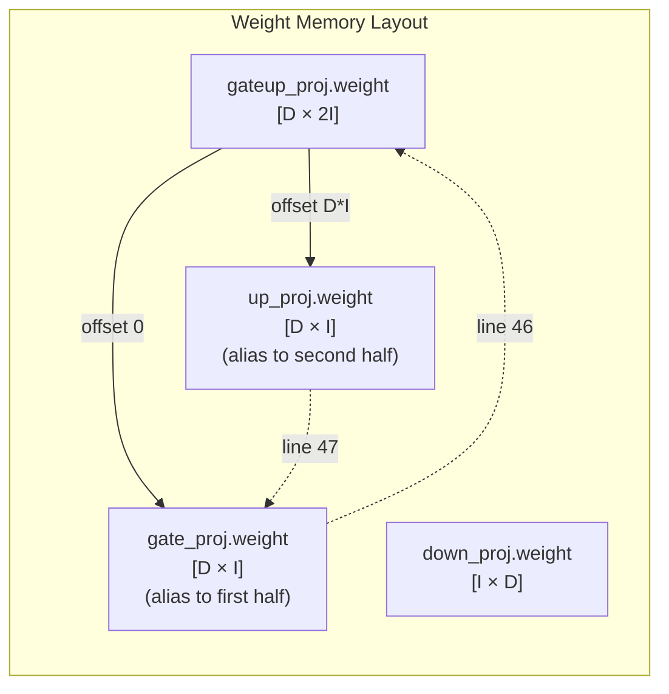
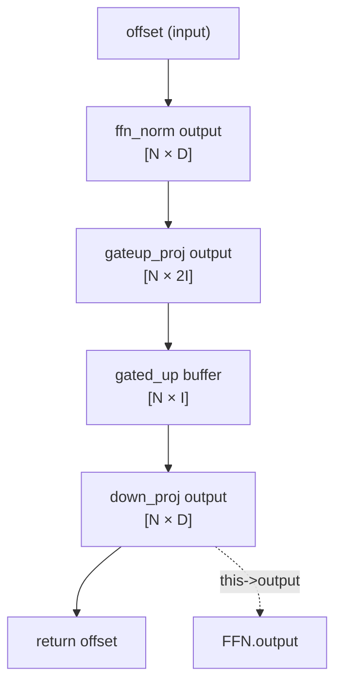
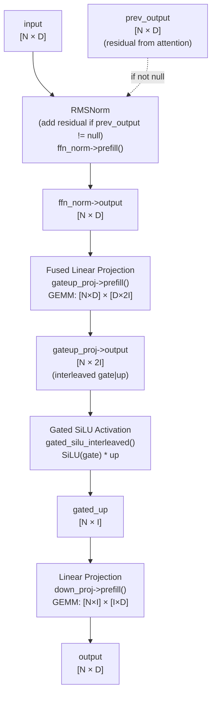
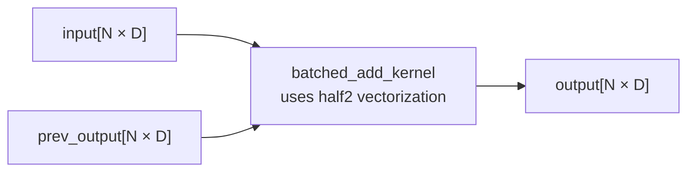
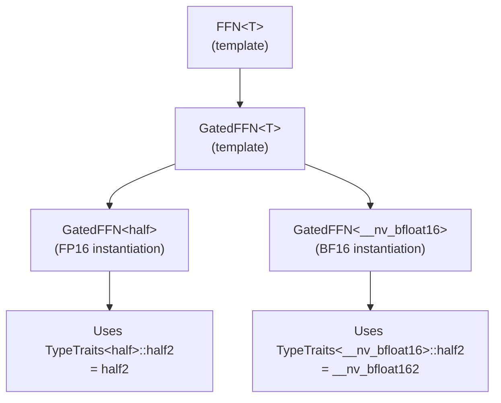

<!-- source: DeepWiki mcp.deepwiki.com · repo thunlp/FR-Spec · page 4.3 Feed-Forward Networks · fetched 2026-11-02 -->

# Feed-Forward Networks

<details>
<summary>Relevant source files</summary>

The following files were used as context for generating this wiki page:

- [src/model/elementwise.cuh](src/model/elementwise.cuh)
- [src/model/ffn.cuh](src/model/ffn.cuh)
- [src/model/norm.cuh](src/model/norm.cuh)

</details>


## Purpose and Scope

This document describes the feed-forward network (FFN) component in FR-Spec's transformer implementation. The FFN performs position-wise transformations in each transformer layer, expanding the representation to an intermediate dimension and then projecting back. FR-Spec implements a gated FFN variant with SiLU activation, commonly used in LLaMA-family models.

For information about how FFN integrates with attention into complete transformer layers, see [Transformer Layers](#4.4). For details on the normalization operations used by FFN, see the RMSNorm implementation referenced in this document.

---

## Architecture Overview

The FFN component is defined in [src/model/ffn.cuh]() with two key classes: an abstract `FFN<T>` base template and the concrete `GatedFFN<T>` implementation.

### Class Hierarchy



**Sources:** [src/model/ffn.cuh:8-86]()

---

## GatedFFN Components

The `GatedFFN` class implements a gated feed-forward network with the following architectural components:

| Component | Type | Shape Transformation | Purpose |
|-----------|------|---------------------|---------|
| `ffn_norm` | `RMSNorm<T>` | `[N, D] → [N, D]` | Normalizes input before FFN |
| `gateup_proj` | `Linear<T>` | `[N, D] → [N, 2*I]` | Projects to double intermediate size |
| `gate_proj` | `Linear<T>` (alias) | `[N, D] → [N, I]` | First half of gateup_proj |
| `up_proj` | `Linear<T>` (alias) | `[N, D] → [N, I]` | Second half of gateup_proj |
| `down_proj` | `Linear<T>` | `[N, I] → [N, D]` | Projects back to hidden size |
| `gated_up` | `T*` (buffer) | `[N, I]` | Stores intermediate activation |

Where:
- `N` = number of tokens (batch size × sequence length)
- `D` = `hidden_size` (model dimension)
- `I` = `intermediate_size` (typically 4×D or larger)

### Constructor and Initialization

[src/model/ffn.cuh:31-41]() shows the constructor initializing sub-components:

- Creates `RMSNorm` with `hidden_size` and `rms_norm_eps`
- Creates `gateup_proj` linear layer with output size `2*intermediate_size`
- Creates separate `gate_proj` and `up_proj` objects (these share storage with `gateup_proj`)
- Creates `down_proj` for final projection

The key optimization here is that `gate_proj` and `up_proj` are implemented as views into `gateup_proj`'s weight tensor, avoiding redundant storage and computation by fusing the two projections into a single GEMM operation.

**Sources:** [src/model/ffn.cuh:19-41]()

---

## Memory Layout and Weight Initialization

### Weight Pointer Initialization

The `init_weight_ptr()` method [src/model/ffn.cuh:43-49]() sets up memory pointers for model weights:



The critical pointer arithmetic at [src/model/ffn.cuh:46-47]():
- `gate_proj->weight = gateup_proj->weight`
- `up_proj->weight = gate_proj->weight + hidden_size * intermediate_size`

This creates two views of the unified `gateup_proj` weight tensor, enabling a single matrix multiplication to compute both gate and up projections simultaneously.

### Output Buffer Allocation

The `init_output_ptr()` method [src/model/ffn.cuh:51-58]() allocates intermediate buffers in sequence:



Each component allocates its output buffer sequentially in the memory pool, ensuring efficient memory reuse and cache locality.

**Sources:** [src/model/ffn.cuh:43-58]()

---

## Forward Pass Data Flow

### Prefill and Decode Operations

Both `prefill()` [src/model/ffn.cuh:74-81]() and `decode()` [src/model/ffn.cuh:83-85]() use the same implementation, reflecting that FFN operations are identical for both phases (unlike attention which differs significantly).



### Gated SiLU Activation

The `gated_silu_interleaved` function [src/model/ffn.cuh:78]() performs the gating mechanism. Given the interleaved output from `gateup_proj`:

```
output[i, :] = [gate₀, gate₁, ..., gate_{I-1}, up₀, up₁, ..., up_{I-1}]
```

The activation computes:
```
gated_up[i, j] = SiLU(gate_j) × up_j
               = (gate_j / (1 + exp(-gate_j))) × up_j
```

This gating mechanism allows the network to selectively control information flow through the FFN, with the gate values determining how much of each `up` dimension to pass through.

**Sources:** [src/model/ffn.cuh:74-85](), [src/model/activation.cuh]() (referenced)

---

## Weight Loading

The `load_to_storage()` method [src/model/ffn.cuh:60-72]() routes weight loading based on layer name conventions:

| Name Pattern | Target Component | Line |
|--------------|------------------|------|
| `"gate_proj"` | `gate_proj->load_to_storage()` | 61-62 |
| `"up_proj"` | `up_proj->load_to_storage()` | 63-64 |
| `"down_proj"` | `down_proj->load_to_storage()` | 65-66 |
| `"post_attention_layernorm"` | `ffn_norm->load_to_storage()` | 67-68 |

The naming convention matches HuggingFace Transformers' LLaMA model weight naming, enabling direct loading from pre-trained checkpoints. When `gate_proj` and `up_proj` weights are loaded separately, they are placed into the correct halves of the unified `gateup_proj` weight tensor based on the pointer aliases established during initialization.

**Sources:** [src/model/ffn.cuh:60-72]()

---

## Integration with Element-Wise Operations

The FFN implementation leverages element-wise CUDA kernels from [src/model/elementwise.cuh]() for efficient operations:

### Batched Addition

Used when combining residual connections at [src/model/norm.cuh:54-99]() (within the RMSNorm that FFN uses):



The kernel operates on `half2` vectors (pairs of half-precision values) for 2× memory bandwidth efficiency, processing dimension `D/2` elements per thread.

### Vectorization Strategy

All element-wise operations in [src/model/elementwise.cuh:36-48]() use the pattern:

1. Convert dimension from element count to `half2` count: `dim = dim / 2`
2. Cast pointers to `T2*` (half2 or bfloat162)
3. Process two values per memory transaction

This vectorization reduces memory transactions by 50% and improves throughput on GPU memory-bound operations.

**Sources:** [src/model/elementwise.cuh:1-53](), [src/model/norm.cuh:54-99]()

---

## RMSNorm in FFN Context

The `ffn_norm` component uses RMSNorm [src/model/norm.cuh:124-154]() to normalize the FFN input. The normalization formula:

```
output[i, j] = (input[i, j] / RMS(input[i])) × weight[j]

where RMS(input[i]) = sqrt((Σ input[i, k]²) / D + eps)
```

### Fused Residual Addition

When `prev_output != nullptr`, the normalization kernel [src/model/norm.cuh:54-99]() fuses the residual addition:

1. Add residual: `input += prev_output`
2. Compute RMS over summed values
3. Normalize and scale by weight

This fusion reduces memory traffic by avoiding a separate pass for the addition.

### Warp-Level Reduction

The RMS computation uses efficient warp-level reduction [src/model/norm.cuh:23-39]():

1. Each thread computes partial sum of squares
2. Warp shuffle instructions reduce within warps (32 threads)
3. Block-level reduction across warps via shared memory
4. Final `rsqrtf()` computes reciprocal square root

**Sources:** [src/model/norm.cuh:1-154]()

---

## Memory Efficiency Optimizations

### Fused Gate-Up Projection

The most significant optimization in `GatedFFN` is fusing `gate_proj` and `up_proj` into a single `gateup_proj`:

**Without Fusion:**
- Two separate GEMMs: `[N×D] × [D×I]` each
- Total FLOPs: `2 × (2×N×D×I)` = `4NDI`
- Two kernel launches, separate memory accesses

**With Fusion:**
- Single GEMM: `[N×D] × [D×2I]`
- Total FLOPs: `2×N×D×2I` = `4NDI` (same)
- One kernel launch, sequential memory layout improves cache utilization
- The activation function `gated_silu_interleaved` reads the interleaved output efficiently

### Buffer Reuse Strategy

The memory allocation pattern in `init_output_ptr()` [src/model/ffn.cuh:51-58]() allocates buffers sequentially. Since operations are executed in order and each buffer is only needed until the next stage, the memory allocator can potentially reuse the same physical memory across multiple layers (managed by the `Memory` class in the memory pool).

The final output pointer assignment [src/model/ffn.cuh:56]() (`this->output = this->down_proj->output`) means FFN's output is the down projection's output buffer, avoiding an extra copy.

**Sources:** [src/model/ffn.cuh:31-58]()

---

## Type System and Template Instantiation

The FFN components use C++ templates to support multiple precision formats:



The `TypeTraits<T>::half2` type alias (defined in [src/trait.cuh]()) maps:
- `half` → `half2` (CUDA's native FP16 pair)
- `__nv_bfloat16` → `__nv_bfloat162` (CUDA's native BF16 pair)

This enables the same CUDA kernel code to work with both precision formats through template instantiation, with vectorized operations automatically using the correct paired type.

**Sources:** [src/model/ffn.cuh:8-86](), [src/trait.cuh]() (referenced)

---

## Summary

The `GatedFFN` implementation in FR-Spec provides an efficient feed-forward network component with several key design features:

1. **Fused Projections**: Gate and up projections are fused into a single GEMM operation
2. **Gated SiLU Activation**: Implements the gating mechanism common in modern LLMs
3. **Memory Efficiency**: Sequential buffer allocation and pointer aliasing minimize memory footprint
4. **Vectorized Operations**: Half2/bfloat162 vectorization for 2× memory bandwidth
5. **Fused Residual**: RMSNorm can fuse residual addition to reduce memory traffic
6. **Template-Based**: Supports multiple precision formats through C++ templates

The implementation prioritizes GPU memory efficiency and kernel fusion to minimize data movement, critical for the large intermediate dimensions (typically 4-8× hidden size) used in transformer FFN layers.

**Sources:** [src/model/ffn.cuh:1-87](), [src/model/norm.cuh:1-154](), [src/model/elementwise.cuh:1-53]()

---

