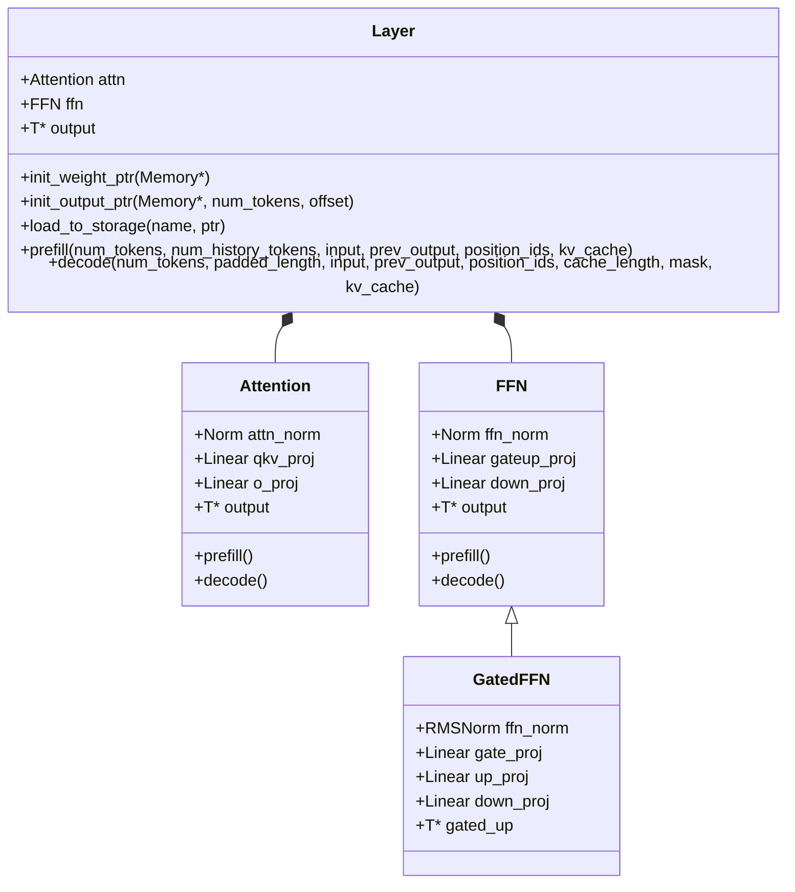
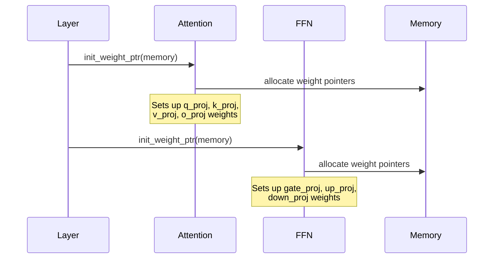
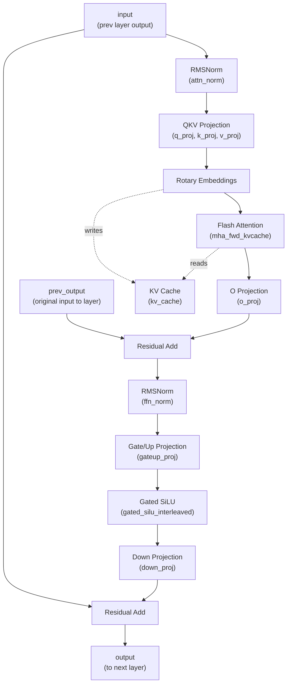
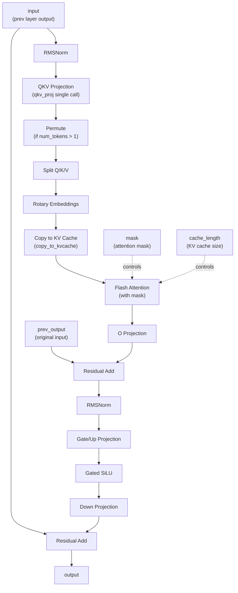
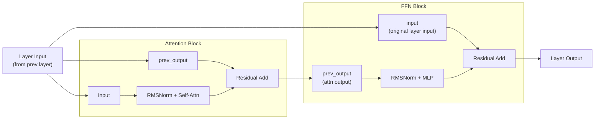
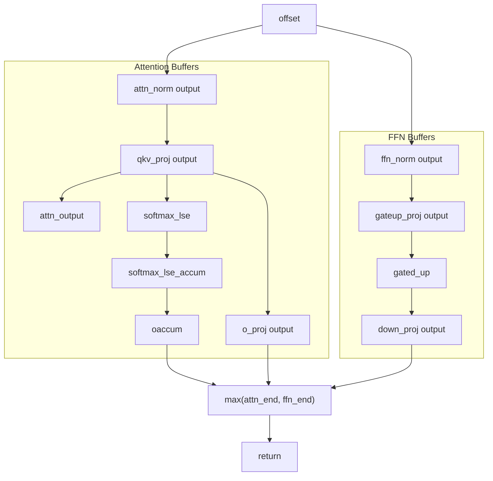
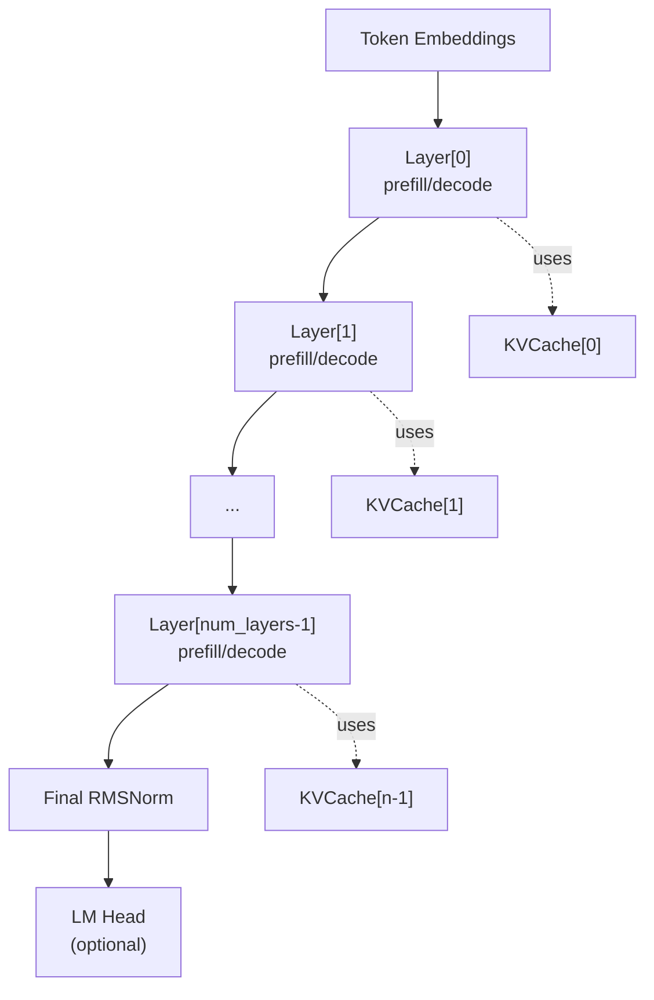

<!-- source: DeepWiki mcp.deepwiki.com · repo thunlp/FR-Spec · page 4.4 Transformer Layers · fetched 2026-11-02 -->

# Transformer Layers

<details>
<summary>Relevant source files</summary>

The following files were used as context for generating this wiki page:

- [src/model/attn.cuh](src/model/attn.cuh)
- [src/model/ffn.cuh](src/model/ffn.cuh)
- [src/model/layer.cuh](src/model/layer.cuh)

</details>


## Purpose and Scope

This page documents the `Layer` structure that combines the Attention and Feed-Forward Network (FFN) components into a complete transformer block. The `Layer` class orchestrates the data flow through attention and FFN operations, manages residual connections, and handles both prefill and decode execution paths.

For detailed information about the individual components, see:
- Attention mechanism internals: [Attention Mechanism](#4.2)
- FFN architecture and gated activation: [Feed-Forward Networks](#4.3)
- How layers are stacked in the full model: [ModelImpl: Base Transformer](#4.1)

---

## Layer Structure

The `Layer` template struct is defined in [src/model/layer.cuh:9-51]() and serves as the fundamental building block of the transformer architecture. It combines two primary components:

| Component | Type | Purpose |
|-----------|------|---------|
| `attn` | `Attention<T, has_attention_bias>*` | Multi-head attention with KV caching |
| `ffn` | `FFN<T>*` | Feed-forward network (typically `GatedFFN`) |
| `output` | `T*` | Points to the FFN output buffer |

The `Layer` is templated on:
- `T`: The data type (typically `half` or `__nv_bfloat16`)
- `has_attention_bias`: Boolean flag indicating whether attention projections include bias terms

### Layer Composition



**Sources:** [src/model/layer.cuh:9-51]()

---

## Initialization

### Weight Pointer Initialization

The `init_weight_ptr` method [src/model/layer.cuh:20-23]() delegates weight pointer initialization to both the attention and FFN components. This sets up pointers into the pre-allocated memory pool where model weights are stored:



**Sources:** [src/model/layer.cuh:20-23](), [src/model/attn.cuh:89-102](), [src/model/ffn.cuh:43-49]()

### Output Buffer Initialization

The `init_output_ptr` method [src/model/layer.cuh:25-30]() allocates intermediate buffers for both components. The key aspect is that attention and FFN buffers can overlap in memory since they execute sequentially:

```
Memory Layout (simplified):
┌─────────────────────────────┐
│ Attention Buffers           │ ← attn_norm, qkv_proj, attn_output, etc.
│ (offset → attn_end)         │
├─────────────────────────────┤
│ FFN Buffers (overlapping)   │ ← ffn_norm, gateup_proj, gated_up, etc.
│ (offset → ffn_end)          │
└─────────────────────────────┘

final = max(attn_end, ffn_end)
```

The layer's output pointer is set to the FFN's output since FFN executes last [src/model/layer.cuh:28]().

**Sources:** [src/model/layer.cuh:25-30]()

---

## Weight Loading

The `load_to_storage` method [src/model/layer.cuh:32-40]() routes HuggingFace checkpoint parameter names to the appropriate sub-component:

| Name Pattern | Routed To | Components |
|--------------|-----------|------------|
| Contains `"attn"` | `attn->load_to_storage()` | Q, K, V, O projections |
| Contains `"input_layernorm"` | `attn->load_to_storage()` | Pre-attention normalization |
| Contains `"mlp"` | `ffn->load_to_storage()` | Gate, Up, Down projections |
| Contains `"post_attention_layernorm"` | `ffn->load_to_storage()` | Pre-FFN normalization |

**Sources:** [src/model/layer.cuh:32-40]()

---

## Prefill Execution Flow

During the prefill phase, the layer processes the initial prompt tokens in parallel. The `prefill` method [src/model/layer.cuh:42-45]() executes attention followed by FFN:



### Execution Steps

1. **Attention Processing** [src/model/layer.cuh:43]():
   - `attn->prefill(calc_stream, num_tokens, num_history_tokens, input, prev_output, position_ids, kv_cache)`
   - Input: `input` (output from previous layer), `prev_output` (for residual connection)
   - Output: `attn->output` (attention result after residual add)

2. **FFN Processing** [src/model/layer.cuh:44]():
   - `ffn->prefill(calc_stream, num_tokens, input, this->attn->output)`
   - Input: `input` (original layer input for residual), `attn->output` (from attention)
   - Output: `ffn->output` (final layer output after residual add)

The residual connections are handled internally by the `Attention` and `FFN` components through the `prev_output` parameter.

**Sources:** [src/model/layer.cuh:42-45](), [src/model/attn.cuh:138-176](), [src/model/ffn.cuh:74-81]()

---

## Decode Execution Flow

During the decode phase, the layer processes generated tokens one (or a few) at a time. The `decode` method [src/model/layer.cuh:47-50]() follows a similar pattern but with additional mask and cache length parameters:



### Key Differences from Prefill

1. **QKV Projection**: Uses a single fused `qkv_proj` call instead of separate Q, K, V projections [src/model/attn.cuh:182-189]()
2. **Permutation**: When processing multiple tokens (`num_tokens > 1`), a permutation kernel reorganizes the QKV output [src/model/attn.cuh:181-183]()
3. **KV Cache Copy**: Explicit copy of K and V into the cache using `copy_to_kvcache` [src/model/attn.cuh:192]()
4. **Attention Mask**: A `Mask` object controls which positions can attend to each other [src/model/layer.cuh:48]()
5. **Cache Length**: The `cache_length` parameter specifies how many tokens are in the KV cache [src/model/layer.cuh:48]()

**Sources:** [src/model/layer.cuh:47-50](), [src/model/attn.cuh:178-222](), [src/model/ffn.cuh:83-86]()

---

## Residual Connection Handling

Both the `Attention` and `FFN` components implement residual connections internally. The layer orchestrates this by passing two inputs:



The naming is somewhat counterintuitive:
- `input`: The value to be transformed (normalized and projected)
- `prev_output`: The value to be added as a residual

In attention, both point to the same data (previous layer's output). In FFN, `prev_output` is the attention output while `input` is the original layer input, enabling the second residual connection.

**Sources:** [src/model/layer.cuh:42-50](), [src/model/attn.cuh:138-176](), [src/model/ffn.cuh:74-81]()

---

## Memory Allocation Pattern

The `Layer` allocates buffers with careful consideration for memory reuse:



Both branches start from the same `offset` and can overlap because:
1. Attention executes completely before FFN
2. Intermediate attention buffers are not needed during FFN execution
3. Only the final outputs need to persist across the layer boundary

The `init_output_ptr` method returns `max(attn_end, ffn_end)` [src/model/layer.cuh:29](), ensuring the next layer allocates beyond both branches.

**Sources:** [src/model/layer.cuh:25-30]()

---

## Global Stream Usage

All CUDA operations within the layer execute on the global `calc_stream`:

```cpp
// From layer.cuh:43-44
this->attn->prefill(calc_stream, num_tokens, num_history_tokens, input, prev_output, position_ids, kv_cache);
this->ffn->prefill(calc_stream, num_tokens, input, this->attn->output);
```

The `calc_stream` is a global `Stream` object defined elsewhere in the codebase. Using a single stream ensures sequential execution of attention and FFN, which is required for correctness (FFN depends on attention output).

**Sources:** [src/model/layer.cuh:43-49]()

---

## Integration with Model Stack

Multiple `Layer` instances are stacked in the `ModelImpl` class to form the complete transformer:



Each layer:
- Has its own dedicated KV cache instance
- Processes the output of the previous layer
- Outputs to the next layer (or final normalization if last layer)

**Sources:** [src/model/layer.cuh:42-50]()

---

## Template Instantiation

The `Layer` template is typically instantiated with:

```cpp
// For models without attention bias (e.g., Llama):
Layer<half, false> layer(hidden_size, intermediate_size, num_attention_heads, 
                         num_key_value_heads, head_dim, rms_norm_eps);

// For models with attention bias:
Layer<half, true> layer(...);
```

The `has_attention_bias` template parameter determines whether Q, K, V, and O projections include bias terms. Most modern models (Llama family) do not use attention bias.

**Sources:** [src/model/layer.cuh:9-18]()

---

