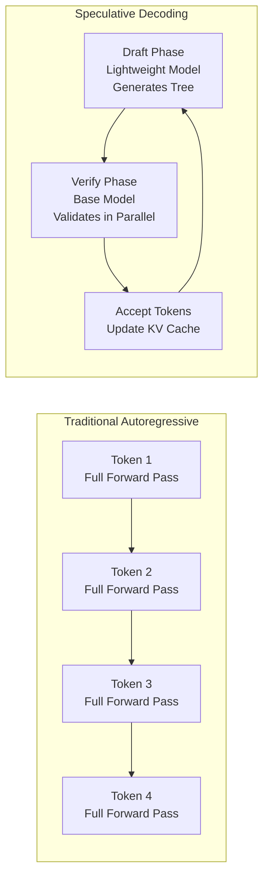
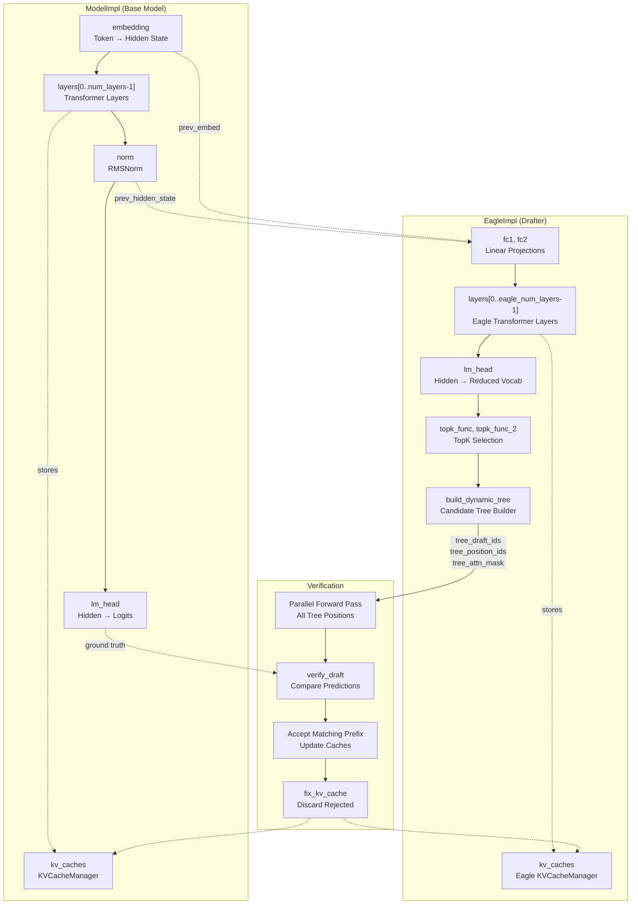
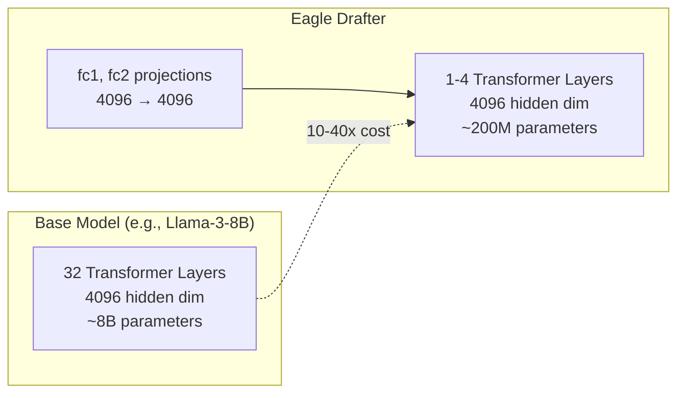
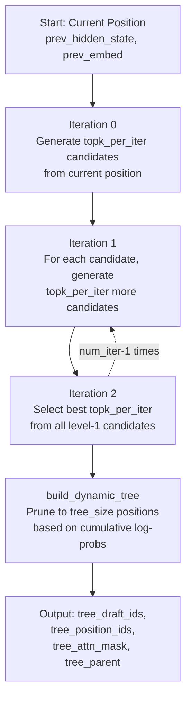
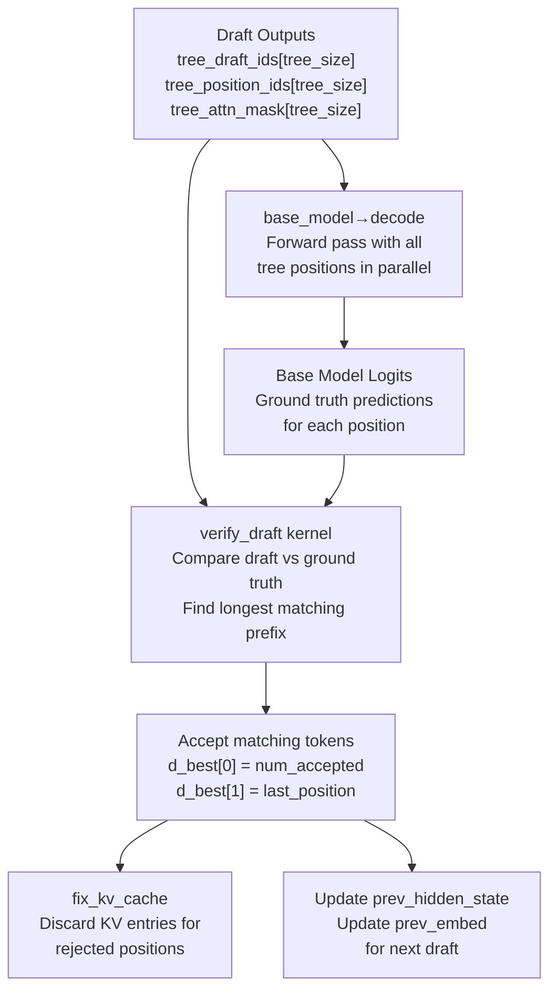
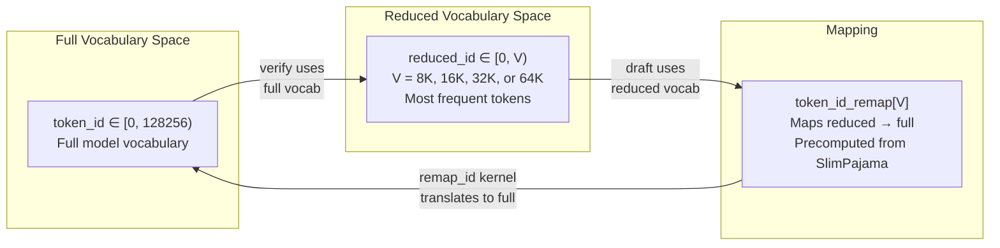
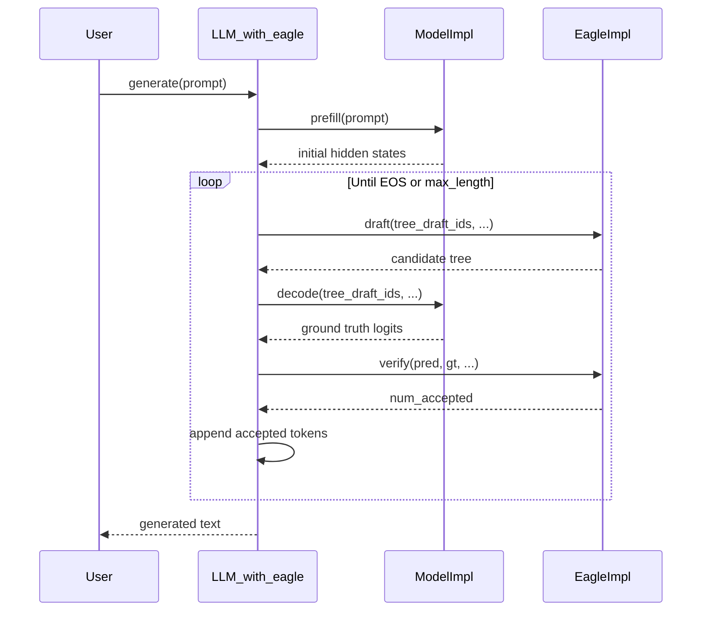

<!-- source: DeepWiki mcp.deepwiki.com · repo thunlp/FR-Spec · page 5 Speculative Decoding · fetched 2026-11-02 -->

# Speculative Decoding

<details>
<summary>Relevant source files</summary>

The following files were used as context for generating this wiki page:

- [README.md](README.md)
- [llamacu/speculative/eagle.py](llamacu/speculative/eagle.py)
- [src/flash_attn/flash_api.hpp](src/flash_attn/flash_api.hpp)
- [src/model/eagle.cuh](src/model/eagle.cuh)

</details>


## Purpose and Scope

This page introduces the concept of speculative decoding and how it is implemented in FR-Spec to accelerate large language model inference. Speculative decoding is a draft-verify technique that generates multiple candidate tokens in parallel using a lightweight drafter model, then validates them in batch using the full base model. This approach reduces the number of sequential decoding steps required, achieving significant speedup (1.5x+ over baseline, 1.12x over EAGLE-2).

For specific implementation details of the EAGLE drafter, see [EAGLE Implementation](#5.1). For the Medusa alternative approach, see [Medusa Implementation](#5.2). For detailed mechanics of the draft-verify loop, see [Draft-Verify Pipeline](#5.3).

Sources: [README.md:1-140](), [src/model/eagle.cuh:1-514]()

---

## Core Concept

Speculative decoding exploits the observation that generating a single token with a large language model is memory-bandwidth bound, not compute-bound. Instead of generating tokens one at a time, a lightweight **drafter model** speculatively generates multiple candidate tokens in a tree structure. The **base model** then verifies all candidates in parallel in a single forward pass. Matching tokens are accepted, and generation continues from the longest matching prefix.

The key insight enabling FR-Spec's 1.12x speedup over EAGLE-2 is that the LM-Head projection (vocabulary size × hidden dimension) is the bottleneck during drafting. By reducing the vocabulary to only the most frequent tokens during the draft phase, FR-Spec accelerates speculation without sacrificing generation quality.



**Diagram: Traditional vs Speculative Decoding Flow**

| Approach | Sequential Steps per Token | Parallelization | Speedup |
|----------|---------------------------|-----------------|---------|
| Traditional Autoregressive | 1 forward pass per token | None | 1.0x baseline |
| EAGLE-2 Speculative | ~1/N forward passes (avg) | Batch verification | ~1.5x |
| FR-Spec (EAGLE + Vocabulary Reduction) | ~1/(N*1.12) forward passes | Batch verification + reduced vocab | ~1.68x |

Sources: [README.md:5-23](), [src/model/eagle.cuh:242-306]()

---

## Draft-Verify Architecture

The speculative decoding system consists of three main components that work together in an iterative loop:



**Diagram: Speculative Decoding Component Architecture**

### Key Data Structures

The following data structures flow through the draft-verify pipeline:

| Structure | Type | Purpose | Location |
|-----------|------|---------|----------|
| `tree_draft_ids` | `int32_t*` | Candidate token IDs in tree | [src/model/eagle.cuh:432]() |
| `tree_position_ids` | `int32_t*` | Position indices for each candidate | [src/model/eagle.cuh:432]() |
| `tree_attn_mask` | `uint64_t*` | Attention masks defining tree dependencies | [src/model/eagle.cuh:432]() |
| `tree_parent` | `int32_t*` | Parent pointers for tree structure | [src/model/eagle.cuh:432]() |
| `topk_func->topk_val` | `T*` | Log-probabilities of top-k candidates | [src/model/eagle.cuh:256]() |
| `topk_func->topk_pos` | `int32_t*` | Token positions of top-k candidates | [src/model/eagle.cuh:256]() |

Sources: [src/model/eagle.cuh:242-513](), [src/model/tree_drafter.cuh:1-100]() (inferred)

---

## How Speculative Decoding Accelerates Generation

Speculative decoding achieves speedup through three mechanisms:

### 1. Reduced Sequential Dependencies

Traditional autoregressive decoding requires sequential execution:
- Generate token 1 → wait → generate token 2 → wait → generate token 3...

Speculative decoding amortizes this cost:
- Draft N tokens in parallel → verify all N tokens in one pass → accept M tokens (M ≤ N)
- Average accepted tokens per verification: ~3-5 tokens
- Net result: ~3-5x fewer base model calls

### 2. Lightweight Drafter Model

The EAGLE drafter uses fewer layers and parameters than the base model:



**Diagram: Base Model vs Drafter Computational Cost**

The drafter's cost is dominated by the LM-Head projection when using the full vocabulary (128K tokens × 4096 dim = 512M values). FR-Spec reduces this to 8K-64K tokens, cutting LM-Head cost by 2-16x.

### 3. Parallel Verification with Flash Attention

The verification phase processes all tree candidates in parallel using Flash Attention [src/flash_attn/flash_api.hpp:207-304](). The base model performs a single forward pass with:
- Batch size = tree_size (typically 60 positions)
- Attention masks encoding tree structure dependencies
- Shared KV cache across all positions

This parallel execution is only slightly more expensive than generating a single token, but validates N candidates simultaneously.

Sources: [README.md:9-23](), [src/model/eagle.cuh:432-494](), [src/flash_attn/flash_api.hpp:207-304]()

---

## Draft Phase Overview

The draft phase generates a tree of candidate tokens using the EAGLE drafter. The process is iterative, building the tree level by level:



**Diagram: Draft Phase Iteration Flow**

### Draft Parameters

The draft phase is controlled by several hyperparameters defined in [src/model/eagle.cuh:244-247]():

| Parameter | Typical Value | Purpose |
|-----------|--------------|---------|
| `num_iter` | 6 | Number of iterative expansions |
| `topk_per_iter` | 10 | Candidates selected per iteration |
| `tree_size` | 60 | Final number of positions in verification tree |
| `total_tried` | `topk_per_iter² × (num_iter - 1) + topk_per_iter` | Total candidates evaluated (e.g., 1000 for 10,6,60) |
| `V` | 8192-65536 | Reduced vocabulary size (FR-Spec optimization) |

### Key Methods

The draft phase is implemented in [src/model/eagle.cuh:432-494]():

1. **First iteration** [src/model/eagle.cuh:447-457](): Generate top-k candidates from current position
   - Project hidden state through `lm_head` with reduced vocabulary size `V`
   - Apply `log_softmax` for stable log-probabilities
   - Select `topk_per_iter` best candidates using `topk_func`

2. **Subsequent iterations** [src/model/eagle.cuh:458-485](): Expand the tree
   - Embed selected candidates, process through Eagle layers
   - Generate next-level candidates for each position
   - Accumulate log-probabilities from parent nodes
   - Select top-k across all positions using `topk_func_2`

3. **Tree pruning** [src/model/eagle.cuh:487-491](): Build final verification tree
   - Select `tree_size - 1` best candidates from all iterations
   - Construct tree structure with `build_dynamic_tree`
   - Generate position IDs, attention masks, and parent pointers

Sources: [src/model/eagle.cuh:432-494](), [src/model/eagle.cuh:178-212]()

---

## Verification Phase Overview

The verification phase validates drafted candidates by comparing them against the base model's predictions:



**Diagram: Verification Phase Data Flow**

### Verification Algorithm

The verification is implemented in [src/model/eagle.cuh:496-512]():

```
verify(num_tokens, pred, gt, position_ids, cache_length, mask_2d, tree_parent):
    1. Call verify_draft kernel to compare predictions
       - Input: draft predictions (pred), ground truth (gt)
       - Output: d_best[0] = number of accepted tokens
                 d_best[1] = final position index
    
    2. Copy results to host: h_best ← d_best
    
    3. Update internal state:
       - num_prev = h_best[0] (accepted count)
       - Copy accepted hidden states: prev_hidden_state ← model.norm.output
       - Copy accepted embeddings: prev_embed ← model.embedding.output
    
    4. Fix KV cache:
       - Discard cache entries for rejected positions
       - Compact cache to only contain accepted tokens
    
    5. Prepare for next draft:
       - Generate position IDs: eagle_position_ids = [cache_length, ..., cache_length + num_prev]
    
    6. Return h_best[0] (number of accepted tokens)
```

### KV Cache Correction

The `fix_kv_cache` kernel [inferred from src/model/eagle.cuh:504]() is critical for correctness. When tokens are rejected:
- The base model's KV cache contains entries for both accepted and rejected positions
- These must be removed to avoid contaminating future generations
- The cache is compacted to only contain the accepted prefix

Sources: [src/model/eagle.cuh:496-512](), [src/model/kvcache.cuh:1-200]() (inferred)

---

## FR-Spec Vocabulary Optimization

The key innovation in FR-Spec is reducing the vocabulary during the draft phase. This addresses EAGLE-2's LM-Head bottleneck:

### LM-Head Bottleneck Analysis

| Model | Vocab Size | Hidden Dim | LM-Head Parameters | FLOPs per Token |
|-------|-----------|-----------|-------------------|-----------------|
| Llama-3-8B | 128,256 | 4096 | ~525M | ~1.05 TFLOPs |
| FR-Spec (V=16384) | 16,384 | 4096 | ~67M | ~0.13 TFLOPs |
| FR-Spec (V=8192) | 8,192 | 4096 | ~34M | ~0.07 TFLOPs |
| **Speedup** | **8-16x** | - | **8-16x** | **8-15x** |

### Token ID Remapping

FR-Spec uses `token_id_remap` [src/model/eagle.cuh:255]() to translate between vocabulary spaces:



**Diagram: Token ID Remapping Between Vocabulary Spaces**

The `remap_id` kernel [src/model/eagle.cuh:169-172]() performs the translation:
```
remap_id(num_tokens, id_map, real_id, token_id_remap, output):
    output[i] = token_id_remap[real_id[id_map[i]]]
```

This allows the drafter to work in reduced vocabulary space (fast LM-Head) while the verifier uses full vocabulary space (complete coverage).

Sources: [README.md:9-14](), [src/model/eagle.cuh:255](), [src/model/eagle.cuh:169-172](), [src/model/eagle.cuh:453](), [src/model/eagle.cuh:484]()

---

## Integration with Base Model

The speculative decoding system integrates with the base model through several interfaces:

### Initialization

The system is initialized in two stages [llamacu/speculative/eagle.py:34-46]():

1. **Base model initialization**: `C.init_base_model(...)` loads the full transformer
2. **Eagle initialization**: `C.init_eagle_model(...)` creates the drafter with:
   - `eagle_num_layers`: Number of Eagle transformer layers
   - `num_iter`, `topk_per_iter`, `tree_size`: Draft parameters
   - `V`: Reduced vocabulary size for FR-Spec optimization

### Runtime Flow



**Diagram: Runtime Sequence for Speculative Decoding Generation**

### State Sharing

The drafter maintains state from the base model [src/model/eagle.cuh:259-261]():
- `prev_hidden_state`: Last hidden state from base model (input to Eagle layers)
- `prev_embed`: Token embeddings from base model (input to fc1/fc2)
- `num_prev`: Number of tokens in the current prefix

These are updated after each verification to maintain consistency between the base model and drafter.

Sources: [llamacu/speculative/eagle.py:16-70](), [src/model/eagle.cuh:242-513](), [src/model/tree_drafter.cuh:1-100]() (inferred)

---

## Performance Characteristics

### Acceptance Rate

The effectiveness of speculative decoding depends on the **acceptance rate**: the average number of tokens accepted per draft-verify cycle. Higher acceptance rates lead to greater speedup.

| Configuration | Acceptance Rate | Effective Speedup | Notes |
|--------------|----------------|-------------------|-------|
| EAGLE-2 baseline | ~3.5 tokens | ~1.5x | Standard EAGLE with full vocab |
| FR-Spec (V=16384) | ~3.5 tokens | ~1.68x | Same acceptance, faster drafting |
| FR-Spec (V=8192) | ~3.3 tokens | ~1.65x | Slightly lower acceptance, much faster drafting |

The acceptance rate is influenced by:
- **Draft quality**: More accurate predictions → higher acceptance
- **Tree structure**: Wider, deeper trees → more chances to accept
- **Task difficulty**: Deterministic tasks → higher acceptance than creative tasks

### Memory Overhead

Speculative decoding requires additional memory for:
- Eagle model weights: ~200M parameters (~400MB in FP16)
- Eagle KV cache: Proportional to `eagle_num_layers` (typically 1-4 layers)
- Draft buffers: `tree_size` × `hidden_dim` (~1MB for tree_size=60, hidden_dim=4096)
- Tree metadata: `tree_size` × (masks, positions, parents) (~10KB)

The KV cache budget is split between base and drafter [src/model/eagle.cuh:355-358]():
```
ratio = num_base_layers / (num_base_layers + num_eagle_layers)
base_kv_budget = total_budget × ratio
eagle_kv_budget = total_budget × (1 - ratio)
```

Sources: [README.md:17-23](), [src/model/eagle.cuh:350-359]()

---

## Summary

Speculative decoding accelerates LLM inference by:

1. **Drafting**: Using a lightweight model to generate multiple candidate tokens in a tree structure
2. **Verifying**: Validating all candidates in parallel with a single base model forward pass
3. **Accepting**: Committing the longest matching prefix and repeating

FR-Spec optimizes EAGLE-2's LM-Head bottleneck by reducing the vocabulary during drafting, achieving 1.12x additional speedup without sacrificing generation quality. The system achieves ~1.68x speedup over baseline autoregressive decoding.

Key implementation classes:
- `EagleImpl<T>`: Main drafter implementation [src/model/eagle.cuh:242-513]()
- `ModelImpl<T>`: Base transformer model [src/model/model.cuh:1-500]() (inferred)
- `LLM_with_eagle`: Python interface [llamacu/speculative/eagle.py:16-70]()

For detailed information on specific components:
- EAGLE architecture and kernels: See [EAGLE Implementation](#5.1)
- Alternative Medusa approach: See [Medusa Implementation](#5.2)
- Draft-verify mechanics: See [Draft-Verify Pipeline](#5.3)

Sources: [README.md:1-140](), [src/model/eagle.cuh:242-513](), [llamacu/speculative/eagle.py:1-70]()

---

