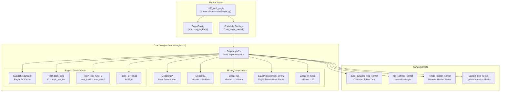
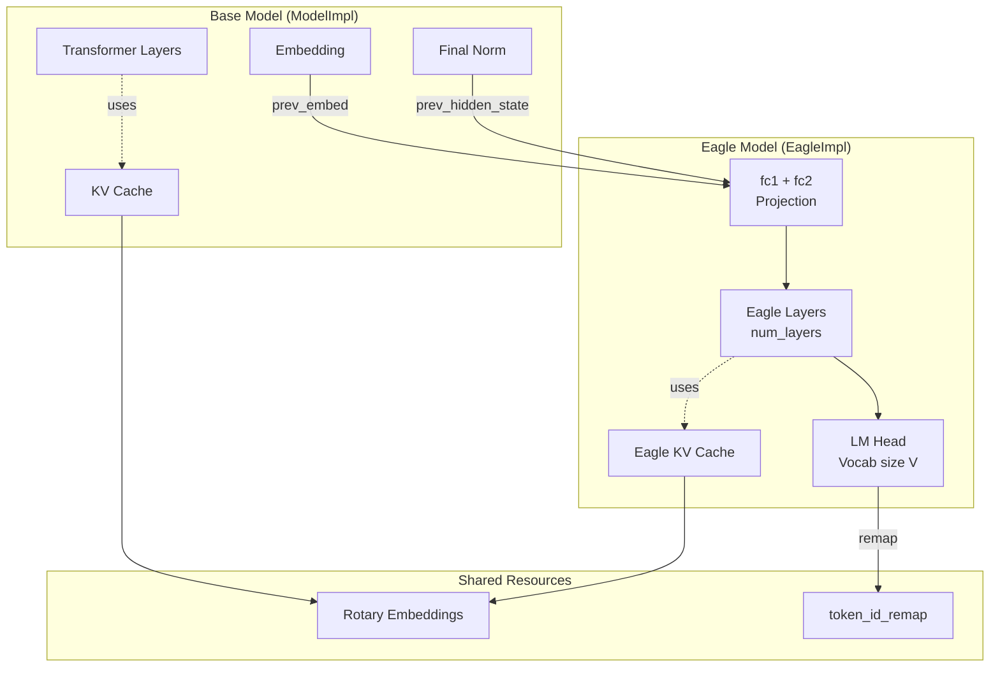

<!-- source: DeepWiki mcp.deepwiki.com · repo thunlp/FR-Spec · page 5.1 EAGLE Implementation · fetched 2026-11-02 -->

# EAGLE Implementation

<details>
<summary>Relevant source files</summary>

The following files were used as context for generating this wiki page:

- [llamacu/speculative/eagle.py](llamacu/speculative/eagle.py)
- [src/model/eagle.cuh](src/model/eagle.cuh)

</details>


## Purpose and Scope

This document provides a detailed technical reference for the EAGLE (Extrapolation Algorithm for Greater Language-model Efficiency) speculative decoding implementation in FR-Spec. EAGLE accelerates inference by drafting multiple candidate tokens in parallel using a lightweight auxiliary model, which are then verified by the base model in a single forward pass.

This page covers the C++ implementation (`EagleImpl` class), CUDA kernels for tree building and token selection, and the Python API wrapper. For the general concept of speculative decoding and the draft-verify pipeline, see [Draft-Verify Pipeline](#5.3). For the FR-Spec vocabulary optimization applied to EAGLE, see [FR-Spec Optimization](#6).

**Sources:** [src/model/eagle.cuh:1-514](), [llamacu/speculative/eagle.py:1-70]()

## Architecture Overview

The EAGLE implementation consists of a C++ backend (`EagleImpl`) that extends the base model with speculative decoding capabilities, and a Python wrapper (`LLM_with_eagle`) for high-level API access.



**Key Class Members:**

| Member | Type | Purpose |
|--------|------|---------|
| `model` | `ModelImpl<T>*` | Base transformer model for verification |
| `fc1`, `fc2` | `Linear<T>` | Projection layers (split from original fc) |
| `layers` | `std::vector<Layer<T>*>` | Eagle-specific transformer layers |
| `lm_head` | `Linear<T>` | LM head with reduced vocabulary (V) |
| `kv_caches` | `KVCacheManager<T>*` | KV cache for Eagle layers |
| `token_id_remap` | `int32_t*` | Maps reduced vocab to full vocab |
| `topk_func` | `functions::TopK<T>*` | Selects top-k from V tokens |
| `topk_func_2` | `functions::TopK<T>*` | Selects tree_size-1 from total_tried |

**Sources:** [src/model/eagle.cuh:242-305](), [llamacu/speculative/eagle.py:16-46]()

## Initialization and Memory Allocation

The EAGLE implementation requires careful memory management due to the auxiliary model components and intermediate buffers for tree-based speculation.

### Constructor Parameters

The `EagleImpl` constructor [src/model/eagle.cuh:274-305]() accepts:

- `model`: Pointer to base `ModelImpl`
- `num_layers`: Number of Eagle transformer layers
- `intermediate_size`: FFN intermediate dimension
- `num_attention_heads`, `num_key_value_heads`, `head_dim`: Attention configuration
- `rms_norm_eps`: Normalization epsilon
- `num_iter`: Number of draft iterations (typically 6)
- `topk_per_iter`: Top-k candidates per iteration (typically 10)
- `tree_size`: Total positions in draft tree (typically 60)
- `V`: Reduced vocabulary size (8K-64K)

The constructor computes `total_tried = topk_per_iter * topk_per_iter * (num_iter - 1) + topk_per_iter` to track all candidate positions across iterations.

### Memory Layout

Memory allocation occurs in two phases via `init_weight_ptr()` [src/model/eagle.cuh:307-317]() and `init_output_ptr()` [src/model/eagle.cuh:319-348]():

**Weight Buffers:**
- FC layer weights (fc1, fc2)
- Eagle transformer layer weights
- Reduced LM head weights (size V)
- Token ID remapping table (V integers)

**Output/Intermediate Buffers:**

| Buffer | Size | Purpose |
|--------|------|---------|
| `eagle_logits` | `topk_per_iter * V * sizeof(T)` | Logits for top-k positions |
| `eagle_mask_2d` | `topk_per_iter * sizeof(uint64_t)` | Attention masks for tree |
| `tired_history_val` | `total_tried * sizeof(T)` | Log-probabilities of all candidates |
| `tired_history_pos` | `total_tried * sizeof(int32_t)` | Token IDs of all candidates |
| `tired_history_parent` | `topk_per_iter * (num_iter-1) * sizeof(int32_t)` | Parent pointers for tree |
| `prev_hidden_state` | `num_tokens * hidden_size * sizeof(T)` | Previous layer outputs |
| `prev_embed` | `num_tokens * hidden_size * sizeof(T)` | Previous embeddings |
| `tmp_kvcache` | `64 * num_layers * 2 * dim * sizeof(T)` | Temporary KV cache for fixing |

### KV Cache Budget

The `init_storage()` method [src/model/eagle.cuh:350-359]() distributes KV cache memory between the base model and Eagle model:

```cpp
float ratio = float(this->model->num_hidden_layers) / 
              (this->model->num_hidden_layers + this->num_layers);
kv_cache_offset = this->model->kv_caches->init_output_ptr(
    this->model->memory, kv_cache_offset, ratio);
kv_caches->init_output_ptr(this->model->memory, kv_cache_offset);
```

This proportional allocation ensures both models have sufficient KV cache based on their layer counts.

**Sources:** [src/model/eagle.cuh:274-359]()

## Draft Phase

The draft phase generates a tree of candidate tokens through iterative refinement. The entry point is `draft()` [src/model/eagle.cuh:432-494]().

### Draft Process Flow

```mermaid
flowchart TD
    START["draft() called"]
    COPY_LEN["Copy cache_length<br/>to eagle_original_length"]
    COMPUTE_PAD["Compute eagle_padded_length<br/>(align to 128)"]
    
    CHECK_FIRST{"is_first_draft?"}
    FIRST_EMBED["model->embedding->prefill()<br/>on tree_draft_ids[0]"]
    FIRST_EAGLE["eagle_prefill()<br/>Process history"]
    CONTINUE_EAGLE["eagle_decode()<br/>Use existing cache"]
    
    INIT_POS["Initialize eagle_position_ids<br/>from cache_length"]
    
    D0_START["Iteration d=0"]
    D0_LMHEAD["lm_head->prefill()<br/>fc2->output[num_prev-1]"]
    D0_SOFTMAX["log_softmax()<br/>Normalize logits"]
    D0_TOPK["topk_func->prefill()<br/>Select top-k"]
    D0_COPY["Copy to tired_history_val/pos<br/>Remap IDs via token_id_remap"]
    D0_REPEAT["repeat() fc2->output<br/>to fc1->output"]
    D0_TREE["init_tree() eagle_mask_2d"]
    
    ITER_START["For d=1 to num_iter-1"]
    ITER_INC["add() cache_length<br/>by topk_per_iter"]
    ITER_EMBED["model->embedding->prefill()<br/>on topk_pos"]
    ITER_FC["fc1->prefill(), fc2->prefill()<br/>elementwise_add()"]
    ITER_LAYERS["Loop through Eagle layers:<br/>layers[i]->decode()"]
    ITER_INC_POS["add() position_ids by 1"]
    ITER_LMHEAD["lm_head->prefill()<br/>topk_per_iter positions"]
    ITER_SOFTMAX["log_softmax()<br/>topk_per_iter * V"]
    ITER_TOPK["topk_func->prefill()<br/>topk_per_iter^2 candidates"]
    ITER_CUMSUM["cumsum() with parent scores"]
    ITER_COPY["Copy to tired_history<br/>at offset"]
    ITER_SELECT["topk_func_2->prefill()<br/>Select tree_size-1 best"]
    ITER_UPDATE["set_parent(), update_tree()<br/>Build tree structure"]
    ITER_REMAP["remap_hidden(), remap_id()"]
    ITER_NEXT{"d < num_iter-1?"}
    
    FINAL_TOPK["topk_func_2->prefill()<br/>on tired_history_val (all)"]
    BUILD_TREE["build_dynamic_tree()<br/>Construct final tree"]
    REMAP_IDS["remap_id()<br/>Output draft IDs"]
    SET_FLAG["is_first_draft = false"]
    END["Return"]
    
    START --> COPY_LEN
    COPY_LEN --> COMPUTE_PAD
    COMPUTE_PAD --> CHECK_FIRST
    
    CHECK_FIRST -->|true| FIRST_EMBED
    CHECK_FIRST -->|false| CONTINUE_EAGLE
    FIRST_EMBED --> FIRST_EAGLE
    FIRST_EAGLE --> INIT_POS
    CONTINUE_EAGLE --> INIT_POS
    
    INIT_POS --> D0_START
    D0_START --> D0_LMHEAD
    D0_LMHEAD --> D0_SOFTMAX
    D0_SOFTMAX --> D0_TOPK
    D0_TOPK --> D0_COPY
    D0_COPY --> D0_REPEAT
    D0_REPEAT --> D0_TREE
    
    D0_TREE --> ITER_START
    ITER_START --> ITER_INC
    ITER_INC --> ITER_EMBED
    ITER_EMBED --> ITER_FC
    ITER_FC --> ITER_LAYERS
    ITER_LAYERS --> ITER_INC_POS
    ITER_INC_POS --> ITER_LMHEAD
    ITER_LMHEAD --> ITER_SOFTMAX
    ITER_SOFTMAX --> ITER_TOPK
    ITER_TOPK --> ITER_CUMSUM
    ITER_CUMSUM --> ITER_COPY
    ITER_COPY --> ITER_SELECT
    ITER_SELECT --> ITER_UPDATE
    ITER_UPDATE --> ITER_REMAP
    ITER_REMAP --> ITER_NEXT
    
    ITER_NEXT -->|yes| ITER_START
    ITER_NEXT -->|no| FINAL_TOPK
    
    FINAL_TOPK --> BUILD_TREE
    BUILD_TREE --> REMAP_IDS
    REMAP_IDS --> SET_FLAG
    SET_FLAG --> END
```



**Sources:** [src/model/eagle.cuh:432-494]()

### Iteration 0: Initial Candidates

At iteration 0 [src/model/eagle.cuh:447-457]():

1. **Generate logits:** Apply LM head to the last hidden state position
2. **Normalize:** Apply log-softmax across vocabulary V
3. **Select top-k:** Use `topk_func` to select `topk_per_iter` candidates
4. **Store:** Copy scores and positions to `tired_history_val/pos`
5. **Remap:** Convert positions through `token_id_remap` to full vocabulary
6. **Replicate:** Repeat the hidden state for all k candidates
7. **Initialize tree:** Set up `eagle_mask_2d` with identity masks

### Iterations 1 to num_iter-1: Tree Expansion

For each subsequent iteration d [src/model/eagle.cuh:458-485]():

1. **Update cache length:** Increment by `topk_per_iter`
2. **Embed tokens:** Convert selected token IDs to embeddings
3. **Project:** Apply fc1 and fc2 with residual connection
4. **Transform:** Pass through Eagle transformer layers with attention masks
5. **Generate logits:** Apply LM head to all `topk_per_iter` positions → `topk_per_iter²` total candidates
6. **Normalize:** Log-softmax across all candidates
7. **Select locally:** Use `topk_func` to get top-k per position
8. **Combine scores:** Add parent log-probabilities via `cumsum()`
9. **Store candidates:** Copy to `tired_history` at appropriate offset
10. **Select globally:** Use `topk_func_2` to select best candidates across all positions
11. **Update tree:** Use `set_parent()` and `update_tree()` to maintain tree structure
12. **Remap:** Reorder hidden states and token IDs for next iteration

### Final Tree Construction

After all iterations [src/model/eagle.cuh:487-492]():

1. **Global selection:** Select top `tree_size-1` candidates from all `total_tried` positions
2. **Build tree:** Call `build_dynamic_tree()` kernel to construct final tree structure
3. **Output IDs:** Remap selected positions to draft token IDs via `token_id_remap`

**Sources:** [src/model/eagle.cuh:432-494]()

## Verification Phase

The verification phase compares Eagle's draft predictions against the base model's ground truth and determines which tokens to accept. The entry point is `verify()` [src/model/eagle.cuh:496-512]().

### Verification Process

```mermaid
flowchart LR
    VERIFY_START["verify() called"]
    VERIFY_DRAFT["verify_draft()<br/>Compare pred vs gt<br/>Find longest match"]
    COPY_RESULT["cudaMemcpyAsync<br/>d_best → h_best"]
    SYNC["cudaStreamSynchronize"]
    
    UPDATE_PREV["num_prev = h_best[0]<br/>Update state count"]
    REMAP_HIDDEN["remap_hidden()<br/>Reorder prev_hidden_state"]
    FIX_KV["fix_kv_cache()<br/>Discard rejected tokens"]
    UPDATE_EMBED["embedding->prefill()<br/>Update prev_embed"]
    UPDATE_POS["make_arange()<br/>Update eagle_position_ids"]
    
    RETURN["Return h_best[0]<br/>Number of accepted tokens"]
    
    VERIFY_START --> VERIFY_DRAFT
    VERIFY_DRAFT --> COPY_RESULT
    COPY_RESULT --> SYNC
    SYNC --> UPDATE_PREV
    UPDATE_PREV --> REMAP_HIDDEN
    REMAP_HIDDEN --> FIX_KV
    FIX_KV --> UPDATE_EMBED
    UPDATE_EMBED --> UPDATE_POS
    UPDATE_POS --> RETURN
```



**Steps:**

1. **Compare predictions:** Call `verify_draft()` kernel to find longest matching prefix
2. **Synchronize:** Transfer result (`h_best`) from device to host
3. **Update state count:** Set `num_prev` to number of accepted tokens
4. **Reorder hidden states:** Use `remap_hidden()` to select correct states based on tree positions
5. **Fix KV cache:** Call `fix_kv_cache()` to discard KV entries for rejected tokens
6. **Update embeddings:** Recompute embeddings for accepted tokens
7. **Update positions:** Generate new position IDs starting from cache length

The verification determines how many tokens from the tree are accepted, and the next draft iteration continues from the last accepted position.

**Sources:** [src/model/eagle.cuh:496-512]()

## CUDA Kernels

EAGLE uses several specialized CUDA kernels for tree operations and tensor manipulation.

### Tree Building: `build_dynamic_tree_kernel`

Located at [src/model/eagle.cuh:178-208](), this kernel constructs the final token prediction tree structure.

**Inputs:**
- `tree_size`: Number of positions in tree
- `pos_offset`: Base position offset
- `topk_per_iter`: Candidates per iteration
- `tried_history_parent`: Parent pointers for positions
- `topk_pos`: Selected positions from global top-k

**Outputs:**
- `tree_pos`: Position IDs for each tree node
- `tree_mask`: Attention masks (64-bit bitmasks)
- `tree_parent`: Parent indices in tree

**Algorithm:**
1. Build reverse mapping from positions to tree IDs
2. For each tree position i:
   - Calculate actual sequence position based on iteration depth
   - Set attention mask to include all ancestors
   - Determine parent node by tracing through `tried_history_parent`

### Log-Softmax: `log_softmax_kernel`

Located at [src/model/eagle.cuh:30-89](), this kernel computes log-softmax across vocabulary dimensions.

**Algorithm:**
1. Find maximum value using warp-level reductions
2. Compute sum of exponentials (subtracting max for numerical stability)
3. Apply log-softmax formula: `log(softmax(x)) = x - max - log(sum)`

Uses shared memory and warp shuffles for efficient parallel reduction.

### Tensor Remapping Kernels

**`remap_hidden_kernel`** [src/model/eagle.cuh:108-115](): Reorders hidden states according to an index map. Used to select correct hidden states after top-k selection.

**`remap_id_kernel`** [src/model/eagle.cuh:117-119](): Maps token IDs through `token_id_remap` table to convert between reduced and full vocabularies.

**`repeat_kernel`** [src/model/eagle.cuh:15-21](): Replicates a single hidden state or value across multiple positions.

### Tree Update Kernels

**`init_tree_kernel`** [src/model/eagle.cuh:91-93](): Initializes attention masks with identity (each position attends to itself).

**`update_tree_kernel`** [src/model/eagle.cuh:99-101](): Updates attention masks by combining parent masks with new positions.

**`set_parent_kernel`** [src/model/eagle.cuh:95-97](): Sets parent pointers for new tree positions.

### Utility Kernels

**`add_kernel`** [src/model/eagle.cuh:11-13](): Adds a constant value to an array.

**`cumsum_kernel`** [src/model/eagle.cuh:104-106](): Adds parent scores to child scores for tree probability accumulation.

**`make_arange_kernel`** [src/model/eagle.cuh:121-123](): Generates a range of consecutive integers starting from an offset.

**Sources:** [src/model/eagle.cuh:11-177]()

## Python API

The Python interface provides a high-level API for initializing and using EAGLE models.

### EagleConfig

The `EagleConfig` class [llamacu/speculative/eagle.py:7-14]() extends `PretrainedConfig` from HuggingFace Transformers:

```python
class EagleConfig(PretrainedConfig):
    def __init__(self, num_hidden_layers=1, **kwargs):
        super().__init__(**kwargs)
        self.eagle_num_layers = num_hidden_layers
```

It stores configuration parameters loaded from HuggingFace model repositories.

### LLM_with_eagle

The `LLM_with_eagle` class [llamacu/speculative/eagle.py:16-70]() inherits from `LLM_with_tree_drafter` and initializes the EAGLE model:

**Constructor parameters:**
- `eagle_path`: Path to Eagle model weights
- `base_path`: Path to base model weights
- `num_iter`: Draft iterations (default 6)
- `topk_per_iter`: Top-k per iteration (default 10)
- `tree_size`: Tree size (default 60)
- `V`: Reduced vocabulary size (default 15000)

**Initialization sequence:**
1. Load `EagleConfig` from `eagle_path`
2. Call `C.init_eagle_model()` with configuration parameters
3. Extract and pass model dimensions to C++ backend

### Weight Loading

The `_load()` method [llamacu/speculative/eagle.py:48-69]() handles weight loading with special logic:

**Token ID remap:** Loaded directly to device memory via `C.load_model()`.

**FC layer splitting:** The original fc layer is split into fc1 and fc2:
```python
param1 = param[..., :param.shape[-1] // 2].contiguous()
param2 = param[..., param.shape[-1] // 2:].contiguous()
C.load_model(f"eagle.fc1.weight", param1.data_ptr())
C.load_model(f"eagle.fc2.weight", param2.data_ptr())
```

**Embedding skip:** Eagle uses the base model's embeddings, so `embed_tokens` weights are ignored.

**LM head remapping:** When base model's `lm_head` is loaded, it's automatically remapped to Eagle's reduced vocabulary via `remap_copy()` [src/model/eagle.cuh:382-383]().

**Sources:** [llamacu/speculative/eagle.py:1-70]()

## Integration with Base Model

EAGLE operates alongside the base model in a cooperative manner:



**Key integration points:**

1. **Shared embeddings:** Eagle uses `model->embedding` for token embeddings [src/model/eagle.cuh:388, 413, 438, 460, 506]()

2. **Shared rotary embeddings:** Both models use the same `rotary_embedding` instance [src/model/eagle.cuh:315]()

3. **Hidden state transfer:** Base model's final hidden states (`model->norm->output`) feed into Eagle's `prev_hidden_state` [src/model/eagle.cuh:420, 502]()

4. **Token remapping:** Eagle's reduced vocabulary is mapped back to full vocabulary via `token_id_remap` [src/model/eagle.cuh:316, 368, 382-383, 453, 484, 491]()

5. **KV cache budget sharing:** Memory is proportionally allocated between base and Eagle KV caches [src/model/eagle.cuh:355-358]()

6. **Prefill coordination:** During prefill, if `num_history_tokens > 0`, Eagle processes history via `eagle_prefill()` [src/model/eagle.cuh:414-415]()

**Sources:** [src/model/eagle.cuh:242-514]()

---

