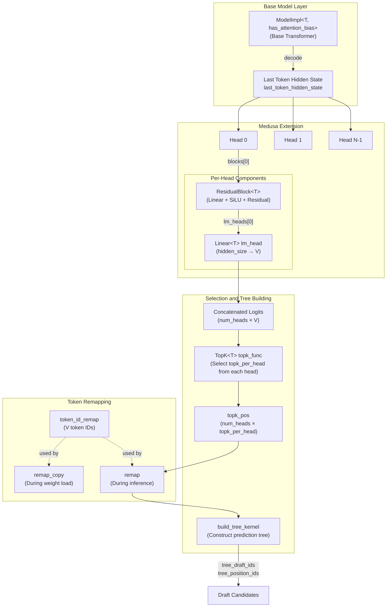
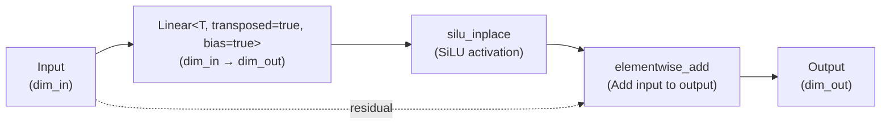
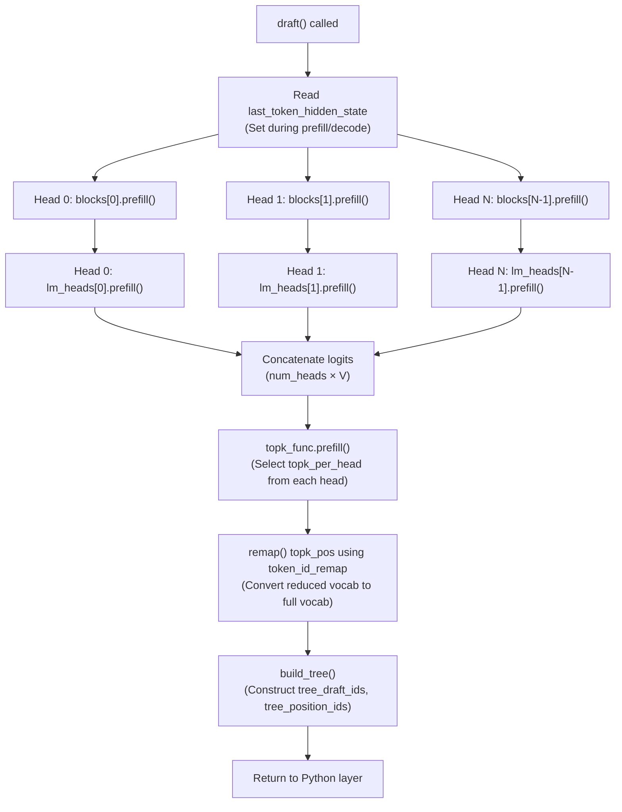
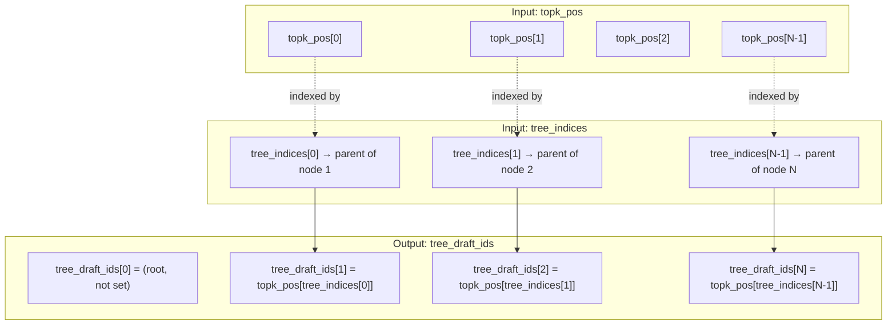

<!-- source: DeepWiki mcp.deepwiki.com · repo thunlp/FR-Spec · page 5.2 Medusa Implementation · fetched 2026-11-02 -->

# Medusa Implementation

<details>
<summary>Relevant source files</summary>

The following files were used as context for generating this wiki page:

- [src/entry.cu](src/entry.cu)
- [src/model/medusa.cuh](src/model/medusa.cuh)

</details>


## Purpose and Scope

This document describes the Medusa speculative decoding implementation in FR-Spec, an alternative to EAGLE for accelerating LLM inference. Medusa uses multiple independent language model heads attached to the base model's hidden states to generate candidate tokens in parallel. This page covers the `MedusaImpl` class architecture, initialization, weight loading, draft generation, and verification mechanisms.

For the EAGLE implementation, see [EAGLE Implementation](#5.1). For general speculative decoding concepts, see [Draft-Verify Pipeline](#5.3).

---

## Architecture Overview

The Medusa architecture extends the base model with multiple independent prediction heads, each producing token candidates from the same hidden state. Unlike EAGLE's sequential tree generation, Medusa generates predictions from multiple heads simultaneously, then selects top-k candidates from each head to build a prediction tree.

### Medusa System Architecture



**Sources:** [src/model/medusa.cuh:34-166](), [src/entry.cu:70-95]()

The `MedusaImpl` class wraps a `ModelImpl` instance and adds `num_heads` independent prediction paths. Each head processes the same hidden state through a `ResidualBlock` followed by a language model head projection to the reduced vocabulary size `V`.

---

## Core Class Structure

### MedusaImpl Template Class

The `MedusaImpl` class is templated on element type `T` (half or bfloat16) and `has_attention_bias` flag:

```
template<typename T, bool has_attention_bias=false>
struct MedusaImpl : Model
```

**Key Member Variables:**

| Variable | Type | Purpose |
|----------|------|---------|
| `model` | `ModelImpl<T, has_attention_bias>*` | Base transformer model |
| `num_heads` | `int` | Number of independent prediction heads |
| `num_layers` | `int` | Number of layers per head (asserted to be 1 in Python) |
| `topk_per_head` | `int` | Number of top candidates selected from each head |
| `tree_size` | `int` | Total positions in the prediction tree |
| `V` | `int` | Reduced vocabulary size for FR-Spec optimization |
| `blocks` | `std::vector<ResidualBlock<T>*>` | Residual transformation blocks (one per head) |
| `lm_heads` | `std::vector<Linear<T>*>` | Language model projections (one per head) |
| `token_id_remap` | `int32_t*` | Maps reduced vocab indices to full vocab indices |
| `tree_indices` | `int32_t*` | Predefined tree structure indices |
| `draft_position_ids` | `int32_t*` | Position IDs for tree nodes |

**Sources:** [src/model/medusa.cuh:34-56]()

---

## Initialization and Configuration

### Entry Point

Medusa initialization is exposed through PyBind11 in the `init_medusa_model` function:

```
void init_medusa_model(
    int num_heads,
    int num_layers,
    int topk_per_head,
    int tree_size,
    std::uintptr_t tree_indices,
    std::uintptr_t draft_position_ids,
    int V,
    int torch_dtype
)
```

This function wraps an existing `ModelImpl` instance with a `MedusaImpl` instance. The base model must already be initialized via `init_base_model` before calling this function.

**Sources:** [src/entry.cu:70-95]()

### Constructor

The `MedusaImpl` constructor initializes the multi-head architecture:

```cpp
MedusaImpl(
    ModelImpl<T, has_attention_bias>* model,
    int num_heads,
    int num_layers,
    int topk_per_head,
    int tree_size,
    int V,
    int32_t* tree_indices,
    int32_t* draft_position_ids
)
```

For each head, it creates:
1. A `ResidualBlock<T>` for hidden state transformation
2. A `Linear<T>` projection from `hidden_size` to `V` (reduced vocabulary)

It also initializes a `TopK<T>` function object for selecting candidates.

**Sources:** [src/model/medusa.cuh:57-81]()

### Memory Allocation

The `init_storage` method allocates GPU memory for weights and intermediate buffers:

1. Base model weights and outputs are allocated first
2. Medusa-specific weights (blocks and lm_heads) are allocated via `init_weight_ptr`
3. Per-head output buffers are allocated via `init_output_ptr`
4. KV cache for the base model is allocated from remaining budget

**Sources:** [src/model/medusa.cuh:83-111]()

---

## ResidualBlock Component

### Architecture

The `ResidualBlock` is a key building block that applies a linear transformation with residual connection:

```
ResidualBlock = Linear(dim_in, dim_out) + SiLU + Residual
```



**Sources:** [src/model/medusa.cuh:22-32]()

The `prefill` method implements this transformation:
1. Apply linear projection: `Linear::prefill(stream, num_tokens, input)`
2. Apply SiLU activation in-place: `silu_inplace<T>(stream, num_tokens, dim_out, output)`
3. Add residual connection: `elementwise_add<T>(stream, num_tokens, dim_out, output, input, tgt)`

**Sources:** [src/model/medusa.cuh:26-31]()

---

## Weight Loading

### Token ID Remapping

Medusa supports FR-Spec's vocabulary reduction through token ID remapping. The `load_to_storage` method handles weight loading with special logic for Medusa-specific weights:

**Weight Name Patterns:**

| Pattern | Action |
|---------|--------|
| `medusa.token_id_remap` | Load remapping table directly to `token_id_remap` buffer |
| `medusa.{head}.0.*` | Load ResidualBlock weights for head `{head}` |
| `medusa.{head}.1.*` | Load and remap LM head weights for head `{head}` |
| Other names | Delegate to base model's `load_to_storage` |

**LM Head Weight Remapping:**

For language model heads, weights are loaded from full vocabulary size and remapped to reduced size:

1. Allocate temporary buffer for full vocab size weights
2. Copy full weights from host to temporary GPU buffer
3. Apply `remap_copy` to select only the `V` token embeddings specified by `token_id_remap`
4. Free temporary buffer

**Sources:** [src/model/medusa.cuh:113-138]()

---

## Draft Generation Phase

### Draft Method Flow



**Sources:** [src/model/medusa.cuh:149-156]()

### Draft Implementation

The `draft` method generates candidate tokens:

1. **Hidden State Processing**: Each head processes `last_token_hidden_state` through its `ResidualBlock`
2. **Logit Generation**: Each block output is projected through its `lm_head` to produce `V` logits
3. **TopK Selection**: `topk_func` selects the top `topk_per_head` tokens from each head's logits
4. **Token Remapping**: Selected token IDs are remapped from reduced vocabulary to full vocabulary using `token_id_remap`
5. **Tree Building**: The `build_tree` kernel constructs the final prediction tree structure (handled externally)

Note that the `draft` method signature includes unused parameters for compatibility with the `Model` interface:
```cpp
void draft(int32_t* tree_draft_ids, int32_t* tree_position_ids, 
           int32_t* cache_length, uint64_t*, int32_t*)
```

**Sources:** [src/model/medusa.cuh:149-156]()

---

## Tree Building Kernel

### build_tree_kernel

The tree building kernel constructs the prediction tree from selected candidates:

```cpp
__global__ void build_tree_kernel(
    int tree_size, 
    const int32_t* topk_pos,           // Selected token IDs
    const int32_t* tree_indices,       // Predefined tree structure
    const int32_t* draft_position_ids, // Position offsets in tree
    int32_t* tree_draft_ids,           // Output: token IDs for each tree node
    int32_t* tree_position_ids,        // Output: absolute positions for each node
    const int32_t* cache_length        // Current KV cache length
)
```

**Kernel Logic:**

For each tree position `i` (one thread per position):
1. Calculate absolute position: `tree_position_ids[i] = cache_length[0] + draft_position_ids[i]`
2. If not root node (`i > 0`): Look up parent's token from `topk_pos` using `tree_indices[i-1]`

The `tree_indices` array defines the parent-child relationships in the prediction tree. Each entry specifies which candidate from `topk_pos` should be used as the token for that tree position.

**Sources:** [src/model/medusa.cuh:6-20]()

### Tree Building Visualization



**Sources:** [src/model/medusa.cuh:7-14]()

---

## Verification and KV Cache Fixing

### Verification Phase

The `verify` method validates draft predictions against ground truth from the base model:

```mermaid
flowchart LR
    INPUT["verify() inputs:<br/>num_tokens, pred, gt,<br/>position_ids, cache_length,<br/>mask_2d, tree_parent"]
    
    VERIFY["verify_draft()<br/>(CUDA kernel)<br/>Find longest matching prefix"]
    
    DBEST["d_best buffer<br/>[num_accepted, last_valid_idx]"]
    
    HBEST["h_best buffer<br/>(Copy to host)"]
    
    FIX["fix_kv_cache()<br/>Discard KV cache entries<br/>for rejected tokens"]
    
    UPDATE["Update last_token_hidden_state<br/>to position h_best[1]"]
    
    RETURN["Return h_best[0]<br/>(number of accepted tokens)"]
    
    INPUT --> VERIFY
    VERIFY --> DBEST
    DBEST -->|"cudaMemcpyAsync"| HBEST
    HBEST --> FIX
    FIX --> UPDATE
    UPDATE --> RETURN
```



**Sources:** [src/model/medusa.cuh:158-165]()

### Verification Steps

1. **Draft Verification**: Call `verify_draft` kernel to compare predictions (`pred`) with ground truth (`gt`), writing results to `d_best`:
   - `d_best[0]`: Number of accepted tokens
   - `d_best[1]`: Index of last valid token in hidden state buffer

2. **Result Copy**: Asynchronously copy `d_best` to host memory `h_best`

3. **KV Cache Fixing**: Call `fix_kv_cache` to remove KV cache entries for rejected tokens beyond the accepted prefix

4. **State Update**: Update `last_token_hidden_state` pointer to the hidden state at position `h_best[1]`

5. **Return**: Return `h_best[0]` to Python layer as the number of accepted tokens

**Sources:** [src/model/medusa.cuh:158-165]()

### KV Cache Management

The verification phase allocates temporary storage for KV cache manipulation:

```cpp
tmp_kvcache = 64 * num_hidden_layers * 2 * kv_dim * sizeof(T)
```

This buffer holds intermediate KV cache data during the fixing process. The `fix_kv_cache` function uses this buffer to reconstruct the valid KV cache by:
1. Copying valid entries from the original cache
2. Discarding entries corresponding to rejected tokens
3. Updating `cache_length` to reflect the new cache state

**Sources:** [src/model/medusa.cuh:100](), [src/model/medusa.cuh:162]()

---

## Comparison: Medusa vs EAGLE

| Aspect | Medusa | EAGLE |
|--------|--------|-------|
| **Architecture** | Multiple independent heads in parallel | Sequential auto-regressive layers |
| **Prediction Strategy** | Each head predicts from same hidden state | Iteratively builds on previous predictions |
| **Tree Construction** | Static tree structure from multi-head outputs | Dynamic tree construction via iterations |
| **Components** | `ResidualBlock` + `Linear` per head | Full transformer layers with attention |
| **Memory Overhead** | Lower (simple linear projections) | Higher (full attention and FFN layers) |
| **Flexibility** | Fixed tree topology | Adaptive tree topology |
| **Typical Use Case** | Simpler, faster drafting | More sophisticated, context-aware drafting |

**Sources:** [src/model/medusa.cuh:34-166](), Comparison with EagleImpl structure

---

## Entry Point Summary

The PyBind11 module exposes Medusa functionality through these functions:

```python
C.init_base_model(...)      # Initialize base transformer
C.init_medusa_model(...)    # Wrap base model with Medusa extension
C.init_storage()            # Allocate GPU memory
C.load_model(name, param)   # Load weights (handles "medusa.*" prefix)
C.prefill(...)              # Process prompt through base model
C.decode(...)               # Generate next token (base model)
C.draft(...)                # Generate candidate tree (Medusa heads)
C.verify_and_fix(...)       # Validate candidates and fix KV cache
```

The Medusa model operates in a draft-verify loop managed by the Python layer (see `LLM_with_medusa` class), where:
1. Base model generates ground truth token
2. Medusa heads generate candidate tree
3. Verification checks candidates against base model predictions
4. Accepted prefix advances generation

**Sources:** [src/entry.cu:174-184](), [src/entry.cu:70-95]()

---

