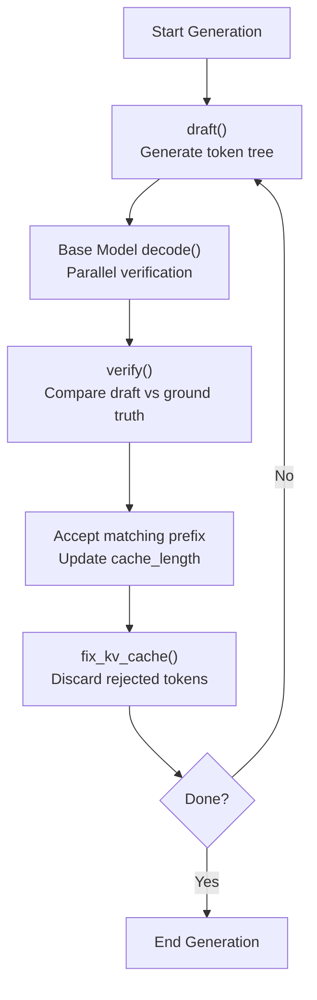
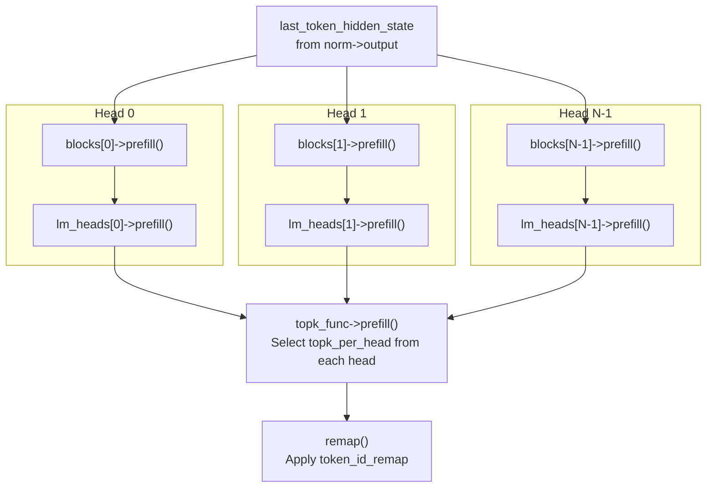
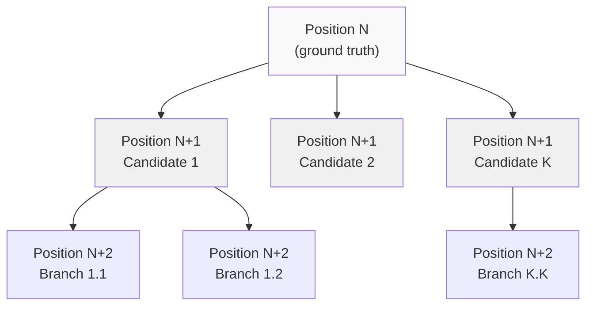
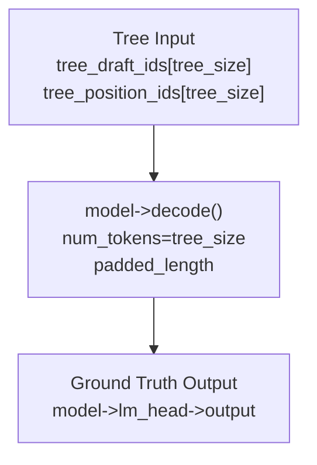
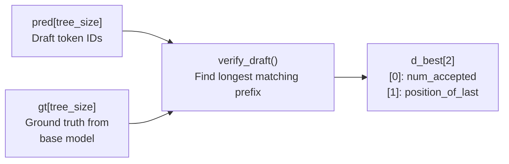
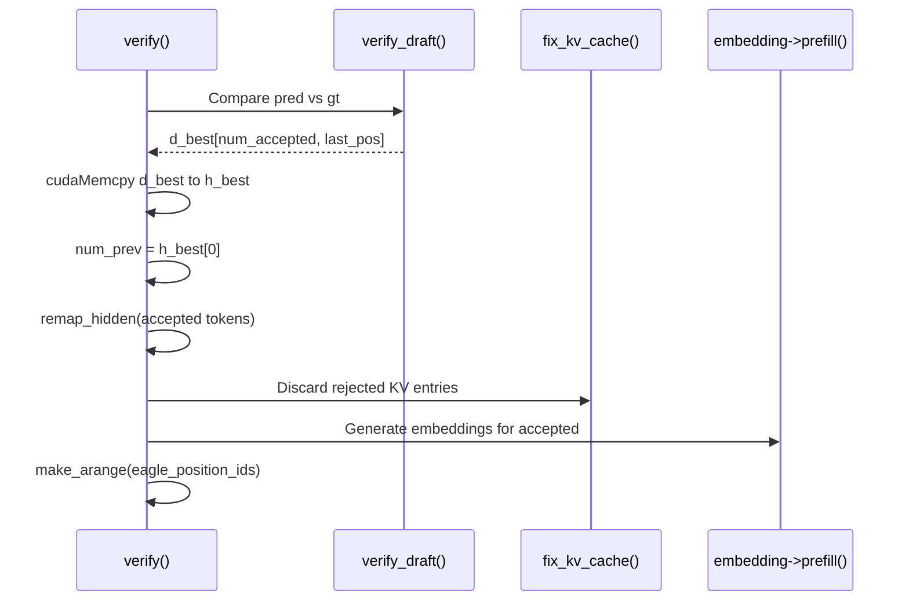
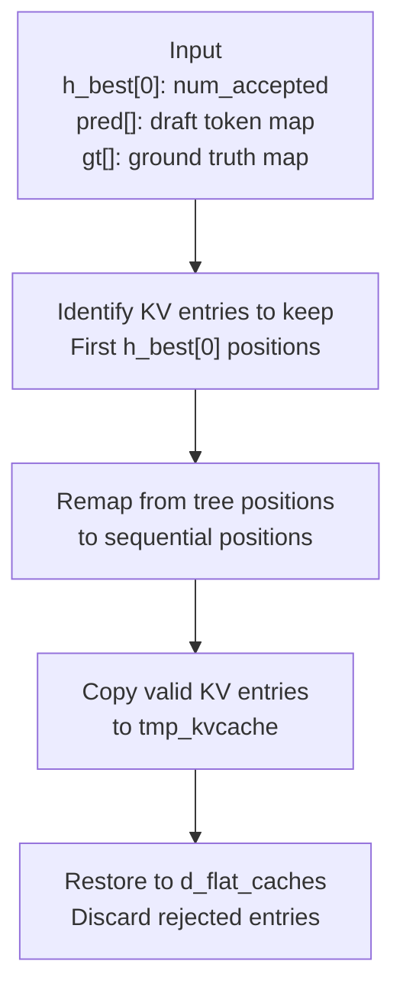
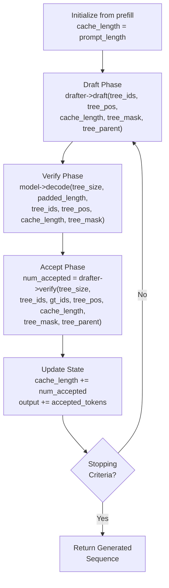

<!-- source: DeepWiki mcp.deepwiki.com · repo thunlp/FR-Spec · page 5.3 Draft-Verify Pipeline · fetched 2026-11-02 -->

# Draft-Verify Pipeline

Relevant source files

The following files were used as context for generating this wiki page:

- [src/model/eagle.cuh](src/model/eagle.cuh)
- [src/model/medusa.cuh](src/model/medusa.cuh)

## Purpose and Scope

This page documents the draft-verify pipeline, which is the core iterative loop in FR-Spec's speculative decoding implementation. The pipeline generates candidate token sequences using a lightweight drafter model, verifies them in parallel using the base model, and accepts matching prefixes to accelerate generation.

For implementation details of specific drafters, see [EAGLE Implementation](#5.1) and [Medusa Implementation](#5.2). For the overall speculative decoding concepts, see [Speculative Decoding](#5).

## Overview

The draft-verify pipeline operates in three phases per iteration:

1. **Draft Phase**: A lightweight drafter (EAGLE or Medusa) generates multiple candidate tokens organized in a tree structure
2. **Verification Phase**: The base model processes all tree positions in parallel and compares results with the draft
3. **Acceptance Phase**: Matching token prefixes are accepted, the KV cache is corrected, and the loop continues

This pipeline repeats until the desired number of tokens is generated or an end-of-sequence token is produced.

**Sources:** [src/model/eagle.cuh:432-512](), [src/model/medusa.cuh:149-165]()

## Draft Phase

The draft phase generates candidate tokens without using the base model's expensive forward pass. Both EAGLE and Medusa use a tree structure to explore multiple token possibilities simultaneously.

### EAGLE Draft Process

The `EagleImpl::draft()` method [src/model/eagle.cuh:432-494]() performs iterative drafting over multiple depths (`num_iter`):

| Step | Operation | Code Reference |
|------|-----------|----------------|
| 1 | Initialize from last hidden state | [src/model/eagle.cuh:438-445]() |
| 2 | Generate logits with FR-Spec vocab | [src/model/eagle.cuh:448-449]() |
| 3 | Select top-k candidates per iteration | [src/model/eagle.cuh:450]() |
| 4 | Expand tree for `num_iter` depths | [src/model/eagle.cuh:458-485]() |
| 5 | Build final dynamic tree structure | [src/model/eagle.cuh:490]() |

```mermaid
flowchart LR
    subgraph "Iteration d=0"
        H0["Hidden State<br/>(num_prev-1)"]
        LM0["lm_head->prefill()<br/>V-sized logits"]
        TK0["topk_func->prefill()<br/>topk_per_iter candidates"]
        H0 --> LM0
        LM0 --> TK0
    end
    
    subgraph "Iteration d=1..num_iter-1"
        Embed["model->embedding->prefill()"]
        FC["fc1, fc2 projections"]
        Layers["Eagle layers decode()"]
        LM["lm_head->prefill()"]
        TK["topk selection + cumsum"]
        
        Embed --> FC
        FC --> Layers
        Layers --> LM
        LM --> TK
    end
    
    subgraph "Tree Building"
        Select["topk_func_2->prefill()<br/>Select tree_size-1 best"]
        Build["build_dynamic_tree()<br/>Construct tree structure"]
        
        Select --> Build
    end
    
    TK0 --> Embed
    TK --> Select
```

**Key Variables:**
- `eagle_logits`: Log-probabilities with size `topk_per_iter * V` [src/model/eagle.cuh:328]()
- `tired_history_val`: Accumulated log-probabilities for all candidates [src/model/eagle.cuh:331]()
- `tired_history_pos`: Token IDs for all candidates [src/model/eagle.cuh:332]()
- `topk_per_iter`: Number of candidates per iteration (typically 10)
- `num_iter`: Number of iterative expansions (typically 3-5)

**Sources:** [src/model/eagle.cuh:432-494](), [src/model/eagle.cuh:210-212]()

### Medusa Draft Process

The `MedusaImpl::draft()` method [src/model/medusa.cuh:149-156]() uses a simpler approach with multiple parallel heads:

**Key Differences:**
- Medusa uses parallel heads instead of iterative expansion
- Each head independently predicts the next token at different positions
- Tree structure is predefined via `tree_indices` [src/model/medusa.cuh:72]()

**Sources:** [src/model/medusa.cuh:149-156](), [src/model/medusa.cuh:57-81]()

### Tree Structure

Both implementations organize candidates in a tree where:
- **Root**: Current position (first token in the tree)
- **Branches**: Multiple candidate continuations
- **Depth**: Corresponds to look-ahead distance

The tree is represented by:
- `tree_position_ids`: Absolute position in sequence for each tree node
- `tree_attn_mask`: 2D attention mask (`uint64_t`) indicating dependencies
- `tree_parent`: Parent index for each node (used during verification)

The `build_dynamic_tree()` kernel [src/model/eagle.cuh:210-212]() constructs this structure by:
1. Selecting the `tree_size-1` best candidates based on cumulative log-probabilities
2. Computing parent relationships from the `topk_pos` mapping
3. Building the attention mask to enforce tree dependencies

**Sources:** [src/model/eagle.cuh:178-212](), [src/model/medusa.cuh:7-20]()

## Verification Phase

The verification phase validates all draft tokens in parallel using the base model.

### Parallel Processing

The base model's `decode()` method processes the entire tree in a single forward pass:

**Key Parameters:**
- `tree_size`: Total number of nodes in the prediction tree
- `padded_length`: Current sequence length (rounded for alignment)
- `tree_attn_mask`: Attention mask ensuring each node only attends to its ancestors

This parallel verification is the key to speculative decoding's speedup: instead of generating tokens one-by-one, we verify multiple candidates simultaneously.

**Sources:** [src/model/eagle.cuh:428-430](), [src/model/medusa.cuh:145-147]()

### Comparison Logic

The `verify_draft()` function (defined in [src/model/tree_drafter.cuh]()) compares the draft predictions with the ground truth:

The comparison walks the tree structure following parent pointers:
1. Start at root (always matches)
2. Check each child against ground truth
3. Stop at first mismatch
4. Return the longest matching prefix length

**Sources:** [src/model/eagle.cuh:496-499](), [src/model/medusa.cuh:158-161]()

## Acceptance and Cache Management

After verification determines which tokens were accepted, the system updates its internal state for the next iteration.

### Acceptance Flow

The `EagleImpl::verify()` method [src/model/eagle.cuh:496-512]() handles acceptance:

| Step | Operation | Purpose |
|------|-----------|---------|
| 1 | Call `verify_draft()` | Compute acceptance length |
| 2 | Copy `d_best` to `h_best` | Transfer results to host |
| 3 | Update `num_prev` | Track accepted token count |
| 4 | Remap hidden states | Extract accepted hidden states |
| 5 | Call `fix_kv_cache()` | Correct KV cache |
| 6 | Prepare embeddings | Set up for next draft iteration |

**Sources:** [src/model/eagle.cuh:496-512](), [src/model/medusa.cuh:158-165]()

### KV Cache Correction

The `fix_kv_cache()` function (declared in [src/model/tree_drafter.cuh]()) maintains cache consistency:

**Why KV Cache Fixing is Necessary:**
- During verification, the base model computes KV states for all tree positions
- Some tree positions correspond to rejected tokens
- The KV cache must contain only accepted tokens for the next iteration
- Entries are reordered from tree layout back to sequential layout

The operation processes:
- `num_hidden_layers * 2` KV matrices (key and value for each layer)
- `dim` elements per token (hidden dimension)
- `h_best[0]` tokens to keep

**Sources:** [src/model/eagle.cuh:504](), [src/model/medusa.cuh:162]()

## Integration Example

Here's how the draft-verify pipeline integrates into the generation loop:

**Stopping Criteria:**
- Maximum tokens generated
- End-of-sequence token accepted
- Maximum tree rejections (fallback to regular decoding)

**Sources:** [src/model/eagle.cuh:432-512](), [src/model/medusa.cuh:149-165]()

## Performance Characteristics

The draft-verify pipeline achieves speedup through:

1. **Parallel Verification**: Processing multiple candidates in one forward pass
2. **Early Termination**: Stopping when mismatch detected (via tree structure)
3. **Reduced LM-Head Computation**: EAGLE uses FR-Spec's reduced vocabulary (V instead of full vocab_size)
4. **Efficient Tree Search**: Dynamic tree building selects only promising candidates

**Typical Parameters:**
- EAGLE: `num_iter=3-5`, `topk_per_iter=10`, `tree_size=63`
- Medusa: `num_heads=3-5`, `topk_per_head=5`, `tree_size=64`

Acceptance rate (percentage of draft tokens accepted) is the key metric. Higher acceptance rates lead to greater speedup, typically 1.5-2.5x over baseline decoding.

**Sources:** [src/model/eagle.cuh:274-305](), [src/model/medusa.cuh:57-81]()

---

