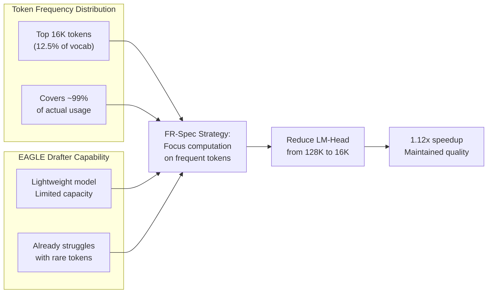
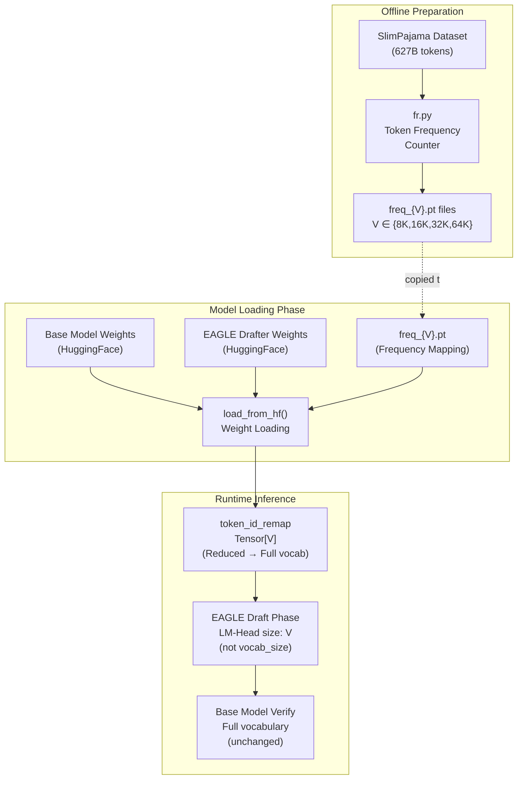
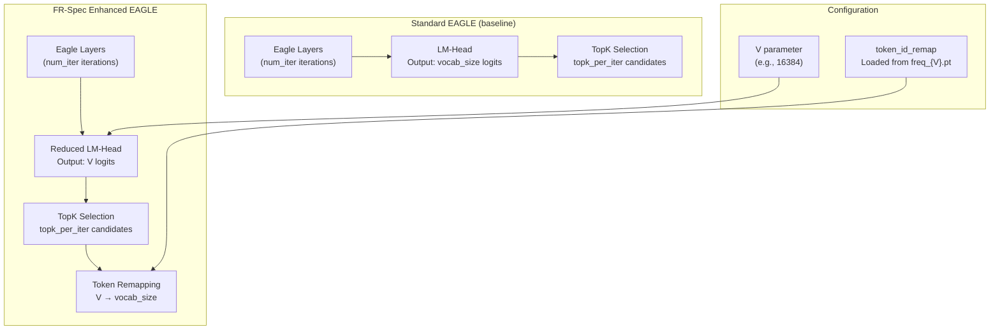
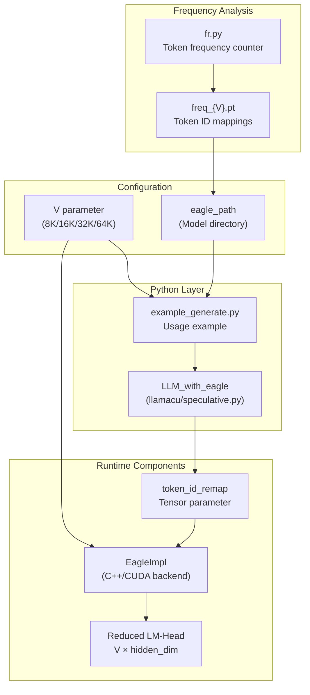
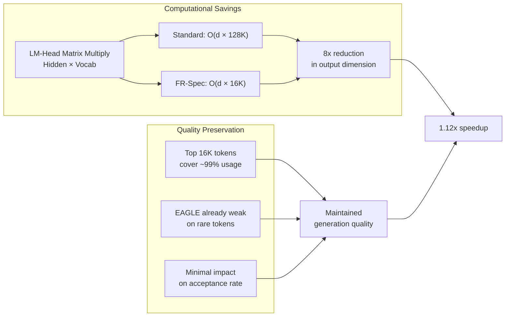

<!-- source: DeepWiki mcp.deepwiki.com · repo thunlp/FR-Spec · page 6 FR-Spec Optimization · fetched 2026-11-02 -->

# FR-Spec Optimization

<details>
<summary>Relevant source files</summary>

The following files were used as context for generating this wiki page:

- [README.md](README.md)
- [examples/example_generate.py](examples/example_generate.py)
- [fr/fr.py](fr/fr.py)
- [src/flash_attn/flash_api.hpp](src/flash_attn/flash_api.hpp)

</details>


## Purpose and Scope

This document describes the core innovation of FR-Spec: frequency-ranked vocabulary reduction for accelerating speculative decoding. FR-Spec addresses the LM-Head computation bottleneck in EAGLE-2 by leveraging the long-tail property of token distributions, achieving a **1.12x speedup** over standard EAGLE-2 while preserving generation quality.

For implementation details of token frequency analysis, see [Token Frequency Analysis](#6.1). For vocabulary reduction strategies, see [Vocabulary Reduction Strategy](#6.2). For runtime token mapping mechanisms, see [Token ID Remapping](#6.3). For details on the EAGLE drafter implementation, see [EAGLE Implementation](#5.1).

**Sources:** [README.md:9-13]()

## The LM-Head Bottleneck Problem

In speculative decoding systems like EAGLE-2, the draft model generates candidate tokens that are verified by the base model. The EAGLE drafter uses lightweight layers to predict tokens iteratively, but each iteration requires computing logits over the entire vocabulary through the LM-Head layer.

### Computational Characteristics

The LM-Head layer performs a matrix multiplication between the hidden states (dimension `d`) and the full vocabulary weight matrix (size `vocab_size × d`). For modern LLMs:

| Model | Vocabulary Size | Hidden Dimension | LM-Head Output Size |
|-------|----------------|------------------|---------------------|
| Llama-3-8B | 128,256 | 4,096 | 128,256 |
| Llama-3.2-1B | 128,256 | 2,048 | 128,256 |
| Qwen2-7B | 151,936 | 3,584 | 151,936 |

During each EAGLE drafting iteration, computing logits for 100K+ vocabulary entries becomes a bottleneck, especially when generating multiple candidate tokens per iteration (typical `topk_per_iter` values range from 4-10).

### Why This Is a Problem

1. **High Memory Bandwidth**: Reading the entire LM-Head weight matrix from GPU memory
2. **Wasted Computation**: Most vocabulary tokens have near-zero probability for common text
3. **Repeated Cost**: EAGLE performs multiple drafting iterations per base model step

The observation is that EAGLE's lightweight architecture and iterative drafting already limits its ability to predict rare tokens accurately, making full-vocabulary computation wasteful.

**Sources:** [README.md:9-13]()

## FR-Spec Solution Overview

FR-Spec exploits the **long-tail property** of natural language: a small subset of tokens accounts for the vast majority of token occurrences in typical text. By restricting the EAGLE drafter to only predict from the most frequent tokens, FR-Spec dramatically reduces LM-Head computation while maintaining high acceptance rates.

### Core Insight



**Diagram: FR-Spec Core Insight**

### Key Innovation

Instead of modifying model weights or architecture, FR-Spec:
1. Analyzes token frequency in a representative corpus (SlimPajama)
2. Identifies the top-N most frequent tokens (N ∈ {8K, 16K, 32K, 64K})
3. Maps these tokens to a contiguous range [0, N)
4. Replaces the full LM-Head with a reduced version operating on N tokens only

The base model remains unchanged, and only the EAGLE drafter operates with reduced vocabulary.

**Sources:** [README.md:9-14](), [examples/example_generate.py:13-14,33-38]()

## FR-Spec Architecture

### High-Level Workflow



**Diagram: FR-Spec End-to-End Workflow**

### Component Interaction

The FR-Spec optimization integrates seamlessly with the EAGLE architecture:



**Diagram: Standard EAGLE vs FR-Spec EAGLE**

**Sources:** [fr/fr.py:1-76](), [examples/example_generate.py:13-14,33-39]()

## Implementation Strategy

### Three-Phase Process

**Phase 1: Offline Token Frequency Analysis**

The `fr.py` script performs corpus-level analysis:
- Processes SlimPajama dataset (default: 1M lines, ~2B tokens)
- Counts token occurrences using `Counter` from Python collections
- Sorts tokens by frequency in descending order
- Generates mappings for multiple vocabulary sizes

Output files: `freq_8192.pt`, `freq_16384.pt`, `freq_32768.pt`, `freq_65536.pt`

**Phase 2: Model Initialization with Token Mapping**

During model loading ([examples/example_generate.py:33-39]()):
```python
if V != -1:
    with open(f'{eagle_path}/freq_{V}.pt', 'rb') as f:
        token_id_remap = torch.tensor(torch.load(f, weights_only=True), 
                                      dtype=torch.int32, device="cpu")
else:
    token_id_remap = torch.arange(config.vocab_size, dtype=torch.int32, device="cpu")
llm._load("token_id_remap", token_id_remap, cls="eagle")
```

The `token_id_remap` tensor contains the mapping from reduced vocabulary indices [0, V) to full vocabulary token IDs.

**Phase 3: Runtime Inference**

During EAGLE drafting:
1. EAGLE layers produce hidden states
2. Reduced LM-Head computes only V logits (not `vocab_size`)
3. TopK selection chooses candidates from these V logits
4. Token IDs are remapped to full vocabulary using `token_id_remap`
5. Base model verification uses full vocabulary

**Sources:** [fr/fr.py:9-43](), [examples/example_generate.py:13-14,24-44]()

## Key Code Entities



**Diagram: FR-Spec Code Entity Relationships**

### Key Parameters

| Parameter | Type | Purpose | Typical Values |
|-----------|------|---------|----------------|
| `V` | int | Reduced vocabulary size | 8192, 16384, 32768, 65536 |
| `token_id_remap` | Tensor[V] | Maps reduced indices to full vocab | Loaded from `freq_{V}.pt` |
| `eagle_path` | str | Path to EAGLE weights and freq files | HuggingFace model path |
| `num_lines` | int | SlimPajama lines for analysis | 1,000,000 (default) |

**Sources:** [examples/example_generate.py:6-13,33-38](), [fr/fr.py:46-72]()

## Performance Impact

### Speedup Characteristics

FR-Spec achieves:
- **1.12x speedup** over standard EAGLE-2 on average
- **1.5x+ speedup** over baseline autoregressive decoding
- Speedup increases with larger base models (more LM-Head compute)

### Why It Works



**Diagram: Performance Impact Analysis**

### Trade-offs

**Advantages:**
- No model retraining required
- Preserves generation quality on common text
- Simple to implement and deploy
- Configurable vocabulary sizes for different use cases

**Limitations:**
- Slight reduction in capability for rare/technical tokens
- Requires corpus analysis step (one-time, offline)
- Most effective for general-domain text generation

### Vocabulary Size Selection

Different `V` values offer different trade-offs:

| V | Coverage | Speedup | Use Case |
|---|----------|---------|----------|
| 8K | ~95% | Highest | Chat, simple generation |
| 16K | ~99% | High | General text (recommended) |
| 32K | ~99.5% | Moderate | Technical/domain text |
| 64K | ~99.9% | Lower | Maximum quality preservation |

**Sources:** [README.md:9-22](), [fr/fr.py:67-72]()

## Integration Example

A minimal example showing FR-Spec usage:

```python
# Set reduced vocabulary size
V = 16384  # or -1 to disable FR-Spec

# Load token frequency mapping
if V != -1:
    with open(f'{eagle_path}/freq_{V}.pt', 'rb') as f:
        token_id_remap = torch.tensor(torch.load(f, weights_only=True), 
                                      dtype=torch.int32, device="cpu")
else:
    token_id_remap = torch.arange(config.vocab_size, dtype=torch.int32, device="cpu")

# Initialize EAGLE model with FR-Spec
llm = LLM_with_eagle(eagle_path, base_path, dtype=dtype, memory_limit=0.9)
llm.init_storage()
llm._load("token_id_remap", token_id_remap, cls="eagle")
llm.load_from_hf()

# Generate with FR-Spec optimization
output = llm.generate(input_ids, num_generate=100)
```

The `token_id_remap` tensor is passed to the C++/CUDA backend where it's used during EAGLE drafting to map reduced vocabulary indices back to full vocabulary token IDs.

**Sources:** [examples/example_generate.py:13-14,24-44]()

## Summary

FR-Spec optimizes EAGLE-2 speculative decoding by:

1. **Identifying the bottleneck**: LM-Head computation over 100K+ vocabulary
2. **Exploiting token distribution**: Long-tail property means few tokens dominate
3. **Reducing computation**: EAGLE drafter uses only top-N frequent tokens
4. **Preserving quality**: Base model unchanged, minimal impact on accuracy
5. **Achieving speedup**: 1.12x over EAGLE-2, 1.5x+ over baseline

The optimization requires no model retraining, integrates seamlessly with existing EAGLE architectures, and provides configurable trade-offs between speed and vocabulary coverage.

**Sources:** [README.md:1-139](), [examples/example_generate.py:1-46](), [fr/fr.py:1-76]()

---

