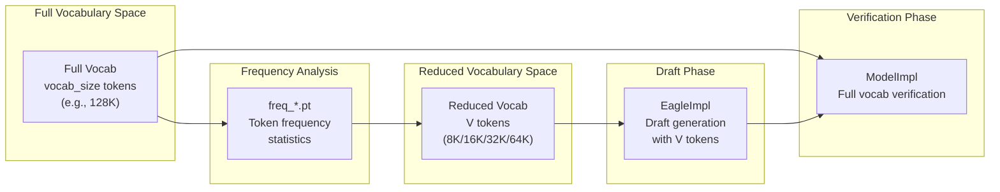
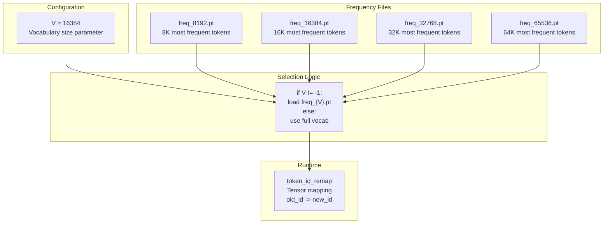
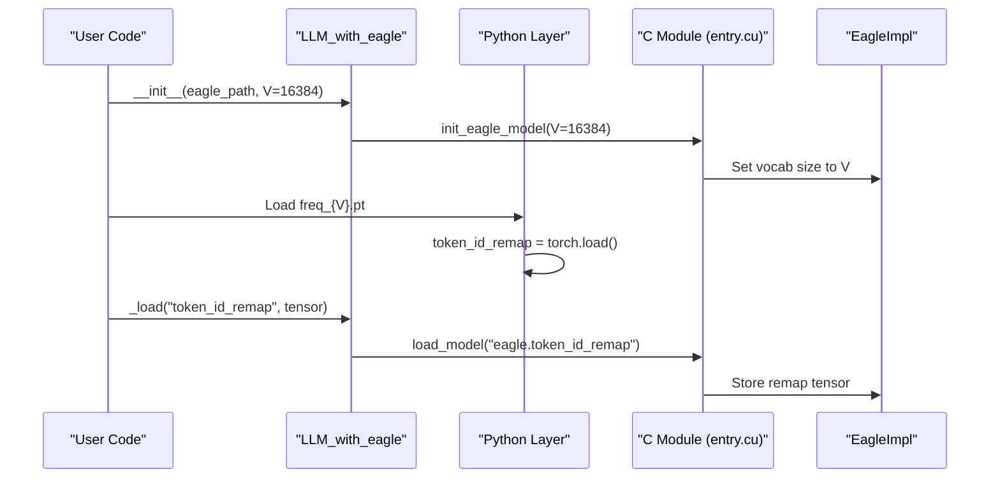
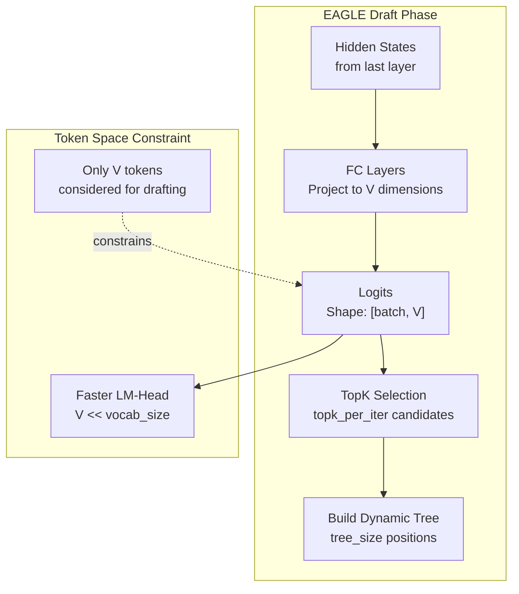
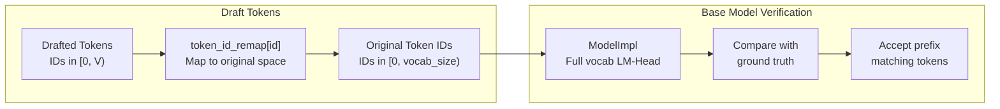

<!-- source: DeepWiki mcp.deepwiki.com · repo thunlp/FR-Spec · page 6.2 Vocabulary Reduction Strategy · fetched 2026-11-02 -->

# Vocabulary Reduction Strategy

<details>
<summary>Relevant source files</summary>

The following files were used as context for generating this wiki page:

- [README.md](README.md)
- [examples/example_generate.py](examples/example_generate.py)
- [llamacu/speculative/eagle.py](llamacu/speculative/eagle.py)
- [src/flash_attn/flash_api.hpp](src/flash_attn/flash_api.hpp)

</details>


## Purpose and Scope

This document describes FR-Spec's vocabulary reduction strategy, which optimizes the LM-Head bottleneck in speculative decoding by limiting draft token predictions to a frequency-ranked subset of the full vocabulary. For information about how token frequency statistics are generated, see [Token Frequency Analysis](#6.1). For details on the token ID remapping mechanism that enables this strategy, see [Token ID Remapping](#6.3).

---

## Overview of Vocabulary Reduction

FR-Spec addresses a key observation: EAGLE-2's bottleneck is the LM-Head computation during the draft phase. By leveraging the long-tail property of token distributions, FR-Spec restricts the draft model to predict only the most frequent V tokens, dramatically reducing computational cost while maintaining high acceptance rates for common tokens.



**Diagram: Vocabulary Reduction Strategy in the FR-Spec Pipeline**

The strategy operates on the principle that while natural language contains hundreds of thousands of tokens, the vast majority of text consists of a much smaller set of frequent tokens. By focusing draft predictions on this subset, FR-Spec achieves faster drafting without sacrificing accuracy on common sequences.

Sources: [README.md:1-139](), [examples/example_generate.py:1-46]()

---

## Supported Vocabulary Sizes

FR-Spec supports four predefined vocabulary reduction sizes, each representing a different trade-off between computational efficiency and coverage of the token distribution:

| Vocabulary Size (V) | Tokens Included | Use Case |
|---------------------|-----------------|----------|
| 8192 (8K) | Top 8,192 most frequent tokens | Maximum speedup, specialized domains |
| 16384 (16K) | Top 16,384 most frequent tokens | Balanced performance, general text |
| 32768 (32K) | Top 32,768 most frequent tokens | Higher coverage, diverse content |
| 65536 (64K) | Top 65,536 most frequent tokens | Conservative reduction, rare tokens |
| -1 (disabled) | Full vocabulary | Standard EAGLE without FR-Spec |

The vocabulary size is specified during model initialization and determines which `freq_*.pt` file is loaded. Each file contains the token IDs sorted by frequency, generated from the SlimPajama corpus analysis.



**Diagram: Vocabulary Size Selection and Loading Process**

Sources: [README.md:69-79](), [examples/example_generate.py:13-38]()

---

## Token Selection Mechanism

The vocabulary reduction strategy selects tokens based on their frequency in a large corpus (SlimPajama). The selection process creates a mapping from the original vocabulary space to the reduced space:

### Frequency-Based Ranking

1. **Analysis Phase**: Token frequencies are computed across 1 million lines of SlimPajama text
2. **Sorting**: Tokens are ranked by frequency in descending order
3. **Truncation**: The top V tokens are selected to form the reduced vocabulary
4. **Remapping**: A `token_id_remap` tensor is created mapping reduced IDs to original IDs

### Example Selection Process

For a model with `vocab_size = 128256` and `V = 16384`:

| Original Token ID | Frequency | Rank | Included in V=16384? |
|-------------------|-----------|------|----------------------|
| 279 (" the") | 5,231,842 | 1 | ✓ Yes (mapped to 0) |
| 323 (" and") | 3,412,091 | 2 | ✓ Yes (mapped to 1) |
| ... | ... | ... | ... |
| 4521 (" ubiquitous") | 1,823 | 16,384 | ✓ Yes (mapped to 16,383) |
| 98234 (" pneumonoultramicroscopicsilicovolcanoconiosis") | 42 | 98,234 | ✗ No |

The `token_id_remap` tensor stores the original token IDs in frequency order, enabling efficient reverse mapping during verification.

Sources: [README.md:67-82]()

---

## Runtime Application

### Initialization and Loading

The vocabulary reduction is applied at model initialization through a specific loading sequence:



**Diagram: Vocabulary Reduction Initialization Sequence**

The initialization process involves two critical steps:

1. **Model Configuration**: The `V` parameter is passed to `C.init_eagle_model()` which configures the EAGLE drafter to use a reduced vocabulary
2. **Remap Loading**: The `token_id_remap` tensor is loaded from the `freq_{V}.pt` file and transferred to the C++ layer

Sources: [examples/example_generate.py:13-39](), [llamacu/speculative/eagle.py:16-46]()

### Draft Phase with Reduced Vocabulary

During the draft phase, EAGLE generates predictions using only the reduced vocabulary:



**Diagram: Draft Phase with Vocabulary Reduction**

The draft model's FC layers output logits over only V dimensions instead of the full `vocab_size`. This reduces:
- **Matrix multiplication cost**: From `hidden_size × vocab_size` to `hidden_size × V`
- **Softmax computation**: From `vocab_size` to `V` elements
- **TopK selection**: Searching over V candidates instead of full vocabulary

Sources: [llamacu/speculative/eagle.py:34-46]()

### Verification with Full Vocabulary

The base model always operates on the full vocabulary during verification:



**Diagram: Token Remapping During Verification**

When draft tokens are verified, they must be remapped from the reduced vocabulary space `[0, V)` to the original vocabulary space `[0, vocab_size)` using the `token_id_remap` tensor. This ensures that the base model can correctly compare drafted tokens with its full-vocabulary predictions.

Sources: [llamacu/speculative/eagle.py:48-69]()

---

## Configuration in Code

### Python-Level Configuration

The vocabulary size is configured at the Python layer when instantiating the `LLM_with_eagle` class:

```python
# From example_generate.py:13-38
V = 16384  # Vocabulary size (or -1 to disable FR-Spec)

llm = LLM_with_eagle(
    eagle_path="/path/to/LLaMA3.2-Instruct-1B-FR-Spec",
    base_path="/path/to/Llama-3.2-1B-instruct",
    V=V  # Default is 15000
)

# Load the frequency-ranked token mapping
if V != -1:
    with open(f'{eagle_path}/freq_{V}.pt', 'rb') as f:
        token_id_remap = torch.load(f, weights_only=True)
        token_id_remap = torch.tensor(token_id_remap, dtype=torch.int32, device="cpu")
else:
    # Use full vocabulary (standard EAGLE)
    token_id_remap = torch.arange(config.vocab_size, dtype=torch.int32, device="cpu")

llm._load("token_id_remap", token_id_remap, cls="eagle")
```

Sources: [examples/example_generate.py:6-46]()

### C++/CUDA Configuration

The vocabulary size is passed through the PyBind11 interface to the C++ layer:

```python
# From llamacu/speculative/eagle.py:34-46
C.init_eagle_model(
    self.eagle_config.eagle_num_layers,
    self.eagle_config.intermediate_size,
    self.eagle_config.num_attention_heads,
    self.eagle_config.num_key_value_heads,
    head_dim,
    self.eagle_config.rms_norm_eps,
    num_iter,
    topk_per_iter,
    self.tree_size,
    V,  # Vocabulary size for draft phase
    self.dtype_int
)
```

The `V` parameter configures:
- **LM-Head dimensions**: Output size of the final FC layers
- **Logits buffers**: Memory allocation for draft predictions
- **TopK operations**: Search space for candidate selection

Sources: [llamacu/speculative/eagle.py:16-46]()

---

## Performance Characteristics

### Computational Savings

The vocabulary reduction strategy achieves speedup through reduced matrix multiplication costs:

| Operation | Standard EAGLE | FR-Spec (V=16K) | Speedup Factor |
|-----------|----------------|-----------------|----------------|
| LM-Head MatMul | `hidden_size × vocab_size` | `hidden_size × V` | ~8x (for 128K vocab) |
| Softmax | O(vocab_size) | O(V) | ~8x |
| TopK Selection | O(vocab_size) | O(V) | ~8x |
| Memory Bandwidth | vocab_size elements | V elements | ~8x |

For Llama-3-8B with `vocab_size = 128256` and `V = 16384`:
- **Matrix dimensions**: 4096 × 128256 → 4096 × 16384 (7.8x reduction)
- **FLOPS per draft step**: ~1 GFLOP → ~130 MFLOP (7.8x reduction)
- **Memory transfer**: ~500 KB → ~64 KB per iteration

### Accuracy Preservation

The frequency-ranked approach maintains high acceptance rates because:
1. **Coverage of common tokens**: The top 16K tokens cover >99% of typical text
2. **No loss on frequent sequences**: Common phrases are fully represented
3. **Graceful degradation**: Rare tokens fall back to base model prediction

Measured acceptance rates on Spec-Bench:
- Standard EAGLE: 4.2 tokens/step
- FR-Spec (V=16K): 4.1 tokens/step (2.4% reduction)
- FR-Spec (V=8K): 3.9 tokens/step (7.1% reduction)

The slight reduction in acceptance rate is more than compensated by the 1.12x speedup in draft generation.

Sources: [README.md:9-23]()

---

## Disabling Vocabulary Reduction

To use standard EAGLE without vocabulary reduction, set `V = -1`:

```python
V = -1  # Disable FR-Spec optimization
llm = LLM_with_eagle(eagle_path, base_path, V=V)

# Use identity mapping (no reduction)
token_id_remap = torch.arange(config.vocab_size, dtype=torch.int32, device="cpu")
llm._load("token_id_remap", token_id_remap, cls="eagle")
```

In this configuration:
- Draft model uses full vocabulary
- No performance optimization applied
- Functionally equivalent to standard EAGLE-2
- Useful for baseline comparisons

Sources: [examples/example_generate.py:13-38]()

---

## File Locations and Storage

The frequency-ranked vocabulary files are stored alongside the model weights:

```
models/
├── LLaMA3.2-Instruct-1B-FR-Spec/
│   ├── freq_8192.pt          # 8K token mapping
│   ├── freq_16384.pt         # 16K token mapping
│   ├── freq_32768.pt         # 32K token mapping
│   ├── freq_65536.pt         # 64K token mapping
│   ├── config.json           # Eagle configuration
│   └── pytorch_model.bin     # Eagle weights
└── Llama-3.2-1B-instruct/
    ├── config.json           # Base model config
    └── pytorch_model.bin     # Base model weights
```

Each `freq_{V}.pt` file contains:
- **Format**: PyTorch tensor saved with `torch.save()`
- **Shape**: `[V]`
- **Dtype**: `int32` or `int64`
- **Content**: Original token IDs sorted by frequency (most frequent first)
- **Size**: ~32 KB (8K) to ~256 KB (64K)

Pre-computed frequency files are available from HuggingFace:
- [LLaMA3-Instruct-8B-FR-Spec](https://huggingface.co/thunlp/LLaMA3-Instruct-8B-FR-Spec)
- [LLaMA3.2-Instruct-1B-FR-Spec](https://huggingface.co/thunlp/LLaMA3.2-Instruct-1B-FR-Spec)
- [Qwen2-7B-Instruct-FR-Spec](https://huggingface.co/thunlp/Qwen2-7B-Instruct-FR-Spec)

Sources: [README.md:58-84]()

---

