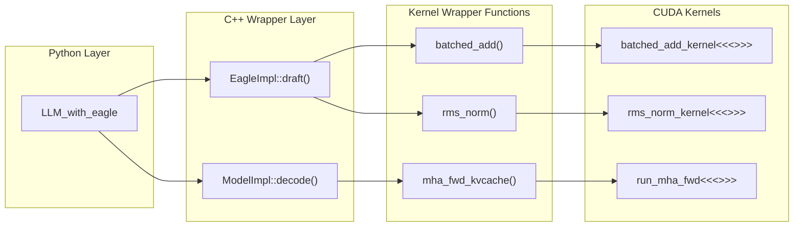
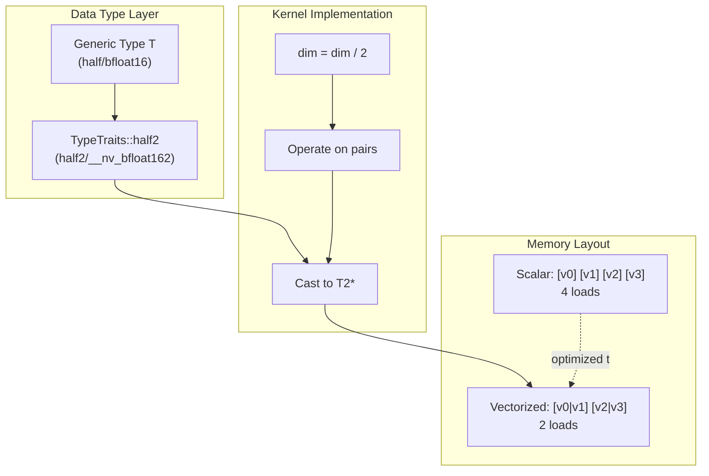
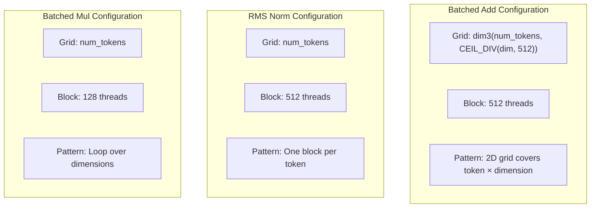
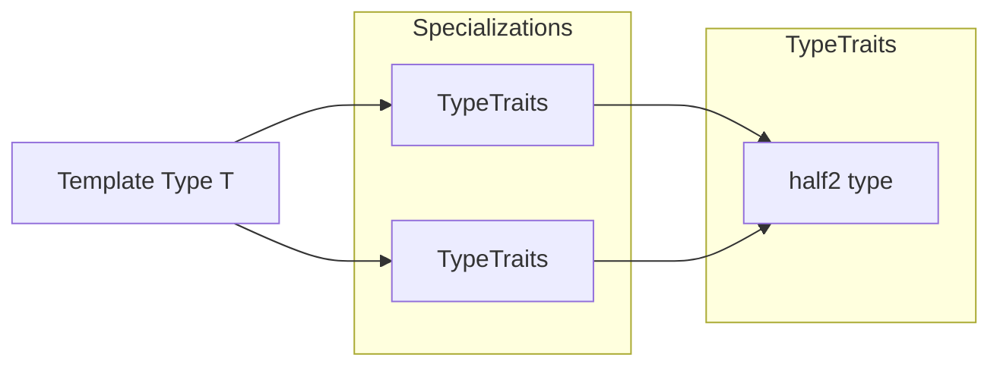

<!-- source: DeepWiki mcp.deepwiki.com · repo thunlp/FR-Spec · page 7 CUDA Kernels · fetched 2026-11-02 -->

# CUDA Kernels

<details>
<summary>Relevant source files</summary>

The following files were used as context for generating this wiki page:

- [README.md](README.md)
- [src/flash_attn/flash_api.hpp](src/flash_attn/flash_api.hpp)
- [src/model/elementwise.cuh](src/model/elementwise.cuh)
- [src/model/norm.cuh](src/model/norm.cuh)

</details>


## Purpose and Scope

This page provides an overview of the custom CUDA kernels that implement performance-critical GPU operations in FR-Spec. These kernels form the computational foundation for transformer inference and speculative decoding, providing optimized implementations for attention mechanisms, element-wise operations, token selection, and tree building.

For details on specific kernel implementations, see:
- Flash Attention kernels: [Flash Attention](#7.1)
- Element-wise and normalization kernels: [Element-wise Operations and Normalization](#7.2)
- Token candidate selection: [TopK Selection](#7.3)
- Speculative decoding tree construction: [Tree Building Kernels](#7.4)

For information on how these kernels integrate into the model architecture, see [Core Model Components](#4) and [Speculative Decoding](#5).

---

## Kernel Categories

FR-Spec implements four primary categories of CUDA kernels, each serving a distinct role in the inference pipeline:

```mermaid
graph TB
    subgraph "Model Components"
        ATT["Attention"]
        FFN["GatedFFN"]
        EAGLE["EagleImpl"]
        LAYER["Layer"]
    end
    
    subgraph "Flash Attention Kernels"
        MHA["mha_fwd_kvcache()"]
        SETPARAM["set_params_fprop()"]
        RUNMHA["run_mha_fwd()"]
    end
    
    subgraph "Element-wise & Normalization"
        BADD["batched_add_kernel"]
        EADD["elementwise_add_kernel"]
        BMUL["batched_mul_kernel"]
        RMS["rms_norm_kernel"]
        ADDNORM["add_and_rms_norm_kernel"]
    end
    
    subgraph "Selection Kernels"
        TOPK["bitonic_topk"]
        SAMPLE["sampling kernels"]
    end
    
    subgraph "Tree Building"
        BTREE["build_dynamic_tree"]
        MASK["mask construction"]
    end
    
    ATT --> MHA
    ATT --> SETPARAM
    ATT --> RUNMHA
    
    FFN --> BADD
    FFN --> BMUL
    
    LAYER --> RMS
    LAYER --> ADDNORM
    LAYER --> EADD
    
    EAGLE --> TOPK
    EAGLE --> SAMPLE
    EAGLE --> BTREE
    EAGLE --> MASK
```



**Diagram: Kernel Categories and Their Callers**

Sources: [src/flash_attn/flash_api.hpp](), [src/model/elementwise.cuh](), [src/model/norm.cuh]()

| Kernel Category | Purpose | Key Functions | Used By |
|-----------------|---------|---------------|---------|
| **Flash Attention** | Optimized multi-head attention with KV caching | `mha_fwd_kvcache`, `run_mha_fwd` | Attention component |
| **Element-wise Operations** | Vector addition and multiplication | `batched_add`, `elementwise_add`, `batched_mul` | FFN, residual connections |
| **Normalization** | RMS normalization with optional residual | `rms_norm_kernel`, `add_and_rms_norm_kernel` | Layer normalization |
| **TopK Selection** | Bitonic sort-based token selection | `bitonic_topk` | EAGLE draft phase |
| **Tree Building** | Dynamic tree construction for speculative decoding | `build_dynamic_tree` | EAGLE verification |

Sources: [src/flash_attn/flash_api.hpp](), [src/model/elementwise.cuh](), [src/model/norm.cuh]()

---

## Kernel Invocation Pattern

CUDA kernels in FR-Spec follow a consistent invocation pattern through C++ wrapper functions that manage kernel launch configurations:



**Diagram: Kernel Invocation Hierarchy**

The wrapper functions [src/model/elementwise.cuh:37-53]() and [src/model/norm.cuh:102-111]() handle:
1. Type conversions (e.g., converting to `half2` for vectorization)
2. Grid and block dimension calculation
3. Stream management
4. Template instantiation for different data types

Sources: [src/model/elementwise.cuh:37-53](), [src/model/norm.cuh:102-111]()

---

## Vectorization Strategy

FR-Spec kernels extensively use `half2` vectorization to double memory bandwidth utilization and computational throughput for FP16 operations:



**Diagram: Half2 Vectorization Pattern**

The vectorization is applied in three steps visible in [src/model/elementwise.cuh:37-41]():

1. **Dimension halving**: `dim = dim / 2` converts element count to pair count
2. **Pointer casting**: `(T2*)a` reinterprets data as packed pairs
3. **Kernel execution**: Operates on pairs, effectively processing two elements per thread operation

This pattern appears consistently across:
- `batched_add` [src/model/elementwise.cuh:37-41]()
- `elementwise_add` [src/model/elementwise.cuh:44-48]()
- `rms_norm` [src/model/norm.cuh:102-105]()

Sources: [src/model/elementwise.cuh:37-48](), [src/model/norm.cuh:102-105](), [src/trait.cuh]()

---

## Memory Access Patterns

Different kernel categories employ distinct memory access patterns optimized for their computational characteristics:

| Kernel Type | Memory Pattern | Coalescing Strategy | Example |
|-------------|----------------|---------------------|---------|
| **Element-wise** | Row-major sequential | Direct coalesced access | [src/model/elementwise.cuh:8-14]() |
| **Normalization** | Reduction + broadcast | Shared memory accumulation | [src/model/norm.cuh:7-51]() |
| **Flash Attention** | Tiled matrix multiply | Block-wise loading | [src/flash_attn/flash_api.hpp:207-304]() |
| **TopK** | Parallel comparison | Bitonic sort network | Referenced in EAGLE draft |

Sources: [src/model/elementwise.cuh](), [src/model/norm.cuh](), [src/flash_attn/flash_api.hpp]()

### Element-wise Kernel Pattern

Element-wise kernels like `batched_add_kernel` [src/model/elementwise.cuh:8-14]() use a straightforward access pattern:

```
Thread mapping: col = blockIdx.y * blockDim.x + threadIdx.x
Memory access: c[row + col] = a[row + col] + b[col]
```

This achieves perfect memory coalescing when threads in a warp access consecutive memory locations.

### Normalization Kernel Pattern

RMS normalization kernels [src/model/norm.cuh:7-51]() employ a two-phase pattern:

1. **Reduction phase**: Threads accumulate sum-of-squares using warp shuffles and shared memory
2. **Normalization phase**: Threads apply the computed scale factor element-wise

The shared memory array `s_input[4096]` [src/model/norm.cuh:9]() and `warp_sum[16]` [src/model/norm.cuh:11]() enable efficient intra-block communication.

Sources: [src/model/elementwise.cuh:8-14](), [src/model/norm.cuh:7-51]()

---

## Kernel Launch Configuration

FR-Spec kernels use different grid/block configurations optimized for their workload:



**Diagram: Common Kernel Launch Configurations**

| Kernel | Grid Dimensions | Block Size | Rationale |
|--------|-----------------|------------|-----------|
| `batched_add_kernel` | `(num_tokens, CEIL_DIV(dim, 512))` | 512 | 2D grid allows direct indexing [src/model/elementwise.cuh:40]() |
| `rms_norm_kernel` | `num_tokens` | 512 | One block per token, threads reduce across dimension [src/model/norm.cuh:104]() |
| `batched_mul_kernel` | `num_tokens` | 128 | Threads loop over dimension with stride [src/model/elementwise.cuh:52]() |

The choice of 512 threads for most kernels balances occupancy with resource usage (registers, shared memory).

Sources: [src/model/elementwise.cuh:40-52](), [src/model/norm.cuh:104]()

---

## Flash Attention Integration

Flash Attention is the most complex kernel subsystem, interfacing through `mha_fwd_kvcache` [src/flash_attn/flash_api.hpp:207-304](). The API setup involves:

1. **Parameter structure population**: `set_params_fprop` [src/flash_attn/flash_api.hpp:13-131]() configures `Flash_fwd_params` with:
   - Tensor pointers and strides
   - Batch size, sequence lengths, head counts
   - Attention mask information
   - Softmax scale and optional softcap

2. **Split-KV heuristic**: `set_params_splitkv` [src/flash_attn/flash_api.hpp:189-204]() determines optimal parallelization:
   ```
   num_splits = num_splits_heuristic(batch * heads * m_blocks, num_SMs * 2, n_blocks, 128)
   ```

3. **Kernel dispatch**: `run_mha_fwd` [src/flash_attn/flash_api.hpp:133-145]() selects implementation based on:
   - Data type (FP16 vs BF16)
   - Head dimension (64, 128, 256)
   - Causality mask
   - Split-KV requirement

Sources: [src/flash_attn/flash_api.hpp:13-304]()

---

## Stream Management

All kernel launches accept a `Stream` parameter containing a `cudaStream_t`, enabling:

1. **Asynchronous execution**: Kernels can overlap with CPU computation
2. **Pipeline parallelism**: Different stages can execute concurrently
3. **CUDA graph compatibility**: Repeated decode passes can be captured

The pattern appears consistently:
```cpp
batched_add_kernel<T2><<<grid, block, 0, stream.stream>>>(...);
```

The `stream.stream` member [src/model/elementwise.cuh:40]() provides the CUDA stream handle for kernel launch.

Sources: [src/model/elementwise.cuh:40](), [src/model/norm.cuh:104](), [src/utils.cuh]()

---

## Type Traits and Template Instantiation

FR-Spec uses `TypeTraits` to abstract over FP16 and BF16 data types:



**Diagram: Type Trait System**

This enables kernel wrapper functions to use `typename TypeTraits<T>::half2` [src/model/elementwise.cuh:38]() and [src/model/norm.cuh:103]() to obtain the correct vectorized type regardless of whether the model uses FP16 or BF16.

Sources: [src/model/elementwise.cuh:38](), [src/model/norm.cuh:103](), [src/trait.cuh]()

---

## Error Handling and Synchronization

FR-Spec kernels follow CUDA best practices for error handling:

1. **Asynchronous execution**: Kernel launches return immediately
2. **Error checking**: Errors are detected at synchronization points or subsequent CUDA calls
3. **Stream synchronization**: Explicit synchronization when CPU needs results

The codebase does not include explicit `cudaGetLastError()` checks after every kernel launch, relying instead on higher-level synchronization points in the inference pipeline.

---

## Performance Characteristics

The kernel implementations prioritize:

| Optimization | Implementation | Benefit |
|--------------|----------------|---------|
| **Memory coalescing** | Contiguous access patterns | Full memory bandwidth utilization |
| **Half2 vectorization** | Packed 16-bit operations | 2× throughput for element-wise ops |
| **Shared memory** | Reduction in normalization | Reduces global memory traffic |
| **Warp shuffles** | Sum reduction without atomics | Fast intra-warp communication |
| **Occupancy** | 512 threads/block for most kernels | Balance registers/shared memory |

Sources: [src/model/elementwise.cuh](), [src/model/norm.cuh]()

---

## Summary

FR-Spec's CUDA kernel layer provides:
- **Optimized primitives** for transformer operations with half2 vectorization
- **Flash Attention** for efficient attention computation with KV caching
- **Element-wise operations** for residual connections and FFN components  
- **Normalization kernels** with integrated residual addition
- **Specialized kernels** for speculative decoding (TopK, tree building)

These kernels are accessed through C++ wrapper functions that manage launch configurations and type conversions, while integrating seamlessly with the higher-level model components described in [Core Model Components](#4) and [Speculative Decoding](#5).

Sources: [src/model/elementwise.cuh](), [src/model/norm.cuh](), [src/flash_attn/flash_api.hpp](), [README.md]()

---

