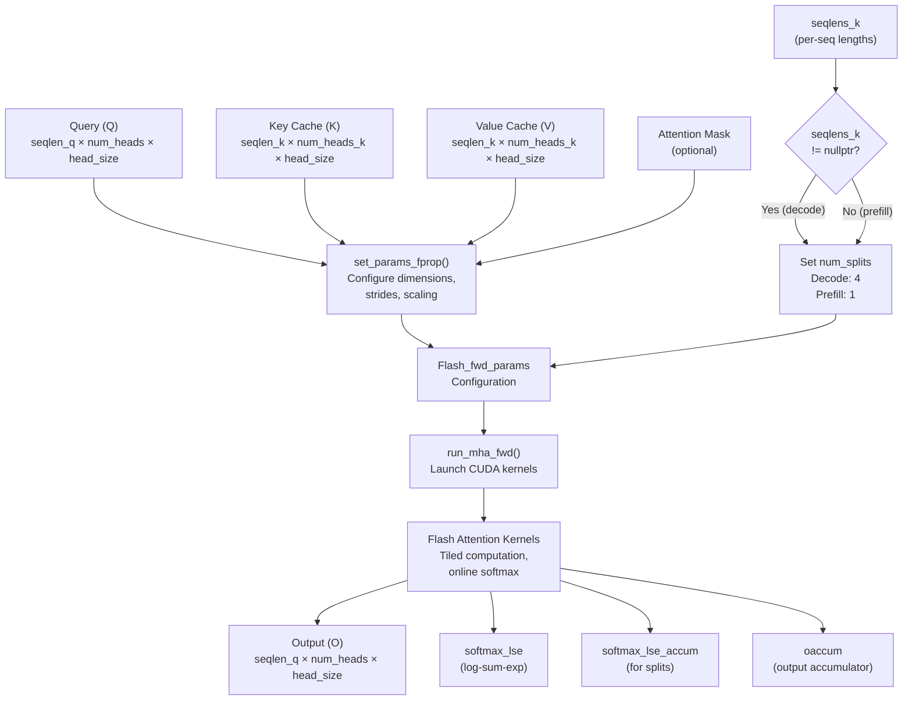
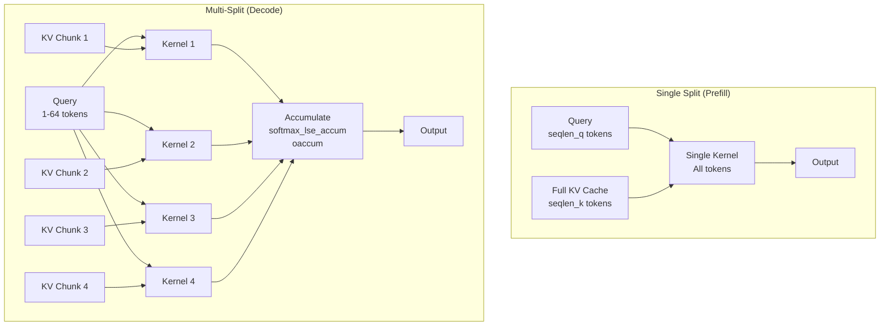
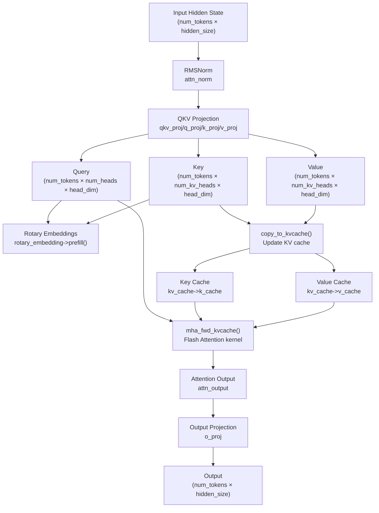

<!-- source: DeepWiki mcp.deepwiki.com · repo thunlp/FR-Spec · page 7.1 Flash Attention · fetched 2026-11-02 -->

# Flash Attention

<details>
<summary>Relevant source files</summary>

The following files were used as context for generating this wiki page:

- [README.md](README.md)
- [src/flash_attn/flash_api.hpp](src/flash_attn/flash_api.hpp)
- [src/model/attn.cuh](src/model/attn.cuh)

</details>


## Purpose and Scope

This document covers the modified Flash Attention implementation used in FR-Spec for efficient attention computation on GPUs. Flash Attention is a CUDA kernel that computes multi-head attention with optimized memory access patterns and support for key-value caching during inference.

The implementation is based on [flash-attention v2.4.2](https://github.com/Dao-AILab/flash-attention/blob/v2.4.2/csrc/flash_attn) with modifications for speculative decoding workloads. For information about the higher-level Attention component that uses this kernel, see [Attention Mechanism](#4.2). For other CUDA kernels, see [Element-wise Operations and Normalization](#7.2) and [TopK Selection](#7.3).

**Sources**: [README.md:128](), [src/flash_attn/flash_api.hpp:5]()

## Overview of Flash Attention in FR-Spec

Flash Attention provides the core computational primitive for multi-head attention with the following features:

- **KV Cache Integration**: Direct computation from cached key-value pairs without copying
- **Split-KV Optimization**: Parallel processing across sequence dimension for better GPU utilization
- **Mixed Precision**: Support for FP16 and BF16 data types
- **Attention Masking**: Support for causal masks and 2D attention masks for tree-based verification
- **Windowed Attention**: Optional sliding window for local attention patterns

The main entry point is the `mha_fwd_kvcache` function which handles attention computation during both prefill and decode phases.

**Sources**: [src/flash_attn/flash_api.hpp:207-304]()

## API Reference: mha_fwd_kvcache

### Function Signature

```cpp
void mha_fwd_kvcache(
    bool is_bf16,
    int batch_size,
    int seqlen_q,
    int seqlen_k,
    int seqlen_knew,
    int num_heads,
    int num_heads_k,
    int head_size,
    void* q,                    // batch_size x seqlen_q x num_heads x head_size
    void* kcache,               // batch_size x seqlen_k x num_heads_k x head_size
    void* vcache,               // batch_size x seqlen_k x num_heads_k x head_size
    int* seqlens_k,             // batch_size
    const Mask& mask,           // batch_size x seqlen_q x seqlen_k_range
    void* out,                  // batch_size x seqlen_q x num_heads x head_size
    float* softmax_lse,         // batch_size x num_heads x seqlen_q
    float* softmax_lse_accum,   // num_splits x batch_size x num_heads x seqlen_q
    float* oaccum,              // num_splits x batch_size x num_heads x seqlen_q x head_size
    const float softmax_scale,
    bool is_causal,
    int window_size_left,
    int window_size_right,
    const float softcap,
    cudaStream_t stream
)
```

**Sources**: [src/flash_attn/flash_api.hpp:207-231]()

### Parameter Description

| Parameter | Type | Description |
|-----------|------|-------------|
| `is_bf16` | bool | If true, use BFloat16; otherwise use Float16 |
| `batch_size` | int | Number of sequences in the batch (typically 1 for inference) |
| `seqlen_q` | int | Query sequence length (current tokens being processed) |
| `seqlen_k` | int | Key/Value cache length (total context including history) |
| `seqlen_knew` | int | Number of new KV pairs being added (unused in current implementation) |
| `num_heads` | int | Number of query attention heads |
| `num_heads_k` | int | Number of key/value heads (for grouped-query attention) |
| `head_size` | int | Dimension of each attention head |
| `q` | void* | Query tensor pointer |
| `kcache` | void* | Key cache pointer (pre-allocated, persistent across calls) |
| `vcache` | void* | Value cache pointer (pre-allocated, persistent across calls) |
| `seqlens_k` | int* | Per-sequence actual KV cache lengths (nullptr if uniform) |
| `mask` | Mask& | 2D attention mask for tree-based verification |
| `out` | void* | Output tensor pointer |
| `softmax_lse` | float* | Log-sum-exp values for softmax (for numerical stability) |
| `softmax_lse_accum` | float* | Accumulated LSE values for split-KV (allocated for `num_splits`) |
| `oaccum` | float* | Accumulated output values for split-KV |
| `softmax_scale` | float | Scaling factor (typically `1/sqrt(head_size)`) |
| `is_causal` | bool | Enable causal masking (attention only to past tokens) |
| `window_size_left` | int | Left window size for sliding window attention (-1 for unlimited) |
| `window_size_right` | int | Right window size for sliding window attention |
| `softcap` | float | Optional softcap value for logit scaling (0 to disable) |
| `stream` | cudaStream_t | CUDA stream for kernel execution |

**Sources**: [src/flash_attn/flash_api.hpp:207-231]()

### Flash Attention Data Flow



**Sources**: [src/flash_attn/flash_api.hpp:207-304]()

## Parameter Setup: set_params_fprop

The `set_params_fprop` function configures the `Flash_fwd_params` structure with all necessary parameters for the forward pass. This function translates high-level API parameters into the internal format expected by CUDA kernels.

### Key Configuration Steps

1. **Memory Layout Configuration**: Sets strides for Q, K, V, and output tensors
2. **Dimension Setup**: Configures batch size, sequence lengths, head counts, and head dimensions
3. **Scaling Configuration**: Sets up softmax scaling with optional softcap
4. **Window Configuration**: Configures causal masking and sliding window parameters
5. **Rounding**: Rounds dimensions to multiples required by CUDA kernels (32 for head_size, 128 for sequence length)

**Sources**: [src/flash_attn/flash_api.hpp:13-131]()

### Tensor Stride Configuration

The function sets strides (in elements, not bytes) for accessing multi-dimensional tensors:

```
q_row_stride = h * d          // Stride between query tokens
k_row_stride = h_k * d        // Stride between key tokens
v_row_stride = h_k * d        // Stride between value tokens
q_head_stride = d             // Stride between heads in query
k_head_stride = d             // Stride between heads in key
v_head_stride = d             // Stride between heads in value
```

For batched processing (when `cu_seqlens_q_d == nullptr`):

```
q_batch_stride = seqlen_q * h * d
k_batch_stride = seqlen_k * h_k * d
v_batch_stride = seqlen_k * h_k * d
o_batch_stride = seqlen_q * h * d
```

**Sources**: [src/flash_attn/flash_api.hpp:48-72]()

### Softmax Scaling with Softcap

When `softcap > 0`, the scaling is modified to prevent extreme logit values:

```cpp
params.softcap = softmax_scale / softcap;
params.scale_softmax = softcap;
params.scale_softmax_log2 = softcap * M_LOG2E;
```

Otherwise, standard scaling is used:

```cpp
params.scale_softmax = softmax_scale;
params.scale_softmax_log2 = softmax_scale * M_LOG2E;
```

The `scale_softmax_log2` is pre-computed for efficiency since the kernel operates in log-space.

**Sources**: [src/flash_attn/flash_api.hpp:97-106]()

### Dimension Rounding

Flash Attention kernels require dimensions to be rounded to specific multiples for vectorization and tile size alignment:

```cpp
auto round_multiple = [](int x, int m) { return (x + m - 1) / m * m; };
const int head_size_rounded = head_size <= 192 ? round_multiple(head_size, 32) : 256;
const int seqlen_q_rounded = round_multiple(seqlen_q, 128);
const int seqlen_k_rounded = round_multiple(seqlen_k, 128);
```

This ensures efficient memory access patterns and allows the kernel to use optimized tile sizes.

**Sources**: [src/flash_attn/flash_api.hpp:250-253]()

## Split-KV Optimization

Split-KV is an optimization technique that parallelizes attention computation across the key/value sequence dimension, improving GPU utilization especially for decode operations where `seqlen_q` is small (typically 1 or a small tree size).

### Split-KV Strategy



**Sources**: [src/flash_attn/flash_api.hpp:133-145](), [src/flash_attn/flash_api.hpp:289-295]()

### Split Count Determination

The number of splits is determined by `num_splits_heuristic`, which maximizes GPU occupancy:

1. If `batch_nheads_mblocks >= 0.8 * num_SMs`, use 1 split (sufficient parallelism already)
2. Otherwise, find the split count that maximizes efficiency (work / ceil(work))
3. Choose the smallest split count that achieves >= 85% of maximum efficiency

```cpp
inline int num_splits_heuristic(int batch_nheads_mblocks, int num_SMs, int num_n_blocks, int max_splits)
```

For FR-Spec decode operations, a fixed value of 4 splits is used:

```cpp
if (seqlens_k != nullptr) {
    params.cu_seqlens_k = seqlens_k;
    params.is_seqlens_k_cumulative = false;
    params.num_splits = 4; // Fixed for decode
}
```

**Sources**: [src/flash_attn/flash_api.hpp:153-187](), [src/flash_attn/flash_api.hpp:289-295]()

### Split-KV Parameters

| Parameter | Purpose |
|-----------|---------|
| `num_splits` | Number of parallel splits across KV dimension |
| `softmax_lse_accum` | Accumulator for log-sum-exp values from each split |
| `oaccum` | Accumulator for output values from each split |
| `block_n` | Block size for K dimension (256, 128, or 64 based on head_size) |

The final output is computed by combining splits using numerically stable online softmax:

```
output = sum_i(oaccum[i] * exp(softmax_lse_accum[i] - max_lse))
```

**Sources**: [src/flash_attn/flash_api.hpp:189-204]()

## Integration with Attention Component

The `Attention` struct in the model layer calls Flash Attention during both prefill and decode operations.

### Prefill Path

During prefill, the entire prompt is processed at once:

```cpp
mha_fwd_kvcache(
    TypeTraits<T>::type_code()==1,        // is_bf16
    1,                                     // batch_size
    num_tokens,                            // seqlen_q
    num_history_tokens+num_tokens,         // seqlen_k
    num_tokens,                            // seqlen_knew
    this->num_attention_heads,
    this->num_key_value_heads,
    this->head_dim,
    this->q_proj->output,                  // Q from projection
    kv_cache->k_cache,                     // K cache base pointer
    kv_cache->v_cache,                     // V cache base pointer
    nullptr,                               // seqlens_k (uniform)
    Mask(nullptr),                         // No mask for prefill
    this->attn_output,
    this->softmax_lse,
    this->softmax_lse_accum,
    this->oaccum,
    rsqrtf(float(this->head_dim)),        // 1/sqrt(d)
    true,                                  // is_causal
    -1,                                    // window_size_left
    -1,                                    // window_size_right
    0,                                     // no softcap
    stream.stream
);
```

**Sources**: [src/model/attn.cuh:148-172]()

### Decode Path

During decode, Flash Attention processes one or more tokens (in tree-based verification, multiple tree positions):

```cpp
mha_fwd_kvcache(
    TypeTraits<T>::type_code()==1,
    1,
    num_tokens,                            // Tree size or 1
    padded_length,                         // Total KV cache length
    num_tokens,
    this->num_attention_heads,
    this->num_key_value_heads,
    this->head_dim,
    q,                                     // Q after permute
    kv_cache->k_cache,
    kv_cache->v_cache,
    cache_length,                          // Per-sequence lengths
    mask,                                  // Tree verification mask
    this->attn_output,
    this->softmax_lse,
    this->softmax_lse_accum,
    this->oaccum,
    rsqrtf(float(this->head_dim)),
    true,                                  // is_causal
    -1,
    -1,
    0,
    stream.stream
);
```

**Sources**: [src/model/attn.cuh:194-218]()

### Attention Component Integration Diagram



**Sources**: [src/model/attn.cuh:138-222]()

## Memory Buffers for Flash Attention

The Attention component allocates several buffers used by Flash Attention:

| Buffer | Type | Size | Purpose |
|--------|------|------|---------|
| `attn_output` | T* | `num_tokens × num_heads × head_dim` | Attention output before output projection |
| `softmax_lse` | float* | `num_tokens × num_heads` | Log-sum-exp values for softmax |
| `softmax_lse_accum` | float* | `num_tokens × num_heads` | LSE accumulator for split-KV |
| `oaccum` | float* | `num_tokens × num_heads × head_dim` | Output accumulator for split-KV |

Buffer allocation happens in `init_output_ptr`:

```cpp
int64_t softmax_lse_end = memory->allocate((void**)&this->softmax_lse, 
    qkv_proj_end, num_tokens * this->num_attention_heads * sizeof(float));
int64_t softmax_lse_accum_end = memory->allocate((void**)&this->softmax_lse_accum, 
    softmax_lse_end, num_tokens * this->num_attention_heads * sizeof(float));
int64_t oaccum_end = memory->allocate((void**)&this->oaccum, 
    softmax_lse_accum_end, num_tokens * this->num_attention_heads * this->head_dim * sizeof(float));
```

These buffers are reused across attention calls to minimize memory allocations.

**Sources**: [src/model/attn.cuh:104-120]()

## CUTLASS Dependency

Flash Attention relies on NVIDIA CUTLASS for optimized matrix operations. The CUTLASS submodule provides:

- Templated GEMM kernels for mixed-precision matrix multiplication
- Efficient memory access patterns with tiling
- Warp-level and thread-block-level primitives

The CUTLASS integration is transparent to the Flash Attention API level and is handled internally by the kernel implementation.

**Sources**: [README.md:128]()

## Key Implementation Details

### Type Dispatch

Flash Attention supports both FP16 and BF16 through compile-time type switching:

```cpp
FP16_SWITCH(!params.is_bf16, [&] {
    HEADDIM_SWITCH(params.d, [&] {
        BOOL_SWITCH(params.is_causal, Is_causal, [&] {
            if (params.num_splits <= 1 && !force_split_kernel) {
                run_mha_fwd_<elem_type, kHeadDim, Is_causal>(params, stream);
            } else {
                run_mha_fwd_splitkv_dispatch<elem_type, kHeadDim, Is_causal>(params, stream);
            }
        });
    });
});
```

**Sources**: [src/flash_attn/flash_api.hpp:134-144]()

### Causal Masking Optimization

When `seqlen_q == 1` (single token decode), causal masking is disabled as it has no effect:

```cpp
if (seqlen_q == 1) { is_causal = false; }
if (is_causal) { window_size_right = 0; }
```

This optimization avoids unnecessary mask computation during single-token generation.

**Sources**: [src/flash_attn/flash_api.hpp:233-234]()

### Mask Integration

The FR-Spec implementation extends Flash Attention with 2D mask support for tree-based verification:

```cpp
params.mask_2d = mask.ptr;
params.mask_q_range = mask.mask_q_range;
params.mask_k_range = mask.mask_k_range;
```

This allows different tree positions to attend to different subsets of the KV cache during parallel verification.

**Sources**: [src/flash_attn/flash_api.hpp:276-278]()

## Performance Characteristics

Flash Attention provides significant performance benefits:

1. **Memory Efficiency**: Online softmax avoids materializing the full attention matrix
2. **Compute Efficiency**: Tiled computation maximizes data reuse in fast memory (shared memory, registers)
3. **Parallelism**: Split-KV optimization improves GPU utilization for decode workloads
4. **Mixed Precision**: FP16/BF16 computation with FP32 accumulation for numerical stability

The modified implementation is tuned for speculative decoding workloads where:
- Batch sizes are typically small (1)
- Decode involves trees of candidates rather than single tokens
- KV cache is large and grows throughout generation

**Sources**: [README.md:9-13](), [src/flash_attn/flash_api.hpp:1-304]()

---

