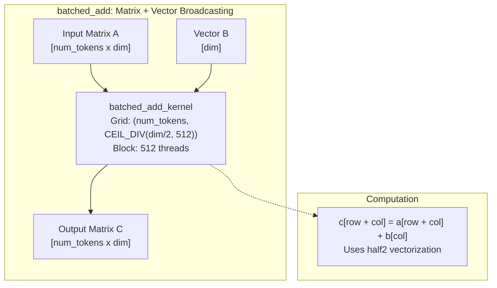
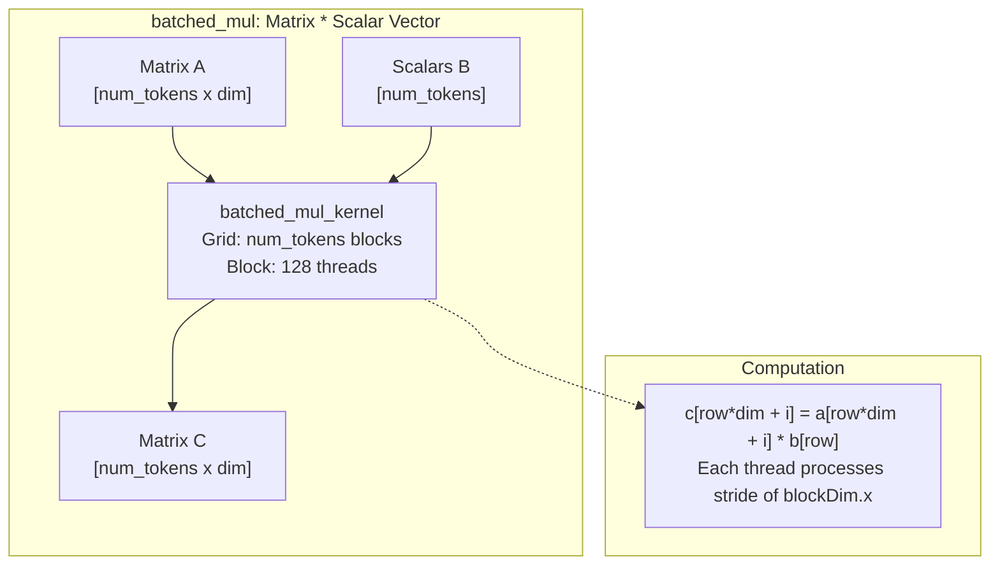
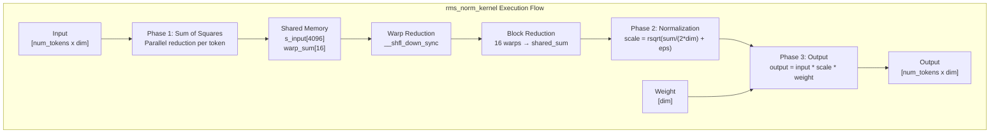
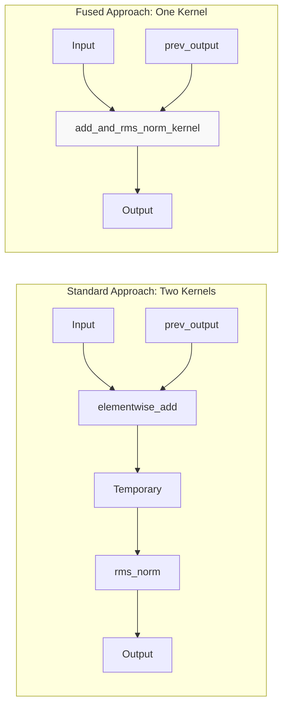
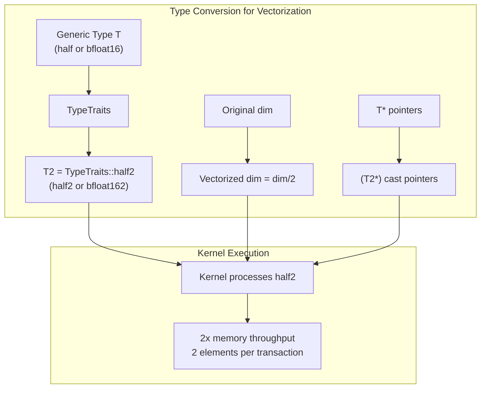
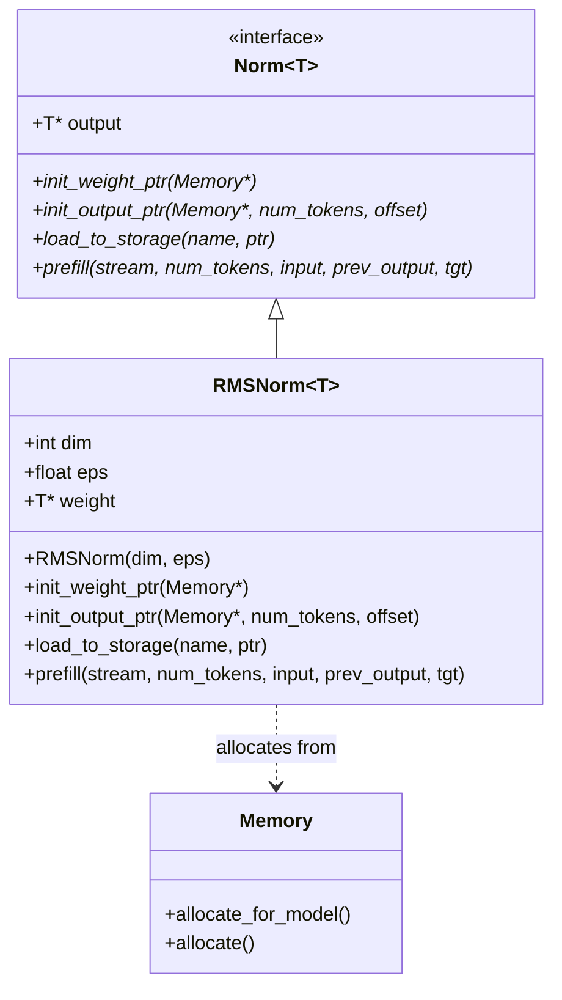
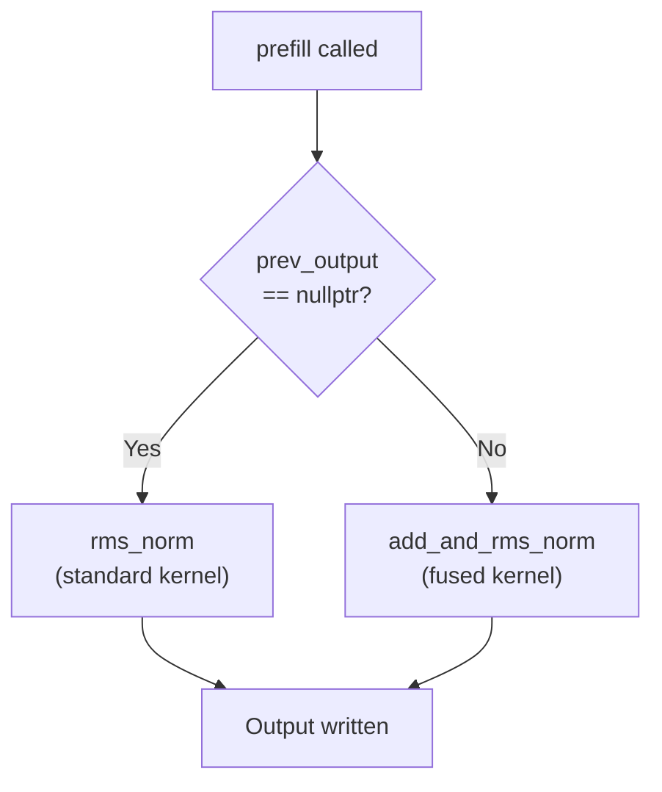
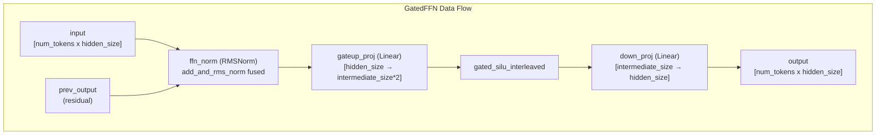

<!-- source: DeepWiki mcp.deepwiki.com · repo thunlp/FR-Spec · page 7.2 Element-wise Operations and Normalization · fetched 2026-11-02 -->

# Element-wise Operations and Normalization

<details>
<summary>Relevant source files</summary>

The following files were used as context for generating this wiki page:

- [src/model/elementwise.cuh](src/model/elementwise.cuh)
- [src/model/ffn.cuh](src/model/ffn.cuh)
- [src/model/norm.cuh](src/model/norm.cuh)

</details>


This document describes the CUDA kernels that implement element-wise operations (addition, multiplication) and RMS normalization in the FR-Spec system. These kernels are fundamental building blocks used throughout the transformer architecture, particularly in the attention mechanism ([4.2](#4.2)) and feed-forward networks ([4.3](#4.3)). The implementations leverage half-precision vectorization and fused operations to maximize GPU memory bandwidth and minimize kernel launch overhead.

For Flash Attention kernels, see [7.1](#7.1). For other specialized CUDA kernels like TopK selection, see [7.3](#7.3).

## Overview

The element-wise operations and normalization kernels provide three categories of functionality:

1. **Element-wise arithmetic operations**: Broadcasting and element-wise addition/multiplication
2. **RMS normalization**: Root mean square layer normalization used in transformer layers
3. **Fused operations**: Combined operations that reduce memory traffic

All kernels operate on half-precision types (`__half` or `__nv_bfloat16`) and use `half2` vectorization to process two elements per memory transaction, doubling effective memory bandwidth.

**Sources**: [src/model/elementwise.cuh:1-53](), [src/model/norm.cuh:1-154]()

## Element-wise Operations

### Operation Types and Kernels

The system provides three primary element-wise operations:

| Operation | Kernel Function | Host Function | Purpose |
|-----------|----------------|---------------|---------|
| Batched Add | `batched_add_kernel` | `batched_add` | Add a 1D vector to each row of a matrix (broadcasting) |
| Element-wise Add | `elementwise_add_kernel` | `elementwise_add` | Add two matrices element-wise |
| Batched Multiply | `batched_mul_kernel` | `batched_mul` | Multiply each row of a matrix by a corresponding scalar |

### Batched Add Operation



The `batched_add` operation implements broadcasting addition: `C[i,j] = A[i,j] + B[j]` for all rows. This is commonly used for adding bias terms in linear layers.

**Implementation details**:
- Grid dimensions: `(num_tokens, CEIL_DIV(dim/2, 512))`
- Block size: 512 threads
- Each thread processes one `half2` element (2 scalar values)
- Dimension is halved because of `half2` vectorization

**Sources**: [src/model/elementwise.cuh:6-14](), [src/model/elementwise.cuh:36-41]()

### Element-wise Add Operation

The `elementwise_add` operation performs standard matrix addition: `C[i,j] = A[i,j] + B[i,j]` for all elements. This is used for residual connections in transformer layers.

**Implementation details**:
- Same grid and block configuration as `batched_add`
- Both input matrices are fully traversed
- Uses `half2` vectorization for memory efficiency

**Sources**: [src/model/elementwise.cuh:16-23](), [src/model/elementwise.cuh:43-48]()

### Batched Multiply Operation



The `batched_mul` operation scales each row by a corresponding scalar: `C[i,j] = A[i,j] * B[i]`. This is used for operations like applying attention weights.

**Implementation details**:
- Grid dimensions: `num_tokens` blocks (one per row)
- Block size: 128 threads
- Each thread processes multiple elements with stride `blockDim.x`
- Loads the scalar once per block for cache efficiency

**Sources**: [src/model/elementwise.cuh:25-33](), [src/model/elementwise.cuh:50-53]()

## RMS Normalization

### RMS Norm Algorithm

RMS (Root Mean Square) normalization is a simplified layer normalization that normalizes by the root mean square of the input without centering (subtracting mean). The operation is:

```
RMS = sqrt(mean(x²) + eps)
y = (x / RMS) * weight
```

### Kernel Architecture



The RMS normalization kernel operates in three phases:

1. **Sum of squares computation**: Each thread computes partial sums using `half2` operations
2. **Parallel reduction**: Warp-level shuffles followed by block-level reduction using shared memory
3. **Normalization and scaling**: Compute scale factor and apply with weight multiplication

**Sources**: [src/model/norm.cuh:6-51]()

### Reduction Strategy

The kernel uses a two-level reduction strategy optimized for modern GPU architectures:

**Warp-level reduction**:
- Uses `__shfl_down_sync` to reduce within 32-thread warps
- Reduction sequence: 16 → 8 → 4 → 2 → 1
- One result per warp stored in shared memory array `warp_sum[16]`

**Block-level reduction**:
- First 16 threads reduce the 16 warp results
- Final sum stored in `shared_sum` for all threads to access
- Synchronization via `__syncthreads()`

This approach minimizes shared memory usage and synchronization overhead.

**Sources**: [src/model/norm.cuh:14-42]()

### Fused Add and RMS Norm



The `add_and_rms_norm_kernel` fuses residual addition with RMS normalization, reducing memory traffic by eliminating an intermediate buffer. This is critical for transformer layers where residual connections are followed by normalization.

**Key optimization**: The kernel writes the sum back to the input buffer (`input[row * dim + i] = val`) while also storing it in shared memory for the normalization computation, avoiding separate read/write passes.

**Sources**: [src/model/norm.cuh:53-99]()

## Half2 Vectorization

### Vectorization Strategy

All element-wise and normalization kernels use `half2` vectorization to process two half-precision values per memory operation:



**Implementation pattern**:
1. Convert dimension from element count to `half2` count: `dim = dim / 2`
2. Cast pointers from `T*` to `T2*` where `T2` is `TypeTraits<T>::half2`
3. Process pairs of elements in each thread
4. Arithmetic operations automatically vectorized by GPU hardware

This approach doubles effective memory bandwidth without explicit SIMD programming.

**Sources**: [src/model/elementwise.cuh:37-41](), [src/model/norm.cuh:103-105]()

### Type Traits System

The system uses template metaprogramming to select the appropriate `half2` type based on the base precision type:

| Base Type `T` | `TypeTraits<T>::half2` | Description |
|---------------|------------------------|-------------|
| `__half` | `__half2` | NVIDIA half-precision pair |
| `__nv_bfloat16` | `__nv_bfloat162` | NVIDIA bfloat16 pair |

This abstraction allows the same kernel code to work with both half and bfloat16 precision without duplication.

**Sources**: [src/trait.cuh]() (referenced in includes)

## RMSNorm Component

### Class Structure



The `RMSNorm` class wraps the RMS normalization kernels and provides a component interface compatible with the transformer layer architecture.

**Key methods**:
- `init_weight_ptr`: Allocates weight buffer in model memory region
- `init_output_ptr`: Allocates output buffer in dynamic memory region
- `load_to_storage`: Copies weights from host to device via `cudaMemcpy`
- `prefill`: Executes normalization, choosing fused or standard kernel based on whether `prev_output` is provided

**Sources**: [src/model/norm.cuh:114-154]()

### Kernel Selection Logic

The `RMSNorm::prefill` method automatically selects the appropriate kernel:



This provides automatic optimization: when a residual connection is present, the fused kernel is used; otherwise, the standard kernel applies normalization directly.

**Sources**: [src/model/norm.cuh:146-153]()

## Usage in Model Components

### Integration in GatedFFN



The `GatedFFN` component uses `RMSNorm` for pre-normalization with residual connection:

**Sources**: [src/model/ffn.cuh:18-86]()

### Attention Mechanism Usage

While not shown in the provided files, the attention mechanism similarly uses:
- `RMSNorm` for input normalization (typically `input_layernorm`)
- `elementwise_add` for residual connections
- These operations are critical for the prefill and decode paths

For attention-specific normalization patterns, see [4.2](#4.2).

## Performance Characteristics

### Memory Access Patterns

| Operation | Memory Reads | Memory Writes | Arithmetic Intensity |
|-----------|--------------|---------------|---------------------|
| batched_add | 2x (matrix A + vector B) | 1x (matrix C) | Low (1 add per element) |
| elementwise_add | 2x (matrices A + B) | 1x (matrix C) | Low (1 add per element) |
| batched_mul | 2x (matrix A + scalars B) | 1x (matrix C) | Low (1 mul per element) |
| rms_norm | 2x (input + weight) | 1x (output) | Medium (reduction + normalization) |
| add_and_rms_norm | 3x (input + prev + weight) | 2x (input + output) | Medium (fused operations) |

### Optimization Techniques

The implementations employ several optimization strategies:

1. **Half2 vectorization**: Doubles memory throughput by processing pairs of elements
2. **Warp-level primitives**: Uses `__shfl_down_sync` for efficient reductions without shared memory
3. **Shared memory staging**: Reduces global memory traffic in normalization kernels
4. **Kernel fusion**: Combines operations to eliminate intermediate buffers
5. **Grid-stride loops**: Allows flexible workload distribution in `batched_mul`

These optimizations are particularly important because element-wise operations are typically memory-bound on modern GPUs.

**Sources**: [src/model/elementwise.cuh:1-53](), [src/model/norm.cuh:1-154]()

---

