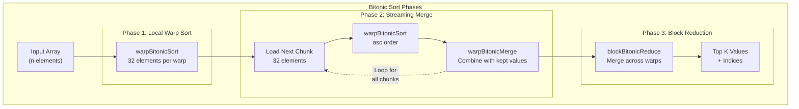
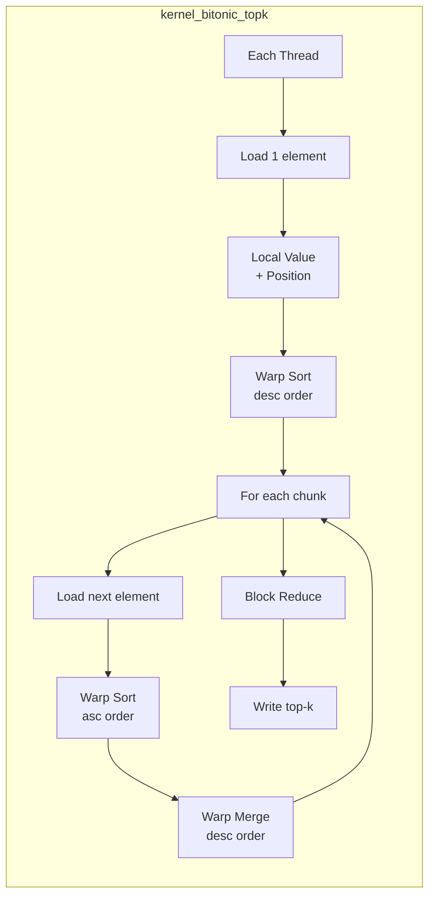
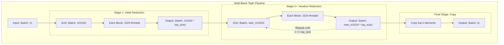
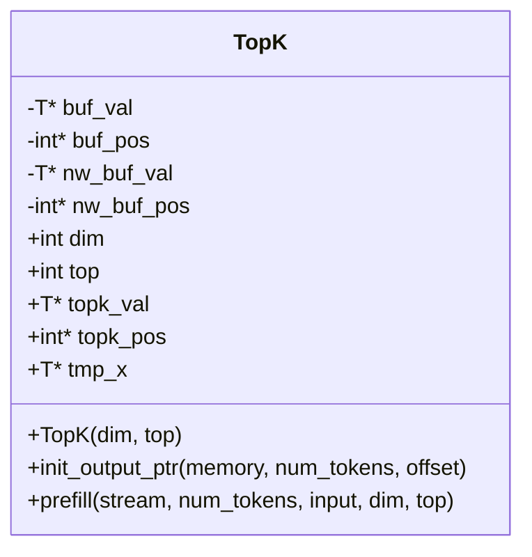
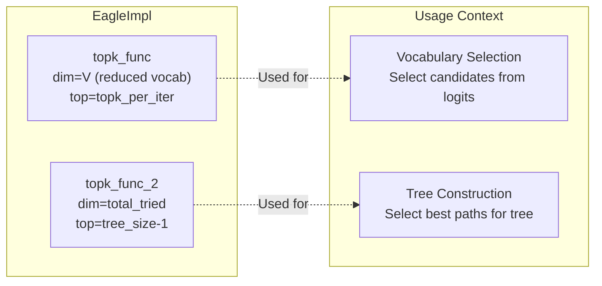
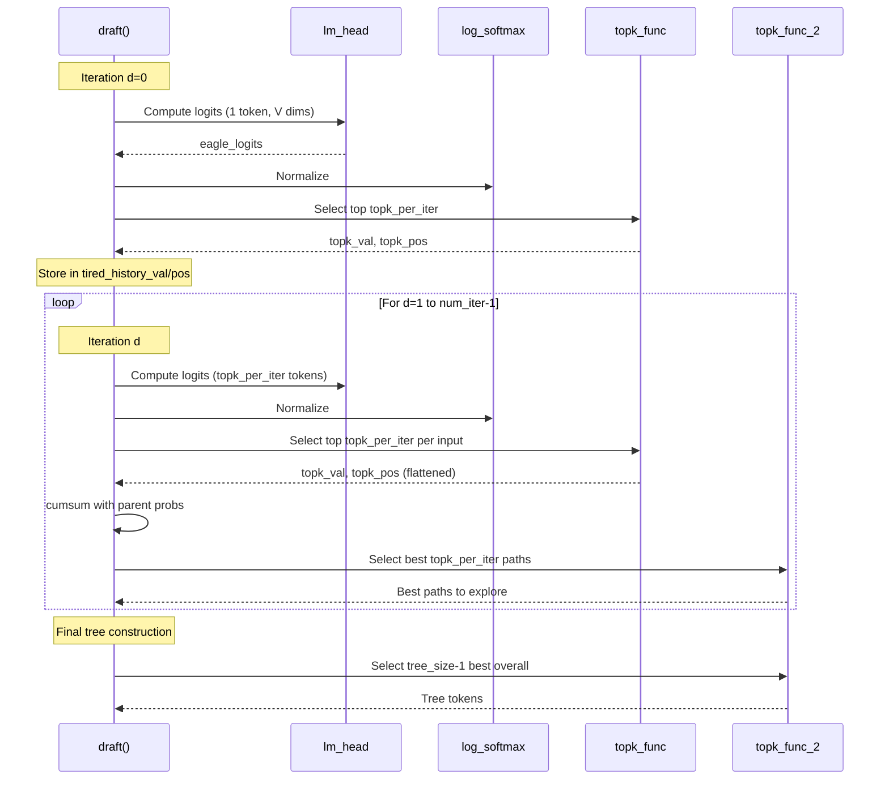

<!-- source: DeepWiki mcp.deepwiki.com · repo thunlp/FR-Spec · page 7.3 TopK Selection · fetched 2026-11-02 -->

# TopK Selection

<details>
<summary>Relevant source files</summary>

The following files were used as context for generating this wiki page:

- [src/model/eagle.cuh](src/model/eagle.cuh)
- [src/model/topk.cuh](src/model/topk.cuh)

</details>


## Purpose and Scope

This page documents the TopK selection CUDA kernels used in FR-Spec for efficiently selecting the k highest-valued tokens from probability distributions. The implementation uses a bitonic sort-based algorithm optimized for GPU execution, enabling fast candidate token selection during speculative decoding.

This page focuses on the low-level CUDA kernel implementation. For information about how TopK selection integrates into the EAGLE drafting process, see [EAGLE Implementation](#5.1). For overall CUDA kernel architecture, see [CUDA Kernels](#7).

---

## Overview

The TopK selection system provides GPU-accelerated selection of the k highest probability tokens from logit distributions. This is a critical operation in EAGLE speculative decoding, where at each iteration the drafter must select `topk_per_iter` candidate tokens to explore in the prediction tree.

The implementation uses a **bitonic sort** algorithm, which is particularly well-suited to GPU architectures due to its regular data-parallel structure. The system handles vocabularies of varying sizes (8K to 64K tokens in FR-Spec) and top-k values (typically 4-10 candidates per iteration).

**Sources:** [src/model/topk.cuh:1-291]()

---

## Algorithm: Bitonic Sort for TopK

### Bitonic Sort Fundamentals

The bitonic sort algorithm is a parallel sorting algorithm that works by repeatedly merging bitonic sequences (sequences that monotonically increase then decrease, or vice versa). The algorithm has a fixed structure that maps well to GPU warp operations.



**Sources:** [src/model/topk.cuh:6-95]()

### Warp-Level Primitives

The implementation provides three core warp-level primitives:

1. **`warpBitonicSort<T, N>`** - Sorts N elements (N ≤ 32) within a warp in ascending or descending order
2. **`warpBitonicMerge<T, N>`** - Merges two sorted sequences and maintains top-N elements
3. **`blockBitonicReduce<T, N>`** - Reduces across warps to find block-level top-N

Each primitive operates on a single value per thread, using warp shuffle instructions (`__shfl_xor_sync`) for efficient data exchange without shared memory for small N.

**Sources:** [src/model/topk.cuh:6-69]()

---

## Implementation Architecture

### Single-Block TopK Kernel

For small vocabularies (n ≤ 32K), a single block can process the entire array:



The kernel uses a streaming approach where each thread maintains its local top value and iteratively merges with new chunks, reducing memory usage compared to loading the entire array.

**Sources:** [src/model/topk.cuh:71-95]()

### Multi-Block TopK Strategy

For large vocabularies that exceed a single block's capacity, a multi-stage reduction is used:



Each stage reduces the problem size by a factor of approximately `1024/top_size`, continuing until the remaining elements fit in a single block.

**Sources:** [src/model/topk.cuh:99-117](), [src/model/topk.cuh:159-213]()

### Memory Layout and Buffers

The multi-block approach requires intermediate buffers:

| Buffer | Size | Purpose |
|--------|------|---------|
| `buf_val` | `batch * (n/1024) * top_size * sizeof(T)` | First-stage output values |
| `buf_pos` | `batch * (n/1024) * top_size * sizeof(int)` | First-stage output indices |
| `nw_buf_val` | Same as `buf_val` | Ping-pong buffer for values |
| `nw_buf_pos` | Same as `buf_pos` | Ping-pong buffer for indices |
| `tmp_x` | `batch * n * sizeof(T)` | Temporary for k > 32 (see below) |

**Sources:** [src/model/topk.cuh:241-254]()

---

## TopK Struct API

### Class Definition

The `functions::TopK<T>` struct provides the high-level API for TopK operations:



**Key Members:**

- **`dim`**: Vocabulary size (number of elements to select from)
- **`top`**: Number of top elements to select (k)
- **`topk_val`**: Output buffer for top-k values (logits or log-probabilities)
- **`topk_pos`**: Output buffer for top-k indices (token IDs)

**Sources:** [src/model/topk.cuh:226-289]()

### Initialization

```
TopK<T>* topk_func = new functions::TopK<T>(vocab_size, k);
topk_func->init_output_ptr(memory, num_tokens, offset);
```

The constructor sets the problem size parameters. `init_output_ptr` allocates all required buffers using the memory pool system.

**Sources:** [src/model/topk.cuh:237-254]()

### Selection Operation

```
topk_func->prefill(stream, num_tokens, logits_ptr);
// Results available in:
// - topk_func->topk_val: top-k values
// - topk_func->topk_pos: top-k token indices
```

The `prefill` method performs the TopK selection. Despite the name "prefill", it's used for both prefill and decode phases - the name comes from the batch-oriented processing model.

**Optional parameters:**
- `dim`: Override vocabulary size (default: use constructor value)
- `top`: Override k value (default: use constructor value)

**Sources:** [src/model/topk.cuh:255-289]()

### Special Case: k > 32

For `top > 32`, the implementation uses a two-pass approach due to warp shuffle limitations:

1. First pass: Select top 32 elements
2. Set those 32 elements to `-inf` in a temporary copy
3. Second pass: Select top `k-32` elements from the modified array
4. Combine results

This limitation is noted in the code with `assert(top <= 64)`, indicating support for up to 64 candidates.

**Sources:** [src/model/topk.cuh:248-250](), [src/model/topk.cuh:273-287](), [src/model/topk.cuh:216-224]()

---

## Integration with EAGLE

### TopK Instances in EAGLE

EAGLE uses two separate TopK instances with different configurations:



**Definitions:**
- `V`: Reduced vocabulary size (8K, 16K, 32K, or 64K in FR-Spec)
- `topk_per_iter`: Number of candidates per iteration (typically 5-10)
- `total_tried`: Total candidates across all iterations = `topk_per_iter * topk_per_iter * (num_iter - 1) + topk_per_iter`
- `tree_size`: Size of the final prediction tree

**Sources:** [src/model/eagle.cuh:256-257](), [src/model/eagle.cuh:303-304]()

### Usage Pattern in Draft Phase

The draft phase uses TopK selection at each iteration:



**Key steps:**

1. **First iteration (d=0):** Select `topk_per_iter` candidates from the base model's output [src/model/eagle.cuh:448-456]()

2. **Subsequent iterations (d=1 to num_iter-1):** 
   - Generate logits for all current candidates
   - Select `topk_per_iter` children per parent (total: `topk_per_iter * topk_per_iter`)
   - Accumulate probabilities with parent scores using `cumsum` [src/model/eagle.cuh:475]()
   - Use `topk_func_2` to select the best `topk_per_iter` paths to continue [src/model/eagle.cuh:478]()

3. **Final tree construction:**
   - Use `topk_func_2` on all accumulated candidates to select `tree_size-1` best tokens [src/model/eagle.cuh:487]()
   - These become the draft tokens for verification

**Sources:** [src/model/eagle.cuh:432-494]()

---

## Performance Characteristics

### Computational Complexity

| Phase | Complexity | Notes |
|-------|-----------|-------|
| Warp-level sort | O(log²(32)) per element | Constant for warp size |
| Streaming merge | O(n/32 * log(32)) | Linear in vocabulary size |
| Block reduction | O(log(warps) * log(32)) | Logarithmic in block size |
| Multi-block stages | O(log(n/1024)) stages | Logarithmic in total size |

Overall complexity: **O(n)** for large n, with excellent GPU parallelism.

### Memory Bandwidth

The streaming approach in the single-block kernel is memory-efficient:
- Each element loaded once from global memory
- Intermediate results stay in registers and shared memory
- Only top-k results written back

For multi-block: Each stage reads and writes intermediate results, but the problem size shrinks rapidly.

### Top-K Size Dispatch

The implementation uses compile-time dispatch based on k to optimize warp operations:

| K Range | Warp Size | Notes |
|---------|-----------|-------|
| k = 1 | 1 | Single best (special case) |
| 2 ≤ k ≤ 2 | 2 | Two-element sort |
| 3 ≤ k ≤ 4 | 4 | Four-element networks |
| 5 ≤ k ≤ 8 | 8 | Eight-element networks |
| 9 ≤ k ≤ 16 | 16 | Sixteen-element networks |
| 17 ≤ k ≤ 32 | 32 | Full warp |
| 33 ≤ k ≤ 64 | 32 + 32 | Two-pass (see above) |

The `TOPK_SIZE_DISPATCH` macro [src/model/topk.cuh:135-157]() selects the appropriate template parameter at runtime, allowing the compiler to optimize each case.

**Sources:** [src/model/topk.cuh:135-213]()

---

## Implementation Details

### Warp Shuffle Instructions

The core primitives extensively use `__shfl_xor_sync` for data exchange within warps. This is significantly faster than shared memory for small N:

```
T v2 = __shfl_xor_sync(0xFFFFFFFF, v1, j);
int pos2 = __shfl_xor_sync(0xFFFFFFFF, pos, j);
```

The XOR pattern in bitonic sort naturally maps to the XOR shuffle, enabling efficient implementations.

**Sources:** [src/model/topk.cuh:14-15](), [src/model/topk.cuh:34-35]()

### Tie-Breaking

When values are equal, the implementation uses position as a tie-breaker:

```
if (v1 > v2 || (v1 == v2 && pos < pos2))
```

This ensures deterministic behavior - lower indices are preferred when values are identical.

**Sources:** [src/model/topk.cuh:17](), [src/model/topk.cuh:26]()

### Shared Memory Usage

Block-level reduction uses shared memory for inter-warp communication:

```
__shared__ T shared_val[1024];
__shared__ int shared_pos[1024];
```

Each thread writes its value/position once, then warps progressively merge results until the final top-k emerges in the first warp.

**Sources:** [src/model/topk.cuh:45-46]()

### Helper Function: set_topk_to_neg_inf

This utility function supports the two-pass approach for k > 32:

```
set_topk_to_neg_inf(stream, num_tokens, dim, 32, tmp_x, topk_pos);
```

It sets the first 32 selected positions to negative infinity in a copy of the input, allowing the second pass to find the next-best elements.

**Sources:** [src/model/topk.cuh:216-224]()

---

## Summary

The TopK selection system provides efficient GPU-accelerated token candidate selection through:

1. **Bitonic sort algorithm** optimized for GPU warp operations
2. **Streaming approach** for single-block processing, minimizing memory usage
3. **Multi-block reduction** for large vocabularies, scaling logarithmically
4. **Compile-time optimization** via template dispatch based on k
5. **Two-pass handling** for k > 32, supporting up to 64 candidates

This implementation is critical to EAGLE's performance, enabling fast exploration of candidate tokens during speculative decoding while maintaining the reduced vocabulary benefits of FR-Spec.

**Sources:** [src/model/topk.cuh:1-291](), [src/model/eagle.cuh:256-257](), [src/model/eagle.cuh:303-304](), [src/model/eagle.cuh:432-494]()

---

