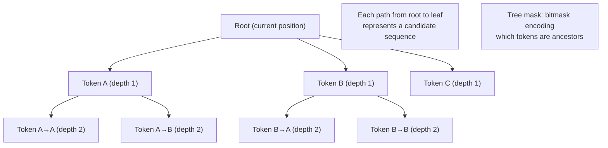
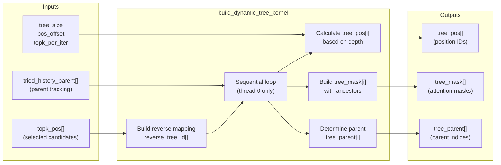
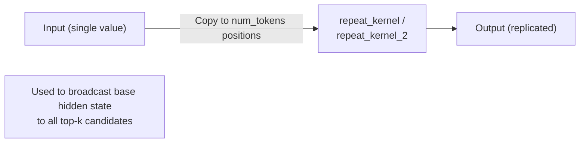
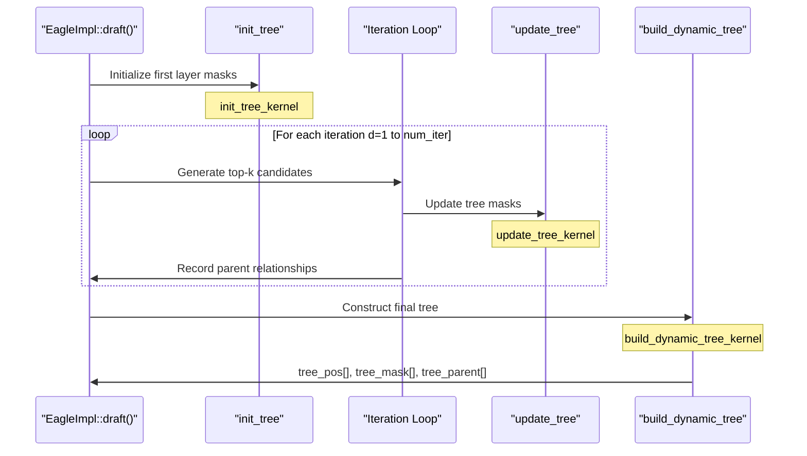

<!-- source: DeepWiki mcp.deepwiki.com · repo thunlp/FR-Spec · page 7.4 Tree Building Kernels · fetched 2026-11-02 -->

# Tree Building Kernels

<details>
<summary>Relevant source files</summary>

The following files were used as context for generating this wiki page:

- [src/model/eagle.cuh](src/model/eagle.cuh)
- [src/model/medusa.cuh](src/model/medusa.cuh)

</details>


## Purpose and Scope

This document describes the CUDA kernels responsible for constructing and managing token prediction trees in speculative decoding. These kernels create the branching structures that represent candidate token sequences proposed by the drafter models (EAGLE and Medusa) during the draft phase. The tree representation enables efficient parallel verification by the base model.

For information about the higher-level speculative decoding algorithms that use these kernels, see [Speculative Decoding](#5) and [EAGLE Implementation](#5.1). For other CUDA kernel implementations, see [Flash Attention](#7.1), [Element-wise Operations](#7.2), and [TopK Selection](#7.3).

## Tree Structure Concepts

In speculative decoding, the drafter generates multiple candidate token sequences organized as a tree structure. Each node in the tree represents a token position, and edges represent possible next tokens. The tree structure allows the base model to verify all candidates in parallel using a single forward pass.



**Key Data Structures:**
- **Tree Position IDs** (`tree_position_ids`): Absolute position in sequence for each tree node
- **Tree Masks** (`tree_attn_mask`): 64-bit bitmasks encoding ancestor relationships for attention
- **Tree Parent** (`tree_parent`): Index of parent node for each tree node
- **Tree Draft IDs** (`tree_draft_ids`): Token IDs for each tree node

Sources: [src/model/eagle.cuh:178-212]()

## EAGLE Dynamic Tree Building

EAGLE uses a dynamic tree construction algorithm that selects the most promising candidate sequences based on accumulated log probabilities. The tree is built iteratively across multiple drafting iterations.

### build_dynamic_tree Kernel

The core tree building kernel for EAGLE constructs the complete tree structure from the top-k selections made during drafting.



**Implementation Details:**

The kernel is launched with a single thread block where only thread 0 performs the sequential tree construction:

[src/model/eagle.cuh:178-208]()

```cpp
__global__ void build_dynamic_tree_kernel(
    int32_t tree_size, 
    int32_t pos_offset, 
    int32_t topk_per_iter,
    const int32_t* tried_history_parent, 
    const int32_t* topk_pos, 
    int32_t* tree_pos, 
    uint64_t* tree_mask, 
    int32_t* tree_parent)
```

**Algorithm Steps:**

1. **Reverse Mapping Construction** [src/model/eagle.cuh:179-184](): All threads cooperatively build `reverse_tree_id[]` that maps from original candidate indices to tree node indices
   
2. **Root Node Initialization** [src/model/eagle.cuh:185-187](): Thread 0 sets up the root with mask=1, position=pos_offset

3. **Iterative Tree Construction** [src/model/eagle.cuh:188-206](): For each remaining node i:
   - **Position Calculation**: Determines depth based on candidate index `p`:
     - Depth 1 (first iteration): `pos_offset + 1`
     - Depth 2: `pos_offset + (p / topk_per_iter²) + 2`
   - **Mask Construction** [src/model/eagle.cuh:191](): Set bit for current node and inherit parent's mask
   - **Parent Lookup** [src/model/eagle.cuh:193-204](): Trace back through drafting iterations to find parent node

Sources: [src/model/eagle.cuh:178-212]()

### Tree Initialization and Update Kernels

EAGLE uses several helper kernels during the iterative drafting process:

#### init_tree_kernel

Initializes the tree mask for the first iteration by setting diagonal bits:

[src/model/eagle.cuh:91-93]()

```cpp
__global__ void init_tree_kernel(uint64_t* mask_2d) {
    mask_2d[threadIdx.x] = 1ULL << threadIdx.x;
}
```

Each thread initializes its own mask with a single bit set, representing that it only depends on itself initially.

#### update_tree_kernel

Updates tree masks when adding a new layer of candidates:

[src/model/eagle.cuh:99-101]()

```cpp
__global__ void update_tree_kernel(
    int32_t num_tokens, 
    int32_t offset, 
    uint64_t* mask_2d, 
    const uint64_t* tmp_mask_2d, 
    const int32_t* topk_pos)
{
    mask_2d[threadIdx.x] = tmp_mask_2d[topk_pos[threadIdx.x] / num_tokens] 
                          | (1ULL << (offset + threadIdx.x));
}
```

This inherits the parent's mask (`tmp_mask_2d[...]`) and sets the new node's own bit.

#### set_parent_kernel

Records parent relationships during drafting:

[src/model/eagle.cuh:95-97]()

```cpp
__global__ void set_parent_kernel(
    int32_t num_tokens, 
    int32_t* parent, 
    const int32_t* pos, 
    int32_t offset)
{
    parent[threadIdx.x] = pos[threadIdx.x] + offset;
}
```

Sources: [src/model/eagle.cuh:91-101]()

### Host Function Wrappers

The kernels are invoked through wrapper functions that handle stream management:

| Function | Kernel | Purpose | Launch Config |
|----------|--------|---------|---------------|
| `init_tree` | `init_tree_kernel` | Initialize tree masks for first iteration | `<<<1, num_tokens>>>` |
| `set_parent` | `set_parent_kernel` | Record parent indices | `<<<1, num_tokens>>>` |
| `update_tree` | `update_tree_kernel` | Update masks when extending tree | `<<<1, num_tokens>>>` |
| `build_dynamic_tree` | `build_dynamic_tree_kernel` | Build final tree structure | `<<<1, tree_size>>>` |

Sources: [src/model/eagle.cuh:146-157](), [src/model/eagle.cuh:210-212]()

## Medusa Tree Building

Medusa uses a simpler, fixed tree structure where the tree topology is predetermined. The kernel only needs to populate token IDs and position IDs based on the fixed structure.

### build_tree Kernel

[src/model/medusa.cuh:7-15]()

```cpp
__global__ void build_tree_kernel(
    int tree_size, 
    const int32_t* topk_pos, 
    const int32_t* tree_indices,
    const int32_t* draft_position_ids, 
    int32_t* tree_draft_ids, 
    int32_t* tree_position_ids,
    const int32_t* cache_length)
{
    int i = threadIdx.x;
    if (i < tree_size) {
        tree_position_ids[i] = cache_length[0] + draft_position_ids[i];
        if (i > 0) {
            tree_draft_ids[i] = topk_pos[tree_indices[i-1]];
        }
    }
}
```

**Differences from EAGLE:**
- **Fixed Structure**: `tree_indices[]` predefines the tree topology
- **Parallel Execution**: All threads work independently (no coordination needed)
- **Simpler Logic**: Just maps indices to token IDs and positions
- **No Mask Construction**: Tree masks are not computed by this kernel (likely precomputed in Python)

Sources: [src/model/medusa.cuh:7-20]()

## Tree Manipulation Helper Kernels

Several utility kernels support tree operations during drafting:

### Repeat Kernels

Copy and replicate hidden states or scalars across tree nodes:



[src/model/eagle.cuh:15-27]()

**repeat_kernel**: Copies multi-dimensional data (hidden states)
**repeat_kernel_2**: Copies scalars (e.g., position IDs)

### Remap Kernels

Map between tree node indices and original candidate indices:

#### remap_hidden_kernel

[src/model/eagle.cuh:108-115]()

```cpp
__global__ void remap_hidden_kernel(
    int32_t scale, 
    int32_t dim, 
    const int32_t* id_map,
    const float4* real_hidden, 
    float4* output)
{
    int row = blockIdx.x;
    int col = threadIdx.x;
    int real_row = id_map[row] / scale;
    for (int i = col; i < dim; i += blockDim.x) {
        output[row * dim + i] = real_hidden[real_row * dim + i];
    }
}
```

Reorders hidden states according to `id_map[]`, used when selecting top-k candidates to gather their corresponding embeddings.

#### remap_id_kernel

[src/model/eagle.cuh:117-119]()

Maps token IDs through the tree structure and applies vocabulary remapping for FR-Spec optimization.

### Position Management Kernels

#### add_kernel

[src/model/eagle.cuh:11-13]()

Increments position IDs for all tree nodes when advancing to the next iteration.

#### make_arange_kernel

[src/model/eagle.cuh:121-123]()

Generates sequential position IDs starting from a base offset, used during verification to set up position IDs for accepted tokens.

Sources: [src/model/eagle.cuh:11-123]()

## Integration with EAGLE Draft Phase

The tree building kernels are orchestrated during EAGLE's `draft()` method:



**Call Sequence:**

1. **Initialization** [src/model/eagle.cuh:456](): `init_tree()` sets up masks for first iteration
2. **Iterative Extension** [src/model/eagle.cuh:458-485](): For each drafting iteration:
   - Generate candidates with LM head
   - Select top-k per position
   - Call `set_parent()` to record relationships [src/model/eagle.cuh:481]()
   - Call `update_tree()` to extend masks [src/model/eagle.cuh:482]()
   - Remap hidden states and IDs [src/model/eagle.cuh:483-484]()
3. **Final Construction** [src/model/eagle.cuh:490](): `build_dynamic_tree()` creates complete tree structure

Sources: [src/model/eagle.cuh:432-494]()

## Memory Layout and Performance

### Tree Mask Encoding

Tree masks use 64-bit unsigned integers (`uint64_t`) to encode ancestor relationships:
- Each bit position represents a tree node index
- Bit i is set if node i is an ancestor of (or is) the current node
- Maximum tree size is limited to 64 nodes

**Example:** If node 5 has ancestors [0, 2, 3, 5], its mask is:
```
mask[5] = (1 << 0) | (1 << 2) | (1 << 3) | (1 << 5) = 0x002D
```

This encoding enables efficient attention masking in the verification phase.

### Kernel Launch Configurations

| Kernel | Grid Dim | Block Dim | Shared Memory | Notes |
|--------|----------|-----------|---------------|-------|
| `init_tree_kernel` | 1 | num_tokens | 0 | One thread per initial candidate |
| `update_tree_kernel` | 1 | num_tokens | 0 | One thread per new candidate |
| `build_dynamic_tree_kernel` | 1 | tree_size | 4KB (reverse_tree_id) | Sequential in thread 0 |
| `build_tree_kernel` (Medusa) | 1 | 64 | 0 | Fully parallel |

**Performance Characteristics:**

- **Small Kernel Overhead**: All tree kernels use single-block launches since tree sizes are small (typically <64 nodes)
- **Sequential Bottleneck**: EAGLE's `build_dynamic_tree_kernel` is sequential but represents negligible overhead compared to model forward passes
- **Memory Bandwidth**: Limited data movement, primarily bounded by computation in parent model

Sources: [src/model/eagle.cuh:91-212](), [src/model/medusa.cuh:7-20]()

## Summary

The tree building kernels provide the infrastructure for organizing candidate token sequences in speculative decoding:

- **EAGLE**: Uses dynamic tree construction with iterative mask updates and final tree building via `build_dynamic_tree_kernel`
- **Medusa**: Uses simpler fixed-structure trees with parallel population via `build_tree_kernel`
- **Helper Kernels**: Support operations like position management, state remapping, and mask initialization
- **Memory Efficiency**: 64-bit mask encoding enables compact representation of tree structure

These kernels enable the parallel verification that makes speculative decoding efficient, converting the sequential problem of token generation into a tree-structured parallel computation.

Sources: [src/model/eagle.cuh](), [src/model/medusa.cuh]()

---

