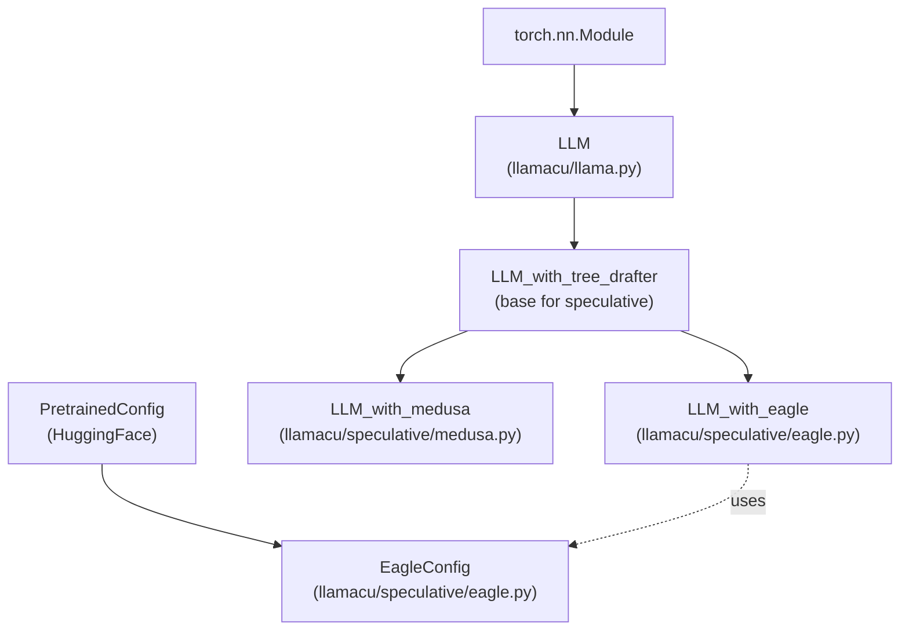
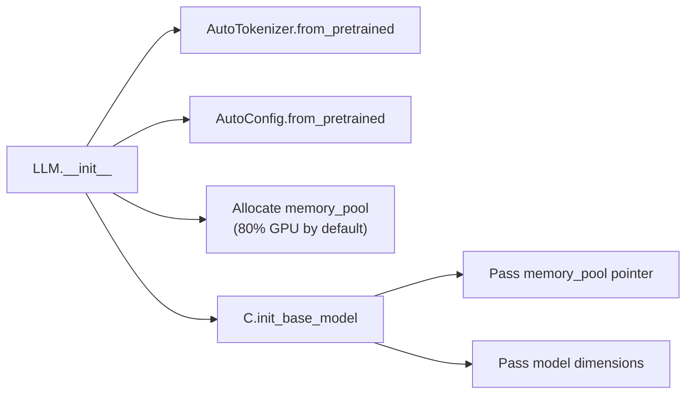
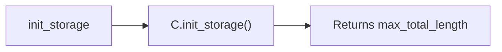
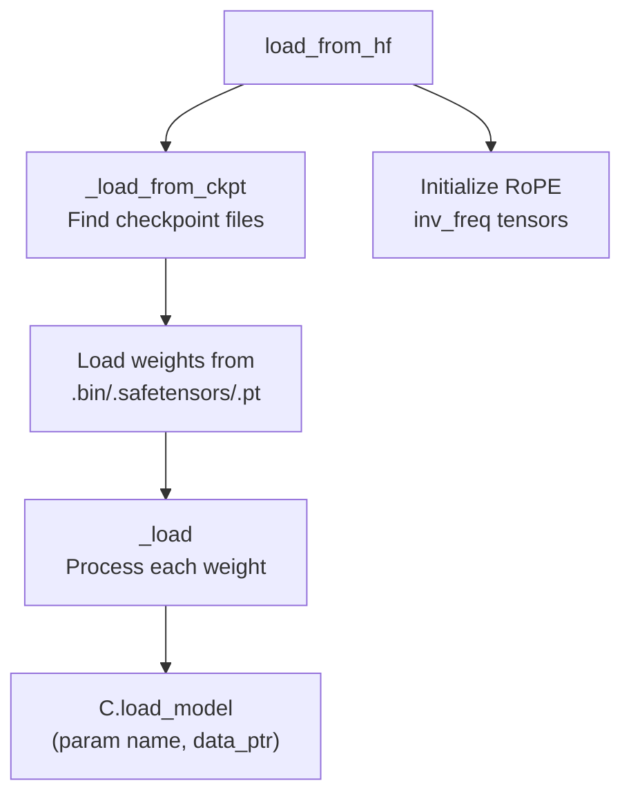
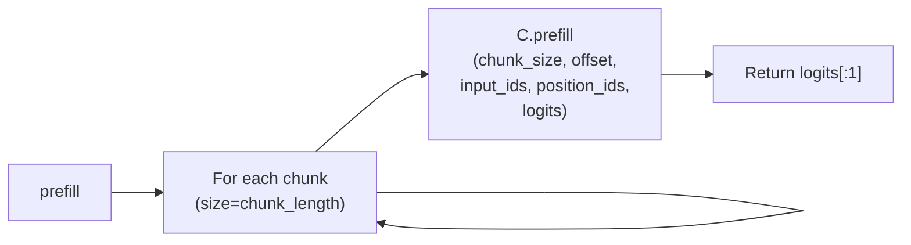
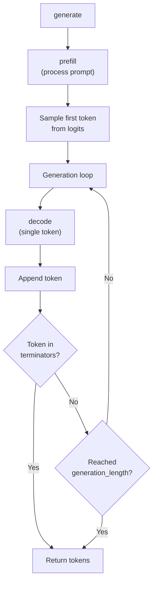
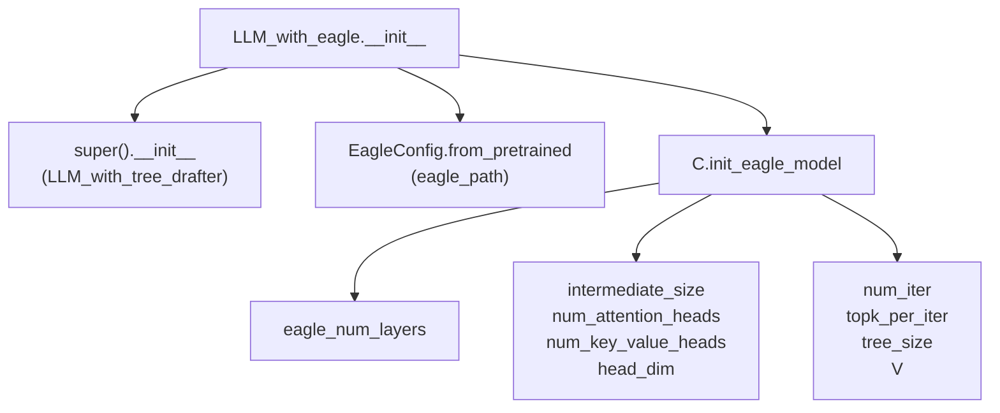
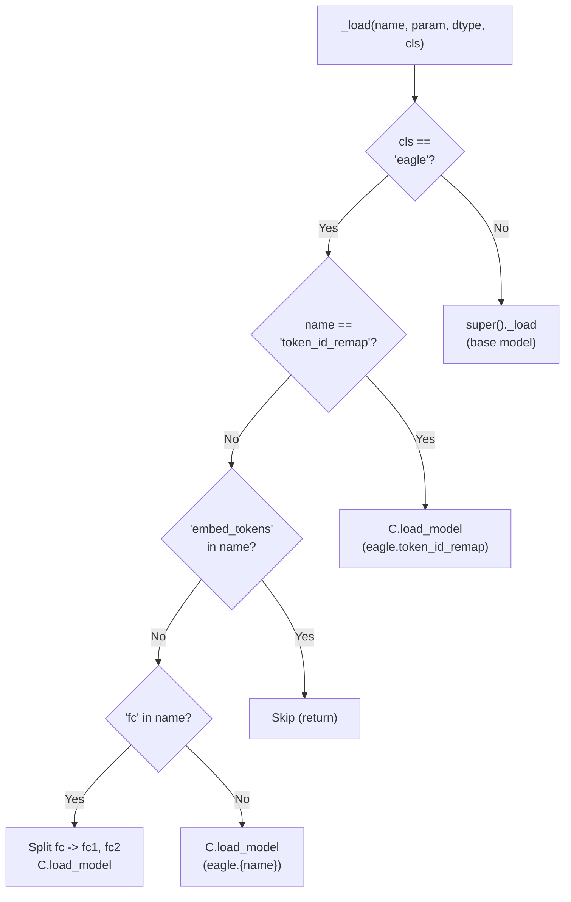

<!-- source: DeepWiki mcp.deepwiki.com · repo thunlp/FR-Spec · page 8 Python API Reference · fetched 2026-11-02 -->

# Python API Reference

<details>
<summary>Relevant source files</summary>

The following files were used as context for generating this wiki page:

- [llamacu/llama.py](llamacu/llama.py)
- [llamacu/speculative/eagle.py](llamacu/speculative/eagle.py)

</details>


This page documents the Python-level APIs exposed by the FR-Spec system for end users. The APIs provide high-level interfaces for loading models, configuring speculative decoding, and performing text generation. For details on the underlying C++/CUDA implementation, see [System Architecture](#3). For usage examples, see [Quick Start Example](#2.2).

## Class Hierarchy

The FR-Spec Python API is organized into a class hierarchy where specialized classes inherit from and extend the base `LLM` class:



**Sources:** [llamacu/llama.py:20-198](), [llamacu/speculative/eagle.py:1-70]()

## Base LLM Class

The `LLM` class provides the foundation for all model inference in FR-Spec. It manages the base transformer model, memory allocation, and basic generation operations.

### Initialization Parameters

| Parameter | Type | Default | Description |
|-----------|------|---------|-------------|
| `path` | `str` | Required | HuggingFace model path or local directory |
| `memory_limit` | `float` | `0.8` | Fraction of GPU memory to allocate (0.0-1.0) |
| `chunk_length` | `int` | `1024` | Maximum tokens per prefill chunk |
| `dtype` | `torch.dtype` | `None` | Computation dtype (defaults to model config) |
| `cuda_graph` | `bool` | `False` | Enable CUDA graph optimization for decode |

The class initializes by allocating a memory pool and calling `C.init_base_model` to set up the C++/CUDA backend:



**Implementation details:** [llamacu/llama.py:21-61]()

**Sources:** [llamacu/llama.py:20-61]()

### Data Type Handling

FR-Spec supports `torch.float16` and `torch.bfloat16` for efficient mixed-precision computation. The `dtype_to_int` helper function converts PyTorch types to integer codes used by the C backend:

| PyTorch dtype | Integer code |
|---------------|--------------|
| `torch.float16` | 0 |
| `torch.bfloat16` | 1 |

**Implementation:** [llamacu/llama.py:9-18]()

**Sources:** [llamacu/llama.py:9-18](), [llamacu/llama.py:33-34]()

### Core Methods

#### `init_storage() -> int`

Initializes storage allocation for KV cache and intermediate buffers after model weights are loaded. Returns the maximum supported total sequence length.



**Implementation:** [llamacu/llama.py:63-64]()

#### `load_from_hf()`

Loads model weights from HuggingFace checkpoint files and initializes rotary position embeddings. Supports multiple checkpoint formats (`.bin`, `.safetensors`, `.pt`) and index files for sharded models.

**Weight loading flow:**



The method handles special cases:
- **Fused weights:** Splits `gate_up_proj` into `gate_proj` and `up_proj` [llamacu/llama.py:73-75]()
- **Fused QKV:** Splits `qkv_proj` into separate Q, K, V projections [llamacu/llama.py:76-79]()
- **Weight tying:** Reuses `embed_tokens` for `lm_head` if configured [llamacu/llama.py:84-85]()

**Implementation:** [llamacu/llama.py:125-138](), [llamacu/llama.py:66-82](), [llamacu/llama.py:87-123]()

**Sources:** [llamacu/llama.py:66-138]()

#### `prefill(input_ids: Tensor, position_ids: Tensor) -> Tensor`

Processes the input prompt in chunks and returns logits for the last token.

**Parameters:**
- `input_ids`: Token IDs as `torch.int32` tensor, shape `[seq_len]`
- `position_ids`: Position indices as `torch.int32` tensor, shape `[seq_len]`

**Returns:** Logits tensor of shape `[1, vocab_size]`

The method chunks long sequences to avoid memory spikes, processing at most `chunk_length` tokens per call to `C.prefill`:



**Implementation:** [llamacu/llama.py:140-150]()

**Sources:** [llamacu/llama.py:140-150]()

#### `decode(input_ids: Tensor, position_ids: Tensor, cache_length: Tensor, mask_2d: Tensor = None) -> Tensor`

Performs single-step token generation with KV cache support.

**Parameters:**
- `input_ids`: Token IDs to decode, `torch.int32`, shape `[batch]`
- `position_ids`: Position indices, `torch.int32`, shape `[batch]`
- `cache_length`: Current cache length per sequence, `torch.int32`, shape `[batch]`
- `mask_2d`: Optional attention mask, `torch.uint64`, shape `[batch, padded_length/64]`

**Returns:** Logits tensor of shape `[batch, vocab_size]`

The method pads `cache_length` to a multiple of 128 for efficient Flash Attention:

**Implementation:** [llamacu/llama.py:152-172]()

**Sources:** [llamacu/llama.py:152-172]()

#### `generate(input_ids: Tensor, generation_length: int = 100, terminators: list = []) -> list[int]`

High-level generation method that combines prefill and iterative decode steps.

**Parameters:**
- `input_ids`: Prompt token IDs, `torch.int32`, shape `[prefix_length]`
- `generation_length`: Maximum tokens to generate
- `terminators`: List of token IDs that stop generation (e.g., EOS tokens)

**Returns:** List of generated token IDs

**Generation loop:**



The method reuses pre-allocated `input_ids`, `position_ids`, and `cache_length` tensors to avoid repeated allocations:

**Implementation:** [llamacu/llama.py:174-197]()

**Sources:** [llamacu/llama.py:174-197]()

## Speculative Decoding Classes

The `LLM_with_eagle` and `LLM_with_medusa` classes extend the base `LLM` functionality with speculative decoding capabilities. They inherit from an intermediate `LLM_with_tree_drafter` base class.

### LLM_with_eagle

The `LLM_with_eagle` class implements EAGLE-2 style speculative decoding with optional FR-Spec vocabulary reduction.

#### Initialization Parameters

| Parameter | Type | Default | Description |
|-----------|------|---------|-------------|
| `eagle_path` | `str` | Required | Path to Eagle drafter model weights |
| `base_path` | `str` | Required | Path to base model (same as `LLM.path`) |
| `num_iter` | `int` | `6` | Number of drafting iterations per step |
| `topk_per_iter` | `int` | `10` | Top-K candidates per iteration |
| `tree_size` | `int` | `60` | Maximum tree nodes (total candidates) |
| `V` | `int` | `15000` | Reduced vocabulary size for FR-Spec |
| `**kwargs` | | | Additional arguments passed to base `LLM` |

**Initialization flow:**



The `V` parameter controls FR-Spec vocabulary reduction:
- **Full vocabulary:** Set `V = config.vocab_size` (no reduction)
- **Typical values:** 8000, 16000, 32000, 64000 (see [Token Frequency Analysis](#6.1))

**Implementation:** [llamacu/speculative/eagle.py:16-46]()

**Sources:** [llamacu/speculative/eagle.py:16-46]()

#### Weight Loading

The `_load` method overrides the base class to handle Eagle-specific weight formats:

**Special handling:**

1. **`token_id_remap`:** Loaded directly without dtype conversion [llamacu/speculative/eagle.py:50-52]()
2. **`embed_tokens`:** Skipped (Eagle reuses base model embeddings) [llamacu/speculative/eagle.py:56-57]()
3. **Fused `fc` layers:** Split into `fc1` and `fc2` with separate weight and bias [llamacu/speculative/eagle.py:58-66]()



**Implementation:** [llamacu/speculative/eagle.py:48-69]()

**Sources:** [llamacu/speculative/eagle.py:48-69]()

## Configuration Management

### EagleConfig

The `EagleConfig` class extends HuggingFace's `PretrainedConfig` to store Eagle-specific hyperparameters:

| Attribute | Type | Default | Description |
|-----------|------|---------|-------------|
| `eagle_num_layers` | `int` | `1` | Number of Eagle transformer layers |
| `intermediate_size` | `int` | Inherited | FFN intermediate dimension |
| `num_attention_heads` | `int` | Inherited | Number of attention heads |
| `num_key_value_heads` | `int` | Inherited | Number of KV heads (GQA support) |
| `hidden_size` | `int` | Inherited | Hidden state dimension |
| `rms_norm_eps` | `float` | Inherited | RMSNorm epsilon value |

The configuration is loaded using HuggingFace's standard API:

```python
eagle_config = EagleConfig.from_pretrained(eagle_path)
```

This reads `config.json` from the Eagle model directory and populates the attributes. The `num_hidden_layers` parameter from the config file is aliased as `eagle_num_layers`.

**Implementation:** [llamacu/speculative/eagle.py:7-14](), [llamacu/speculative/eagle.py:32]()

**Sources:** [llamacu/speculative/eagle.py:7-14](), [llamacu/speculative/eagle.py:32]()

### Integration with HuggingFace AutoConfig

The base `LLM` class uses `AutoConfig.from_pretrained` to automatically load model configurations from HuggingFace Hub or local directories:

```python
self.config = AutoConfig.from_pretrained(path)
```

This supports various architectures including Llama, Qwen2, and others. The configuration provides:
- Model dimensions (`hidden_size`, `intermediate_size`, `num_hidden_layers`)
- Attention parameters (`num_attention_heads`, `num_key_value_heads`)
- Normalization settings (`rms_norm_eps`)
- RoPE configuration (`rope_scaling`)
- Architecture-specific flags (e.g., `has_attention_bias` for Qwen2)

**Implementation:** [llamacu/llama.py:32](), [llamacu/llama.py:44]()

**Sources:** [llamacu/llama.py:32](), [llamacu/llama.py:44]()

## API Usage Patterns

### Basic Generation

```python
from llamacu import LLM

# Initialize model
model = LLM(path="meta-llama/Llama-3-8B", memory_limit=0.8, dtype=torch.float16)
model.init_storage()
model.load_from_hf()

# Generate text
prompt_ids = torch.tensor([...], dtype=torch.int32, device="cuda")
tokens = model.generate(prompt_ids, generation_length=100)
```

### Speculative Decoding with EAGLE

```python
from llamacu.speculative import LLM_with_eagle

# Initialize with Eagle drafter
model = LLM_with_eagle(
    eagle_path="path/to/eagle",
    base_path="meta-llama/Llama-3-8B",
    num_iter=6,
    topk_per_iter=10,
    tree_size=60,
    V=32000,  # FR-Spec vocabulary size
    memory_limit=0.8
)
model.init_storage()
model.load_from_hf()

# Generate text (uses draft-verify loop internally)
tokens = model.generate(prompt_ids, generation_length=100)
```

### FR-Spec Vocabulary Reduction

To use different FR-Spec vocabulary sizes, adjust the `V` parameter and ensure the corresponding `token_id_remap` is loaded:

| V value | Typical use case | Speedup vs baseline |
|---------|------------------|---------------------|
| Full vocab | Maximum accuracy, no reduction | 1.0x (EAGLE-2) |
| 64000 | Conservative reduction | ~1.05x |
| 32000 | Balanced trade-off | ~1.10x |
| 16000 | Aggressive reduction | ~1.12x (best) |
| 8000 | Maximum reduction | ~1.08x (accuracy loss) |

The frequency-ranked token mappings are generated offline using the `fr.py` script (see [Token Frequency Analysis](#6.1)).

**Sources:** [llamacu/speculative/eagle.py:23-24]()

---

