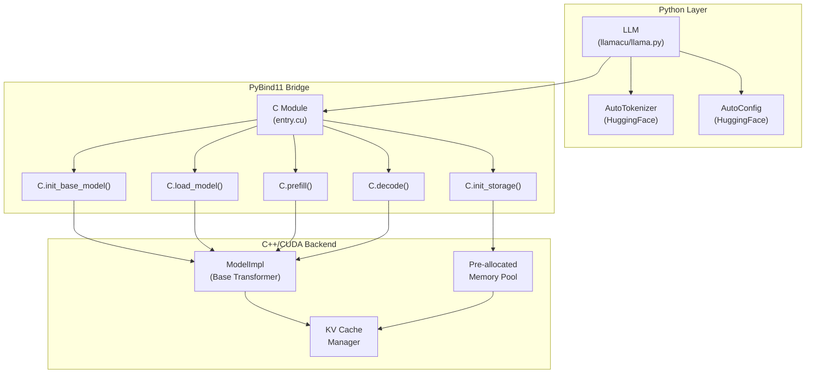
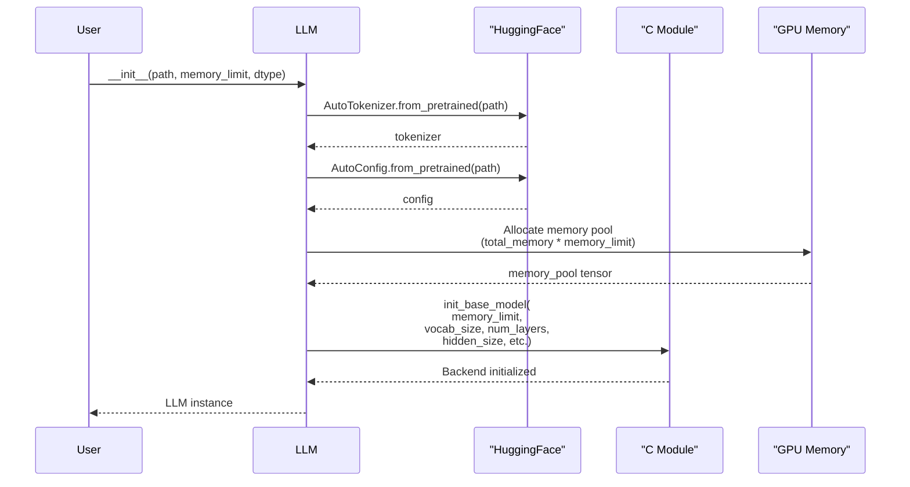
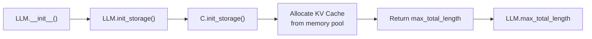
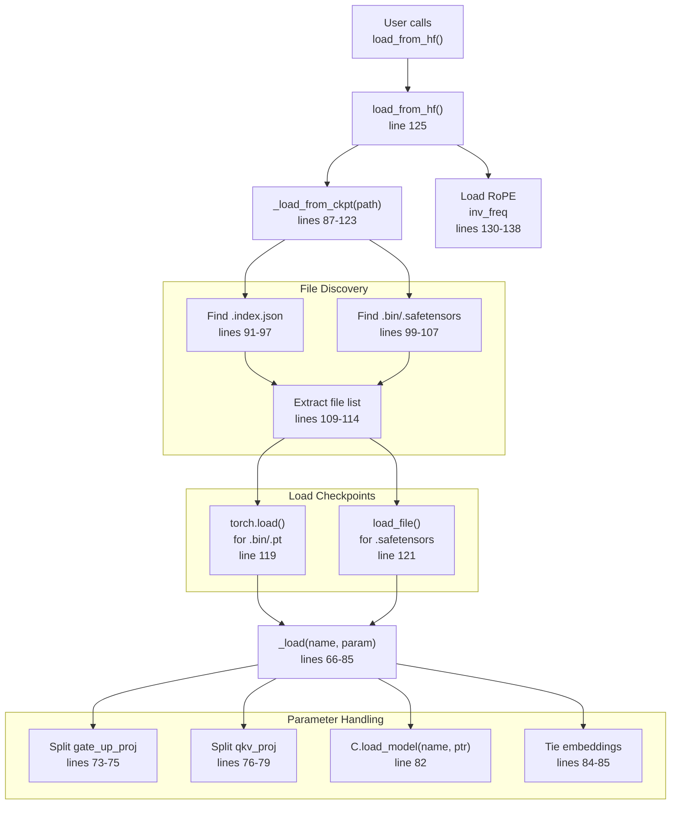
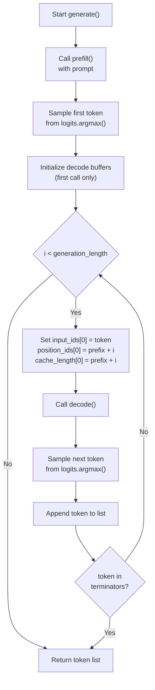
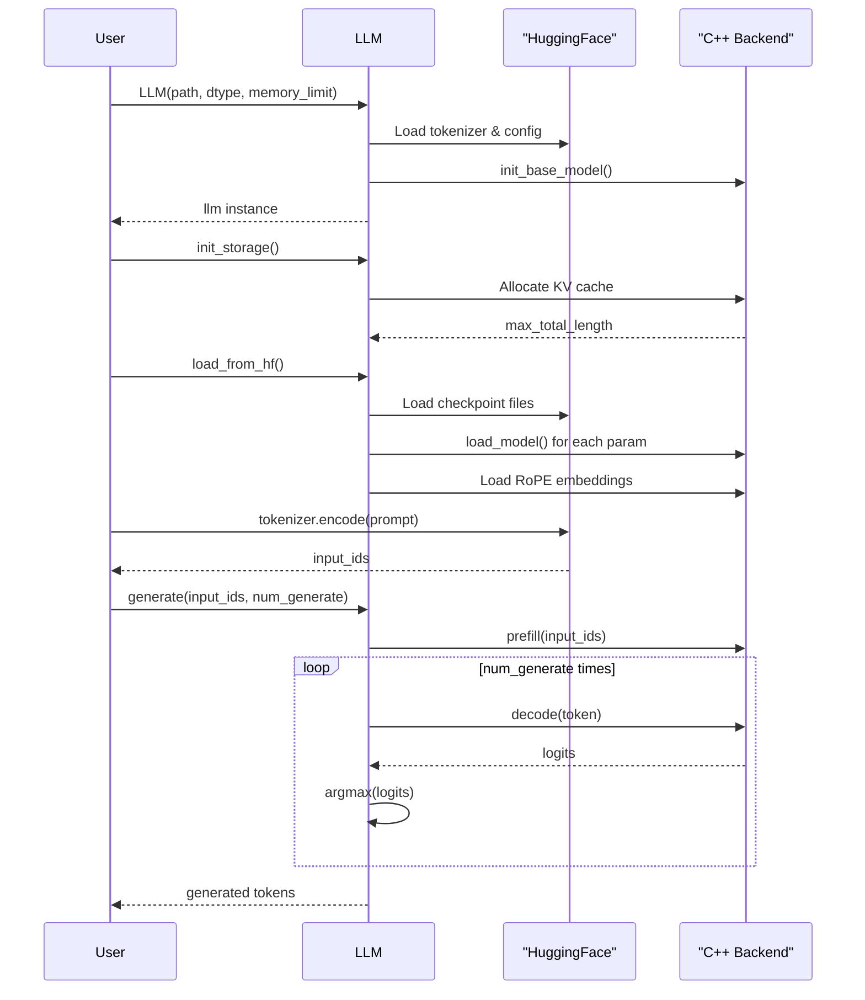
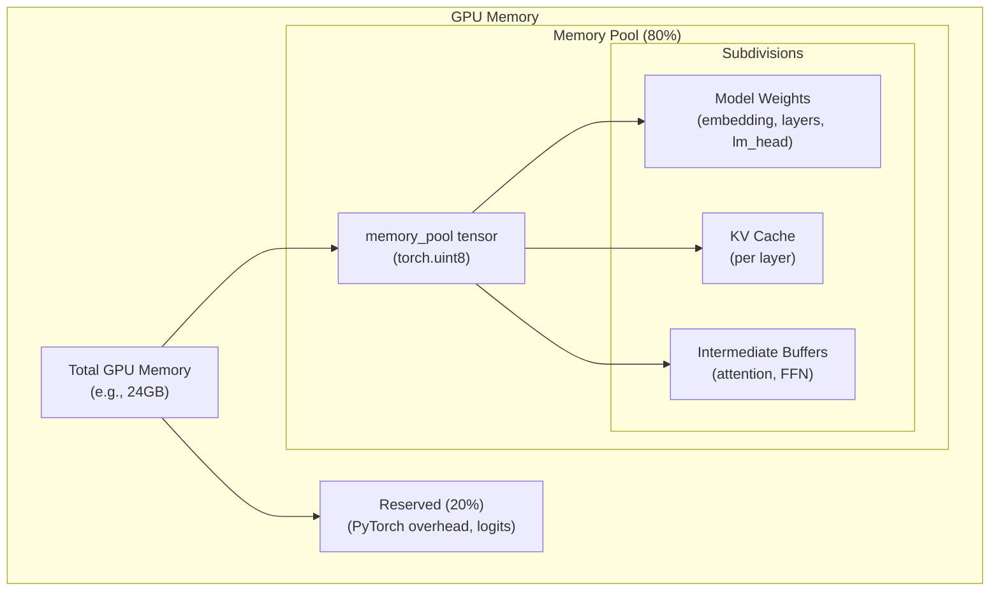
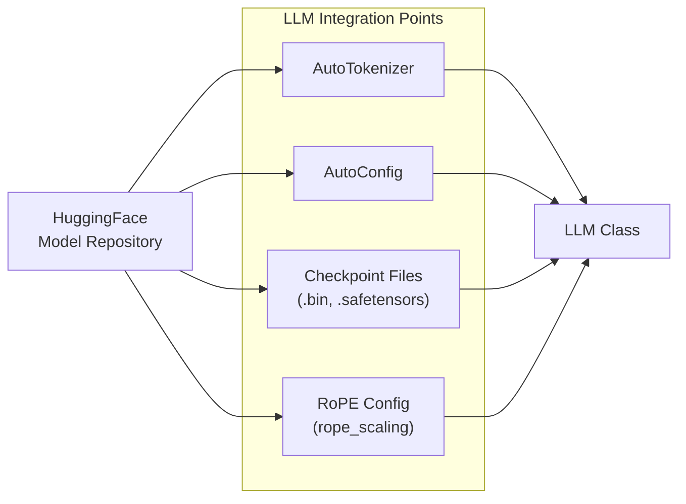

<!-- source: DeepWiki mcp.deepwiki.com · repo thunlp/FR-Spec · page 8.1 LLM Class · fetched 2026-11-02 -->

# LLM Class

<details>
<summary>Relevant source files</summary>

The following files were used as context for generating this wiki page:

- [examples/example_generate.py](examples/example_generate.py)
- [llamacu/llama.py](llamacu/llama.py)

</details>


## Purpose and Scope

The `LLM` class in [llamacu/llama.py]() provides the primary Python API for standard (non-speculative) text generation using transformer models. It serves as a high-level interface that manages model initialization, weight loading from HuggingFace checkpoints, memory allocation, and inference operations (prefill and decode).

This page covers the base `LLM` class used for standard autoregressive generation. For speculative decoding variants (EAGLE and Medusa), see [Speculative Decoding Classes](#8.2). For details on the underlying C++/CUDA implementation, see [ModelImpl: Base Transformer](#4.1).

---

## Class Architecture

The `LLM` class extends `torch.nn.Module` and acts as a Python wrapper around the C++/CUDA inference engine exposed through the PyBind11 module `C`.



**Sources:** [llamacu/llama.py:1-198](), [examples/example_generate.py:1-46]()

---

## Initialization

### Constructor Parameters

The `LLM` constructor in [llamacu/llama.py:20-59]() accepts the following parameters:

| Parameter | Type | Default | Description |
|-----------|------|---------|-------------|
| `path` | `str` | Required | Path to HuggingFace model directory |
| `memory_limit` | `float` | `0.8` | Fraction of GPU memory to allocate (0.0-1.0) |
| `chunk_length` | `int` | `1024` | Maximum tokens per prefill chunk |
| `dtype` | `torch.dtype` | `None` | Model data type (fp16/bf16); defaults to config value |
| `cuda_graph` | `bool` | `False` | Enable CUDA graph optimization for decode |

### Initialization Flow



The constructor performs the following steps:

1. **Load Configuration** [llamacu/llama.py:31-32](): Loads tokenizer and model configuration from HuggingFace using `AutoTokenizer` and `AutoConfig`.

2. **Determine Data Type** [llamacu/llama.py:33-34](): Uses provided `dtype` or falls back to `config.torch_dtype`. Converts to integer representation via `dtype_to_int()` [llamacu/llama.py:14-18]().

3. **Allocate Memory Pool** [llamacu/llama.py:37-38](): Allocates a contiguous `uint8` tensor representing the fraction of total GPU memory specified by `memory_limit`. This pool is shared across all model components.

4. **Initialize Backend** [llamacu/llama.py:45-59](): Calls `C.init_base_model()` to initialize the C++/CUDA `ModelImpl` with architectural parameters from the config:
   - Vocabulary size and layer count
   - Hidden dimensions and FFN size
   - Attention head configuration (num_heads, num_kv_heads, head_dim)
   - RMS normalization epsilon
   - Architecture-specific flags (e.g., attention bias for Qwen2)

5. **Allocate Logits Buffer** [llamacu/llama.py:61](): Creates a buffer for storing output logits (size 64 × vocab_size).

**Sources:** [llamacu/llama.py:20-61]()

---

## Storage Initialization and Weight Loading

### Storage Initialization

After constructing the `LLM` object, you must call `init_storage()` before loading weights:



The `init_storage()` method [llamacu/llama.py:63-64]() calls the C++ backend to subdivide the memory pool among model components, primarily the KV cache. It returns `max_total_length`, the maximum sequence length supported given the allocated memory.

**Sources:** [llamacu/llama.py:63-64](), [examples/example_generate.py:31]()

### Weight Loading

The `LLM` class provides a comprehensive weight loading system that handles various checkpoint formats.



#### Checkpoint Format Support

The `_load_from_ckpt()` method [llamacu/llama.py:87-123]() supports multiple checkpoint formats:

| Format | Suffixes | Index File | Notes |
|--------|----------|------------|-------|
| Sharded PyTorch | `.bin` | `*.bin.index.json` | Legacy format |
| Sharded SafeTensors | `.safetensors` | `*.safetensors.index.json` | Recommended format |
| Single PyTorch | `.bin`, `.pt` | None | Single file checkpoint |
| Single SafeTensors | `.safetensors` | None | Single file checkpoint |

#### Parameter Processing

The `_load()` method [llamacu/llama.py:66-85]() handles special parameter cases:

1. **Gate-Up Projection Splitting** [llamacu/llama.py:73-75](): Some models store `gate_proj` and `up_proj` as a single fused `gate_up_proj` tensor. The method splits it in half and loads each part separately.

2. **QKV Projection Splitting** [llamacu/llama.py:76-79](): Similarly, fused `qkv_proj` tensors are split into separate `q_proj`, `k_proj`, and `v_proj` based on head dimensions:
   - Q: `[0 : num_attention_heads * head_dim]`
   - K: `[num_attention_heads * head_dim : (num_attention_heads + num_kv_heads) * head_dim]`
   - V: `[(num_attention_heads + num_kv_heads) * head_dim : end]`

3. **Data Type Conversion** [llamacu/llama.py:68-71](): Converts parameters to the target dtype (fp16 or bf16), except for RoPE embeddings which use fp32.

4. **Weight Tying** [llamacu/llama.py:84-85](): If `config.tie_word_embeddings` is True, the embedding layer weights are also loaded as LM head weights.

#### RoPE Initialization

The `load_from_hf()` method [llamacu/llama.py:125-138]() also initializes rotary positional embeddings (RoPE):

- Determines RoPE type from `config.rope_scaling` (default, llama3, longrope, etc.)
- Uses HuggingFace's `ROPE_INIT_FUNCTIONS` to compute `inv_freq` tensor
- Loads the inverse frequency tensor at fp32 precision

**Sources:** [llamacu/llama.py:66-138](), [examples/example_generate.py:39]()

---

## Inference Methods

The `LLM` class provides three levels of inference APIs, from low-level to high-level.

### Prefill

The `prefill()` method [llamacu/llama.py:140-150]() processes the initial prompt tokens and populates the KV cache.

```python
# Method signature
def prefill(self, input_ids, position_ids)
```

**Parameters:**
- `input_ids`: `torch.Tensor` of shape `[batch_size, seq_len]` with dtype `int32` containing token IDs
- `position_ids`: `torch.Tensor` of shape `[batch_size, seq_len]` with dtype `int32` containing position indices

**Returns:**
- `torch.Tensor` of shape `[1, vocab_size]` containing logits for the next token

**Behavior:**
- Chunks long sequences into `chunk_length`-sized segments [llamacu/llama.py:142]()
- Calls `C.prefill()` for each chunk [llamacu/llama.py:144-148]()
- Uses NVTX ranges for profiling [llamacu/llama.py:143, 149]()
- Returns only the logits for the last position [llamacu/llama.py:150]()

**Sources:** [llamacu/llama.py:140-150](), [examples/example_generate.py:22, 179]()

---

### Decode

The `decode()` method [llamacu/llama.py:152-172]() performs a single autoregressive decoding step, generating logits for the next token(s).

```python
# Method signature
def decode(self, input_ids, position_ids, cache_length, mask_2d=None)
```

**Parameters:**

| Parameter | Type | Shape | Description |
|-----------|------|-------|-------------|
| `input_ids` | `torch.int32` | `[num_tokens]` | Token IDs to decode |
| `position_ids` | `torch.int32` | `[num_tokens]` | Position indices for each token |
| `cache_length` | `torch.int32` | `[1]` | Current KV cache length (modified in-place) |
| `mask_2d` | `torch.uint64` or `None` | `[num_tokens, ...]` | Optional attention mask for tree structures |

**Returns:**
- `torch.Tensor` of shape `[num_tokens, vocab_size]` containing logits

**Behavior:**
1. Validates input dtypes [llamacu/llama.py:153-158]()
2. Temporarily increments `cache_length` for Flash Attention [llamacu/llama.py:161]()
3. Computes padded length (aligned to 128) [llamacu/llama.py:162]()
4. Calls `C.decode()` with optional CUDA graph [llamacu/llama.py:163-169]()
5. Restores `cache_length` [llamacu/llama.py:170]()
6. Returns logits for all input positions [llamacu/llama.py:172]()

**CUDA Graph Support:**
When `cuda_graph=True` is set during initialization, the decode operation can be captured in a CUDA graph to reduce kernel launch overhead. This is particularly effective for single-token decoding.

**Sources:** [llamacu/llama.py:152-172](), [examples/example_generate.py:192]()

---

### Generate

The `generate()` method [llamacu/llama.py:174-197]() provides a high-level API for autoregressive text generation.

```python
# Method signature
def generate(self, input_ids, generation_length=100, terminators=[])
```

**Parameters:**
- `input_ids`: `torch.Tensor` with dtype `int32` containing the prompt token IDs
- `generation_length`: `int` specifying maximum number of tokens to generate (default 100)
- `terminators`: `list` of token IDs that stop generation early (e.g., EOS token)

**Returns:**
- `list` of `int` containing the generated token IDs

**Algorithm:**



The method performs the following steps:

1. **Prefill Phase** [llamacu/llama.py:177-180]():
   - Creates position IDs for the prompt
   - Calls `prefill()` to process the entire prompt
   - Samples the first token using greedy decoding (argmax)

2. **Buffer Initialization** [llamacu/llama.py:183-186]():
   - On first call, creates reusable single-element tensors for decode inputs
   - Avoids repeated tensor allocations in the decode loop

3. **Decode Loop** [llamacu/llama.py:187-196]():
   - For each generation step:
     - Updates `input_ids`, `position_ids`, and `cache_length`
     - Calls `decode()` to get logits
     - Samples next token greedily (argmax)
     - Appends to output list
     - Checks for termination tokens

**Limitations:**
- Only supports greedy sampling (argmax)
- Single-token generation per step (no speculative decoding)
- For speculative variants, see [LLM_with_eagle](#8.2)

**Sources:** [llamacu/llama.py:174-197](), [examples/example_generate.py:29, 42, 46]()

---

## Usage Example

Below is a complete example demonstrating the typical usage pattern:



**Code Example** (from [examples/example_generate.py:6-28, 31-46]()):

```python
# 1. Configure paths and parameters
path = "/path/to/Llama-3.2-1B-instruct"
dtype = torch.float16
num_generate = 100

# 2. Load tokenizer and prepare prompt
tokenizer = AutoTokenizer.from_pretrained(path)
prompt = "Beijing is the"
input_ids = tokenizer(prompt, return_tensors="pt").input_ids.cuda().int()

# 3. Initialize LLM
llm = LLM(path, dtype=dtype, memory_limit=0.9)

# 4. Initialize storage (allocate KV cache)
llm.init_storage()

# 5. Load model weights
llm.load_from_hf()

# 6. Generate text
output_tokens = llm.generate(input_ids, num_generate)

# 7. Decode and print result
print(tokenizer.decode(output_tokens))
```

**Key Steps:**
1. Specify model path and dtype
2. Tokenize the input prompt
3. Instantiate `LLM` with configuration
4. Call `init_storage()` to allocate memory
5. Call `load_from_hf()` to load weights
6. Call `generate()` to produce tokens
7. Use tokenizer to decode output

**Sources:** [examples/example_generate.py:6-46]()

---

## Memory Management

The `LLM` class implements a memory pool architecture where GPU memory is pre-allocated and subdivided:



**Memory Pool Allocation** [llamacu/llama.py:37-38]():
- Size: `total_memory * memory_limit` (default 80%)
- Type: Contiguous `torch.uint8` tensor registered as a parameter
- Passed to C++ backend via data pointer [llamacu/llama.py:47]()

**Logits Buffer** [llamacu/llama.py:61]():
- Allocated separately (outside memory pool)
- Size: `64 × vocab_size` with model dtype
- Reused across decode steps

The C++ backend (accessed via `C.init_storage()`) subdivides the memory pool among components, primarily allocating space for the KV cache. The maximum sequence length is constrained by the available memory after accounting for model weights and intermediate buffers.

**Sources:** [llamacu/llama.py:37-38, 47, 61, 63-64]()

---

## Data Type Support

The `LLM` class supports mixed-precision inference with the following dtypes:

| Data Type | Enum Value | Notes |
|-----------|------------|-------|
| `torch.float16` | `0` | Half precision (FP16) |
| `torch.bfloat16` | `1` | Brain floating point (BF16) |

**Type Conversion** [llamacu/llama.py:9-18]():
The `dtype_to_int()` function maps PyTorch dtypes to integer codes used by the C++ backend. Unsupported dtypes raise a `ValueError`.

**Default Behavior** [llamacu/llama.py:33]():
If no dtype is specified, the class uses `config.torch_dtype` from the HuggingFace configuration.

**Special Cases:**
- RoPE embeddings always use `torch.float32` [llamacu/llama.py:69]() for numerical stability
- All other parameters use the model dtype [llamacu/llama.py:71]()

**Sources:** [llamacu/llama.py:9-18, 33-34, 68-71]()

---

## Integration with HuggingFace Ecosystem

The `LLM` class is designed for seamless integration with HuggingFace models:



**Compatible Architectures:**
- LLaMA 2 and LLaMA 3 (including instruct variants)
- Qwen 2 (with attention bias support)
- Other architectures with standard transformer structure

**Required Config Attributes:**
- `vocab_size`, `num_hidden_layers`, `hidden_size`
- `intermediate_size`, `num_attention_heads`, `num_key_value_heads`
- `rms_norm_eps`
- Optional: `rope_scaling`, `tie_word_embeddings`, `head_dim`

**Automatic Handling:**
- Architecture detection via `config.architectures[0]` [llamacu/llama.py:44]()
- RoPE type inference from config [llamacu/llama.py:130-133]()
- Weight tying for tied embeddings [llamacu/llama.py:84-85]()

**Sources:** [llamacu/llama.py:31-32, 44, 84-85, 130-138]()

---

## Performance Considerations

### CUDA Graph Optimization

The `cuda_graph` parameter [llamacu/llama.py:26, 35]() enables CUDA graph capture for the decode operation:

**Benefits:**
- Reduces kernel launch overhead (~10-20% speedup for single-token decoding)
- Most effective for small batch sizes and short decode sequences

**Limitations:**
- Only applicable to decode path, not prefill
- Requires fixed input shapes
- May not benefit batch decoding or speculative methods

**Usage:**
```python
llm = LLM(path, dtype=dtype, cuda_graph=True)
```

The flag is passed to `C.decode()` [llamacu/llama.py:168]() which decides whether to capture a graph.

### Chunked Prefill

Long prompts are processed in chunks of `chunk_length` tokens [llamacu/llama.py:24, 40, 142]():

**Rationale:**
- Prevents OOM errors for very long sequences
- Maintains reasonable memory footprint for intermediate activations
- Default chunk size of 1024 balances memory and kernel launch overhead

**Trade-offs:**
- Smaller chunks: Lower memory, more kernel launches
- Larger chunks: Higher memory, fewer kernel launches

### Memory Limit Tuning

The `memory_limit` parameter [llamacu/llama.py:23, 37]() controls GPU memory allocation:

**Recommended Values:**
- `0.8` (default): Safe for most configurations, leaves headroom for PyTorch overhead
- `0.9`: Aggressive allocation for maximum sequence length
- `0.7` or lower: When running multiple models or background processes

**Impact:**
- Directly affects maximum sequence length (KV cache size)
- Too high: Risk of OOM during inference
- Too low: Reduced maximum context length

**Sources:** [llamacu/llama.py:23-24, 26, 35, 37, 40, 142, 168]()

---

