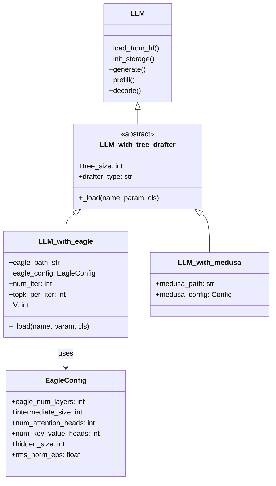
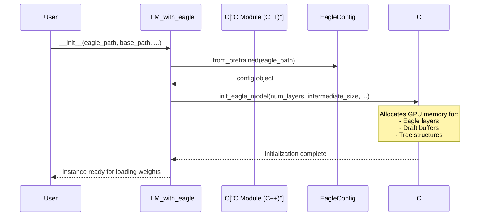
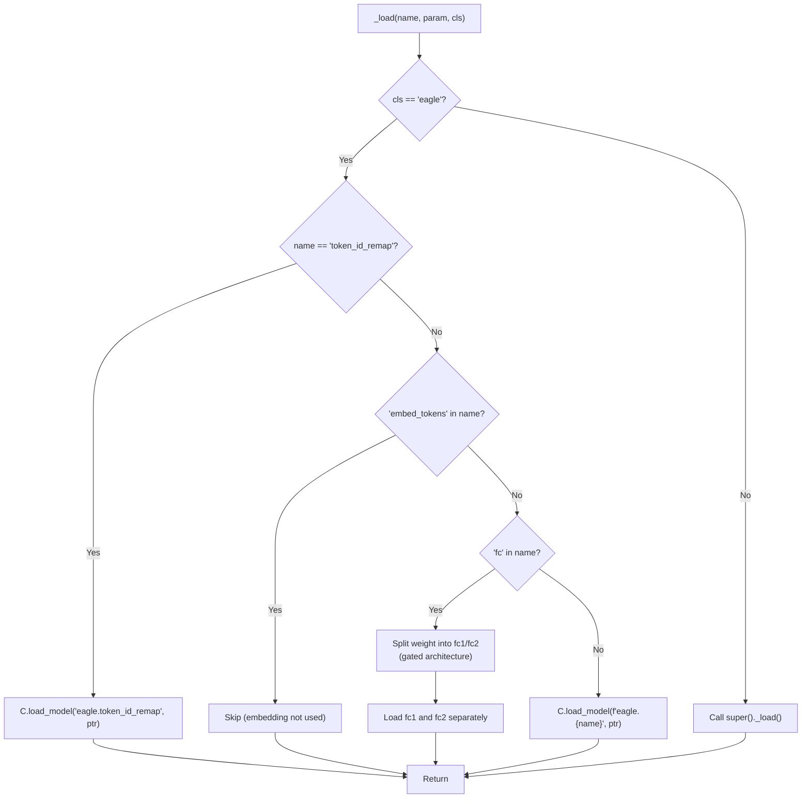
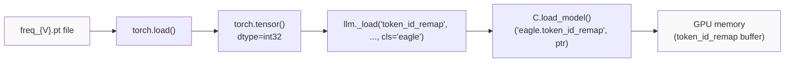

<!-- source: DeepWiki mcp.deepwiki.com · repo thunlp/FR-Spec · page 8.2 Speculative Decoding Classes · fetched 2026-11-02 -->

# Speculative Decoding Classes

<details>
<summary>Relevant source files</summary>

The following files were used as context for generating this wiki page:

- [examples/example_generate.py](examples/example_generate.py)
- [llamacu/speculative/eagle.py](llamacu/speculative/eagle.py)

</details>


## Purpose and Scope

This page documents the Python wrapper classes that enable speculative decoding for accelerated token generation. These classes (`LLM_with_eagle` and `LLM_with_medusa`) extend the base `LLM` class to provide draft-verify speculative decoding functionality. For the base LLM class documentation, see [LLM Class](#8.1). For underlying algorithm implementation details, see [EAGLE Implementation](#5.1) and [Medusa Implementation](#5.2).

**Sources:** [llamacu/speculative/eagle.py:1-70](), [examples/example_generate.py:1-46]()

---

## Class Hierarchy

The speculative decoding classes follow an inheritance structure that extends the base LLM with tree-based drafting capabilities:



**Sources:** [llamacu/speculative/eagle.py:16-47](), [examples/example_generate.py:3-4]()

---

## LLM_with_eagle Class

The `LLM_with_eagle` class implements EAGLE (Extrapolation Algorithm for Greater Language-model Efficiency) speculative decoding with optional FR-Spec vocabulary reduction optimization.

### Initialization Parameters

| Parameter | Type | Default | Description |
|-----------|------|---------|-------------|
| `eagle_path` | str | required | Path to Eagle drafter model weights directory |
| `base_path` | str | required | Path to base LLM model directory |
| `num_iter` | int | 6 | Number of iterative drafting steps |
| `topk_per_iter` | int | 10 | Number of top-k candidates selected per iteration |
| `tree_size` | int | 60 | Maximum size of prediction tree |
| `V` | int | 15000 | Vocabulary size for FR-Spec optimization |
| `**kwargs` | - | - | Additional arguments passed to parent class |

The `V` parameter controls FR-Spec vocabulary reduction. Setting `V=-1` disables FR-Spec and uses the full vocabulary.

**Sources:** [llamacu/speculative/eagle.py:16-29](), [examples/example_generate.py:13-14]()

### Initialization Flow



The initialization process:
1. Loads `EagleConfig` from the eagle model directory using HuggingFace's `from_pretrained()` [llamacu/speculative/eagle.py:32]()
2. Calls `C.init_eagle_model()` with configuration parameters to initialize C++ backend [llamacu/speculative/eagle.py:34-46]()
3. Passes architectural parameters including `eagle_num_layers`, `intermediate_size`, attention head counts, and drafting hyperparameters

**Sources:** [llamacu/speculative/eagle.py:16-46]()

### Weight Loading Process

The `_load()` method handles special logic for loading Eagle-specific weights and the token ID remapping table:



Key loading behaviors:
- **Token ID Remap**: Loaded directly without dtype conversion [llamacu/speculative/eagle.py:50-52]()
- **Embedding Tokens**: Skipped (Eagle reuses base model embeddings) [llamacu/speculative/eagle.py:56-57]()
- **FC Layers**: Split into `fc1` and `fc2` for gated FFN architecture [llamacu/speculative/eagle.py:58-66]()
- **Other Weights**: Loaded directly after dtype conversion [llamacu/speculative/eagle.py:67]()

**Sources:** [llamacu/speculative/eagle.py:48-69]()

---

## LLM_with_medusa Class

The `LLM_with_medusa` class provides an alternative speculative decoding approach using multiple prediction heads. While not detailed in the provided source files, it follows the same inheritance pattern as `LLM_with_eagle`, inheriting from `LLM_with_tree_drafter`.

**Sources:** [examples/example_generate.py:3]()

---

## EagleConfig Class

`EagleConfig` extends HuggingFace's `PretrainedConfig` to store Eagle-specific model configuration parameters.

### Configuration Fields

| Field | Type | Description |
|-------|------|-------------|
| `eagle_num_layers` | int | Number of transformer layers in Eagle drafter (typically 1) |
| `intermediate_size` | int | Dimension of FFN intermediate layer |
| `num_attention_heads` | int | Number of attention heads |
| `num_key_value_heads` | int | Number of KV heads (for grouped-query attention) |
| `hidden_size` | int | Hidden dimension size |
| `rms_norm_eps` | float | Epsilon for RMS normalization |

The configuration is loaded from the Eagle model directory's `config.json` file using HuggingFace's standard serialization mechanism.

**Sources:** [llamacu/speculative/eagle.py:7-14](), [llamacu/speculative/eagle.py:32-40]()

---

## Usage Patterns

### Basic Eagle Usage

```python
# Initialize with FR-Spec vocabulary reduction
llm = LLM_with_eagle(
    eagle_path="/path/to/eagle/weights",
    base_path="/path/to/base/model",
    dtype=torch.float16,
    memory_limit=0.9,
    num_iter=6,
    topk_per_iter=10,
    tree_size=60,
    V=16384  # FR-Spec vocab size
)

# Allocate GPU memory
llm.init_storage()

# Load token ID remapping for FR-Spec
with open(f'{eagle_path}/freq_{V}.pt', 'rb') as f:
    token_id_remap = torch.load(f, weights_only=True)
    token_id_remap = torch.tensor(token_id_remap, dtype=torch.int32)
llm._load("token_id_remap", token_id_remap, cls="eagle")

# Load model weights from HuggingFace
llm.load_from_hf()

# Generate tokens with speculative decoding
output_ids, accept_lengths = llm.generate(input_ids, num_generate=100)
average_accept = sum(accept_lengths) / len(accept_lengths)
```

**Sources:** [examples/example_generate.py:24-44]()

### Disabling FR-Spec

To use standard EAGLE without vocabulary reduction:

```python
# Set V=-1 to disable FR-Spec
llm = LLM_with_eagle(
    eagle_path=eagle_path,
    base_path=base_path,
    V=-1  # Disable FR-Spec, use full vocabulary
)

# Use identity mapping for token IDs
token_id_remap = torch.arange(config.vocab_size, dtype=torch.int32)
llm._load("token_id_remap", token_id_remap, cls="eagle")
```

**Sources:** [examples/example_generate.py:36-38]()

### Model Type Selection

```python
model_type = ["base", "eagle"][1]  # Select model type

if model_type == "eagle":
    llm = LLM_with_eagle(eagle_path, base_path, dtype=dtype, memory_limit=0.9)
else:
    llm = LLM(base_path, dtype=dtype, memory_limit=0.9)
```

**Sources:** [examples/example_generate.py:11](), [examples/example_generate.py:24-27]()

---

## Token ID Remapping

The token ID remap table is critical for FR-Spec optimization. It translates between the full vocabulary and the reduced vocabulary used by the Eagle drafter.

### Remap File Format

The remap table is stored as a PyTorch tensor in `.pt` files with naming convention `freq_{V}.pt` where `V` is the reduced vocabulary size:
- `freq_8192.pt` - 8K vocabulary
- `freq_16384.pt` - 16K vocabulary  
- `freq_32768.pt` - 32K vocabulary
- `freq_65536.pt` - 64K vocabulary

### Loading and Application Flow



The remap table must be loaded **after** `init_storage()` but **before** or during `load_from_hf()` to ensure proper memory allocation.

**Sources:** [examples/example_generate.py:33-38](), [llamacu/speculative/eagle.py:50-52]()

---

## Generation Output Format

Eagle-based generation returns a tuple containing:

1. **Token IDs** (`torch.Tensor`): Generated token sequence including the input prompt
2. **Accept Lengths** (`List[int]`): Number of tokens accepted at each verification step

This allows tracking of the speculative decoding efficiency:

```python
output_ids, accept_lengths = llm.generate(input_ids, num_generate)
average_acceptance_rate = sum(accept_lengths) / len(accept_lengths)
print(f"Average accept length: {average_acceptance_rate}")
```

A higher average accept length indicates better drafting quality and greater speedup from speculative decoding.

**Sources:** [examples/example_generate.py:42-43]()

---

