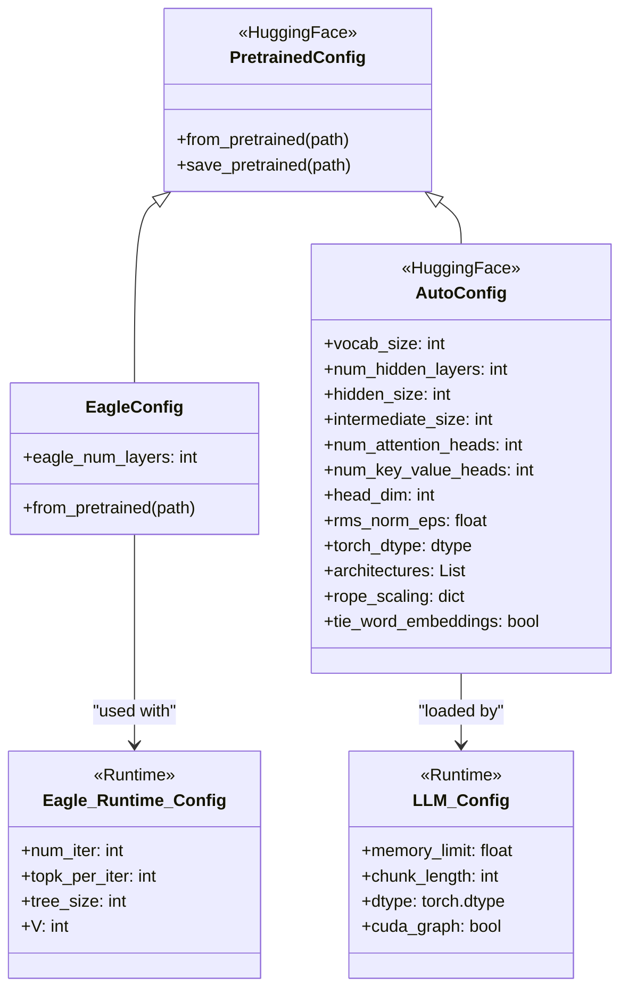
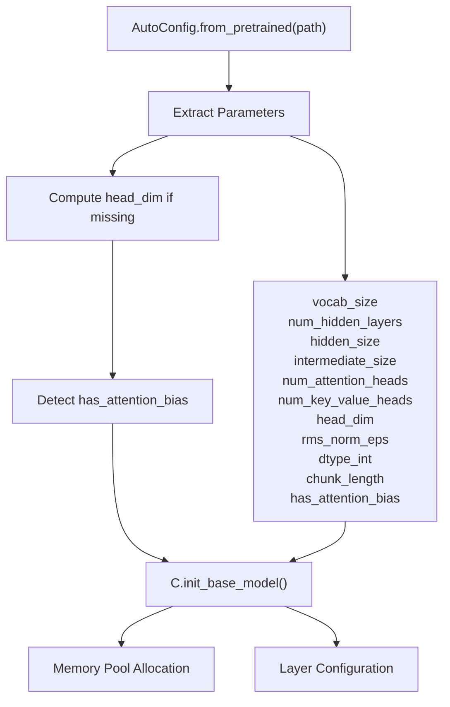
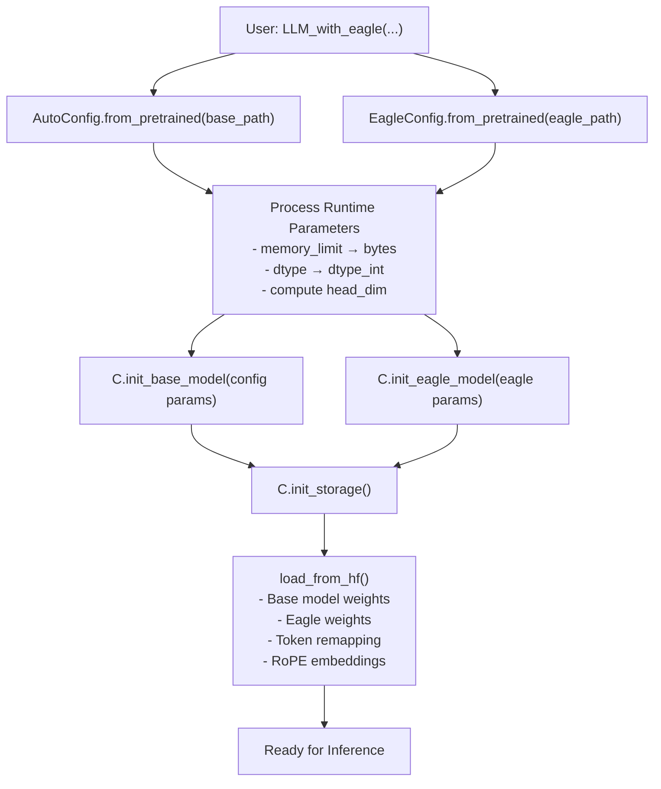

<!-- source: DeepWiki mcp.deepwiki.com · repo thunlp/FR-Spec · page 8.3 Configuration Management · fetched 2026-11-02 -->

# Configuration Management

<details>
<summary>Relevant source files</summary>

The following files were used as context for generating this wiki page:

- [llamacu/llama.py](llamacu/llama.py)
- [llamacu/speculative/eagle.py](llamacu/speculative/eagle.py)

</details>


## Purpose and Scope

This document covers the configuration management system in FR-Spec, which handles model parameters, runtime settings, and integration with HuggingFace's configuration framework. Configuration management bridges Python-level model initialization with CUDA-level resource allocation and model setup.

For details on how configurations are used during model weight loading, see [Python to CUDA Bridge](#3.1). For memory allocation controlled by configuration parameters, see [Memory Management](#3.2).

## Overview

FR-Spec's configuration system consists of three layers:

1. **HuggingFace Integration**: Uses `transformers.AutoConfig` and `transformers.PretrainedConfig` for model architecture parameters
2. **Runtime Configuration**: Python-level parameters for memory limits, chunking, and performance tuning
3. **Speculative Decoding Configuration**: Eagle/Medusa-specific parameters for draft-verify behavior

Configuration flows from HuggingFace checkpoint directories through Python initialization to CUDA-level model setup.

## Configuration Class Hierarchy



**Sources:** [llamacu/llama.py:1-60](), [llamacu/speculative/eagle.py:7-15]()

## HuggingFace Configuration Integration

FR-Spec leverages HuggingFace's configuration system to load model architecture parameters from pretrained checkpoints. The `AutoConfig` class automatically detects the model type and loads the appropriate configuration.

### Loading Base Model Configuration

The base `LLM` class loads configuration during initialization:

```python
# From llamacu/llama.py
self.config = AutoConfig.from_pretrained(path)
self.dtype = dtype if dtype is not None else self.config.torch_dtype
```

The loaded `config` object provides all model architecture parameters needed for CUDA initialization.

**Sources:** [llamacu/llama.py:32-33]()

### Loading Eagle Configuration

Eagle models use a custom `EagleConfig` class that extends `PretrainedConfig`:

```python
# From llamacu/speculative/eagle.py
class EagleConfig(PretrainedConfig):
    def __init__(self, num_hidden_layers=1, **kwargs):
        super().__init__(**kwargs)
        self.eagle_num_layers = num_hidden_layers
```

This configuration is loaded from the Eagle checkpoint directory:

```python
self.eagle_config = EagleConfig.from_pretrained(eagle_path)
```

**Sources:** [llamacu/speculative/eagle.py:7-32]()

## Base Model Configuration Parameters

The following table documents parameters from `AutoConfig` used during model initialization:

| Parameter | Type | Description | Usage |
|-----------|------|-------------|-------|
| `vocab_size` | int | Total vocabulary size | Embedding and LM-Head dimensions |
| `num_hidden_layers` | int | Number of transformer layers | Layer allocation and iteration |
| `hidden_size` | int | Dimension of hidden states | Intermediate buffer sizing |
| `intermediate_size` | int | FFN intermediate dimension | GatedFFN weight shapes |
| `num_attention_heads` | int | Number of query attention heads | QKV projection sizes |
| `num_key_value_heads` | int | Number of KV attention heads (GQA) | KV cache dimensions |
| `head_dim` | int | Dimension per attention head | Computed as `hidden_size / num_attention_heads` if not present |
| `rms_norm_eps` | float | Epsilon for RMS normalization | Numerical stability in normalization |
| `torch_dtype` | torch.dtype | Default tensor dtype (fp16/bf16) | Weight and activation precision |
| `architectures` | List[str] | Model architecture identifiers | Detect model-specific features (e.g., attention bias) |
| `rope_scaling` | dict | RoPE configuration | Position encoding initialization |
| `tie_word_embeddings` | bool | Share embedding and LM-Head weights | Weight loading optimization |

**Sources:** [llamacu/llama.py:45-59](), [llamacu/llama.py:41-42](), [llamacu/llama.py:44](), [llamacu/llama.py:84-85](), [llamacu/llama.py:130-138]()

### Configuration-to-CUDA Initialization



**Sources:** [llamacu/llama.py:41-59]()

The mapping from configuration to C++ initialization occurs in the `__init__` method:

```python
# head_dim computation if not present
if not hasattr(self.config, "head_dim"):
    self.config.head_dim = self.config.hidden_size // self.config.num_attention_heads

# Detect model-specific features
has_attention_bias = (self.config.architectures[0] in ["Qwen2ForCausalLM"])

# Initialize CUDA-level base model
C.init_base_model(
    self.memory_limit,
    self.memory_pool.data.data_ptr(),
    self.config.vocab_size,
    self.config.num_hidden_layers,
    self.config.hidden_size,
    self.config.intermediate_size,
    self.config.num_attention_heads,
    self.config.num_key_value_heads,
    self.config.head_dim,
    self.config.rms_norm_eps,
    self.dtype_int,
    self.chunk_length,
    has_attention_bias
)
```

**Sources:** [llamacu/llama.py:41-59]()

## Eagle Configuration Parameters

`EagleConfig` extends the base configuration with Eagle-specific parameters:

| Parameter | Type | Default | Description |
|-----------|------|---------|-------------|
| `eagle_num_layers` | int | 1 | Number of Eagle drafter layers |
| `intermediate_size` | int | (inherited) | FFN dimension for Eagle layers |
| `num_attention_heads` | int | (inherited) | Attention heads for Eagle layers |
| `num_key_value_heads` | int | (inherited) | KV heads for Eagle layers |
| `hidden_size` | int | (inherited) | Hidden dimension for Eagle layers |
| `rms_norm_eps` | float | (inherited) | RMS norm epsilon for Eagle layers |

**Sources:** [llamacu/speculative/eagle.py:7-46]()

The Eagle configuration is passed to CUDA initialization:

```python
C.init_eagle_model(
    self.eagle_config.eagle_num_layers,
    self.eagle_config.intermediate_size,
    self.eagle_config.num_attention_heads,
    self.eagle_config.num_key_value_heads,
    self.eagle_config.hidden_size // self.eagle_config.num_attention_heads, # head_dim
    self.eagle_config.rms_norm_eps,
    num_iter,
    topk_per_iter,
    self.tree_size,
    V,
    self.dtype_int,
)
```

**Sources:** [llamacu/speculative/eagle.py:34-46]()

## Runtime Configuration Parameters

Runtime configuration parameters control inference behavior and resource allocation:

### Base LLM Runtime Parameters

| Parameter | Type | Default | Description |
|-----------|------|---------|-------------|
| `path` | str | (required) | HuggingFace model checkpoint path |
| `memory_limit` | float | 0.8 | Fraction of GPU memory to pre-allocate (e.g., 0.8 = 80%) |
| `chunk_length` | int | 1024 | Maximum tokens per prefill chunk for long sequences |
| `dtype` | torch.dtype | None | Override dtype (defaults to `config.torch_dtype`) |
| `cuda_graph` | bool | False | Enable CUDA graph optimization for decode phase |

**Sources:** [llamacu/llama.py:21-27]()

**Memory Limit Calculation:**

```python
self.memory_limit = int(torch.cuda.get_device_properties(0).total_memory * memory_limit)
self.memory_pool = torch.nn.Parameter(
    torch.empty(self.memory_limit, dtype=torch.uint8, device="cuda"),
    requires_grad=False
)
```

The `memory_limit` parameter determines the size of the pre-allocated memory pool used for KV cache and intermediate buffers.

**Sources:** [llamacu/llama.py:37-38]()

### Eagle Runtime Parameters

| Parameter | Type | Default | Description |
|-----------|------|---------|-------------|
| `eagle_path` | str | (required) | Path to Eagle drafter checkpoint |
| `base_path` | str | (required) | Path to base model checkpoint |
| `num_iter` | int | 6 | Number of iterative draft steps |
| `topk_per_iter` | int | 10 | Candidates selected per iteration |
| `tree_size` | int | 60 | Maximum positions in draft tree |
| `V` | int | 15000 | Reduced vocabulary size for FR-Spec optimization |

**Sources:** [llamacu/speculative/eagle.py:17-29]()

### FR-Spec Vocabulary Size (`V`) Selection

The `V` parameter controls the vocabulary reduction level:

- **V = 8192**: Maximum speedup, suitable for common text
- **V = 16384**: Balanced speed and coverage
- **V = 32768**: Conservative reduction
- **V = 65536**: Minimal reduction for diverse domains

Smaller `V` values accelerate the LM-Head computation in the Eagle drafter but may reduce acceptance rates for uncommon tokens.

**Sources:** [llamacu/speculative/eagle.py:23-24]()

## Dtype Configuration and Mapping

FR-Spec supports FP16 and BF16 dtypes. The Python `torch.dtype` is mapped to an integer representation for C++:

```python
dtype_map = {
    torch.float16: 0,
    torch.bfloat16: 1,
}

def dtype_to_int(dtype):
    ret = dtype_map.get(dtype, -1)
    if ret == -1:
        raise ValueError(f"Unsupported dtype: {dtype}")
    return ret
```

The mapped integer is passed to all C++ initialization functions as `dtype_int`.

**Sources:** [llamacu/llama.py:9-18](), [llamacu/llama.py:34]()

## Configuration Flow Diagram



**Sources:** [llamacu/llama.py:20-64](), [llamacu/speculative/eagle.py:16-46](), [llamacu/llama.py:125-138]()

## Configuration Validation and Defaults

### Head Dimension Computation

If `head_dim` is not present in the configuration, it is computed automatically:

```python
if not hasattr(self.config, "head_dim"):
    self.config.head_dim = self.config.hidden_size // self.config.num_attention_heads
```

**Sources:** [llamacu/llama.py:41-42]()

### Architecture-Specific Features

Some architectures require special handling. The configuration is inspected to detect these:

```python
has_attention_bias = (self.config.architectures[0] in ["Qwen2ForCausalLM"])
```

This flag enables bias terms in attention projections for specific model types.

**Sources:** [llamacu/llama.py:44]()

### RoPE Scaling Configuration

Rotary Position Embeddings (RoPE) support various scaling strategies:

```python
if hasattr(self.config, "rope_scaling") and self.config.rope_scaling is not None:
    rope_type = self.config.rope_scaling.get("rope_type", self.config.rope_scaling.get("type"))
else:
    rope_type = "default"
```

Supported rope types include `"default"`, `"llama3"`, and `"longrope"`.

**Sources:** [llamacu/llama.py:130-133]()

### Tied Word Embeddings

If the configuration specifies tied embeddings, the embedding matrix is also loaded as the LM-Head:

```python
if "embed_tokens" in name and hasattr(self.config, "tie_word_embeddings") and self.config.tie_word_embeddings:
    self._load("lm_head.weight", param)
```

**Sources:** [llamacu/llama.py:84-85]()

## Configuration Best Practices

### Memory Limit Selection

- **Default (0.8)**: Safe for most cases, reserves 20% for PyTorch overhead
- **Higher (0.85-0.9)**: Use for maximum batch size, requires careful monitoring
- **Lower (0.6-0.7)**: Use when running multiple models or with limited VRAM

### Chunk Length Selection

- **Default (1024)**: Good balance for most prompts
- **Larger (2048-4096)**: For very long prefill with sufficient memory
- **Smaller (512)**: Reduce peak memory usage during prefill

### CUDA Graph Usage

- **Enable (`cuda_graph=True`)**: For repeated decode steps, reduces kernel launch overhead
- **Disable (`cuda_graph=False`)**: For variable-length generation or debugging

### FR-Spec Vocabulary Size (`V`)

- **Measure acceptance rates**: Run experiments to determine optimal `V` for your workload
- **Domain-specific tuning**: Code generation may need larger `V` than chat
- **Trade-off**: Smaller `V` → faster draft, potentially lower acceptance rate

**Sources:** [llamacu/llama.py:21-27](), [llamacu/llama.py:35](), [llamacu/speculative/eagle.py:23-24]()

---

