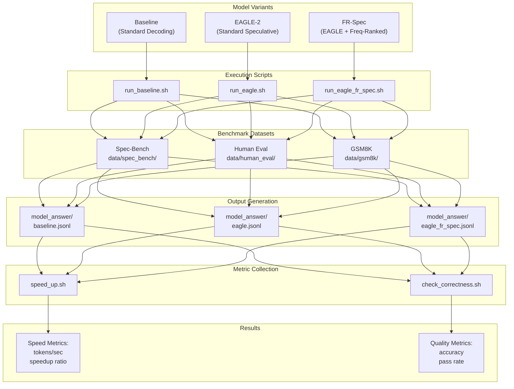
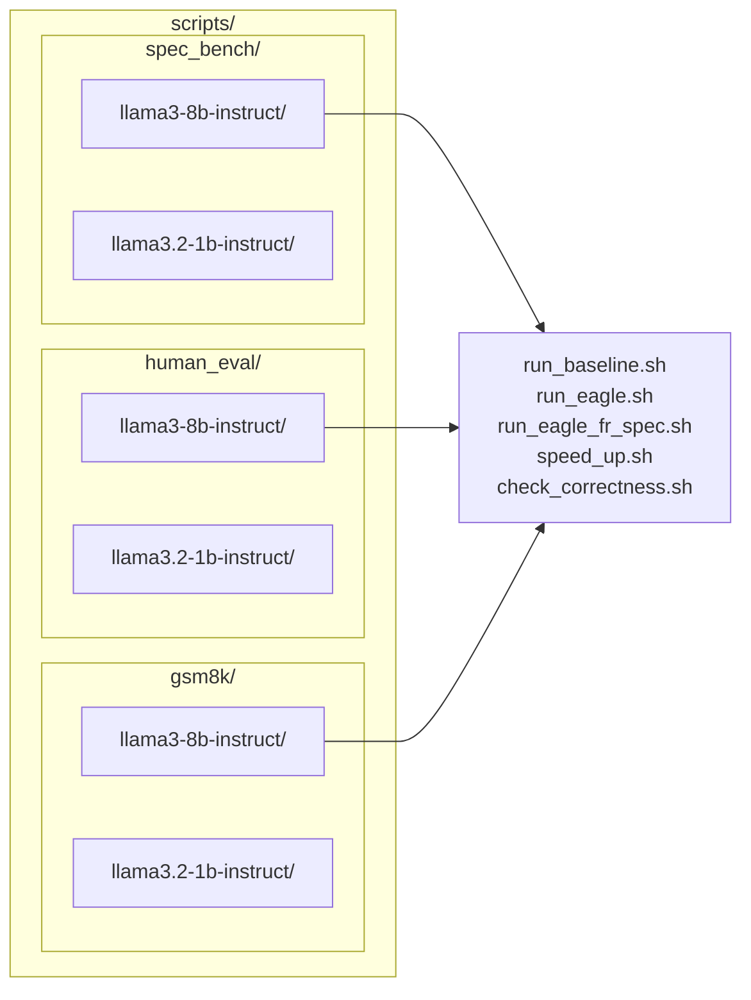
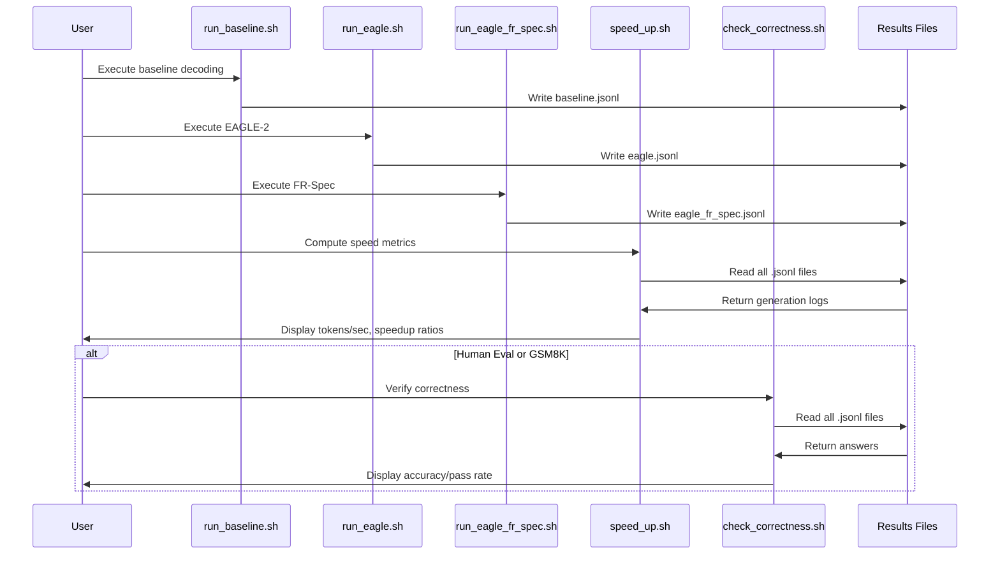
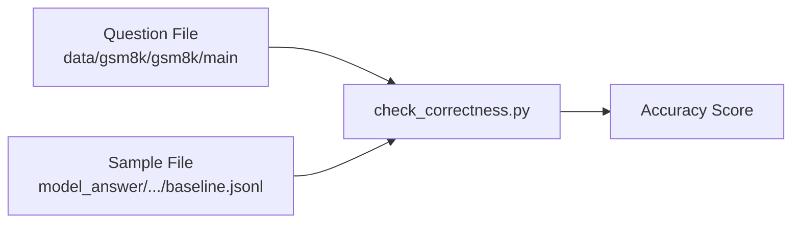

<!-- source: DeepWiki mcp.deepwiki.com · repo thunlp/FR-Spec · page 9 Evaluation and Benchmarking · fetched 2026-11-02 -->

# Evaluation and Benchmarking

<details>
<summary>Relevant source files</summary>

The following files were used as context for generating this wiki page:

- [README.md](README.md)
- [scripts/gsm8k/llama3-8b-instruct/check_correctness.sh](scripts/gsm8k/llama3-8b-instruct/check_correctness.sh)
- [src/flash_attn/flash_api.hpp](src/flash_attn/flash_api.hpp)

</details>


This page documents the evaluation and benchmarking framework used to measure FR-Spec's performance and quality. The framework systematically compares FR-Spec against baseline autoregressive decoding and EAGLE-2 speculative decoding across multiple benchmarks, measuring both speed improvements and generation quality.

For details on the core FR-Spec optimization technique being evaluated, see [FR-Spec Optimization](#6). For information on running inference with FR-Spec, see [Python API Reference](#8).

## Purpose and Scope

The evaluation system serves three primary functions:

1. **Performance Measurement**: Quantifies decoding speed (tokens/sec) and speedup ratios across different model configurations
2. **Quality Verification**: Validates that FR-Spec preserves generation quality on tasks with objective correctness metrics
3. **Comparative Analysis**: Provides automated scripts to compare baseline, EAGLE-2, and FR-Spec approaches systematically

The evaluation framework is located in the `scripts/` directory and supports three benchmarks: Spec-Bench (general generation), Human Eval (code generation), and GSM8K (mathematical reasoning).

## Evaluation Architecture

The evaluation system follows a three-stage pipeline: experiment execution, speed measurement, and correctness verification.



**Evaluation Pipeline Architecture**

Sources: [README.md:95-112]()

## Benchmark Suite

The framework supports three benchmarks, each targeting different aspects of language model capabilities:

| Benchmark | Purpose | Dataset Location | Metrics |
|-----------|---------|------------------|---------|
| **Spec-Bench** | General text generation across diverse tasks | `data/spec_bench/` | Speed (tokens/sec, speedup) |
| **Human Eval** | Code generation with functional correctness | `data/human_eval/` | Speed + Correctness (pass@k) |
| **GSM8K** | Mathematical reasoning with exact answers | `data/gsm8k/` | Speed + Correctness (accuracy) |

### Spec-Bench

Spec-Bench evaluates general-purpose text generation performance across a variety of tasks. This benchmark focuses primarily on speed measurements without objective correctness metrics, as outputs are open-ended text generation.

**Output Format**: JSONL files in `data/spec_bench/model_answer/`

### Human Eval

Human Eval assesses code generation capability using Python programming problems. Each problem includes test cases that determine functional correctness. This benchmark measures both generation speed and the pass rate of generated code.

**Output Format**: JSONL files in `data/human_eval/model_answer/`  
**Correctness Check**: Uses `evaluation/human_eval/check_correctness.py`

### GSM8K

GSM8K evaluates mathematical reasoning through grade school math word problems. Each problem has a definitive numerical answer, enabling exact correctness verification.

**Output Format**: JSONL files in `data/gsm8k/model_answer/`  
**Correctness Check**: Uses `evaluation/gsm8k/check_correctness.py`

Sources: [README.md:95-112](), [scripts/gsm8k/llama3-8b-instruct/check_correctness.sh:1-6]()

## Running Experiments

The evaluation scripts are organized by benchmark and model variant. Each benchmark directory (e.g., `scripts/spec_bench/`, `scripts/human_eval/`, `scripts/gsm8k/`) contains subdirectories for specific models (e.g., `llama3-8b-instruct/`, `llama3.2-1b-instruct/`).

### Script Organization



**Directory Structure for Evaluation Scripts**

### Execution Scripts

Each model directory contains five core scripts:

#### 1. `run_baseline.sh`
Executes standard autoregressive decoding without speculative sampling. This provides the baseline performance for comparison.

**Typical Usage**:
```bash
bash scripts/<benchmark>/llama3-8b-instruct/run_baseline.sh
```

#### 2. `run_eagle.sh`
Executes EAGLE-2 speculative decoding with the standard full-vocabulary LM-Head.

**Typical Usage**:
```bash
bash scripts/<benchmark>/llama3-8b-instruct/run_eagle.sh
```

#### 3. `run_eagle_fr_spec.sh`
Executes FR-Spec (EAGLE-2 with frequency-ranked vocabulary reduction). This is the optimized approach that demonstrates the 1.12x speedup over EAGLE-2.

**Typical Usage**:
```bash
bash scripts/<benchmark>/llama3-8b-instruct/run_eagle_fr_spec.sh
```

#### 4. `speed_up.sh`
Analyzes the generated outputs to compute speed metrics: tokens per second and speedup ratios relative to baseline and EAGLE-2.

**Typical Usage**:
```bash
bash scripts/<benchmark>/llama3-8b-instruct/speed_up.sh
```

#### 5. `check_correctness.sh`
Verifies generation quality for benchmarks with objective correctness metrics (Human Eval and GSM8K only). This script is not present in the `spec_bench/` directories.

**Typical Usage**:
```bash
bash scripts/<benchmark>/llama3-8b-instruct/check_correctness.sh
```

Sources: [README.md:95-112](), [scripts/gsm8k/llama3-8b-instruct/check_correctness.sh:1-6]()

### Complete Evaluation Workflow

The standard evaluation workflow for a given model and benchmark:



**Evaluation Workflow Sequence**

Sources: [README.md:95-112]()

## Metrics and Analysis

### Speed Metrics

The `speed_up.sh` script computes two primary speed metrics:

1. **Tokens per Second**: Absolute throughput measured as the number of tokens generated per second
2. **Speedup Ratio**: Relative performance improvement compared to baseline or EAGLE-2

The FR-Spec paper reports a **1.12x speedup over EAGLE-2** and **1.5x+ speedup over baseline** for Llama-3-8B and Llama-3.2-1B models.

### Quality Metrics

For benchmarks with objective correctness (Human Eval and GSM8K), the `check_correctness.sh` script verifies that FR-Spec preserves generation quality:

#### Human Eval
- **Pass@k**: Percentage of problems where at least one of k generated solutions passes all test cases
- Typical evaluation uses pass@1 (single generation correctness)

#### GSM8K
- **Accuracy**: Percentage of problems where the generated answer matches the ground truth numerical answer
- Extraction logic handles various answer formats and extracts the final numerical result

Sources: [README.md:17-22](), [README.md:95-112]()

## Correctness Verification Details

### GSM8K Correctness Check

The GSM8K correctness verification script validates mathematical reasoning outputs:



**GSM8K Correctness Verification Flow**

The script located at `evaluation/gsm8k/check_correctness.py` takes two inputs:
- `--question-file`: Path to the GSM8K dataset questions
- `--sample-file`: Path to the generated model answers

Sources: [scripts/gsm8k/llama3-8b-instruct/check_correctness.sh:1-6]()

### Human Eval Correctness Check

Human Eval verification follows a similar pattern but uses code execution and test cases:

- Script location: `evaluation/human_eval/check_correctness.py`
- Executes generated code against test cases
- Reports pass@k metrics for functional correctness

## Supported Models

The evaluation framework includes pre-configured scripts for multiple model variants:

### Llama-3 Family
- **Llama-3-8B-Instruct**: Primary evaluation target, demonstrates full FR-Spec performance
- **Llama-3.2-1B-Instruct**: Smaller model variant for efficiency-focused scenarios

### Qwen2 Family
- **Qwen2-7B-Instruct**: Cross-architecture validation of FR-Spec approach

Each model requires corresponding token frequency statistics (see [Preparing Token Frequency Statistics](#2.3)) and model weights in the `models/` directory.

Sources: [README.md:54-84]()

## Output Format

All evaluation scripts generate outputs in JSONL (JSON Lines) format, with one JSON object per line. Each line typically contains:

```
{
  "question_id": <id>,
  "question": <input_text>,
  "answer": <generated_output>,
  "metadata": {
    "generation_time": <seconds>,
    "num_tokens": <count>,
    ...
  }
}
```

Output files are organized by model and method:
- `data/<benchmark>/model_answer/<model_name>/baseline.jsonl`
- `data/<benchmark>/model_answer/<model_name>/eagle.jsonl`
- `data/<benchmark>/model_answer/<model_name>/eagle_fr_spec.jsonl`

## Evaluation Best Practices

### Running a Complete Evaluation

For a comprehensive evaluation of a new model configuration:

1. **Prepare the environment**: Ensure model weights and frequency statistics are downloaded
2. **Execute all variants sequentially**:
   ```bash
   cd scripts/<benchmark>/<model>/
   bash run_baseline.sh
   bash run_eagle.sh
   bash run_eagle_fr_spec.sh
   ```
3. **Compute speed metrics**:
   ```bash
   bash speed_up.sh
   ```
4. **Verify correctness** (for Human Eval and GSM8K):
   ```bash
   bash check_correctness.sh
   ```

### Comparing Across Benchmarks

To compare FR-Spec performance across all three benchmarks:

```bash
# For each benchmark: spec_bench, human_eval, gsm8k
for benchmark in spec_bench human_eval gsm8k; do
    cd scripts/$benchmark/llama3-8b-instruct/
    bash run_baseline.sh
    bash run_eagle.sh
    bash run_eagle_fr_spec.sh
    bash speed_up.sh
    if [ "$benchmark" != "spec_bench" ]; then
        bash check_correctness.sh
    fi
    cd ../../..
done
```

### Performance Analysis

The evaluation framework enables several types of performance analysis:

1. **Absolute Performance**: Tokens/sec for each method on each benchmark
2. **Relative Speedup**: FR-Spec speedup over EAGLE-2 and baseline
3. **Quality Preservation**: Comparison of correctness metrics across methods
4. **Cross-Benchmark Trends**: Performance characteristics across different task types

Sources: [README.md:95-112]()

## Integration with FR-Spec Components

The evaluation scripts integrate with the core FR-Spec components documented elsewhere:

- **Token Frequency Statistics** ([#2.3](#2.3)): FR-Spec experiments require pre-computed frequency rankings
- **LLM Classes** ([#8.1](#8.1), [#8.2](#8.2)): Execution scripts instantiate `LLM`, `LLM_with_eagle` classes
- **Configuration Management** ([#8.3](#8.3)): Model-specific configurations are loaded from HuggingFace
- **Draft-Verify Pipeline** ([#5.3](#5.3)): EAGLE and FR-Spec scripts exercise the speculative decoding loop

The evaluation framework serves as the primary validation tool for the FR-Spec optimization, demonstrating the claimed 1.12x speedup while maintaining generation quality across diverse benchmarks.

---

