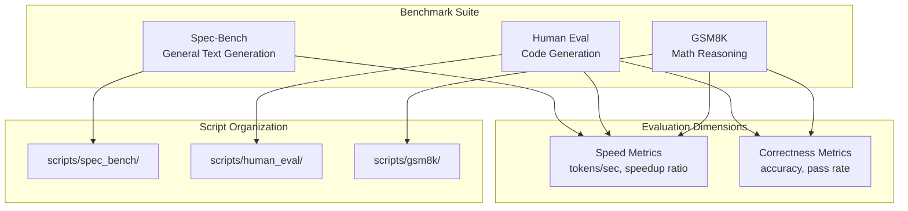
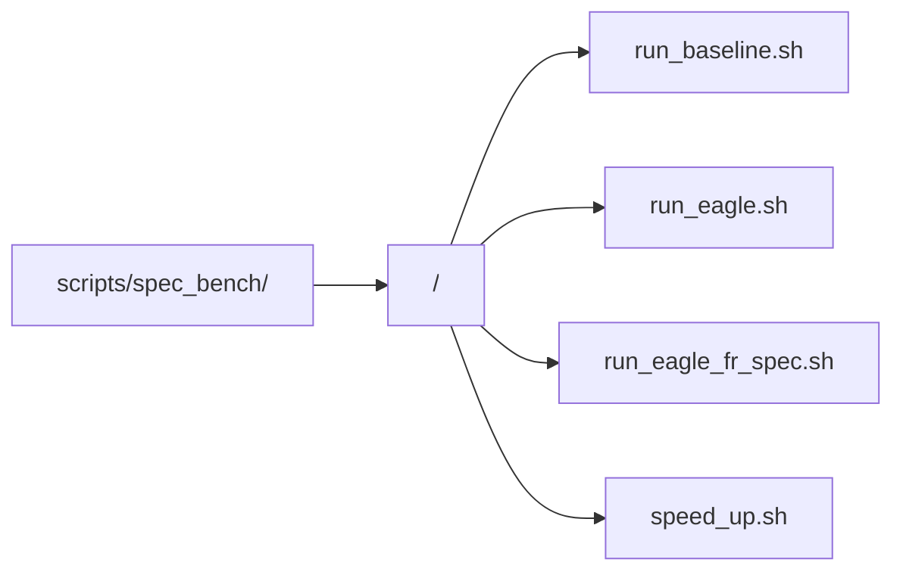
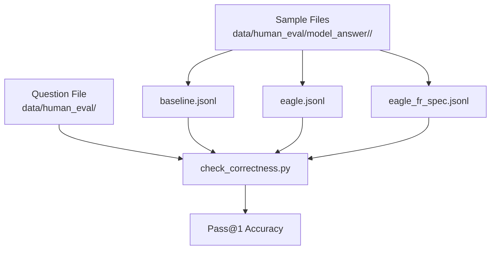
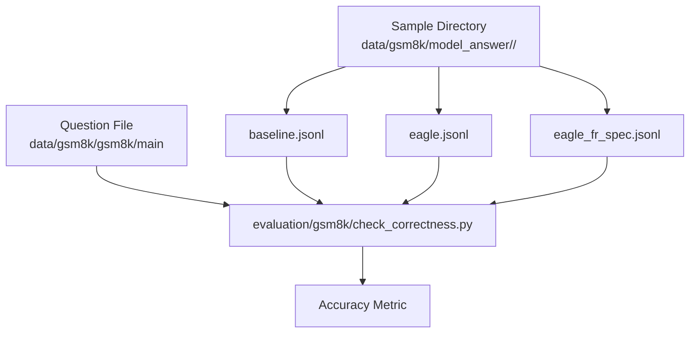
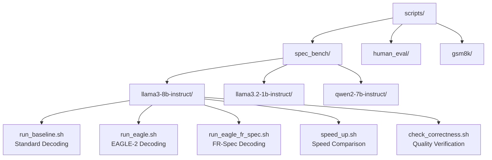
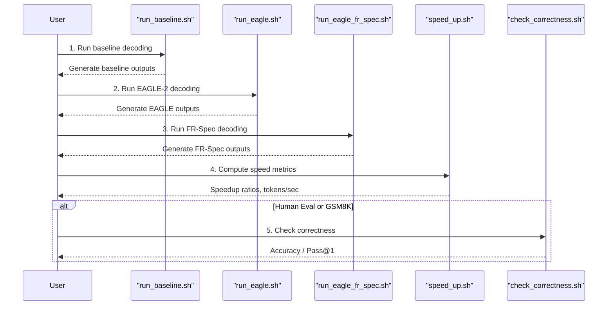

<!-- source: DeepWiki mcp.deepwiki.com · repo thunlp/FR-Spec · page 9.1 Supported Benchmarks · fetched 2026-11-02 -->

# Supported Benchmarks

<details>
<summary>Relevant source files</summary>

The following files were used as context for generating this wiki page:

- [README.md](README.md)
- [scripts/gsm8k/llama3-8b-instruct/check_correctness.sh](scripts/gsm8k/llama3-8b-instruct/check_correctness.sh)
- [src/flash_attn/flash_api.hpp](src/flash_attn/flash_api.hpp)

</details>


## Purpose and Scope

This page documents the three benchmarks used to evaluate FR-Spec: Spec-Bench, Human Eval, and GSM8K. Each benchmark measures different aspects of language model performance and is used to validate that FR-Spec maintains generation quality while achieving speedup. For information about how to run these benchmarks, see [Running Experiments](#9.2). For details on verifying correctness of outputs, see [Correctness Verification](#9.3).

## Benchmark Overview

FR-Spec evaluation uses three distinct benchmarks to assess both speed and quality across different task types:



**Diagram: Benchmark Evaluation Structure**

Sources: [README.md:97-112]()

## Benchmark Comparison

| Benchmark | Task Type | Primary Metric | Correctness Checking | Data Location | Evaluation Script |
|-----------|-----------|----------------|---------------------|---------------|-------------------|
| Spec-Bench | General text generation | Speed (tokens/sec) | No | `data/spec_bench/` | `evaluation/spec_bench/` |
| Human Eval | Code generation | Speed + Pass@1 | Yes | `data/human_eval/` | `evaluation/human_eval/check_correctness.py` |
| GSM8K | Math reasoning | Speed + Accuracy | Yes | `data/gsm8k/` | `evaluation/gsm8k/check_correctness.py` |

Sources: [README.md:97-112]()

## Spec-Bench

### Overview

Spec-Bench is a general-purpose text generation benchmark that measures the raw decoding speed of language models across diverse prompts. It focuses exclusively on throughput measurement (tokens per second) without evaluating answer correctness, as general text generation lacks objective ground truth.

### Measurement Focus

- **Primary Metric**: Tokens per second (tokens/s)
- **Secondary Metric**: Speedup ratio compared to baseline
- **No Correctness Evaluation**: Outputs are not evaluated for quality

### Directory Structure



**Diagram: Spec-Bench Script Organization**

Each model directory (e.g., `llama3-8b-instruct/`) contains scripts to run baseline decoding, EAGLE-2 decoding, and FR-Spec decoding, followed by a speed comparison script.

Sources: [README.md:97-112]()

## Human Eval

### Overview

Human Eval is a code generation benchmark consisting of programming problems where models must generate Python functions to satisfy test cases. This benchmark evaluates both speed and functional correctness of generated code.

### Measurement Focus

- **Primary Metric**: Tokens per second (tokens/s)
- **Correctness Metric**: Pass@1 (percentage of problems solved correctly on first attempt)
- **Task**: Generate Python function implementations from docstrings

### Data Format



**Diagram: Human Eval Data Flow**

### Correctness Verification

Human Eval includes automated correctness checking by executing generated code against test cases. The `check_correctness.py` script in the evaluation directory validates that generated functions produce correct outputs.

```
evaluation/human_eval/check_correctness.py
    --question-file <path to questions>
    --sample-file <path to generated solutions>
```

Sources: [README.md:108-109](), [scripts/gsm8k/llama3-8b-instruct/check_correctness.sh:1-6]()

## GSM8K

### Overview

GSM8K (Grade School Math 8K) is a dataset of grade-school level math word problems that test multi-step reasoning capabilities. Models must parse natural language problem descriptions, perform arithmetic reasoning, and generate numerical answers.

### Measurement Focus

- **Primary Metric**: Tokens per second (tokens/s)
- **Correctness Metric**: Accuracy (percentage of problems with correct final answers)
- **Task**: Solve math word problems with step-by-step reasoning

### Data Format

The GSM8K benchmark uses a structured question-answer format:



**Diagram: GSM8K Data Flow**

### Correctness Verification

GSM8K correctness is verified by extracting the final numerical answer from the model's response and comparing it to the ground truth. The evaluation script handles parsing of different answer formats and computes accuracy.

Example correctness check invocation:
```bash
python evaluation/gsm8k/check_correctness.py \
    --question-file data/gsm8k/gsm8k/main \
    --sample-file data/gsm8k/model_answer/llama-3-8b-instruct/baseline.jsonl
```

Sources: [scripts/gsm8k/llama3-8b-instruct/check_correctness.sh:1-6]()

## Evaluation Script Organization

All benchmarks follow a consistent directory structure within the `scripts/` directory:



**Diagram: Script Directory Structure**

Each model variant (e.g., `llama3-8b-instruct/`, `qwen2-7b-instruct/`) has its own subdirectory containing:

1. **run_baseline.sh**: Executes standard autoregressive decoding
2. **run_eagle.sh**: Executes EAGLE-2 speculative decoding
3. **run_eagle_fr_spec.sh**: Executes FR-Spec (EAGLE + frequency-ranked vocabulary)
4. **speed_up.sh**: Computes speedup ratios between methods
5. **check_correctness.sh**: Validates output quality (Human Eval and GSM8K only)

Sources: [README.md:97-112]()

## Benchmark Usage Pattern

The typical workflow for evaluating a model on any benchmark follows this pattern:



**Diagram: Benchmark Evaluation Workflow**

Example commands for Llama-3-8B-Instruct on GSM8K:
```bash
bash scripts/gsm8k/llama3-8b-instruct/run_baseline.sh
bash scripts/gsm8k/llama3-8b-instruct/run_eagle.sh
bash scripts/gsm8k/llama3-8b-instruct/run_eagle_fr_spec.sh
bash scripts/gsm8k/llama3-8b-instruct/speed_up.sh
bash scripts/gsm8k/llama3-8b-instruct/check_correctness.sh
```

Sources: [README.md:99-109]()

## Key Results and Validation

The benchmarks collectively demonstrate FR-Spec's performance characteristics:

- **Speed Improvement**: FR-Spec achieves ~1.12x speedup over EAGLE-2 across all benchmarks
- **Quality Preservation**: Human Eval and GSM8K correctness checks confirm that FR-Spec maintains generation quality
- **Consistency**: Speedup is observed across different model sizes (1B, 7B, 8B parameters) and families (Llama, Qwen)

The combination of speed-only evaluation (Spec-Bench) and correctness-validated evaluation (Human Eval, GSM8K) provides comprehensive validation that the frequency-ranked vocabulary optimization does not sacrifice accuracy.

Sources: [README.md:9-22]()

---

