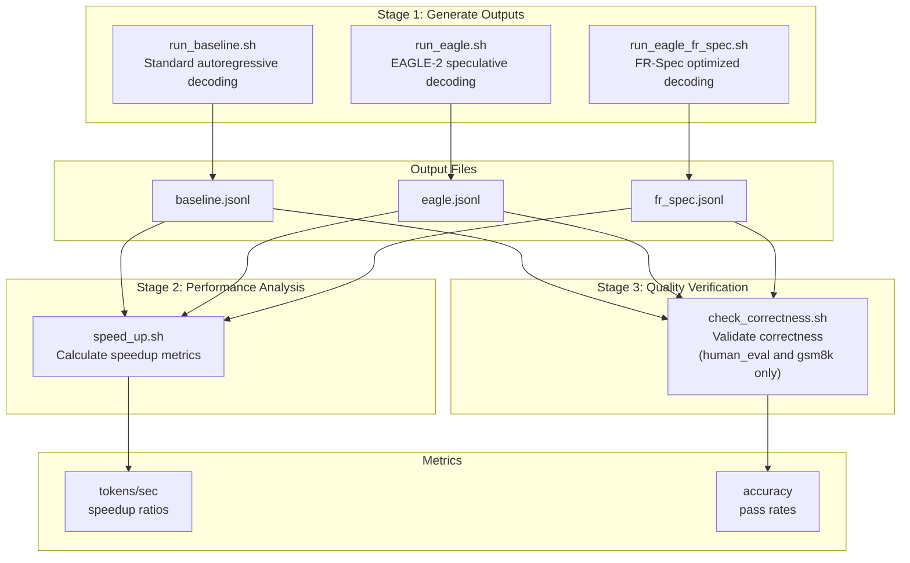
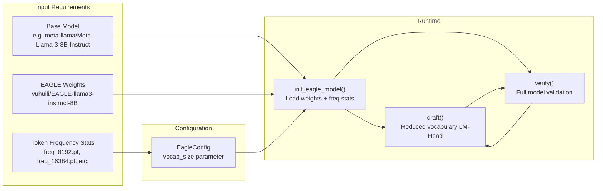
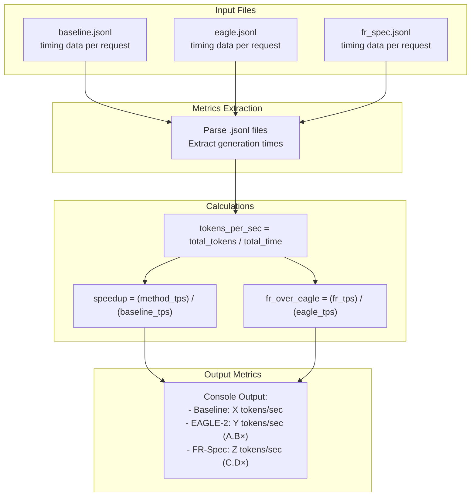
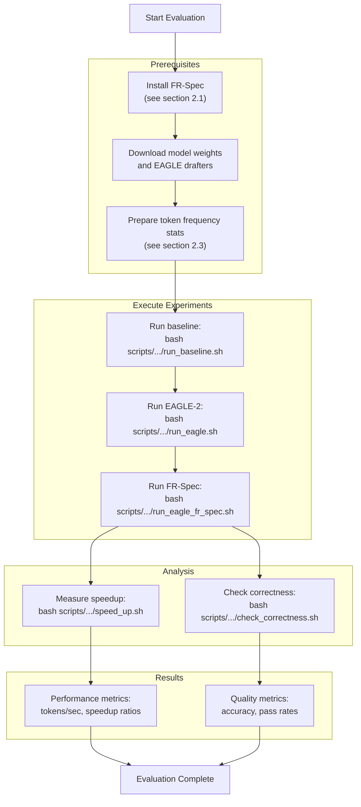

<!-- source: DeepWiki mcp.deepwiki.com · repo thunlp/FR-Spec · page 9.2 Running Experiments · fetched 2026-11-02 -->

# Running Experiments

<details>
<summary>Relevant source files</summary>

The following files were used as context for generating this wiki page:

- [README.md](README.md)
- [scripts/gsm8k/llama3-8b-instruct/check_correctness.sh](scripts/gsm8k/llama3-8b-instruct/check_correctness.sh)
- [src/flash_attn/flash_api.hpp](src/flash_attn/flash_api.hpp)

</details>


## Purpose and Scope

This page explains how to execute evaluation experiments using the shell scripts provided in the `scripts/` directory. These scripts automate the process of running baseline decoding, EAGLE-2 speculative decoding, and FR-Spec optimized decoding across different benchmarks and models. 

For information about the supported benchmarks (Spec-Bench, Human Eval, GSM8K), see [Supported Benchmarks](#9.1). For verifying generation quality on tasks with ground truth answers, see [Correctness Verification](#9.3).

Sources: [README.md:95-112]()

## Evaluation Workflow Overview

The evaluation process follows a three-stage pipeline where different decoding methods are compared systematically:



**Evaluation Workflow: Multi-Stage Comparison**

Each method generates a `.jsonl` output file containing generated text and timing information. The `speed_up.sh` script compares these outputs to compute performance metrics, while `check_correctness.sh` validates correctness for benchmarks with ground truth answers.

Sources: [README.md:99-112]()

## Script Organization

Evaluation scripts are organized hierarchically by benchmark and model:

```
scripts/
├── spec_bench/
│   ├── llama3-8b-instruct/
│   │   ├── run_baseline.sh
│   │   ├── run_eagle.sh
│   │   ├── run_eagle_fr_spec.sh
│   │   ├── speed_up.sh
│   │   └── check_correctness.sh (if applicable)
│   ├── llama3.2-1b-instruct/
│   └── qwen2-7b-instruct/
├── human_eval/
│   └── (same structure)
└── gsm8k/
    └── (same structure)
```

**Directory Structure**: Each benchmark-model combination has its own set of scripts, allowing for benchmark-specific configurations and model-specific parameters.

| Script Name | Purpose | Output |
|-------------|---------|--------|
| `run_baseline.sh` | Execute standard autoregressive decoding | `baseline.jsonl` |
| `run_eagle.sh` | Execute EAGLE-2 speculative decoding | `eagle.jsonl` |
| `run_eagle_fr_spec.sh` | Execute FR-Spec optimized decoding | `fr_spec.jsonl` |
| `speed_up.sh` | Compare performance across methods | Speedup metrics (console output) |
| `check_correctness.sh` | Validate generation quality | Accuracy metrics (console output) |

Sources: [README.md:97-112]()

## Running Baseline Experiments

Baseline experiments use standard autoregressive decoding without any speculative sampling optimization. This serves as the performance baseline for comparison.

### Executing Baseline Scripts

```bash
# Navigate to repository root
cd /path/to/FR-Spec

# Run baseline for a specific benchmark and model
bash scripts/<benchmark>/<model>/run_baseline.sh
```

**Example: Llama-3-8B-Instruct on GSM8K**
```bash
bash scripts/gsm8k/llama3-8b-instruct/run_baseline.sh
```

### Baseline Script Structure

The `run_baseline.sh` scripts typically invoke Python evaluation scripts that:

1. Load the base model using the `LLM` class from [LLM Class](#8.1)
2. Process benchmark prompts through the `prefill` and `decode` methods
3. Generate outputs using standard autoregressive decoding
4. Record timing information and generated text to a `.jsonl` file

The baseline serves as the reference point for measuring speedup achieved by speculative decoding methods.

Sources: [README.md:101]()

## Running EAGLE-2 Experiments

EAGLE-2 experiments use speculative decoding with the EAGLE drafter without FR-Spec vocabulary optimization.

### Executing EAGLE-2 Scripts

```bash
bash scripts/<benchmark>/<model>/run_eagle.sh
```

**Example: Llama-3-8B-Instruct on Spec-Bench**
```bash
bash scripts/spec_bench/llama3-8b-instruct/run_eagle.sh
```

### EAGLE-2 Script Structure

The `run_eagle.sh` scripts invoke evaluation with the `LLM_with_eagle` class (documented in [Speculative Decoding Classes](#8.2)), which:

1. Loads both base model and EAGLE drafter weights
2. Uses the standard EAGLE speculative decoding pipeline
3. Performs draft-verify iterations with full vocabulary
4. Records acceptance rates and timing metrics

EAGLE-2 provides significant speedup over baseline but experiences bottlenecks in the LM-Head projection when computing logits over the full vocabulary.

Sources: [README.md:102]()

## Running FR-Spec Experiments

FR-Spec experiments use EAGLE speculative decoding enhanced with frequency-ranked vocabulary reduction to optimize the LM-Head bottleneck.

### Executing FR-Spec Scripts

```bash
bash scripts/<benchmark>/<model>/run_eagle_fr_spec.sh
```

**Example: Llama-3-8B-Instruct on Human Eval**
```bash
bash scripts/human_eval/llama3-8b-instruct/run_eagle_fr_spec.sh
```

### FR-Spec Script Structure

The `run_eagle_fr_spec.sh` scripts use the same `LLM_with_eagle` class but with `EagleConfig` configured to use frequency-ranked vocabularies:

1. Load base model, EAGLE drafter, and token frequency statistics (see [Preparing Token Frequency Statistics](#2.3))
2. Apply token ID remapping to reduce vocabulary size (see [Token ID Remapping](#6.3))
3. Perform speculative decoding with reduced LM-Head computation
4. Record acceptance rates, speedup, and timing metrics

**Configuration Flow**:



**FR-Spec Initialization and Execution Flow**

The reduced vocabulary (typically 8K, 16K, 32K, or 64K tokens) focuses computation on the most frequent tokens, where the vast majority of next-token predictions concentrate. See [Vocabulary Reduction Strategy](#6.2) for details on how vocabulary sizes are chosen.

Sources: [README.md:103]()

## Measuring Performance

After running baseline, EAGLE-2, and FR-Spec experiments, the `speed_up.sh` script computes comparative performance metrics.

### Executing Speed Measurement

```bash
bash scripts/<benchmark>/<model>/speed_up.sh
```

**Example: Measuring Speedup for Llama-3-8B-Instruct on Spec-Bench**
```bash
bash scripts/spec_bench/llama3-8b-instruct/speed_up.sh
```

### Speed Calculation Process



**Speed Calculation Pipeline**

The `speed_up.sh` script typically:

1. Reads timing data from each `.jsonl` output file
2. Calculates tokens per second for each method
3. Computes speedup ratios relative to baseline
4. Computes FR-Spec improvement over EAGLE-2 (typically **1.12×**)
5. Outputs summary statistics to console

**Expected Performance Characteristics**:

| Method | Typical Speedup vs Baseline | Notes |
|--------|---------------------------|-------|
| Baseline | 1.0× (reference) | Standard autoregressive decoding |
| EAGLE-2 | 1.3× - 1.8× | Speculative decoding with full vocabulary |
| FR-Spec | 1.5× - 2.0× | EAGLE-2 + frequency-ranked optimization |

FR-Spec typically achieves **1.12× speedup over EAGLE-2** and **1.5×+ over baseline**, as documented in the paper.

Sources: [README.md:106](), [README.md:11](), [README.md:19-22]()

## Script Parameters and Customization

Evaluation scripts can be customized for different experimental configurations.

### Common Parameters

Most evaluation scripts accept or can be modified to include:

| Parameter Category | Examples | Purpose |
|-------------------|----------|---------|
| Model paths | Base model path, EAGLE weights path | Specify which models to load |
| Vocabulary size | 8192, 16384, 32768, 65536 | Control FR-Spec vocabulary reduction |
| Batch size | 1 (typical for inference) | Control parallelism |
| Max generation length | Varies by benchmark | Limit output length |
| Temperature/Top-p | Sampling parameters | Control generation randomness |
| Output paths | `.jsonl` file locations | Specify where to save results |

### Modifying Script Behavior

To customize evaluation scripts:

1. **Edit script files directly** in `scripts/<benchmark>/<model>/`
2. **Adjust model paths** to point to your downloaded weights
3. **Change vocabulary sizes** in FR-Spec scripts to experiment with different reduction levels
4. **Modify generation parameters** (temperature, top-p, max length) for different generation characteristics
5. **Update output paths** if you want to organize results differently

### Multi-Model Experiments

To run experiments across multiple models:

```bash
# Iterate over models
for model in llama3-8b-instruct llama3.2-1b-instruct qwen2-7b-instruct; do
    bash scripts/spec_bench/$model/run_baseline.sh
    bash scripts/spec_bench/$model/run_eagle.sh
    bash scripts/spec_bench/$model/run_eagle_fr_spec.sh
    bash scripts/spec_bench/$model/speed_up.sh
done
```

### Multi-Benchmark Experiments

To run the same model across all benchmarks:

```bash
# Iterate over benchmarks
for benchmark in spec_bench human_eval gsm8k; do
    bash scripts/$benchmark/llama3-8b-instruct/run_baseline.sh
    bash scripts/$benchmark/llama3-8b-instruct/run_eagle.sh
    bash scripts/$benchmark/llama3-8b-instruct/run_eagle_fr_spec.sh
    bash scripts/$benchmark/llama3-8b-instruct/speed_up.sh
done
```

Sources: [README.md:97-112]()

## Typical Experiment Workflow

A complete experimental workflow follows this sequence:



**Complete Evaluation Workflow**

### Step-by-Step Example

Here's a complete example for evaluating Llama-3-8B-Instruct on GSM8K:

```bash
# 1. Ensure prerequisites are met
# - Models downloaded to models/
# - Token frequency stats in place
# - FR-Spec installed

# 2. Navigate to repository root
cd /path/to/FR-Spec

# 3. Run all three methods
bash scripts/gsm8k/llama3-8b-instruct/run_baseline.sh
bash scripts/gsm8k/llama3-8b-instruct/run_eagle.sh
bash scripts/gsm8k/llama3-8b-instruct/run_eagle_fr_spec.sh

# 4. Analyze performance
bash scripts/gsm8k/llama3-8b-instruct/speed_up.sh

# 5. Verify correctness (GSM8K has ground truth)
bash scripts/gsm8k/llama3-8b-instruct/check_correctness.sh
```

This workflow systematically compares all three methods and provides both performance and quality metrics.

Sources: [README.md:95-112]()

## Troubleshooting Common Issues

### Script Execution Errors

| Issue | Possible Cause | Solution |
|-------|---------------|----------|
| Script not found | Incorrect path or working directory | Ensure you're in repository root, verify script path |
| Permission denied | Script lacks execute permissions | Run `chmod +x scripts/<path>/script.sh` |
| Python module not found | Environment not activated or incomplete installation | Activate conda environment, reinstall FR-Spec |
| CUDA out of memory | Model too large for GPU | Reduce batch size, use smaller model, or upgrade GPU |

### Model Loading Errors

| Issue | Possible Cause | Solution |
|-------|---------------|----------|
| Model weights not found | Incorrect path in script | Update model paths in script to match your directory structure |
| Token frequency stats missing | Stats not downloaded or generated | Follow [Preparing Token Frequency Statistics](#2.3) |
| Version mismatch | Incompatible transformers/PyTorch versions | Check [Installation](#2.1) for compatible versions |

### Performance Issues

| Issue | Possible Cause | Solution |
|-------|---------------|----------|
| Slower than expected | Wrong CUDA architecture compiled | Rebuild with correct `arch` in `setup.py` (see [Installation](#2.1)) |
| Low acceptance rate | Suboptimal vocabulary size | Try different vocabulary sizes (8K, 16K, 32K, 64K) |
| Memory leaks over long runs | CUDA memory not freed | Restart Python process between experiments |

Sources: [README.md:42-50]()

---

