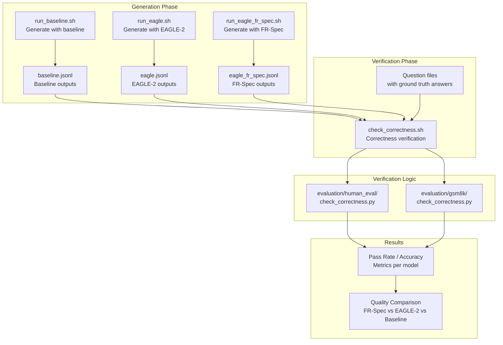
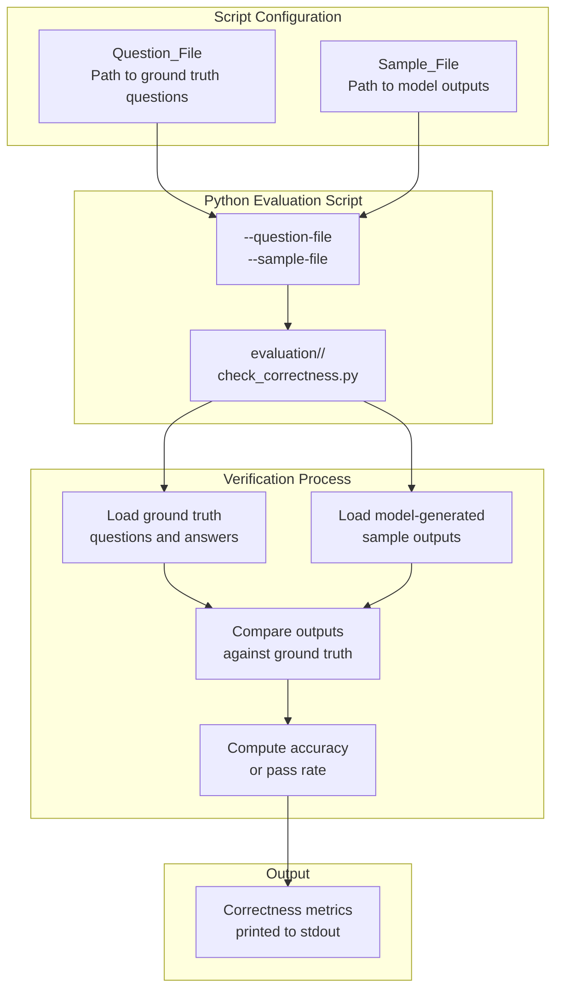
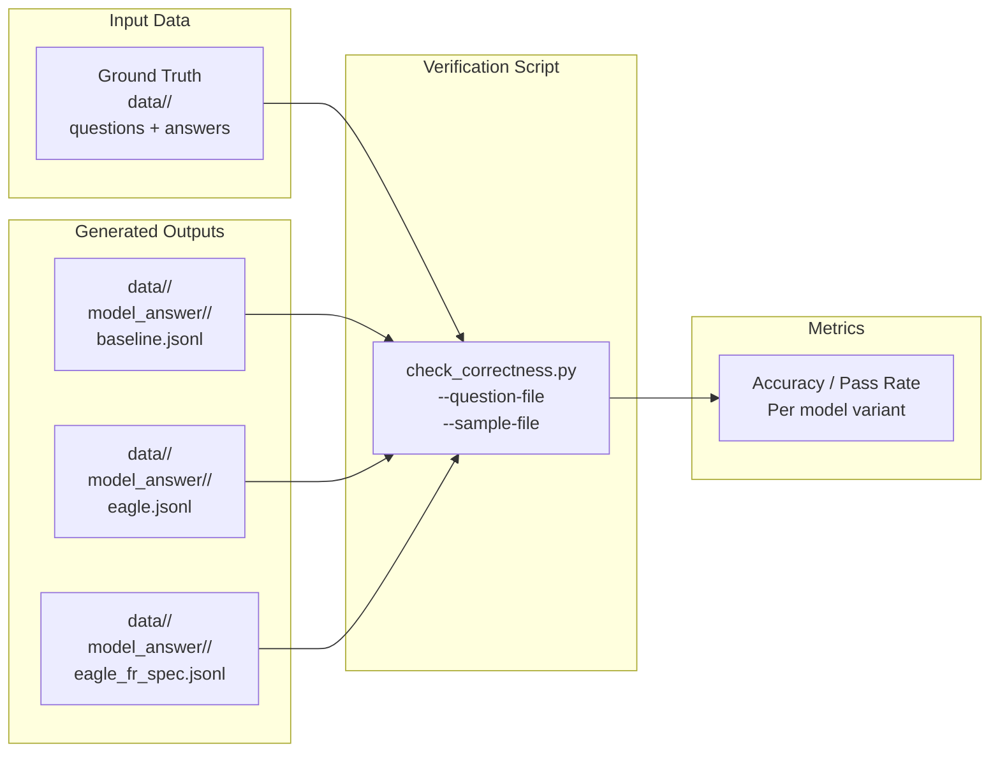

<!-- source: DeepWiki mcp.deepwiki.com · repo thunlp/FR-Spec · page 9.3 Correctness Verification · fetched 2026-11-02 -->

# Correctness Verification

<details>
<summary>Relevant source files</summary>

The following files were used as context for generating this wiki page:

- [README.md](README.md)
- [scripts/gsm8k/llama3-8b-instruct/check_correctness.sh](scripts/gsm8k/llama3-8b-instruct/check_correctness.sh)
- [src/flash_attn/flash_api.hpp](src/flash_attn/flash_api.hpp)

</details>


This document describes the correctness verification system used to validate that FR-Spec preserves generation quality while improving performance. The verification process ensures that vocabulary reduction does not negatively impact the accuracy of model outputs on tasks with objective ground truth answers.

For information about running the complete evaluation pipeline, see [Running Experiments](#9.2). For details on the benchmarks themselves, see [Supported Benchmarks](#9.1).

## Purpose and Scope

Correctness verification validates that FR-Spec's frequency-ranked vocabulary reduction maintains generation quality. Unlike speed benchmarks that measure tokens/second, correctness verification checks whether generated outputs match expected answers on objective evaluation tasks.

**Scope limitations:**
- Only applicable to benchmarks with verifiable correctness: Human Eval (code generation) and GSM8K (math reasoning)
- Not used for Spec-Bench, which focuses on general text generation without objective ground truth
- Runs after generation is complete using the model outputs produced during evaluation

Sources: [README.md:108-109]()

## Verification Workflow



The verification workflow consists of two phases: generation and verification. During generation, each model variant produces outputs saved to JSONL files. During verification, these outputs are compared against ground truth to compute accuracy metrics.

Sources: [README.md:99-109](), [scripts/gsm8k/llama3-8b-instruct/check_correctness.sh:1-6]()

## Script Structure

### Check Correctness Script

The `check_correctness.sh` script orchestrates the verification process for a specific model and benchmark combination.



**Script location pattern:**
- `scripts/<benchmark>/<model>/check_correctness.sh`
- Example: `scripts/gsm8k/llama3-8b-instruct/check_correctness.sh`

**Configuration variables:**
- `Question_File`: Path to ground truth data (e.g., `data/gsm8k/gsm8k/main`)
- `Sample_File`: Path to generated model outputs (e.g., `data/gsm8k/model_answer/llama-3-8b-instruct/baseline.jsonl`)

Sources: [scripts/gsm8k/llama3-8b-instruct/check_correctness.sh:1-6]()

## Verification for Different Benchmarks

| Benchmark | Metric | Verification Type | Script Location |
|-----------|--------|-------------------|-----------------|
| Human Eval | Pass@1 | Execute generated code and check output | `evaluation/human_eval/check_correctness.py` |
| GSM8K | Accuracy | Extract numerical answer and compare | `evaluation/gsm8k/check_correctness.py` |
| Spec-Bench | N/A | No objective correctness measure | Not applicable |

### Human Eval Verification

Human Eval verifies code generation correctness by:
1. Parsing generated code from model output
2. Executing code in sandboxed environment
3. Running test cases from the benchmark
4. Computing pass@1 metric (percentage of problems solved correctly on first attempt)

### GSM8K Verification

GSM8K verifies mathematical reasoning by:
1. Extracting the final numerical answer from generated text
2. Comparing against ground truth answer
3. Computing accuracy (percentage of correct answers)
4. Handling various answer formats and edge cases

Sources: [README.md:108-109]()

## Running Correctness Verification

### Basic Usage

```bash
cd scripts/<benchmark>/<model>
bash check_correctness.sh
```

### Model Comparison Workflow

To compare correctness across all three approaches:

```bash
# Step 1: Generate outputs for all models
bash scripts/gsm8k/llama3-8b-instruct/run_baseline.sh
bash scripts/gsm8k/llama3-8b-instruct/run_eagle.sh
bash scripts/gsm8k/llama3-8b-instruct/run_eagle_fr_spec.sh

# Step 2: Verify correctness for each
# Edit check_correctness.sh to point to baseline.jsonl
bash scripts/gsm8k/llama3-8b-instruct/check_correctness.sh

# Edit check_correctness.sh to point to eagle.jsonl
bash scripts/gsm8k/llama3-8b-instruct/check_correctness.sh

# Edit check_correctness.sh to point to eagle_fr_spec.jsonl
bash scripts/gsm8k/llama3-8b-instruct/check_correctness.sh
```

**Note:** The script requires manual editing of `Sample_File` variable to point to different output files for comparison.

Sources: [README.md:99-109](), [scripts/gsm8k/llama3-8b-instruct/check_correctness.sh:1-6]()

## Data Flow



**File format:**
- Output files use JSONL format (one JSON object per line)
- Each line contains a question/problem ID and the generated answer
- Ground truth files contain reference questions and correct answers

Sources: [scripts/gsm8k/llama3-8b-instruct/check_correctness.sh:1-6]()

## Expected Results

FR-Spec is designed to preserve generation quality while improving speed. Correctness verification confirms this design goal:

| Model Variant | Speed Improvement | Expected Correctness |
|---------------|-------------------|---------------------|
| Baseline | 1.0x | 100% (reference) |
| EAGLE-2 | ~1.5x | ≈ Baseline |
| FR-Spec | ~1.68x | ≈ Baseline |

**Key insight:** FR-Spec achieves 1.12x speedup over EAGLE-2 without degrading correctness metrics on Human Eval and GSM8K benchmarks. This validates that frequency-ranked vocabulary reduction affects only the draft generation efficiency, not the final output quality.

Sources: [README.md:11-13](), [README.md:22]()

## Integration with Speed Benchmarks

Correctness verification complements speed benchmarks to provide a complete evaluation:

1. **Speed benchmarks** ([see Running Experiments](#9.2)): Measure tokens/second and speedup ratios
2. **Correctness verification**: Ensure accuracy is maintained
3. **Combined analysis**: Demonstrate that FR-Spec achieves speedup without quality loss

The evaluation process typically runs in sequence:
1. Generate outputs with all model variants
2. Measure generation speed (`speed_up.sh`)
3. Verify correctness (`check_correctness.sh`)
4. Analyze combined results to validate FR-Spec effectiveness

Sources: [README.md:105-109]()

## Configuration Reference

### Script Variables

| Variable | Purpose | Example Value |
|----------|---------|---------------|
| `Question_File` | Path to ground truth data | `data/gsm8k/gsm8k/main` |
| `Sample_File` | Path to model output to verify | `data/gsm8k/model_answer/llama-3-8b-instruct/baseline.jsonl` |

### Command-Line Arguments

The Python verification scripts accept:
- `--question-file`: Path to ground truth questions/answers
- `--sample-file`: Path to generated model outputs to evaluate

Sources: [scripts/gsm8k/llama3-8b-instruct/check_correctness.sh:1-6]()

## Limitations and Considerations

**Benchmark coverage:**
- Only Human Eval and GSM8K support correctness verification
- Spec-Bench measures fluency and coherence but lacks objective ground truth

**Manual configuration:**
- `check_correctness.sh` requires editing to switch between model variants
- No automated script to verify all variants in sequence

**Verification assumptions:**
- Human Eval assumes generated code can be safely executed
- GSM8K assumes numerical answers can be reliably extracted from free-form text

**Quality preservation:**
- Correctness verification confirms quality preservation on objective tasks
- Does not measure subjective quality aspects like coherence or style

Sources: [README.md:108-109]()

---

