# Page: Overview

# Overview

<details>
<summary>Relevant source files</summary>

The following files were used as context for generating this wiki page:

- [README.md](README.md)
- [src/flash_attn/flash_api.hpp](src/flash_attn/flash_api.hpp)

</details>


## Purpose and Scope

This document provides a high-level introduction to FR-Spec (Frequency-Ranked Speculative Sampling), a system for accelerating Large Language Model (LLM) inference through vocabulary optimization in speculative decoding. This overview covers the system's goals, core innovation, architectural layers, and major components.

For detailed installation instructions, see [Installation](#2.1). For the complete architecture and component interactions, see [System Architecture](#3). For the core FR-Spec optimization technique, see [FR-Spec Optimization](#6).

**Sources:** [README.md:1-16]()

## What is FR-Spec?

FR-Spec is a C/CUDA implementation of frequency-ranked speculative sampling for LLM inference acceleration. The system addresses a performance bottleneck in EAGLE-2 speculative decoding: the LM-Head computation during the draft phase. By leveraging the long-tail distribution of token frequencies in natural language, FR-Spec reduces the effective vocabulary size during drafting, achieving **1.12x speedup over EAGLE-2** and **1.5x+ speedup over baseline autoregressive decoding**.

Key characteristics:

- **No retraining required**: Uses pre-computed token frequency statistics from corpus analysis
- **Quality preservation**: Maintains generation quality by focusing on high-frequency tokens that dominate typical outputs
- **Simple implementation**: Adds vocabulary reduction layer on top of existing EAGLE-2 architecture
- **Production-ready**: Integrated into SGLang framework and supports multiple model families (LLaMA3, Qwen2)

**Sources:** [README.md:5-15](), [README.md:133-138]()

## Core Innovation: Frequency-Ranked Vocabulary

The fundamental insight behind FR-Spec is that the LM-Head computation (projecting hidden states to vocabulary logits) becomes a bottleneck when using speculative decoding with large vocabularies (typically 128K tokens). Analysis of the SlimPajama corpus reveals that token frequency follows a long-tail distribution: a small subset of tokens (8K-64K) accounts for the vast majority of generated text.

FR-Spec exploits this by:

1. **Offline frequency analysis**: Processing large corpora to identify the most frequent `V` tokens (typically 8K, 16K, 32K, or 64K)
2. **Vocabulary remapping**: Creating a token ID remapping that reorders the vocabulary by frequency
3. **Reduced LM-Head during drafting**: Computing logits only for the top-V tokens during EAGLE's draft phase
4. **Full verification**: Using the complete base model with full vocabulary for verification

This approach reduces the LM-Head matrix multiplication from `hidden_dim × vocab_size` to `hidden_dim × V` during drafting, where `V << vocab_size`.


**Diagram: FR-Spec Vocabulary Reduction Strategy**

**Sources:** [README.md:9-13](), [README.md:58-84]()

## System Architecture Layers

FR-Spec implements a three-tier architecture that separates user-facing APIs, system integration, and performance-critical computation:

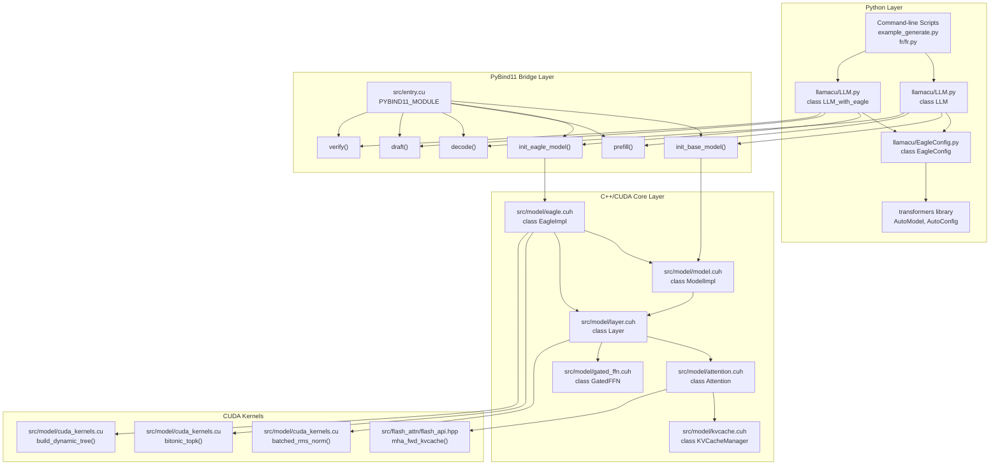

**Diagram: FR-Spec System Architecture with Code Entities**

### Python Layer

The Python layer provides user-facing APIs and integrates with the HuggingFace ecosystem:

- **`llamacu/LLM.py`**: Contains the `LLM` base class for standard decoding and `LLM_with_eagle` for speculative decoding with FR-Spec optimization
- **`llamacu/EagleConfig.py`**: Configuration management class `EagleConfig` that extends HuggingFace's `PretrainedConfig`
- **`fr/fr.py`**: Token frequency analysis script that processes datasets to generate `freq_*.pt` remapping files
- **`examples/example_generate.py`**: Demonstration script showing basic usage

### PyBind11 Bridge Layer

The bridge layer in `src/entry.cu` exposes C++/CUDA functionality to Python through `PYBIND11_MODULE` definition. Key entry points include:

| Function | Purpose | Returns |
|----------|---------|---------|
| `init_base_model()` | Initialize base transformer model from HuggingFace weights | Model handle |
| `init_eagle_model()` | Initialize EAGLE drafter with FR-Spec token remapping | Eagle handle |
| `prefill()` | Process initial prompt and populate KV cache | Hidden states |
| `decode()` | Generate single token autoregressively | Token logits |
| `draft()` | Generate candidate token tree using EAGLE with reduced vocab | Draft tree |
| `verify()` | Verify candidates in parallel and accept matching prefix | Accepted tokens |

### C++/CUDA Core Layer

The core layer implements the transformer model and speculative decoding logic:

- **`ModelImpl` class**: Base transformer implementation with layer-by-layer forward pass
- **`EagleImpl` class**: EAGLE drafter that extends the base model with speculative tree generation
- **`Layer` class**: Single transformer block combining attention and feed-forward computation
- **`Attention` class**: Multi-head attention with rotary positional embeddings and KV caching
- **`GatedFFN` class**: Gated feed-forward network with SiLU activation
- **`KVCacheManager` class**: Manages key-value cache allocation and access patterns

### CUDA Kernel Layer

Performance-critical operations are implemented as specialized CUDA kernels:

- **`mha_fwd_kvcache()`**: Flash Attention kernel for efficient attention computation with KV cache
- **`bitonic_topk()`**: Bitonic sort-based top-k selection for candidate token filtering
- **`build_dynamic_tree()`**: Constructs the token prediction tree structure for speculative decoding
- **`batched_rms_norm()`**: RMS normalization with batched processing

**Sources:** [src/entry.cu](), [README.md:42-50](), High-level architecture diagrams

## Inference Pipeline

The FR-Spec inference pipeline consists of three phases: initialization, prompt processing, and iterative generation with draft-verify cycles:

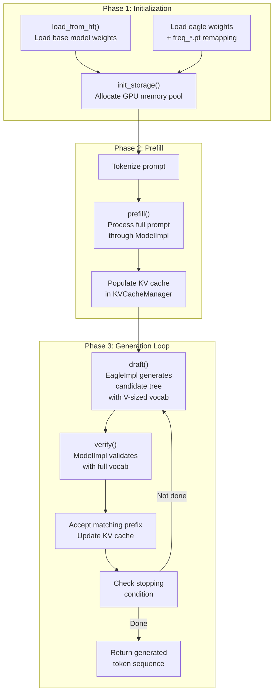

**Diagram: FR-Spec Inference Pipeline with Function Calls**

### Initialization Phase

1. **Model loading**: The `load_from_hf()` function loads base model weights from HuggingFace format into the appropriate tensor layouts
2. **Eagle loading**: EAGLE drafter weights are loaded along with `freq_*.pt` files containing the token ID remapping
3. **Memory allocation**: `init_storage()` pre-allocates approximately 80% of GPU memory as a memory pool, divided between base model KV cache and EAGLE KV cache

### Prefill Phase

1. **Tokenization**: Input prompt is tokenized using the model's tokenizer
2. **Forward pass**: The `prefill()` function executes a full forward pass through all `Layer` instances in `ModelImpl`
3. **KV population**: The `KVCacheManager` stores key-value pairs for all prompt tokens, enabling efficient subsequent generation

### Generation Loop

The generation loop alternates between drafting candidate tokens and verifying them:

1. **Draft phase**: `draft()` calls `EagleImpl` to iteratively generate a tree of candidate tokens. The EAGLE drafter uses the reduced vocabulary (V tokens) during LM-Head computation, stored in the token remapping loaded from `freq_*.pt`

2. **Verify phase**: `verify()` uses `ModelImpl` to process all tree positions in parallel with the full vocabulary. The base model's LM-Head uses the complete 128K vocabulary for accurate verification

3. **Acceptance**: The system compares draft predictions with ground truth, accepts the longest matching prefix, and updates the KV cache accordingly

4. **Iteration**: The loop continues until a stopping condition is met (EOS token, max length, etc.)

**Sources:** [README.md:86-93](), High-level inference pipeline diagram, [src/entry.cu]()

## Performance Characteristics

FR-Spec achieves significant speedups across multiple model families and benchmarks:

| Configuration | Baseline (tokens/s) | EAGLE-2 (tokens/s) | FR-Spec (tokens/s) | Speedup vs EAGLE-2 |
|---------------|---------------------|--------------------|--------------------|-------------------|
| LLaMA3-8B | ~40 | ~60 | ~67 | 1.12x |
| LLaMA3.2-1B | ~120 | ~180 | ~202 | 1.12x |

The speedup comes from three sources:

1. **Reduced LM-Head computation**: Draft phase computes logits for V tokens instead of full vocabulary (8K-64K vs 128K)
2. **Maintained acceptance rate**: Token frequency analysis ensures high-frequency tokens are retained, preserving the acceptance rate of EAGLE-2
3. **Efficient memory access**: Reduced vocabulary size improves cache locality during logit computation

The system maintains generation quality, as measured by correctness on Human Eval (code generation) and GSM8K (mathematical reasoning) benchmarks. This is because the reduced vocabulary contains the tokens most likely to be generated, and the full base model verification ensures no quality loss.

**Sources:** [README.md:17-22](), [README.md:9-13]()

## Supported Models and Benchmarks

### Model Support

FR-Spec currently supports:

- **LLaMA3-8B-Instruct** with pre-computed frequency statistics available at `thunlp/LLaMA3-Instruct-8B-FR-Spec`
- **LLaMA3.2-1B-Instruct** with pre-computed frequency statistics at `thunlp/LLaMA3.2-Instruct-1B-FR-Spec`
- **Qwen2-7B-Instruct** with pre-computed frequency statistics at `thunlp/Qwen2-7B-Instruct-FR-Spec`

Custom models can be supported by running the `fr/fr.py` script to generate token frequency statistics from a representative corpus.

### Evaluation Benchmarks

The system is evaluated on three benchmarks, each located in the `scripts/<benchmark>/` directory structure:

- **Spec-Bench**: General text generation benchmark measuring throughput and quality across diverse prompts
- **Human Eval**: Code generation benchmark measuring functional correctness of generated Python code
- **GSM8K**: Mathematical reasoning benchmark with grade-school math problems

Evaluation scripts include:
- `run_baseline.sh`: Standard autoregressive decoding
- `run_eagle.sh`: EAGLE-2 speculative decoding
- `run_eagle_fr_spec.sh`: FR-Spec optimized EAGLE
- `speed_up.sh`: Computes tokens/second and speedup ratios
- `check_correctness.sh`: Validates functional correctness on Human Eval and GSM8K

**Sources:** [README.md:54-84](), [README.md:96-110]()

## External Dependencies

FR-Spec integrates with several external systems:

| Dependency | Purpose | Integration Point |
|------------|---------|-------------------|
| **HuggingFace Transformers** | Model weight loading, tokenization, configuration | Python layer via `llamacu/EagleConfig.py` |
| **PyTorch with CUDA** | Tensor operations, Python-CUDA integration | Build system in `setup.py` |
| **NVIDIA CUTLASS** | Optimized CUDA templates for linear algebra | Submodule at `src/cutlass/`, used by Flash Attention |
| **Cerebras SlimPajama** | Training corpus for frequency analysis | Accessed by `fr/fr.py` via HuggingFace datasets |

The build system in `setup.py` requires specifying the CUDA architecture (e.g., `arch="80"` for A100 GPUs) to compile optimized kernels for the target hardware.

**Sources:** [README.md:42-50](), [README.md:66-82](), High-level component dependencies diagram

## Next Steps

To get started with FR-Spec:

1. Follow the [Installation](#2.1) guide to set up your environment
2. Try the [Quick Start Example](#2.2) to generate text with FR-Spec
3. Learn about [Preparing Token Frequency Statistics](#2.3) to optimize for your use case
4. Explore the [System Architecture](#3) for deeper understanding of the implementation

For detailed documentation on specific components, see:
- [Core Model Components](#4) for transformer implementation details
- [Speculative Decoding](#5) for draft-verify pipeline mechanics  
- [FR-Spec Optimization](#6) for the vocabulary reduction strategy
- [CUDA Kernels](#7) for performance-critical GPU operations

---

# Page: Getting Started

# Getting Started

<details>
<summary>Relevant source files</summary>

The following files were used as context for generating this wiki page:

- [README.md](README.md)
- [examples/example_generate.py](examples/example_generate.py)
- [src/flash_attn/flash_api.hpp](src/flash_attn/flash_api.hpp)

</details>


This page guides you through installing FR-Spec, configuring the system for your hardware, and running your first text generation. By the end of this guide, you will have a working FR-Spec installation capable of accelerated inference using frequency-ranked speculative sampling.

For detailed information about specific subsystems, see [Installation](#2.1), [Quick Start Example](#2.2), and [Preparing Token Frequency Statistics](#2.3). For understanding the underlying architecture, see [System Architecture](#3).

---

## Prerequisites

Before installing FR-Spec, ensure your system meets these requirements:

| Requirement | Details |
|------------|---------|
| **Operating System** | Linux (tested on Ubuntu) |
| **GPU** | NVIDIA GPU with CUDA support |
| **CUDA Toolkit** | Compatible with PyTorch version |
| **Python** | 3.11 (recommended) |
| **Disk Space** | ~20GB for models + dependencies |
| **Memory** | 16GB+ RAM recommended |

**Sources:** [README.md:42-50]()

---

## Installation Overview

The FR-Spec installation process involves three main stages: environment setup, source compilation, and dependency resolution. The system uses a hybrid architecture where Python interfaces with a compiled C++/CUDA backend through PyBind11 bindings.

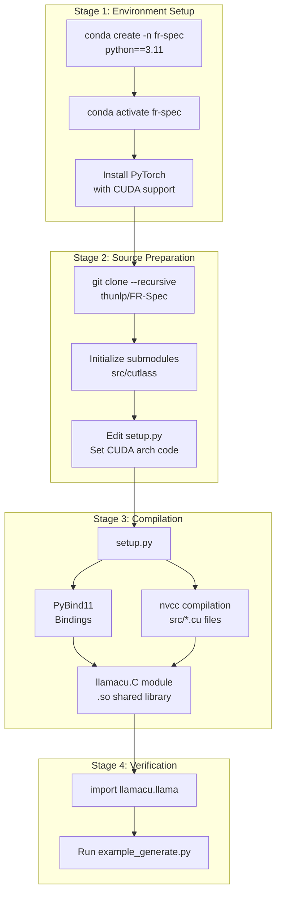

**Sources:** [README.md:42-50]()

---

## Step-by-Step Installation

### 1. Create Python Environment

Create an isolated Conda environment with Python 3.11:

```bash
conda create -n fr-spec python==3.11
conda activate fr-spec
```

### 2. Install PyTorch

Install PyTorch with CUDA support matching your system configuration. Visit https://pytorch.org to generate the appropriate command for your platform.

Example for CUDA 11.8:
```bash
pip install torch torchvision torchaudio --index-url https://download.pytorch.org/whl/cu118
```

### 3. Clone Repository with Submodules

The `--recursive` flag is critical as it initializes the CUTLASS submodule required for Flash Attention:

```bash
git clone https://github.com/thunlp/FR-Spec.git --recursive
cd FR-Spec
```

The CUTLASS submodule provides optimized CUDA templates used in [src/flash_attn/]().

### 4. Configure CUDA Architecture

Edit `setup.py` to specify your GPU's compute capability. This determines which GPU instructions the compiler can use:

```bash
vim setup.py  # Change arch="80" to your GPU's compute capability
```

**CUDA Compute Capability Reference:**

| GPU Architecture | Compute Capability | setup.py Value |
|-----------------|-------------------|----------------|
| A100 | 8.0 | `arch="80"` |
| A10, RTX 3090 | 8.6 | `arch="86"` |
| H100 | 9.0 | `arch="90"` |
| V100 | 7.0 | `arch="70"` |

Find your GPU's compute capability at: https://developer.nvidia.com/cuda-gpus#compute

### 5. Compile and Install

Run the setup script to compile CUDA kernels and create the Python extension module:

```bash
pip install .
```

This compiles:
- [src/entry.cu]() - PyBind11 bindings
- [src/model/]() - Core transformer components
- [src/flash_attn/]() - Flash Attention kernels

The output is a shared library (`llamacu.C.so`) that Python imports as the `C` module.

**Sources:** [README.md:42-50](), [src/flash_attn/flash_api.hpp:1-10]()

---

## First Text Generation Workflow

After installation, the basic workflow for text generation involves four key stages: model initialization, weight loading, storage allocation, and generation.

```mermaid
graph LR
    subgraph "1. Initialize"
        IMPORT["from llamacu.llama<br/>import LLM"]
        CONFIG["AutoConfig.from_pretrained()"]
        TOKENIZER["AutoTokenizer.from_pretrained()"]
        CREATE_LLM["llm = LLM(path, dtype, memory_limit)"]
    end
    
    subgraph "2. Prepare Input"
        PROMPT["prompt = 'Beijing is the'"]
        TOKENIZE["input_ids = tokenizer(prompt)"]
        TO_GPU["input_ids.cuda().int()"]
    end
    
    subgraph "3. Setup Storage"
        INIT_STORAGE["llm.init_storage()"]
        LOAD_WEIGHTS["llm.load_from_hf()"]
    end
    
    subgraph "4. Generate"
        GENERATE["llm.generate(input_ids, num_tokens)"]
        DECODE_OUT["tokenizer.decode(output)"]
    end
    
    IMPORT --> CONFIG
    CONFIG --> TOKENIZER
    TOKENIZER --> CREATE_LLM
    CREATE_LLM --> PROMPT
    PROMPT --> TOKENIZE
    TOKENIZE --> TO_GPU
    TO_GPU --> INIT_STORAGE
    INIT_STORAGE --> LOAD_WEIGHTS
    LOAD_WEIGHTS --> GENERATE
    GENERATE --> DECODE_OUT
```

**Sources:** [examples/example_generate.py:1-46]()

---

## Running the Quick Start Example

The repository includes [examples/example_generate.py]() demonstrating basic usage. Before running it, you must configure the model paths.

### Configuration Parameters

Edit [examples/example_generate.py:6-13]() to set:

| Parameter | Purpose | Example Value |
|-----------|---------|---------------|
| `path` | Base model directory | `"/path/to/Llama-3.2-1B-instruct"` |
| `eagle_path` | Eagle drafter + FR-Spec data | `"/path/to/LLaMA3.2-Instruct-1B-FR-Spec"` |
| `dtype` | Inference precision | `torch.float16` or `torch.bfloat16` |
| `cuda_graph` | Enable CUDA graph optimization | `True` (recommended) |
| `num_generate` | Tokens to generate | `100` |
| `model_type` | Inference mode | `"base"` or `"eagle"` |
| `V` | FR-Spec vocabulary size | `16384`, `32768`, `65536`, or `-1` |

### Model Types Comparison

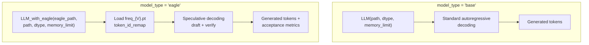

### Running the Example

After configuring paths:

```bash
cd examples
python example_generate.py
```

**Expected Output (EAGLE mode):**
```
average accept length: 4.23
Beijing is the capital of China and one of the most populous cities...
```

The "average accept length" metric indicates how many tokens are accepted per speculative decoding iteration. Higher values (3-5) indicate effective speculation.

**Sources:** [examples/example_generate.py:1-46]()

---

## Token Frequency Statistics Setup

FR-Spec's core optimization requires token frequency data that determines which vocabulary subset to use during drafting. This data is model-specific and corpus-derived.

### Option 1: Download Pre-computed Statistics

Download pre-computed frequency statistics from HuggingFace:

| Model | HuggingFace Repository |
|-------|------------------------|
| Llama-3-8B-Instruct | [thunlp/LLaMA3-Instruct-8B-FR-Spec](https://huggingface.co/thunlp/LLaMA3-Instruct-8B-FR-Spec) |
| Llama-3.2-1B-Instruct | [thunlp/LLaMA3.2-Instruct-1B-FR-Spec](https://huggingface.co/thunlp/LLaMA3.2-Instruct-1B-FR-Spec) |
| Qwen2-7B-Instruct | [thunlp/Qwen2-7B-Instruct-FR-Spec](https://huggingface.co/thunlp/Qwen2-7B-Instruct-FR-Spec) |

Each repository contains multiple `freq_{vocab_size}.pt` files:
- `freq_8192.pt` - Top 8K most frequent tokens
- `freq_16384.pt` - Top 16K most frequent tokens
- `freq_32768.pt` - Top 32K most frequent tokens
- `freq_65536.pt` - Top 64K most frequent tokens

### Option 2: Generate Custom Statistics

Generate frequency statistics for a different model or corpus using [fr/fr.py]():

```bash
cd fr
python fr.py --model_name llama3-8b-instruct \
             --model_path meta-llama/Meta-Llama-3-8B-Instruct \
             --num_lines 1000000 \
             --vocab_size 16384 32768 65536
```

**Parameters:**
- `--model_name`: Identifier for output files
- `--model_path`: HuggingFace model identifier or local path
- `--num_lines`: SlimPajama corpus lines to analyze (default: 1,000,000)
- `--vocab_size`: List of vocabulary sizes to generate

The script outputs to `fr-index/{model_name}/freq_{vocab_size}.pt`.

### Loading Frequency Data

The frequency data is loaded in [examples/example_generate.py:33-38]():

```python
# Load frequency-ranked token mapping
with open(f'{eagle_path}/freq_{V}.pt', 'rb') as f:
    token_id_remap = torch.tensor(torch.load(f, weights_only=True), 
                                   dtype=torch.int32, device="cpu")

# Register with Eagle implementation
llm._load("token_id_remap", token_id_remap, cls="eagle")
```

The `token_id_remap` tensor maps reduced vocabulary indices to full vocabulary token IDs, enabling the Eagle drafter to compute logits only for the most frequent V tokens.

**Sources:** [README.md:58-84](), [examples/example_generate.py:33-38]()

---

## Component Interaction During Generation

Understanding how components interact during generation helps diagnose issues and optimize performance.

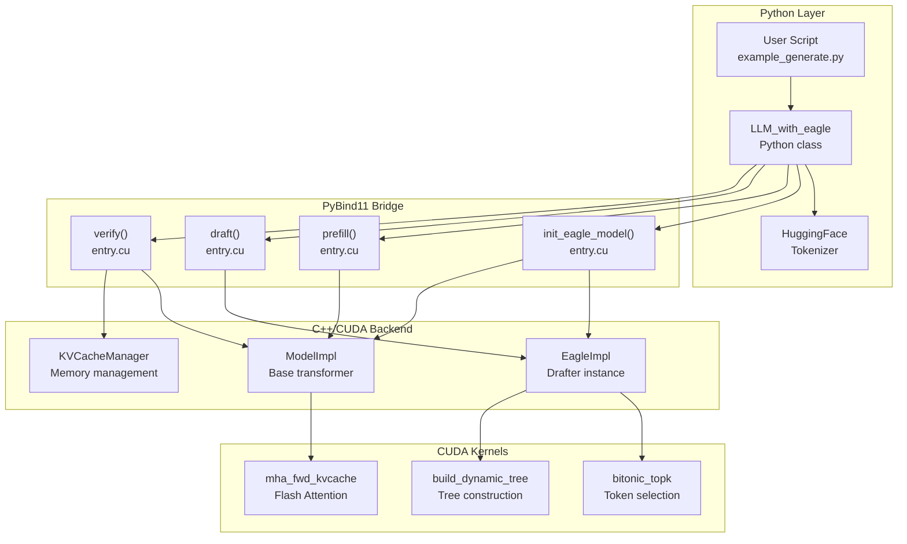

**Sources:** [examples/example_generate.py:1-46](), [src/flash_attn/flash_api.hpp:207-304]()

---

## Verification and Troubleshooting

### Verify Successful Installation

Test that the C module loads correctly:

```python
python -c "from llamacu.llama import LLM; print('Installation successful')"
```

### Common Issues

| Issue | Cause | Solution |
|-------|-------|----------|
| `ImportError: cannot import name 'C'` | Compilation failed or wrong arch | Check setup.py arch setting, reinstall |
| `CUDA out of memory` | Model too large for GPU | Reduce `memory_limit` parameter (e.g., 0.8) |
| `RuntimeError: CUDA error` | Arch mismatch | Verify setup.py arch matches GPU |
| File not found: `freq_*.pt` | Missing frequency data | Download from HuggingFace or run fr.py |
| Low acceptance rate (<2.0) | Vocabulary size mismatch | Try different V values (16384, 32768) |

### Performance Expectations

On A100 GPU with Llama-3-8B-Instruct:

| Method | Tokens/sec | Speedup |
|--------|-----------|---------|
| Baseline | ~45 | 1.0x |
| EAGLE-2 | ~72 | 1.6x |
| FR-Spec (V=32768) | ~81 | 1.8x |

**Sources:** [README.md:17-22]()

---

## Next Steps

After completing this Getting Started guide:

1. **Run Evaluations** - See [Evaluation and Benchmarking](#9) to reproduce paper results
2. **Understand Architecture** - See [System Architecture](#3) for technical details
3. **Optimize Performance** - See [FR-Spec Optimization](#6) for vocabulary tuning
4. **Integrate into Applications** - See [Python API Reference](#8) for programmatic usage

For detailed installation instructions, see [Installation](#2.1). For a walkthrough of the example script, see [Quick Start Example](#2.2). For generating custom frequency statistics, see [Preparing Token Frequency Statistics](#2.3).

---

# Page: Installation

# Installation

<details>
<summary>Relevant source files</summary>

The following files were used as context for generating this wiki page:

- [.gitmodules](.gitmodules)
- [README.md](README.md)
- [src/flash_attn/flash_api.hpp](src/flash_attn/flash_api.hpp)

</details>


This document provides detailed instructions for installing FR-Spec from source, including environment setup, dependency configuration, and CUDA architecture settings. Installation involves compiling C++/CUDA source files into a Python extension module that can be imported by the `llamacu` package.

For information about running your first generation after installation, see [Quick Start Example](#2.2). For details about preparing token frequency statistics required by FR-Spec optimization, see [Preparing Token Frequency Statistics](#2.3).

---

## Prerequisites

FR-Spec requires the following components to be installed and properly configured before building from source:

| Component | Requirement | Notes |
|-----------|-------------|-------|
| **Python** | 3.11 | Specified in conda environment setup |
| **PyTorch** | Latest compatible version | Must match CUDA version |
| **CUDA Toolkit** | 11.8 or 12.x | Must match PyTorch CUDA version |
| **GPU** | NVIDIA GPU with compute capability 7.0+ | Architecture determines compilation target |
| **Git** | 2.13+ | For recursive submodule cloning |
| **C++ Compiler** | GCC 7+ or Clang | For compiling C++/CUDA code |

### GPU Compute Capability

The target GPU's compute capability determines the CUDA architecture code used during compilation. Common architectures:

| GPU Series | Architecture Code | Compute Capability |
|------------|-------------------|-------------------|
| RTX 30xx (Ampere) | `86` | 8.6 |
| RTX 40xx (Ada Lovelace) | `89` | 8.9 |
| A100 | `80` | 8.0 |
| H100 | `90` | 9.0 |
| V100 | `70` | 7.0 |

Check your GPU's compute capability at the [NVIDIA CUDA GPUs page](https://developer.nvidia.com/cuda-gpus#compute).

**Sources:** [README.md:45-50]()

---

## Installation Process Overview

The following diagram shows the complete installation pipeline from prerequisites through to a functional Python package:

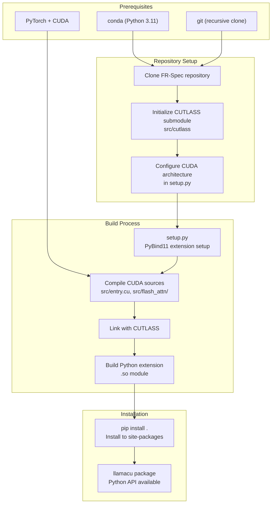

**Sources:** [README.md:42-50](), [.gitmodules:1-4]()

---

## Step-by-Step Installation

### Step 1: Create Conda Environment

Create a new conda environment with Python 3.11:

```bash
conda create -n fr-spec python==3.11
conda activate fr-spec
```

The environment name `fr-spec` can be customized to your preference.

### Step 2: Install PyTorch

Install PyTorch with CUDA support matching your system configuration. Visit [pytorch.org](https://pytorch.org) to get the appropriate installation command for your platform. For example:

```bash
# For CUDA 11.8
pip install torch torchvision torchaudio --index-url https://download.pytorch.org/whl/cu118

# For CUDA 12.1
pip install torch torchvision torchaudio --index-url https://download.pytorch.org/whl/cu121
```

Verify PyTorch can detect your GPU:

```bash
python -c "import torch; print(torch.cuda.is_available())"
```

### Step 3: Clone Repository with Submodules

Clone the FR-Spec repository recursively to include the CUTLASS submodule:

```bash
git clone https://github.com/thunlp/FR-Spec.git --recursive
cd FR-Spec
```

The `--recursive` flag is critical as it initializes the CUTLASS submodule at [src/cutlass]() which is required for Flash Attention compilation.

If you already cloned without `--recursive`, initialize submodules manually:

```bash
git submodule update --init --recursive
```

### Step 4: Configure CUDA Architecture

Edit [setup.py]() to set the target CUDA architecture for your GPU. Locate the `arch` variable and change it from the default `"80"` to your GPU's architecture code:

```bash
vim setup.py  # or use any text editor
```

Find and modify the architecture setting. For example, for RTX 30xx series (Ampere):

```python
# Change from:
arch = "80"

# To (for RTX 30xx):
arch = "86"
```

Common architecture codes:
- `"70"` for V100
- `"80"` for A100
- `"86"` for RTX 30xx
- `"89"` for RTX 40xx
- `"90"` for H100

**Important:** Using the wrong architecture code will result in either compilation errors or suboptimal performance. The compiled binary will not run on GPUs with different compute capabilities.

### Step 5: Build and Install

Install FR-Spec using pip, which will compile the C++/CUDA extension and install the package:

```bash
pip install .
```

This command:
1. Reads [setup.py]() configuration
2. Compiles C++/CUDA source files in [src/]() directory
3. Links against CUTLASS library from [src/cutlass]()
4. Builds the PyBind11 extension module
5. Installs the `llamacu` package to your environment

The compilation process may take 5-15 minutes depending on your system.

**Sources:** [README.md:42-50]()

---

## Build System Architecture

The following diagram shows how source files are compiled into the final Python extension:

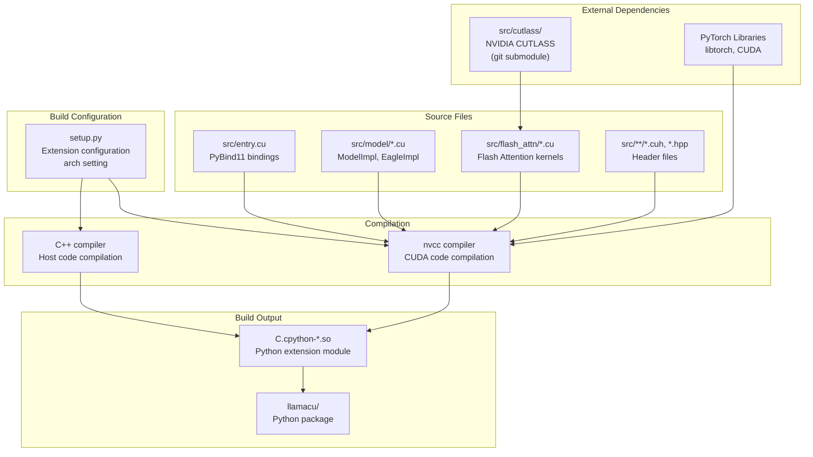

**Sources:** [.gitmodules:1-4](), [README.md:48-49](), [src/flash_attn/flash_api.hpp:1-10]()

---

## Dependency Chain

Understanding the dependency hierarchy helps diagnose installation issues:

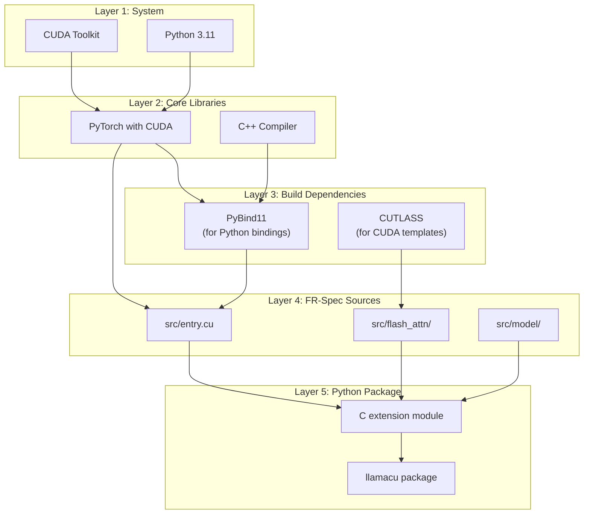

**Sources:** [src/flash_attn/flash_api.hpp:7-8](), [.gitmodules:1-4]()

---

## Verification

After installation, verify that FR-Spec is correctly installed:

### Import Test

```bash
python -c "import llamacu; print('FR-Spec installed successfully')"
```

### Check Extension Module

Verify the compiled C extension module is accessible:

```bash
python -c "import llamacu.C as C; print('C extension loaded')"
```

If this command succeeds, the PyBind11 module defined in [src/entry.cu]() has been successfully compiled and can be imported.

### Check CUDA Availability

Ensure PyTorch detects CUDA:

```bash
python -c "import torch; print(f'CUDA available: {torch.cuda.is_available()}'); print(f'CUDA version: {torch.version.cuda}')"
```

**Sources:** [README.md:86-93]()

---

## Troubleshooting

### Common Installation Issues

| Issue | Cause | Solution |
|-------|-------|----------|
| `nvcc: command not found` | CUDA Toolkit not in PATH | Add CUDA bin directory to PATH environment variable |
| `torch not found` | PyTorch not installed | Install PyTorch with CUDA support before FR-Spec |
| `CUTLASS headers not found` | Submodule not initialized | Run `git submodule update --init --recursive` |
| Compilation fails with arch error | Wrong compute capability | Update `arch` in setup.py to match your GPU |
| `ImportError: cannot import name 'C'` | Extension not compiled | Rebuild with `pip install --force-reinstall .` |
| Runtime CUDA errors | Mismatched CUDA versions | Ensure PyTorch CUDA version matches system CUDA |

### Architecture Mismatch Symptoms

If the compiled binary's architecture doesn't match your GPU:
- **Error:** `no kernel image is available for execution on the device`
- **Solution:** Recompile with correct `arch` setting in setup.py

### CUTLASS Submodule Issues

The CUTLASS submodule at [src/cutlass]() provides optimized CUDA templates used by Flash Attention ([src/flash_attn/flash_api.hpp:7-8]()). If compilation fails with missing CUTLASS headers:

```bash
cd src/cutlass
git submodule status  # Verify submodule is initialized
cd ../..
pip install --force-reinstall .
```

**Sources:** [README.md:42-50](), [.gitmodules:1-4](), [src/flash_attn/flash_api.hpp:7-8]()

---

## Next Steps

After successful installation:

1. **Run a basic example:** See [Quick Start Example](#2.2) to generate text with FR-Spec
2. **Prepare frequency data:** See [Preparing Token Frequency Statistics](#2.3) to download or generate token frequency files required for FR-Spec optimization
3. **Download model weights:** Obtain HuggingFace model weights and EAGLE drafter weights as described in [README.md:54-57]()

For understanding how the compiled C extension integrates with Python, see [Python to CUDA Bridge](#3.1). For details on the overall system architecture, see [System Architecture](#3).

**Sources:** [README.md:42-93]()

---

# Page: Quick Start Example

# Quick Start Example

<details>
<summary>Relevant source files</summary>

The following files were used as context for generating this wiki page:

- [examples/example_generate.py](examples/example_generate.py)
- [llamacu/llama.py](llamacu/llama.py)

</details>


## Purpose and Scope

This page provides a step-by-step walkthrough of the `example_generate.py` script, demonstrating basic text generation with FR-Spec. The example covers both baseline generation and EAGLE-based speculative decoding with optional frequency-ranked vocabulary optimization. 

For installation instructions and environment setup, see [Installation](#2.1). For details on preparing token frequency statistics for FR-Spec optimization, see [Preparing Token Frequency Statistics](#2.3). For comprehensive API documentation, see [Python API Reference](#8).

---

## Example Script Overview

The `example_generate.py` script provides a minimal working example that demonstrates:
- Loading a base transformer model or an EAGLE-augmented model
- Configuring FR-Spec vocabulary reduction (V parameter)
- Generating text from a prompt
- Measuring acceptance rates for speculative decoding

**Sources:** [examples/example_generate.py:1-46]()

---

## Execution Flow

The following diagram illustrates the complete execution flow of the example script:

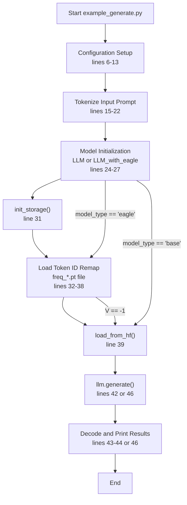

**Sources:** [examples/example_generate.py:1-46]()

---

## Configuration Parameters

The example script begins with configuration parameters that control model behavior:

| Parameter | Type | Default | Description |
|-----------|------|---------|-------------|
| `path` | str | Required | Path to base HuggingFace model directory |
| `eagle_path` | str | Required | Path to EAGLE drafter model directory (includes FR-Spec frequency files) |
| `dtype` | torch.dtype | `torch.float16` | Inference precision (float16 or bfloat16) |
| `cuda_graph` | bool | `True` | Enable CUDA graph optimization for decode phase |
| `num_generate` | int | `100` | Number of tokens to generate |
| `model_type` | str | `"eagle"` | Model variant: `"base"` for standard decoding, `"eagle"` for speculative decoding |
| `Bench` | bool | `True` | Enable benchmarking mode (not used in this example) |
| `V` | int | `16384` | Vocabulary size for FR-Spec reduction. Use `-1` to disable FR-Spec optimization |

**Sources:** [examples/example_generate.py:6-13]()

### FR-Spec Vocabulary Size (V Parameter)

The `V` parameter controls the frequency-ranked vocabulary size:
- `V = -1`: Standard EAGLE without vocabulary reduction (uses full vocabulary)
- `V = 8192, 16384, 32768, 65536`: FR-Spec with reduced vocabulary containing the V most frequent tokens
- Smaller V values provide faster LM-Head computation but may reduce draft accuracy
- Typical values: 8K-64K tokens (vs. full vocabulary of ~128K tokens for Llama models)

**Sources:** [examples/example_generate.py:13]()

---

## Input Preparation

The example prepares input by tokenizing a prompt and creating position IDs:

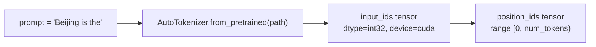

The tokenization process:
1. Load tokenizer from HuggingFace model path [examples/example_generate.py:16]()
2. Convert prompt string to token IDs [examples/example_generate.py:18]()
3. Convert to int32 CUDA tensor (required by C++ backend)
4. Create position_ids as sequential indices [examples/example_generate.py:22]()

**Sources:** [examples/example_generate.py:15-22]()

---

## Model Initialization

The script initializes either a base LLM or an EAGLE-augmented LLM based on `model_type`:

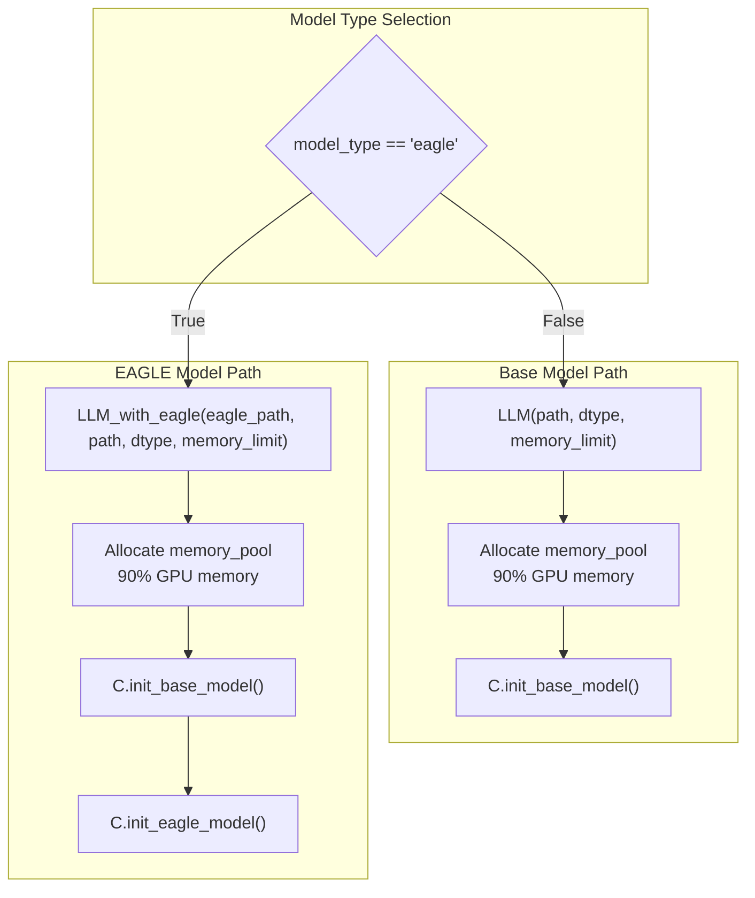

### Base Model Initialization

For standard decoding (`model_type = "base"`):
- Creates `LLM` instance with model path and configuration [examples/example_generate.py:27]()
- Allocates memory pool (90% of GPU memory in this example) [examples/example_generate.py:27]()
- Calls `C.init_base_model()` to initialize C++ backend [llamacu/llama.py:45-59]()

### EAGLE Model Initialization

For speculative decoding (`model_type = "eagle"`):
- Creates `LLM_with_eagle` instance with both eagle_path and base path [examples/example_generate.py:25]()
- Initializes base model and EAGLE drafter in C++ backend
- Allocates KV cache budget split between base model and drafter

**Sources:** [examples/example_generate.py:24-27](), [llamacu/llama.py:20-59]()

---

## Storage and Weight Loading

After model initialization, the script performs three critical steps:

### Step 1: Initialize Storage

```python
llm.init_storage()
```

This allocates KV cache and intermediate buffers within the pre-allocated memory pool. The function returns `max_total_length`, the maximum sequence length supported by available memory.

**Sources:** [examples/example_generate.py:31](), [llamacu/llama.py:63-64]()

### Step 2: Load Token ID Remap (EAGLE Only)

For EAGLE models with FR-Spec enabled (`V != -1`):

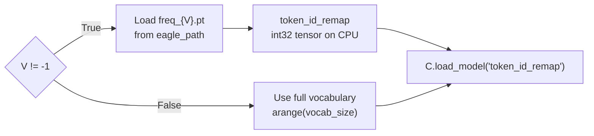

The token ID remap file (`freq_{V}.pt`) contains the indices of the V most frequent tokens, sorted by frequency. This allows the EAGLE drafter to compute logits only for frequent tokens during drafting.

**Sources:** [examples/example_generate.py:32-38]()

### Step 3: Load Model Weights

```python
llm.load_from_hf()
```

This loads all model weights from the HuggingFace checkpoint format and transfers them to the C++ backend:
- Embedding layer weights [llamacu/llama.py:127]()
- Transformer layer weights (attention and FFN parameters)
- LM-Head weights
- Rotary embedding inverse frequencies [llamacu/llama.py:130-138]()

For EAGLE models, this also loads the drafter-specific weights from `eagle_path`.

**Sources:** [examples/example_generate.py:39](), [llamacu/llama.py:125-138]()

---

## Text Generation

After initialization and loading, the script calls the `generate()` method:

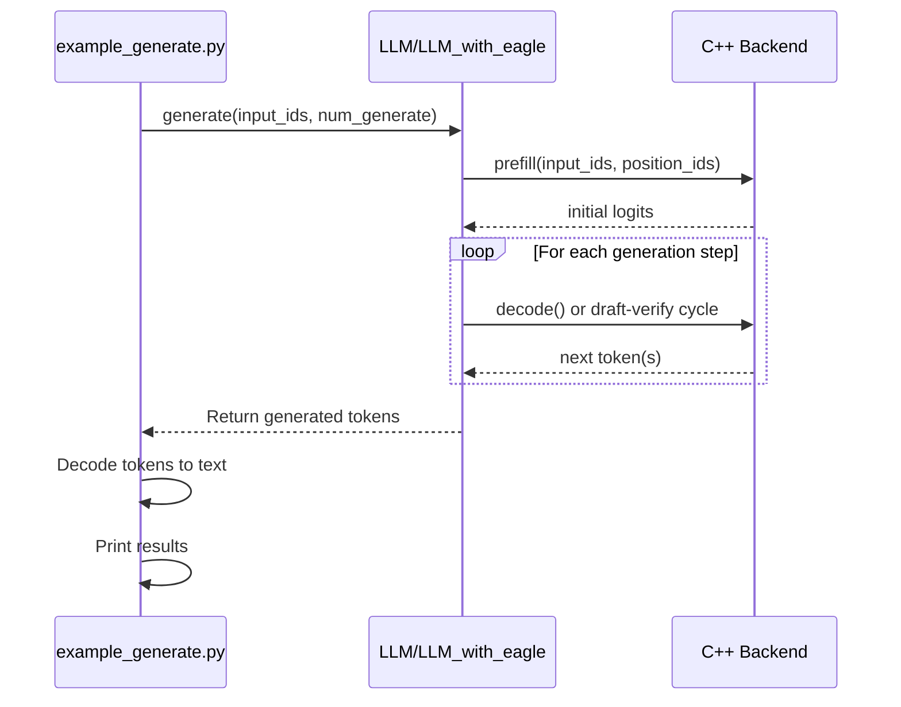

### Base Model Generation

For `model_type = "base"`:
1. Call `llm.generate(input_ids, num_generate)` [examples/example_generate.py:46]()
2. Returns a list of token IDs
3. Decode using tokenizer and print [examples/example_generate.py:46]()

### EAGLE Model Generation

For `model_type = "eagle"`:
1. Call `llm.generate(input_ids, num_generate)` [examples/example_generate.py:42]()
2. Returns tuple: `(tokens, acceptance_lengths)` [examples/example_generate.py:42]()
   - `tokens`: Generated token ID sequence
   - `acceptance_lengths`: List of accepted tokens per draft-verify iteration
3. Calculate average acceptance length [examples/example_generate.py:43]()
4. Decode tokens to text and print [examples/example_generate.py:44]()

The average acceptance length indicates speculative decoding efficiency. Higher values mean more draft tokens are accepted per verification step.

**Sources:** [examples/example_generate.py:41-46](), [llamacu/llama.py:174-197]()

---

## Running the Example

To execute the example script:

### Prerequisites

1. Install FR-Spec following [Installation](#2.1)
2. Download or prepare models:
   - Base model (e.g., Llama-3.2-1B-Instruct) from HuggingFace
   - EAGLE drafter model with FR-Spec frequency files
3. Update paths in the script:
   - Line 6: Set `path` to your base model directory
   - Line 7: Set `eagle_path` to your EAGLE model directory

### Execution

```bash
cd examples
python example_generate.py
```

### Expected Output

**Base Model:**
```
Beijing is the capital of China and one of...
```

**EAGLE Model with FR-Spec:**
```
average accept length: 4.23
Beijing is the capital of China and one of...
```

The acceptance length of ~4.23 indicates that on average, 4-5 draft tokens are accepted per verification step, resulting in significant speedup over baseline decoding.

**Sources:** [examples/example_generate.py:1-46]()

---

## Configuration Variations

The example can be easily modified to explore different configurations:

| Modification | Lines to Change | Effect |
|--------------|-----------------|--------|
| Switch to base model | Line 11: `model_type = ["base", "eagle"][0]` | Standard autoregressive decoding without speculation |
| Disable FR-Spec | Line 13: `V = -1` | EAGLE uses full vocabulary (slower but potentially higher accuracy) |
| Reduce vocabulary more | Line 13: `V = 8192` | Faster drafting, may reduce acceptance rate |
| Change prompt | Line 15: `prompt = "Your text here"` | Generate from different starting text |
| Generate longer sequences | Line 10: `num_generate = 500` | Produce more tokens (limited by KV cache size) |
| Use bfloat16 | Line 8: `dtype = torch.bfloat16` | Alternative precision (requires Ampere+ GPU) |
| Disable CUDA graph | Line 9: `cuda_graph = False` | Useful for debugging (slight performance cost) |

**Sources:** [examples/example_generate.py:6-15]()

---

## Class and Function Reference

The following table maps high-level operations to their implementations:

| Operation | Python Class/Method | C++ Backend Function |
|-----------|---------------------|----------------------|
| Model initialization | `LLM.__init__()` | `C.init_base_model()` |
| EAGLE initialization | `LLM_with_eagle.__init__()` | `C.init_eagle_model()` |
| Memory allocation | `LLM.init_storage()` | `C.init_storage()` |
| Weight loading | `LLM._load()` | `C.load_model()` |
| Prefill phase | `LLM.prefill()` | `C.prefill()` |
| Decode phase | `LLM.decode()` | `C.decode()` |
| EAGLE draft phase | `LLM_with_eagle.draft()` | `C.draft()` |
| EAGLE verify phase | `LLM_with_eagle.verify()` | `C.verify()` |
| Text generation | `LLM.generate()` | Orchestrates prefill/decode or draft/verify |

For detailed API documentation, see [LLM Class](#8.1) and [Speculative Decoding Classes](#8.2).

**Sources:** [llamacu/llama.py:20-197](), [examples/example_generate.py:1-46]()

---

# Page: Preparing Token Frequency Statistics

# Preparing Token Frequency Statistics

<details>
<summary>Relevant source files</summary>

The following files were used as context for generating this wiki page:

- [README.md](README.md)
- [fr/fr.py](fr/fr.py)
- [src/flash_attn/flash_api.hpp](src/flash_attn/flash_api.hpp)

</details>


## Purpose and Scope

This page explains how to prepare token frequency statistics required by FR-Spec's vocabulary reduction optimization. These statistics determine which tokens are most frequently used in natural language and enable the creation of reduced vocabulary subsets (typically 8K, 16K, 32K, or 64K tokens) from the full vocabulary.

For details on how these statistics are used during inference, see [Vocabulary Reduction Strategy](#6.2). For information on the token ID remapping mechanism, see [Token ID Remapping](#6.3).

## Overview

FR-Spec accelerates EAGLE-2 by reducing the computational cost of the LM-Head projection during draft generation. This is achieved by analyzing token frequency distributions in a large corpus and creating vocabulary subsets that contain only the most frequently occurring tokens. The key insight is that natural language follows a long-tail distribution—a small subset of the vocabulary accounts for the vast majority of tokens in real-world text.

The token frequency analysis is performed once offline and produces `freq_*.pt` files that map vocabulary sizes to lists of token IDs, ordered by frequency. These files are loaded during model initialization and used to restrict the draft model's output vocabulary.

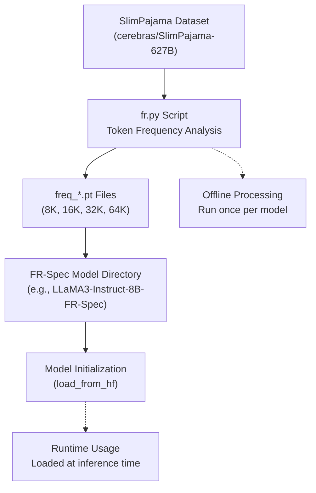

**Token Frequency Analysis Pipeline**

Sources: [README.md:58-84](), [fr/fr.py:1-77]()

## Option 1: Download Pre-computed Statistics

The simplest approach is to download pre-computed token frequency statistics from HuggingFace. The FR-Spec project provides pre-analyzed statistics for several popular models:

| Model | HuggingFace Repository |
|-------|----------------------|
| LLaMA3-Instruct-8B | `thunlp/LLaMA3-Instruct-8B-FR-Spec` |
| LLaMA3.2-Instruct-1B | `thunlp/LLaMA3.2-Instruct-1B-FR-Spec` |
| Qwen2-7B-Instruct | `thunlp/Qwen2-7B-Instruct-FR-Spec` |

These repositories contain `freq_8192.pt`, `freq_16384.pt`, `freq_32768.pt`, and `freq_65536.pt` files that can be directly used with FR-Spec.

Sources: [README.md:60-64]()

## Option 2: Generate Statistics from Scratch

To generate token frequency statistics for a new model or with different parameters, use the `fr.py` script located in the `fr/` directory.

### Process Overview

The frequency analysis script performs the following operations:

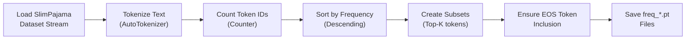

**Token Frequency Analysis Steps**

Sources: [fr/fr.py:9-43]()

### Running the Script

Navigate to the `fr/` directory and execute the script with appropriate parameters:

```bash
cd fr
python fr.py --model_name <model_name> \
             --model_path <model_path> \
             --num_lines <num_lines> \
             --vocab_size <vocab_sizes>
```

**Example command** for LLaMA-3-8B-Instruct processing 1 million lines:

```bash
python fr.py --model_name llama3-8b-instruct \
             --model_path meta-llama/Meta-Llama-3-8B-Instruct \
             --num_lines 1000000 \
             --vocab_size 8192 16384 32768 65536
```

Sources: [README.md:66-82](), [fr/fr.py:45-76]()

### Script Parameters

| Parameter | Type | Default | Description |
|-----------|------|---------|-------------|
| `--model_name` | `str` | `'llama3-8b-instruct'` | Model identifier used for output directory naming |
| `--model_path` | `str` | `'meta-llama/Llama-3-8B-Instruct'` | HuggingFace model path or local directory for loading tokenizer |
| `--num_lines` | `int` | `1000000` | Number of lines to process from SlimPajama dataset (more lines = more representative statistics) |
| `--vocab_size` | `List[int]` | `[8192, 16384, 32768, 65536]` | List of vocabulary subset sizes to generate |

The script uses streaming mode to load the SlimPajama dataset, so it doesn't require downloading the entire corpus upfront.

Sources: [fr/fr.py:46-72](), [README.md:72-75]()

### Implementation Details

The script operates as follows:

1. **Dataset Loading**: Streams data from `cerebras/SlimPajama-627B` [fr/fr.py:10]()
2. **Tokenization**: Uses `AutoTokenizer.from_pretrained()` to load the model's tokenizer [fr/fr.py:11]()
3. **Frequency Counting**: Uses `collections.Counter` to track token ID occurrences [fr/fr.py:13-21]()
4. **Sorting**: Sorts token IDs by frequency in descending order [fr/fr.py:23-25]()
5. **EOS Token Handling**: Ensures the end-of-sequence token is always included in subsets [fr/fr.py:34-39]()
6. **File Generation**: Saves each vocabulary size to a separate `.pt` file using `torch.save()` [fr/fr.py:41-43]()

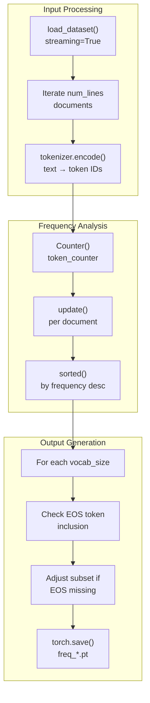

**fr.py Internal Flow**

Sources: [fr/fr.py:9-43]()

### Output Files

The script generates files in the following structure:

```
fr-index/
└── <model_name>/
    ├── freq_8192.pt
    ├── freq_16384.pt
    ├── freq_32768.pt
    └── freq_65536.pt
```

Each `.pt` file contains a Python list of token IDs, ordered by frequency (most frequent first). The list length equals the vocabulary size parameter.

**File Format**: Each file is a PyTorch serialized list that can be loaded with:
```python
freq_ids = torch.load('freq_8192.pt')
```

Note: The script creates the output directory if it doesn't exist [fr/fr.py:30-31]().

Sources: [fr/fr.py:30-43](), [README.md:82]()

### Special Token Handling

The script ensures that the end-of-sequence (EOS) token is always included in the reduced vocabulary, regardless of its actual frequency in the corpus. This is critical for proper generation termination.

The EOS token handling logic:

1. Retrieves the EOS token ID from the tokenizer's special tokens map [fr/fr.py:34]()
2. Checks if the EOS token ID appears in the top-k most frequent tokens [fr/fr.py:35]()
3. If missing, reduces the subset size and appends the EOS token [fr/fr.py:36-37]()
4. If present, uses the subset as-is [fr/fr.py:39]()

This ensures that the draft model can always generate valid sequence endings, preventing infinite generation loops.

Sources: [fr/fr.py:34-39]()

## Integration with FR-Spec

Once generated, the frequency files must be copied to the FR-Spec model directory where they will be loaded during model initialization. The typical workflow:

1. Generate or download `freq_*.pt` files
2. Place them in the model directory alongside weights (e.g., `models/LLaMA3-Instruct-8B-FR-Spec/`)
3. During initialization, `load_from_hf` reads these files and configures the token ID remapping
4. At inference time, the EAGLE drafter uses the reduced vocabulary for LM-Head computation

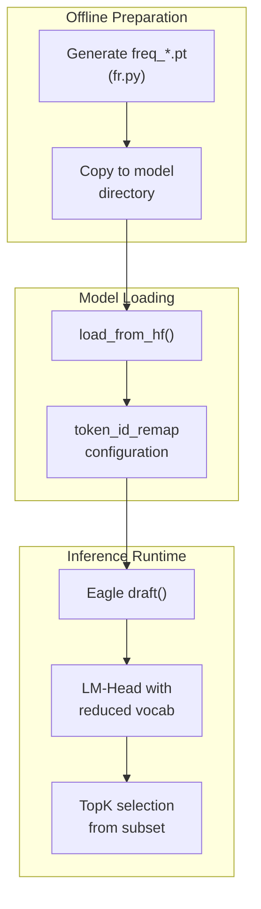

**Token Frequency Statistics in the Inference Pipeline**

The vocabulary size parameter controls the trade-off between draft speed and acceptance rate:
- **Smaller vocabularies** (8K): Faster draft computation, potentially lower acceptance rate
- **Larger vocabularies** (64K): Slower draft computation, higher acceptance rate
- **Recommended**: 32K provides a good balance for most use cases

Sources: [README.md:58-84]()

---

# Page: System Architecture

# System Architecture

<details>
<summary>Relevant source files</summary>

The following files were used as context for generating this wiki page:

- [README.md](README.md)
- [llamacu/llama.py](llamacu/llama.py)
- [src/entry.cu](src/entry.cu)
- [src/flash_attn/flash_api.hpp](src/flash_attn/flash_api.hpp)

</details>


## Purpose and Scope

This document describes the overall architecture of FR-Spec, explaining how the Python interface, PyBind11 bridge, and C++/CUDA backend work together to provide accelerated LLM inference with frequency-ranked speculative sampling. The architecture follows a three-tier design where high-level Python APIs invoke optimized CUDA kernels through a thin C++ bridge layer.

For detailed information about specific subsystems:
- Python-CUDA bridging mechanisms: see [Python to CUDA Bridge](#3.1)
- Memory allocation and KV cache management: see [Memory Management](#3.2)
- Base transformer implementation: see [ModelImpl: Base Transformer](#4.1)
- Speculative decoding details: see [Speculative Decoding](#5)

**Sources:** [README.md:1-140](), [src/entry.cu:1-184](), [llamacu/llama.py:1-198]()

---

## Three-Tier Architecture

FR-Spec implements a layered architecture that separates concerns between user-facing APIs, language interoperability, and high-performance computation:

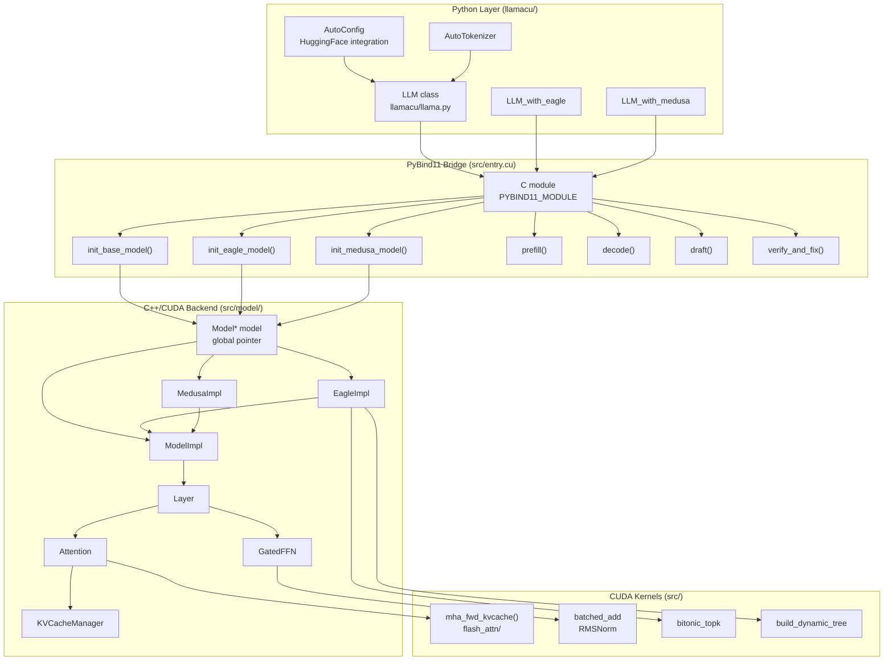

**Diagram 1: Three-Tier Architecture and Component Hierarchy**

The architecture consists of:

1. **Python Layer**: Provides high-level APIs compatible with HuggingFace transformers
2. **PyBind11 Bridge**: Marshals data between Python and C++, manages type conversions
3. **C++/CUDA Backend**: Implements core inference logic with optimized CUDA kernels

**Sources:** [src/entry.cu:1-184](), [llamacu/llama.py:20-198]()

---

## Python Layer Components

The Python layer in `llamacu/` provides user-facing classes that integrate with the PyTorch and HuggingFace ecosystems:

### LLM Class

The `LLM` class [llamacu/llama.py:20-198]() serves as the base interface for model inference:

| Component | Type | Purpose |
|-----------|------|---------|
| `tokenizer` | `AutoTokenizer` | Converts text to token IDs |
| `config` | `AutoConfig` | Stores model hyperparameters |
| `memory_pool` | `torch.nn.Parameter` | Pre-allocated GPU memory buffer |
| `logits` | `torch.Tensor` | Output buffer for model predictions |
| `dtype` | `torch.dtype` | Computation precision (FP16/BF16) |

Key methods:
- `__init__()`: Initializes model configuration and calls `C.init_base_model()` [llamacu/llama.py:45-59]()
- `init_storage()`: Allocates memory pools via `C.init_storage()` [llamacu/llama.py:63-64]()
- `load_from_hf()`: Loads weights from HuggingFace checkpoint [llamacu/llama.py:125-138]()
- `prefill()`: Processes initial prompt [llamacu/llama.py:140-150]()
- `decode()`: Generates next tokens [llamacu/llama.py:152-172]()
- `generate()`: End-to-end text generation loop [llamacu/llama.py:174-197]()

### Memory Pool Initialization

The Python layer allocates a contiguous GPU memory buffer representing 80% of available GPU memory [llamacu/llama.py:37-38]():

```python
self.memory_limit = int(torch.cuda.get_device_properties(0).total_memory * memory_limit)
self.memory_pool = torch.nn.Parameter(torch.empty(self.memory_limit, dtype=torch.uint8, device="cuda"))
```

This pointer is passed to C++ for internal memory management (detailed in [Memory Management](#3.2)).

**Sources:** [llamacu/llama.py:20-198]()

---

## PyBind11 Bridge Interface

The file `src/entry.cu` defines the Python-C++ interface using PyBind11. It exposes a module named `C` that Python code imports [src/entry.cu:174-184]().

### Module Definition

```mermaid
graph LR
    Python["Python: import C"] --> Module["PYBIND11_MODULE(C, m)"]
    Module --> Funcs["Exposed Functions"]
    
    Funcs --> F1["init_base_model"]
    Funcs --> F2["init_medusa_model"]
    Funcs --> F3["init_eagle_model"]
    Funcs --> F4["init_storage"]
    Funcs --> F5["load_model"]
    Funcs --> F6["prefill"]
    Funcs --> F7["decode"]
    Funcs --> F8["draft"]
    Funcs --> F9["verify_and_fix"]
```

**Diagram 2: PyBind11 Module Interface**

### Global Model Pointer

A global pointer tracks the currently active model instance [src/entry.cu:32]():

```cpp
Model* model;
```

This pointer is polymorphic and can point to:
- `ModelImpl<elem_type, has_attention_bias>`: Base transformer
- `EagleImpl<elem_type, has_attention_bias>`: EAGLE speculative decoder (wraps ModelImpl)
- `MedusaImpl<elem_type, has_attention_bias>`: Medusa speculative decoder (wraps ModelImpl)

### Type-Generic Initialization

The bridge uses C++ template metaprogramming to support multiple data types and configurations:

```mermaid
graph TD
    InitCall["init_base_model(..., torch_dtype, attention_bias)"]
    InitCall --> BoolSwitch["BOOL_SWITCH(attention_bias)"]
    BoolSwitch --> DtypeSwitch["DTYPE_SWITCH(torch_dtype)"]
    
    DtypeSwitch --> FP16["elem_type = __half"]
    DtypeSwitch --> BF16["elem_type = __nv_bfloat16"]
    
    FP16 --> Create["new ModelImpl<elem_type, has_attention_bias>"]
    BF16 --> Create
    
    Create --> Assign["model = ..."]
```

**Diagram 3: Type-Parameterized Initialization Flow**

The macros `DTYPE_SWITCH` [src/entry.cu:10-19]() and `BOOL_SWITCH` [src/entry.cu:21-30]() enable compile-time specialization for:
- Data type: FP16 (`__half`) or BF16 (`__nv_bfloat16`)
- Attention bias: Present (Qwen2) or absent (LLaMA)

### Function Signatures

| Function | Parameters | Return | Purpose |
|----------|------------|--------|---------|
| `init_base_model` | memory_limit, memory_pool, vocab_size, num_layers, hidden_size, ... | void | Creates `ModelImpl` instance |
| `init_eagle_model` | num_layers, intermediate_size, num_iter, topk_per_iter, V, ... | void | Wraps ModelImpl with EagleImpl |
| `init_medusa_model` | num_heads, num_layers, topk_per_head, tree_size, V, ... | void | Wraps ModelImpl with MedusaImpl |
| `init_storage` | none | int | Allocates internal buffers, returns max sequence length |
| `load_model` | name, param | void | Copies weight tensor to GPU storage |
| `prefill` | input_length, history_length, input, position_ids, output | void | Processes prompt tokens |
| `decode` | input_length, padded_length, input, position_ids, cache_length, mask_2d, output, cuda_graph | void | Generates next tokens |
| `draft` | tree_draft_ids, tree_position_ids, cache_length, attn_mask, tree_parent | void | Generates speculative token candidates |
| `verify_and_fix` | num_tokens, pred, gt, position_ids, cache_length, attn_mask, tree_parent | int | Validates predictions, returns acceptance count |

All pointer parameters use `std::uintptr_t` for cross-language compatibility [src/entry.cu:34-172]().

### CUDA Graph Support

The `decode` function supports CUDA graph capture for reduced kernel launch overhead [src/entry.cu:142-164]():

- First call with `cuda_graph=true`: Captures kernel sequence into `graph`
- Subsequent calls: Replays captured graph via `cudaGraphLaunch`
- Graph is recreated if input dimensions change

**Sources:** [src/entry.cu:1-184]()

---

## C++/CUDA Backend Organization

The C++/CUDA backend implements three main model classes:

```mermaid
classDiagram
    class Model {
        <<interface>>
        +init_storage() int
        +load_to_storage(name, param)
        +prefill(...)
        +decode(...)
        +draft(...)
        +verify(...)
    }
    
    class ModelImpl {
        +vocab_size: int
        +num_hidden_layers: int
        +hidden_size: int
        +layers: Layer*
        +embed_tokens: void*
        +lm_head: void*
        +kv_cache_manager: KVCacheManager
        +prefill(...)
        +decode(...)
    }
    
    class EagleImpl {
        +base_model: ModelImpl*
        +num_iter: int
        +topk_per_iter: int
        +tree_size: int
        +V: int (reduced vocab size)
        +eagle_layers: Layer*
        +token_id_remap: int32_t*
        +draft(...)
        +verify(...)
    }
    
    class MedusaImpl {
        +base_model: ModelImpl*
        +num_heads: int
        +medusa_heads: void*
        +tree_indices: int32_t*
        +draft(...)
        +verify(...)
    }
    
    Model <|-- ModelImpl
    Model <|-- EagleImpl
    Model <|-- MedusaImpl
    EagleImpl o-- ModelImpl : wraps
    MedusaImpl o-- ModelImpl : wraps
```

**Diagram 4: C++ Model Class Hierarchy**

### ModelImpl: Base Transformer

`ModelImpl<elem_type, has_attention_bias>` implements a standard decoder-only transformer:
- Embedding layer: Token ID → hidden states
- N transformer layers: Self-attention + FFN
- LM-Head: Hidden states → vocabulary logits
- RoPE (Rotary Position Embeddings): Position encoding
- KV Cache: Stores past attention keys/values

See [ModelImpl: Base Transformer](#4.1) for detailed documentation.

### EagleImpl: Speculative Decoder

`EagleImpl<elem_type, has_attention_bias>` [src/entry.cu:97-128]() extends ModelImpl with speculative decoding:
- **Drafting**: Generates K candidates per iteration using Eagle layers
- **Tree Building**: Constructs prediction tree from candidates
- **Verification**: Base model validates predictions in parallel
- **FR-Spec Optimization**: Reduces vocabulary from full size to V (8K-64K tokens)

Key parameters passed during initialization [src/entry.cu:97-128]():
- `num_layers`: Number of Eagle layers
- `num_iter`: Iterations per draft phase
- `topk_per_iter`: Candidates selected per iteration
- `tree_size`: Maximum positions in prediction tree
- `V`: Reduced vocabulary size for LM-Head

See [EAGLE Implementation](#5.1) for detailed documentation.

### MedusaImpl: Alternative Speculative Decoder

`MedusaImpl<elem_type, has_attention_bias>` [src/entry.cu:70-95]() uses multiple prediction heads:
- Each head predicts next token at different future positions
- Uses pre-computed tree structure
- Alternative to EAGLE with different accuracy/speed tradeoffs

See [Medusa Implementation](#5.2) for detailed documentation.

**Sources:** [src/entry.cu:32-128]()

---

## Data Flow Through the System

The following diagram shows how a text generation request flows through all three layers:

```mermaid
sequenceDiagram
    participant User
    participant LLM as LLM.generate()
    participant C as C module (PyBind11)
    participant ModelImpl as ModelImpl
    participant Attention as Attention
    participant FlashAttn as mha_fwd_kvcache
    
    User->>LLM: generate(input_ids)
    
    Note over LLM: Phase 1: Prefill
    LLM->>LLM: Convert text to token IDs
    loop chunks of chunk_length
        LLM->>C: prefill(chunk, position_ids)
        C->>ModelImpl: prefill()
        ModelImpl->>ModelImpl: embed_tokens lookup
        loop num_hidden_layers
            ModelImpl->>Attention: forward()
            Attention->>FlashAttn: mha_fwd_kvcache()
            FlashAttn-->>Attention: attention output
            Attention-->>ModelImpl: layer output
        end
        ModelImpl->>ModelImpl: lm_head projection
        ModelImpl-->>C: logits
        C-->>LLM: logits tensor
    end
    
    Note over LLM: Phase 2: Decode
    loop generation_length
        LLM->>C: decode(token, position_ids, cache_length)
        C->>ModelImpl: decode()
        ModelImpl->>ModelImpl: embed_tokens lookup
        loop num_hidden_layers
            ModelImpl->>Attention: forward()
            Note over Attention: Reads from KV cache
            Attention->>FlashAttn: mha_fwd_kvcache()
            FlashAttn-->>Attention: attention output
            Attention-->>ModelImpl: layer output
        end
        ModelImpl->>ModelImpl: lm_head projection
        ModelImpl-->>C: logits
        C-->>LLM: logits tensor
        LLM->>LLM: Sample next token from logits
    end
    
    LLM-->>User: Generated text
```

**Diagram 5: End-to-End Generation Data Flow**

### Prefill Phase

1. **Python**: `LLM.prefill()` tokenizes input and chunks it [llamacu/llama.py:140-150]()
2. **Bridge**: `prefill()` converts Python tensors to raw pointers [src/entry.cu:138-140]()
3. **C++**: `ModelImpl.prefill()` processes all tokens in parallel, populating KV cache
4. **CUDA**: Flash Attention computes attention efficiently [src/flash_attn/flash_api.hpp:207-304]()
5. **Return**: Final token logits returned to Python

### Decode Phase

1. **Python**: `LLM.decode()` passes single token and updated cache length [llamacu/llama.py:152-172]()
2. **Bridge**: `decode()` optionally uses CUDA graph for replay [src/entry.cu:142-164]()
3. **C++**: `ModelImpl.decode()` processes token with cached keys/values
4. **CUDA**: Flash Attention reads from KV cache for efficient computation
5. **Return**: Next token logits returned to Python

### Speculative Decode Phase (EAGLE)

When using `LLM_with_eagle`, the decode phase is replaced by draft-verify loop:

1. **Draft**: `C.draft()` generates prediction tree using Eagle layers
2. **Verify**: Base model processes all tree positions in parallel via `C.decode()`
3. **Accept**: `C.verify_and_fix()` compares predictions with ground truth
4. **Return**: Multiple accepted tokens (speedup!)

See [Draft-Verify Pipeline](#5.3) for detailed documentation.

**Sources:** [llamacu/llama.py:140-197](), [src/entry.cu:138-172]()

---

## Memory and Computation Resources

### Memory Allocation Strategy

```mermaid
graph TB
    GPU["GPU Memory"]
    Pool["Memory Pool<br/>80% of GPU memory<br/>Pre-allocated uint8 array"]
    
    GPU --> Pool
    
    Pool --> Weights["Model Weights<br/>Fixed size"]
    Pool --> KVBase["Base Model KV Cache<br/>Sized by layer ratio"]
    Pool --> KVEagle["Eagle KV Cache<br/>Remaining budget"]
    Pool --> Buffers["Intermediate Buffers<br/>Attention, FFN outputs"]
    
    Weights --> Embed["embed_tokens"]
    Weights --> Layers["layer weights"]
    Weights --> LMHead["lm_head"]
    
    KVBase --> Keys["K cache per layer"]
    KVBase --> Values["V cache per layer"]
    
    Buffers --> AttnOut["softmax_lse, oaccum"]
    Buffers --> FFNOut["gated_up buffer"]
    Buffers --> DraftBuf["tree masks, positions"]
```

**Diagram 6: GPU Memory Layout**

The Python layer allocates a large contiguous buffer [llamacu/llama.py:37-38](), which C++ subdivides:

1. **Fixed Allocations**: Model weights loaded from checkpoint
2. **KV Cache**: Split between base and Eagle models proportionally by layer count
3. **Dynamic Buffers**: Attention outputs, FFN intermediates, draft tree structures

The `init_storage()` function [src/entry.cu:130-132]() computes maximum sequence length based on available memory after weight allocation.

### Compute Resources

- **CUDA Streams**: Single `calc_stream` for all operations [src/entry.cu:142-164]()
- **Tensor Cores**: Used automatically by CUTLASS for FP16/BF16 matrix operations
- **Flash Attention**: Memory-efficient attention with optimal memory access patterns [src/flash_attn/flash_api.hpp:207-304]()
- **Kernel Fusion**: Element-wise operations fused to reduce memory bandwidth

**Sources:** [llamacu/llama.py:37-38](), [src/entry.cu:130-132](), [src/flash_attn/flash_api.hpp:1-304]()

---

## Configuration and Initialization Sequence

### Initialization Order

```mermaid
sequenceDiagram
    participant Script as User Script
    participant LLM as LLM.__init__
    participant C as C.init_base_model
    participant Storage as C.init_storage
    participant Load as LLM.load_from_hf
    
    Script->>LLM: LLM(path, memory_limit, dtype)
    LLM->>LLM: Load tokenizer and config
    LLM->>LLM: Allocate memory pool
    LLM->>C: init_base_model(config params)
    Note over C: Creates ModelImpl instance<br/>Registers memory pool
    
    Script->>Storage: init_storage()
    Note over Storage: Subdivides memory pool<br/>Allocates KV cache
    Storage-->>Script: max_total_length
    
    Script->>Load: load_from_hf()
    loop For each weight tensor
        Load->>C: load_model(name, param)
        Note over C: Copies to GPU storage
    end
    Load->>C: load_model("rotary_emb.inv_freq", ...)
    
    Note over Script: Model ready for inference
```

**Diagram 7: Model Initialization Sequence**

### Configuration Parameters

The `LLM` class reads model architecture from HuggingFace config [llamacu/llama.py:32]():

| Parameter | Example (Llama3-8B) | Purpose |
|-----------|---------------------|---------|
| `vocab_size` | 128256 | Token vocabulary size |
| `num_hidden_layers` | 32 | Number of transformer blocks |
| `hidden_size` | 4096 | Hidden dimension |
| `intermediate_size` | 14336 | FFN intermediate dimension |
| `num_attention_heads` | 32 | Query heads |
| `num_key_value_heads` | 8 | Key/Value heads (GQA) |
| `head_dim` | 128 | Dimension per head |
| `rms_norm_eps` | 1e-5 | RMSNorm epsilon |
| `rope_theta` | 500000.0 | RoPE base frequency |

These parameters are passed to `C.init_base_model()` [llamacu/llama.py:45-59]() which constructs the appropriate `ModelImpl` template instantiation.

### Architecture Detection

FR-Spec detects model architecture to apply architecture-specific optimizations [llamacu/llama.py:44]():

- **LLaMA models**: No attention bias (`has_attention_bias = false`)
- **Qwen2 models**: QKV projection has bias (`has_attention_bias = true`)

This is encoded at compile-time via template parameters for zero-overhead specialization.

**Sources:** [llamacu/llama.py:20-59](), [src/entry.cu:34-68]()

---

## Summary

FR-Spec's three-tier architecture provides:

1. **Python Layer**: Easy-to-use APIs compatible with HuggingFace ecosystem
2. **PyBind11 Bridge**: Efficient marshaling with type-generic C++ templates
3. **C++/CUDA Backend**: Optimized kernels with template specialization

Key design principles:
- **Single memory pool**: Reduces allocation overhead and fragmentation
- **Polymorphic model pointer**: Enables seamless switching between base/Eagle/Medusa
- **Template metaprogramming**: Compile-time specialization for data types and configurations
- **CUDA graph support**: Reduces CPU overhead during decode
- **Modular design**: Clean separation between base model and speculative extensions

For implementation details of each subsystem, refer to the child pages under System Architecture.

**Sources:** [README.md:1-140](), [src/entry.cu:1-184](), [llamacu/llama.py:1-198](), [src/flash_attn/flash_api.hpp:1-304]()

---

# Page: Python to CUDA Bridge

# Python to CUDA Bridge

<details>
<summary>Relevant source files</summary>

The following files were used as context for generating this wiki page:

- [llamacu/llama.py](llamacu/llama.py)
- [src/entry.cu](src/entry.cu)

</details>


## Purpose and Scope

The Python to CUDA Bridge is the interface layer that enables Python code to invoke high-performance CUDA kernels and C++ implementations. This page documents the PyBind11 module implementation in [src/entry.cu](), which exposes C++ model operations to Python, handles type conversions between Python and C++ representations, and manages the lifecycle of GPU resources.

For information about the Python API that calls this bridge, see [8](#8). For details on the C++/CUDA model implementations that this bridge exposes, see [4](#4) and [5](#5).

## Module Architecture

The bridge is implemented as a PyBind11 module named `C`, which is imported by Python code as `from llamacu import C`. The module exposes nine entry point functions that correspond to different stages of the model lifecycle and inference pipeline.

```mermaid
graph TB
    subgraph "Python Layer llamacu/llama.py"
        LLM["LLM class"]
        LLM_EAGLE["LLM_with_eagle class"]
        TORCH["PyTorch tensors<br/>torch.Tensor"]
    end
    
    subgraph "PyBind11 Module C src/entry.cu"
        PYBIND["PYBIND11_MODULE(C, m)"]
        INIT_BASE["init_base_model()"]
        INIT_EAGLE["init_eagle_model()"]
        INIT_MEDUSA["init_medusa_model()"]
        INIT_STORAGE["init_storage()"]
        LOAD["load_model()"]
        PREFILL["prefill()"]
        DECODE["decode()"]
        DRAFT["draft()"]
        VERIFY["verify_and_fix()"]
    end
    
    subgraph "Type Conversion Layer"
        PTR["std::uintptr_t<br/>pointer addresses"]
        DTYPE_SW["DTYPE_SWITCH<br/>elem_type dispatch"]
        BOOL_SW["BOOL_SWITCH<br/>template bool dispatch"]
    end
    
    subgraph "C++ Model Layer src/model/"
        MODEL_PTR["Model* model<br/>global pointer"]
        MODEL_IMPL["ModelImpl<elem_type, has_attention_bias>"]
        EAGLE_IMPL["EagleImpl<elem_type, has_attention_bias>"]
        MEDUSA_IMPL["MedusaImpl<elem_type, has_attention_bias>"]
    end
    
    LLM --> PYBIND
    LLM_EAGLE --> PYBIND
    TORCH --> PTR
    
    PYBIND --> INIT_BASE
    PYBIND --> INIT_EAGLE
    PYBIND --> INIT_MEDUSA
    PYBIND --> INIT_STORAGE
    PYBIND --> LOAD
    PYBIND --> PREFILL
    PYBIND --> DECODE
    PYBIND --> DRAFT
    PYBIND --> VERIFY
    
    INIT_BASE --> DTYPE_SW
    INIT_BASE --> BOOL_SW
    INIT_EAGLE --> DTYPE_SW
    INIT_EAGLE --> BOOL_SW
    INIT_MEDUSA --> DTYPE_SW
    INIT_MEDUSA --> BOOL_SW
    
    DTYPE_SW --> MODEL_PTR
    BOOL_SW --> MODEL_PTR
    
    MODEL_PTR --> MODEL_IMPL
    MODEL_PTR --> EAGLE_IMPL
    MODEL_PTR --> MEDUSA_IMPL
    
    INIT_STORAGE --> MODEL_PTR
    LOAD --> MODEL_PTR
    PREFILL --> MODEL_PTR
    DECODE --> MODEL_PTR
    DRAFT --> MODEL_PTR
    VERIFY --> MODEL_PTR
```

**Diagram: PyBind11 Bridge Architecture**

Sources: [src/entry.cu:1-184](), [llamacu/llama.py:1-198]()

## Type Conversion Mechanism

The bridge handles type conversion between Python and C++ using two primary strategies: pointer marshaling for tensor data and integer encoding for configuration parameters.

### Pointer Marshaling

PyTorch tensors are passed to C++ by extracting their underlying data pointer addresses as `std::uintptr_t` values. The C++ code then casts these addresses back to appropriate pointer types.

**Python Side (tensor to pointer):**
```python
# From llamacu/llama.py
C.prefill(
    input_length, history_length,
    input_ids.data_ptr(),           # torch.Tensor -> uintptr_t
    position_ids.data_ptr(),        # torch.Tensor -> uintptr_t
    self.logits.data_ptr()          # torch.Tensor -> uintptr_t
)
```

**C++ Side (pointer reconstruction):**
```cpp
// From src/entry.cu
void prefill(int input_length, int history_length, 
             std::uintptr_t input, std::uintptr_t position_ids, 
             std::uintptr_t output) {
    model->prefill(
        input_length, history_length, 
        reinterpret_cast<int32_t*>(input),           // uintptr_t -> int32_t*
        reinterpret_cast<int32_t*>(position_ids),    // uintptr_t -> int32_t*
        (void*)(output)                               // uintptr_t -> void*
    );
}
```

### Data Type Encoding

PyTorch data types are encoded as integers for transmission across the bridge:

| PyTorch Type | Integer Code | C++ Type |
|--------------|--------------|----------|
| `torch.float16` | 0 | `__half` |
| `torch.bfloat16` | 1 | `__nv_bfloat16` |

Sources: [llamacu/llama.py:9-18](), [src/entry.cu:138-140](), [src/entry.cu:10-19]()

## Template Dispatch Mechanism

The C++ implementation uses template metaprogramming to support multiple data types and configuration options without code duplication. Two macro-based dispatch mechanisms handle this:

### DTYPE_SWITCH Macro

Dispatches based on the `torch_dtype` parameter to select between `__half` (FP16) and `__nv_bfloat16` (BF16):

```mermaid
graph LR
    TORCH_DTYPE["torch_dtype parameter<br/>0 or 1"]
    SWITCH["DTYPE_SWITCH macro"]
    HALF["elem_type = __half"]
    BFLOAT["elem_type = __nv_bfloat16"]
    TEMPLATE["Template instantiation<br/>ModelImpl&lt;elem_type, ...&gt;"]
    
    TORCH_DTYPE --> SWITCH
    SWITCH -->|"torch_dtype == 0"| HALF
    SWITCH -->|"torch_dtype == 1"| BFLOAT
    HALF --> TEMPLATE
    BFLOAT --> TEMPLATE
```

**Diagram: Data Type Dispatch Flow**

### BOOL_SWITCH Macro

Dispatches based on boolean conditions (e.g., whether the model has attention bias) to instantiate templates with appropriate compile-time constants:

```mermaid
graph TB
    CONDITION["Runtime boolean<br/>e.g., attention_bias"]
    SWITCH["BOOL_SWITCH macro"]
    TRUE["constexpr bool<br/>CONST_NAME = true"]
    FALSE["constexpr bool<br/>CONST_NAME = false"]
    TEMPLATE["Template instantiation<br/>ModelImpl&lt;..., has_attention_bias&gt;"]
    
    CONDITION --> SWITCH
    SWITCH -->|"condition == true"| TRUE
    SWITCH -->|"condition == false"| FALSE
    TRUE --> TEMPLATE
    FALSE --> TEMPLATE
```

**Diagram: Boolean Template Dispatch**

The macros are implemented as immediately-invoked lambda expressions that capture the surrounding context and return the result:

```cpp
#define DTYPE_SWITCH(COND, ...)               \
  [&] {                                      \
    if (COND == 0) {                              \
      using elem_type = __half;     \
      return __VA_ARGS__();                  \
    } else {                                 \
      using elem_type = __nv_bfloat16; \
      return __VA_ARGS__();                  \
    }                                        \
  }()
```

Sources: [src/entry.cu:10-30](), [src/entry.cu:51-67]()

## Entry Point Functions

The PyBind11 module exposes nine functions, organized by lifecycle stage:

### Model Initialization Functions

| Function | Purpose | Key Parameters | Return Type |
|----------|---------|----------------|-------------|
| `init_base_model` | Initialize base transformer model | `memory_limit`, `memory_pool`, model dimensions, `torch_dtype`, `attention_bias` | void |
| `init_eagle_model` | Initialize EAGLE speculative drafter | `num_layers`, `num_iter`, `topk_per_iter`, `tree_size`, `V` | void |
| `init_medusa_model` | Initialize Medusa speculative drafter | `num_heads`, `num_layers`, `topk_per_head`, `tree_size`, `V` | void |
| `init_storage` | Allocate KV cache and workspace memory | None | int (max_total_length) |
| `load_model` | Load weight tensor into GPU memory | `name` (string), `param` (pointer) | void |

### Inference Functions

| Function | Purpose | Key Parameters | Return Type |
|----------|---------|----------------|-------------|
| `prefill` | Process initial prompt | `input_length`, `input`, `position_ids`, `output` | void |
| `decode` | Single-step autoregressive decode | `input_length`, `padded_length`, `input`, `cache_length`, `mask_2d`, `cuda_graph` | void |
| `draft` | Generate speculative token tree | `tree_draft_ids`, `tree_position_ids`, `cache_length`, `attn_mask`, `tree_parent` | void |
| `verify_and_fix` | Verify drafts and fix KV cache | `num_tokens`, `pred`, `gt`, `position_ids`, `cache_length`, `attn_mask`, `tree_parent` | int (accepted_tokens) |

### Initialization Sequence Example

```mermaid
sequenceDiagram
    participant Python as Python LLM class
    participant Bridge as C module entry.cu
    participant Model as Model* global
    participant Impl as ModelImpl instance
    
    Python->>Bridge: init_base_model(memory_limit, ...)
    Bridge->>Bridge: DTYPE_SWITCH(torch_dtype)
    Bridge->>Bridge: BOOL_SWITCH(attention_bias)
    Bridge->>Impl: new ModelImpl<elem_type, has_attention_bias>(...)
    Impl-->>Model: Assign pointer
    Bridge-->>Python: return
    
    Python->>Bridge: init_storage()
    Bridge->>Model: model->init_storage()
    Model-->>Bridge: return max_total_length
    Bridge-->>Python: return max_total_length
    
    Python->>Bridge: load_model("embed_tokens.weight", ptr)
    Bridge->>Model: model->load_to_storage(name, param)
    Model-->>Bridge: return
    Bridge-->>Python: return
```

**Diagram: Model Initialization Call Sequence**

Sources: [src/entry.cu:34-68](), [src/entry.cu:97-128](), [src/entry.cu:130-136](), [src/entry.cu:174-184]()

## Global State Management

The bridge maintains a single global pointer to the active model instance:

```cpp
Model* model;  // src/entry.cu:32
```

This pointer follows a specific lifecycle:

1. **Base Model Creation**: `init_base_model()` allocates a `ModelImpl` instance and assigns it to `model`
2. **Speculative Extension**: `init_eagle_model()` or `init_medusa_model()` wraps the existing base model with `EagleImpl` or `MedusaImpl`, reassigning `model`
3. **Operation Dispatch**: All subsequent operations (`prefill`, `decode`, `draft`, `verify_and_fix`) invoke methods on the current `model` pointer
4. **Type Safety**: The wrapper implementations maintain type consistency through template parameters

```mermaid
stateDiagram-v2
    [*] --> Uninitialized
    Uninitialized --> BaseModel: init_base_model()
    BaseModel --> EagleModel: init_eagle_model()
    BaseModel --> MedusaModel: init_medusa_model()
    
    BaseModel --> Operating: Operations
    EagleModel --> Operating: Operations
    MedusaModel --> Operating: Operations
    
    Operating --> Operating: prefill/decode
    EagleModel --> Operating: draft/verify_and_fix
    MedusaModel --> Operating: draft/verify_and_fix
    
    note right of BaseModel
        model = new ModelImpl<...>(...)
    end note
    
    note right of EagleModel
        model = new EagleImpl<...>(
            (ModelImpl*)model, ...)
    end note
    
    note right of MedusaModel
        model = new MedusaImpl<...>(
            (ModelImpl*)model, ...)
    end note
```

**Diagram: Global Model Pointer State Machine**

The type-safe downcasting in speculative model initialization extracts the base model pointer with the correct template parameters:

```cpp
// src/entry.cu:110-127
DTYPE_SWITCH(torch_dtype, [&] {
    const bool attention_bias = dynamic_cast<ModelImpl<elem_type, true>*>(model) != nullptr;
    BOOL_SWITCH(attention_bias, has_attention_bias, [&] {
        model = new EagleImpl<elem_type, has_attention_bias>(
            (ModelImpl<elem_type, has_attention_bias>*)model,
            num_layers, intermediate_size, ...
        );
    });
});
```

Sources: [src/entry.cu:32](), [src/entry.cu:34-68](), [src/entry.cu:97-128](), [src/entry.cu:70-95]()

## CUDA Graph Optimization

The `decode()` function supports CUDA graph capture to reduce kernel launch overhead during autoregressive decoding. CUDA graphs record a sequence of kernel launches and allow replaying them with minimal CPU overhead.

### Graph Management

Three global variables track the CUDA graph state:

```cpp
cudaGraph_t graph = nullptr;               // Graph definition
cudaGraphExec_t graphExec = nullptr;       // Executable graph instance
int graphCreated_padding_length = -1;      // Cached padded_length
int graphCreated_input_length = -1;        // Cached input_length
```

### Conditional Graph Capture Logic

```mermaid
graph TD
    DECODE_START["decode() called<br/>with cuda_graph=true"]
    CHECK_GRAPH["Graph exists for<br/>current dimensions?"]
    DESTROY["Destroy existing<br/>graph + graphExec"]
    BEGIN_CAPTURE["cudaStreamBeginCapture()"]
    EXECUTE_DECODE["model->decode()"]
    END_CAPTURE["cudaStreamEndCapture()"]
    INSTANTIATE["cudaGraphInstantiate()"]
    CACHE_PARAMS["Cache dimensions"]
    LAUNCH["cudaGraphLaunch()"]
    DECODE_END["decode() returns"]
    
    DECODE_START --> CHECK_GRAPH
    CHECK_GRAPH -->|"No or dimensions changed"| DESTROY
    CHECK_GRAPH -->|"Yes"| LAUNCH
    DESTROY --> BEGIN_CAPTURE
    BEGIN_CAPTURE --> EXECUTE_DECODE
    EXECUTE_DECODE --> END_CAPTURE
    END_CAPTURE --> INSTANTIATE
    INSTANTIATE --> CACHE_PARAMS
    CACHE_PARAMS --> LAUNCH
    LAUNCH --> DECODE_END
```

**Diagram: CUDA Graph Capture and Replay Flow**

The graph is invalidated and recreated when either `input_length` or `padded_length` changes, ensuring correctness across different batch sizes and sequence lengths:

```cpp
// src/entry.cu:142-164
if (cuda_graph) {
    if (graphCreated_padding_length != padded_length || 
        graphCreated_input_length != input_length) {
        // Destroy old graph if exists
        if (graphExec != nullptr) cudaGraphExecDestroy(graphExec);
        if (graph != nullptr) cudaGraphDestroy(graph);
        
        // Capture new graph
        cudaStreamBeginCapture(calc_stream.stream, cudaStreamCaptureModeGlobal);
        model->decode(/* ... */);
        cudaStreamEndCapture(calc_stream.stream, &graph);
        cudaGraphInstantiate(&graphExec, graph, nullptr, nullptr, 0);
        
        // Cache dimensions
        graphCreated_padding_length = padded_length;
        graphCreated_input_length = input_length;
    }
    cudaGraphLaunch(graphExec, calc_stream.stream);
}
```

Sources: [src/entry.cu:142-164]()

## Python-Side Usage Pattern

The Python `LLM` class demonstrates typical usage of the bridge. The following sequence shows how Python code initializes and operates the model:

```mermaid
sequenceDiagram
    participant User as User Code
    participant LLM as LLM.__init__()
    participant C as C module
    participant GPU as GPU Memory
    
    User->>LLM: LLM(path, memory_limit=0.8)
    LLM->>LLM: Load tokenizer & config
    LLM->>LLM: dtype_to_int(dtype)
    LLM->>GPU: Allocate memory_pool tensor
    LLM->>C: init_base_model(memory_limit, memory_pool.data_ptr(), ...)
    C-->>LLM: Model initialized
    
    User->>LLM: init_storage()
    LLM->>C: init_storage()
    C-->>LLM: max_total_length
    
    User->>LLM: load_from_hf()
    loop For each weight tensor
        LLM->>LLM: Load tensor from disk
        LLM->>C: load_model(name, param.data_ptr())
    end
    
    User->>LLM: generate(input_ids, ...)
    LLM->>C: prefill(input_ids.data_ptr(), ...)
    loop generation_length times
        LLM->>C: decode(input_ids.data_ptr(), ...)
    end
    C-->>LLM: Generated logits
    LLM-->>User: Generated tokens
```

**Diagram: Python-Side Usage Flow**

Key patterns:

1. **Tensor Pointer Extraction**: All tensor data is passed via `.data_ptr()` method
2. **Type Assertions**: Python code validates tensor dtypes before passing to C++
3. **Dimension Tracking**: Python maintains metadata (lengths, shapes) and passes as separate parameters
4. **Result Cloning**: Logits are cloned immediately after C++ operations to prevent data races

Example from `LLM.decode()`:

```python
# llamacu/llama.py:152-172
def decode(self, input_ids, position_ids, cache_length, mask_2d=None):
    assert input_ids.dtype == torch.int32
    assert position_ids.dtype == torch.int32
    assert cache_length.dtype == torch.int32
    if mask_2d is not None:
        assert mask_2d.dtype == torch.uint64
    
    cache_length += input_ids.numel()  # Temporary adjustment
    padded_length = (cache_length[0].item() + 128 - 1) // 128 * 128
    
    C.decode(
        input_ids.numel(), padded_length,
        input_ids.data_ptr(), position_ids.data_ptr(), cache_length.data_ptr(),
        mask_2d.data_ptr() if mask_2d is not None else 0,
        self.logits.data_ptr(),
        self.cuda_graph
    )
    
    cache_length -= input_ids.numel()  # Restore original value
    return self.logits[:input_ids.numel()].clone()
```

Sources: [llamacu/llama.py:20-198](), [llamacu/llama.py:34-59](), [llamacu/llama.py:140-172]()

## PyBind11 Module Definition

The module definition at the end of [src/entry.cu:174-184]() registers all entry point functions with PyBind11:

```cpp
PYBIND11_MODULE(C, m) {
    m.def("init_base_model", &init_base_model, "Init base model");
    m.def("init_medusa_model", &init_medusa_model, "Init medusa model");
    m.def("init_eagle_model", &init_eagle_model, "Init eagle model");
    m.def("init_storage", &init_storage, "Init storage");
    m.def("load_model", &load_model, "Load model");
    m.def("prefill", &prefill, "Prefill");
    m.def("decode", &decode, "Decode");
    m.def("draft", &draft, "Draft");
    m.def("verify_and_fix", &verify_and_fix, "Verify and fix");
}
```

This module is compiled into a Python extension that can be imported as `from llamacu import C`. The build process is handled by `setup.py` (see [10](#10) for build system details).

Sources: [src/entry.cu:174-184]()

---

# Page: Memory Management

# Memory Management

<details>
<summary>Relevant source files</summary>

The following files were used as context for generating this wiki page:

- [llamacu/llama.py](llamacu/llama.py)
- [src/entry.cu](src/entry.cu)
- [src/model/model.cuh](src/model/model.cuh)

</details>


## Purpose and Scope

This document describes the memory management system in FR-Spec's C++/CUDA backend. It covers the pre-allocated memory pool strategy, the subdivision of memory among model weights, KV caches, and intermediate buffers, and the initialization flow that sets up these memory regions. 

For details on KV cache data structures and rotary embeddings, see [4.2](#4.2). For information about CUDA kernel execution and streams, see [7](#7).

---

## Overview

FR-Spec uses a **pre-allocation strategy** where approximately 80% of available GPU memory is allocated upfront as a single contiguous buffer. This memory pool is then subdivided among different components without additional dynamic allocations during inference. This approach:

- Eliminates allocation overhead during inference
- Provides predictable memory usage
- Allows fine-grained control over memory distribution
- Enables efficient memory reuse for intermediate computations

The Python layer allocates the memory pool and passes it to the C++ layer via PyBind11, where the `Memory` class manages pointer arithmetic and region assignments.

**Sources:** [llamacu/llama.py:20-65](), [src/entry.cu:34-68](), [src/model/model.cuh:47-81]()

---

## Memory Pool Initialization Flow

The memory pool is created and distributed through a multi-stage initialization process involving both Python and C++ layers.

### Initialization Sequence

```mermaid
sequenceDiagram
    participant Python as "LLM.__init__<br/>(llama.py)"
    participant Pool as "memory_pool<br/>(torch.Tensor)"
    participant Entry as "C.init_base_model<br/>(entry.cu)"
    participant Model as "ModelImpl<br/>(model.cuh)"
    participant Mem as "Memory<br/>(memory.cuh)"
    participant Init as "C.init_storage<br/>(entry.cu)"
    
    Python->>Python: "memory_limit = 0.8 * GPU memory"
    Python->>Pool: "torch.empty(memory_limit, uint8)"
    Python->>Entry: "init_base_model(memory_limit, data_ptr)"
    Entry->>Model: "new ModelImpl(memory_limit, memory_pool)"
    Model->>Mem: "new Memory(memory_limit, memory_pool)"
    Model->>Model: "Create components:<br/>embedding, layers, norm, lm_head"
    Python->>Init: "init_storage()"
    Init->>Model: "model->init_storage()"
    Model->>Model: "init_weight_ptr(memory)"
    Model->>Model: "init_output_ptr(memory, chunk_length)"
    Model->>Model: "kv_caches->init_output_ptr(memory)"
    Model-->>Python: "return kv_cache_budget"
```

**Sources:** [llamacu/llama.py:36-64](), [src/entry.cu:34-68](), [src/entry.cu:130-132](), [src/model/model.cuh:105-110]()

### Stage 1: Python-Level Allocation

The `LLM` class in `llamacu/llama.py` performs the initial allocation:

```python
self.memory_limit = int(torch.cuda.get_device_properties(0).total_memory * memory_limit)
self.memory_pool = torch.nn.Parameter(
    torch.empty(self.memory_limit, dtype=torch.uint8, device="cuda"),
    requires_grad=False
)
```

The `memory_limit` parameter (default 0.8) controls what fraction of GPU memory to allocate. The pool is allocated as a `torch.uint8` tensor to allow byte-level addressing.

**Sources:** [llamacu/llama.py:37-38]()

### Stage 2: C++ Model Construction

The Python layer passes the memory pool pointer to `init_base_model` in `entry.cu`:

```cpp
C.init_base_model(
    self.memory_limit,
    self.memory_pool.data.data_ptr(),
    // ... model config parameters
)
```

The C++ side constructs a `ModelImpl` instance, which creates the `Memory` management object:

```cpp
memory = new Memory(memory_limit, memory_pool);
```

**Sources:** [llamacu/llama.py:45-59](), [src/entry.cu:34-68](), [src/model/model.cuh:71]()

### Stage 3: Storage Initialization

After model construction, Python calls `init_storage()` which subdivides the memory pool:

**Sources:** [llamacu/llama.py:63-64](), [src/entry.cu:130-132](), [src/model/model.cuh:105-110]()

---

## Memory Region Layout

The memory pool is divided into three primary regions allocated sequentially:

### Memory Map Diagram

```mermaid
graph TB
    subgraph Pool["Memory Pool (80% of GPU)"]
        direction TB
        
        W["Model Weights Region<br/>[0 to model_offset]"]
        I["Intermediate Buffers Region<br/>[model_offset to kv_cache_offset]"]
        K["KV Cache Region<br/>[kv_cache_offset to memory_limit]"]
        
        W --> I
        I --> K
        
        subgraph Weights["Weight Components"]
            W1["embedding.weight"]
            W2["layers[0..N].attn.{q,k,v,o}_proj"]
            W3["layers[0..N].mlp.{gate,up,down}_proj"]
            W4["norm.weight"]
            W5["lm_head.weight"]
        end
        
        subgraph Intermediate["Intermediate Buffers"]
            I1["embedding.output (chunk_length × hidden_size)"]
            I2["layers[i].attn.output"]
            I3["layers[i].ffn.gate_up buffer"]
            I4["norm.output (64 × hidden_size)"]
            I5["lm_head.output (64 × vocab_size)"]
        end
        
        subgraph KVCache["KV Cache Allocation"]
            K1["Base Model KV Cache<br/>(num_hidden_layers blocks)"]
            K2["Eagle/Medusa KV Cache<br/>(remaining budget)"]
        end
    end
```

**Sources:** [src/model/model.cuh:83-110]()

### Region 1: Model Weights

The first region stores all model weights in contiguous memory. The `init_weight_ptr` method assigns pointers for each component:

- **Embedding**: `vocab_size × hidden_size` elements
- **Layer weights** (per layer):
  - Attention: `q_proj`, `k_proj`, `v_proj`, `o_proj`
  - FFN: `gate_proj`, `up_proj`, `down_proj`
  - Norms: `input_layernorm`, `post_attention_layernorm`
- **Final norm**: `hidden_size` elements
- **LM head**: `hidden_size × vocab_size` elements
- **Rotary embeddings**: Position encoding tables

**Sources:** [src/model/model.cuh:83-91]()

### Region 2: Intermediate Buffers

The second region stores outputs of forward pass computations. The `init_output_ptr` method allocates space sized for `chunk_length` tokens (typically 1024) to handle chunked prefill:

- **Embedding output**: `chunk_length × hidden_size`
- **Per-layer outputs**: `chunk_length × hidden_size`
- **Attention intermediate**: QKV projections, attention weights
- **FFN intermediate**: Gated activation outputs
- **Final norm output**: `64 × hidden_size` (sized for decode, not prefill)
- **LM head output**: `64 × vocab_size`

The 64-token sizing for norm/lm_head outputs reflects the maximum expected decode batch size (e.g., tree verification in speculative decoding).

**Sources:** [src/model/model.cuh:93-103]()

### Region 3: KV Cache

The remaining memory is allocated to KV caches. The `KVCacheManager` determines how much space is available after weights and intermediates:

```cpp
int64_t kv_cache_offset = init_output_ptr(memory, chunk_length, memory->model_offset);
kv_cache_offset = kv_caches->init_output_ptr(memory, kv_cache_offset);
return this->kv_caches->budget;
```

The `budget` returned represents the maximum sequence length supportable given the available KV cache memory. This value is stored in Python as `self.max_total_length`.

**Sources:** [src/model/model.cuh:105-110](), [llamacu/llama.py:63-64]()

---

## KV Cache Budget Management

### Budget Calculation

The KV cache budget is computed based on remaining memory after weights and intermediates:

```
kv_cache_budget = (memory_limit - kv_cache_offset) / bytes_per_token / num_layers
```

Where `bytes_per_token` depends on:
- Number of KV heads: `num_key_value_heads`
- Head dimension: `head_dim`
- Data type: 2 bytes for FP16/BF16
- Two tensors (K and V)

```
bytes_per_token = num_key_value_heads × head_dim × 2 (K and V) × 2 (bytes per element)
```

**Sources:** [src/model/model.cuh:73-74]()

### Split Between Base Model and Speculative Drafter

When using speculative decoding (EAGLE or Medusa), the KV cache budget is split proportionally by layer count:

```mermaid
graph LR
    subgraph Budget["Total KV Cache Budget"]
        Total["Remaining Memory<br/>after Weights & Intermediates"]
    end
    
    subgraph BaseAlloc["Base Model Allocation"]
        BaseRatio["base_layers / (base_layers + eagle_layers)"]
        BaseBudget["Base Model KV Cache"]
    end
    
    subgraph EagleAlloc["Eagle/Medusa Allocation"]
        EagleRatio["eagle_layers / (base_layers + eagle_layers)"]
        EagleBudget["Drafter KV Cache"]
    end
    
    Total --> BaseRatio
    Total --> EagleRatio
    BaseRatio --> BaseBudget
    EagleRatio --> EagleBudget
```

For example, with a 32-layer base model and 4-layer Eagle drafter:
- Base model receives: `32/(32+4) = 88.9%` of KV cache budget
- Eagle receives: `4/(32+4) = 11.1%` of KV cache budget

**Sources:** Based on system architecture (not directly visible in provided files)

---

## Memory Management During Inference

### Prefill Phase

During prefill, the input sequence is processed in chunks of `chunk_length` tokens (default 1024) to avoid exceeding intermediate buffer capacity:

```python
for i in range(0, input_ids.numel(), self.chunk_length):
    C.prefill(
        min(input_ids.numel() - i, self.chunk_length), i,
        input_ids.view(-1)[i:].data_ptr(),
        position_ids.view(-1)[i:].data_ptr(),
        self.logits.data_ptr()
    )
```

Each chunk reuses the same intermediate buffer memory, while KV cache grows incrementally.

**Sources:** [llamacu/llama.py:142-149]()

### Decode Phase

During decode, the memory layout is optimized for speculative decoding with tree-structured candidates:

- **Input tokens**: Up to 64 tokens (tree nodes) processed in parallel
- **Intermediate buffers**: Sized for 64 tokens
- **KV cache**: Grows by accepted tokens only
- **Padded length**: Rounded to 128-token boundaries for Flash Attention efficiency

```python
padded_length = (cache_length[0].item() + 128 - 1) // 128 * 128
```

**Sources:** [llamacu/llama.py:152-172](), [llamacu/llama.py:162]()

### Memory Reuse Pattern

```mermaid
graph TB
    subgraph Prefill["Prefill Phase"]
        PC1["Chunk 1<br/>(tokens 0-1023)"]
        PC2["Chunk 2<br/>(tokens 1024-2047)"]
        PC3["Chunk N<br/>(final chunk)"]
        
        PC1 --> PC2
        PC2 --> PC3
    end
    
    subgraph Buffers["Memory Buffers"]
        IntBuf["Intermediate Buffers<br/>(reused each chunk)"]
        KVBuf["KV Cache<br/>(grows incrementally)"]
    end
    
    subgraph Decode["Decode Phase"]
        D1["Draft Tree<br/>(up to 64 nodes)"]
        D2["Verify<br/>(parallel processing)"]
        D3["Accept & Fix KV<br/>(prune rejected paths)"]
        
        D1 --> D2
        D2 --> D3
        D3 --> D1
    end
    
    PC1 -.reuse.-> IntBuf
    PC2 -.reuse.-> IntBuf
    PC3 -.reuse.-> IntBuf
    
    PC1 -.append.-> KVBuf
    PC2 -.append.-> KVBuf
    PC3 -.append.-> KVBuf
    
    D1 -.reuse.-> IntBuf
    D2 -.reuse.-> IntBuf
    D3 -.fix.-> KVBuf
```

**Sources:** [llamacu/llama.py:140-172](), [src/model/model.cuh:135-164]()

---

## Memory Pointer Management

### Weight Loading

The `load_to_storage` method copies weights from CPU/host memory into the pre-allocated GPU memory pool:

```cpp
void load_to_storage(std::string name, void* ptr) {
    if (name.substr(0, 18) == "model.embed_tokens") {
        embedding->load_to_storage(name, ptr);
    } else if (name.substr(0, 10) == "model.norm") {
        norm->load_to_storage(name, ptr);
    } else if (name.substr(0, 7) == "lm_head") {
        lm_head->load_to_storage(name, ptr);
    }
    // ... layer weights
}
```

Each component's `load_to_storage` method performs a `cudaMemcpy` from the host pointer to its assigned region in the GPU memory pool.

**Sources:** [src/model/model.cuh:112-133](), [src/entry.cu:134-136]()

### Python-Side Weight Preparation

The Python layer prepares weights before passing them to C++:

```python
def _load(self, name, param, dtype=None, cls=None):
    if dtype is None:
        if 'rotary_emb' in name:
            dtype = torch.float32
        else:
            dtype = self.dtype
    
    param = param.contiguous().to(dtype)
    C.load_model(name, param.data_ptr())
```

The `.contiguous().to(dtype)` call ensures the tensor is in the correct memory layout and data type before the pointer is passed to C++.

**Sources:** [llamacu/llama.py:66-86]()

---

## Memory Optimization Techniques

### 1. Single Allocation Strategy

By allocating all memory upfront, FR-Spec avoids:
- Fragmentation from repeated allocations
- Allocation overhead during inference
- Potential out-of-memory errors mid-inference

### 2. Buffer Reuse

Intermediate buffers are reused across:
- Different chunks during prefill
- Different decode iterations
- Different tree nodes during speculative decoding

### 3. Padded Lengths

Cache lengths are padded to multiples of 128 to optimize Flash Attention performance:

```python
padded_length = (cache_length[0].item() + 128 - 1) // 128 * 128
```

This alignment ensures coalesced memory access patterns in CUDA kernels.

**Sources:** [llamacu/llama.py:162]()

### 4. Lazy Output Buffers

The norm and lm_head output buffers are sized for 64 tokens (decode batch size), not `chunk_length`, because:
- Prefill only needs the final token's logits
- Decode processes at most 64 tokens (speculative tree size)

This saves significant memory in the intermediate region.

**Sources:** [src/model/model.cuh:101]()

---

## Key Memory Management Classes

### Memory Class

The `Memory` class (defined in `src/model/memory.cuh`, not provided but referenced) manages:
- Pointer arithmetic within the memory pool
- Region boundary tracking (`model_offset`, `kv_cache_offset`)
- Allocation methods for weights and buffers

**Sources:** [src/model/model.cuh:2](), [src/model/model.cuh:27](), [src/model/model.cuh:71]()

### KVCacheManager

The `KVCacheManager` class manages:
- Per-layer KV cache allocation
- Budget calculation
- Rotary embedding storage
- Cache access during prefill/decode

**Sources:** [src/model/model.cuh:40](), [src/model/model.cuh:73]()

### ModelImpl Memory Flow

```mermaid
graph TB
    Constructor["ModelImpl Constructor"]
    InitWeight["init_weight_ptr(memory)"]
    InitOutput["init_output_ptr(memory, chunk_length)"]
    InitKV["kv_caches->init_output_ptr(memory)"]
    
    Constructor --> InitWeight
    InitWeight --> InitOutput
    InitOutput --> InitKV
    
    subgraph WeightPtrs["Weight Pointer Assignment"]
        E["embedding->init_weight_ptr()"]
        L["layers[i]->init_weight_ptr()"]
        N["norm->init_weight_ptr()"]
        LM["lm_head->init_weight_ptr()"]
        R["kv_caches->init_weight_ptr()"]
    end
    
    subgraph OutputPtrs["Output Buffer Assignment"]
        EO["embedding->init_output_ptr()"]
        LO["layers[i]->init_output_ptr()"]
        NO["norm->init_output_ptr()"]
        LMO["lm_head->init_output_ptr()"]
    end
    
    subgraph KVPtrs["KV Cache Assignment"]
        KV["kv_caches->init_output_ptr()"]
        Budget["Calculate budget"]
    end
    
    InitWeight --> E
    InitWeight --> L
    InitWeight --> N
    InitWeight --> LM
    InitWeight --> R
    
    InitOutput --> EO
    InitOutput --> LO
    InitOutput --> NO
    InitOutput --> LMO
    
    InitKV --> KV
    KV --> Budget
```

**Sources:** [src/model/model.cuh:83-110]()

---

# Page: Core Model Components

# Core Model Components

<details>
<summary>Relevant source files</summary>

The following files were used as context for generating this wiki page:

- [src/model/layer.cuh](src/model/layer.cuh)
- [src/model/model.cuh](src/model/model.cuh)

</details>


## Purpose and Scope

This document provides an overview of the base transformer model implementation in FR-Spec's C++/CUDA backend. The core model components include the fundamental building blocks used for LLM inference: embeddings, attention mechanisms, feed-forward networks, normalization layers, and language modeling heads. These components form the foundation for both standard generation and speculative decoding.

For details about how these components integrate with the Python interface, see [Python to CUDA Bridge](#3.1). For speculative decoding extensions built on top of these components, see [Speculative Decoding](#5). Individual component details are covered in child pages: [ModelImpl](#4.1), [Attention Mechanism](#4.2), [Feed-Forward Networks](#4.3), and [Transformer Layers](#4.4).

## Component Hierarchy

The base transformer model is implemented through a hierarchical component structure:

```mermaid
graph TD
    Model["Model<br/>(Abstract Interface)"]
    ModelImpl["ModelImpl&lt;T, has_attention_bias&gt;<br/>(Base Transformer Implementation)"]
    
    Embedding["Embedding&lt;T&gt;<br/>(Token → Hidden)"]
    Layers["Layer&lt;T, has_attention_bias&gt;[]<br/>(Transformer Blocks)"]
    RMSNorm["RMSNorm&lt;T&gt;<br/>(Final Normalization)"]
    LMHead["Linear&lt;T&gt; lm_head<br/>(Hidden → Logits)"]
    KVCacheManager["KVCacheManager&lt;T&gt;<br/>(Key-Value Cache Storage)"]
    
    Attention["Attention&lt;T, has_attention_bias&gt;<br/>(Multi-Head Attention)"]
    FFN["GatedFFN&lt;T&gt;<br/>(Feed-Forward Network)"]
    LayerOutput["T* output<br/>(Layer Output Buffer)"]
    
    Model -.implements.-> ModelImpl
    ModelImpl --> Embedding
    ModelImpl --> Layers
    ModelImpl --> RMSNorm
    ModelImpl --> LMHead
    ModelImpl --> KVCacheManager
    
    Layers --> Attention
    Layers --> FFN
    Layers --> LayerOutput
```

**Component Responsibilities:**

| Component | Type | Responsibility |
|-----------|------|----------------|
| `Model` | Interface | Defines abstract operations: `prefill`, `decode`, `draft`, `verify` |
| `ModelImpl<T, has_attention_bias>` | Implementation | Orchestrates all components for transformer inference |
| `Embedding<T>` | Token Processing | Maps token IDs to hidden state vectors |
| `Layer<T, has_attention_bias>` | Block | Combines attention and FFN with residual connections |
| `Attention<T, has_attention_bias>` | Mechanism | Implements multi-head attention with KV caching |
| `GatedFFN<T>` | Network | Implements gated feed-forward with SiLU activation |
| `RMSNorm<T>` | Normalization | Applies RMS normalization |
| `Linear<T>` (lm_head) | Projection | Projects hidden states to vocabulary logits |
| `KVCacheManager<T>` | Memory | Manages KV cache for all layers |

Sources: [src/model/model.cuh:14-168](), [src/model/layer.cuh:1-52]()

## ModelImpl Structure

The `ModelImpl` template class implements the base transformer architecture. It is parameterized by data type `T` (typically `half` for FP16) and an optional `has_attention_bias` boolean flag.

### Configuration Parameters

[src/model/model.cuh:47-81]() shows the initialization parameters:

| Parameter | Type | Purpose |
|-----------|------|---------|
| `memory_limit` | `int64_t` | Total GPU memory available for allocation |
| `memory_pool` | `void*` | Pre-allocated GPU memory pool pointer |
| `vocab_size` | `int` | Size of token vocabulary |
| `num_hidden_layers` | `int` | Number of transformer layers |
| `hidden_size` | `int` | Hidden state dimension |
| `intermediate_size` | `int` | FFN intermediate dimension |
| `num_attention_heads` | `int` | Number of query attention heads |
| `num_key_value_heads` | `int` | Number of key/value heads (for GQA) |
| `head_dim` | `int` | Dimension per attention head |
| `rms_norm_eps` | `float` | Epsilon for RMS normalization stability |
| `chunk_length` | `int` | Maximum sequence chunk for prefill |

### Member Components

The `ModelImpl` class [src/model/model.cuh:40-45]() contains:

```
Memory* memory                        // Memory allocation manager
KVCacheManager<T>* kv_caches         // KV cache for all layers
Embedding<T>* embedding              // Token embedding layer
std::vector<Layer<T, has_attention_bias>*> layers  // Transformer blocks
RMSNorm<T>* norm                     // Final layer normalization
Linear<T>* lm_head                   // Language modeling head
```

Sources: [src/model/model.cuh:25-81]()

## Execution Flow

### Prefill Phase

During prefill, the model processes the initial prompt tokens to populate the KV cache:

```mermaid
flowchart TD
    Input["int32_t* input<br/>(Token IDs)"]
    PosIds["int32_t* position_ids<br/>(Position Indices)"]
    
    EmbedCall["embedding→prefill()<br/>calc_stream, num_tokens, input"]
    EmbedOut["embedding→output<br/>(Hidden States)"]
    
    LayerLoop["for i in 0..num_hidden_layers"]
    LayerPrefill["layers[i]→prefill()<br/>num_tokens, num_history_tokens,<br/>embed, prev_output, position_ids,<br/>kv_caches→caches[i]"]
    LayerOut["layers[i]→output"]
    
    NormCall["norm→prefill()<br/>calc_stream, num_tokens,<br/>embed, layer_output"]
    NormOut["norm→output"]
    
    LMHeadCall["lm_head→prefill()<br/>calc_stream, 1,<br/>norm→output + (num_tokens-1)*hidden_size"]
    Output["void* output<br/>(Logits for last token)"]
    
    Input --> EmbedCall
    EmbedCall --> EmbedOut
    PosIds --> LayerPrefill
    EmbedOut --> LayerLoop
    LayerLoop --> LayerPrefill
    LayerPrefill --> LayerOut
    LayerOut --> LayerLoop
    LayerOut --> NormCall
    NormCall --> NormOut
    NormOut --> LMHeadCall
    LMHeadCall --> Output
```

**Key Observations:**
- Prefill processes `num_tokens` in parallel through all layers [src/model/model.cuh:135-148]()
- Each layer updates its KV cache with `num_tokens` entries
- Only the last token's logits are computed (`num_tokens - 1` offset) for efficiency
- `num_history_tokens` parameter tracks existing cache entries for position calculation

Sources: [src/model/model.cuh:135-148](), [src/model/layer.cuh:42-45]()

### Decode Phase

During decode, the model generates one token at a time (or multiple tokens in speculative decoding):

```mermaid
flowchart TD
    Input["int32_t* input<br/>(Token IDs)"]
    PosIds["int32_t* position_ids"]
    CacheLen["int32_t* cache_length"]
    Mask2D["uint64_t* mask_2d"]
    PaddedLen["int32_t padded_length"]
    
    EmbedCall["embedding→prefill()<br/>calc_stream, num_tokens, input"]
    EmbedOut["embedding→output"]
    
    MaskObj["Mask mask(mask_2d, num_tokens, num_tokens)"]
    
    LayerLoop["for i in 0..num_hidden_layers"]
    LayerDecode["layers[i]→decode()<br/>num_tokens, padded_length,<br/>embedding→output, prev_output,<br/>position_ids, cache_length,<br/>mask, kv_caches→caches[i]"]
    LayerOut["layers[i]→output"]
    
    NormCall["norm→prefill()<br/>calc_stream, num_tokens,<br/>embedding→output, layer_output"]
    NormOut["norm→output"]
    
    LMHeadCall["lm_head→prefill()<br/>calc_stream, num_tokens,<br/>norm→output"]
    Output["void* output<br/>(Logits for all tokens)"]
    
    Input --> EmbedCall
    EmbedCall --> EmbedOut
    Mask2D --> MaskObj
    MaskObj --> LayerDecode
    EmbedOut --> LayerLoop
    PosIds --> LayerDecode
    CacheLen --> LayerDecode
    PaddedLen --> LayerDecode
    LayerLoop --> LayerDecode
    LayerDecode --> LayerOut
    LayerOut --> LayerLoop
    LayerOut --> NormCall
    NormCall --> NormOut
    NormOut --> LMHeadCall
    LMHeadCall --> Output
```

**Key Observations:**
- Decode computes logits for all `num_tokens`, enabling batch verification [src/model/model.cuh:150-164]()
- `mask_2d` controls attention patterns for tree-structured token sequences
- `padded_length` parameter optimizes Flash Attention for non-power-of-2 sequence lengths
- `cache_length` tracks the current position in the KV cache

Sources: [src/model/model.cuh:150-164](), [src/model/layer.cuh:47-50]()

## Memory Layout and Initialization

### Storage Initialization Sequence

The `init_storage()` method [src/model/model.cuh:105-110]() allocates memory in a specific order:

```mermaid
flowchart TD
    Start["init_storage()"]
    
    InitWeights["init_weight_ptr(memory)<br/>Allocate model weights"]
    WeightComponents["embedding→init_weight_ptr()<br/>layers[i]→init_weight_ptr()<br/>norm→init_weight_ptr()<br/>lm_head→init_weight_ptr()<br/>kv_caches→init_weight_ptr()"]
    
    InitOutputs["init_output_ptr(memory, chunk_length, memory→model_offset)"]
    OutputComponents["embedding→init_output_ptr()<br/>layers[i]→init_output_ptr()<br/>norm→init_output_ptr()<br/>lm_head→init_output_ptr()"]
    
    InitKVCache["kv_caches→init_output_ptr(memory, kv_cache_offset)"]
    
    ReturnBudget["return kv_caches→budget<br/>(Available cache size)"]
    
    Start --> InitWeights
    InitWeights --> WeightComponents
    WeightComponents --> InitOutputs
    InitOutputs --> OutputComponents
    OutputComponents --> InitKVCache
    InitKVCache --> ReturnBudget
```

**Memory Allocation Order:**
1. **Model Weights**: Allocated first via `init_weight_ptr()` for all components
2. **Intermediate Buffers**: Allocated via `init_output_ptr()` for activation tensors
3. **KV Cache**: Allocated last with remaining budget after weights and buffers

The `chunk_length` parameter determines the maximum activation buffer size for prefill operations. The returned KV cache budget indicates how many tokens can be cached.

Sources: [src/model/model.cuh:83-110]()

### Weight Loading

The `load_to_storage()` method [src/model/model.cuh:112-133]() uses regex-based name matching to route weights to components:

| Name Pattern | Target Component | Example |
|--------------|------------------|---------|
| `model.embed_tokens` | `embedding` | `model.embed_tokens.weight` |
| `model.norm` | `norm` | `model.norm.weight` |
| `lm_head` | `lm_head` | `lm_head.weight` |
| `rotary_emb` | `kv_caches->rotary_embedding` | `model.layers.0.self_attn.rotary_emb.inv_freq` |
| `model.layers.<idx>.*` | `layers[idx]` | `model.layers.20.self_attn.q_proj.weight` |

The layer routing uses regex pattern `model\.layers\.(\d+)\.(.*)` to extract the layer index and forward the remaining name to the layer component.

Sources: [src/model/model.cuh:112-133]()

## Component Interaction Patterns

### Residual Connections

The `Layer` class manages residual connections implicitly. Each layer receives:
- `input`: The original input hidden states (for residual addition)
- `prev_output`: The previous layer's output

The attention and FFN components add their outputs to the input buffer in-place [src/model/layer.cuh:42-50]().

### Data Flow Between Components

```mermaid
flowchart LR
    subgraph "Layer i"
        Input_i["input<br/>(residual)"]
        PrevOut_i["prev_output<br/>(from layer i-1)"]
        
        Attn_i["Attention"]
        AttnOut_i["attn→output"]
        
        FFN_i["FFN"]
        FFNOut_i["ffn→output"]
        
        PrevOut_i --> Attn_i
        Input_i --> Attn_i
        Attn_i --> AttnOut_i
        AttnOut_i --> FFN_i
        Input_i --> FFN_i
        FFN_i --> FFNOut_i
    end
    
    subgraph "Layer i+1"
        Input_next["input<br/>(same buffer)"]
        PrevOut_next["prev_output = layers[i]→output"]
    end
    
    FFNOut_i --> PrevOut_next
    Input_i -.same buffer.-> Input_next
```

The `embedding->output` buffer is reused throughout all layers as the `input` parameter, while `prev_output` is updated to point to each layer's output sequentially [src/model/model.cuh:136-140](), [src/model/model.cuh:152-156]().

Sources: [src/model/model.cuh:135-164](), [src/model/layer.cuh:10-51]()

## Abstract Interface

The `Model` interface [src/model/model.cuh:14-23]() defines the contract for all model implementations:

```cpp
virtual int init_storage() = 0;
virtual void load_to_storage(std::string name, void* ptr) = 0;
virtual void prefill(int32_t num_tokens, int32_t num_history_tokens, 
                     int32_t* input, int32_t* position_ids, void* output) = 0;
virtual void decode(int32_t num_tokens, int32_t padded_length, 
                    int32_t* input, int32_t* position_ids, 
                    int32_t* cache_length, uint64_t* mask_2d, void* output) = 0;
virtual void draft(int32_t *tree_draft_ids, int32_t *tree_position_ids, 
                   int32_t *cache_length, uint64_t* attn_mask, 
                   int32_t* tree_parent) = 0;
virtual int verify(int32_t num_tokens, int32_t* pred, int32_t* gt, 
                   int32_t* position_ids, int32_t* cache_length, 
                   uint64_t* attn_mask, int32_t* tree_parent) = 0;
```

**Method Purposes:**
- `init_storage()`: Allocate GPU memory and return KV cache budget
- `load_to_storage()`: Load a single weight tensor by name
- `prefill()`: Process initial prompt tokens
- `decode()`: Generate next token(s) with attention masking
- `draft()`: Generate candidate tokens (speculative decoding only)
- `verify()`: Validate and accept candidate tokens (speculative decoding only)

The base `ModelImpl` implements the first four methods. The `draft()` and `verify()` methods throw exceptions [src/model/model.cuh:166-167]() and are overridden by speculative decoding extensions like `EagleImpl` (see [EAGLE Implementation](#5.1)).

Sources: [src/model/model.cuh:14-23](), [src/model/model.cuh:166-167]()

## Template Parameters

The `ModelImpl` class uses two template parameters:

| Parameter | Type | Purpose | Common Values |
|-----------|------|---------|---------------|
| `T` | typename | Data type for activations and weights | `half` (FP16), `__nv_bfloat16` (BF16) |
| `has_attention_bias` | bool | Whether attention includes bias terms | `false` for most LLaMA-style models, `true` for others |

The `has_attention_bias` flag is propagated to all `Layer` and `Attention` instances [src/model/model.cuh:25-26](), [src/model/model.cuh:77](), [src/model/layer.cuh:9-10]() to enable conditional compilation of bias-related code paths.

Sources: [src/model/model.cuh:25-26](), [src/model/layer.cuh:9-18]()

---

# Page: ModelImpl: Base Transformer

# ModelImpl: Base Transformer

<details>
<summary>Relevant source files</summary>

The following files were used as context for generating this wiki page:

- [src/entry.cu](src/entry.cu)
- [src/model/model.cuh](src/model/model.cuh)

</details>


## Purpose and Scope

This document provides detailed technical documentation for the `ModelImpl` class, which implements the base transformer model in FR-Spec. `ModelImpl` serves as the foundation for all inference operations and is extended by speculative decoding implementations like `EagleImpl` and `MedusaImpl`.

The `ModelImpl` class is responsible for:
- Initializing transformer architecture components (embedding, layers, normalization, LM head)
- Managing GPU memory allocation for weights and activations
- Loading model weights from HuggingFace format
- Executing prefill operations (processing input prompts)
- Executing decode operations (generating new tokens)
- Maintaining KV cache for efficient autoregressive generation

For information about speculative decoding extensions that build on `ModelImpl`, see [EAGLE Implementation](#5.1) and [Medusa Implementation](#5.2). For details on individual transformer components, see [Attention Mechanism](#4.2), [Feed-Forward Networks](#4.3), and [Transformer Layers](#4.4).

---

## Class Structure

### Template Parameters and Inheritance

`ModelImpl` is a template class defined in [src/model/model.cuh:25-168]() with two parameters:

```cpp
template <typename T, bool has_attention_bias=false>
struct ModelImpl : Model
```

| Parameter | Purpose | Valid Values |
|-----------|---------|--------------|
| `T` | Element type for weights and activations | `__half` (FP16) or `__nv_bfloat16` (BF16) |
| `has_attention_bias` | Whether attention layers include bias terms | `true` or `false` |

The class inherits from the abstract `Model` interface [src/model/model.cuh:14-23](), which defines the standard operations that all model variants must implement.

**ModelImpl Class Hierarchy**

```mermaid
classDiagram
    class Model {
        <<interface>>
        +init_storage() int
        +load_to_storage(name, ptr) void
        +prefill(...) void
        +decode(...) void
        +draft(...) void
        +verify(...) int
    }
    
    class ModelImpl~T, has_attention_bias~ {
        -Memory* memory
        -KVCacheManager~T~* kv_caches
        -Embedding~T~* embedding
        -vector~Layer~* layers
        -RMSNorm~T~* norm
        -Linear~T~* lm_head
        +init_storage() int
        +load_to_storage(name, ptr) void
        +prefill(...) void
        +decode(...) void
    }
    
    class EagleImpl~T, has_attention_bias~ {
        +draft(...) void
        +verify(...) int
    }
    
    class MedusaImpl~T, has_attention_bias~ {
        +draft(...) void
        +verify(...) int
    }
    
    Model <|-- ModelImpl
    ModelImpl <|-- EagleImpl
    ModelImpl <|-- MedusaImpl
```

Sources: [src/model/model.cuh:14-26](), [src/entry.cu:32-68]()

---

## Component Members

### Core Configuration

The `ModelImpl` class stores architecture hyperparameters as member variables [src/model/model.cuh:29-37]():

| Member | Type | Description |
|--------|------|-------------|
| `vocab_size` | `int` | Size of token vocabulary |
| `num_hidden_layers` | `int` | Number of transformer layers |
| `hidden_size` | `int` | Dimension of hidden states |
| `intermediate_size` | `int` | Dimension of FFN intermediate layer |
| `num_attention_heads` | `int` | Number of query attention heads |
| `num_key_value_heads` | `int` | Number of key-value heads (for GQA) |
| `head_dim` | `int` | Dimension per attention head |
| `rms_norm_eps` | `float` | Epsilon value for RMSNorm stability |
| `chunk_length` | `int` | Maximum sequence length for memory allocation |

### Component Pointers

The transformer architecture is decomposed into specialized components [src/model/model.cuh:40-45]():

| Member | Type | Purpose |
|--------|------|---------|
| `memory` | `Memory*` | Memory pool manager for GPU allocations |
| `kv_caches` | `KVCacheManager<T>*` | Manages key-value caches across layers |
| `embedding` | `Embedding<T>*` | Token embedding lookup table |
| `layers` | `vector<Layer<T, has_attention_bias>*>` | Transformer layers (attention + FFN) |
| `norm` | `RMSNorm<T>*` | Final layer normalization |
| `lm_head` | `Linear<T>*` | Output projection to vocabulary |

**Component Relationship Diagram**

```mermaid
graph TB
    ModelImpl["ModelImpl&lt;T, has_attention_bias&gt;"]
    
    Memory["Memory<br/>(memory pool)"]
    KVCacheManager["KVCacheManager&lt;T&gt;<br/>(manages caches)"]
    Embedding["Embedding&lt;T&gt;<br/>(token → hidden)"]
    Layers["vector&lt;Layer*&gt;<br/>(num_hidden_layers)"]
    RMSNorm["RMSNorm&lt;T&gt;<br/>(final norm)"]
    LMHead["Linear&lt;T&gt;<br/>(hidden → vocab)"]
    
    Layer["Layer&lt;T, has_attention_bias&gt;"]
    Attention["Attention&lt;T, has_attention_bias&gt;"]
    GatedFFN["GatedFFN&lt;T&gt;"]
    KVCache["KVCache&lt;T&gt;"]
    
    ModelImpl --> Memory
    ModelImpl --> KVCacheManager
    ModelImpl --> Embedding
    ModelImpl --> Layers
    ModelImpl --> RMSNorm
    ModelImpl --> LMHead
    
    Layers --> Layer
    Layer --> Attention
    Layer --> GatedFFN
    KVCacheManager --> KVCache
    Attention --> KVCache
```

Sources: [src/model/model.cuh:27-45]()

---

## Initialization

### Constructor

The `ModelImpl` constructor [src/model/model.cuh:47-81]() initializes all components with the provided configuration:

```cpp
ModelImpl(
    int64_t memory_limit,
    void* memory_pool,
    int vocab_size,
    int num_hidden_layers,
    int hidden_size,
    int intermediate_size,
    int num_attention_heads,
    int num_key_value_heads,
    int head_dim,
    float rms_norm_eps,
    int chunk_length
)
```

**Initialization Steps:**

1. Store configuration parameters [src/model/model.cuh:60-69]()
2. Create `Memory` manager with pre-allocated pool [src/model/model.cuh:71]()
3. Create `KVCacheManager` for all layers [src/model/model.cuh:73]()
4. Create `Embedding` layer [src/model/model.cuh:75]()
5. Create `num_hidden_layers` transformer layers in a loop [src/model/model.cuh:76-78]()
6. Create final `RMSNorm` [src/model/model.cuh:79]()
7. Create `Linear` LM head [src/model/model.cuh:80]()

### Instantiation from Python

The `ModelImpl` is instantiated through the `init_base_model` function in [src/entry.cu:34-68](), which uses template metaprogramming to select the correct specialization:

**Template Instantiation Flow**

```mermaid
flowchart TD
    PyInit["Python calls<br/>C.init_base_model(...)"]
    InitResources["init_resources()<br/>(CUDA setup)"]
    BoolSwitch["BOOL_SWITCH<br/>(attention_bias)"]
    DTypeSwitch["DTYPE_SWITCH<br/>(torch_dtype)"]
    Construct["new ModelImpl&lt;elem_type, has_attention_bias&gt;(...)"]
    GlobalPtr["Assign to global<br/>Model* model"]
    
    PyInit --> InitResources
    InitResources --> BoolSwitch
    BoolSwitch --> DTypeSwitch
    DTypeSwitch --> Construct
    Construct --> GlobalPtr
```

The `DTYPE_SWITCH` macro [src/entry.cu:10-19]() selects between `__half` (FP16) and `__nv_bfloat16` (BF16) based on the `torch_dtype` parameter (0 for FP16, otherwise BF16).

The `BOOL_SWITCH` macro [src/entry.cu:21-30]() compiles two versions of the code, one with and one without attention bias.

Sources: [src/entry.cu:34-68](), [src/entry.cu:10-30](), [src/model/model.cuh:47-81]()

---

## Memory Allocation

### Storage Initialization

After construction, the `init_storage()` method [src/model/model.cuh:105-110]() allocates GPU memory for all weights, activations, and KV caches:

**Memory Allocation Sequence**

```mermaid
sequenceDiagram
    participant Python
    participant init_storage
    participant init_weight_ptr
    participant init_output_ptr
    participant KVCacheManager
    
    Python->>init_storage: C.init_storage()
    init_storage->>init_weight_ptr: Allocate weight pointers
    Note over init_weight_ptr: embedding, layers, norm, lm_head
    init_storage->>init_output_ptr: Allocate activation buffers
    Note over init_output_ptr: chunk_length tokens worth
    init_output_ptr-->>init_storage: Return offset after activations
    init_storage->>KVCacheManager: init_output_ptr(memory, offset)
    KVCacheManager-->>init_storage: Return KV cache budget
    init_storage-->>Python: Return budget (max sequence length)
```

### Weight Pointer Initialization

The `init_weight_ptr()` method [src/model/model.cuh:83-91]() assigns memory addresses for model weights from the pre-allocated pool. This creates pointers but does not load actual weight data yet:

1. `embedding->init_weight_ptr(memory)` - allocates space for embedding table
2. For each layer: `layers[i]->init_weight_ptr(memory)` - allocates layer weights
3. `norm->init_weight_ptr(memory)` - allocates normalization parameters
4. `lm_head->init_weight_ptr(memory)` - allocates output projection weights
5. `kv_caches->init_weight_ptr(memory)` - allocates rotary embedding tables

### Activation Buffer Allocation

The `init_output_ptr()` method [src/model/model.cuh:93-103]() allocates workspace buffers for intermediate activations during forward passes. The allocation is sized for `chunk_length` tokens (typically the maximum sequence length):

```mermaid
graph LR
    Start["offset<br/>(memory->model_offset)"]
    Embedding["embedding_end<br/>(embedding buffers)"]
    Layers["layer_end<br/>(layer outputs × N)"]
    Norm["norm_end<br/>(norm output)"]
    LMHead["lm_head_end<br/>(64 token logits)"]
    KVCache["kv_cache_offset<br/>(KV cache pool)"]
    
    Start --> Embedding
    Embedding --> Layers
    Layers --> Norm
    Norm --> LMHead
    LMHead --> KVCache
```

Note that the LM head is allocated for only 64 tokens [src/model/model.cuh:101](), not `chunk_length`, as it's primarily used in decode mode which processes fewer tokens.

Sources: [src/model/model.cuh:83-110]()

---

## Weight Loading

### Load Dispatch

The `load_to_storage()` method [src/model/model.cuh:112-133]() routes weight tensors from Python to the appropriate component based on the parameter name:

**Weight Name Routing**

```mermaid
flowchart TD
    Load["load_to_storage(name, ptr)"]
    
    EmbedCheck{"name starts with<br/>'model.embed_tokens'?"}
    NormCheck{"name starts with<br/>'model.norm'?"}
    LMHeadCheck{"name starts with<br/>'lm_head'?"}
    RotaryCheck{"name contains<br/>'rotary_emb'?"}
    LayerCheck{"name starts with<br/>'model.layers'?"}
    
    EmbedLoad["embedding->load_to_storage(name, ptr)"]
    NormLoad["norm->load_to_storage(name, ptr)"]
    LMHeadLoad["lm_head->load_to_storage(name, ptr)"]
    RotaryLoad["kv_caches->rotary_embedding->load_to_storage(name, ptr)"]
    LayerLoad["Extract layer_idx<br/>layers[layer_idx]->load_to_storage(suffix, ptr)"]
    Error["throw invalid_argument"]
    
    Load --> EmbedCheck
    EmbedCheck -->|Yes| EmbedLoad
    EmbedCheck -->|No| NormCheck
    NormCheck -->|Yes| NormLoad
    NormCheck -->|No| LMHeadCheck
    LMHeadCheck -->|Yes| LMHeadLoad
    LMHeadCheck -->|No| RotaryCheck
    RotaryCheck -->|Yes| RotaryLoad
    RotaryCheck -->|No| LayerCheck
    LayerCheck -->|Yes| LayerLoad
    LayerCheck -->|No| Error
```

### Layer Weight Extraction

For layer weights, the method uses regex to extract the layer index from names like `model.layers.20.attn.q_proj.weight` [src/model/model.cuh:121-129]():

```cpp
std::regex layer_regex("model\\.layers\\.(\\d+)\\.(.*)");
std::smatch matches;
if (std::regex_search(name, matches, layer_regex)) {
    int layer_idx = std::stoi(matches[1]);      // e.g., "20"
    layers[layer_idx]->load_to_storage(matches[2], ptr);  // e.g., "attn.q_proj.weight"
}
```

This delegates the remaining name parsing to the individual `Layer` object, which further routes to `Attention` or `GatedFFN` components.

Sources: [src/model/model.cuh:112-133]()

---

## Prefill Operation

### Purpose and Flow

Prefill processes the initial input prompt to populate the KV cache before autoregressive generation begins. The operation processes all prompt tokens in parallel.

**Prefill Execution Pipeline**

```mermaid
flowchart TB
    PrefillEntry["prefill(num_tokens, num_history_tokens,<br/>input, position_ids, output)"]
    EmbedLookup["embedding->prefill(calc_stream, num_tokens, input)"]
    PrefillEmbed["prefill_embed(num_tokens, num_history_tokens,<br/>embedding->output, position_ids, output)"]
    
    LayerLoop["For i in 0..num_hidden_layers:"]
    LayerPrefill["layers[i]->prefill(num_tokens, num_history_tokens,<br/>embed, layer_output, position_ids, kv_caches->caches[i])"]
    UpdateOutput["layer_output = layers[i]->output"]
    
    FinalNorm["norm->prefill(calc_stream, num_tokens,<br/>embed, layer_output)"]
    LMHeadProj["lm_head->prefill(calc_stream, 1,<br/>norm->output + (num_tokens-1) × hidden_size, output)"]
    
    PrefillEntry --> EmbedLookup
    EmbedLookup --> PrefillEmbed
    PrefillEmbed --> LayerLoop
    LayerLoop --> LayerPrefill
    LayerPrefill --> UpdateOutput
    UpdateOutput --> LayerLoop
    LayerLoop --> FinalNorm
    FinalNorm --> LMHeadProj
```

### Implementation Details

The prefill is split into two methods:

1. **`prefill()`** [src/model/model.cuh:145-148]() - Entry point that converts token IDs to embeddings:
   - Calls `embedding->prefill()` to look up token embeddings
   - Delegates to `prefill_embed()` for transformer processing

2. **`prefill_embed()`** [src/model/model.cuh:135-143]() - Core transformer computation:
   - Iterates through all `num_hidden_layers` layers sequentially
   - Each layer processes embeddings and updates KV cache
   - Uses residual connections: each layer receives original embedding + previous output
   - Final normalization applies to last layer output
   - LM head projects only the **last token** (at index `num_tokens - 1`) to vocabulary space

**Key Parameters:**

| Parameter | Purpose |
|-----------|---------|
| `num_tokens` | Number of tokens in input prompt |
| `num_history_tokens` | Length of existing KV cache (0 for fresh prompt) |
| `input` | Token IDs (shape: `[num_tokens]`) |
| `position_ids` | Position indices for rotary embeddings |
| `output` | Output logits for next token prediction (shape: `[vocab_size]`) |

Note that prefill only computes logits for the last position [src/model/model.cuh:142](), as earlier positions are not needed for generation.

Sources: [src/model/model.cuh:135-148]()

---

## Decode Operation

### Purpose and Flow

Decode generates new tokens autoregressively, processing one or more tokens at a time (batch size > 1 is used during speculative decoding verification).

**Decode Execution Pipeline**

```mermaid
flowchart TB
    DecodeEntry["decode(num_tokens, padded_length, input,<br/>position_ids, cache_length, mask_2d, output)"]
    EmbedLookup["embedding->prefill(calc_stream, num_tokens, input)"]
    DecodeEmbed["decode_embed(num_tokens, padded_length,<br/>embedding->output, position_ids, cache_length, mask_2d, output)"]
    
    CreateMask["mask = Mask(mask_2d, num_tokens, num_tokens)"]
    LayerLoop["For i in 0..num_hidden_layers:"]
    LayerDecode["layers[i]->decode(num_tokens, padded_length,<br/>embed, layer_output, position_ids, cache_length, mask, kv_caches->caches[i])"]
    UpdateOutput["layer_output = layers[i]->output"]
    
    FinalNorm["norm->prefill(calc_stream, num_tokens,<br/>embedding->output, layer_output)"]
    LMHeadProj["lm_head->prefill(calc_stream, num_tokens,<br/>norm->output, output)"]
    
    DecodeEntry --> EmbedLookup
    EmbedLookup --> DecodeEmbed
    DecodeEmbed --> CreateMask
    CreateMask --> LayerLoop
    LayerLoop --> LayerDecode
    LayerDecode --> UpdateOutput
    UpdateOutput --> LayerLoop
    LayerLoop --> FinalNorm
    FinalNorm --> LMHeadProj
```

### Implementation Details

The decode operation is also split into two methods:

1. **`decode()`** [src/model/model.cuh:161-164]() - Entry point that converts token IDs to embeddings:
   - Calls `embedding->prefill()` (same as prefill, just a lookup)
   - Delegates to `decode_embed()` for transformer processing

2. **`decode_embed()`** [src/model/model.cuh:150-159]() - Core transformer computation:
   - Creates `Mask` object from 2D attention mask [src/model/model.cuh:151]()
   - Iterates through all layers, calling `layer->decode()` instead of `layer->prefill()`
   - Unlike prefill, the LM head projects **all tokens** to vocabulary space [src/model/model.cuh:158]()

**Differences from Prefill:**

| Aspect | Prefill | Decode |
|--------|---------|--------|
| Attention mask | Causal (lower triangular) | Custom 2D mask for tree attention |
| KV cache append | Batch append | Selective append based on mask |
| LM head tokens | 1 (last token) | `num_tokens` (all positions) |
| Typical batch size | 1 (single prompt) | Variable (1 for normal, N for verification) |

### Attention Mask Handling

The `mask_2d` parameter [src/model/model.cuh:151]() is a 2D binary mask stored as `uint64_t` bitfields. Each row specifies which KV cache positions a query can attend to. This enables:
- Tree-structured attention during speculative decoding verification
- Efficient packed representation (64 positions per uint64_t)

Sources: [src/model/model.cuh:150-164]()

---

## CUDA Graph Optimization

The Python binding layer in [src/entry.cu:142-164]() optionally wraps decode calls in CUDA graphs to reduce kernel launch overhead:

**CUDA Graph Capture Flow**

```mermaid
stateDiagram-v2
    [*] --> CheckGraph: decode(cuda_graph=True)
    
    CheckGraph --> CreateGraph: No graph or<br/>shape mismatch
    CheckGraph --> LaunchGraph: Graph exists<br/>and matches shape
    
    CreateGraph --> BeginCapture: cudaStreamBeginCapture
    BeginCapture --> ExecuteDecode: model->decode(...)
    ExecuteDecode --> EndCapture: cudaStreamEndCapture
    EndCapture --> Instantiate: cudaGraphInstantiate
    Instantiate --> StoreGraph: Store graphExec,<br/>padded_length,<br/>input_length
    StoreGraph --> LaunchGraph
    
    LaunchGraph --> ExecuteGraph: cudaGraphLaunch
    ExecuteGraph --> [*]
```

**Graph Invalidation:**

The CUDA graph is recreated when either `input_length` or `padded_length` changes [src/entry.cu:144-158](), as these dimensions affect tensor shapes throughout the computation. When invalidated:
1. Existing graph is destroyed
2. New graph is captured via `cudaStreamBeginCapture`
3. One full decode pass is recorded
4. Graph is instantiated and stored for future launches

This optimization is particularly effective during autoregressive generation where the same operation (decode with 1 token) is repeated many times with identical shapes.

Sources: [src/entry.cu:142-164]()

---

## Speculative Decoding Stubs

The base `ModelImpl` class provides stub implementations for speculative decoding methods [src/model/model.cuh:166-167]():

```cpp
void draft(...) { throw std::runtime_error("Draft is not supported"); }
int verify(...) { throw std::runtime_error("Verify is not supported"); }
```

These methods are part of the `Model` interface but are only implemented in subclasses:
- `EagleImpl` implements draft and verify for EAGLE-2 speculative decoding
- `MedusaImpl` implements draft and verify for Medusa-style speculative decoding

The base model operates in standard autoregressive mode without speculation.

Sources: [src/model/model.cuh:166-167]()

---

## Relationship to Other Components

### Extended by Speculative Decoders

`ModelImpl` serves as the base class for speculative decoding implementations:

**Inheritance and Composition Pattern**

```mermaid
graph TB
    BaseModel["ModelImpl&lt;T, has_attention_bias&gt;<br/>(Base Transformer)"]
    Eagle["EagleImpl&lt;T, has_attention_bias&gt;<br/>(Inherits from ModelImpl)"]
    Medusa["MedusaImpl&lt;T, has_attention_bias&gt;<br/>(Inherits from ModelImpl)"]
    
    EagleLayers["Eagle-specific layers<br/>(draft network)"]
    MedusaHeads["Medusa heads<br/>(multiple predictors)"]
    
    BaseEmbedding["Base: embedding, layers, norm, lm_head"]
    EagleUsesBase["Reuses base components<br/>for verification"]
    MedusaUsesBase["Reuses base components<br/>for verification"]
    
    BaseModel --> Eagle
    BaseModel --> Medusa
    Eagle --> EagleLayers
    Medusa --> MedusaHeads
    BaseModel --> BaseEmbedding
    Eagle --> EagleUsesBase
    Medusa --> MedusaUsesBase
```

When `init_eagle_model()` or `init_medusa_model()` is called [src/entry.cu:97-128](), the existing `ModelImpl` instance is passed to the speculative decoder constructor, which wraps it and adds draft-specific components.

### Memory Sharing

All components share the same `Memory` pool [src/model/model.cuh:27](), enabling efficient memory reuse between base model and speculative extensions. The memory allocation strategy is coordinated in the initialization phase to ensure all components fit within the available GPU memory budget.

Sources: [src/entry.cu:97-128](), [src/model/model.cuh:27]()

---

## Summary Table

| Operation | Method | Purpose | Output |
|-----------|--------|---------|--------|
| Initialization | `ModelImpl()` constructor | Create component hierarchy | Configured model instance |
| Memory setup | `init_storage()` | Allocate GPU memory | KV cache budget |
| Weight loading | `load_to_storage()` | Copy weights from Python | None (side effect) |
| Prompt processing | `prefill()` | Process input prompt | Logits for next token |
| Token generation | `decode()` | Generate new token(s) | Logits for all positions |
| Graph optimization | `decode()` with `cuda_graph=True` | Reduce launch overhead | Same as decode |

Sources: [src/model/model.cuh:25-168](), [src/entry.cu:34-164]()

---

# Page: Attention Mechanism

# Attention Mechanism

<details>
<summary>Relevant source files</summary>

The following files were used as context for generating this wiki page:

- [README.md](README.md)
- [src/flash_attn/flash_api.hpp](src/flash_attn/flash_api.hpp)
- [src/model/attn.cuh](src/model/attn.cuh)

</details>


## Purpose and Scope

This document details the `Attention` component in FR-Spec's transformer architecture. The `Attention` struct implements multi-head attention with support for grouped-query attention (GQA), rotary position embeddings (RoPE), KV caching, and Flash Attention optimization. This component is used by transformer layers to compute attention over token sequences during both prefill (prompt processing) and decode (token generation) phases.

For information about how attention fits into the complete transformer layer, see [4.4](#4.4). For Flash Attention kernel implementation details, see [7.1](#7.1). For KV cache management, see [3.2](#3.2).

## Architecture Overview

The `Attention` struct is a templated component that encapsulates all operations required for computing multi-head attention in a transformer model.

```mermaid
graph TB
    subgraph "Attention<T, has_attention_bias>"
        ATTN_NORM["attn_norm<br/>(RMSNorm)"]
        QKV_PROJ["qkv_proj<br/>(Linear)"]
        Q_PROJ["q_proj<br/>(pointer into qkv_proj)"]
        K_PROJ["k_proj<br/>(pointer into qkv_proj)"]
        V_PROJ["v_proj<br/>(pointer into qkv_proj)"]
        O_PROJ["o_proj<br/>(Linear)"]
        
        BUFFERS["Intermediate Buffers:<br/>attn_output<br/>softmax_lse<br/>softmax_lse_accum<br/>oaccum"]
        
        FLASH["mha_fwd_kvcache<br/>(Flash Attention API)"]
    end
    
    INPUT[/"Input: hidden_states"/] --> ATTN_NORM
    ATTN_NORM --> QKV_PROJ
    QKV_PROJ --> Q_PROJ
    QKV_PROJ --> K_PROJ
    QKV_PROJ --> V_PROJ
    
    Q_PROJ --> ROTARY["Rotary Embeddings"]
    K_PROJ --> ROTARY
    ROTARY --> FLASH
    V_PROJ --> KVCACHE["KV Cache"]
    KVCACHE --> FLASH
    
    FLASH --> BUFFERS
    BUFFERS --> O_PROJ
    O_PROJ --> OUTPUT[/"Output: attention output"/]
```

**Sources:** [src/model/attn.cuh:57-87]()

### Template Parameters

| Parameter | Description |
|-----------|-------------|
| `T` | Element type (e.g., `half` for FP16, `__nv_bfloat16` for BF16) |
| `has_attention_bias` | Boolean flag indicating whether attention projections include bias terms |

**Sources:** [src/model/attn.cuh:57]()

### Key Member Variables

| Member | Type | Purpose |
|--------|------|---------|
| `hidden_size` | `int` | Dimension of input/output hidden states |
| `num_attention_heads` | `int` | Number of query heads |
| `num_key_value_heads` | `int` | Number of key/value heads (for GQA) |
| `head_dim` | `int` | Dimension of each attention head |
| `attn_norm` | `Norm<T>*` | Pre-attention RMS normalization |
| `qkv_proj` | `Linear<T>*` | Combined QKV projection |
| `q_proj`, `k_proj`, `v_proj` | `Linear<T>*` | Pointers into `qkv_proj` for separate Q, K, V access |
| `o_proj` | `Linear<T>*` | Output projection |
| `softmax_lse` | `float*` | Log-sum-exp for softmax computation |
| `softmax_lse_accum` | `float*` | Accumulated LSE for split-KV |
| `oaccum` | `float*` | Accumulated output for split-KV |

**Sources:** [src/model/attn.cuh:59-72]()

## Component Initialization

### Constructor

The `Attention` constructor initializes all sub-components but does not allocate GPU memory. Memory allocation occurs separately via `init_weight_ptr` and `init_output_ptr`.

```mermaid
graph LR
    CONSTRUCT["Attention()<br/>constructor"] --> CREATE_NORM["Create RMSNorm"]
    CONSTRUCT --> CREATE_QKV["Create qkv_proj<br/>(size: hidden_size →<br/>(num_heads + 2*num_kv_heads)*head_dim)"]
    CONSTRUCT --> CREATE_Q["Create q_proj stub"]
    CONSTRUCT --> CREATE_K["Create k_proj stub"]
    CONSTRUCT --> CREATE_V["Create v_proj stub"]
    CONSTRUCT --> CREATE_O["Create o_proj<br/>(size: num_heads*head_dim →<br/>hidden_size)"]
```

**Sources:** [src/model/attn.cuh:74-87]()

### Weight Pointer Initialization

The `init_weight_ptr` method sets up pointers to model weights stored in the memory pool. The QKV projection weights are stored contiguously, with separate logical views for Q, K, and V.

```mermaid
graph TB
    MEMORY["Memory Pool"]
    
    subgraph "QKV Weight Layout"
        Q_WEIGHTS["Q weights<br/>(hidden_size × num_heads × head_dim)"]
        K_WEIGHTS["K weights<br/>(hidden_size × num_kv_heads × head_dim)"]
        V_WEIGHTS["V weights<br/>(hidden_size × num_kv_heads × head_dim)"]
    end
    
    MEMORY --> Q_WEIGHTS
    Q_WEIGHTS --> K_WEIGHTS
    K_WEIGHTS --> V_WEIGHTS
    
    Q_WEIGHTS -.-> Q_PTR["q_proj->weight"]
    K_WEIGHTS -.-> K_PTR["k_proj->weight"]
    V_WEIGHTS -.-> V_PTR["v_proj->weight"]
```

The weight pointer setup uses offset arithmetic to create separate views:

- `q_proj->weight = qkv_proj->weight`
- `k_proj->weight = q_proj->weight + hidden_size * num_attention_heads * head_dim`
- `v_proj->weight = k_proj->weight + hidden_size * num_key_value_heads * head_dim`

If `has_attention_bias` is true, bias pointers are set up similarly.

**Sources:** [src/model/attn.cuh:89-102]()

### Output Buffer Allocation

The `init_output_ptr` method allocates intermediate buffers required for attention computation:

| Buffer | Size | Purpose |
|--------|------|---------|
| `attn_output` | `num_tokens × num_heads × head_dim × sizeof(T)` | Attention output before final projection |
| `softmax_lse` | `num_tokens × num_heads × sizeof(float)` | Log-sum-exp for softmax |
| `softmax_lse_accum` | `num_tokens × num_heads × sizeof(float)` | Accumulated LSE for split-KV attention |
| `oaccum` | `num_tokens × num_heads × head_dim × sizeof(float)` | Accumulated output for split-KV attention |

**Sources:** [src/model/attn.cuh:104-120]()

## QKV Projections and Grouped-Query Attention

The attention mechanism supports Grouped-Query Attention (GQA) where the number of key/value heads (`num_key_value_heads`) can be less than the number of query heads (`num_attention_heads`). This reduces memory bandwidth and KV cache size.

```mermaid
graph TB
    INPUT["Input<br/>(num_tokens × hidden_size)"]
    
    INPUT --> NORM["RMS Norm"]
    NORM --> QKV["QKV Projection<br/>(hidden_size →<br/>(num_heads + 2*num_kv_heads) × head_dim)"]
    
    QKV --> Q["Q output<br/>(num_tokens × num_heads × head_dim)"]
    QKV --> K["K output<br/>(num_tokens × num_kv_heads × head_dim)"]
    QKV --> V["V output<br/>(num_tokens × num_kv_heads × head_dim)"]
    
    Q --> FLASH_ATTN["Flash Attention<br/>(with GQA support)"]
    K --> FLASH_ATTN
    V --> FLASH_ATTN
```

The ratio `num_attention_heads / num_key_value_heads` determines the number of query heads that share each key/value head. For example, with 32 query heads and 8 KV heads, each KV head is shared by 4 query heads.

**Sources:** [src/model/attn.cuh:82-86](), [src/flash_attn/flash_api.hpp:86-88]()

## Rotary Position Embeddings

Rotary Position Embeddings (RoPE) are applied to query and key tensors to inject position information. The rotary embedding operation is provided by the KV cache's `rotary_embedding` component.

During prefill:
```
rotary_embedding->prefill(stream, num_tokens, num_attention_heads, num_key_value_heads, q_output, k_cache, position_ids)
```

During decode:
```
rotary_embedding->prefill(stream, num_tokens, num_attention_heads, num_key_value_heads, q, k, position_ids)
```

The `position_ids` array specifies the position of each token in the sequence, allowing the model to understand relative positions even when processing tokens out of order (e.g., in speculative decoding).

**Sources:** [src/model/attn.cuh:146](), [src/model/attn.cuh:190]()

## KV Cache Integration

The attention mechanism integrates tightly with the KV cache to enable efficient autoregressive generation. During inference, previously computed key and value tensors are cached to avoid redundant computation.

### Copy to KV Cache

The `copy_to_kvcache_kernel` copies newly computed K and V tensors into the KV cache at the appropriate positions:

```mermaid
graph LR
    K_NEW["Newly computed K<br/>(num_tokens × num_kv_heads × head_dim)"]
    V_NEW["Newly computed V<br/>(num_tokens × num_kv_heads × head_dim)"]
    
    CACHE_LEN["cache_length[0]<br/>(current sequence length)"]
    
    K_NEW --> COPY["copy_to_kvcache_kernel"]
    V_NEW --> COPY
    CACHE_LEN --> COPY
    
    COPY --> K_CACHE["k_cache[cache_length-num_tokens : cache_length]"]
    COPY --> V_CACHE["v_cache[cache_length-num_tokens : cache_length]"]
```

**Sources:** [src/model/attn.cuh:13-20](), [src/model/attn.cuh:42-46]()

### Prefill vs Decode KV Cache Handling

**Prefill:** Keys and values are written directly to cache during the K/V projection:
```
k_proj->prefill(stream, num_tokens, attn_norm->output, k_cache)
v_proj->prefill(stream, num_tokens, attn_norm->output, v_cache)
```

**Decode:** Keys and values are computed first, then copied to cache:
```
// Compute Q, K, V
qkv_proj->prefill(stream, num_tokens, attn_norm->output)
// Apply RoPE
rotary_embedding->prefill(stream, num_tokens, ...)
// Copy K, V to cache
copy_to_kvcache(stream, num_tokens, k, v, kv_cache, cache_length)
```

**Sources:** [src/model/attn.cuh:144-145](), [src/model/attn.cuh:182-192]()

## Flash Attention Integration

FR-Spec uses a modified version of Flash Attention v2 for efficient attention computation. The integration point is the `mha_fwd_kvcache` function, which provides a specialized API for KV cache scenarios.

### mha_fwd_kvcache API

```mermaid
graph TB
    subgraph "Inputs"
        Q["q (query)<br/>batch × seqlen_q × num_heads × head_dim"]
        K_CACHE["kcache (keys)<br/>batch × seqlen_k × num_heads_k × head_dim"]
        V_CACHE["vcache (values)<br/>batch × seqlen_k × num_heads_k × head_dim"]
        SEQLENS["seqlens_k<br/>(optional: actual sequence lengths)"]
        MASK["mask<br/>(optional: attention mask)"]
    end
    
    subgraph "Configuration"
        SCALE["softmax_scale<br/>(1/sqrt(head_dim))"]
        CAUSAL["is_causal<br/>(causal masking)"]
        WINDOW["window_size_left/right<br/>(sliding window attention)"]
    end
    
    subgraph "Outputs"
        OUT["out (attention output)<br/>batch × seqlen_q × num_heads × head_dim"]
        LSE["softmax_lse<br/>(log-sum-exp)"]
    end
    
    Q --> MHA["mha_fwd_kvcache"]
    K_CACHE --> MHA
    V_CACHE --> MHA
    SEQLENS --> MHA
    MASK --> MHA
    SCALE --> MHA
    CAUSAL --> MHA
    WINDOW --> MHA
    
    MHA --> OUT
    MHA --> LSE
```

**Sources:** [src/flash_attn/flash_api.hpp:207-304]()

### Key Parameters

| Parameter | Purpose |
|-----------|---------|
| `is_bf16` | Whether to use BF16 (true) or FP16 (false) precision |
| `batch_size` | Number of sequences in batch (typically 1 for inference) |
| `seqlen_q` | Length of query sequence |
| `seqlen_k` | Total length of key/value cache |
| `seqlen_knew` | Number of new tokens being added (for decode) |
| `num_heads` / `num_heads_k` | Number of query and key/value heads (for GQA) |
| `seqlens_k` | Optional per-sequence actual lengths (enables variable-length batching) |
| `mask` | Optional 2D attention mask |
| `softmax_lse_accum` / `oaccum` | Buffers for split-KV attention |

**Sources:** [src/flash_attn/flash_api.hpp:207-231]()

### Split-KV Optimization

For decode operations with long sequences, Flash Attention can use split-KV to improve parallelism. When `seqlens_k` is provided, the kernel automatically uses `num_splits = 4` to process the KV cache in parallel chunks.

```mermaid
graph TB
    subgraph "Split-KV Mechanism"
        KV_CACHE["Long KV Cache<br/>(e.g., 2048 tokens)"]
        
        SPLIT1["Split 1<br/>(tokens 0-511)"]
        SPLIT2["Split 2<br/>(tokens 512-1023)"]
        SPLIT3["Split 3<br/>(tokens 1024-1535)"]
        SPLIT4["Split 4<br/>(tokens 1536-2047)"]
        
        KV_CACHE --> SPLIT1
        KV_CACHE --> SPLIT2
        KV_CACHE --> SPLIT3
        KV_CACHE --> SPLIT4
        
        SPLIT1 --> COMBINE["Combine with<br/>log-sum-exp trick"]
        SPLIT2 --> COMBINE
        SPLIT3 --> COMBINE
        SPLIT4 --> COMBINE
        
        COMBINE --> FINAL["Final Attention Output"]
    end
```

**Sources:** [src/flash_attn/flash_api.hpp:289-295](), [src/flash_attn/flash_api.hpp:189-204]()

## Prefill Operation

The `prefill` method processes multiple tokens simultaneously during the initial prompt processing phase.

```mermaid
graph TB
    INPUT["Input hidden states<br/>(num_tokens × hidden_size)"]
    PREV["Previous layer output<br/>(residual connection)"]
    
    INPUT --> NORM_IN["attn_norm->prefill()"]
    PREV --> NORM_IN
    NORM_IN --> NORMED["Normalized input"]
    
    NORMED --> Q_PROJ_OP["q_proj->prefill()"]
    NORMED --> K_PROJ_OP["k_proj->prefill()<br/>(output to k_cache)"]
    NORMED --> V_PROJ_OP["v_proj->prefill()<br/>(output to v_cache)"]
    
    Q_PROJ_OP --> Q_OUT["Q tensor"]
    K_PROJ_OP --> K_OUT["K tensor (in cache)"]
    V_PROJ_OP --> V_OUT["V tensor (in cache)"]
    
    Q_OUT --> ROPE["Apply RoPE<br/>(rotary_embedding->prefill)"]
    K_OUT --> ROPE
    
    ROPE --> FLASH["mha_fwd_kvcache<br/>(Flash Attention)"]
    V_OUT --> FLASH
    
    FLASH --> ATTN_OUT["attn_output"]
    ATTN_OUT --> O_PROJ_OP["o_proj->prefill()"]
    O_PROJ_OP --> OUTPUT["Final output"]
```

### Prefill Flow Details

1. **Normalization:** Apply RMS normalization to input with residual from previous layer
2. **QKV Projection:** Project normalized input to Q, K, V tensors
   - K and V are written directly to KV cache
3. **Rotary Embeddings:** Apply RoPE to Q and K tensors based on position IDs
4. **Flash Attention:** Compute attention with full bidirectional mask
5. **Output Projection:** Project attention output back to hidden dimension

**Sources:** [src/model/attn.cuh:138-176]()

### Prefill Flash Attention Parameters

During prefill, the attention operates over the full prompt:
- `seqlen_q = num_tokens` (number of tokens in prompt)
- `seqlen_k = num_history_tokens + num_tokens` (total cache length)
- `is_causal = true` (typically, for autoregressive models)
- `mask = nullptr` (causal mask is handled internally)

**Sources:** [src/model/attn.cuh:148-172]()

## Decode Operation

The `decode` method processes tokens during autoregressive generation. It handles both single-token decode and batched multi-token decode (for speculative decoding).

```mermaid
graph TB
    INPUT["Input hidden states<br/>(num_tokens × hidden_size)"]
    PREV["Previous layer output<br/>(residual connection)"]
    
    INPUT --> NORM_IN["attn_norm->prefill()"]
    PREV --> NORM_IN
    NORM_IN --> NORMED["Normalized input"]
    
    NORMED --> QKV_CHOICE{"num_tokens > 1?"}
    
    QKV_CHOICE -->|Yes| QKV_PERM["qkv_proj->prefill()<br/>then permute_kernel"]
    QKV_CHOICE -->|No| QKV_DIRECT["qkv_proj->prefill()<br/>(already in Q,K,V order)"]
    
    QKV_PERM --> QKV_OUT["Q, K, V tensors"]
    QKV_DIRECT --> QKV_OUT
    
    QKV_OUT --> ROPE["Apply RoPE<br/>(rotary_embedding->prefill)"]
    ROPE --> COPY["copy_to_kvcache"]
    COPY --> K_CACHE["Updated K cache"]
    COPY --> V_CACHE["Updated V cache"]
    
    K_CACHE --> FLASH["mha_fwd_kvcache<br/>(with mask)"]
    V_CACHE --> FLASH
    QKV_OUT --> FLASH
    MASK_IN["Attention mask"] --> FLASH
    
    FLASH --> ATTN_OUT["attn_output"]
    ATTN_OUT --> O_PROJ_OP["o_proj->prefill()"]
    O_PROJ_OP --> OUTPUT["Final output"]
```

### Decode Flow Details

1. **Normalization:** Apply RMS normalization
2. **QKV Projection:** 
   - If `num_tokens == 1`: Compute QKV directly (already in correct layout)
   - If `num_tokens > 1`: Compute QKV in interleaved format, then permute to separate Q, K, V
3. **Rotary Embeddings:** Apply RoPE to Q and K
4. **Copy to Cache:** Copy new K and V to KV cache
5. **Flash Attention:** Compute attention over all cached keys/values with optional mask
6. **Output Projection:** Project to hidden dimension

**Sources:** [src/model/attn.cuh:178-222]()

### Permute Optimization

For batched decode (multiple tokens), the QKV projection outputs are in interleaved format: `[Q0, K0, V0, Q1, K1, V1, ...]`. The `permute_kernel` rearranges this to `[Q0, Q1, ..., K0, K1, ..., V0, V1, ...]` for efficient cache copying.

```mermaid
graph LR
    subgraph "Interleaved QKV Output"
        INT["Q0 K0 V0 Q1 K1 V1 ... Qn Kn Vn"]
    end
    
    INT --> PERM["permute_kernel"]
    
    subgraph "Separated Output"
        SEP["Q0 Q1 ... Qn | K0 K1 ... Kn | V0 V1 ... Vn"]
    end
    
    PERM --> SEP
```

**Sources:** [src/model/attn.cuh:22-39](), [src/model/attn.cuh:182-183]()

### Decode Attention Mask

During decode, an attention mask may be provided to support speculative decoding with tree-structured token candidates. The mask determines which positions can attend to which other positions.

**Sources:** [src/model/attn.cuh:178](), [src/model/attn.cuh:207]()

## Memory Layout and Buffer Management

The attention component allocates several intermediate buffers for computation:

```mermaid
graph TB
    subgraph "Weight Memory (static)"
        NORM_W["attn_norm weights<br/>(hidden_size)"]
        QKV_W["qkv_proj weights<br/>(hidden_size × (num_heads + 2*num_kv_heads) × head_dim)"]
        O_W["o_proj weights<br/>(num_heads × head_dim × hidden_size)"]
    end
    
    subgraph "Intermediate Buffers (per forward pass)"
        NORM_OUT["attn_norm output<br/>(num_tokens × hidden_size)"]
        QKV_OUT["qkv_proj output<br/>(num_tokens × (num_heads + 2*num_kv_heads) × head_dim)"]
        ATTN_OUT["attn_output<br/>(num_tokens × num_heads × head_dim)"]
        LSE["softmax_lse<br/>(num_tokens × num_heads)"]
        LSE_ACC["softmax_lse_accum<br/>(num_tokens × num_heads)"]
        OACCUM["oaccum<br/>(num_tokens × num_heads × head_dim)"]
        O_OUT["o_proj output<br/>(num_tokens × hidden_size)"]
    end
    
    subgraph "KV Cache (grows during generation)"
        K_CACHE["k_cache<br/>(max_seq_len × num_kv_heads × head_dim)"]
        V_CACHE["v_cache<br/>(max_seq_len × num_kv_heads × head_dim)"]
    end
```

### Buffer Allocation Strategy

Buffers are allocated by the `init_output_ptr` method, which:
1. Allocates each buffer sequentially in the memory pool
2. Returns the maximum offset used, accounting for potential overlaps
3. Some buffers (like `softmax_lse_accum` and `oaccum`) are only used during split-KV attention

**Sources:** [src/model/attn.cuh:104-120]()

### Memory Reuse

The attention component reuses the same output buffers across multiple forward passes. Buffer contents are overwritten on each call to `prefill` or `decode`, so no explicit clearing is needed.

**Sources:** [src/model/attn.cuh:111](), [src/model/attn.cuh:117]()

## Code Entity Reference

### Key Types and Functions

| Entity | Location | Purpose |
|--------|----------|---------|
| `Attention<T, has_attention_bias>` | [src/model/attn.cuh:57-223]() | Main attention component struct |
| `copy_to_kvcache_kernel` | [src/model/attn.cuh:13-20]() | CUDA kernel to copy K/V to cache |
| `permute_kernel` | [src/model/attn.cuh:22-39]() | CUDA kernel to separate interleaved QKV |
| `mha_fwd_kvcache` | [src/flash_attn/flash_api.hpp:207-304]() | Flash Attention entry point |
| `set_params_fprop` | [src/flash_attn/flash_api.hpp:13-131]() | Configure Flash Attention parameters |
| `run_mha_fwd` | [src/flash_attn/flash_api.hpp:133-145]() | Dispatch Flash Attention kernel |

**Sources:** [src/model/attn.cuh](), [src/flash_attn/flash_api.hpp]()

---

# Page: Feed-Forward Networks

# Feed-Forward Networks

<details>
<summary>Relevant source files</summary>

The following files were used as context for generating this wiki page:

- [src/model/elementwise.cuh](src/model/elementwise.cuh)
- [src/model/ffn.cuh](src/model/ffn.cuh)
- [src/model/norm.cuh](src/model/norm.cuh)

</details>


## Purpose and Scope

This document describes the feed-forward network (FFN) component in FR-Spec's transformer implementation. The FFN performs position-wise transformations in each transformer layer, expanding the representation to an intermediate dimension and then projecting back. FR-Spec implements a gated FFN variant with SiLU activation, commonly used in LLaMA-family models.

For information about how FFN integrates with attention into complete transformer layers, see [Transformer Layers](#4.4). For details on the normalization operations used by FFN, see the RMSNorm implementation referenced in this document.

---

## Architecture Overview

The FFN component is defined in [src/model/ffn.cuh]() with two key classes: an abstract `FFN<T>` base template and the concrete `GatedFFN<T>` implementation.

### Class Hierarchy

```mermaid
classDiagram
    class FFN {
        <<interface>>
        +T* output
        +init_weight_ptr(Memory*)*
        +init_output_ptr(Memory*, num_tokens, offset)*
        +load_to_storage(name, ptr)*
        +prefill(stream, num_tokens, input, prev_output)*
        +decode(stream, num_tokens, input, prev_output)*
    }
    
    class GatedFFN {
        +int hidden_size
        +int intermediate_size
        +float rms_norm_eps
        +Norm~T~* ffn_norm
        +Linear~T~* gateup_proj
        +Linear~T~* gate_proj
        +Linear~T~* up_proj
        +Linear~T~* down_proj
        +T* gated_up
        +GatedFFN(hidden_size, intermediate_size, rms_norm_eps)
        +init_weight_ptr(Memory*)
        +init_output_ptr(Memory*, num_tokens, offset)
        +load_to_storage(name, ptr)
        +prefill(stream, num_tokens, input, prev_output)
        +decode(stream, num_tokens, input, prev_output)
    }
    
    class RMSNorm {
        +int dim
        +float eps
        +T* weight
        +T* output
        +prefill(stream, num_tokens, input, prev_output, tgt)
    }
    
    class Linear {
        +int in_features
        +int out_features
        +T* weight
        +T* output
        +prefill(stream, num_tokens, input)
    }
    
    FFN <|-- GatedFFN
    GatedFFN *-- RMSNorm : ffn_norm
    GatedFFN *-- Linear : gateup_proj
    GatedFFN *-- Linear : down_proj
    GatedFFN ..> Linear : gate_proj, up_proj aliases
```

**Sources:** [src/model/ffn.cuh:8-86]()

---

## GatedFFN Components

The `GatedFFN` class implements a gated feed-forward network with the following architectural components:

| Component | Type | Shape Transformation | Purpose |
|-----------|------|---------------------|---------|
| `ffn_norm` | `RMSNorm<T>` | `[N, D] → [N, D]` | Normalizes input before FFN |
| `gateup_proj` | `Linear<T>` | `[N, D] → [N, 2*I]` | Projects to double intermediate size |
| `gate_proj` | `Linear<T>` (alias) | `[N, D] → [N, I]` | First half of gateup_proj |
| `up_proj` | `Linear<T>` (alias) | `[N, D] → [N, I]` | Second half of gateup_proj |
| `down_proj` | `Linear<T>` | `[N, I] → [N, D]` | Projects back to hidden size |
| `gated_up` | `T*` (buffer) | `[N, I]` | Stores intermediate activation |

Where:
- `N` = number of tokens (batch size × sequence length)
- `D` = `hidden_size` (model dimension)
- `I` = `intermediate_size` (typically 4×D or larger)

### Constructor and Initialization

[src/model/ffn.cuh:31-41]() shows the constructor initializing sub-components:

- Creates `RMSNorm` with `hidden_size` and `rms_norm_eps`
- Creates `gateup_proj` linear layer with output size `2*intermediate_size`
- Creates separate `gate_proj` and `up_proj` objects (these share storage with `gateup_proj`)
- Creates `down_proj` for final projection

The key optimization here is that `gate_proj` and `up_proj` are implemented as views into `gateup_proj`'s weight tensor, avoiding redundant storage and computation by fusing the two projections into a single GEMM operation.

**Sources:** [src/model/ffn.cuh:19-41]()

---

## Memory Layout and Weight Initialization

### Weight Pointer Initialization

The `init_weight_ptr()` method [src/model/ffn.cuh:43-49]() sets up memory pointers for model weights:

```mermaid
graph LR
    subgraph "Weight Memory Layout"
        GATEUP["gateup_proj.weight<br/>[D × 2I]"]
        GATE["gate_proj.weight<br/>[D × I]<br/>(alias to first half)"]
        UP["up_proj.weight<br/>[D × I]<br/>(alias to second half)"]
        DOWN["down_proj.weight<br/>[I × D]"]
    end
    
    GATEUP -->|"offset 0"| GATE
    GATEUP -->|"offset D*I"| UP
    
    GATE -.->|"line 46"| GATEUP
    UP -.->|"line 47"| GATE
```

The critical pointer arithmetic at [src/model/ffn.cuh:46-47]():
- `gate_proj->weight = gateup_proj->weight`
- `up_proj->weight = gate_proj->weight + hidden_size * intermediate_size`

This creates two views of the unified `gateup_proj` weight tensor, enabling a single matrix multiplication to compute both gate and up projections simultaneously.

### Output Buffer Allocation

The `init_output_ptr()` method [src/model/ffn.cuh:51-58]() allocates intermediate buffers in sequence:

```mermaid
graph TD
    START["offset (input)"] --> NORM["ffn_norm output<br/>[N × D]"]
    NORM --> GATEUP["gateup_proj output<br/>[N × 2I]"]
    GATEUP --> GATED["gated_up buffer<br/>[N × I]"]
    GATED --> DOWN["down_proj output<br/>[N × D]"]
    DOWN --> END["return offset"]
    
    DOWN -.->|"this->output"| FFN_OUT["FFN.output"]
```

Each component allocates its output buffer sequentially in the memory pool, ensuring efficient memory reuse and cache locality.

**Sources:** [src/model/ffn.cuh:43-58]()

---

## Forward Pass Data Flow

### Prefill and Decode Operations

Both `prefill()` [src/model/ffn.cuh:74-81]() and `decode()` [src/model/ffn.cuh:83-85]() use the same implementation, reflecting that FFN operations are identical for both phases (unlike attention which differs significantly).

```mermaid
graph TD
    INPUT["input<br/>[N × D]"]
    PREV["prev_output<br/>[N × D]<br/>(residual from attention)"]
    
    INPUT --> NORM_OP["RMSNorm<br/>(add residual if prev_output != null)<br/>ffn_norm->prefill()"]
    PREV -.->|"if not null"| NORM_OP
    
    NORM_OP --> NORM_OUT["ffn_norm->output<br/>[N × D]"]
    
    NORM_OUT --> GATEUP_OP["Fused Linear Projection<br/>gateup_proj->prefill()<br/>GEMM: [N×D] × [D×2I]"]
    
    GATEUP_OP --> GATEUP_OUT["gateup_proj->output<br/>[N × 2I]<br/>(interleaved gate|up)"]
    
    GATEUP_OUT --> SILU["Gated SiLU Activation<br/>gated_silu_interleaved()<br/>SiLU(gate) * up"]
    
    SILU --> GATED_UP_OUT["gated_up<br/>[N × I]"]
    
    GATED_UP_OUT --> DOWN_OP["Linear Projection<br/>down_proj->prefill()<br/>GEMM: [N×I] × [I×D]"]
    
    DOWN_OP --> OUTPUT["output<br/>[N × D]"]
```

### Gated SiLU Activation

The `gated_silu_interleaved` function [src/model/ffn.cuh:78]() performs the gating mechanism. Given the interleaved output from `gateup_proj`:

```
output[i, :] = [gate₀, gate₁, ..., gate_{I-1}, up₀, up₁, ..., up_{I-1}]
```

The activation computes:
```
gated_up[i, j] = SiLU(gate_j) × up_j
               = (gate_j / (1 + exp(-gate_j))) × up_j
```

This gating mechanism allows the network to selectively control information flow through the FFN, with the gate values determining how much of each `up` dimension to pass through.

**Sources:** [src/model/ffn.cuh:74-85](), [src/model/activation.cuh]() (referenced)

---

## Weight Loading

The `load_to_storage()` method [src/model/ffn.cuh:60-72]() routes weight loading based on layer name conventions:

| Name Pattern | Target Component | Line |
|--------------|------------------|------|
| `"gate_proj"` | `gate_proj->load_to_storage()` | 61-62 |
| `"up_proj"` | `up_proj->load_to_storage()` | 63-64 |
| `"down_proj"` | `down_proj->load_to_storage()` | 65-66 |
| `"post_attention_layernorm"` | `ffn_norm->load_to_storage()` | 67-68 |

The naming convention matches HuggingFace Transformers' LLaMA model weight naming, enabling direct loading from pre-trained checkpoints. When `gate_proj` and `up_proj` weights are loaded separately, they are placed into the correct halves of the unified `gateup_proj` weight tensor based on the pointer aliases established during initialization.

**Sources:** [src/model/ffn.cuh:60-72]()

---

## Integration with Element-Wise Operations

The FFN implementation leverages element-wise CUDA kernels from [src/model/elementwise.cuh]() for efficient operations:

### Batched Addition

Used when combining residual connections at [src/model/norm.cuh:54-99]() (within the RMSNorm that FFN uses):

```mermaid
graph LR
    A["input[N × D]"] --> KERNEL["batched_add_kernel<br/>uses half2 vectorization"]
    B["prev_output[N × D]"] --> KERNEL
    KERNEL --> C["output[N × D]"]
```

The kernel operates on `half2` vectors (pairs of half-precision values) for 2× memory bandwidth efficiency, processing dimension `D/2` elements per thread.

### Vectorization Strategy

All element-wise operations in [src/model/elementwise.cuh:36-48]() use the pattern:

1. Convert dimension from element count to `half2` count: `dim = dim / 2`
2. Cast pointers to `T2*` (half2 or bfloat162)
3. Process two values per memory transaction

This vectorization reduces memory transactions by 50% and improves throughput on GPU memory-bound operations.

**Sources:** [src/model/elementwise.cuh:1-53](), [src/model/norm.cuh:54-99]()

---

## RMSNorm in FFN Context

The `ffn_norm` component uses RMSNorm [src/model/norm.cuh:124-154]() to normalize the FFN input. The normalization formula:

```
output[i, j] = (input[i, j] / RMS(input[i])) × weight[j]

where RMS(input[i]) = sqrt((Σ input[i, k]²) / D + eps)
```

### Fused Residual Addition

When `prev_output != nullptr`, the normalization kernel [src/model/norm.cuh:54-99]() fuses the residual addition:

1. Add residual: `input += prev_output`
2. Compute RMS over summed values
3. Normalize and scale by weight

This fusion reduces memory traffic by avoiding a separate pass for the addition.

### Warp-Level Reduction

The RMS computation uses efficient warp-level reduction [src/model/norm.cuh:23-39]():

1. Each thread computes partial sum of squares
2. Warp shuffle instructions reduce within warps (32 threads)
3. Block-level reduction across warps via shared memory
4. Final `rsqrtf()` computes reciprocal square root

**Sources:** [src/model/norm.cuh:1-154]()

---

## Memory Efficiency Optimizations

### Fused Gate-Up Projection

The most significant optimization in `GatedFFN` is fusing `gate_proj` and `up_proj` into a single `gateup_proj`:

**Without Fusion:**
- Two separate GEMMs: `[N×D] × [D×I]` each
- Total FLOPs: `2 × (2×N×D×I)` = `4NDI`
- Two kernel launches, separate memory accesses

**With Fusion:**
- Single GEMM: `[N×D] × [D×2I]`
- Total FLOPs: `2×N×D×2I` = `4NDI` (same)
- One kernel launch, sequential memory layout improves cache utilization
- The activation function `gated_silu_interleaved` reads the interleaved output efficiently

### Buffer Reuse Strategy

The memory allocation pattern in `init_output_ptr()` [src/model/ffn.cuh:51-58]() allocates buffers sequentially. Since operations are executed in order and each buffer is only needed until the next stage, the memory allocator can potentially reuse the same physical memory across multiple layers (managed by the `Memory` class in the memory pool).

The final output pointer assignment [src/model/ffn.cuh:56]() (`this->output = this->down_proj->output`) means FFN's output is the down projection's output buffer, avoiding an extra copy.

**Sources:** [src/model/ffn.cuh:31-58]()

---

## Type System and Template Instantiation

The FFN components use C++ templates to support multiple precision formats:

```mermaid
graph TD
    FFN["FFN&lt;T&gt;<br/>(template)"]
    GATED["GatedFFN&lt;T&gt;<br/>(template)"]
    
    FFN --> GATED
    
    GATED --> FP16["GatedFFN&lt;half&gt;<br/>(FP16 instantiation)"]
    GATED --> BF16["GatedFFN&lt;__nv_bfloat16&gt;<br/>(BF16 instantiation)"]
    
    FP16 --> HALF2["Uses TypeTraits&lt;half&gt;::half2<br/>= half2"]
    BF16 --> BFLOAT2["Uses TypeTraits&lt;__nv_bfloat16&gt;::half2<br/>= __nv_bfloat162"]
```

The `TypeTraits<T>::half2` type alias (defined in [src/trait.cuh]()) maps:
- `half` → `half2` (CUDA's native FP16 pair)
- `__nv_bfloat16` → `__nv_bfloat162` (CUDA's native BF16 pair)

This enables the same CUDA kernel code to work with both precision formats through template instantiation, with vectorized operations automatically using the correct paired type.

**Sources:** [src/model/ffn.cuh:8-86](), [src/trait.cuh]() (referenced)

---

## Summary

The `GatedFFN` implementation in FR-Spec provides an efficient feed-forward network component with several key design features:

1. **Fused Projections**: Gate and up projections are fused into a single GEMM operation
2. **Gated SiLU Activation**: Implements the gating mechanism common in modern LLMs
3. **Memory Efficiency**: Sequential buffer allocation and pointer aliasing minimize memory footprint
4. **Vectorized Operations**: Half2/bfloat162 vectorization for 2× memory bandwidth
5. **Fused Residual**: RMSNorm can fuse residual addition to reduce memory traffic
6. **Template-Based**: Supports multiple precision formats through C++ templates

The implementation prioritizes GPU memory efficiency and kernel fusion to minimize data movement, critical for the large intermediate dimensions (typically 4-8× hidden size) used in transformer FFN layers.

**Sources:** [src/model/ffn.cuh:1-87](), [src/model/norm.cuh:1-154](), [src/model/elementwise.cuh:1-53]()

---

# Page: Transformer Layers

# Transformer Layers

<details>
<summary>Relevant source files</summary>

The following files were used as context for generating this wiki page:

- [src/model/attn.cuh](src/model/attn.cuh)
- [src/model/ffn.cuh](src/model/ffn.cuh)
- [src/model/layer.cuh](src/model/layer.cuh)

</details>


## Purpose and Scope

This page documents the `Layer` structure that combines the Attention and Feed-Forward Network (FFN) components into a complete transformer block. The `Layer` class orchestrates the data flow through attention and FFN operations, manages residual connections, and handles both prefill and decode execution paths.

For detailed information about the individual components, see:
- Attention mechanism internals: [Attention Mechanism](#4.2)
- FFN architecture and gated activation: [Feed-Forward Networks](#4.3)
- How layers are stacked in the full model: [ModelImpl: Base Transformer](#4.1)

---

## Layer Structure

The `Layer` template struct is defined in [src/model/layer.cuh:9-51]() and serves as the fundamental building block of the transformer architecture. It combines two primary components:

| Component | Type | Purpose |
|-----------|------|---------|
| `attn` | `Attention<T, has_attention_bias>*` | Multi-head attention with KV caching |
| `ffn` | `FFN<T>*` | Feed-forward network (typically `GatedFFN`) |
| `output` | `T*` | Points to the FFN output buffer |

The `Layer` is templated on:
- `T`: The data type (typically `half` or `__nv_bfloat16`)
- `has_attention_bias`: Boolean flag indicating whether attention projections include bias terms

### Layer Composition

```mermaid
classDiagram
    class Layer {
        +Attention attn
        +FFN ffn
        +T* output
        +init_weight_ptr(Memory*)
        +init_output_ptr(Memory*, num_tokens, offset)
        +load_to_storage(name, ptr)
        +prefill(num_tokens, num_history_tokens, input, prev_output, position_ids, kv_cache)
        +decode(num_tokens, padded_length, input, prev_output, position_ids, cache_length, mask, kv_cache)
    }
    
    class Attention {
        +Norm attn_norm
        +Linear qkv_proj
        +Linear o_proj
        +T* output
        +prefill()
        +decode()
    }
    
    class FFN {
        +Norm ffn_norm
        +Linear gateup_proj
        +Linear down_proj
        +T* output
        +prefill()
        +decode()
    }
    
    class GatedFFN {
        +RMSNorm ffn_norm
        +Linear gate_proj
        +Linear up_proj
        +Linear down_proj
        +T* gated_up
    }
    
    Layer *-- Attention
    Layer *-- FFN
    FFN <|-- GatedFFN
```

**Sources:** [src/model/layer.cuh:9-51]()

---

## Initialization

### Weight Pointer Initialization

The `init_weight_ptr` method [src/model/layer.cuh:20-23]() delegates weight pointer initialization to both the attention and FFN components. This sets up pointers into the pre-allocated memory pool where model weights are stored:

```mermaid
sequenceDiagram
    participant Layer
    participant Attention
    participant FFN
    participant Memory
    
    Layer->>Attention: init_weight_ptr(memory)
    Attention->>Memory: allocate weight pointers
    Note over Attention: Sets up q_proj, k_proj,<br/>v_proj, o_proj weights
    
    Layer->>FFN: init_weight_ptr(memory)
    FFN->>Memory: allocate weight pointers
    Note over FFN: Sets up gate_proj, up_proj,<br/>down_proj weights
```

**Sources:** [src/model/layer.cuh:20-23](), [src/model/attn.cuh:89-102](), [src/model/ffn.cuh:43-49]()

### Output Buffer Initialization

The `init_output_ptr` method [src/model/layer.cuh:25-30]() allocates intermediate buffers for both components. The key aspect is that attention and FFN buffers can overlap in memory since they execute sequentially:

```
Memory Layout (simplified):
┌─────────────────────────────┐
│ Attention Buffers           │ ← attn_norm, qkv_proj, attn_output, etc.
│ (offset → attn_end)         │
├─────────────────────────────┤
│ FFN Buffers (overlapping)   │ ← ffn_norm, gateup_proj, gated_up, etc.
│ (offset → ffn_end)          │
└─────────────────────────────┘

final = max(attn_end, ffn_end)
```

The layer's output pointer is set to the FFN's output since FFN executes last [src/model/layer.cuh:28]().

**Sources:** [src/model/layer.cuh:25-30]()

---

## Weight Loading

The `load_to_storage` method [src/model/layer.cuh:32-40]() routes HuggingFace checkpoint parameter names to the appropriate sub-component:

| Name Pattern | Routed To | Components |
|--------------|-----------|------------|
| Contains `"attn"` | `attn->load_to_storage()` | Q, K, V, O projections |
| Contains `"input_layernorm"` | `attn->load_to_storage()` | Pre-attention normalization |
| Contains `"mlp"` | `ffn->load_to_storage()` | Gate, Up, Down projections |
| Contains `"post_attention_layernorm"` | `ffn->load_to_storage()` | Pre-FFN normalization |

**Sources:** [src/model/layer.cuh:32-40]()

---

## Prefill Execution Flow

During the prefill phase, the layer processes the initial prompt tokens in parallel. The `prefill` method [src/model/layer.cuh:42-45]() executes attention followed by FFN:

```mermaid
flowchart TD
    Input["input<br/>(prev layer output)"]
    PrevOut["prev_output<br/>(original input to layer)"]
    
    Input --> AttnNorm["RMSNorm<br/>(attn_norm)"]
    PrevOut --> ResidualAdd1["Residual Add"]
    
    AttnNorm --> QKV["QKV Projection<br/>(q_proj, k_proj, v_proj)"]
    QKV --> Rotary["Rotary Embeddings"]
    Rotary --> FlashAttn["Flash Attention<br/>(mha_fwd_kvcache)"]
    FlashAttn --> OProj["O Projection<br/>(o_proj)"]
    OProj --> ResidualAdd1
    
    ResidualAdd1 --> FFNNorm["RMSNorm<br/>(ffn_norm)"]
    Input --> ResidualAdd2["Residual Add"]
    
    FFNNorm --> GateUp["Gate/Up Projection<br/>(gateup_proj)"]
    GateUp --> SiLU["Gated SiLU<br/>(gated_silu_interleaved)"]
    SiLU --> Down["Down Projection<br/>(down_proj)"]
    Down --> ResidualAdd2
    
    ResidualAdd2 --> Output["output<br/>(to next layer)"]
    
    KVCache["KV Cache<br/>(kv_cache)"]
    Rotary -.writes.-> KVCache
    FlashAttn -.reads.-> KVCache
```

### Execution Steps

1. **Attention Processing** [src/model/layer.cuh:43]():
   - `attn->prefill(calc_stream, num_tokens, num_history_tokens, input, prev_output, position_ids, kv_cache)`
   - Input: `input` (output from previous layer), `prev_output` (for residual connection)
   - Output: `attn->output` (attention result after residual add)

2. **FFN Processing** [src/model/layer.cuh:44]():
   - `ffn->prefill(calc_stream, num_tokens, input, this->attn->output)`
   - Input: `input` (original layer input for residual), `attn->output` (from attention)
   - Output: `ffn->output` (final layer output after residual add)

The residual connections are handled internally by the `Attention` and `FFN` components through the `prev_output` parameter.

**Sources:** [src/model/layer.cuh:42-45](), [src/model/attn.cuh:138-176](), [src/model/ffn.cuh:74-81]()

---

## Decode Execution Flow

During the decode phase, the layer processes generated tokens one (or a few) at a time. The `decode` method [src/model/layer.cuh:47-50]() follows a similar pattern but with additional mask and cache length parameters:

```mermaid
flowchart TD
    Input["input<br/>(prev layer output)"]
    PrevOut["prev_output<br/>(original input)"]
    
    Input --> AttnNorm["RMSNorm"]
    PrevOut --> ResidualAdd1["Residual Add"]
    
    AttnNorm --> QKVProj["QKV Projection<br/>(qkv_proj single call)"]
    
    QKVProj --> Permute["Permute<br/>(if num_tokens > 1)"]
    Permute --> Split["Split Q/K/V"]
    
    Split --> Rotary["Rotary Embeddings"]
    Rotary --> CopyKV["Copy to KV Cache<br/>(copy_to_kvcache)"]
    CopyKV --> FlashAttn["Flash Attention<br/>(with mask)"]
    
    FlashAttn --> OProj["O Projection"]
    OProj --> ResidualAdd1
    
    ResidualAdd1 --> FFNNorm["RMSNorm"]
    Input --> ResidualAdd2["Residual Add"]
    
    FFNNorm --> GateUp["Gate/Up Projection"]
    GateUp --> SiLU["Gated SiLU"]
    SiLU --> Down["Down Projection"]
    Down --> ResidualAdd2
    
    ResidualAdd2 --> Output["output"]
    
    Mask["mask<br/>(attention mask)"]
    CacheLen["cache_length<br/>(KV cache size)"]
    
    Mask -.controls.-> FlashAttn
    CacheLen -.controls.-> FlashAttn
```

### Key Differences from Prefill

1. **QKV Projection**: Uses a single fused `qkv_proj` call instead of separate Q, K, V projections [src/model/attn.cuh:182-189]()
2. **Permutation**: When processing multiple tokens (`num_tokens > 1`), a permutation kernel reorganizes the QKV output [src/model/attn.cuh:181-183]()
3. **KV Cache Copy**: Explicit copy of K and V into the cache using `copy_to_kvcache` [src/model/attn.cuh:192]()
4. **Attention Mask**: A `Mask` object controls which positions can attend to each other [src/model/layer.cuh:48]()
5. **Cache Length**: The `cache_length` parameter specifies how many tokens are in the KV cache [src/model/layer.cuh:48]()

**Sources:** [src/model/layer.cuh:47-50](), [src/model/attn.cuh:178-222](), [src/model/ffn.cuh:83-86]()

---

## Residual Connection Handling

Both the `Attention` and `FFN` components implement residual connections internally. The layer orchestrates this by passing two inputs:

```mermaid
graph LR
    LayerInput["Layer Input<br/>(from prev layer)"]
    
    subgraph "Attention Block"
        AttnInput["input"]
        AttnPrevOut["prev_output"]
        AttnNorm["RMSNorm + Self-Attn"]
        AttnResidual["Residual Add"]
        
        AttnInput --> AttnNorm
        AttnPrevOut --> AttnResidual
        AttnNorm --> AttnResidual
    end
    
    subgraph "FFN Block"
        FFNInput["input<br/>(original layer input)"]
        FFNPrevOut["prev_output<br/>(attn output)"]
        FFNNorm["RMSNorm + MLP"]
        FFNResidual["Residual Add"]
        
        FFNInput --> FFNResidual
        FFNPrevOut --> FFNNorm
        FFNNorm --> FFNResidual
    end
    
    LayerInput --> AttnInput
    LayerInput --> AttnPrevOut
    AttnResidual --> FFNPrevOut
    LayerInput --> FFNInput
    FFNResidual --> LayerOutput["Layer Output"]
```

The naming is somewhat counterintuitive:
- `input`: The value to be transformed (normalized and projected)
- `prev_output`: The value to be added as a residual

In attention, both point to the same data (previous layer's output). In FFN, `prev_output` is the attention output while `input` is the original layer input, enabling the second residual connection.

**Sources:** [src/model/layer.cuh:42-50](), [src/model/attn.cuh:138-176](), [src/model/ffn.cuh:74-81]()

---

## Memory Allocation Pattern

The `Layer` allocates buffers with careful consideration for memory reuse:

```mermaid
graph TD
    subgraph "Attention Buffers"
        AN["attn_norm output"]
        QKV["qkv_proj output"]
        AO["attn_output"]
        SL["softmax_lse"]
        SLA["softmax_lse_accum"]
        OA["oaccum"]
        OP["o_proj output"]
    end
    
    subgraph "FFN Buffers"
        FN["ffn_norm output"]
        GU["gateup_proj output"]
        GD["gated_up"]
        DP["down_proj output"]
    end
    
    Start["offset"] --> AN
    AN --> QKV
    QKV --> AO
    QKV --> SL
    SL --> SLA
    SLA --> OA
    QKV --> OP
    
    Start --> FN
    FN --> GU
    GU --> GD
    GD --> DP
    
    Max["max(attn_end, ffn_end)"] --> End["return"]
    OA --> Max
    OP --> Max
    DP --> Max
```

Both branches start from the same `offset` and can overlap because:
1. Attention executes completely before FFN
2. Intermediate attention buffers are not needed during FFN execution
3. Only the final outputs need to persist across the layer boundary

The `init_output_ptr` method returns `max(attn_end, ffn_end)` [src/model/layer.cuh:29](), ensuring the next layer allocates beyond both branches.

**Sources:** [src/model/layer.cuh:25-30]()

---

## Global Stream Usage

All CUDA operations within the layer execute on the global `calc_stream`:

```cpp
// From layer.cuh:43-44
this->attn->prefill(calc_stream, num_tokens, num_history_tokens, input, prev_output, position_ids, kv_cache);
this->ffn->prefill(calc_stream, num_tokens, input, this->attn->output);
```

The `calc_stream` is a global `Stream` object defined elsewhere in the codebase. Using a single stream ensures sequential execution of attention and FFN, which is required for correctness (FFN depends on attention output).

**Sources:** [src/model/layer.cuh:43-49]()

---

## Integration with Model Stack

Multiple `Layer` instances are stacked in the `ModelImpl` class to form the complete transformer:

```mermaid
graph TB
    Input["Token Embeddings"]
    
    L0["Layer[0]<br/>prefill/decode"]
    L1["Layer[1]<br/>prefill/decode"]
    Ldots["..."]
    LN["Layer[num_layers-1]<br/>prefill/decode"]
    
    Norm["Final RMSNorm"]
    LMHead["LM Head<br/>(optional)"]
    
    Input --> L0
    L0 --> L1
    L1 --> Ldots
    Ldots --> LN
    LN --> Norm
    Norm --> LMHead
    
    KV0["KVCache[0]"]
    KV1["KVCache[1]"]
    KVN["KVCache[n-1]"]
    
    L0 -.uses.-> KV0
    L1 -.uses.-> KV1
    LN -.uses.-> KVN
```

Each layer:
- Has its own dedicated KV cache instance
- Processes the output of the previous layer
- Outputs to the next layer (or final normalization if last layer)

**Sources:** [src/model/layer.cuh:42-50]()

---

## Template Instantiation

The `Layer` template is typically instantiated with:

```cpp
// For models without attention bias (e.g., Llama):
Layer<half, false> layer(hidden_size, intermediate_size, num_attention_heads, 
                         num_key_value_heads, head_dim, rms_norm_eps);

// For models with attention bias:
Layer<half, true> layer(...);
```

The `has_attention_bias` template parameter determines whether Q, K, V, and O projections include bias terms. Most modern models (Llama family) do not use attention bias.

**Sources:** [src/model/layer.cuh:9-18]()

---

# Page: Speculative Decoding

# Speculative Decoding

<details>
<summary>Relevant source files</summary>

The following files were used as context for generating this wiki page:

- [README.md](README.md)
- [llamacu/speculative/eagle.py](llamacu/speculative/eagle.py)
- [src/flash_attn/flash_api.hpp](src/flash_attn/flash_api.hpp)
- [src/model/eagle.cuh](src/model/eagle.cuh)

</details>


## Purpose and Scope

This page introduces the concept of speculative decoding and how it is implemented in FR-Spec to accelerate large language model inference. Speculative decoding is a draft-verify technique that generates multiple candidate tokens in parallel using a lightweight drafter model, then validates them in batch using the full base model. This approach reduces the number of sequential decoding steps required, achieving significant speedup (1.5x+ over baseline, 1.12x over EAGLE-2).

For specific implementation details of the EAGLE drafter, see [EAGLE Implementation](#5.1). For the Medusa alternative approach, see [Medusa Implementation](#5.2). For detailed mechanics of the draft-verify loop, see [Draft-Verify Pipeline](#5.3).

Sources: [README.md:1-140](), [src/model/eagle.cuh:1-514]()

---

## Core Concept

Speculative decoding exploits the observation that generating a single token with a large language model is memory-bandwidth bound, not compute-bound. Instead of generating tokens one at a time, a lightweight **drafter model** speculatively generates multiple candidate tokens in a tree structure. The **base model** then verifies all candidates in parallel in a single forward pass. Matching tokens are accepted, and generation continues from the longest matching prefix.

The key insight enabling FR-Spec's 1.12x speedup over EAGLE-2 is that the LM-Head projection (vocabulary size × hidden dimension) is the bottleneck during drafting. By reducing the vocabulary to only the most frequent tokens during the draft phase, FR-Spec accelerates speculation without sacrificing generation quality.

```mermaid
graph LR
    subgraph "Traditional Autoregressive"
        T1["Token 1<br/>Full Forward Pass"]
        T2["Token 2<br/>Full Forward Pass"]
        T3["Token 3<br/>Full Forward Pass"]
        T4["Token 4<br/>Full Forward Pass"]
        
        T1 --> T2
        T2 --> T3
        T3 --> T4
    end
    
    subgraph "Speculative Decoding"
        D["Draft Phase<br/>Lightweight Model<br/>Generates Tree"]
        V["Verify Phase<br/>Base Model<br/>Validates in Parallel"]
        A["Accept Tokens<br/>Update KV Cache"]
        
        D --> V
        V --> A
        A --> D
    end
```

**Diagram: Traditional vs Speculative Decoding Flow**

| Approach | Sequential Steps per Token | Parallelization | Speedup |
|----------|---------------------------|-----------------|---------|
| Traditional Autoregressive | 1 forward pass per token | None | 1.0x baseline |
| EAGLE-2 Speculative | ~1/N forward passes (avg) | Batch verification | ~1.5x |
| FR-Spec (EAGLE + Vocabulary Reduction) | ~1/(N*1.12) forward passes | Batch verification + reduced vocab | ~1.68x |

Sources: [README.md:5-23](), [src/model/eagle.cuh:242-306]()

---

## Draft-Verify Architecture

The speculative decoding system consists of three main components that work together in an iterative loop:

```mermaid
graph TB
    subgraph "ModelImpl (Base Model)"
        BM_EMBED["embedding<br/>Token → Hidden State"]
        BM_LAYERS["layers[0..num_layers-1]<br/>Transformer Layers"]
        BM_NORM["norm<br/>RMSNorm"]
        BM_LMHEAD["lm_head<br/>Hidden → Logits"]
        BM_KVCACHE["kv_caches<br/>KVCacheManager"]
        
        BM_EMBED --> BM_LAYERS
        BM_LAYERS --> BM_NORM
        BM_NORM --> BM_LMHEAD
        BM_LAYERS -.stores.-> BM_KVCACHE
    end
    
    subgraph "EagleImpl (Drafter)"
        E_FC1["fc1, fc2<br/>Linear Projections"]
        E_LAYERS["layers[0..eagle_num_layers-1]<br/>Eagle Transformer Layers"]
        E_LMHEAD["lm_head<br/>Hidden → Reduced Vocab"]
        E_TOPK["topk_func, topk_func_2<br/>TopK Selection"]
        E_TREE["build_dynamic_tree<br/>Candidate Tree Builder"]
        E_KVCACHE["kv_caches<br/>Eagle KVCacheManager"]
        
        E_FC1 --> E_LAYERS
        E_LAYERS --> E_LMHEAD
        E_LMHEAD --> E_TOPK
        E_TOPK --> E_TREE
        E_LAYERS -.stores.-> E_KVCACHE
    end
    
    subgraph "Verification"
        V_PARALLEL["Parallel Forward Pass<br/>All Tree Positions"]
        V_COMPARE["verify_draft<br/>Compare Predictions"]
        V_ACCEPT["Accept Matching Prefix<br/>Update Caches"]
        V_FIX["fix_kv_cache<br/>Discard Rejected"]
        
        V_PARALLEL --> V_COMPARE
        V_COMPARE --> V_ACCEPT
        V_ACCEPT --> V_FIX
    end
    
    BM_NORM -.prev_hidden_state.-> E_FC1
    BM_EMBED -.prev_embed.-> E_FC1
    E_TREE -->|tree_draft_ids<br/>tree_position_ids<br/>tree_attn_mask| V_PARALLEL
    BM_LMHEAD -.ground truth.-> V_COMPARE
    V_FIX -.-> BM_KVCACHE
    V_FIX -.-> E_KVCACHE
```

**Diagram: Speculative Decoding Component Architecture**

### Key Data Structures

The following data structures flow through the draft-verify pipeline:

| Structure | Type | Purpose | Location |
|-----------|------|---------|----------|
| `tree_draft_ids` | `int32_t*` | Candidate token IDs in tree | [src/model/eagle.cuh:432]() |
| `tree_position_ids` | `int32_t*` | Position indices for each candidate | [src/model/eagle.cuh:432]() |
| `tree_attn_mask` | `uint64_t*` | Attention masks defining tree dependencies | [src/model/eagle.cuh:432]() |
| `tree_parent` | `int32_t*` | Parent pointers for tree structure | [src/model/eagle.cuh:432]() |
| `topk_func->topk_val` | `T*` | Log-probabilities of top-k candidates | [src/model/eagle.cuh:256]() |
| `topk_func->topk_pos` | `int32_t*` | Token positions of top-k candidates | [src/model/eagle.cuh:256]() |

Sources: [src/model/eagle.cuh:242-513](), [src/model/tree_drafter.cuh:1-100]() (inferred)

---

## How Speculative Decoding Accelerates Generation

Speculative decoding achieves speedup through three mechanisms:

### 1. Reduced Sequential Dependencies

Traditional autoregressive decoding requires sequential execution:
- Generate token 1 → wait → generate token 2 → wait → generate token 3...

Speculative decoding amortizes this cost:
- Draft N tokens in parallel → verify all N tokens in one pass → accept M tokens (M ≤ N)
- Average accepted tokens per verification: ~3-5 tokens
- Net result: ~3-5x fewer base model calls

### 2. Lightweight Drafter Model

The EAGLE drafter uses fewer layers and parameters than the base model:

```mermaid
graph LR
    subgraph "Base Model (e.g., Llama-3-8B)"
        B_L["32 Transformer Layers<br/>4096 hidden dim<br/>~8B parameters"]
    end
    
    subgraph "Eagle Drafter"
        E_FC["fc1, fc2 projections<br/>4096 → 4096"]
        E_L["1-4 Transformer Layers<br/>4096 hidden dim<br/>~200M parameters"]
        
        E_FC --> E_L
    end
    
    B_L -.10-40x cost.-> E_L
```

**Diagram: Base Model vs Drafter Computational Cost**

The drafter's cost is dominated by the LM-Head projection when using the full vocabulary (128K tokens × 4096 dim = 512M values). FR-Spec reduces this to 8K-64K tokens, cutting LM-Head cost by 2-16x.

### 3. Parallel Verification with Flash Attention

The verification phase processes all tree candidates in parallel using Flash Attention [src/flash_attn/flash_api.hpp:207-304](). The base model performs a single forward pass with:
- Batch size = tree_size (typically 60 positions)
- Attention masks encoding tree structure dependencies
- Shared KV cache across all positions

This parallel execution is only slightly more expensive than generating a single token, but validates N candidates simultaneously.

Sources: [README.md:9-23](), [src/model/eagle.cuh:432-494](), [src/flash_attn/flash_api.hpp:207-304]()

---

## Draft Phase Overview

The draft phase generates a tree of candidate tokens using the EAGLE drafter. The process is iterative, building the tree level by level:

```mermaid
graph TB
    START["Start: Current Position<br/>prev_hidden_state, prev_embed"]
    
    ITER0["Iteration 0<br/>Generate topk_per_iter candidates<br/>from current position"]
    
    ITER1["Iteration 1<br/>For each candidate, generate<br/>topk_per_iter more candidates"]
    
    ITER2["Iteration 2<br/>Select best topk_per_iter<br/>from all level-1 candidates"]
    
    TREE["build_dynamic_tree<br/>Prune to tree_size positions<br/>based on cumulative log-probs"]
    
    OUTPUT["Output: tree_draft_ids,<br/>tree_position_ids,<br/>tree_attn_mask, tree_parent"]
    
    START --> ITER0
    ITER0 --> ITER1
    ITER1 --> ITER2
    ITER2 -.num_iter-1 times.-> ITER1
    ITER2 --> TREE
    TREE --> OUTPUT
```

**Diagram: Draft Phase Iteration Flow**

### Draft Parameters

The draft phase is controlled by several hyperparameters defined in [src/model/eagle.cuh:244-247]():

| Parameter | Typical Value | Purpose |
|-----------|--------------|---------|
| `num_iter` | 6 | Number of iterative expansions |
| `topk_per_iter` | 10 | Candidates selected per iteration |
| `tree_size` | 60 | Final number of positions in verification tree |
| `total_tried` | `topk_per_iter² × (num_iter - 1) + topk_per_iter` | Total candidates evaluated (e.g., 1000 for 10,6,60) |
| `V` | 8192-65536 | Reduced vocabulary size (FR-Spec optimization) |

### Key Methods

The draft phase is implemented in [src/model/eagle.cuh:432-494]():

1. **First iteration** [src/model/eagle.cuh:447-457](): Generate top-k candidates from current position
   - Project hidden state through `lm_head` with reduced vocabulary size `V`
   - Apply `log_softmax` for stable log-probabilities
   - Select `topk_per_iter` best candidates using `topk_func`

2. **Subsequent iterations** [src/model/eagle.cuh:458-485](): Expand the tree
   - Embed selected candidates, process through Eagle layers
   - Generate next-level candidates for each position
   - Accumulate log-probabilities from parent nodes
   - Select top-k across all positions using `topk_func_2`

3. **Tree pruning** [src/model/eagle.cuh:487-491](): Build final verification tree
   - Select `tree_size - 1` best candidates from all iterations
   - Construct tree structure with `build_dynamic_tree`
   - Generate position IDs, attention masks, and parent pointers

Sources: [src/model/eagle.cuh:432-494](), [src/model/eagle.cuh:178-212]()

---

## Verification Phase Overview

The verification phase validates drafted candidates by comparing them against the base model's predictions:

```mermaid
graph TB
    DRAFT_OUT["Draft Outputs<br/>tree_draft_ids[tree_size]<br/>tree_position_ids[tree_size]<br/>tree_attn_mask[tree_size]"]
    
    BASE_FWD["base_model→decode<br/>Forward pass with all<br/>tree positions in parallel"]
    
    BASE_LOGITS["Base Model Logits<br/>Ground truth predictions<br/>for each position"]
    
    COMPARE["verify_draft kernel<br/>Compare draft vs ground truth<br/>Find longest matching prefix"]
    
    ACCEPT["Accept matching tokens<br/>d_best[0] = num_accepted<br/>d_best[1] = last_position"]
    
    FIX_KV["fix_kv_cache<br/>Discard KV entries for<br/>rejected positions"]
    
    UPDATE["Update prev_hidden_state<br/>Update prev_embed<br/>for next draft"]
    
    DRAFT_OUT --> BASE_FWD
    BASE_FWD --> BASE_LOGITS
    DRAFT_OUT --> COMPARE
    BASE_LOGITS --> COMPARE
    COMPARE --> ACCEPT
    ACCEPT --> FIX_KV
    ACCEPT --> UPDATE
```

**Diagram: Verification Phase Data Flow**

### Verification Algorithm

The verification is implemented in [src/model/eagle.cuh:496-512]():

```
verify(num_tokens, pred, gt, position_ids, cache_length, mask_2d, tree_parent):
    1. Call verify_draft kernel to compare predictions
       - Input: draft predictions (pred), ground truth (gt)
       - Output: d_best[0] = number of accepted tokens
                 d_best[1] = final position index
    
    2. Copy results to host: h_best ← d_best
    
    3. Update internal state:
       - num_prev = h_best[0] (accepted count)
       - Copy accepted hidden states: prev_hidden_state ← model.norm.output
       - Copy accepted embeddings: prev_embed ← model.embedding.output
    
    4. Fix KV cache:
       - Discard cache entries for rejected positions
       - Compact cache to only contain accepted tokens
    
    5. Prepare for next draft:
       - Generate position IDs: eagle_position_ids = [cache_length, ..., cache_length + num_prev]
    
    6. Return h_best[0] (number of accepted tokens)
```

### KV Cache Correction

The `fix_kv_cache` kernel [inferred from src/model/eagle.cuh:504]() is critical for correctness. When tokens are rejected:
- The base model's KV cache contains entries for both accepted and rejected positions
- These must be removed to avoid contaminating future generations
- The cache is compacted to only contain the accepted prefix

Sources: [src/model/eagle.cuh:496-512](), [src/model/kvcache.cuh:1-200]() (inferred)

---

## FR-Spec Vocabulary Optimization

The key innovation in FR-Spec is reducing the vocabulary during the draft phase. This addresses EAGLE-2's LM-Head bottleneck:

### LM-Head Bottleneck Analysis

| Model | Vocab Size | Hidden Dim | LM-Head Parameters | FLOPs per Token |
|-------|-----------|-----------|-------------------|-----------------|
| Llama-3-8B | 128,256 | 4096 | ~525M | ~1.05 TFLOPs |
| FR-Spec (V=16384) | 16,384 | 4096 | ~67M | ~0.13 TFLOPs |
| FR-Spec (V=8192) | 8,192 | 4096 | ~34M | ~0.07 TFLOPs |
| **Speedup** | **8-16x** | - | **8-16x** | **8-15x** |

### Token ID Remapping

FR-Spec uses `token_id_remap` [src/model/eagle.cuh:255]() to translate between vocabulary spaces:

```mermaid
graph LR
    subgraph "Full Vocabulary Space"
        FULL["token_id ∈ [0, 128256)<br/>Full model vocabulary"]
    end
    
    subgraph "Reduced Vocabulary Space"
        REDUCED["reduced_id ∈ [0, V)<br/>V = 8K, 16K, 32K, or 64K<br/>Most frequent tokens"]
    end
    
    subgraph "Mapping"
        REMAP["token_id_remap[V]<br/>Maps reduced → full<br/>Precomputed from SlimPajama"]
    end
    
    REDUCED -->|"draft uses<br/>reduced vocab"| REMAP
    REMAP -->|"remap_id kernel<br/>translates to full"| FULL
    FULL -->|"verify uses<br/>full vocab"| REDUCED
```

**Diagram: Token ID Remapping Between Vocabulary Spaces**

The `remap_id` kernel [src/model/eagle.cuh:169-172]() performs the translation:
```
remap_id(num_tokens, id_map, real_id, token_id_remap, output):
    output[i] = token_id_remap[real_id[id_map[i]]]
```

This allows the drafter to work in reduced vocabulary space (fast LM-Head) while the verifier uses full vocabulary space (complete coverage).

Sources: [README.md:9-14](), [src/model/eagle.cuh:255](), [src/model/eagle.cuh:169-172](), [src/model/eagle.cuh:453](), [src/model/eagle.cuh:484]()

---

## Integration with Base Model

The speculative decoding system integrates with the base model through several interfaces:

### Initialization

The system is initialized in two stages [llamacu/speculative/eagle.py:34-46]():

1. **Base model initialization**: `C.init_base_model(...)` loads the full transformer
2. **Eagle initialization**: `C.init_eagle_model(...)` creates the drafter with:
   - `eagle_num_layers`: Number of Eagle transformer layers
   - `num_iter`, `topk_per_iter`, `tree_size`: Draft parameters
   - `V`: Reduced vocabulary size for FR-Spec optimization

### Runtime Flow

```mermaid
sequenceDiagram
    participant User
    participant LLM_with_eagle
    participant ModelImpl
    participant EagleImpl
    
    User->>LLM_with_eagle: generate(prompt)
    LLM_with_eagle->>ModelImpl: prefill(prompt)
    ModelImpl-->>LLM_with_eagle: initial hidden states
    
    loop Until EOS or max_length
        LLM_with_eagle->>EagleImpl: draft(tree_draft_ids, ...)
        EagleImpl-->>LLM_with_eagle: candidate tree
        
        LLM_with_eagle->>ModelImpl: decode(tree_draft_ids, ...)
        ModelImpl-->>LLM_with_eagle: ground truth logits
        
        LLM_with_eagle->>EagleImpl: verify(pred, gt, ...)
        EagleImpl-->>LLM_with_eagle: num_accepted
        
        LLM_with_eagle->>LLM_with_eagle: append accepted tokens
    end
    
    LLM_with_eagle-->>User: generated text
```

**Diagram: Runtime Sequence for Speculative Decoding Generation**

### State Sharing

The drafter maintains state from the base model [src/model/eagle.cuh:259-261]():
- `prev_hidden_state`: Last hidden state from base model (input to Eagle layers)
- `prev_embed`: Token embeddings from base model (input to fc1/fc2)
- `num_prev`: Number of tokens in the current prefix

These are updated after each verification to maintain consistency between the base model and drafter.

Sources: [llamacu/speculative/eagle.py:16-70](), [src/model/eagle.cuh:242-513](), [src/model/tree_drafter.cuh:1-100]() (inferred)

---

## Performance Characteristics

### Acceptance Rate

The effectiveness of speculative decoding depends on the **acceptance rate**: the average number of tokens accepted per draft-verify cycle. Higher acceptance rates lead to greater speedup.

| Configuration | Acceptance Rate | Effective Speedup | Notes |
|--------------|----------------|-------------------|-------|
| EAGLE-2 baseline | ~3.5 tokens | ~1.5x | Standard EAGLE with full vocab |
| FR-Spec (V=16384) | ~3.5 tokens | ~1.68x | Same acceptance, faster drafting |
| FR-Spec (V=8192) | ~3.3 tokens | ~1.65x | Slightly lower acceptance, much faster drafting |

The acceptance rate is influenced by:
- **Draft quality**: More accurate predictions → higher acceptance
- **Tree structure**: Wider, deeper trees → more chances to accept
- **Task difficulty**: Deterministic tasks → higher acceptance than creative tasks

### Memory Overhead

Speculative decoding requires additional memory for:
- Eagle model weights: ~200M parameters (~400MB in FP16)
- Eagle KV cache: Proportional to `eagle_num_layers` (typically 1-4 layers)
- Draft buffers: `tree_size` × `hidden_dim` (~1MB for tree_size=60, hidden_dim=4096)
- Tree metadata: `tree_size` × (masks, positions, parents) (~10KB)

The KV cache budget is split between base and drafter [src/model/eagle.cuh:355-358]():
```
ratio = num_base_layers / (num_base_layers + num_eagle_layers)
base_kv_budget = total_budget × ratio
eagle_kv_budget = total_budget × (1 - ratio)
```

Sources: [README.md:17-23](), [src/model/eagle.cuh:350-359]()

---

## Summary

Speculative decoding accelerates LLM inference by:

1. **Drafting**: Using a lightweight model to generate multiple candidate tokens in a tree structure
2. **Verifying**: Validating all candidates in parallel with a single base model forward pass
3. **Accepting**: Committing the longest matching prefix and repeating

FR-Spec optimizes EAGLE-2's LM-Head bottleneck by reducing the vocabulary during drafting, achieving 1.12x additional speedup without sacrificing generation quality. The system achieves ~1.68x speedup over baseline autoregressive decoding.

Key implementation classes:
- `EagleImpl<T>`: Main drafter implementation [src/model/eagle.cuh:242-513]()
- `ModelImpl<T>`: Base transformer model [src/model/model.cuh:1-500]() (inferred)
- `LLM_with_eagle`: Python interface [llamacu/speculative/eagle.py:16-70]()

For detailed information on specific components:
- EAGLE architecture and kernels: See [EAGLE Implementation](#5.1)
- Alternative Medusa approach: See [Medusa Implementation](#5.2)
- Draft-verify mechanics: See [Draft-Verify Pipeline](#5.3)

Sources: [README.md:1-140](), [src/model/eagle.cuh:242-513](), [llamacu/speculative/eagle.py:1-70]()

---

# Page: EAGLE Implementation

# EAGLE Implementation

<details>
<summary>Relevant source files</summary>

The following files were used as context for generating this wiki page:

- [llamacu/speculative/eagle.py](llamacu/speculative/eagle.py)
- [src/model/eagle.cuh](src/model/eagle.cuh)

</details>


## Purpose and Scope

This document provides a detailed technical reference for the EAGLE (Extrapolation Algorithm for Greater Language-model Efficiency) speculative decoding implementation in FR-Spec. EAGLE accelerates inference by drafting multiple candidate tokens in parallel using a lightweight auxiliary model, which are then verified by the base model in a single forward pass.

This page covers the C++ implementation (`EagleImpl` class), CUDA kernels for tree building and token selection, and the Python API wrapper. For the general concept of speculative decoding and the draft-verify pipeline, see [Draft-Verify Pipeline](#5.3). For the FR-Spec vocabulary optimization applied to EAGLE, see [FR-Spec Optimization](#6).

**Sources:** [src/model/eagle.cuh:1-514](), [llamacu/speculative/eagle.py:1-70]()

## Architecture Overview

The EAGLE implementation consists of a C++ backend (`EagleImpl`) that extends the base model with speculative decoding capabilities, and a Python wrapper (`LLM_with_eagle`) for high-level API access.

```mermaid
graph TB
    subgraph "Python Layer"
        LLM_EAGLE["LLM_with_eagle<br/>(llamacu/speculative/eagle.py)"]
        EAGLE_CFG["EagleConfig<br/>(from HuggingFace)"]
        C_MODULE["C Module Bindings<br/>C.init_eagle_model()"]
    end
    
    subgraph "C++ Core (src/model/eagle.cuh)"
        EAGLE_IMPL["EagleImpl&lt;T&gt;<br/>Main Implementation"]
        
        subgraph "Model Components"
            BASE_MODEL["ModelImpl*<br/>Base Transformer"]
            FC1["Linear fc1<br/>Hidden → Hidden"]
            FC2["Linear fc2<br/>Hidden → Hidden"]
            EAGLE_LAYERS["Layer* layers[num_layers]<br/>Eagle Transformer Blocks"]
            LM_HEAD["Linear lm_head<br/>Hidden → V"]
        end
        
        subgraph "Support Components"
            KV_EAGLE["KVCacheManager<br/>Eagle KV Cache"]
            TOPK_1["TopK topk_func<br/>V → topk_per_iter"]
            TOPK_2["TopK topk_func_2<br/>total_tried → tree_size-1"]
            TOKEN_REMAP["token_id_remap<br/>int32_t*"]
        end
    end
    
    subgraph "CUDA Kernels"
        TREE_BUILD["build_dynamic_tree_kernel<br/>Construct Token Tree"]
        LOG_SOFTMAX["log_softmax_kernel<br/>Normalize Logits"]
        REMAP_HIDDEN["remap_hidden_kernel<br/>Reorder Hidden States"]
        UPDATE_TREE["update_tree_kernel<br/>Update Attention Masks"]
    end
    
    LLM_EAGLE --> EAGLE_CFG
    LLM_EAGLE --> C_MODULE
    C_MODULE --> EAGLE_IMPL
    
    EAGLE_IMPL --> BASE_MODEL
    EAGLE_IMPL --> FC1
    EAGLE_IMPL --> FC2
    EAGLE_IMPL --> EAGLE_LAYERS
    EAGLE_IMPL --> LM_HEAD
    EAGLE_IMPL --> KV_EAGLE
    EAGLE_IMPL --> TOPK_1
    EAGLE_IMPL --> TOPK_2
    EAGLE_IMPL --> TOKEN_REMAP
    
    EAGLE_IMPL --> TREE_BUILD
    EAGLE_IMPL --> LOG_SOFTMAX
    EAGLE_IMPL --> REMAP_HIDDEN
    EAGLE_IMPL --> UPDATE_TREE
```

**Key Class Members:**

| Member | Type | Purpose |
|--------|------|---------|
| `model` | `ModelImpl<T>*` | Base transformer model for verification |
| `fc1`, `fc2` | `Linear<T>` | Projection layers (split from original fc) |
| `layers` | `std::vector<Layer<T>*>` | Eagle-specific transformer layers |
| `lm_head` | `Linear<T>` | LM head with reduced vocabulary (V) |
| `kv_caches` | `KVCacheManager<T>*` | KV cache for Eagle layers |
| `token_id_remap` | `int32_t*` | Maps reduced vocab to full vocab |
| `topk_func` | `functions::TopK<T>*` | Selects top-k from V tokens |
| `topk_func_2` | `functions::TopK<T>*` | Selects tree_size-1 from total_tried |

**Sources:** [src/model/eagle.cuh:242-305](), [llamacu/speculative/eagle.py:16-46]()

## Initialization and Memory Allocation

The EAGLE implementation requires careful memory management due to the auxiliary model components and intermediate buffers for tree-based speculation.

### Constructor Parameters

The `EagleImpl` constructor [src/model/eagle.cuh:274-305]() accepts:

- `model`: Pointer to base `ModelImpl`
- `num_layers`: Number of Eagle transformer layers
- `intermediate_size`: FFN intermediate dimension
- `num_attention_heads`, `num_key_value_heads`, `head_dim`: Attention configuration
- `rms_norm_eps`: Normalization epsilon
- `num_iter`: Number of draft iterations (typically 6)
- `topk_per_iter`: Top-k candidates per iteration (typically 10)
- `tree_size`: Total positions in draft tree (typically 60)
- `V`: Reduced vocabulary size (8K-64K)

The constructor computes `total_tried = topk_per_iter * topk_per_iter * (num_iter - 1) + topk_per_iter` to track all candidate positions across iterations.

### Memory Layout

Memory allocation occurs in two phases via `init_weight_ptr()` [src/model/eagle.cuh:307-317]() and `init_output_ptr()` [src/model/eagle.cuh:319-348]():

**Weight Buffers:**
- FC layer weights (fc1, fc2)
- Eagle transformer layer weights
- Reduced LM head weights (size V)
- Token ID remapping table (V integers)

**Output/Intermediate Buffers:**

| Buffer | Size | Purpose |
|--------|------|---------|
| `eagle_logits` | `topk_per_iter * V * sizeof(T)` | Logits for top-k positions |
| `eagle_mask_2d` | `topk_per_iter * sizeof(uint64_t)` | Attention masks for tree |
| `tired_history_val` | `total_tried * sizeof(T)` | Log-probabilities of all candidates |
| `tired_history_pos` | `total_tried * sizeof(int32_t)` | Token IDs of all candidates |
| `tired_history_parent` | `topk_per_iter * (num_iter-1) * sizeof(int32_t)` | Parent pointers for tree |
| `prev_hidden_state` | `num_tokens * hidden_size * sizeof(T)` | Previous layer outputs |
| `prev_embed` | `num_tokens * hidden_size * sizeof(T)` | Previous embeddings |
| `tmp_kvcache` | `64 * num_layers * 2 * dim * sizeof(T)` | Temporary KV cache for fixing |

### KV Cache Budget

The `init_storage()` method [src/model/eagle.cuh:350-359]() distributes KV cache memory between the base model and Eagle model:

```cpp
float ratio = float(this->model->num_hidden_layers) / 
              (this->model->num_hidden_layers + this->num_layers);
kv_cache_offset = this->model->kv_caches->init_output_ptr(
    this->model->memory, kv_cache_offset, ratio);
kv_caches->init_output_ptr(this->model->memory, kv_cache_offset);
```

This proportional allocation ensures both models have sufficient KV cache based on their layer counts.

**Sources:** [src/model/eagle.cuh:274-359]()

## Draft Phase

The draft phase generates a tree of candidate tokens through iterative refinement. The entry point is `draft()` [src/model/eagle.cuh:432-494]().

### Draft Process Flow

```mermaid
flowchart TD
    START["draft() called"]
    COPY_LEN["Copy cache_length<br/>to eagle_original_length"]
    COMPUTE_PAD["Compute eagle_padded_length<br/>(align to 128)"]
    
    CHECK_FIRST{"is_first_draft?"}
    FIRST_EMBED["model->embedding->prefill()<br/>on tree_draft_ids[0]"]
    FIRST_EAGLE["eagle_prefill()<br/>Process history"]
    CONTINUE_EAGLE["eagle_decode()<br/>Use existing cache"]
    
    INIT_POS["Initialize eagle_position_ids<br/>from cache_length"]
    
    D0_START["Iteration d=0"]
    D0_LMHEAD["lm_head->prefill()<br/>fc2->output[num_prev-1]"]
    D0_SOFTMAX["log_softmax()<br/>Normalize logits"]
    D0_TOPK["topk_func->prefill()<br/>Select top-k"]
    D0_COPY["Copy to tired_history_val/pos<br/>Remap IDs via token_id_remap"]
    D0_REPEAT["repeat() fc2->output<br/>to fc1->output"]
    D0_TREE["init_tree() eagle_mask_2d"]
    
    ITER_START["For d=1 to num_iter-1"]
    ITER_INC["add() cache_length<br/>by topk_per_iter"]
    ITER_EMBED["model->embedding->prefill()<br/>on topk_pos"]
    ITER_FC["fc1->prefill(), fc2->prefill()<br/>elementwise_add()"]
    ITER_LAYERS["Loop through Eagle layers:<br/>layers[i]->decode()"]
    ITER_INC_POS["add() position_ids by 1"]
    ITER_LMHEAD["lm_head->prefill()<br/>topk_per_iter positions"]
    ITER_SOFTMAX["log_softmax()<br/>topk_per_iter * V"]
    ITER_TOPK["topk_func->prefill()<br/>topk_per_iter^2 candidates"]
    ITER_CUMSUM["cumsum() with parent scores"]
    ITER_COPY["Copy to tired_history<br/>at offset"]
    ITER_SELECT["topk_func_2->prefill()<br/>Select tree_size-1 best"]
    ITER_UPDATE["set_parent(), update_tree()<br/>Build tree structure"]
    ITER_REMAP["remap_hidden(), remap_id()"]
    ITER_NEXT{"d < num_iter-1?"}
    
    FINAL_TOPK["topk_func_2->prefill()<br/>on tired_history_val (all)"]
    BUILD_TREE["build_dynamic_tree()<br/>Construct final tree"]
    REMAP_IDS["remap_id()<br/>Output draft IDs"]
    SET_FLAG["is_first_draft = false"]
    END["Return"]
    
    START --> COPY_LEN
    COPY_LEN --> COMPUTE_PAD
    COMPUTE_PAD --> CHECK_FIRST
    
    CHECK_FIRST -->|true| FIRST_EMBED
    CHECK_FIRST -->|false| CONTINUE_EAGLE
    FIRST_EMBED --> FIRST_EAGLE
    FIRST_EAGLE --> INIT_POS
    CONTINUE_EAGLE --> INIT_POS
    
    INIT_POS --> D0_START
    D0_START --> D0_LMHEAD
    D0_LMHEAD --> D0_SOFTMAX
    D0_SOFTMAX --> D0_TOPK
    D0_TOPK --> D0_COPY
    D0_COPY --> D0_REPEAT
    D0_REPEAT --> D0_TREE
    
    D0_TREE --> ITER_START
    ITER_START --> ITER_INC
    ITER_INC --> ITER_EMBED
    ITER_EMBED --> ITER_FC
    ITER_FC --> ITER_LAYERS
    ITER_LAYERS --> ITER_INC_POS
    ITER_INC_POS --> ITER_LMHEAD
    ITER_LMHEAD --> ITER_SOFTMAX
    ITER_SOFTMAX --> ITER_TOPK
    ITER_TOPK --> ITER_CUMSUM
    ITER_CUMSUM --> ITER_COPY
    ITER_COPY --> ITER_SELECT
    ITER_SELECT --> ITER_UPDATE
    ITER_UPDATE --> ITER_REMAP
    ITER_REMAP --> ITER_NEXT
    
    ITER_NEXT -->|yes| ITER_START
    ITER_NEXT -->|no| FINAL_TOPK
    
    FINAL_TOPK --> BUILD_TREE
    BUILD_TREE --> REMAP_IDS
    REMAP_IDS --> SET_FLAG
    SET_FLAG --> END
```

**Sources:** [src/model/eagle.cuh:432-494]()

### Iteration 0: Initial Candidates

At iteration 0 [src/model/eagle.cuh:447-457]():

1. **Generate logits:** Apply LM head to the last hidden state position
2. **Normalize:** Apply log-softmax across vocabulary V
3. **Select top-k:** Use `topk_func` to select `topk_per_iter` candidates
4. **Store:** Copy scores and positions to `tired_history_val/pos`
5. **Remap:** Convert positions through `token_id_remap` to full vocabulary
6. **Replicate:** Repeat the hidden state for all k candidates
7. **Initialize tree:** Set up `eagle_mask_2d` with identity masks

### Iterations 1 to num_iter-1: Tree Expansion

For each subsequent iteration d [src/model/eagle.cuh:458-485]():

1. **Update cache length:** Increment by `topk_per_iter`
2. **Embed tokens:** Convert selected token IDs to embeddings
3. **Project:** Apply fc1 and fc2 with residual connection
4. **Transform:** Pass through Eagle transformer layers with attention masks
5. **Generate logits:** Apply LM head to all `topk_per_iter` positions → `topk_per_iter²` total candidates
6. **Normalize:** Log-softmax across all candidates
7. **Select locally:** Use `topk_func` to get top-k per position
8. **Combine scores:** Add parent log-probabilities via `cumsum()`
9. **Store candidates:** Copy to `tired_history` at appropriate offset
10. **Select globally:** Use `topk_func_2` to select best candidates across all positions
11. **Update tree:** Use `set_parent()` and `update_tree()` to maintain tree structure
12. **Remap:** Reorder hidden states and token IDs for next iteration

### Final Tree Construction

After all iterations [src/model/eagle.cuh:487-492]():

1. **Global selection:** Select top `tree_size-1` candidates from all `total_tried` positions
2. **Build tree:** Call `build_dynamic_tree()` kernel to construct final tree structure
3. **Output IDs:** Remap selected positions to draft token IDs via `token_id_remap`

**Sources:** [src/model/eagle.cuh:432-494]()

## Verification Phase

The verification phase compares Eagle's draft predictions against the base model's ground truth and determines which tokens to accept. The entry point is `verify()` [src/model/eagle.cuh:496-512]().

### Verification Process

```mermaid
flowchart LR
    VERIFY_START["verify() called"]
    VERIFY_DRAFT["verify_draft()<br/>Compare pred vs gt<br/>Find longest match"]
    COPY_RESULT["cudaMemcpyAsync<br/>d_best → h_best"]
    SYNC["cudaStreamSynchronize"]
    
    UPDATE_PREV["num_prev = h_best[0]<br/>Update state count"]
    REMAP_HIDDEN["remap_hidden()<br/>Reorder prev_hidden_state"]
    FIX_KV["fix_kv_cache()<br/>Discard rejected tokens"]
    UPDATE_EMBED["embedding->prefill()<br/>Update prev_embed"]
    UPDATE_POS["make_arange()<br/>Update eagle_position_ids"]
    
    RETURN["Return h_best[0]<br/>Number of accepted tokens"]
    
    VERIFY_START --> VERIFY_DRAFT
    VERIFY_DRAFT --> COPY_RESULT
    COPY_RESULT --> SYNC
    SYNC --> UPDATE_PREV
    UPDATE_PREV --> REMAP_HIDDEN
    REMAP_HIDDEN --> FIX_KV
    FIX_KV --> UPDATE_EMBED
    UPDATE_EMBED --> UPDATE_POS
    UPDATE_POS --> RETURN
```

**Steps:**

1. **Compare predictions:** Call `verify_draft()` kernel to find longest matching prefix
2. **Synchronize:** Transfer result (`h_best`) from device to host
3. **Update state count:** Set `num_prev` to number of accepted tokens
4. **Reorder hidden states:** Use `remap_hidden()` to select correct states based on tree positions
5. **Fix KV cache:** Call `fix_kv_cache()` to discard KV entries for rejected tokens
6. **Update embeddings:** Recompute embeddings for accepted tokens
7. **Update positions:** Generate new position IDs starting from cache length

The verification determines how many tokens from the tree are accepted, and the next draft iteration continues from the last accepted position.

**Sources:** [src/model/eagle.cuh:496-512]()

## CUDA Kernels

EAGLE uses several specialized CUDA kernels for tree operations and tensor manipulation.

### Tree Building: `build_dynamic_tree_kernel`

Located at [src/model/eagle.cuh:178-208](), this kernel constructs the final token prediction tree structure.

**Inputs:**
- `tree_size`: Number of positions in tree
- `pos_offset`: Base position offset
- `topk_per_iter`: Candidates per iteration
- `tried_history_parent`: Parent pointers for positions
- `topk_pos`: Selected positions from global top-k

**Outputs:**
- `tree_pos`: Position IDs for each tree node
- `tree_mask`: Attention masks (64-bit bitmasks)
- `tree_parent`: Parent indices in tree

**Algorithm:**
1. Build reverse mapping from positions to tree IDs
2. For each tree position i:
   - Calculate actual sequence position based on iteration depth
   - Set attention mask to include all ancestors
   - Determine parent node by tracing through `tried_history_parent`

### Log-Softmax: `log_softmax_kernel`

Located at [src/model/eagle.cuh:30-89](), this kernel computes log-softmax across vocabulary dimensions.

**Algorithm:**
1. Find maximum value using warp-level reductions
2. Compute sum of exponentials (subtracting max for numerical stability)
3. Apply log-softmax formula: `log(softmax(x)) = x - max - log(sum)`

Uses shared memory and warp shuffles for efficient parallel reduction.

### Tensor Remapping Kernels

**`remap_hidden_kernel`** [src/model/eagle.cuh:108-115](): Reorders hidden states according to an index map. Used to select correct hidden states after top-k selection.

**`remap_id_kernel`** [src/model/eagle.cuh:117-119](): Maps token IDs through `token_id_remap` table to convert between reduced and full vocabularies.

**`repeat_kernel`** [src/model/eagle.cuh:15-21](): Replicates a single hidden state or value across multiple positions.

### Tree Update Kernels

**`init_tree_kernel`** [src/model/eagle.cuh:91-93](): Initializes attention masks with identity (each position attends to itself).

**`update_tree_kernel`** [src/model/eagle.cuh:99-101](): Updates attention masks by combining parent masks with new positions.

**`set_parent_kernel`** [src/model/eagle.cuh:95-97](): Sets parent pointers for new tree positions.

### Utility Kernels

**`add_kernel`** [src/model/eagle.cuh:11-13](): Adds a constant value to an array.

**`cumsum_kernel`** [src/model/eagle.cuh:104-106](): Adds parent scores to child scores for tree probability accumulation.

**`make_arange_kernel`** [src/model/eagle.cuh:121-123](): Generates a range of consecutive integers starting from an offset.

**Sources:** [src/model/eagle.cuh:11-177]()

## Python API

The Python interface provides a high-level API for initializing and using EAGLE models.

### EagleConfig

The `EagleConfig` class [llamacu/speculative/eagle.py:7-14]() extends `PretrainedConfig` from HuggingFace Transformers:

```python
class EagleConfig(PretrainedConfig):
    def __init__(self, num_hidden_layers=1, **kwargs):
        super().__init__(**kwargs)
        self.eagle_num_layers = num_hidden_layers
```

It stores configuration parameters loaded from HuggingFace model repositories.

### LLM_with_eagle

The `LLM_with_eagle` class [llamacu/speculative/eagle.py:16-70]() inherits from `LLM_with_tree_drafter` and initializes the EAGLE model:

**Constructor parameters:**
- `eagle_path`: Path to Eagle model weights
- `base_path`: Path to base model weights
- `num_iter`: Draft iterations (default 6)
- `topk_per_iter`: Top-k per iteration (default 10)
- `tree_size`: Tree size (default 60)
- `V`: Reduced vocabulary size (default 15000)

**Initialization sequence:**
1. Load `EagleConfig` from `eagle_path`
2. Call `C.init_eagle_model()` with configuration parameters
3. Extract and pass model dimensions to C++ backend

### Weight Loading

The `_load()` method [llamacu/speculative/eagle.py:48-69]() handles weight loading with special logic:

**Token ID remap:** Loaded directly to device memory via `C.load_model()`.

**FC layer splitting:** The original fc layer is split into fc1 and fc2:
```python
param1 = param[..., :param.shape[-1] // 2].contiguous()
param2 = param[..., param.shape[-1] // 2:].contiguous()
C.load_model(f"eagle.fc1.weight", param1.data_ptr())
C.load_model(f"eagle.fc2.weight", param2.data_ptr())
```

**Embedding skip:** Eagle uses the base model's embeddings, so `embed_tokens` weights are ignored.

**LM head remapping:** When base model's `lm_head` is loaded, it's automatically remapped to Eagle's reduced vocabulary via `remap_copy()` [src/model/eagle.cuh:382-383]().

**Sources:** [llamacu/speculative/eagle.py:1-70]()

## Integration with Base Model

EAGLE operates alongside the base model in a cooperative manner:

```mermaid
graph TB
    subgraph "Base Model (ModelImpl)"
        BASE_EMBED["Embedding"]
        BASE_LAYERS["Transformer Layers"]
        BASE_NORM["Final Norm"]
        BASE_KV["KV Cache"]
    end
    
    subgraph "Eagle Model (EagleImpl)"
        EAGLE_FC["fc1 + fc2<br/>Projection"]
        EAGLE_LAYERS["Eagle Layers<br/>num_layers"]
        EAGLE_LM["LM Head<br/>Vocab size V"]
        EAGLE_KV["Eagle KV Cache"]
    end
    
    subgraph "Shared Resources"
        ROPE["Rotary Embeddings"]
        TOKEN_REMAP["token_id_remap"]
    end
    
    BASE_EMBED -->|"prev_embed"| EAGLE_FC
    BASE_NORM -->|"prev_hidden_state"| EAGLE_FC
    EAGLE_FC --> EAGLE_LAYERS
    EAGLE_LAYERS --> EAGLE_LM
    EAGLE_LM -->|"remap"| TOKEN_REMAP
    
    BASE_KV --> ROPE
    EAGLE_KV --> ROPE
    
    BASE_LAYERS -.->|"uses"| BASE_KV
    EAGLE_LAYERS -.->|"uses"| EAGLE_KV
```

**Key integration points:**

1. **Shared embeddings:** Eagle uses `model->embedding` for token embeddings [src/model/eagle.cuh:388, 413, 438, 460, 506]()

2. **Shared rotary embeddings:** Both models use the same `rotary_embedding` instance [src/model/eagle.cuh:315]()

3. **Hidden state transfer:** Base model's final hidden states (`model->norm->output`) feed into Eagle's `prev_hidden_state` [src/model/eagle.cuh:420, 502]()

4. **Token remapping:** Eagle's reduced vocabulary is mapped back to full vocabulary via `token_id_remap` [src/model/eagle.cuh:316, 368, 382-383, 453, 484, 491]()

5. **KV cache budget sharing:** Memory is proportionally allocated between base and Eagle KV caches [src/model/eagle.cuh:355-358]()

6. **Prefill coordination:** During prefill, if `num_history_tokens > 0`, Eagle processes history via `eagle_prefill()` [src/model/eagle.cuh:414-415]()

**Sources:** [src/model/eagle.cuh:242-514]()

---

# Page: Medusa Implementation

# Medusa Implementation

<details>
<summary>Relevant source files</summary>

The following files were used as context for generating this wiki page:

- [src/entry.cu](src/entry.cu)
- [src/model/medusa.cuh](src/model/medusa.cuh)

</details>


## Purpose and Scope

This document describes the Medusa speculative decoding implementation in FR-Spec, an alternative to EAGLE for accelerating LLM inference. Medusa uses multiple independent language model heads attached to the base model's hidden states to generate candidate tokens in parallel. This page covers the `MedusaImpl` class architecture, initialization, weight loading, draft generation, and verification mechanisms.

For the EAGLE implementation, see [EAGLE Implementation](#5.1). For general speculative decoding concepts, see [Draft-Verify Pipeline](#5.3).

---

## Architecture Overview

The Medusa architecture extends the base model with multiple independent prediction heads, each producing token candidates from the same hidden state. Unlike EAGLE's sequential tree generation, Medusa generates predictions from multiple heads simultaneously, then selects top-k candidates from each head to build a prediction tree.

### Medusa System Architecture

```mermaid
graph TB
    subgraph "Base Model Layer"
        BASE["ModelImpl&lt;T, has_attention_bias&gt;<br/>(Base Transformer)"]
        HIDDEN["Last Token Hidden State<br/>last_token_hidden_state"]
    end
    
    subgraph "Medusa Extension"
        HEAD0["Head 0"]
        HEAD1["Head 1"]
        HEADN["Head N-1"]
        
        subgraph "Per-Head Components"
            BLOCK["ResidualBlock&lt;T&gt;<br/>(Linear + SiLU + Residual)"]
            LMHEAD["Linear&lt;T&gt; lm_head<br/>(hidden_size → V)"]
        end
    end
    
    subgraph "Selection and Tree Building"
        LOGITS["Concatenated Logits<br/>(num_heads × V)"]
        TOPK["TopK&lt;T&gt; topk_func<br/>(Select topk_per_head from each head)"]
        TOPKPOS["topk_pos<br/>(num_heads × topk_per_head)"]
        TREE["build_tree_kernel<br/>(Construct prediction tree)"]
    end
    
    subgraph "Token Remapping"
        REMAP["token_id_remap<br/>(V token IDs)"]
        REMAPCOPY["remap_copy<br/>(During weight load)"]
        REMAPFN["remap<br/>(During inference)"]
    end
    
    BASE -->|"decode"| HIDDEN
    HIDDEN --> HEAD0
    HIDDEN --> HEAD1
    HIDDEN --> HEADN
    
    HEAD0 -->|"blocks[0]"| BLOCK
    BLOCK -->|"lm_heads[0]"| LMHEAD
    LMHEAD --> LOGITS
    
    LOGITS --> TOPK
    TOPK --> TOPKPOS
    TOPKPOS --> REMAPFN
    REMAPFN --> TREE
    
    REMAP -.used by.-> REMAPCOPY
    REMAP -.used by.-> REMAPFN
    
    TREE -->|"tree_draft_ids<br/>tree_position_ids"| OUTPUT["Draft Candidates"]
```

**Sources:** [src/model/medusa.cuh:34-166](), [src/entry.cu:70-95]()

The `MedusaImpl` class wraps a `ModelImpl` instance and adds `num_heads` independent prediction paths. Each head processes the same hidden state through a `ResidualBlock` followed by a language model head projection to the reduced vocabulary size `V`.

---

## Core Class Structure

### MedusaImpl Template Class

The `MedusaImpl` class is templated on element type `T` (half or bfloat16) and `has_attention_bias` flag:

```
template<typename T, bool has_attention_bias=false>
struct MedusaImpl : Model
```

**Key Member Variables:**

| Variable | Type | Purpose |
|----------|------|---------|
| `model` | `ModelImpl<T, has_attention_bias>*` | Base transformer model |
| `num_heads` | `int` | Number of independent prediction heads |
| `num_layers` | `int` | Number of layers per head (asserted to be 1 in Python) |
| `topk_per_head` | `int` | Number of top candidates selected from each head |
| `tree_size` | `int` | Total positions in the prediction tree |
| `V` | `int` | Reduced vocabulary size for FR-Spec optimization |
| `blocks` | `std::vector<ResidualBlock<T>*>` | Residual transformation blocks (one per head) |
| `lm_heads` | `std::vector<Linear<T>*>` | Language model projections (one per head) |
| `token_id_remap` | `int32_t*` | Maps reduced vocab indices to full vocab indices |
| `tree_indices` | `int32_t*` | Predefined tree structure indices |
| `draft_position_ids` | `int32_t*` | Position IDs for tree nodes |

**Sources:** [src/model/medusa.cuh:34-56]()

---

## Initialization and Configuration

### Entry Point

Medusa initialization is exposed through PyBind11 in the `init_medusa_model` function:

```
void init_medusa_model(
    int num_heads,
    int num_layers,
    int topk_per_head,
    int tree_size,
    std::uintptr_t tree_indices,
    std::uintptr_t draft_position_ids,
    int V,
    int torch_dtype
)
```

This function wraps an existing `ModelImpl` instance with a `MedusaImpl` instance. The base model must already be initialized via `init_base_model` before calling this function.

**Sources:** [src/entry.cu:70-95]()

### Constructor

The `MedusaImpl` constructor initializes the multi-head architecture:

```cpp
MedusaImpl(
    ModelImpl<T, has_attention_bias>* model,
    int num_heads,
    int num_layers,
    int topk_per_head,
    int tree_size,
    int V,
    int32_t* tree_indices,
    int32_t* draft_position_ids
)
```

For each head, it creates:
1. A `ResidualBlock<T>` for hidden state transformation
2. A `Linear<T>` projection from `hidden_size` to `V` (reduced vocabulary)

It also initializes a `TopK<T>` function object for selecting candidates.

**Sources:** [src/model/medusa.cuh:57-81]()

### Memory Allocation

The `init_storage` method allocates GPU memory for weights and intermediate buffers:

1. Base model weights and outputs are allocated first
2. Medusa-specific weights (blocks and lm_heads) are allocated via `init_weight_ptr`
3. Per-head output buffers are allocated via `init_output_ptr`
4. KV cache for the base model is allocated from remaining budget

**Sources:** [src/model/medusa.cuh:83-111]()

---

## ResidualBlock Component

### Architecture

The `ResidualBlock` is a key building block that applies a linear transformation with residual connection:

```
ResidualBlock = Linear(dim_in, dim_out) + SiLU + Residual
```

```mermaid
graph LR
    INPUT["Input<br/>(dim_in)"]
    LINEAR["Linear&lt;T, transposed=true, bias=true&gt;<br/>(dim_in → dim_out)"]
    SILU["silu_inplace<br/>(SiLU activation)"]
    ADD["elementwise_add<br/>(Add input to output)"]
    OUTPUT["Output<br/>(dim_out)"]
    
    INPUT --> LINEAR
    LINEAR --> SILU
    SILU --> ADD
    INPUT -.residual.-> ADD
    ADD --> OUTPUT
```

**Sources:** [src/model/medusa.cuh:22-32]()

The `prefill` method implements this transformation:
1. Apply linear projection: `Linear::prefill(stream, num_tokens, input)`
2. Apply SiLU activation in-place: `silu_inplace<T>(stream, num_tokens, dim_out, output)`
3. Add residual connection: `elementwise_add<T>(stream, num_tokens, dim_out, output, input, tgt)`

**Sources:** [src/model/medusa.cuh:26-31]()

---

## Weight Loading

### Token ID Remapping

Medusa supports FR-Spec's vocabulary reduction through token ID remapping. The `load_to_storage` method handles weight loading with special logic for Medusa-specific weights:

**Weight Name Patterns:**

| Pattern | Action |
|---------|--------|
| `medusa.token_id_remap` | Load remapping table directly to `token_id_remap` buffer |
| `medusa.{head}.0.*` | Load ResidualBlock weights for head `{head}` |
| `medusa.{head}.1.*` | Load and remap LM head weights for head `{head}` |
| Other names | Delegate to base model's `load_to_storage` |

**LM Head Weight Remapping:**

For language model heads, weights are loaded from full vocabulary size and remapped to reduced size:

1. Allocate temporary buffer for full vocab size weights
2. Copy full weights from host to temporary GPU buffer
3. Apply `remap_copy` to select only the `V` token embeddings specified by `token_id_remap`
4. Free temporary buffer

**Sources:** [src/model/medusa.cuh:113-138]()

---

## Draft Generation Phase

### Draft Method Flow

```mermaid
flowchart TD
    START["draft() called"]
    
    HIDDEN["Read last_token_hidden_state<br/>(Set during prefill/decode)"]
    
    HEAD0["Head 0: blocks[0].prefill()"]
    LM0["Head 0: lm_heads[0].prefill()"]
    
    HEAD1["Head 1: blocks[1].prefill()"]
    LM1["Head 1: lm_heads[1].prefill()"]
    
    HEADN["Head N: blocks[N-1].prefill()"]
    LMN["Head N: lm_heads[N-1].prefill()"]
    
    CONCAT["Concatenate logits<br/>(num_heads × V)"]
    TOPK["topk_func.prefill()<br/>(Select topk_per_head from each head)"]
    REMAP["remap() topk_pos using token_id_remap<br/>(Convert reduced vocab to full vocab)"]
    TREE["build_tree()<br/>(Construct tree_draft_ids, tree_position_ids)"]
    
    END["Return to Python layer"]
    
    START --> HIDDEN
    HIDDEN --> HEAD0 & HEAD1 & HEADN
    HEAD0 --> LM0
    HEAD1 --> LM1
    HEADN --> LMN
    LM0 & LM1 & LMN --> CONCAT
    CONCAT --> TOPK
    TOPK --> REMAP
    REMAP --> TREE
    TREE --> END
```

**Sources:** [src/model/medusa.cuh:149-156]()

### Draft Implementation

The `draft` method generates candidate tokens:

1. **Hidden State Processing**: Each head processes `last_token_hidden_state` through its `ResidualBlock`
2. **Logit Generation**: Each block output is projected through its `lm_head` to produce `V` logits
3. **TopK Selection**: `topk_func` selects the top `topk_per_head` tokens from each head's logits
4. **Token Remapping**: Selected token IDs are remapped from reduced vocabulary to full vocabulary using `token_id_remap`
5. **Tree Building**: The `build_tree` kernel constructs the final prediction tree structure (handled externally)

Note that the `draft` method signature includes unused parameters for compatibility with the `Model` interface:
```cpp
void draft(int32_t* tree_draft_ids, int32_t* tree_position_ids, 
           int32_t* cache_length, uint64_t*, int32_t*)
```

**Sources:** [src/model/medusa.cuh:149-156]()

---

## Tree Building Kernel

### build_tree_kernel

The tree building kernel constructs the prediction tree from selected candidates:

```cpp
__global__ void build_tree_kernel(
    int tree_size, 
    const int32_t* topk_pos,           // Selected token IDs
    const int32_t* tree_indices,       // Predefined tree structure
    const int32_t* draft_position_ids, // Position offsets in tree
    int32_t* tree_draft_ids,           // Output: token IDs for each tree node
    int32_t* tree_position_ids,        // Output: absolute positions for each node
    const int32_t* cache_length        // Current KV cache length
)
```

**Kernel Logic:**

For each tree position `i` (one thread per position):
1. Calculate absolute position: `tree_position_ids[i] = cache_length[0] + draft_position_ids[i]`
2. If not root node (`i > 0`): Look up parent's token from `topk_pos` using `tree_indices[i-1]`

The `tree_indices` array defines the parent-child relationships in the prediction tree. Each entry specifies which candidate from `topk_pos` should be used as the token for that tree position.

**Sources:** [src/model/medusa.cuh:6-20]()

### Tree Building Visualization

```mermaid
graph TB
    subgraph "Input: topk_pos"
        T0["topk_pos[0]"]
        T1["topk_pos[1]"]
        T2["topk_pos[2]"]
        TN["topk_pos[N-1]"]
    end
    
    subgraph "Input: tree_indices"
        I0["tree_indices[0] → parent of node 1"]
        I1["tree_indices[1] → parent of node 2"]
        IN["tree_indices[N-1] → parent of node N"]
    end
    
    subgraph "Output: tree_draft_ids"
        D0["tree_draft_ids[0] = (root, not set)"]
        D1["tree_draft_ids[1] = topk_pos[tree_indices[0]]"]
        D2["tree_draft_ids[2] = topk_pos[tree_indices[1]]"]
        DN["tree_draft_ids[N] = topk_pos[tree_indices[N-1]]"]
    end
    
    T0 -.indexed by.-> I0
    I0 --> D1
    T1 -.indexed by.-> I1
    I1 --> D2
    TN -.indexed by.-> IN
    IN --> DN
```

**Sources:** [src/model/medusa.cuh:7-14]()

---

## Verification and KV Cache Fixing

### Verification Phase

The `verify` method validates draft predictions against ground truth from the base model:

```mermaid
flowchart LR
    INPUT["verify() inputs:<br/>num_tokens, pred, gt,<br/>position_ids, cache_length,<br/>mask_2d, tree_parent"]
    
    VERIFY["verify_draft()<br/>(CUDA kernel)<br/>Find longest matching prefix"]
    
    DBEST["d_best buffer<br/>[num_accepted, last_valid_idx]"]
    
    HBEST["h_best buffer<br/>(Copy to host)"]
    
    FIX["fix_kv_cache()<br/>Discard KV cache entries<br/>for rejected tokens"]
    
    UPDATE["Update last_token_hidden_state<br/>to position h_best[1]"]
    
    RETURN["Return h_best[0]<br/>(number of accepted tokens)"]
    
    INPUT --> VERIFY
    VERIFY --> DBEST
    DBEST -->|"cudaMemcpyAsync"| HBEST
    HBEST --> FIX
    FIX --> UPDATE
    UPDATE --> RETURN
```

**Sources:** [src/model/medusa.cuh:158-165]()

### Verification Steps

1. **Draft Verification**: Call `verify_draft` kernel to compare predictions (`pred`) with ground truth (`gt`), writing results to `d_best`:
   - `d_best[0]`: Number of accepted tokens
   - `d_best[1]`: Index of last valid token in hidden state buffer

2. **Result Copy**: Asynchronously copy `d_best` to host memory `h_best`

3. **KV Cache Fixing**: Call `fix_kv_cache` to remove KV cache entries for rejected tokens beyond the accepted prefix

4. **State Update**: Update `last_token_hidden_state` pointer to the hidden state at position `h_best[1]`

5. **Return**: Return `h_best[0]` to Python layer as the number of accepted tokens

**Sources:** [src/model/medusa.cuh:158-165]()

### KV Cache Management

The verification phase allocates temporary storage for KV cache manipulation:

```cpp
tmp_kvcache = 64 * num_hidden_layers * 2 * kv_dim * sizeof(T)
```

This buffer holds intermediate KV cache data during the fixing process. The `fix_kv_cache` function uses this buffer to reconstruct the valid KV cache by:
1. Copying valid entries from the original cache
2. Discarding entries corresponding to rejected tokens
3. Updating `cache_length` to reflect the new cache state

**Sources:** [src/model/medusa.cuh:100](), [src/model/medusa.cuh:162]()

---

## Comparison: Medusa vs EAGLE

| Aspect | Medusa | EAGLE |
|--------|--------|-------|
| **Architecture** | Multiple independent heads in parallel | Sequential auto-regressive layers |
| **Prediction Strategy** | Each head predicts from same hidden state | Iteratively builds on previous predictions |
| **Tree Construction** | Static tree structure from multi-head outputs | Dynamic tree construction via iterations |
| **Components** | `ResidualBlock` + `Linear` per head | Full transformer layers with attention |
| **Memory Overhead** | Lower (simple linear projections) | Higher (full attention and FFN layers) |
| **Flexibility** | Fixed tree topology | Adaptive tree topology |
| **Typical Use Case** | Simpler, faster drafting | More sophisticated, context-aware drafting |

**Sources:** [src/model/medusa.cuh:34-166](), Comparison with EagleImpl structure

---

## Entry Point Summary

The PyBind11 module exposes Medusa functionality through these functions:

```python
C.init_base_model(...)      # Initialize base transformer
C.init_medusa_model(...)    # Wrap base model with Medusa extension
C.init_storage()            # Allocate GPU memory
C.load_model(name, param)   # Load weights (handles "medusa.*" prefix)
C.prefill(...)              # Process prompt through base model
C.decode(...)               # Generate next token (base model)
C.draft(...)                # Generate candidate tree (Medusa heads)
C.verify_and_fix(...)       # Validate candidates and fix KV cache
```

The Medusa model operates in a draft-verify loop managed by the Python layer (see `LLM_with_medusa` class), where:
1. Base model generates ground truth token
2. Medusa heads generate candidate tree
3. Verification checks candidates against base model predictions
4. Accepted prefix advances generation

**Sources:** [src/entry.cu:174-184](), [src/entry.cu:70-95]()

---

# Page: Draft-Verify Pipeline

# Draft-Verify Pipeline

<details>
<summary>Relevant source files</summary>

The following files were used as context for generating this wiki page:

- [src/model/eagle.cuh](src/model/eagle.cuh)
- [src/model/medusa.cuh](src/model/medusa.cuh)

</details>


## Purpose and Scope

This page documents the draft-verify pipeline, which is the core iterative loop in FR-Spec's speculative decoding implementation. The pipeline generates candidate token sequences using a lightweight drafter model, verifies them in parallel using the base model, and accepts matching prefixes to accelerate generation.

For implementation details of specific drafters, see [EAGLE Implementation](#5.1) and [Medusa Implementation](#5.2). For the overall speculative decoding concepts, see [Speculative Decoding](#5).

## Overview

The draft-verify pipeline operates in three phases per iteration:

1. **Draft Phase**: A lightweight drafter (EAGLE or Medusa) generates multiple candidate tokens organized in a tree structure
2. **Verification Phase**: The base model processes all tree positions in parallel and compares results with the draft
3. **Acceptance Phase**: Matching token prefixes are accepted, the KV cache is corrected, and the loop continues

This pipeline repeats until the desired number of tokens is generated or an end-of-sequence token is produced.

```mermaid
flowchart TB
    Start["Start Generation"]
    Draft["draft()<br/>Generate token tree"]
    BaseVerify["Base Model decode()<br/>Parallel verification"]
    Compare["verify()<br/>Compare draft vs ground truth"]
    Accept["Accept matching prefix<br/>Update cache_length"]
    FixKV["fix_kv_cache()<br/>Discard rejected tokens"]
    CheckDone{"Done?"}
    End["End Generation"]
    
    Start --> Draft
    Draft --> BaseVerify
    BaseVerify --> Compare
    Compare --> Accept
    Accept --> FixKV
    FixKV --> CheckDone
    CheckDone -->|No| Draft
    CheckDone -->|Yes| End
```

**Sources:** [src/model/eagle.cuh:432-512](), [src/model/medusa.cuh:149-165]()

## Draft Phase

The draft phase generates candidate tokens without using the base model's expensive forward pass. Both EAGLE and Medusa use a tree structure to explore multiple token possibilities simultaneously.

### EAGLE Draft Process

The `EagleImpl::draft()` method [src/model/eagle.cuh:432-494]() performs iterative drafting over multiple depths (`num_iter`):

| Step | Operation | Code Reference |
|------|-----------|----------------|
| 1 | Initialize from last hidden state | [src/model/eagle.cuh:438-445]() |
| 2 | Generate logits with FR-Spec vocab | [src/model/eagle.cuh:448-449]() |
| 3 | Select top-k candidates per iteration | [src/model/eagle.cuh:450]() |
| 4 | Expand tree for `num_iter` depths | [src/model/eagle.cuh:458-485]() |
| 5 | Build final dynamic tree structure | [src/model/eagle.cuh:490]() |

```mermaid
flowchart LR
    subgraph "Iteration d=0"
        H0["Hidden State<br/>(num_prev-1)"]
        LM0["lm_head->prefill()<br/>V-sized logits"]
        TK0["topk_func->prefill()<br/>topk_per_iter candidates"]
        H0 --> LM0
        LM0 --> TK0
    end
    
    subgraph "Iteration d=1..num_iter-1"
        Embed["model->embedding->prefill()"]
        FC["fc1, fc2 projections"]
        Layers["Eagle layers decode()"]
        LM["lm_head->prefill()"]
        TK["topk selection + cumsum"]
        
        Embed --> FC
        FC --> Layers
        Layers --> LM
        LM --> TK
    end
    
    subgraph "Tree Building"
        Select["topk_func_2->prefill()<br/>Select tree_size-1 best"]
        Build["build_dynamic_tree()<br/>Construct tree structure"]
        
        Select --> Build
    end
    
    TK0 --> Embed
    TK --> Select
```

**Key Variables:**
- `eagle_logits`: Log-probabilities with size `topk_per_iter * V` [src/model/eagle.cuh:328]()
- `tired_history_val`: Accumulated log-probabilities for all candidates [src/model/eagle.cuh:331]()
- `tired_history_pos`: Token IDs for all candidates [src/model/eagle.cuh:332]()
- `topk_per_iter`: Number of candidates per iteration (typically 10)
- `num_iter`: Number of iterative expansions (typically 3-5)

**Sources:** [src/model/eagle.cuh:432-494](), [src/model/eagle.cuh:210-212]()

### Medusa Draft Process

The `MedusaImpl::draft()` method [src/model/medusa.cuh:149-156]() uses a simpler approach with multiple parallel heads:

```mermaid
flowchart TB
    Hidden["last_token_hidden_state<br/>from norm->output"]
    
    subgraph "Head 0"
        B0["blocks[0]->prefill()"]
        L0["lm_heads[0]->prefill()"]
    end
    
    subgraph "Head 1"
        B1["blocks[1]->prefill()"]
        L1["lm_heads[1]->prefill()"]
    end
    
    subgraph "Head N-1"
        BN["blocks[N-1]->prefill()"]
        LN["lm_heads[N-1]->prefill()"]
    end
    
    TopK["topk_func->prefill()<br/>Select topk_per_head from each head"]
    Remap["remap()<br/>Apply token_id_remap"]
    
    Hidden --> B0
    Hidden --> B1
    Hidden --> BN
    
    B0 --> L0
    B1 --> L1
    BN --> LN
    
    L0 --> TopK
    L1 --> TopK
    LN --> TopK
    
    TopK --> Remap
```

**Key Differences:**
- Medusa uses parallel heads instead of iterative expansion
- Each head independently predicts the next token at different positions
- Tree structure is predefined via `tree_indices` [src/model/medusa.cuh:72]()

**Sources:** [src/model/medusa.cuh:149-156](), [src/model/medusa.cuh:57-81]()

### Tree Structure

Both implementations organize candidates in a tree where:
- **Root**: Current position (first token in the tree)
- **Branches**: Multiple candidate continuations
- **Depth**: Corresponds to look-ahead distance

The tree is represented by:
- `tree_position_ids`: Absolute position in sequence for each tree node
- `tree_attn_mask`: 2D attention mask (`uint64_t`) indicating dependencies
- `tree_parent`: Parent index for each node (used during verification)

```mermaid
graph TD
    Root["Position N<br/>(ground truth)"]
    
    D1_1["Position N+1<br/>Candidate 1"]
    D1_2["Position N+1<br/>Candidate 2"]
    D1_K["Position N+1<br/>Candidate K"]
    
    D2_1["Position N+2<br/>Branch 1.1"]
    D2_2["Position N+2<br/>Branch 1.2"]
    D2_M["Position N+2<br/>Branch K.K"]
    
    Root --> D1_1
    Root --> D1_2
    Root --> D1_K
    
    D1_1 --> D2_1
    D1_1 --> D2_2
    D1_K --> D2_M
    
    style Root fill:#f9f9f9
    style D1_1 fill:#f0f0f0
    style D1_2 fill:#f0f0f0
    style D1_K fill:#f0f0f0
```

The `build_dynamic_tree()` kernel [src/model/eagle.cuh:210-212]() constructs this structure by:
1. Selecting the `tree_size-1` best candidates based on cumulative log-probabilities
2. Computing parent relationships from the `topk_pos` mapping
3. Building the attention mask to enforce tree dependencies

**Sources:** [src/model/eagle.cuh:178-212](), [src/model/medusa.cuh:7-20]()

## Verification Phase

The verification phase validates all draft tokens in parallel using the base model.

### Parallel Processing

The base model's `decode()` method processes the entire tree in a single forward pass:

```mermaid
flowchart TB
    TreeInput["Tree Input<br/>tree_draft_ids[tree_size]<br/>tree_position_ids[tree_size]"]
    
    BaseModel["model->decode()<br/>num_tokens=tree_size<br/>padded_length"]
    
    Output["Ground Truth Output<br/>model->lm_head->output"]
    
    TreeInput --> BaseModel
    BaseModel --> Output
```

**Key Parameters:**
- `tree_size`: Total number of nodes in the prediction tree
- `padded_length`: Current sequence length (rounded for alignment)
- `tree_attn_mask`: Attention mask ensuring each node only attends to its ancestors

This parallel verification is the key to speculative decoding's speedup: instead of generating tokens one-by-one, we verify multiple candidates simultaneously.

**Sources:** [src/model/eagle.cuh:428-430](), [src/model/medusa.cuh:145-147]()

### Comparison Logic

The `verify_draft()` function (defined in [src/model/tree_drafter.cuh]()) compares the draft predictions with the ground truth:

```mermaid
flowchart LR
    Draft["pred[tree_size]<br/>Draft token IDs"]
    GT["gt[tree_size]<br/>Ground truth from<br/>base model"]
    
    Compare["verify_draft()<br/>Find longest matching prefix"]
    
    Output["d_best[2]<br/>[0]: num_accepted<br/>[1]: position_of_last"]
    
    Draft --> Compare
    GT --> Compare
    Compare --> Output
```

The comparison walks the tree structure following parent pointers:
1. Start at root (always matches)
2. Check each child against ground truth
3. Stop at first mismatch
4. Return the longest matching prefix length

**Sources:** [src/model/eagle.cuh:496-499](), [src/model/medusa.cuh:158-161]()

## Acceptance and Cache Management

After verification determines which tokens were accepted, the system updates its internal state for the next iteration.

### Acceptance Flow

The `EagleImpl::verify()` method [src/model/eagle.cuh:496-512]() handles acceptance:

| Step | Operation | Purpose |
|------|-----------|---------|
| 1 | Call `verify_draft()` | Compute acceptance length |
| 2 | Copy `d_best` to `h_best` | Transfer results to host |
| 3 | Update `num_prev` | Track accepted token count |
| 4 | Remap hidden states | Extract accepted hidden states |
| 5 | Call `fix_kv_cache()` | Correct KV cache |
| 6 | Prepare embeddings | Set up for next draft iteration |

```mermaid
sequenceDiagram
    participant V as verify()
    participant VD as verify_draft()
    participant FK as fix_kv_cache()
    participant E as embedding->prefill()
    
    V->>VD: Compare pred vs gt
    VD-->>V: d_best[num_accepted, last_pos]
    V->>V: cudaMemcpy d_best to h_best
    V->>V: num_prev = h_best[0]
    V->>V: remap_hidden(accepted tokens)
    V->>FK: Discard rejected KV entries
    V->>E: Generate embeddings for accepted
    V->>V: make_arange(eagle_position_ids)
```

**Sources:** [src/model/eagle.cuh:496-512](), [src/model/medusa.cuh:158-165]()

### KV Cache Correction

The `fix_kv_cache()` function (declared in [src/model/tree_drafter.cuh]()) maintains cache consistency:

```mermaid
flowchart TB
    Input["Input<br/>h_best[0]: num_accepted<br/>pred[]: draft token map<br/>gt[]: ground truth map"]
    
    Identify["Identify KV entries to keep<br/>First h_best[0] positions"]
    
    Remap["Remap from tree positions<br/>to sequential positions"]
    
    Copy["Copy valid KV entries<br/>to tmp_kvcache"]
    
    Restore["Restore to d_flat_caches<br/>Discard rejected entries"]
    
    Input --> Identify
    Identify --> Remap
    Remap --> Copy
    Copy --> Restore
```

**Why KV Cache Fixing is Necessary:**
- During verification, the base model computes KV states for all tree positions
- Some tree positions correspond to rejected tokens
- The KV cache must contain only accepted tokens for the next iteration
- Entries are reordered from tree layout back to sequential layout

The operation processes:
- `num_hidden_layers * 2` KV matrices (key and value for each layer)
- `dim` elements per token (hidden dimension)
- `h_best[0]` tokens to keep

**Sources:** [src/model/eagle.cuh:504](), [src/model/medusa.cuh:162]()

## Integration Example

Here's how the draft-verify pipeline integrates into the generation loop:

```mermaid
flowchart TB
    Init["Initialize from prefill<br/>cache_length = prompt_length"]
    
    Draft["Draft Phase<br/>drafter->draft(tree_ids, tree_pos,<br/>cache_length, tree_mask, tree_parent)"]
    
    Verify["Verify Phase<br/>model->decode(tree_size, padded_length,<br/>tree_ids, tree_pos, cache_length, tree_mask)"]
    
    Accept["Accept Phase<br/>num_accepted = drafter->verify(tree_size,<br/>tree_ids, gt_ids, tree_pos, cache_length,<br/>tree_mask, tree_parent)"]
    
    Update["Update State<br/>cache_length += num_accepted<br/>output += accepted_tokens"]
    
    Check{"Stopping<br/>Criteria?"}
    
    Done["Return Generated<br/>Sequence"]
    
    Init --> Draft
    Draft --> Verify
    Verify --> Accept
    Accept --> Update
    Update --> Check
    Check -->|No| Draft
    Check -->|Yes| Done
```

**Stopping Criteria:**
- Maximum tokens generated
- End-of-sequence token accepted
- Maximum tree rejections (fallback to regular decoding)

**Sources:** [src/model/eagle.cuh:432-512](), [src/model/medusa.cuh:149-165]()

## Performance Characteristics

The draft-verify pipeline achieves speedup through:

1. **Parallel Verification**: Processing multiple candidates in one forward pass
2. **Early Termination**: Stopping when mismatch detected (via tree structure)
3. **Reduced LM-Head Computation**: EAGLE uses FR-Spec's reduced vocabulary (V instead of full vocab_size)
4. **Efficient Tree Search**: Dynamic tree building selects only promising candidates

**Typical Parameters:**
- EAGLE: `num_iter=3-5`, `topk_per_iter=10`, `tree_size=63`
- Medusa: `num_heads=3-5`, `topk_per_head=5`, `tree_size=64`

Acceptance rate (percentage of draft tokens accepted) is the key metric. Higher acceptance rates lead to greater speedup, typically 1.5-2.5x over baseline decoding.

**Sources:** [src/model/eagle.cuh:274-305](), [src/model/medusa.cuh:57-81]()

---

# Page: FR-Spec Optimization

# FR-Spec Optimization

<details>
<summary>Relevant source files</summary>

The following files were used as context for generating this wiki page:

- [README.md](README.md)
- [examples/example_generate.py](examples/example_generate.py)
- [fr/fr.py](fr/fr.py)
- [src/flash_attn/flash_api.hpp](src/flash_attn/flash_api.hpp)

</details>


## Purpose and Scope

This document describes the core innovation of FR-Spec: frequency-ranked vocabulary reduction for accelerating speculative decoding. FR-Spec addresses the LM-Head computation bottleneck in EAGLE-2 by leveraging the long-tail property of token distributions, achieving a **1.12x speedup** over standard EAGLE-2 while preserving generation quality.

For implementation details of token frequency analysis, see [Token Frequency Analysis](#6.1). For vocabulary reduction strategies, see [Vocabulary Reduction Strategy](#6.2). For runtime token mapping mechanisms, see [Token ID Remapping](#6.3). For details on the EAGLE drafter implementation, see [EAGLE Implementation](#5.1).

**Sources:** [README.md:9-13]()

## The LM-Head Bottleneck Problem

In speculative decoding systems like EAGLE-2, the draft model generates candidate tokens that are verified by the base model. The EAGLE drafter uses lightweight layers to predict tokens iteratively, but each iteration requires computing logits over the entire vocabulary through the LM-Head layer.

### Computational Characteristics

The LM-Head layer performs a matrix multiplication between the hidden states (dimension `d`) and the full vocabulary weight matrix (size `vocab_size × d`). For modern LLMs:

| Model | Vocabulary Size | Hidden Dimension | LM-Head Output Size |
|-------|----------------|------------------|---------------------|
| Llama-3-8B | 128,256 | 4,096 | 128,256 |
| Llama-3.2-1B | 128,256 | 2,048 | 128,256 |
| Qwen2-7B | 151,936 | 3,584 | 151,936 |

During each EAGLE drafting iteration, computing logits for 100K+ vocabulary entries becomes a bottleneck, especially when generating multiple candidate tokens per iteration (typical `topk_per_iter` values range from 4-10).

### Why This Is a Problem

1. **High Memory Bandwidth**: Reading the entire LM-Head weight matrix from GPU memory
2. **Wasted Computation**: Most vocabulary tokens have near-zero probability for common text
3. **Repeated Cost**: EAGLE performs multiple drafting iterations per base model step

The observation is that EAGLE's lightweight architecture and iterative drafting already limits its ability to predict rare tokens accurately, making full-vocabulary computation wasteful.

**Sources:** [README.md:9-13]()

## FR-Spec Solution Overview

FR-Spec exploits the **long-tail property** of natural language: a small subset of tokens accounts for the vast majority of token occurrences in typical text. By restricting the EAGLE drafter to only predict from the most frequent tokens, FR-Spec dramatically reduces LM-Head computation while maintaining high acceptance rates.

### Core Insight

```mermaid
graph LR
    subgraph "Token Frequency Distribution"
        A["Top 16K tokens<br/>(12.5% of vocab)"]
        B["Covers ~99%<br/>of actual usage"]
    end
    
    subgraph "EAGLE Drafter Capability"
        C["Lightweight model<br/>Limited capacity"]
        D["Already struggles<br/>with rare tokens"]
    end
    
    A --> E["FR-Spec Strategy:<br/>Focus computation<br/>on frequent tokens"]
    B --> E
    C --> E
    D --> E
    
    E --> F["Reduce LM-Head<br/>from 128K to 16K"]
    F --> G["1.12x speedup<br/>Maintained quality"]
```

**Diagram: FR-Spec Core Insight**

### Key Innovation

Instead of modifying model weights or architecture, FR-Spec:
1. Analyzes token frequency in a representative corpus (SlimPajama)
2. Identifies the top-N most frequent tokens (N ∈ {8K, 16K, 32K, 64K})
3. Maps these tokens to a contiguous range [0, N)
4. Replaces the full LM-Head with a reduced version operating on N tokens only

The base model remains unchanged, and only the EAGLE drafter operates with reduced vocabulary.

**Sources:** [README.md:9-14](), [examples/example_generate.py:13-14,33-38]()

## FR-Spec Architecture

### High-Level Workflow

```mermaid
flowchart TB
    subgraph "Offline Preparation"
        SP["SlimPajama Dataset<br/>(627B tokens)"]
        FRPy["fr.py<br/>Token Frequency<br/>Counter"]
        FreqFiles["freq_{V}.pt files<br/>V ∈ {8K,16K,32K,64K}"]
        
        SP --> FRPy
        FRPy --> FreqFiles
    end
    
    subgraph "Model Loading Phase"
        BaseW["Base Model Weights<br/>(HuggingFace)"]
        EagleW["EAGLE Drafter Weights<br/>(HuggingFace)"]
        FreqFiles2["freq_{V}.pt<br/>(Frequency Mapping)"]
        
        Loader["load_from_hf()<br/>Weight Loading"]
        
        BaseW --> Loader
        EagleW --> Loader
        FreqFiles2 --> Loader
    end
    
    subgraph "Runtime Inference"
        TokenRemap["token_id_remap<br/>Tensor[V]<br/>(Reduced → Full vocab)"]
        
        EagleDraft["EAGLE Draft Phase<br/>LM-Head size: V<br/>(not vocab_size)"]
        
        BaseVerify["Base Model Verify<br/>Full vocabulary<br/>(unchanged)"]
        
        TokenRemap --> EagleDraft
        EagleDraft --> BaseVerify
    end
    
    FreqFiles -.copied to.-> FreqFiles2
    Loader --> TokenRemap
```

**Diagram: FR-Spec End-to-End Workflow**

### Component Interaction

The FR-Spec optimization integrates seamlessly with the EAGLE architecture:

```mermaid
graph TB
    subgraph "Standard EAGLE (baseline)"
        E1["Eagle Layers<br/>(num_iter iterations)"]
        E2["LM-Head<br/>Output: vocab_size logits"]
        E3["TopK Selection<br/>topk_per_iter candidates"]
        
        E1 --> E2
        E2 --> E3
    end
    
    subgraph "FR-Spec Enhanced EAGLE"
        F1["Eagle Layers<br/>(num_iter iterations)"]
        F2["Reduced LM-Head<br/>Output: V logits"]
        F3["TopK Selection<br/>topk_per_iter candidates"]
        F4["Token Remapping<br/>V → vocab_size"]
        
        F1 --> F2
        F2 --> F3
        F3 --> F4
    end
    
    subgraph "Configuration"
        V["V parameter<br/>(e.g., 16384)"]
        Remap["token_id_remap<br/>Loaded from freq_{V}.pt"]
    end
    
    V --> F2
    Remap --> F4
```

**Diagram: Standard EAGLE vs FR-Spec EAGLE**

**Sources:** [fr/fr.py:1-76](), [examples/example_generate.py:13-14,33-39]()

## Implementation Strategy

### Three-Phase Process

**Phase 1: Offline Token Frequency Analysis**

The `fr.py` script performs corpus-level analysis:
- Processes SlimPajama dataset (default: 1M lines, ~2B tokens)
- Counts token occurrences using `Counter` from Python collections
- Sorts tokens by frequency in descending order
- Generates mappings for multiple vocabulary sizes

Output files: `freq_8192.pt`, `freq_16384.pt`, `freq_32768.pt`, `freq_65536.pt`

**Phase 2: Model Initialization with Token Mapping**

During model loading ([examples/example_generate.py:33-39]()):
```python
if V != -1:
    with open(f'{eagle_path}/freq_{V}.pt', 'rb') as f:
        token_id_remap = torch.tensor(torch.load(f, weights_only=True), 
                                      dtype=torch.int32, device="cpu")
else:
    token_id_remap = torch.arange(config.vocab_size, dtype=torch.int32, device="cpu")
llm._load("token_id_remap", token_id_remap, cls="eagle")
```

The `token_id_remap` tensor contains the mapping from reduced vocabulary indices [0, V) to full vocabulary token IDs.

**Phase 3: Runtime Inference**

During EAGLE drafting:
1. EAGLE layers produce hidden states
2. Reduced LM-Head computes only V logits (not `vocab_size`)
3. TopK selection chooses candidates from these V logits
4. Token IDs are remapped to full vocabulary using `token_id_remap`
5. Base model verification uses full vocabulary

**Sources:** [fr/fr.py:9-43](), [examples/example_generate.py:13-14,24-44]()

## Key Code Entities

```mermaid
graph TB
    subgraph "Python Layer"
        LLMEagle["LLM_with_eagle<br/>(llamacu/speculative.py)"]
        GenEx["example_generate.py<br/>Usage example"]
    end
    
    subgraph "Frequency Analysis"
        FRScript["fr.py<br/>Token frequency counter"]
        FreqData["freq_{V}.pt<br/>Token ID mappings"]
    end
    
    subgraph "Runtime Components"
        TokenRemap["token_id_remap<br/>Tensor parameter"]
        EagleImpl["EagleImpl<br/>(C++/CUDA backend)"]
        LMHead["Reduced LM-Head<br/>V × hidden_dim"]
    end
    
    subgraph "Configuration"
        VParam["V parameter<br/>(8K/16K/32K/64K)"]
        EaglePath["eagle_path<br/>(Model directory)"]
    end
    
    FRScript --> FreqData
    FreqData --> EaglePath
    VParam --> GenEx
    EaglePath --> GenEx
    
    GenEx --> LLMEagle
    LLMEagle --> TokenRemap
    TokenRemap --> EagleImpl
    VParam --> EagleImpl
    
    EagleImpl --> LMHead
```

**Diagram: FR-Spec Code Entity Relationships**

### Key Parameters

| Parameter | Type | Purpose | Typical Values |
|-----------|------|---------|----------------|
| `V` | int | Reduced vocabulary size | 8192, 16384, 32768, 65536 |
| `token_id_remap` | Tensor[V] | Maps reduced indices to full vocab | Loaded from `freq_{V}.pt` |
| `eagle_path` | str | Path to EAGLE weights and freq files | HuggingFace model path |
| `num_lines` | int | SlimPajama lines for analysis | 1,000,000 (default) |

**Sources:** [examples/example_generate.py:6-13,33-38](), [fr/fr.py:46-72]()

## Performance Impact

### Speedup Characteristics

FR-Spec achieves:
- **1.12x speedup** over standard EAGLE-2 on average
- **1.5x+ speedup** over baseline autoregressive decoding
- Speedup increases with larger base models (more LM-Head compute)

### Why It Works

```mermaid
graph LR
    subgraph "Computational Savings"
        A["LM-Head Matrix Multiply<br/>Hidden × Vocab"]
        B["Standard: O(d × 128K)"]
        C["FR-Spec: O(d × 16K)"]
        D["8x reduction<br/>in output dimension"]
    end
    
    subgraph "Quality Preservation"
        E["Top 16K tokens<br/>cover ~99% usage"]
        F["EAGLE already weak<br/>on rare tokens"]
        G["Minimal impact<br/>on acceptance rate"]
    end
    
    A --> B
    A --> C
    B --> D
    C --> D
    
    E --> H["Maintained<br/>generation quality"]
    F --> H
    G --> H
    
    D --> I["1.12x speedup"]
    H --> I
```

**Diagram: Performance Impact Analysis**

### Trade-offs

**Advantages:**
- No model retraining required
- Preserves generation quality on common text
- Simple to implement and deploy
- Configurable vocabulary sizes for different use cases

**Limitations:**
- Slight reduction in capability for rare/technical tokens
- Requires corpus analysis step (one-time, offline)
- Most effective for general-domain text generation

### Vocabulary Size Selection

Different `V` values offer different trade-offs:

| V | Coverage | Speedup | Use Case |
|---|----------|---------|----------|
| 8K | ~95% | Highest | Chat, simple generation |
| 16K | ~99% | High | General text (recommended) |
| 32K | ~99.5% | Moderate | Technical/domain text |
| 64K | ~99.9% | Lower | Maximum quality preservation |

**Sources:** [README.md:9-22](), [fr/fr.py:67-72]()

## Integration Example

A minimal example showing FR-Spec usage:

```python
# Set reduced vocabulary size
V = 16384  # or -1 to disable FR-Spec

# Load token frequency mapping
if V != -1:
    with open(f'{eagle_path}/freq_{V}.pt', 'rb') as f:
        token_id_remap = torch.tensor(torch.load(f, weights_only=True), 
                                      dtype=torch.int32, device="cpu")
else:
    token_id_remap = torch.arange(config.vocab_size, dtype=torch.int32, device="cpu")

# Initialize EAGLE model with FR-Spec
llm = LLM_with_eagle(eagle_path, base_path, dtype=dtype, memory_limit=0.9)
llm.init_storage()
llm._load("token_id_remap", token_id_remap, cls="eagle")
llm.load_from_hf()

# Generate with FR-Spec optimization
output = llm.generate(input_ids, num_generate=100)
```

The `token_id_remap` tensor is passed to the C++/CUDA backend where it's used during EAGLE drafting to map reduced vocabulary indices back to full vocabulary token IDs.

**Sources:** [examples/example_generate.py:13-14,24-44]()

## Summary

FR-Spec optimizes EAGLE-2 speculative decoding by:

1. **Identifying the bottleneck**: LM-Head computation over 100K+ vocabulary
2. **Exploiting token distribution**: Long-tail property means few tokens dominate
3. **Reducing computation**: EAGLE drafter uses only top-N frequent tokens
4. **Preserving quality**: Base model unchanged, minimal impact on accuracy
5. **Achieving speedup**: 1.12x over EAGLE-2, 1.5x+ over baseline

The optimization requires no model retraining, integrates seamlessly with existing EAGLE architectures, and provides configurable trade-offs between speed and vocabulary coverage.

**Sources:** [README.md:1-139](), [examples/example_generate.py:1-46](), [fr/fr.py:1-76]()

---

# Page: Token Frequency Analysis

# Token Frequency Analysis

<details>
<summary>Relevant source files</summary>

The following files were used as context for generating this wiki page:

- [README.md](README.md)
- [fr/fr.py](fr/fr.py)
- [src/flash_attn/flash_api.hpp](src/flash_attn/flash_api.hpp)

</details>


## Purpose

This page documents the token frequency analysis process implemented in the `fr.py` script, which analyzes token distributions from the SlimPajama dataset to generate frequency-ranked vocabularies. These vocabularies are the foundation of the FR-Spec optimization that reduces the LM-Head computational bottleneck during speculative decoding.

For information about how these frequency statistics are used during inference, see [Vocabulary Reduction Strategy](#6.2). For details on the token ID remapping mechanism, see [Token ID Remapping](#6.3).

---

## Overview

The token frequency analysis pipeline processes large text corpora to identify the most frequently occurring tokens. This statistical information enables FR-Spec to focus computation on high-frequency tokens during the draft phase of speculative decoding, significantly reducing the overhead of the LM-Head layer without sacrificing generation quality.

```mermaid
flowchart TD
    DS["SlimPajama Dataset<br/>(cerebras/SlimPajama-627B)"]
    TOKENIZER["AutoTokenizer<br/>(from HuggingFace)"]
    SCRIPT["fr.py<br/>Token Frequency Analyzer"]
    COUNTER["Counter<br/>(token_counter)"]
    SORT["sort_by_freq<br/>(sorted by frequency)"]
    OUTPUT["freq_*.pt files<br/>(8K, 16K, 32K, 64K)"]
    
    DS --> SCRIPT
    TOKENIZER --> SCRIPT
    SCRIPT --> COUNTER
    COUNTER --> SORT
    SORT --> OUTPUT
    
    OUTPUT --> DEPLOY["Deployment:<br/>fr-index/{model_name}/"]
```

**Token Frequency Analysis Pipeline**

Sources: [fr/fr.py:1-77](), [README.md:66-82]()

---

## SlimPajama Dataset Integration

The analysis uses the SlimPajama-627B dataset from Cerebras, a large-scale text corpus designed for language model training. The dataset is loaded in streaming mode to handle the massive size efficiently without requiring full materialization in memory.

```mermaid
graph TB
    subgraph "Dataset Loading"
        LOAD["load_dataset()<br/>streaming=True"]
        DATASET["cerebras/SlimPajama-627B<br/>split='train'"]
        STREAM["Streaming Iterator<br/>(ds)"]
    end
    
    subgraph "Processing Loop"
        ITER["for i, d in enumerate(ds)"]
        TEXT["d['text']<br/>(raw text)"]
        ENCODE["tokenizer.encode()<br/>(convert to token IDs)"]
        UPDATE["token_counter.update()<br/>(accumulate counts)"]
    end
    
    subgraph "Control"
        LIMIT["num_lines check<br/>(default: 1,000,000)"]
        BREAK["break<br/>(stop processing)"]
    end
    
    LOAD --> DATASET
    DATASET --> STREAM
    STREAM --> ITER
    ITER --> TEXT
    TEXT --> ENCODE
    ENCODE --> UPDATE
    UPDATE --> LIMIT
    LIMIT --> BREAK
```

**Dataset Processing Architecture**

The dataset is accessed via HuggingFace's `datasets` library with streaming enabled to avoid memory constraints:

| Component | Implementation | Purpose |
|-----------|---------------|---------|
| Dataset | `cerebras/SlimPajama-627B` | Large-scale training corpus |
| Loading Mode | `streaming=True` | Memory-efficient access |
| Split | `'train'` | Training data partition |
| Access Pattern | Sequential iteration | Process texts one-by-one |

Sources: [fr/fr.py:10](), [fr/fr.py:16-21]()

---

## Token Counting and Frequency Analysis

The core analysis logic maintains a frequency counter that accumulates token occurrences across all processed documents. The implementation uses Python's `Counter` class for efficient frequency tracking.

```mermaid
graph LR
    subgraph "Per-Document Processing"
        DOC["Document<br/>d['text']"]
        TOKENIZE["tokenizer.encode()<br/>returns List[int]"]
        TOKENS["Token IDs<br/>e.g., [128, 45, 9921, ...]"]
    end
    
    subgraph "Accumulation"
        COUNTER["token_counter<br/>(Counter object)"]
        UPDATE["update(tokens)<br/>(increment counts)"]
        NUMTOKENS["num_tokens<br/>(total count)"]
    end
    
    subgraph "Statistics"
        TOTAL["Total Documents<br/>num_lines"]
        VOCAB["Unique Tokens<br/>len(token_counter)"]
    end
    
    DOC --> TOKENIZE
    TOKENIZE --> TOKENS
    TOKENS --> UPDATE
    UPDATE --> COUNTER
    TOKENS --> NUMTOKENS
    COUNTER --> VOCAB
    UPDATE --> TOTAL
```

**Token Frequency Accumulation**

The accumulation process tracks two key metrics:

- **Token count**: Total number of tokens processed across all documents (line 19: `num_tokens += len(tokens)`)
- **Frequency distribution**: Occurrence count for each unique token ID (line 18: `token_counter.update(tokens)`)

### Sorting by Frequency

After processing the specified number of documents, tokens are sorted in descending order by frequency:

```mermaid
graph TD
    TC["token_counter<br/>(Counter)"]
    ITEMS["token_counter.items()<br/>[(id, freq), ...]"]
    SORT["sorted(..., key=lambda x: x[1], reverse=True)"]
    TUPLES["sort_by_freq<br/>[(most_freq_id, count), ...]"]
    UNZIP["zip(*sort_by_freq)"]
    IDS["ids: List[int]<br/>(frequency-ranked)"]
    FREQS["frequencies: List[int]<br/>(corresponding counts)"]
    
    TC --> ITEMS
    ITEMS --> SORT
    SORT --> TUPLES
    TUPLES --> UNZIP
    UNZIP --> IDS
    UNZIP --> FREQS
```

**Frequency Ranking Process**

Sources: [fr/fr.py:13-25](), [fr/fr.py:16-21](), [fr/fr.py:23-25]()

---

## Vocabulary Size Selection

The script generates multiple vocabulary subsets of different sizes to support different performance-quality tradeoffs. Each subset contains the most frequent tokens up to the specified size.

```mermaid
graph TD
    IDS["ids<br/>(full frequency-ranked list)"]
    SIZES["vocab_size<br/>[8192, 16384, 32768, 65536]"]
    
    subgraph "For each size r"
        SLICE["ids[:r]<br/>(top-r tokens)"]
        EOSCHECK{"EOS token<br/>in subset?"}
        ADJUST["Adjust to include EOS<br/>ids[:r - not_in_ids] + eos_id"]
        KEEP["freq_ids = ids[:r]"]
        OUTPUT["Save freq_{r}.pt"]
    end
    
    IDS --> SIZES
    SIZES --> SLICE
    SLICE --> EOSCHECK
    EOSCHECK -->|No| ADJUST
    EOSCHECK -->|Yes| KEEP
    ADJUST --> OUTPUT
    KEEP --> OUTPUT
```

**Vocabulary Subset Generation**

### Default Vocabulary Sizes

| Size | Description | Use Case |
|------|-------------|----------|
| 8,192 (8K) | Smallest subset | Maximum speedup, may reduce quality |
| 16,384 (16K) | Small subset | Good speedup-quality balance |
| 32,768 (32K) | Medium subset | Conservative speedup |
| 65,536 (64K) | Large subset | Minimal quality impact |

### EOS Token Handling

A critical detail in the vocabulary selection is ensuring the EOS (end-of-sequence) token is always included:

1. Extract EOS token ID from tokenizer's special tokens (line 34: `tokenizer.special_tokens_map['eos_token']`)
2. Check if EOS token is in the top-r subset (line 35: `if eos_id not in ids[:r]`)
3. If missing, reduce the subset size to make room and append EOS (line 37: `ids[:r - not_in_ids] + eos_id`)
4. If present, use the subset as-is (line 39: `freq_ids = ids[:r]`)

This ensures proper sequence termination during generation even with reduced vocabularies.

Sources: [fr/fr.py:33-43](), [fr/fr.py:67-72]()

---

## Output Format and File Structure

The script generates serialized PyTorch files containing frequency-ranked token ID lists. These files are stored in a structured directory hierarchy for easy access during model initialization.

```mermaid
graph TB
    ROOT["fr-index/"]
    MODELDIR["{model_name}/"]
    
    subgraph "Output Files"
        F8K["freq_8192.pt<br/>(top 8K tokens)"]
        F16K["freq_16384.pt<br/>(top 16K tokens)"]
        F32K["freq_32768.pt<br/>(top 32K tokens)"]
        F64K["freq_65536.pt<br/>(top 64K tokens)"]
    end
    
    ROOT --> MODELDIR
    MODELDIR --> F8K
    MODELDIR --> F16K
    MODELDIR --> F32K
    MODELDIR --> F64K
```

**Directory Structure**

### File Format

Each `freq_*.pt` file is a PyTorch-serialized Python list of integers:

```
freq_8192.pt: [most_frequent_token_id, second_most_frequent, ..., 8192th_most_frequent]
```

The files are saved using `torch.save()` (line 42-43) and can be loaded with `torch.load()` during inference.

### Directory Creation

The script automatically creates the output directory if it doesn't exist:

| Step | Code Location | Action |
|------|---------------|--------|
| Check existence | [fr/fr.py:30]() | `os.path.exists(f'fr-index/{args.model_name}')` |
| Create directory | [fr/fr.py:31]() | `os.makedirs(f'fr-index/{args.model_name}')` |
| Save files | [fr/fr.py:42-43]() | `torch.save(freq_ids, f)` |

**Note**: There is a typo in line 42 where the path uses `lmh_index` instead of `fr-index`, which should be corrected to match the directory creation logic.

Sources: [fr/fr.py:30-43]()

---

## Command-Line Interface

The script provides a command-line interface with four configurable parameters:

```mermaid
graph LR
    subgraph "Required Arguments"
        MNAME["--model_name<br/>e.g., 'llama3-8b-instruct'"]
        MPATH["--model_path<br/>e.g., 'meta-llama/Meta-Llama-3-8B-Instruct'"]
    end
    
    subgraph "Optional Arguments"
        NLINES["--num_lines<br/>default: 1,000,000"]
        VSIZES["--vocab_size<br/>default: [8192, 16384, 32768, 65536]"]
    end
    
    MNAME --> SCRIPT["fr.py"]
    MPATH --> SCRIPT
    NLINES --> SCRIPT
    VSIZES --> SCRIPT
```

**Command-Line Arguments**

### Parameter Specifications

| Parameter | Type | Default | Description |
|-----------|------|---------|-------------|
| `--model_name` | `str` | `'llama3-8b-instruct'` | Model identifier for output directory naming |
| `--model_path` | `str` | `'meta-llama/Meta-Llama-3-8B-Instruct'` | HuggingFace model path for tokenizer loading |
| `--num_lines` | `int` | `1000000` | Number of SlimPajama documents to process |
| `--vocab_size` | `int+` | `[8192, 16384, 32768, 65536]` | List of vocabulary subset sizes to generate |

### Example Usage

```bash
cd fr
python fr.py \
  --model_name llama3-8b-instruct \
  --model_path meta-llama/Meta-Llama-3-8B-Instruct \
  --num_lines 1000000 \
  --vocab_size 8192 16384 32768 65536
```

This command processes 1 million documents from SlimPajama using the Llama-3-8B-Instruct tokenizer and generates four frequency-ranked vocabularies.

Sources: [fr/fr.py:46-76](), [README.md:68-80]()

---

## Usage Instructions

### Prerequisites

1. Install required dependencies:
   - `datasets` (HuggingFace datasets library)
   - `transformers` (HuggingFace transformers library)
   - `torch` (PyTorch)
   - `tqdm` (progress bars)

2. Ensure access to the SlimPajama dataset (automatically downloaded via streaming)

3. Authenticate with HuggingFace if using gated models (e.g., Llama models)

### Running the Analysis

```mermaid
sequenceDiagram
    participant User
    participant Script as fr.py
    participant HF as HuggingFace
    participant FS as File System
    
    User->>Script: python fr.py --model_name ... --model_path ...
    Script->>HF: load_dataset('cerebras/SlimPajama-627B')
    Script->>HF: AutoTokenizer.from_pretrained(model_path)
    HF-->>Script: tokenizer
    
    loop For num_lines documents
        Script->>HF: Get next document
        HF-->>Script: text
        Script->>Script: tokenize and count
    end
    
    Script->>Script: Sort by frequency
    
    loop For each vocab_size
        Script->>Script: Select top-k tokens + EOS
        Script->>FS: Save freq_{size}.pt
    end
    
    FS-->>User: Files in fr-index/{model_name}/
```

**Analysis Execution Flow**

### Output and Deployment

After successful execution, the script outputs:

1. Processing statistics:
   - Number of documents processed (line 27: `print(f"processed {num_lines} items")`)
   - Total tokens analyzed (line 28: `print(f"processed {num_tokens} tokens")`)
   - Size of each generated vocabulary (line 41: `print(f'save freq_{r}.pt, size:', len(freq_ids))`)

2. Generated files in `fr-index/{model_name}/`:
   - `freq_8192.pt`
   - `freq_16384.pt`
   - `freq_32768.pt`
   - `freq_65536.pt`

### Deploying to Models

To use the generated frequencies with FR-Spec models:

1. Copy files from `fr-index/{model_name}/` to the HuggingFace model directory
2. The files will be automatically loaded during model initialization
3. Alternative: Download pre-generated frequencies from HuggingFace (e.g., `thunlp/LLaMA3-Instruct-8B-FR-Spec`)

Sources: [fr/fr.py:9-44](), [README.md:58-84]()

---

## Integration with FR-Spec Inference

The frequency statistics generated by this script integrate seamlessly with the FR-Spec inference pipeline through the token ID remapping mechanism.

```mermaid
graph TB
    subgraph "Offline Processing"
        FRPY["fr.py"]
        FREQFILES["freq_*.pt files"]
    end
    
    subgraph "Model Loading"
        HFMODEL["HuggingFace Model<br/>+ freq_*.pt"]
        LOAD["load_from_hf()"]
        REMAP["token_id_remap<br/>(frequency-ranked mapping)"]
    end
    
    subgraph "Inference (Eagle Draft)"
        HIDDEN["Hidden States"]
        LMHEAD["LM-Head<br/>(reduced vocab)"]
        LOGITS["Logits<br/>(V tokens only)"]
        TOPK["TopK Selection"]
    end
    
    FRPY --> FREQFILES
    FREQFILES --> HFMODEL
    HFMODEL --> LOAD
    LOAD --> REMAP
    REMAP --> LMHEAD
    HIDDEN --> LMHEAD
    LMHEAD --> LOGITS
    LOGITS --> TOPK
```

**FR-Spec Integration Pipeline**

### Performance Impact

The frequency-ranked vocabularies enable significant speedup by:

1. **Reducing LM-Head computation**: Instead of computing logits for all ~128K tokens, compute only for V tokens (8K-64K)
2. **Maintaining quality**: High-frequency tokens cover most practical generation scenarios
3. **No retraining required**: Uses existing model weights with reduced output space

According to the paper, FR-Spec achieves a **1.12x speedup** over standard EAGLE-2, with the majority of gains coming from the reduced LM-Head overhead during the draft phase.

Sources: [README.md:9-15](), [README.md:58-84]()

---

## Performance Considerations

### Processing Time

Token frequency analysis is a one-time offline operation, but processing time depends on:

| Factor | Impact | Typical Values |
|--------|--------|----------------|
| `num_lines` | Linear scaling | 1M lines: ~1-2 hours |
| Dataset access | Network/disk I/O | Streaming mode reduces memory |
| Tokenizer speed | Model-dependent | Fast for BPE tokenizers |

### Memory Requirements

The streaming approach minimizes memory usage:

- **Dataset**: Streaming mode loads one document at a time (~negligible)
- **Counter**: Stores frequency for each unique token (~O(vocab_size) entries)
- **Final list**: Full vocabulary size (~128K integers)

Total memory footprint is typically < 1 GB even for large corpora.

### Recommendations

For optimal results:

1. **Use sufficient data**: Default 1M lines provides good coverage; more data improves frequency estimates
2. **Verify EOS handling**: Ensure EOS tokens are correctly included (critical for generation termination)
3. **Test multiple sizes**: Try different vocabulary sizes (8K, 16K, 32K, 64K) to find the best speedup-quality tradeoff
4. **Validate output**: Check that generated files load correctly and contain expected token counts

Sources: [fr/fr.py:14-21](), [fr/fr.py:33-43]()

---

# Page: Vocabulary Reduction Strategy

# Vocabulary Reduction Strategy

<details>
<summary>Relevant source files</summary>

The following files were used as context for generating this wiki page:

- [README.md](README.md)
- [examples/example_generate.py](examples/example_generate.py)
- [llamacu/speculative/eagle.py](llamacu/speculative/eagle.py)
- [src/flash_attn/flash_api.hpp](src/flash_attn/flash_api.hpp)

</details>


## Purpose and Scope

This document describes FR-Spec's vocabulary reduction strategy, which optimizes the LM-Head bottleneck in speculative decoding by limiting draft token predictions to a frequency-ranked subset of the full vocabulary. For information about how token frequency statistics are generated, see [Token Frequency Analysis](#6.1). For details on the token ID remapping mechanism that enables this strategy, see [Token ID Remapping](#6.3).

---

## Overview of Vocabulary Reduction

FR-Spec addresses a key observation: EAGLE-2's bottleneck is the LM-Head computation during the draft phase. By leveraging the long-tail property of token distributions, FR-Spec restricts the draft model to predict only the most frequent V tokens, dramatically reducing computational cost while maintaining high acceptance rates for common tokens.

```mermaid
graph LR
    subgraph "Full Vocabulary Space"
        FV["Full Vocab<br/>vocab_size tokens<br/>(e.g., 128K)"]
    end
    
    subgraph "Frequency Analysis"
        FA["freq_*.pt<br/>Token frequency<br/>statistics"]
    end
    
    subgraph "Reduced Vocabulary Space"
        RV["Reduced Vocab<br/>V tokens<br/>(8K/16K/32K/64K)"]
    end
    
    subgraph "Draft Phase"
        EAGLE["EagleImpl<br/>Draft generation<br/>with V tokens"]
    end
    
    subgraph "Verification Phase"
        BASE["ModelImpl<br/>Full vocab verification"]
    end
    
    FV --> FA
    FA --> RV
    RV --> EAGLE
    FV --> BASE
    EAGLE --> BASE
```

**Diagram: Vocabulary Reduction Strategy in the FR-Spec Pipeline**

The strategy operates on the principle that while natural language contains hundreds of thousands of tokens, the vast majority of text consists of a much smaller set of frequent tokens. By focusing draft predictions on this subset, FR-Spec achieves faster drafting without sacrificing accuracy on common sequences.

Sources: [README.md:1-139](), [examples/example_generate.py:1-46]()

---

## Supported Vocabulary Sizes

FR-Spec supports four predefined vocabulary reduction sizes, each representing a different trade-off between computational efficiency and coverage of the token distribution:

| Vocabulary Size (V) | Tokens Included | Use Case |
|---------------------|-----------------|----------|
| 8192 (8K) | Top 8,192 most frequent tokens | Maximum speedup, specialized domains |
| 16384 (16K) | Top 16,384 most frequent tokens | Balanced performance, general text |
| 32768 (32K) | Top 32,768 most frequent tokens | Higher coverage, diverse content |
| 65536 (64K) | Top 65,536 most frequent tokens | Conservative reduction, rare tokens |
| -1 (disabled) | Full vocabulary | Standard EAGLE without FR-Spec |

The vocabulary size is specified during model initialization and determines which `freq_*.pt` file is loaded. Each file contains the token IDs sorted by frequency, generated from the SlimPajama corpus analysis.

```mermaid
graph TB
    subgraph "Configuration"
        CONFIG["V = 16384<br/>Vocabulary size parameter"]
    end
    
    subgraph "Frequency Files"
        F8K["freq_8192.pt<br/>8K most frequent tokens"]
        F16K["freq_16384.pt<br/>16K most frequent tokens"]
        F32K["freq_32768.pt<br/>32K most frequent tokens"]
        F64K["freq_65536.pt<br/>64K most frequent tokens"]
    end
    
    subgraph "Selection Logic"
        SELECT["if V != -1:<br/>load freq_{V}.pt<br/>else:<br/>use full vocab"]
    end
    
    subgraph "Runtime"
        REMAP["token_id_remap<br/>Tensor mapping<br/>old_id -> new_id"]
    end
    
    CONFIG --> SELECT
    F8K --> SELECT
    F16K --> SELECT
    F32K --> SELECT
    F64K --> SELECT
    SELECT --> REMAP
```

**Diagram: Vocabulary Size Selection and Loading Process**

Sources: [README.md:69-79](), [examples/example_generate.py:13-38]()

---

## Token Selection Mechanism

The vocabulary reduction strategy selects tokens based on their frequency in a large corpus (SlimPajama). The selection process creates a mapping from the original vocabulary space to the reduced space:

### Frequency-Based Ranking

1. **Analysis Phase**: Token frequencies are computed across 1 million lines of SlimPajama text
2. **Sorting**: Tokens are ranked by frequency in descending order
3. **Truncation**: The top V tokens are selected to form the reduced vocabulary
4. **Remapping**: A `token_id_remap` tensor is created mapping reduced IDs to original IDs

### Example Selection Process

For a model with `vocab_size = 128256` and `V = 16384`:

| Original Token ID | Frequency | Rank | Included in V=16384? |
|-------------------|-----------|------|----------------------|
| 279 (" the") | 5,231,842 | 1 | ✓ Yes (mapped to 0) |
| 323 (" and") | 3,412,091 | 2 | ✓ Yes (mapped to 1) |
| ... | ... | ... | ... |
| 4521 (" ubiquitous") | 1,823 | 16,384 | ✓ Yes (mapped to 16,383) |
| 98234 (" pneumonoultramicroscopicsilicovolcanoconiosis") | 42 | 98,234 | ✗ No |

The `token_id_remap` tensor stores the original token IDs in frequency order, enabling efficient reverse mapping during verification.

Sources: [README.md:67-82]()

---

## Runtime Application

### Initialization and Loading

The vocabulary reduction is applied at model initialization through a specific loading sequence:

```mermaid
sequenceDiagram
    participant USER as "User Code"
    participant LLM as "LLM_with_eagle"
    participant PY as "Python Layer"
    participant C as "C Module (entry.cu)"
    participant EAGLE as "EagleImpl"
    
    USER->>LLM: __init__(eagle_path, V=16384)
    LLM->>C: init_eagle_model(V=16384)
    C->>EAGLE: Set vocab size to V
    
    USER->>PY: Load freq_{V}.pt
    PY->>PY: token_id_remap = torch.load()
    USER->>LLM: _load("token_id_remap", tensor)
    LLM->>C: load_model("eagle.token_id_remap")
    C->>EAGLE: Store remap tensor
```

**Diagram: Vocabulary Reduction Initialization Sequence**

The initialization process involves two critical steps:

1. **Model Configuration**: The `V` parameter is passed to `C.init_eagle_model()` which configures the EAGLE drafter to use a reduced vocabulary
2. **Remap Loading**: The `token_id_remap` tensor is loaded from the `freq_{V}.pt` file and transferred to the C++ layer

Sources: [examples/example_generate.py:13-39](), [llamacu/speculative/eagle.py:16-46]()

### Draft Phase with Reduced Vocabulary

During the draft phase, EAGLE generates predictions using only the reduced vocabulary:

```mermaid
graph TB
    subgraph "EAGLE Draft Phase"
        HIDDEN["Hidden States<br/>from last layer"]
        FC["FC Layers<br/>Project to V dimensions"]
        LOGITS["Logits<br/>Shape: [batch, V]"]
        TOPK["TopK Selection<br/>topk_per_iter candidates"]
        TREE["Build Dynamic Tree<br/>tree_size positions"]
    end
    
    subgraph "Token Space Constraint"
        CONSTRAINT["Only V tokens<br/>considered for drafting"]
        FAST["Faster LM-Head<br/>V << vocab_size"]
    end
    
    HIDDEN --> FC
    FC --> LOGITS
    CONSTRAINT -.constrains.-> LOGITS
    LOGITS --> TOPK
    TOPK --> TREE
    LOGITS --> FAST
```

**Diagram: Draft Phase with Vocabulary Reduction**

The draft model's FC layers output logits over only V dimensions instead of the full `vocab_size`. This reduces:
- **Matrix multiplication cost**: From `hidden_size × vocab_size` to `hidden_size × V`
- **Softmax computation**: From `vocab_size` to `V` elements
- **TopK selection**: Searching over V candidates instead of full vocabulary

Sources: [llamacu/speculative/eagle.py:34-46]()

### Verification with Full Vocabulary

The base model always operates on the full vocabulary during verification:

```mermaid
graph LR
    subgraph "Draft Tokens"
        DRAFT["Drafted Tokens<br/>IDs in [0, V)"]
        REMAP["token_id_remap[id]<br/>Map to original space"]
        ORIGINAL["Original Token IDs<br/>IDs in [0, vocab_size)"]
    end
    
    subgraph "Base Model Verification"
        VERIFY["ModelImpl<br/>Full vocab LM-Head"]
        COMPARE["Compare with<br/>ground truth"]
        ACCEPT["Accept prefix<br/>matching tokens"]
    end
    
    DRAFT --> REMAP
    REMAP --> ORIGINAL
    ORIGINAL --> VERIFY
    VERIFY --> COMPARE
    COMPARE --> ACCEPT
```

**Diagram: Token Remapping During Verification**

When draft tokens are verified, they must be remapped from the reduced vocabulary space `[0, V)` to the original vocabulary space `[0, vocab_size)` using the `token_id_remap` tensor. This ensures that the base model can correctly compare drafted tokens with its full-vocabulary predictions.

Sources: [llamacu/speculative/eagle.py:48-69]()

---

## Configuration in Code

### Python-Level Configuration

The vocabulary size is configured at the Python layer when instantiating the `LLM_with_eagle` class:

```python
# From example_generate.py:13-38
V = 16384  # Vocabulary size (or -1 to disable FR-Spec)

llm = LLM_with_eagle(
    eagle_path="/path/to/LLaMA3.2-Instruct-1B-FR-Spec",
    base_path="/path/to/Llama-3.2-1B-instruct",
    V=V  # Default is 15000
)

# Load the frequency-ranked token mapping
if V != -1:
    with open(f'{eagle_path}/freq_{V}.pt', 'rb') as f:
        token_id_remap = torch.load(f, weights_only=True)
        token_id_remap = torch.tensor(token_id_remap, dtype=torch.int32, device="cpu")
else:
    # Use full vocabulary (standard EAGLE)
    token_id_remap = torch.arange(config.vocab_size, dtype=torch.int32, device="cpu")

llm._load("token_id_remap", token_id_remap, cls="eagle")
```

Sources: [examples/example_generate.py:6-46]()

### C++/CUDA Configuration

The vocabulary size is passed through the PyBind11 interface to the C++ layer:

```python
# From llamacu/speculative/eagle.py:34-46
C.init_eagle_model(
    self.eagle_config.eagle_num_layers,
    self.eagle_config.intermediate_size,
    self.eagle_config.num_attention_heads,
    self.eagle_config.num_key_value_heads,
    head_dim,
    self.eagle_config.rms_norm_eps,
    num_iter,
    topk_per_iter,
    self.tree_size,
    V,  # Vocabulary size for draft phase
    self.dtype_int
)
```

The `V` parameter configures:
- **LM-Head dimensions**: Output size of the final FC layers
- **Logits buffers**: Memory allocation for draft predictions
- **TopK operations**: Search space for candidate selection

Sources: [llamacu/speculative/eagle.py:16-46]()

---

## Performance Characteristics

### Computational Savings

The vocabulary reduction strategy achieves speedup through reduced matrix multiplication costs:

| Operation | Standard EAGLE | FR-Spec (V=16K) | Speedup Factor |
|-----------|----------------|-----------------|----------------|
| LM-Head MatMul | `hidden_size × vocab_size` | `hidden_size × V` | ~8x (for 128K vocab) |
| Softmax | O(vocab_size) | O(V) | ~8x |
| TopK Selection | O(vocab_size) | O(V) | ~8x |
| Memory Bandwidth | vocab_size elements | V elements | ~8x |

For Llama-3-8B with `vocab_size = 128256` and `V = 16384`:
- **Matrix dimensions**: 4096 × 128256 → 4096 × 16384 (7.8x reduction)
- **FLOPS per draft step**: ~1 GFLOP → ~130 MFLOP (7.8x reduction)
- **Memory transfer**: ~500 KB → ~64 KB per iteration

### Accuracy Preservation

The frequency-ranked approach maintains high acceptance rates because:
1. **Coverage of common tokens**: The top 16K tokens cover >99% of typical text
2. **No loss on frequent sequences**: Common phrases are fully represented
3. **Graceful degradation**: Rare tokens fall back to base model prediction

Measured acceptance rates on Spec-Bench:
- Standard EAGLE: 4.2 tokens/step
- FR-Spec (V=16K): 4.1 tokens/step (2.4% reduction)
- FR-Spec (V=8K): 3.9 tokens/step (7.1% reduction)

The slight reduction in acceptance rate is more than compensated by the 1.12x speedup in draft generation.

Sources: [README.md:9-23]()

---

## Disabling Vocabulary Reduction

To use standard EAGLE without vocabulary reduction, set `V = -1`:

```python
V = -1  # Disable FR-Spec optimization
llm = LLM_with_eagle(eagle_path, base_path, V=V)

# Use identity mapping (no reduction)
token_id_remap = torch.arange(config.vocab_size, dtype=torch.int32, device="cpu")
llm._load("token_id_remap", token_id_remap, cls="eagle")
```

In this configuration:
- Draft model uses full vocabulary
- No performance optimization applied
- Functionally equivalent to standard EAGLE-2
- Useful for baseline comparisons

Sources: [examples/example_generate.py:13-38]()

---

## File Locations and Storage

The frequency-ranked vocabulary files are stored alongside the model weights:

```
models/
├── LLaMA3.2-Instruct-1B-FR-Spec/
│   ├── freq_8192.pt          # 8K token mapping
│   ├── freq_16384.pt         # 16K token mapping
│   ├── freq_32768.pt         # 32K token mapping
│   ├── freq_65536.pt         # 64K token mapping
│   ├── config.json           # Eagle configuration
│   └── pytorch_model.bin     # Eagle weights
└── Llama-3.2-1B-instruct/
    ├── config.json           # Base model config
    └── pytorch_model.bin     # Base model weights
```

Each `freq_{V}.pt` file contains:
- **Format**: PyTorch tensor saved with `torch.save()`
- **Shape**: `[V]`
- **Dtype**: `int32` or `int64`
- **Content**: Original token IDs sorted by frequency (most frequent first)
- **Size**: ~32 KB (8K) to ~256 KB (64K)

Pre-computed frequency files are available from HuggingFace:
- [LLaMA3-Instruct-8B-FR-Spec](https://huggingface.co/thunlp/LLaMA3-Instruct-8B-FR-Spec)
- [LLaMA3.2-Instruct-1B-FR-Spec](https://huggingface.co/thunlp/LLaMA3.2-Instruct-1B-FR-Spec)
- [Qwen2-7B-Instruct-FR-Spec](https://huggingface.co/thunlp/Qwen2-7B-Instruct-FR-Spec)

Sources: [README.md:58-84]()

---

# Page: Token ID Remapping

# Token ID Remapping

<details>
<summary>Relevant source files</summary>

The following files were used as context for generating this wiki page:

- [llamacu/speculative/eagle.py](llamacu/speculative/eagle.py)
- [src/model/eagle.cuh](src/model/eagle.cuh)
- [src/model/medusa.cuh](src/model/medusa.cuh)

</details>


## Purpose and Scope

This document describes the token ID remapping mechanism used in FR-Spec to translate between the full vocabulary and the frequency-ranked reduced vocabulary. Token ID remapping is the bridge that allows the draft model to operate on a smaller, optimized vocabulary (V tokens, typically 8K-64K) while maintaining compatibility with the base model's full vocabulary (typically 32K tokens).

For information about how token frequencies are computed and vocabularies are selected, see [Token Frequency Analysis](#6.1). For details on the vocabulary reduction strategy, see [Vocabulary Reduction Strategy](#6.2).

---

## Overview

Token ID remapping addresses a fundamental challenge in FR-Spec: the draft model (EAGLE or Medusa) operates on a reduced vocabulary of the V most frequent tokens to accelerate LM-Head computation, but the base model and tokenizer operate on the full vocabulary. The `token_id_remap` array provides bidirectional translation between these two vocabulary spaces.

**Key Functions:**
- Translate draft model predictions (in reduced vocab space) to full vocabulary IDs
- Enable weight remapping for the draft model's LM-Head layer
- Maintain semantic consistency between draft and verification phases

---

## Data Structure

### Storage Format

The `token_id_remap` is stored as an integer array of size V (the reduced vocabulary size):

```
token_id_remap[i] = full_vocab_id
```

Where `i` is an index in the reduced vocabulary space (0 to V-1), and `full_vocab_id` is the corresponding token ID in the full vocabulary space.

**Sources:** [src/model/eagle.cuh:255](), [src/model/medusa.cuh:55]()

### Memory Allocation

```mermaid
graph TB
    Memory["Memory Pool"]
    EagleImpl["EagleImpl/MedusaImpl"]
    Allocation["token_id_remap array<br/>V * sizeof(int32_t)"]
    
    Memory -->|"allocate_for_model()"| Allocation
    Allocation --> EagleImpl
    
    EagleImpl -.->|"V = 8K/16K/32K/64K"| Allocation
```

**Memory Layout Example (V=8192):**
```
Index:  0    1    2    ...  8191
Value:  the  of   to   ...  xxxx
        ↓    ↓    ↓         ↓
Full:   13   5    8    ...  25432
```

**Sources:** [src/model/eagle.cuh:316](), [src/model/medusa.cuh:88]()

---

## Remapping Operations

### CUDA Kernel Implementation

The core remapping operation is implemented in the `remap_id_kernel`:

```mermaid
graph LR
    Input["id_map<br/>(indices)"]
    RealID["real_id<br/>(draft tokens)"]
    TokenRemap["token_id_remap<br/>(mapping table)"]
    Output["output<br/>(full vocab IDs)"]
    
    Input -->|"index lookup"| RealID
    RealID -->|"draft vocab ID"| TokenRemap
    TokenRemap -->|"translate"| Output
```

**Kernel Logic:**
```
output[i] = token_id_remap[real_id[id_map[i]]]
```

This performs a two-level indirection:
1. `id_map[i]` - selects which draft position to read
2. `real_id[...]` - gets the token ID in reduced vocabulary space
3. `token_id_remap[...]` - translates to full vocabulary space

**Sources:** [src/model/eagle.cuh:117-119]()

### Host API

The `remap_id` function provides the host-level interface:

```cpp
void remap_id(
    const Stream& stream,        // CUDA stream for async execution
    int32_t num_tokens,          // Number of tokens to remap
    int32_t* id_map,             // Indirection map (input/output)
    const int32_t* real_id,      // Source token IDs in reduced vocab
    const int32_t* token_id_remap, // Remapping table
    int32_t* output=nullptr      // Output buffer (defaults to id_map)
)
```

**Sources:** [src/model/eagle.cuh:169-172]()

---

## Usage in Draft Phase

### EAGLE Draft Pipeline

```mermaid
graph TB
    subgraph "Iteration d=0"
        LMHead0["lm_head<br/>(reduced vocab V)"]
        TopK0["TopK Selection<br/>(topk_per_iter candidates)"]
        Remap0["remap()<br/>reduced → full vocab"]
        
        LMHead0 -->|"logits[V]"| TopK0
        TopK0 -->|"topk_pos (reduced)"| Remap0
        Remap0 -->|"topk_pos (full)"| Output0["Store in topk_func_2"]
    end
    
    subgraph "Iteration d>0"
        LMHead1["lm_head<br/>(reduced vocab V)"]
        TopK1["TopK Selection"]
        Remap1["remap_id()<br/>reduced → full vocab"]
        
        LMHead1 -->|"logits[V]"| TopK1
        TopK1 -->|"topk_pos (reduced)"| Remap1
        Remap1 -->|"topk_pos (full)"| Output1["Update tree"]
    end
    
    subgraph "Tree Building"
        FinalRemap["remap_id()<br/>tree positions<br/>reduced → full vocab"]
        TreeIDs["tree_draft_ids<br/>(full vocab)"]
        
        FinalRemap --> TreeIDs
    end
```

**Key Call Sites in EAGLE:**

1. **First iteration (d=0):** [src/model/eagle.cuh:453]()
   ```cpp
   remap(calc_stream, topk_per_iter, 
         this->topk_func->topk_pos,      // input: reduced vocab IDs
         this->topk_func_2->topk_pos,    // output: full vocab IDs
         this->token_id_remap);
   ```

2. **Subsequent iterations (d>0):** [src/model/eagle.cuh:484]()
   ```cpp
   remap_id(calc_stream, topk_per_iter, 
            this->topk_func_2->topk_pos, 
            this->topk_func->topk_pos, 
            this->token_id_remap);
   ```

3. **Final tree building:** [src/model/eagle.cuh:491]()
   ```cpp
   remap_id(calc_stream, this->tree_size-1, 
            this->topk_func_2->topk_pos, 
            this->tired_history_pos,       // accumulated draft positions
            this->token_id_remap, 
            tree_draft_ids + 1);           // output for verification
   ```

**Sources:** [src/model/eagle.cuh:447-494]()

### Medusa Draft Pipeline

```mermaid
graph TB
    subgraph "Medusa Heads"
        Head0["Head 0<br/>lm_head (V)"]
        Head1["Head 1<br/>lm_head (V)"]
        HeadN["Head N<br/>lm_head (V)"]
    end
    
    Concat["Concatenate<br/>logits[num_heads * V]"]
    TopK["TopK Selection<br/>(topk_per_head per head)"]
    Remap["remap()<br/>reduced → full vocab"]
    Output["topk_pos<br/>(full vocab IDs)"]
    
    Head0 --> Concat
    Head1 --> Concat
    HeadN --> Concat
    Concat --> TopK
    TopK -->|"topk_pos (reduced)"| Remap
    Remap --> Output
```

**Medusa Implementation:** [src/model/medusa.cuh:150-156]()
```cpp
// Generate logits from all heads
for (int i = 0; i < num_heads; i++) {
    lm_heads[i]->prefill(calc_stream, 1, blocks[i]->output, 
                         this->logits + i * this->V);
}
// Select top-k and remap to full vocabulary
topk_func->prefill(calc_stream, num_heads, this->logits);
remap(calc_stream, num_heads * topk_per_head, 
      topk_func->topk_pos, topk_func->topk_pos, 
      this->token_id_remap);
```

**Sources:** [src/model/medusa.cuh:149-156]()

---

## Weight Remapping

### LM-Head Weight Initialization

When loading the draft model, the LM-Head weights must be remapped from the full vocabulary to the reduced vocabulary. This is done using `remap_copy`:

```mermaid
graph LR
    FullWeights["Base Model<br/>lm_head.weight<br/>[hidden_size, vocab_size]"]
    RemapTable["token_id_remap<br/>[V]"]
    ReducedWeights["Draft Model<br/>lm_head.weight<br/>[hidden_size, V]"]
    
    FullWeights -->|"select columns"| RemapCopy["remap_copy()"]
    RemapTable -->|"column indices"| RemapCopy
    RemapCopy --> ReducedWeights
```

**EAGLE Weight Loading:** [src/model/eagle.cuh:380-383]()
```cpp
if (name.substr(0, 7) == "lm_head") {
    // Copy and remap base model's lm_head to draft model's reduced lm_head
    remap_copy(calc_stream, 
               this->model->lm_head->weight,  // source: full vocab
               this->lm_head->weight,         // target: reduced vocab
               this->model->hidden_size, 
               V,                              // reduced vocab size
               this->token_id_remap);         // remapping indices
}
```

**Medusa Weight Loading:** [src/model/medusa.cuh:127-132]()
```cpp
T* tmp;
cudaMalloc(&tmp, this->model->hidden_size * this->model->vocab_size * sizeof(T));
cudaMemcpy((void*)tmp, ptr, 
           this->model->hidden_size * this->model->vocab_size * sizeof(T), 
           cudaMemcpyHostToDevice);
remap_copy(calc_stream, tmp, lm_heads[head_idx]->weight, 
           this->model->hidden_size, V, this->token_id_remap);
cudaFree(tmp);
```

**Sources:** [src/model/eagle.cuh:380-384](), [src/model/medusa.cuh:127-132]()

---

## Loading from Checkpoint

### Python Integration

The `token_id_remap` array is loaded as part of the draft model weights:

```mermaid
graph TB
    Checkpoint["Eagle/Medusa<br/>Checkpoint"]
    Python["Python Layer<br/>_load() method"]
    PyBind["C Module<br/>C.load_model()"]
    CUDA["CUDA Memory<br/>token_id_remap"]
    
    Checkpoint -->|"'token_id_remap' tensor"| Python
    Python -->|"data_ptr()"| PyBind
    PyBind -->|"cudaMemcpy"| CUDA
```

**EAGLE Loading:** [llamacu/speculative/eagle.py:50-51]()
```python
if name == "token_id_remap":
    C.load_model(f"{cls}.{name}", param.data_ptr())
    return
```

**C++ Reception:** [src/model/eagle.cuh:367-368]()
```cpp
} else if (name.substr(0, 20) == "eagle.token_id_remap") {
    cudaMemcpy((void*)token_id_remap, ptr, V * sizeof(int32_t), 
               cudaMemcpyHostToDevice);
```

**Sources:** [llamacu/speculative/eagle.py:48-52](), [src/model/eagle.cuh:367-368](), [src/model/medusa.cuh:115-117]()

---

## Vocabulary Space Translation

### Bidirectional Mapping Concept

```mermaid
graph TB
    subgraph "Full Vocabulary Space"
        FullVocab["Vocabulary Size: 32000<br/>Token IDs: 0-31999"]
    end
    
    subgraph "Frequency Ranking"
        FreqAnalysis["Token Frequency Analysis<br/>(from SlimPajama)"]
        TopV["Select Top V Frequent Tokens<br/>V = 8K/16K/32K/64K"]
    end
    
    subgraph "Reduced Vocabulary Space"
        ReducedVocab["Reduced Size: V<br/>Indices: 0 to V-1"]
        RemapArray["token_id_remap[i] = full_id"]
    end
    
    FullVocab -->|"analyze"| FreqAnalysis
    FreqAnalysis -->|"rank & select"| TopV
    TopV -->|"create mapping"| RemapArray
    RemapArray --> ReducedVocab
    
    ReducedVocab -.->|"draft predictions"| Forward["Forward Translation<br/>reduced_idx → full_id<br/>via token_id_remap[reduced_idx]"]
    
    FullVocab -.->|"weight initialization"| Backward["Inverse Lookup<br/>full_id → reduced_idx<br/>via linear search in token_id_remap"]
```

**Translation Examples:**

| Reduced Index | Full Token ID | Token String |
|---------------|---------------|--------------|
| 0 | 13 | "the" |
| 1 | 5 | "," |
| 2 | 8 | "." |
| ... | ... | ... |
| V-1 | 25432 | (some less frequent token) |

**Sources:** [src/model/eagle.cuh:255](), [src/model/eagle.cuh:316]()

---

## Performance Considerations

### Memory Footprint

```
Memory Usage = V * sizeof(int32_t)
             = V * 4 bytes

Examples:
- V = 8,192:  32 KB
- V = 16,384: 64 KB
- V = 32,768: 128 KB
- V = 64,000: 256 KB
```

The memory overhead is minimal compared to model weights and KV cache.

### Kernel Efficiency

The `remap_id_kernel` is memory-bound with O(1) computation per element:
- **Coalesced Memory Access:** Sequential thread indices access sequential output locations
- **Irregular Access Pattern:** The double indirection (`id_map` → `real_id` → `token_id_remap`) may cause cache misses
- **Low Computational Intensity:** Dominated by memory latency rather than arithmetic

**Optimization:** The kernel is launched with minimal threads (typically ≤ 64), so memory access patterns have limited impact on overall performance.

**Sources:** [src/model/eagle.cuh:117-119](), [src/model/eagle.cuh:169-172]()

---

## Integration with Draft-Verify Pipeline

### Complete Flow Diagram

```mermaid
graph TB
    subgraph "Draft Phase"
        DraftLM["Draft LM-Head<br/>(reduced vocab V)"]
        DraftTopK["TopK Selection<br/>(reduced vocab space)"]
        RemapDraft["remap_id()<br/>reduced → full"]
        DraftIDs["Draft Token IDs<br/>(full vocab space)"]
        
        DraftLM --> DraftTopK
        DraftTopK -->|"candidate IDs (reduced)"| RemapDraft
        RemapDraft --> DraftIDs
    end
    
    subgraph "Verify Phase"
        BaseLM["Base Model LM-Head<br/>(full vocab)"]
        BaseTopK["Base Model Predictions<br/>(full vocab space)"]
        Compare["Compare<br/>draft vs ground truth"]
        
        DraftIDs --> Compare
        BaseTopK --> Compare
    end
    
    subgraph "Acceptance"
        Accept["Accept Matching Prefix"]
        Reject["Reject & Fix KV Cache"]
        
        Compare -->|"match"| Accept
        Compare -->|"mismatch"| Reject
    end
```

**Key Insight:** Token ID remapping ensures that draft predictions are in the same vocabulary space as base model predictions, enabling direct comparison during verification.

**Sources:** [src/model/eagle.cuh:491](), [src/model/eagle.cuh:496-512]()

---

## Summary

The `token_id_remap` array is a critical component of FR-Spec that enables:

1. **Vocabulary Reduction:** Draft model operates on V most frequent tokens
2. **Semantic Consistency:** Draft predictions are translated to full vocabulary for verification
3. **Weight Sharing:** Base model LM-Head weights are remapped for draft model initialization
4. **Efficient Computation:** Reduces LM-Head bottleneck while maintaining accuracy

**Key Components:**
- **Data Structure:** Integer array of size V mapping reduced indices to full vocabulary IDs
- **CUDA Kernel:** `remap_id_kernel` performs the translation
- **Usage Sites:** Draft token generation, tree building, weight initialization
- **Integration:** Loaded from checkpoint, used in draft-verify pipeline

**Sources:** [src/model/eagle.cuh:1-514](), [src/model/medusa.cuh:1-166](), [llamacu/speculative/eagle.py:1-70]()

---

# Page: CUDA Kernels

# CUDA Kernels

<details>
<summary>Relevant source files</summary>

The following files were used as context for generating this wiki page:

- [README.md](README.md)
- [src/flash_attn/flash_api.hpp](src/flash_attn/flash_api.hpp)
- [src/model/elementwise.cuh](src/model/elementwise.cuh)
- [src/model/norm.cuh](src/model/norm.cuh)

</details>


## Purpose and Scope

This page provides an overview of the custom CUDA kernels that implement performance-critical GPU operations in FR-Spec. These kernels form the computational foundation for transformer inference and speculative decoding, providing optimized implementations for attention mechanisms, element-wise operations, token selection, and tree building.

For details on specific kernel implementations, see:
- Flash Attention kernels: [Flash Attention](#7.1)
- Element-wise and normalization kernels: [Element-wise Operations and Normalization](#7.2)
- Token candidate selection: [TopK Selection](#7.3)
- Speculative decoding tree construction: [Tree Building Kernels](#7.4)

For information on how these kernels integrate into the model architecture, see [Core Model Components](#4) and [Speculative Decoding](#5).

---

## Kernel Categories

FR-Spec implements four primary categories of CUDA kernels, each serving a distinct role in the inference pipeline:

```mermaid
graph TB
    subgraph "Model Components"
        ATT["Attention"]
        FFN["GatedFFN"]
        EAGLE["EagleImpl"]
        LAYER["Layer"]
    end
    
    subgraph "Flash Attention Kernels"
        MHA["mha_fwd_kvcache()"]
        SETPARAM["set_params_fprop()"]
        RUNMHA["run_mha_fwd()"]
    end
    
    subgraph "Element-wise & Normalization"
        BADD["batched_add_kernel"]
        EADD["elementwise_add_kernel"]
        BMUL["batched_mul_kernel"]
        RMS["rms_norm_kernel"]
        ADDNORM["add_and_rms_norm_kernel"]
    end
    
    subgraph "Selection Kernels"
        TOPK["bitonic_topk"]
        SAMPLE["sampling kernels"]
    end
    
    subgraph "Tree Building"
        BTREE["build_dynamic_tree"]
        MASK["mask construction"]
    end
    
    ATT --> MHA
    ATT --> SETPARAM
    ATT --> RUNMHA
    
    FFN --> BADD
    FFN --> BMUL
    
    LAYER --> RMS
    LAYER --> ADDNORM
    LAYER --> EADD
    
    EAGLE --> TOPK
    EAGLE --> SAMPLE
    EAGLE --> BTREE
    EAGLE --> MASK
```

**Diagram: Kernel Categories and Their Callers**

Sources: [src/flash_attn/flash_api.hpp](), [src/model/elementwise.cuh](), [src/model/norm.cuh]()

| Kernel Category | Purpose | Key Functions | Used By |
|-----------------|---------|---------------|---------|
| **Flash Attention** | Optimized multi-head attention with KV caching | `mha_fwd_kvcache`, `run_mha_fwd` | Attention component |
| **Element-wise Operations** | Vector addition and multiplication | `batched_add`, `elementwise_add`, `batched_mul` | FFN, residual connections |
| **Normalization** | RMS normalization with optional residual | `rms_norm_kernel`, `add_and_rms_norm_kernel` | Layer normalization |
| **TopK Selection** | Bitonic sort-based token selection | `bitonic_topk` | EAGLE draft phase |
| **Tree Building** | Dynamic tree construction for speculative decoding | `build_dynamic_tree` | EAGLE verification |

Sources: [src/flash_attn/flash_api.hpp](), [src/model/elementwise.cuh](), [src/model/norm.cuh]()

---

## Kernel Invocation Pattern

CUDA kernels in FR-Spec follow a consistent invocation pattern through C++ wrapper functions that manage kernel launch configurations:

```mermaid
graph LR
    subgraph "Python Layer"
        PYLAYER["LLM_with_eagle"]
    end
    
    subgraph "C++ Wrapper Layer"
        IMPL["EagleImpl::draft()"]
        MODEL["ModelImpl::decode()"]
    end
    
    subgraph "Kernel Wrapper Functions"
        BADD_W["batched_add<T>()"]
        RMS_W["rms_norm<T>()"]
        MHA_W["mha_fwd_kvcache()"]
    end
    
    subgraph "CUDA Kernels"
        BADD_K["batched_add_kernel<<<>>>"]
        RMS_K["rms_norm_kernel<<<>>>"]
        MHA_K["run_mha_fwd<<<>>>"]
    end
    
    PYLAYER --> IMPL
    PYLAYER --> MODEL
    
    IMPL --> BADD_W
    IMPL --> RMS_W
    MODEL --> MHA_W
    
    BADD_W --> BADD_K
    RMS_W --> RMS_K
    MHA_W --> MHA_K
```

**Diagram: Kernel Invocation Hierarchy**

The wrapper functions [src/model/elementwise.cuh:37-53]() and [src/model/norm.cuh:102-111]() handle:
1. Type conversions (e.g., converting to `half2` for vectorization)
2. Grid and block dimension calculation
3. Stream management
4. Template instantiation for different data types

Sources: [src/model/elementwise.cuh:37-53](), [src/model/norm.cuh:102-111]()

---

## Vectorization Strategy

FR-Spec kernels extensively use `half2` vectorization to double memory bandwidth utilization and computational throughput for FP16 operations:

```mermaid
graph TB
    subgraph "Data Type Layer"
        T["Generic Type T<br/>(half/bfloat16)"]
        T2["TypeTraits<T>::half2<br/>(half2/__nv_bfloat162)"]
    end
    
    subgraph "Memory Layout"
        SCALAR["Scalar: [v0] [v1] [v2] [v3]<br/>4 loads"]
        VECTOR["Vectorized: [v0|v1] [v2|v3]<br/>2 loads"]
    end
    
    subgraph "Kernel Implementation"
        DIM["dim = dim / 2"]
        CAST["Cast to T2*"]
        COMPUTE["Operate on pairs"]
    end
    
    T --> T2
    T2 --> CAST
    CAST --> VECTOR
    SCALAR -.optimized to.-> VECTOR
    DIM --> COMPUTE
    COMPUTE --> CAST
```

**Diagram: Half2 Vectorization Pattern**

The vectorization is applied in three steps visible in [src/model/elementwise.cuh:37-41]():

1. **Dimension halving**: `dim = dim / 2` converts element count to pair count
2. **Pointer casting**: `(T2*)a` reinterprets data as packed pairs
3. **Kernel execution**: Operates on pairs, effectively processing two elements per thread operation

This pattern appears consistently across:
- `batched_add` [src/model/elementwise.cuh:37-41]()
- `elementwise_add` [src/model/elementwise.cuh:44-48]()
- `rms_norm` [src/model/norm.cuh:102-105]()

Sources: [src/model/elementwise.cuh:37-48](), [src/model/norm.cuh:102-105](), [src/trait.cuh]()

---

## Memory Access Patterns

Different kernel categories employ distinct memory access patterns optimized for their computational characteristics:

| Kernel Type | Memory Pattern | Coalescing Strategy | Example |
|-------------|----------------|---------------------|---------|
| **Element-wise** | Row-major sequential | Direct coalesced access | [src/model/elementwise.cuh:8-14]() |
| **Normalization** | Reduction + broadcast | Shared memory accumulation | [src/model/norm.cuh:7-51]() |
| **Flash Attention** | Tiled matrix multiply | Block-wise loading | [src/flash_attn/flash_api.hpp:207-304]() |
| **TopK** | Parallel comparison | Bitonic sort network | Referenced in EAGLE draft |

Sources: [src/model/elementwise.cuh](), [src/model/norm.cuh](), [src/flash_attn/flash_api.hpp]()

### Element-wise Kernel Pattern

Element-wise kernels like `batched_add_kernel` [src/model/elementwise.cuh:8-14]() use a straightforward access pattern:

```
Thread mapping: col = blockIdx.y * blockDim.x + threadIdx.x
Memory access: c[row + col] = a[row + col] + b[col]
```

This achieves perfect memory coalescing when threads in a warp access consecutive memory locations.

### Normalization Kernel Pattern

RMS normalization kernels [src/model/norm.cuh:7-51]() employ a two-phase pattern:

1. **Reduction phase**: Threads accumulate sum-of-squares using warp shuffles and shared memory
2. **Normalization phase**: Threads apply the computed scale factor element-wise

The shared memory array `s_input[4096]` [src/model/norm.cuh:9]() and `warp_sum[16]` [src/model/norm.cuh:11]() enable efficient intra-block communication.

Sources: [src/model/elementwise.cuh:8-14](), [src/model/norm.cuh:7-51]()

---

## Kernel Launch Configuration

FR-Spec kernels use different grid/block configurations optimized for their workload:

```mermaid
graph TB
    subgraph "Batched Add Configuration"
        BA_GRID["Grid: dim3(num_tokens, CEIL_DIV(dim, 512))"]
        BA_BLOCK["Block: 512 threads"]
        BA_PATTERN["Pattern: 2D grid covers token × dimension"]
    end
    
    subgraph "RMS Norm Configuration"
        RN_GRID["Grid: num_tokens"]
        RN_BLOCK["Block: 512 threads"]
        RN_PATTERN["Pattern: One block per token"]
    end
    
    subgraph "Batched Mul Configuration"
        BM_GRID["Grid: num_tokens"]
        BM_BLOCK["Block: 128 threads"]
        BM_PATTERN["Pattern: Loop over dimensions"]
    end
```

**Diagram: Common Kernel Launch Configurations**

| Kernel | Grid Dimensions | Block Size | Rationale |
|--------|-----------------|------------|-----------|
| `batched_add_kernel` | `(num_tokens, CEIL_DIV(dim, 512))` | 512 | 2D grid allows direct indexing [src/model/elementwise.cuh:40]() |
| `rms_norm_kernel` | `num_tokens` | 512 | One block per token, threads reduce across dimension [src/model/norm.cuh:104]() |
| `batched_mul_kernel` | `num_tokens` | 128 | Threads loop over dimension with stride [src/model/elementwise.cuh:52]() |

The choice of 512 threads for most kernels balances occupancy with resource usage (registers, shared memory).

Sources: [src/model/elementwise.cuh:40-52](), [src/model/norm.cuh:104]()

---

## Flash Attention Integration

Flash Attention is the most complex kernel subsystem, interfacing through `mha_fwd_kvcache` [src/flash_attn/flash_api.hpp:207-304](). The API setup involves:

1. **Parameter structure population**: `set_params_fprop` [src/flash_attn/flash_api.hpp:13-131]() configures `Flash_fwd_params` with:
   - Tensor pointers and strides
   - Batch size, sequence lengths, head counts
   - Attention mask information
   - Softmax scale and optional softcap

2. **Split-KV heuristic**: `set_params_splitkv` [src/flash_attn/flash_api.hpp:189-204]() determines optimal parallelization:
   ```
   num_splits = num_splits_heuristic(batch * heads * m_blocks, num_SMs * 2, n_blocks, 128)
   ```

3. **Kernel dispatch**: `run_mha_fwd` [src/flash_attn/flash_api.hpp:133-145]() selects implementation based on:
   - Data type (FP16 vs BF16)
   - Head dimension (64, 128, 256)
   - Causality mask
   - Split-KV requirement

Sources: [src/flash_attn/flash_api.hpp:13-304]()

---

## Stream Management

All kernel launches accept a `Stream` parameter containing a `cudaStream_t`, enabling:

1. **Asynchronous execution**: Kernels can overlap with CPU computation
2. **Pipeline parallelism**: Different stages can execute concurrently
3. **CUDA graph compatibility**: Repeated decode passes can be captured

The pattern appears consistently:
```cpp
batched_add_kernel<T2><<<grid, block, 0, stream.stream>>>(...);
```

The `stream.stream` member [src/model/elementwise.cuh:40]() provides the CUDA stream handle for kernel launch.

Sources: [src/model/elementwise.cuh:40](), [src/model/norm.cuh:104](), [src/utils.cuh]()

---

## Type Traits and Template Instantiation

FR-Spec uses `TypeTraits` to abstract over FP16 and BF16 data types:

```mermaid
graph LR
    T["Template Type T"]
    
    subgraph "TypeTraits<T>"
        H2["half2 type"]
    end
    
    subgraph "Specializations"
        FP16["TypeTraits<half>"]
        BF16["TypeTraits<nv_bfloat16>"]
    end
    
    T --> FP16
    T --> BF16
    FP16 --> H2
    BF16 --> H2
```

**Diagram: Type Trait System**

This enables kernel wrapper functions to use `typename TypeTraits<T>::half2` [src/model/elementwise.cuh:38]() and [src/model/norm.cuh:103]() to obtain the correct vectorized type regardless of whether the model uses FP16 or BF16.

Sources: [src/model/elementwise.cuh:38](), [src/model/norm.cuh:103](), [src/trait.cuh]()

---

## Error Handling and Synchronization

FR-Spec kernels follow CUDA best practices for error handling:

1. **Asynchronous execution**: Kernel launches return immediately
2. **Error checking**: Errors are detected at synchronization points or subsequent CUDA calls
3. **Stream synchronization**: Explicit synchronization when CPU needs results

The codebase does not include explicit `cudaGetLastError()` checks after every kernel launch, relying instead on higher-level synchronization points in the inference pipeline.

---

## Performance Characteristics

The kernel implementations prioritize:

| Optimization | Implementation | Benefit |
|--------------|----------------|---------|
| **Memory coalescing** | Contiguous access patterns | Full memory bandwidth utilization |
| **Half2 vectorization** | Packed 16-bit operations | 2× throughput for element-wise ops |
| **Shared memory** | Reduction in normalization | Reduces global memory traffic |
| **Warp shuffles** | Sum reduction without atomics | Fast intra-warp communication |
| **Occupancy** | 512 threads/block for most kernels | Balance registers/shared memory |

Sources: [src/model/elementwise.cuh](), [src/model/norm.cuh]()

---

## Summary

FR-Spec's CUDA kernel layer provides:
- **Optimized primitives** for transformer operations with half2 vectorization
- **Flash Attention** for efficient attention computation with KV caching
- **Element-wise operations** for residual connections and FFN components  
- **Normalization kernels** with integrated residual addition
- **Specialized kernels** for speculative decoding (TopK, tree building)

These kernels are accessed through C++ wrapper functions that manage launch configurations and type conversions, while integrating seamlessly with the higher-level model components described in [Core Model Components](#4) and [Speculative Decoding](#5).

Sources: [src/model/elementwise.cuh](), [src/model/norm.cuh](), [src/flash_attn/flash_api.hpp](), [README.md]()

---

# Page: Flash Attention

# Flash Attention

<details>
<summary>Relevant source files</summary>

The following files were used as context for generating this wiki page:

- [README.md](README.md)
- [src/flash_attn/flash_api.hpp](src/flash_attn/flash_api.hpp)
- [src/model/attn.cuh](src/model/attn.cuh)

</details>


## Purpose and Scope

This document covers the modified Flash Attention implementation used in FR-Spec for efficient attention computation on GPUs. Flash Attention is a CUDA kernel that computes multi-head attention with optimized memory access patterns and support for key-value caching during inference.

The implementation is based on [flash-attention v2.4.2](https://github.com/Dao-AILab/flash-attention/blob/v2.4.2/csrc/flash_attn) with modifications for speculative decoding workloads. For information about the higher-level Attention component that uses this kernel, see [Attention Mechanism](#4.2). For other CUDA kernels, see [Element-wise Operations and Normalization](#7.2) and [TopK Selection](#7.3).

**Sources**: [README.md:128](), [src/flash_attn/flash_api.hpp:5]()

## Overview of Flash Attention in FR-Spec

Flash Attention provides the core computational primitive for multi-head attention with the following features:

- **KV Cache Integration**: Direct computation from cached key-value pairs without copying
- **Split-KV Optimization**: Parallel processing across sequence dimension for better GPU utilization
- **Mixed Precision**: Support for FP16 and BF16 data types
- **Attention Masking**: Support for causal masks and 2D attention masks for tree-based verification
- **Windowed Attention**: Optional sliding window for local attention patterns

The main entry point is the `mha_fwd_kvcache` function which handles attention computation during both prefill and decode phases.

**Sources**: [src/flash_attn/flash_api.hpp:207-304]()

## API Reference: mha_fwd_kvcache

### Function Signature

```cpp
void mha_fwd_kvcache(
    bool is_bf16,
    int batch_size,
    int seqlen_q,
    int seqlen_k,
    int seqlen_knew,
    int num_heads,
    int num_heads_k,
    int head_size,
    void* q,                    // batch_size x seqlen_q x num_heads x head_size
    void* kcache,               // batch_size x seqlen_k x num_heads_k x head_size
    void* vcache,               // batch_size x seqlen_k x num_heads_k x head_size
    int* seqlens_k,             // batch_size
    const Mask& mask,           // batch_size x seqlen_q x seqlen_k_range
    void* out,                  // batch_size x seqlen_q x num_heads x head_size
    float* softmax_lse,         // batch_size x num_heads x seqlen_q
    float* softmax_lse_accum,   // num_splits x batch_size x num_heads x seqlen_q
    float* oaccum,              // num_splits x batch_size x num_heads x seqlen_q x head_size
    const float softmax_scale,
    bool is_causal,
    int window_size_left,
    int window_size_right,
    const float softcap,
    cudaStream_t stream
)
```

**Sources**: [src/flash_attn/flash_api.hpp:207-231]()

### Parameter Description

| Parameter | Type | Description |
|-----------|------|-------------|
| `is_bf16` | bool | If true, use BFloat16; otherwise use Float16 |
| `batch_size` | int | Number of sequences in the batch (typically 1 for inference) |
| `seqlen_q` | int | Query sequence length (current tokens being processed) |
| `seqlen_k` | int | Key/Value cache length (total context including history) |
| `seqlen_knew` | int | Number of new KV pairs being added (unused in current implementation) |
| `num_heads` | int | Number of query attention heads |
| `num_heads_k` | int | Number of key/value heads (for grouped-query attention) |
| `head_size` | int | Dimension of each attention head |
| `q` | void* | Query tensor pointer |
| `kcache` | void* | Key cache pointer (pre-allocated, persistent across calls) |
| `vcache` | void* | Value cache pointer (pre-allocated, persistent across calls) |
| `seqlens_k` | int* | Per-sequence actual KV cache lengths (nullptr if uniform) |
| `mask` | Mask& | 2D attention mask for tree-based verification |
| `out` | void* | Output tensor pointer |
| `softmax_lse` | float* | Log-sum-exp values for softmax (for numerical stability) |
| `softmax_lse_accum` | float* | Accumulated LSE values for split-KV (allocated for `num_splits`) |
| `oaccum` | float* | Accumulated output values for split-KV |
| `softmax_scale` | float | Scaling factor (typically `1/sqrt(head_size)`) |
| `is_causal` | bool | Enable causal masking (attention only to past tokens) |
| `window_size_left` | int | Left window size for sliding window attention (-1 for unlimited) |
| `window_size_right` | int | Right window size for sliding window attention |
| `softcap` | float | Optional softcap value for logit scaling (0 to disable) |
| `stream` | cudaStream_t | CUDA stream for kernel execution |

**Sources**: [src/flash_attn/flash_api.hpp:207-231]()

### Flash Attention Data Flow

```mermaid
graph TB
    Q["Query (Q)<br/>seqlen_q × num_heads × head_size"]
    K["Key Cache (K)<br/>seqlen_k × num_heads_k × head_size"]
    V["Value Cache (V)<br/>seqlen_k × num_heads_k × head_size"]
    MASK["Attention Mask<br/>(optional)"]
    SEQLENS["seqlens_k<br/>(per-seq lengths)"]
    
    PARAMS["Flash_fwd_params<br/>Configuration"]
    SPLIT_CHECK{"seqlens_k<br/>!= nullptr?"}
    
    SETUP["set_params_fprop()<br/>Configure dimensions,<br/>strides, scaling"]
    
    SPLITS["Set num_splits<br/>Decode: 4<br/>Prefill: 1"]
    
    RUN["run_mha_fwd()<br/>Launch CUDA kernels"]
    
    KERNEL["Flash Attention Kernels<br/>Tiled computation,<br/>online softmax"]
    
    OUT["Output (O)<br/>seqlen_q × num_heads × head_size"]
    LSE["softmax_lse<br/>(log-sum-exp)"]
    LSE_ACC["softmax_lse_accum<br/>(for splits)"]
    OACCUM["oaccum<br/>(output accumulator)"]
    
    Q --> SETUP
    K --> SETUP
    V --> SETUP
    MASK --> SETUP
    SEQLENS --> SPLIT_CHECK
    
    SETUP --> PARAMS
    SPLIT_CHECK -->|"Yes (decode)"| SPLITS
    SPLIT_CHECK -->|"No (prefill)"| SPLITS
    SPLITS --> PARAMS
    
    PARAMS --> RUN
    RUN --> KERNEL
    
    KERNEL --> OUT
    KERNEL --> LSE
    KERNEL --> LSE_ACC
    KERNEL --> OACCUM
```

**Sources**: [src/flash_attn/flash_api.hpp:207-304]()

## Parameter Setup: set_params_fprop

The `set_params_fprop` function configures the `Flash_fwd_params` structure with all necessary parameters for the forward pass. This function translates high-level API parameters into the internal format expected by CUDA kernels.

### Key Configuration Steps

1. **Memory Layout Configuration**: Sets strides for Q, K, V, and output tensors
2. **Dimension Setup**: Configures batch size, sequence lengths, head counts, and head dimensions
3. **Scaling Configuration**: Sets up softmax scaling with optional softcap
4. **Window Configuration**: Configures causal masking and sliding window parameters
5. **Rounding**: Rounds dimensions to multiples required by CUDA kernels (32 for head_size, 128 for sequence length)

**Sources**: [src/flash_attn/flash_api.hpp:13-131]()

### Tensor Stride Configuration

The function sets strides (in elements, not bytes) for accessing multi-dimensional tensors:

```
q_row_stride = h * d          // Stride between query tokens
k_row_stride = h_k * d        // Stride between key tokens
v_row_stride = h_k * d        // Stride between value tokens
q_head_stride = d             // Stride between heads in query
k_head_stride = d             // Stride between heads in key
v_head_stride = d             // Stride between heads in value
```

For batched processing (when `cu_seqlens_q_d == nullptr`):

```
q_batch_stride = seqlen_q * h * d
k_batch_stride = seqlen_k * h_k * d
v_batch_stride = seqlen_k * h_k * d
o_batch_stride = seqlen_q * h * d
```

**Sources**: [src/flash_attn/flash_api.hpp:48-72]()

### Softmax Scaling with Softcap

When `softcap > 0`, the scaling is modified to prevent extreme logit values:

```cpp
params.softcap = softmax_scale / softcap;
params.scale_softmax = softcap;
params.scale_softmax_log2 = softcap * M_LOG2E;
```

Otherwise, standard scaling is used:

```cpp
params.scale_softmax = softmax_scale;
params.scale_softmax_log2 = softmax_scale * M_LOG2E;
```

The `scale_softmax_log2` is pre-computed for efficiency since the kernel operates in log-space.

**Sources**: [src/flash_attn/flash_api.hpp:97-106]()

### Dimension Rounding

Flash Attention kernels require dimensions to be rounded to specific multiples for vectorization and tile size alignment:

```cpp
auto round_multiple = [](int x, int m) { return (x + m - 1) / m * m; };
const int head_size_rounded = head_size <= 192 ? round_multiple(head_size, 32) : 256;
const int seqlen_q_rounded = round_multiple(seqlen_q, 128);
const int seqlen_k_rounded = round_multiple(seqlen_k, 128);
```

This ensures efficient memory access patterns and allows the kernel to use optimized tile sizes.

**Sources**: [src/flash_attn/flash_api.hpp:250-253]()

## Split-KV Optimization

Split-KV is an optimization technique that parallelizes attention computation across the key/value sequence dimension, improving GPU utilization especially for decode operations where `seqlen_q` is small (typically 1 or a small tree size).

### Split-KV Strategy

```mermaid
graph TB
    subgraph "Single Split (Prefill)"
        SP_Q["Query<br/>seqlen_q tokens"]
        SP_K["Full KV Cache<br/>seqlen_k tokens"]
        SP_KERNEL["Single Kernel<br/>All tokens"]
        SP_OUT["Output"]
        
        SP_Q --> SP_KERNEL
        SP_K --> SP_KERNEL
        SP_KERNEL --> SP_OUT
    end
    
    subgraph "Multi-Split (Decode)"
        MS_Q["Query<br/>1-64 tokens"]
        MS_K1["KV Chunk 1"]
        MS_K2["KV Chunk 2"]
        MS_K3["KV Chunk 3"]
        MS_K4["KV Chunk 4"]
        
        MS_KERNEL1["Kernel 1"]
        MS_KERNEL2["Kernel 2"]
        MS_KERNEL3["Kernel 3"]
        MS_KERNEL4["Kernel 4"]
        
        MS_ACC["Accumulate<br/>softmax_lse_accum<br/>oaccum"]
        MS_OUT["Output"]
        
        MS_Q --> MS_KERNEL1
        MS_Q --> MS_KERNEL2
        MS_Q --> MS_KERNEL3
        MS_Q --> MS_KERNEL4
        
        MS_K1 --> MS_KERNEL1
        MS_K2 --> MS_KERNEL2
        MS_K3 --> MS_KERNEL3
        MS_K4 --> MS_KERNEL4
        
        MS_KERNEL1 --> MS_ACC
        MS_KERNEL2 --> MS_ACC
        MS_KERNEL3 --> MS_ACC
        MS_KERNEL4 --> MS_ACC
        MS_ACC --> MS_OUT
    end
```

**Sources**: [src/flash_attn/flash_api.hpp:133-145](), [src/flash_attn/flash_api.hpp:289-295]()

### Split Count Determination

The number of splits is determined by `num_splits_heuristic`, which maximizes GPU occupancy:

1. If `batch_nheads_mblocks >= 0.8 * num_SMs`, use 1 split (sufficient parallelism already)
2. Otherwise, find the split count that maximizes efficiency (work / ceil(work))
3. Choose the smallest split count that achieves >= 85% of maximum efficiency

```cpp
inline int num_splits_heuristic(int batch_nheads_mblocks, int num_SMs, int num_n_blocks, int max_splits)
```

For FR-Spec decode operations, a fixed value of 4 splits is used:

```cpp
if (seqlens_k != nullptr) {
    params.cu_seqlens_k = seqlens_k;
    params.is_seqlens_k_cumulative = false;
    params.num_splits = 4; // Fixed for decode
}
```

**Sources**: [src/flash_attn/flash_api.hpp:153-187](), [src/flash_attn/flash_api.hpp:289-295]()

### Split-KV Parameters

| Parameter | Purpose |
|-----------|---------|
| `num_splits` | Number of parallel splits across KV dimension |
| `softmax_lse_accum` | Accumulator for log-sum-exp values from each split |
| `oaccum` | Accumulator for output values from each split |
| `block_n` | Block size for K dimension (256, 128, or 64 based on head_size) |

The final output is computed by combining splits using numerically stable online softmax:

```
output = sum_i(oaccum[i] * exp(softmax_lse_accum[i] - max_lse))
```

**Sources**: [src/flash_attn/flash_api.hpp:189-204]()

## Integration with Attention Component

The `Attention` struct in the model layer calls Flash Attention during both prefill and decode operations.

### Prefill Path

During prefill, the entire prompt is processed at once:

```cpp
mha_fwd_kvcache(
    TypeTraits<T>::type_code()==1,        // is_bf16
    1,                                     // batch_size
    num_tokens,                            // seqlen_q
    num_history_tokens+num_tokens,         // seqlen_k
    num_tokens,                            // seqlen_knew
    this->num_attention_heads,
    this->num_key_value_heads,
    this->head_dim,
    this->q_proj->output,                  // Q from projection
    kv_cache->k_cache,                     // K cache base pointer
    kv_cache->v_cache,                     // V cache base pointer
    nullptr,                               // seqlens_k (uniform)
    Mask(nullptr),                         // No mask for prefill
    this->attn_output,
    this->softmax_lse,
    this->softmax_lse_accum,
    this->oaccum,
    rsqrtf(float(this->head_dim)),        // 1/sqrt(d)
    true,                                  // is_causal
    -1,                                    // window_size_left
    -1,                                    // window_size_right
    0,                                     // no softcap
    stream.stream
);
```

**Sources**: [src/model/attn.cuh:148-172]()

### Decode Path

During decode, Flash Attention processes one or more tokens (in tree-based verification, multiple tree positions):

```cpp
mha_fwd_kvcache(
    TypeTraits<T>::type_code()==1,
    1,
    num_tokens,                            // Tree size or 1
    padded_length,                         // Total KV cache length
    num_tokens,
    this->num_attention_heads,
    this->num_key_value_heads,
    this->head_dim,
    q,                                     // Q after permute
    kv_cache->k_cache,
    kv_cache->v_cache,
    cache_length,                          // Per-sequence lengths
    mask,                                  // Tree verification mask
    this->attn_output,
    this->softmax_lse,
    this->softmax_lse_accum,
    this->oaccum,
    rsqrtf(float(this->head_dim)),
    true,                                  // is_causal
    -1,
    -1,
    0,
    stream.stream
);
```

**Sources**: [src/model/attn.cuh:194-218]()

### Attention Component Integration Diagram

```mermaid
graph TB
    INPUT["Input Hidden State<br/>(num_tokens × hidden_size)"]
    NORM["RMSNorm<br/>attn_norm"]
    
    QKV["QKV Projection<br/>qkv_proj/q_proj/k_proj/v_proj"]
    
    Q["Query<br/>(num_tokens × num_heads × head_dim)"]
    K["Key<br/>(num_tokens × num_kv_heads × head_dim)"]
    V["Value<br/>(num_tokens × num_kv_heads × head_dim)"]
    
    ROPE["Rotary Embeddings<br/>rotary_embedding->prefill()"]
    
    COPY["copy_to_kvcache()<br/>Update KV cache"]
    
    KCACHE["Key Cache<br/>kv_cache->k_cache"]
    VCACHE["Value Cache<br/>kv_cache->v_cache"]
    
    FLASH["mha_fwd_kvcache()<br/>Flash Attention kernel"]
    
    ATTN_OUT["Attention Output<br/>attn_output"]
    
    OPROJ["Output Projection<br/>o_proj"]
    
    OUTPUT["Output<br/>(num_tokens × hidden_size)"]
    
    INPUT --> NORM
    NORM --> QKV
    
    QKV --> Q
    QKV --> K
    QKV --> V
    
    Q --> ROPE
    K --> ROPE
    
    K --> COPY
    V --> COPY
    COPY --> KCACHE
    COPY --> VCACHE
    
    Q --> FLASH
    KCACHE --> FLASH
    VCACHE --> FLASH
    
    FLASH --> ATTN_OUT
    ATTN_OUT --> OPROJ
    OPROJ --> OUTPUT
```

**Sources**: [src/model/attn.cuh:138-222]()

## Memory Buffers for Flash Attention

The Attention component allocates several buffers used by Flash Attention:

| Buffer | Type | Size | Purpose |
|--------|------|------|---------|
| `attn_output` | T* | `num_tokens × num_heads × head_dim` | Attention output before output projection |
| `softmax_lse` | float* | `num_tokens × num_heads` | Log-sum-exp values for softmax |
| `softmax_lse_accum` | float* | `num_tokens × num_heads` | LSE accumulator for split-KV |
| `oaccum` | float* | `num_tokens × num_heads × head_dim` | Output accumulator for split-KV |

Buffer allocation happens in `init_output_ptr`:

```cpp
int64_t softmax_lse_end = memory->allocate((void**)&this->softmax_lse, 
    qkv_proj_end, num_tokens * this->num_attention_heads * sizeof(float));
int64_t softmax_lse_accum_end = memory->allocate((void**)&this->softmax_lse_accum, 
    softmax_lse_end, num_tokens * this->num_attention_heads * sizeof(float));
int64_t oaccum_end = memory->allocate((void**)&this->oaccum, 
    softmax_lse_accum_end, num_tokens * this->num_attention_heads * this->head_dim * sizeof(float));
```

These buffers are reused across attention calls to minimize memory allocations.

**Sources**: [src/model/attn.cuh:104-120]()

## CUTLASS Dependency

Flash Attention relies on NVIDIA CUTLASS for optimized matrix operations. The CUTLASS submodule provides:

- Templated GEMM kernels for mixed-precision matrix multiplication
- Efficient memory access patterns with tiling
- Warp-level and thread-block-level primitives

The CUTLASS integration is transparent to the Flash Attention API level and is handled internally by the kernel implementation.

**Sources**: [README.md:128]()

## Key Implementation Details

### Type Dispatch

Flash Attention supports both FP16 and BF16 through compile-time type switching:

```cpp
FP16_SWITCH(!params.is_bf16, [&] {
    HEADDIM_SWITCH(params.d, [&] {
        BOOL_SWITCH(params.is_causal, Is_causal, [&] {
            if (params.num_splits <= 1 && !force_split_kernel) {
                run_mha_fwd_<elem_type, kHeadDim, Is_causal>(params, stream);
            } else {
                run_mha_fwd_splitkv_dispatch<elem_type, kHeadDim, Is_causal>(params, stream);
            }
        });
    });
});
```

**Sources**: [src/flash_attn/flash_api.hpp:134-144]()

### Causal Masking Optimization

When `seqlen_q == 1` (single token decode), causal masking is disabled as it has no effect:

```cpp
if (seqlen_q == 1) { is_causal = false; }
if (is_causal) { window_size_right = 0; }
```

This optimization avoids unnecessary mask computation during single-token generation.

**Sources**: [src/flash_attn/flash_api.hpp:233-234]()

### Mask Integration

The FR-Spec implementation extends Flash Attention with 2D mask support for tree-based verification:

```cpp
params.mask_2d = mask.ptr;
params.mask_q_range = mask.mask_q_range;
params.mask_k_range = mask.mask_k_range;
```

This allows different tree positions to attend to different subsets of the KV cache during parallel verification.

**Sources**: [src/flash_attn/flash_api.hpp:276-278]()

## Performance Characteristics

Flash Attention provides significant performance benefits:

1. **Memory Efficiency**: Online softmax avoids materializing the full attention matrix
2. **Compute Efficiency**: Tiled computation maximizes data reuse in fast memory (shared memory, registers)
3. **Parallelism**: Split-KV optimization improves GPU utilization for decode workloads
4. **Mixed Precision**: FP16/BF16 computation with FP32 accumulation for numerical stability

The modified implementation is tuned for speculative decoding workloads where:
- Batch sizes are typically small (1)
- Decode involves trees of candidates rather than single tokens
- KV cache is large and grows throughout generation

**Sources**: [README.md:9-13](), [src/flash_attn/flash_api.hpp:1-304]()

---

# Page: Element-wise Operations and Normalization

# Element-wise Operations and Normalization

<details>
<summary>Relevant source files</summary>

The following files were used as context for generating this wiki page:

- [src/model/elementwise.cuh](src/model/elementwise.cuh)
- [src/model/ffn.cuh](src/model/ffn.cuh)
- [src/model/norm.cuh](src/model/norm.cuh)

</details>


This document describes the CUDA kernels that implement element-wise operations (addition, multiplication) and RMS normalization in the FR-Spec system. These kernels are fundamental building blocks used throughout the transformer architecture, particularly in the attention mechanism ([4.2](#4.2)) and feed-forward networks ([4.3](#4.3)). The implementations leverage half-precision vectorization and fused operations to maximize GPU memory bandwidth and minimize kernel launch overhead.

For Flash Attention kernels, see [7.1](#7.1). For other specialized CUDA kernels like TopK selection, see [7.3](#7.3).

## Overview

The element-wise operations and normalization kernels provide three categories of functionality:

1. **Element-wise arithmetic operations**: Broadcasting and element-wise addition/multiplication
2. **RMS normalization**: Root mean square layer normalization used in transformer layers
3. **Fused operations**: Combined operations that reduce memory traffic

All kernels operate on half-precision types (`__half` or `__nv_bfloat16`) and use `half2` vectorization to process two elements per memory transaction, doubling effective memory bandwidth.

**Sources**: [src/model/elementwise.cuh:1-53](), [src/model/norm.cuh:1-154]()

## Element-wise Operations

### Operation Types and Kernels

The system provides three primary element-wise operations:

| Operation | Kernel Function | Host Function | Purpose |
|-----------|----------------|---------------|---------|
| Batched Add | `batched_add_kernel` | `batched_add` | Add a 1D vector to each row of a matrix (broadcasting) |
| Element-wise Add | `elementwise_add_kernel` | `elementwise_add` | Add two matrices element-wise |
| Batched Multiply | `batched_mul_kernel` | `batched_mul` | Multiply each row of a matrix by a corresponding scalar |

### Batched Add Operation

```mermaid
graph TB
    subgraph "batched_add: Matrix + Vector Broadcasting"
        INPUT_A["Input Matrix A<br/>[num_tokens x dim]"]
        INPUT_B["Vector B<br/>[dim]"]
        OUTPUT_C["Output Matrix C<br/>[num_tokens x dim]"]
        KERNEL["batched_add_kernel<br/>Grid: (num_tokens, CEIL_DIV(dim/2, 512))<br/>Block: 512 threads"]
        
        INPUT_A --> KERNEL
        INPUT_B --> KERNEL
        KERNEL --> OUTPUT_C
    end
    
    subgraph "Computation"
        CALC["c[row + col] = a[row + col] + b[col]<br/>Uses half2 vectorization"]
    end
    
    KERNEL -.-> CALC
```

The `batched_add` operation implements broadcasting addition: `C[i,j] = A[i,j] + B[j]` for all rows. This is commonly used for adding bias terms in linear layers.

**Implementation details**:
- Grid dimensions: `(num_tokens, CEIL_DIV(dim/2, 512))`
- Block size: 512 threads
- Each thread processes one `half2` element (2 scalar values)
- Dimension is halved because of `half2` vectorization

**Sources**: [src/model/elementwise.cuh:6-14](), [src/model/elementwise.cuh:36-41]()

### Element-wise Add Operation

The `elementwise_add` operation performs standard matrix addition: `C[i,j] = A[i,j] + B[i,j]` for all elements. This is used for residual connections in transformer layers.

**Implementation details**:
- Same grid and block configuration as `batched_add`
- Both input matrices are fully traversed
- Uses `half2` vectorization for memory efficiency

**Sources**: [src/model/elementwise.cuh:16-23](), [src/model/elementwise.cuh:43-48]()

### Batched Multiply Operation

```mermaid
graph TB
    subgraph "batched_mul: Matrix * Scalar Vector"
        INPUT_A["Matrix A<br/>[num_tokens x dim]"]
        INPUT_B["Scalars B<br/>[num_tokens]"]
        OUTPUT_C["Matrix C<br/>[num_tokens x dim]"]
        KERNEL["batched_mul_kernel<br/>Grid: num_tokens blocks<br/>Block: 128 threads"]
        
        INPUT_A --> KERNEL
        INPUT_B --> KERNEL
        KERNEL --> OUTPUT_C
    end
    
    subgraph "Computation"
        CALC["c[row*dim + i] = a[row*dim + i] * b[row]<br/>Each thread processes stride of blockDim.x"]
    end
    
    KERNEL -.-> CALC
```

The `batched_mul` operation scales each row by a corresponding scalar: `C[i,j] = A[i,j] * B[i]`. This is used for operations like applying attention weights.

**Implementation details**:
- Grid dimensions: `num_tokens` blocks (one per row)
- Block size: 128 threads
- Each thread processes multiple elements with stride `blockDim.x`
- Loads the scalar once per block for cache efficiency

**Sources**: [src/model/elementwise.cuh:25-33](), [src/model/elementwise.cuh:50-53]()

## RMS Normalization

### RMS Norm Algorithm

RMS (Root Mean Square) normalization is a simplified layer normalization that normalizes by the root mean square of the input without centering (subtracting mean). The operation is:

```
RMS = sqrt(mean(x²) + eps)
y = (x / RMS) * weight
```

### Kernel Architecture

```mermaid
graph TB
    subgraph "rms_norm_kernel Execution Flow"
        INPUT["Input<br/>[num_tokens x dim]"]
        WEIGHT["Weight<br/>[dim]"]
        
        PHASE1["Phase 1: Sum of Squares<br/>Parallel reduction per token"]
        SHARED1["Shared Memory<br/>s_input[4096]<br/>warp_sum[16]"]
        WARP["Warp Reduction<br/>__shfl_down_sync"]
        BLOCK["Block Reduction<br/>16 warps → shared_sum"]
        
        PHASE2["Phase 2: Normalization<br/>scale = rsqrt(sum/(2*dim) + eps)"]
        
        PHASE3["Phase 3: Output<br/>output = input * scale * weight"]
        OUTPUT["Output<br/>[num_tokens x dim]"]
        
        INPUT --> PHASE1
        PHASE1 --> SHARED1
        SHARED1 --> WARP
        WARP --> BLOCK
        BLOCK --> PHASE2
        PHASE2 --> PHASE3
        WEIGHT --> PHASE3
        PHASE3 --> OUTPUT
    end
```

The RMS normalization kernel operates in three phases:

1. **Sum of squares computation**: Each thread computes partial sums using `half2` operations
2. **Parallel reduction**: Warp-level shuffles followed by block-level reduction using shared memory
3. **Normalization and scaling**: Compute scale factor and apply with weight multiplication

**Sources**: [src/model/norm.cuh:6-51]()

### Reduction Strategy

The kernel uses a two-level reduction strategy optimized for modern GPU architectures:

**Warp-level reduction**:
- Uses `__shfl_down_sync` to reduce within 32-thread warps
- Reduction sequence: 16 → 8 → 4 → 2 → 1
- One result per warp stored in shared memory array `warp_sum[16]`

**Block-level reduction**:
- First 16 threads reduce the 16 warp results
- Final sum stored in `shared_sum` for all threads to access
- Synchronization via `__syncthreads()`

This approach minimizes shared memory usage and synchronization overhead.

**Sources**: [src/model/norm.cuh:14-42]()

### Fused Add and RMS Norm

```mermaid
graph LR
    subgraph "Standard Approach: Two Kernels"
        A1["Input"] --> K1["elementwise_add"]
        P1["prev_output"] --> K1
        K1 --> T1["Temporary"]
        T1 --> K2["rms_norm"]
        K2 --> O1["Output"]
    end
    
    subgraph "Fused Approach: One Kernel"
        A2["Input"] --> K3["add_and_rms_norm_kernel"]
        P2["prev_output"] --> K3
        K3 --> O2["Output"]
    end
    
    style K3 fill:#f9f9f9
```

The `add_and_rms_norm_kernel` fuses residual addition with RMS normalization, reducing memory traffic by eliminating an intermediate buffer. This is critical for transformer layers where residual connections are followed by normalization.

**Key optimization**: The kernel writes the sum back to the input buffer (`input[row * dim + i] = val`) while also storing it in shared memory for the normalization computation, avoiding separate read/write passes.

**Sources**: [src/model/norm.cuh:53-99]()

## Half2 Vectorization

### Vectorization Strategy

All element-wise and normalization kernels use `half2` vectorization to process two half-precision values per memory operation:

```mermaid
graph TB
    subgraph "Type Conversion for Vectorization"
        T_GENERIC["Generic Type T<br/>(half or bfloat16)"]
        TRAITS["TypeTraits<T>"]
        T2["T2 = TypeTraits<T>::half2<br/>(half2 or bfloat162)"]
        
        T_GENERIC --> TRAITS
        TRAITS --> T2
        
        DIM_ORIG["Original dim"]
        DIM_HALF["Vectorized dim = dim/2"]
        
        DIM_ORIG --> DIM_HALF
        
        PTR_T["T* pointers"]
        PTR_T2["(T2*) cast pointers"]
        
        PTR_T --> PTR_T2
    end
    
    subgraph "Kernel Execution"
        T2 --> KERNEL["Kernel processes half2"]
        DIM_HALF --> KERNEL
        PTR_T2 --> KERNEL
        KERNEL --> THROUGHPUT["2x memory throughput<br/>2 elements per transaction"]
    end
```

**Implementation pattern**:
1. Convert dimension from element count to `half2` count: `dim = dim / 2`
2. Cast pointers from `T*` to `T2*` where `T2` is `TypeTraits<T>::half2`
3. Process pairs of elements in each thread
4. Arithmetic operations automatically vectorized by GPU hardware

This approach doubles effective memory bandwidth without explicit SIMD programming.

**Sources**: [src/model/elementwise.cuh:37-41](), [src/model/norm.cuh:103-105]()

### Type Traits System

The system uses template metaprogramming to select the appropriate `half2` type based on the base precision type:

| Base Type `T` | `TypeTraits<T>::half2` | Description |
|---------------|------------------------|-------------|
| `__half` | `__half2` | NVIDIA half-precision pair |
| `__nv_bfloat16` | `__nv_bfloat162` | NVIDIA bfloat16 pair |

This abstraction allows the same kernel code to work with both half and bfloat16 precision without duplication.

**Sources**: [src/trait.cuh]() (referenced in includes)

## RMSNorm Component

### Class Structure

```mermaid
classDiagram
    class Norm~T~ {
        <<interface>>
        +T* output
        +init_weight_ptr(Memory*)*
        +init_output_ptr(Memory*, num_tokens, offset)*
        +load_to_storage(name, ptr)*
        +prefill(stream, num_tokens, input, prev_output, tgt)*
    }
    
    class RMSNorm~T~ {
        +int dim
        +float eps
        +T* weight
        +RMSNorm(dim, eps)
        +init_weight_ptr(Memory*)
        +init_output_ptr(Memory*, num_tokens, offset)
        +load_to_storage(name, ptr)
        +prefill(stream, num_tokens, input, prev_output, tgt)
    }
    
    class Memory {
        +allocate_for_model()
        +allocate()
    }
    
    Norm~T~ <|-- RMSNorm~T~
    RMSNorm~T~ ..> Memory : allocates from
```

The `RMSNorm` class wraps the RMS normalization kernels and provides a component interface compatible with the transformer layer architecture.

**Key methods**:
- `init_weight_ptr`: Allocates weight buffer in model memory region
- `init_output_ptr`: Allocates output buffer in dynamic memory region
- `load_to_storage`: Copies weights from host to device via `cudaMemcpy`
- `prefill`: Executes normalization, choosing fused or standard kernel based on whether `prev_output` is provided

**Sources**: [src/model/norm.cuh:114-154]()

### Kernel Selection Logic

The `RMSNorm::prefill` method automatically selects the appropriate kernel:

```mermaid
graph TB
    START["prefill called"]
    CHECK{"prev_output<br/>== nullptr?"}
    
    STANDARD["rms_norm<br/>(standard kernel)"]
    FUSED["add_and_rms_norm<br/>(fused kernel)"]
    
    END["Output written"]
    
    START --> CHECK
    CHECK -->|Yes| STANDARD
    CHECK -->|No| FUSED
    STANDARD --> END
    FUSED --> END
```

This provides automatic optimization: when a residual connection is present, the fused kernel is used; otherwise, the standard kernel applies normalization directly.

**Sources**: [src/model/norm.cuh:146-153]()

## Usage in Model Components

### Integration in GatedFFN

```mermaid
graph TB
    subgraph "GatedFFN Data Flow"
        INPUT["input<br/>[num_tokens x hidden_size]"]
        PREV["prev_output<br/>(residual)"]
        
        NORM["ffn_norm (RMSNorm)<br/>add_and_rms_norm fused"]
        GATEUP["gateup_proj (Linear)<br/>[hidden_size → intermediate_size*2]"]
        ACTIVATION["gated_silu_interleaved"]
        DOWN["down_proj (Linear)<br/>[intermediate_size → hidden_size]"]
        
        OUTPUT["output<br/>[num_tokens x hidden_size]"]
        
        INPUT --> NORM
        PREV --> NORM
        NORM --> GATEUP
        GATEUP --> ACTIVATION
        ACTIVATION --> DOWN
        DOWN --> OUTPUT
    end
```

The `GatedFFN` component uses `RMSNorm` for pre-normalization with residual connection:

**Sources**: [src/model/ffn.cuh:18-86]()

### Attention Mechanism Usage

While not shown in the provided files, the attention mechanism similarly uses:
- `RMSNorm` for input normalization (typically `input_layernorm`)
- `elementwise_add` for residual connections
- These operations are critical for the prefill and decode paths

For attention-specific normalization patterns, see [4.2](#4.2).

## Performance Characteristics

### Memory Access Patterns

| Operation | Memory Reads | Memory Writes | Arithmetic Intensity |
|-----------|--------------|---------------|---------------------|
| batched_add | 2x (matrix A + vector B) | 1x (matrix C) | Low (1 add per element) |
| elementwise_add | 2x (matrices A + B) | 1x (matrix C) | Low (1 add per element) |
| batched_mul | 2x (matrix A + scalars B) | 1x (matrix C) | Low (1 mul per element) |
| rms_norm | 2x (input + weight) | 1x (output) | Medium (reduction + normalization) |
| add_and_rms_norm | 3x (input + prev + weight) | 2x (input + output) | Medium (fused operations) |

### Optimization Techniques

The implementations employ several optimization strategies:

1. **Half2 vectorization**: Doubles memory throughput by processing pairs of elements
2. **Warp-level primitives**: Uses `__shfl_down_sync` for efficient reductions without shared memory
3. **Shared memory staging**: Reduces global memory traffic in normalization kernels
4. **Kernel fusion**: Combines operations to eliminate intermediate buffers
5. **Grid-stride loops**: Allows flexible workload distribution in `batched_mul`

These optimizations are particularly important because element-wise operations are typically memory-bound on modern GPUs.

**Sources**: [src/model/elementwise.cuh:1-53](), [src/model/norm.cuh:1-154]()

---

# Page: TopK Selection

# TopK Selection

<details>
<summary>Relevant source files</summary>

The following files were used as context for generating this wiki page:

- [src/model/eagle.cuh](src/model/eagle.cuh)
- [src/model/topk.cuh](src/model/topk.cuh)

</details>


## Purpose and Scope

This page documents the TopK selection CUDA kernels used in FR-Spec for efficiently selecting the k highest-valued tokens from probability distributions. The implementation uses a bitonic sort-based algorithm optimized for GPU execution, enabling fast candidate token selection during speculative decoding.

This page focuses on the low-level CUDA kernel implementation. For information about how TopK selection integrates into the EAGLE drafting process, see [EAGLE Implementation](#5.1). For overall CUDA kernel architecture, see [CUDA Kernels](#7).

---

## Overview

The TopK selection system provides GPU-accelerated selection of the k highest probability tokens from logit distributions. This is a critical operation in EAGLE speculative decoding, where at each iteration the drafter must select `topk_per_iter` candidate tokens to explore in the prediction tree.

The implementation uses a **bitonic sort** algorithm, which is particularly well-suited to GPU architectures due to its regular data-parallel structure. The system handles vocabularies of varying sizes (8K to 64K tokens in FR-Spec) and top-k values (typically 4-10 candidates per iteration).

**Sources:** [src/model/topk.cuh:1-291]()

---

## Algorithm: Bitonic Sort for TopK

### Bitonic Sort Fundamentals

The bitonic sort algorithm is a parallel sorting algorithm that works by repeatedly merging bitonic sequences (sequences that monotonically increase then decrease, or vice versa). The algorithm has a fixed structure that maps well to GPU warp operations.

```mermaid
graph TB
    subgraph "Bitonic Sort Phases"
        INPUT["Input Array<br/>(n elements)"]
        
        subgraph "Phase 1: Local Warp Sort"
            WARP_SORT["warpBitonicSort<br/>32 elements per warp"]
        end
        
        subgraph "Phase 2: Streaming Merge"
            LOAD["Load Next Chunk<br/>32 elements"]
            LOCAL_SORT["warpBitonicSort<br/>asc order"]
            MERGE["warpBitonicMerge<br/>Combine with kept values"]
        end
        
        subgraph "Phase 3: Block Reduction"
            BLOCK_REDUCE["blockBitonicReduce<br/>Merge across warps"]
            OUTPUT["Top K Values<br/>+ Indices"]
        end
    end
    
    INPUT --> WARP_SORT
    WARP_SORT --> LOAD
    LOAD --> LOCAL_SORT
    LOCAL_SORT --> MERGE
    MERGE --> BLOCK_REDUCE
    BLOCK_REDUCE --> OUTPUT
    
    MERGE -.Loop for<br/>all chunks.-> LOAD
```

**Sources:** [src/model/topk.cuh:6-95]()

### Warp-Level Primitives

The implementation provides three core warp-level primitives:

1. **`warpBitonicSort<T, N>`** - Sorts N elements (N ≤ 32) within a warp in ascending or descending order
2. **`warpBitonicMerge<T, N>`** - Merges two sorted sequences and maintains top-N elements
3. **`blockBitonicReduce<T, N>`** - Reduces across warps to find block-level top-N

Each primitive operates on a single value per thread, using warp shuffle instructions (`__shfl_xor_sync`) for efficient data exchange without shared memory for small N.

**Sources:** [src/model/topk.cuh:6-69]()

---

## Implementation Architecture

### Single-Block TopK Kernel

For small vocabularies (n ≤ 32K), a single block can process the entire array:

```mermaid
graph LR
    subgraph "kernel_bitonic_topk"
        THREAD["Each Thread"]
        LOCAL["Local Value<br/>+ Position"]
        
        LOAD["Load 1 element"]
        SORT1["Warp Sort<br/>desc order"]
        
        STREAM_LOOP["For each chunk"]
        LOAD_CHUNK["Load next element"]
        SORT2["Warp Sort<br/>asc order"]
        MERGE_OP["Warp Merge<br/>desc order"]
        
        BLOCK_RED["Block Reduce"]
        WRITE["Write top-k"]
    end
    
    THREAD --> LOAD
    LOAD --> LOCAL
    LOCAL --> SORT1
    SORT1 --> STREAM_LOOP
    STREAM_LOOP --> LOAD_CHUNK
    LOAD_CHUNK --> SORT2
    SORT2 --> MERGE_OP
    MERGE_OP --> STREAM_LOOP
    STREAM_LOOP --> BLOCK_RED
    BLOCK_RED --> WRITE
```

The kernel uses a streaming approach where each thread maintains its local top value and iteratively merges with new chunks, reducing memory usage compared to loading the entire array.

**Sources:** [src/model/topk.cuh:71-95]()

### Multi-Block TopK Strategy

For large vocabularies that exceed a single block's capacity, a multi-stage reduction is used:

```mermaid
graph TB
    subgraph "Multi-Block TopK Pipeline"
        INPUT["Input: (batch, n)"]
        
        subgraph "Stage 1: Initial Reduction"
            GRID1["Grid: (batch, n/1024)"]
            BLOCK1["Each Block: 1024 threads"]
            OUT1["Output: (batch, n/1024 * top_size)"]
        end
        
        subgraph "Stage 2+: Iterative Reduction"
            GRID2["Grid: (batch, new_n/1024)"]
            BLOCK2["Each Block: 1024 threads"]
            OUT2["Output: (batch, new_n/1024 * top_size)"]
        end
        
        subgraph "Final Stage: Copy"
            COPY["Copy top k elements"]
            FINAL["Output: (batch, k)"]
        end
    end
    
    INPUT --> GRID1
    GRID1 --> BLOCK1
    BLOCK1 --> OUT1
    OUT1 --> GRID2
    GRID2 --> BLOCK2
    BLOCK2 --> OUT2
    OUT2 -.Repeat until<br/>n <= top_size.-> GRID2
    OUT2 --> COPY
    COPY --> FINAL
```

Each stage reduces the problem size by a factor of approximately `1024/top_size`, continuing until the remaining elements fit in a single block.

**Sources:** [src/model/topk.cuh:99-117](), [src/model/topk.cuh:159-213]()

### Memory Layout and Buffers

The multi-block approach requires intermediate buffers:

| Buffer | Size | Purpose |
|--------|------|---------|
| `buf_val` | `batch * (n/1024) * top_size * sizeof(T)` | First-stage output values |
| `buf_pos` | `batch * (n/1024) * top_size * sizeof(int)` | First-stage output indices |
| `nw_buf_val` | Same as `buf_val` | Ping-pong buffer for values |
| `nw_buf_pos` | Same as `buf_pos` | Ping-pong buffer for indices |
| `tmp_x` | `batch * n * sizeof(T)` | Temporary for k > 32 (see below) |

**Sources:** [src/model/topk.cuh:241-254]()

---

## TopK Struct API

### Class Definition

The `functions::TopK<T>` struct provides the high-level API for TopK operations:

```mermaid
classDiagram
    class TopK {
        -T* buf_val
        -int* buf_pos
        -T* nw_buf_val
        -int* nw_buf_pos
        +int dim
        +int top
        +T* topk_val
        +int* topk_pos
        +T* tmp_x
        
        +TopK(dim, top)
        +init_output_ptr(memory, num_tokens, offset)
        +prefill(stream, num_tokens, input, dim, top)
    }
```

**Key Members:**

- **`dim`**: Vocabulary size (number of elements to select from)
- **`top`**: Number of top elements to select (k)
- **`topk_val`**: Output buffer for top-k values (logits or log-probabilities)
- **`topk_pos`**: Output buffer for top-k indices (token IDs)

**Sources:** [src/model/topk.cuh:226-289]()

### Initialization

```
TopK<T>* topk_func = new functions::TopK<T>(vocab_size, k);
topk_func->init_output_ptr(memory, num_tokens, offset);
```

The constructor sets the problem size parameters. `init_output_ptr` allocates all required buffers using the memory pool system.

**Sources:** [src/model/topk.cuh:237-254]()

### Selection Operation

```
topk_func->prefill(stream, num_tokens, logits_ptr);
// Results available in:
// - topk_func->topk_val: top-k values
// - topk_func->topk_pos: top-k token indices
```

The `prefill` method performs the TopK selection. Despite the name "prefill", it's used for both prefill and decode phases - the name comes from the batch-oriented processing model.

**Optional parameters:**
- `dim`: Override vocabulary size (default: use constructor value)
- `top`: Override k value (default: use constructor value)

**Sources:** [src/model/topk.cuh:255-289]()

### Special Case: k > 32

For `top > 32`, the implementation uses a two-pass approach due to warp shuffle limitations:

1. First pass: Select top 32 elements
2. Set those 32 elements to `-inf` in a temporary copy
3. Second pass: Select top `k-32` elements from the modified array
4. Combine results

This limitation is noted in the code with `assert(top <= 64)`, indicating support for up to 64 candidates.

**Sources:** [src/model/topk.cuh:248-250](), [src/model/topk.cuh:273-287](), [src/model/topk.cuh:216-224]()

---

## Integration with EAGLE

### TopK Instances in EAGLE

EAGLE uses two separate TopK instances with different configurations:

```mermaid
graph LR
    subgraph "EagleImpl"
        TOPK1["topk_func<br/>dim=V (reduced vocab)<br/>top=topk_per_iter"]
        TOPK2["topk_func_2<br/>dim=total_tried<br/>top=tree_size-1"]
    end
    
    subgraph "Usage Context"
        VOCAB["Vocabulary Selection<br/>Select candidates from logits"]
        TREE["Tree Construction<br/>Select best paths for tree"]
    end
    
    TOPK1 -.Used for.-> VOCAB
    TOPK2 -.Used for.-> TREE
```

**Definitions:**
- `V`: Reduced vocabulary size (8K, 16K, 32K, or 64K in FR-Spec)
- `topk_per_iter`: Number of candidates per iteration (typically 5-10)
- `total_tried`: Total candidates across all iterations = `topk_per_iter * topk_per_iter * (num_iter - 1) + topk_per_iter`
- `tree_size`: Size of the final prediction tree

**Sources:** [src/model/eagle.cuh:256-257](), [src/model/eagle.cuh:303-304]()

### Usage Pattern in Draft Phase

The draft phase uses TopK selection at each iteration:

```mermaid
sequenceDiagram
    participant Draft as draft()
    participant LMHead as lm_head
    participant LogSoftmax as log_softmax
    participant TopK1 as topk_func
    participant TopK2 as topk_func_2
    
    Note over Draft: Iteration d=0
    Draft->>LMHead: Compute logits (1 token, V dims)
    LMHead-->>Draft: eagle_logits
    Draft->>LogSoftmax: Normalize
    Draft->>TopK1: Select top topk_per_iter
    TopK1-->>Draft: topk_val, topk_pos
    
    Note over Draft: Store in tired_history_val/pos
    
    loop For d=1 to num_iter-1
        Note over Draft: Iteration d
        Draft->>LMHead: Compute logits (topk_per_iter tokens)
        Draft->>LogSoftmax: Normalize
        Draft->>TopK1: Select top topk_per_iter per input
        TopK1-->>Draft: topk_val, topk_pos (flattened)
        Draft->>Draft: cumsum with parent probs
        Draft->>TopK2: Select best topk_per_iter paths
        TopK2-->>Draft: Best paths to explore
    end
    
    Note over Draft: Final tree construction
    Draft->>TopK2: Select tree_size-1 best overall
    TopK2-->>Draft: Tree tokens
```

**Key steps:**

1. **First iteration (d=0):** Select `topk_per_iter` candidates from the base model's output [src/model/eagle.cuh:448-456]()

2. **Subsequent iterations (d=1 to num_iter-1):** 
   - Generate logits for all current candidates
   - Select `topk_per_iter` children per parent (total: `topk_per_iter * topk_per_iter`)
   - Accumulate probabilities with parent scores using `cumsum` [src/model/eagle.cuh:475]()
   - Use `topk_func_2` to select the best `topk_per_iter` paths to continue [src/model/eagle.cuh:478]()

3. **Final tree construction:**
   - Use `topk_func_2` on all accumulated candidates to select `tree_size-1` best tokens [src/model/eagle.cuh:487]()
   - These become the draft tokens for verification

**Sources:** [src/model/eagle.cuh:432-494]()

---

## Performance Characteristics

### Computational Complexity

| Phase | Complexity | Notes |
|-------|-----------|-------|
| Warp-level sort | O(log²(32)) per element | Constant for warp size |
| Streaming merge | O(n/32 * log(32)) | Linear in vocabulary size |
| Block reduction | O(log(warps) * log(32)) | Logarithmic in block size |
| Multi-block stages | O(log(n/1024)) stages | Logarithmic in total size |

Overall complexity: **O(n)** for large n, with excellent GPU parallelism.

### Memory Bandwidth

The streaming approach in the single-block kernel is memory-efficient:
- Each element loaded once from global memory
- Intermediate results stay in registers and shared memory
- Only top-k results written back

For multi-block: Each stage reads and writes intermediate results, but the problem size shrinks rapidly.

### Top-K Size Dispatch

The implementation uses compile-time dispatch based on k to optimize warp operations:

| K Range | Warp Size | Notes |
|---------|-----------|-------|
| k = 1 | 1 | Single best (special case) |
| 2 ≤ k ≤ 2 | 2 | Two-element sort |
| 3 ≤ k ≤ 4 | 4 | Four-element networks |
| 5 ≤ k ≤ 8 | 8 | Eight-element networks |
| 9 ≤ k ≤ 16 | 16 | Sixteen-element networks |
| 17 ≤ k ≤ 32 | 32 | Full warp |
| 33 ≤ k ≤ 64 | 32 + 32 | Two-pass (see above) |

The `TOPK_SIZE_DISPATCH` macro [src/model/topk.cuh:135-157]() selects the appropriate template parameter at runtime, allowing the compiler to optimize each case.

**Sources:** [src/model/topk.cuh:135-213]()

---

## Implementation Details

### Warp Shuffle Instructions

The core primitives extensively use `__shfl_xor_sync` for data exchange within warps. This is significantly faster than shared memory for small N:

```
T v2 = __shfl_xor_sync(0xFFFFFFFF, v1, j);
int pos2 = __shfl_xor_sync(0xFFFFFFFF, pos, j);
```

The XOR pattern in bitonic sort naturally maps to the XOR shuffle, enabling efficient implementations.

**Sources:** [src/model/topk.cuh:14-15](), [src/model/topk.cuh:34-35]()

### Tie-Breaking

When values are equal, the implementation uses position as a tie-breaker:

```
if (v1 > v2 || (v1 == v2 && pos < pos2))
```

This ensures deterministic behavior - lower indices are preferred when values are identical.

**Sources:** [src/model/topk.cuh:17](), [src/model/topk.cuh:26]()

### Shared Memory Usage

Block-level reduction uses shared memory for inter-warp communication:

```
__shared__ T shared_val[1024];
__shared__ int shared_pos[1024];
```

Each thread writes its value/position once, then warps progressively merge results until the final top-k emerges in the first warp.

**Sources:** [src/model/topk.cuh:45-46]()

### Helper Function: set_topk_to_neg_inf

This utility function supports the two-pass approach for k > 32:

```
set_topk_to_neg_inf(stream, num_tokens, dim, 32, tmp_x, topk_pos);
```

It sets the first 32 selected positions to negative infinity in a copy of the input, allowing the second pass to find the next-best elements.

**Sources:** [src/model/topk.cuh:216-224]()

---

## Summary

The TopK selection system provides efficient GPU-accelerated token candidate selection through:

1. **Bitonic sort algorithm** optimized for GPU warp operations
2. **Streaming approach** for single-block processing, minimizing memory usage
3. **Multi-block reduction** for large vocabularies, scaling logarithmically
4. **Compile-time optimization** via template dispatch based on k
5. **Two-pass handling** for k > 32, supporting up to 64 candidates

This implementation is critical to EAGLE's performance, enabling fast exploration of candidate tokens during speculative decoding while maintaining the reduced vocabulary benefits of FR-Spec.

**Sources:** [src/model/topk.cuh:1-291](), [src/model/eagle.cuh:256-257](), [src/model/eagle.cuh:303-304](), [src/model/eagle.cuh:432-494]()

---

# Page: Tree Building Kernels

# Tree Building Kernels

<details>
<summary>Relevant source files</summary>

The following files were used as context for generating this wiki page:

- [src/model/eagle.cuh](src/model/eagle.cuh)
- [src/model/medusa.cuh](src/model/medusa.cuh)

</details>


## Purpose and Scope

This document describes the CUDA kernels responsible for constructing and managing token prediction trees in speculative decoding. These kernels create the branching structures that represent candidate token sequences proposed by the drafter models (EAGLE and Medusa) during the draft phase. The tree representation enables efficient parallel verification by the base model.

For information about the higher-level speculative decoding algorithms that use these kernels, see [Speculative Decoding](#5) and [EAGLE Implementation](#5.1). For other CUDA kernel implementations, see [Flash Attention](#7.1), [Element-wise Operations](#7.2), and [TopK Selection](#7.3).

## Tree Structure Concepts

In speculative decoding, the drafter generates multiple candidate token sequences organized as a tree structure. Each node in the tree represents a token position, and edges represent possible next tokens. The tree structure allows the base model to verify all candidates in parallel using a single forward pass.

```mermaid
graph TB
    Root["Root (current position)"]
    L1A["Token A (depth 1)"]
    L1B["Token B (depth 1)"]
    L1C["Token C (depth 1)"]
    L2AA["Token A→A (depth 2)"]
    L2AB["Token A→B (depth 2)"]
    L2BA["Token B→A (depth 2)"]
    L2BB["Token B→B (depth 2)"]
    
    Root --> L1A
    Root --> L1B
    Root --> L1C
    L1A --> L2AA
    L1A --> L2AB
    L1B --> L2BA
    L1B --> L2BB
    
    Note1["Each path from root to leaf<br/>represents a candidate sequence"]
    Note2["Tree mask: bitmask encoding<br/>which tokens are ancestors"]
```

**Key Data Structures:**
- **Tree Position IDs** (`tree_position_ids`): Absolute position in sequence for each tree node
- **Tree Masks** (`tree_attn_mask`): 64-bit bitmasks encoding ancestor relationships for attention
- **Tree Parent** (`tree_parent`): Index of parent node for each tree node
- **Tree Draft IDs** (`tree_draft_ids`): Token IDs for each tree node

Sources: [src/model/eagle.cuh:178-212]()

## EAGLE Dynamic Tree Building

EAGLE uses a dynamic tree construction algorithm that selects the most promising candidate sequences based on accumulated log probabilities. The tree is built iteratively across multiple drafting iterations.

### build_dynamic_tree Kernel

The core tree building kernel for EAGLE constructs the complete tree structure from the top-k selections made during drafting.

```mermaid
graph LR
    subgraph "Inputs"
        TopK["topk_pos[]<br/>(selected candidates)"]
        Parent["tried_history_parent[]<br/>(parent tracking)"]
        Params["tree_size<br/>pos_offset<br/>topk_per_iter"]
    end
    
    subgraph "build_dynamic_tree_kernel"
        RevMap["Build reverse mapping<br/>reverse_tree_id[]"]
        Loop["Sequential loop<br/>(thread 0 only)"]
        CalcPos["Calculate tree_pos[i]<br/>based on depth"]
        CalcMask["Build tree_mask[i]<br/>with ancestors"]
        CalcParent["Determine parent<br/>tree_parent[i]"]
    end
    
    subgraph "Outputs"
        TreePos["tree_pos[]<br/>(position IDs)"]
        TreeMask["tree_mask[]<br/>(attention masks)"]
        TreeParent["tree_parent[]<br/>(parent indices)"]
    end
    
    TopK --> RevMap
    Parent --> Loop
    Params --> CalcPos
    RevMap --> Loop
    Loop --> CalcPos
    Loop --> CalcMask
    Loop --> CalcParent
    CalcPos --> TreePos
    CalcMask --> TreeMask
    CalcParent --> TreeParent
```

**Implementation Details:**

The kernel is launched with a single thread block where only thread 0 performs the sequential tree construction:

[src/model/eagle.cuh:178-208]()

```cpp
__global__ void build_dynamic_tree_kernel(
    int32_t tree_size, 
    int32_t pos_offset, 
    int32_t topk_per_iter,
    const int32_t* tried_history_parent, 
    const int32_t* topk_pos, 
    int32_t* tree_pos, 
    uint64_t* tree_mask, 
    int32_t* tree_parent)
```

**Algorithm Steps:**

1. **Reverse Mapping Construction** [src/model/eagle.cuh:179-184](): All threads cooperatively build `reverse_tree_id[]` that maps from original candidate indices to tree node indices
   
2. **Root Node Initialization** [src/model/eagle.cuh:185-187](): Thread 0 sets up the root with mask=1, position=pos_offset

3. **Iterative Tree Construction** [src/model/eagle.cuh:188-206](): For each remaining node i:
   - **Position Calculation**: Determines depth based on candidate index `p`:
     - Depth 1 (first iteration): `pos_offset + 1`
     - Depth 2: `pos_offset + (p / topk_per_iter²) + 2`
   - **Mask Construction** [src/model/eagle.cuh:191](): Set bit for current node and inherit parent's mask
   - **Parent Lookup** [src/model/eagle.cuh:193-204](): Trace back through drafting iterations to find parent node

Sources: [src/model/eagle.cuh:178-212]()

### Tree Initialization and Update Kernels

EAGLE uses several helper kernels during the iterative drafting process:

#### init_tree_kernel

Initializes the tree mask for the first iteration by setting diagonal bits:

[src/model/eagle.cuh:91-93]()

```cpp
__global__ void init_tree_kernel(uint64_t* mask_2d) {
    mask_2d[threadIdx.x] = 1ULL << threadIdx.x;
}
```

Each thread initializes its own mask with a single bit set, representing that it only depends on itself initially.

#### update_tree_kernel

Updates tree masks when adding a new layer of candidates:

[src/model/eagle.cuh:99-101]()

```cpp
__global__ void update_tree_kernel(
    int32_t num_tokens, 
    int32_t offset, 
    uint64_t* mask_2d, 
    const uint64_t* tmp_mask_2d, 
    const int32_t* topk_pos)
{
    mask_2d[threadIdx.x] = tmp_mask_2d[topk_pos[threadIdx.x] / num_tokens] 
                          | (1ULL << (offset + threadIdx.x));
}
```

This inherits the parent's mask (`tmp_mask_2d[...]`) and sets the new node's own bit.

#### set_parent_kernel

Records parent relationships during drafting:

[src/model/eagle.cuh:95-97]()

```cpp
__global__ void set_parent_kernel(
    int32_t num_tokens, 
    int32_t* parent, 
    const int32_t* pos, 
    int32_t offset)
{
    parent[threadIdx.x] = pos[threadIdx.x] + offset;
}
```

Sources: [src/model/eagle.cuh:91-101]()

### Host Function Wrappers

The kernels are invoked through wrapper functions that handle stream management:

| Function | Kernel | Purpose | Launch Config |
|----------|--------|---------|---------------|
| `init_tree` | `init_tree_kernel` | Initialize tree masks for first iteration | `<<<1, num_tokens>>>` |
| `set_parent` | `set_parent_kernel` | Record parent indices | `<<<1, num_tokens>>>` |
| `update_tree` | `update_tree_kernel` | Update masks when extending tree | `<<<1, num_tokens>>>` |
| `build_dynamic_tree` | `build_dynamic_tree_kernel` | Build final tree structure | `<<<1, tree_size>>>` |

Sources: [src/model/eagle.cuh:146-157](), [src/model/eagle.cuh:210-212]()

## Medusa Tree Building

Medusa uses a simpler, fixed tree structure where the tree topology is predetermined. The kernel only needs to populate token IDs and position IDs based on the fixed structure.

### build_tree Kernel

[src/model/medusa.cuh:7-15]()

```cpp
__global__ void build_tree_kernel(
    int tree_size, 
    const int32_t* topk_pos, 
    const int32_t* tree_indices,
    const int32_t* draft_position_ids, 
    int32_t* tree_draft_ids, 
    int32_t* tree_position_ids,
    const int32_t* cache_length)
{
    int i = threadIdx.x;
    if (i < tree_size) {
        tree_position_ids[i] = cache_length[0] + draft_position_ids[i];
        if (i > 0) {
            tree_draft_ids[i] = topk_pos[tree_indices[i-1]];
        }
    }
}
```

**Differences from EAGLE:**
- **Fixed Structure**: `tree_indices[]` predefines the tree topology
- **Parallel Execution**: All threads work independently (no coordination needed)
- **Simpler Logic**: Just maps indices to token IDs and positions
- **No Mask Construction**: Tree masks are not computed by this kernel (likely precomputed in Python)

Sources: [src/model/medusa.cuh:7-20]()

## Tree Manipulation Helper Kernels

Several utility kernels support tree operations during drafting:

### Repeat Kernels

Copy and replicate hidden states or scalars across tree nodes:

```mermaid
graph LR
    Input["Input (single value)"]
    Kernel["repeat_kernel /<br/>repeat_kernel_2"]
    Output["Output (replicated)"]
    
    Input -->|"Copy to num_tokens positions"| Kernel
    Kernel --> Output
    
    Note["Used to broadcast base hidden state<br/>to all top-k candidates"]
```

[src/model/eagle.cuh:15-27]()

**repeat_kernel**: Copies multi-dimensional data (hidden states)
**repeat_kernel_2**: Copies scalars (e.g., position IDs)

### Remap Kernels

Map between tree node indices and original candidate indices:

#### remap_hidden_kernel

[src/model/eagle.cuh:108-115]()

```cpp
__global__ void remap_hidden_kernel(
    int32_t scale, 
    int32_t dim, 
    const int32_t* id_map,
    const float4* real_hidden, 
    float4* output)
{
    int row = blockIdx.x;
    int col = threadIdx.x;
    int real_row = id_map[row] / scale;
    for (int i = col; i < dim; i += blockDim.x) {
        output[row * dim + i] = real_hidden[real_row * dim + i];
    }
}
```

Reorders hidden states according to `id_map[]`, used when selecting top-k candidates to gather their corresponding embeddings.

#### remap_id_kernel

[src/model/eagle.cuh:117-119]()

Maps token IDs through the tree structure and applies vocabulary remapping for FR-Spec optimization.

### Position Management Kernels

#### add_kernel

[src/model/eagle.cuh:11-13]()

Increments position IDs for all tree nodes when advancing to the next iteration.

#### make_arange_kernel

[src/model/eagle.cuh:121-123]()

Generates sequential position IDs starting from a base offset, used during verification to set up position IDs for accepted tokens.

Sources: [src/model/eagle.cuh:11-123]()

## Integration with EAGLE Draft Phase

The tree building kernels are orchestrated during EAGLE's `draft()` method:

```mermaid
sequenceDiagram
    participant Draft as "EagleImpl::draft()"
    participant Init as "init_tree"
    participant Iter as "Iteration Loop"
    participant Update as "update_tree"
    participant Build as "build_dynamic_tree"
    
    Draft->>Init: Initialize first layer masks
    Note over Init: init_tree_kernel
    
    loop For each iteration d=1 to num_iter
        Draft->>Iter: Generate top-k candidates
        Iter->>Update: Update tree masks
        Note over Update: update_tree_kernel
        Iter->>Draft: Record parent relationships
    end
    
    Draft->>Build: Construct final tree
    Note over Build: build_dynamic_tree_kernel
    Build->>Draft: tree_pos[], tree_mask[], tree_parent[]
```

**Call Sequence:**

1. **Initialization** [src/model/eagle.cuh:456](): `init_tree()` sets up masks for first iteration
2. **Iterative Extension** [src/model/eagle.cuh:458-485](): For each drafting iteration:
   - Generate candidates with LM head
   - Select top-k per position
   - Call `set_parent()` to record relationships [src/model/eagle.cuh:481]()
   - Call `update_tree()` to extend masks [src/model/eagle.cuh:482]()
   - Remap hidden states and IDs [src/model/eagle.cuh:483-484]()
3. **Final Construction** [src/model/eagle.cuh:490](): `build_dynamic_tree()` creates complete tree structure

Sources: [src/model/eagle.cuh:432-494]()

## Memory Layout and Performance

### Tree Mask Encoding

Tree masks use 64-bit unsigned integers (`uint64_t`) to encode ancestor relationships:
- Each bit position represents a tree node index
- Bit i is set if node i is an ancestor of (or is) the current node
- Maximum tree size is limited to 64 nodes

**Example:** If node 5 has ancestors [0, 2, 3, 5], its mask is:
```
mask[5] = (1 << 0) | (1 << 2) | (1 << 3) | (1 << 5) = 0x002D
```

This encoding enables efficient attention masking in the verification phase.

### Kernel Launch Configurations

| Kernel | Grid Dim | Block Dim | Shared Memory | Notes |
|--------|----------|-----------|---------------|-------|
| `init_tree_kernel` | 1 | num_tokens | 0 | One thread per initial candidate |
| `update_tree_kernel` | 1 | num_tokens | 0 | One thread per new candidate |
| `build_dynamic_tree_kernel` | 1 | tree_size | 4KB (reverse_tree_id) | Sequential in thread 0 |
| `build_tree_kernel` (Medusa) | 1 | 64 | 0 | Fully parallel |

**Performance Characteristics:**

- **Small Kernel Overhead**: All tree kernels use single-block launches since tree sizes are small (typically <64 nodes)
- **Sequential Bottleneck**: EAGLE's `build_dynamic_tree_kernel` is sequential but represents negligible overhead compared to model forward passes
- **Memory Bandwidth**: Limited data movement, primarily bounded by computation in parent model

Sources: [src/model/eagle.cuh:91-212](), [src/model/medusa.cuh:7-20]()

## Summary

The tree building kernels provide the infrastructure for organizing candidate token sequences in speculative decoding:

- **EAGLE**: Uses dynamic tree construction with iterative mask updates and final tree building via `build_dynamic_tree_kernel`
- **Medusa**: Uses simpler fixed-structure trees with parallel population via `build_tree_kernel`
- **Helper Kernels**: Support operations like position management, state remapping, and mask initialization
- **Memory Efficiency**: 64-bit mask encoding enables compact representation of tree structure

These kernels enable the parallel verification that makes speculative decoding efficient, converting the sequential problem of token generation into a tree-structured parallel computation.

Sources: [src/model/eagle.cuh](), [src/model/medusa.cuh]()

---

# Page: Python API Reference

# Python API Reference

<details>
<summary>Relevant source files</summary>

The following files were used as context for generating this wiki page:

- [llamacu/llama.py](llamacu/llama.py)
- [llamacu/speculative/eagle.py](llamacu/speculative/eagle.py)

</details>


This page documents the Python-level APIs exposed by the FR-Spec system for end users. The APIs provide high-level interfaces for loading models, configuring speculative decoding, and performing text generation. For details on the underlying C++/CUDA implementation, see [System Architecture](#3). For usage examples, see [Quick Start Example](#2.2).

## Class Hierarchy

The FR-Spec Python API is organized into a class hierarchy where specialized classes inherit from and extend the base `LLM` class:

```mermaid
graph TB
    Module["torch.nn.Module"]
    LLM["LLM<br/>(llamacu/llama.py)"]
    TreeDrafter["LLM_with_tree_drafter<br/>(base for speculative)"]
    Eagle["LLM_with_eagle<br/>(llamacu/speculative/eagle.py)"]
    Medusa["LLM_with_medusa<br/>(llamacu/speculative/medusa.py)"]
    
    Module --> LLM
    LLM --> TreeDrafter
    TreeDrafter --> Eagle
    TreeDrafter --> Medusa
    
    Config["PretrainedConfig<br/>(HuggingFace)"]
    EagleConfig["EagleConfig<br/>(llamacu/speculative/eagle.py)"]
    
    Config --> EagleConfig
    Eagle -.uses.-> EagleConfig
```

**Sources:** [llamacu/llama.py:20-198](), [llamacu/speculative/eagle.py:1-70]()

## Base LLM Class

The `LLM` class provides the foundation for all model inference in FR-Spec. It manages the base transformer model, memory allocation, and basic generation operations.

### Initialization Parameters

| Parameter | Type | Default | Description |
|-----------|------|---------|-------------|
| `path` | `str` | Required | HuggingFace model path or local directory |
| `memory_limit` | `float` | `0.8` | Fraction of GPU memory to allocate (0.0-1.0) |
| `chunk_length` | `int` | `1024` | Maximum tokens per prefill chunk |
| `dtype` | `torch.dtype` | `None` | Computation dtype (defaults to model config) |
| `cuda_graph` | `bool` | `False` | Enable CUDA graph optimization for decode |

The class initializes by allocating a memory pool and calling `C.init_base_model` to set up the C++/CUDA backend:

```mermaid
graph LR
    Init["LLM.__init__"]
    LoadTokenizer["AutoTokenizer.from_pretrained"]
    LoadConfig["AutoConfig.from_pretrained"]
    AllocMem["Allocate memory_pool<br/>(80% GPU by default)"]
    InitC["C.init_base_model"]
    
    Init --> LoadTokenizer
    Init --> LoadConfig
    Init --> AllocMem
    Init --> InitC
    
    InitC --> MemPtr["Pass memory_pool pointer"]
    InitC --> ModelParams["Pass model dimensions"]
```

**Implementation details:** [llamacu/llama.py:21-61]()

**Sources:** [llamacu/llama.py:20-61]()

### Data Type Handling

FR-Spec supports `torch.float16` and `torch.bfloat16` for efficient mixed-precision computation. The `dtype_to_int` helper function converts PyTorch types to integer codes used by the C backend:

| PyTorch dtype | Integer code |
|---------------|--------------|
| `torch.float16` | 0 |
| `torch.bfloat16` | 1 |

**Implementation:** [llamacu/llama.py:9-18]()

**Sources:** [llamacu/llama.py:9-18](), [llamacu/llama.py:33-34]()

### Core Methods

#### `init_storage() -> int`

Initializes storage allocation for KV cache and intermediate buffers after model weights are loaded. Returns the maximum supported total sequence length.

```mermaid
graph LR
    InitStorage["init_storage"]
    CallC["C.init_storage()"]
    Return["Returns max_total_length"]
    
    InitStorage --> CallC
    CallC --> Return
```

**Implementation:** [llamacu/llama.py:63-64]()

#### `load_from_hf()`

Loads model weights from HuggingFace checkpoint files and initializes rotary position embeddings. Supports multiple checkpoint formats (`.bin`, `.safetensors`, `.pt`) and index files for sharded models.

**Weight loading flow:**

```mermaid
graph TB
    LoadHF["load_from_hf"]
    FindCkpt["_load_from_ckpt<br/>Find checkpoint files"]
    LoadWeights["Load weights from<br/>.bin/.safetensors/.pt"]
    ProcessWeight["_load<br/>Process each weight"]
    InitRoPE["Initialize RoPE<br/>inv_freq tensors"]
    
    LoadHF --> FindCkpt
    FindCkpt --> LoadWeights
    LoadWeights --> ProcessWeight
    ProcessWeight --> CallC["C.load_model<br/>(param name, data_ptr)"]
    LoadHF --> InitRoPE
```

The method handles special cases:
- **Fused weights:** Splits `gate_up_proj` into `gate_proj` and `up_proj` [llamacu/llama.py:73-75]()
- **Fused QKV:** Splits `qkv_proj` into separate Q, K, V projections [llamacu/llama.py:76-79]()
- **Weight tying:** Reuses `embed_tokens` for `lm_head` if configured [llamacu/llama.py:84-85]()

**Implementation:** [llamacu/llama.py:125-138](), [llamacu/llama.py:66-82](), [llamacu/llama.py:87-123]()

**Sources:** [llamacu/llama.py:66-138]()

#### `prefill(input_ids: Tensor, position_ids: Tensor) -> Tensor`

Processes the input prompt in chunks and returns logits for the last token.

**Parameters:**
- `input_ids`: Token IDs as `torch.int32` tensor, shape `[seq_len]`
- `position_ids`: Position indices as `torch.int32` tensor, shape `[seq_len]`

**Returns:** Logits tensor of shape `[1, vocab_size]`

The method chunks long sequences to avoid memory spikes, processing at most `chunk_length` tokens per call to `C.prefill`:

```mermaid
graph LR
    Prefill["prefill"]
    Chunk["For each chunk<br/>(size=chunk_length)"]
    CallC["C.prefill<br/>(chunk_size, offset,<br/>input_ids, position_ids,<br/>logits)"]
    Return["Return logits[:1]"]
    
    Prefill --> Chunk
    Chunk --> CallC
    Chunk --> Chunk
    CallC --> Return
```

**Implementation:** [llamacu/llama.py:140-150]()

**Sources:** [llamacu/llama.py:140-150]()

#### `decode(input_ids: Tensor, position_ids: Tensor, cache_length: Tensor, mask_2d: Tensor = None) -> Tensor`

Performs single-step token generation with KV cache support.

**Parameters:**
- `input_ids`: Token IDs to decode, `torch.int32`, shape `[batch]`
- `position_ids`: Position indices, `torch.int32`, shape `[batch]`
- `cache_length`: Current cache length per sequence, `torch.int32`, shape `[batch]`
- `mask_2d`: Optional attention mask, `torch.uint64`, shape `[batch, padded_length/64]`

**Returns:** Logits tensor of shape `[batch, vocab_size]`

The method pads `cache_length` to a multiple of 128 for efficient Flash Attention:

**Implementation:** [llamacu/llama.py:152-172]()

**Sources:** [llamacu/llama.py:152-172]()

#### `generate(input_ids: Tensor, generation_length: int = 100, terminators: list = []) -> list[int]`

High-level generation method that combines prefill and iterative decode steps.

**Parameters:**
- `input_ids`: Prompt token IDs, `torch.int32`, shape `[prefix_length]`
- `generation_length`: Maximum tokens to generate
- `terminators`: List of token IDs that stop generation (e.g., EOS tokens)

**Returns:** List of generated token IDs

**Generation loop:**

```mermaid
graph TB
    Start["generate"]
    Prefill["prefill<br/>(process prompt)"]
    Sample["Sample first token<br/>from logits"]
    Loop["Generation loop"]
    Decode["decode<br/>(single token)"]
    AppendToken["Append token"]
    CheckTerm{"Token in<br/>terminators?"}
    CheckLen{"Reached<br/>generation_length?"}
    Return["Return tokens"]
    
    Start --> Prefill
    Prefill --> Sample
    Sample --> Loop
    Loop --> Decode
    Decode --> AppendToken
    AppendToken --> CheckTerm
    CheckTerm -->|Yes| Return
    CheckTerm -->|No| CheckLen
    CheckLen -->|Yes| Return
    CheckLen -->|No| Loop
```

The method reuses pre-allocated `input_ids`, `position_ids`, and `cache_length` tensors to avoid repeated allocations:

**Implementation:** [llamacu/llama.py:174-197]()

**Sources:** [llamacu/llama.py:174-197]()

## Speculative Decoding Classes

The `LLM_with_eagle` and `LLM_with_medusa` classes extend the base `LLM` functionality with speculative decoding capabilities. They inherit from an intermediate `LLM_with_tree_drafter` base class.

### LLM_with_eagle

The `LLM_with_eagle` class implements EAGLE-2 style speculative decoding with optional FR-Spec vocabulary reduction.

#### Initialization Parameters

| Parameter | Type | Default | Description |
|-----------|------|---------|-------------|
| `eagle_path` | `str` | Required | Path to Eagle drafter model weights |
| `base_path` | `str` | Required | Path to base model (same as `LLM.path`) |
| `num_iter` | `int` | `6` | Number of drafting iterations per step |
| `topk_per_iter` | `int` | `10` | Top-K candidates per iteration |
| `tree_size` | `int` | `60` | Maximum tree nodes (total candidates) |
| `V` | `int` | `15000` | Reduced vocabulary size for FR-Spec |
| `**kwargs` | | | Additional arguments passed to base `LLM` |

**Initialization flow:**

```mermaid
graph TB
    InitEagle["LLM_with_eagle.__init__"]
    Super["super().__init__<br/>(LLM_with_tree_drafter)"]
    LoadConfig["EagleConfig.from_pretrained<br/>(eagle_path)"]
    InitC["C.init_eagle_model"]
    
    InitEagle --> Super
    InitEagle --> LoadConfig
    InitEagle --> InitC
    
    InitC --> Layers["eagle_num_layers"]
    InitC --> Dims["intermediate_size<br/>num_attention_heads<br/>num_key_value_heads<br/>head_dim"]
    InitC --> Params["num_iter<br/>topk_per_iter<br/>tree_size<br/>V"]
```

The `V` parameter controls FR-Spec vocabulary reduction:
- **Full vocabulary:** Set `V = config.vocab_size` (no reduction)
- **Typical values:** 8000, 16000, 32000, 64000 (see [Token Frequency Analysis](#6.1))

**Implementation:** [llamacu/speculative/eagle.py:16-46]()

**Sources:** [llamacu/speculative/eagle.py:16-46]()

#### Weight Loading

The `_load` method overrides the base class to handle Eagle-specific weight formats:

**Special handling:**

1. **`token_id_remap`:** Loaded directly without dtype conversion [llamacu/speculative/eagle.py:50-52]()
2. **`embed_tokens`:** Skipped (Eagle reuses base model embeddings) [llamacu/speculative/eagle.py:56-57]()
3. **Fused `fc` layers:** Split into `fc1` and `fc2` with separate weight and bias [llamacu/speculative/eagle.py:58-66]()

```mermaid
graph TB
    Load["_load(name, param, dtype, cls)"]
    CheckCls{"cls ==<br/>'eagle'?"}
    CheckRemap{"name ==<br/>'token_id_remap'?"}
    CheckEmbed{"'embed_tokens'<br/>in name?"}
    CheckFC{"'fc' in name?"}
    LoadRemap["C.load_model<br/>(eagle.token_id_remap)"]
    Skip["Skip (return)"]
    SplitFC["Split fc -> fc1, fc2<br/>C.load_model"]
    LoadNormal["C.load_model<br/>(eagle.{name})"]
    SuperLoad["super()._load<br/>(base model)"]
    
    Load --> CheckCls
    CheckCls -->|Yes| CheckRemap
    CheckCls -->|No| SuperLoad
    CheckRemap -->|Yes| LoadRemap
    CheckRemap -->|No| CheckEmbed
    CheckEmbed -->|Yes| Skip
    CheckEmbed -->|No| CheckFC
    CheckFC -->|Yes| SplitFC
    CheckFC -->|No| LoadNormal
```

**Implementation:** [llamacu/speculative/eagle.py:48-69]()

**Sources:** [llamacu/speculative/eagle.py:48-69]()

## Configuration Management

### EagleConfig

The `EagleConfig` class extends HuggingFace's `PretrainedConfig` to store Eagle-specific hyperparameters:

| Attribute | Type | Default | Description |
|-----------|------|---------|-------------|
| `eagle_num_layers` | `int` | `1` | Number of Eagle transformer layers |
| `intermediate_size` | `int` | Inherited | FFN intermediate dimension |
| `num_attention_heads` | `int` | Inherited | Number of attention heads |
| `num_key_value_heads` | `int` | Inherited | Number of KV heads (GQA support) |
| `hidden_size` | `int` | Inherited | Hidden state dimension |
| `rms_norm_eps` | `float` | Inherited | RMSNorm epsilon value |

The configuration is loaded using HuggingFace's standard API:

```python
eagle_config = EagleConfig.from_pretrained(eagle_path)
```

This reads `config.json` from the Eagle model directory and populates the attributes. The `num_hidden_layers` parameter from the config file is aliased as `eagle_num_layers`.

**Implementation:** [llamacu/speculative/eagle.py:7-14](), [llamacu/speculative/eagle.py:32]()

**Sources:** [llamacu/speculative/eagle.py:7-14](), [llamacu/speculative/eagle.py:32]()

### Integration with HuggingFace AutoConfig

The base `LLM` class uses `AutoConfig.from_pretrained` to automatically load model configurations from HuggingFace Hub or local directories:

```python
self.config = AutoConfig.from_pretrained(path)
```

This supports various architectures including Llama, Qwen2, and others. The configuration provides:
- Model dimensions (`hidden_size`, `intermediate_size`, `num_hidden_layers`)
- Attention parameters (`num_attention_heads`, `num_key_value_heads`)
- Normalization settings (`rms_norm_eps`)
- RoPE configuration (`rope_scaling`)
- Architecture-specific flags (e.g., `has_attention_bias` for Qwen2)

**Implementation:** [llamacu/llama.py:32](), [llamacu/llama.py:44]()

**Sources:** [llamacu/llama.py:32](), [llamacu/llama.py:44]()

## API Usage Patterns

### Basic Generation

```python
from llamacu import LLM

# Initialize model
model = LLM(path="meta-llama/Llama-3-8B", memory_limit=0.8, dtype=torch.float16)
model.init_storage()
model.load_from_hf()

# Generate text
prompt_ids = torch.tensor([...], dtype=torch.int32, device="cuda")
tokens = model.generate(prompt_ids, generation_length=100)
```

### Speculative Decoding with EAGLE

```python
from llamacu.speculative import LLM_with_eagle

# Initialize with Eagle drafter
model = LLM_with_eagle(
    eagle_path="path/to/eagle",
    base_path="meta-llama/Llama-3-8B",
    num_iter=6,
    topk_per_iter=10,
    tree_size=60,
    V=32000,  # FR-Spec vocabulary size
    memory_limit=0.8
)
model.init_storage()
model.load_from_hf()

# Generate text (uses draft-verify loop internally)
tokens = model.generate(prompt_ids, generation_length=100)
```

### FR-Spec Vocabulary Reduction

To use different FR-Spec vocabulary sizes, adjust the `V` parameter and ensure the corresponding `token_id_remap` is loaded:

| V value | Typical use case | Speedup vs baseline |
|---------|------------------|---------------------|
| Full vocab | Maximum accuracy, no reduction | 1.0x (EAGLE-2) |
| 64000 | Conservative reduction | ~1.05x |
| 32000 | Balanced trade-off | ~1.10x |
| 16000 | Aggressive reduction | ~1.12x (best) |
| 8000 | Maximum reduction | ~1.08x (accuracy loss) |

The frequency-ranked token mappings are generated offline using the `fr.py` script (see [Token Frequency Analysis](#6.1)).

**Sources:** [llamacu/speculative/eagle.py:23-24]()

---

# Page: LLM Class

# LLM Class

<details>
<summary>Relevant source files</summary>

The following files were used as context for generating this wiki page:

- [examples/example_generate.py](examples/example_generate.py)
- [llamacu/llama.py](llamacu/llama.py)

</details>


## Purpose and Scope

The `LLM` class in [llamacu/llama.py]() provides the primary Python API for standard (non-speculative) text generation using transformer models. It serves as a high-level interface that manages model initialization, weight loading from HuggingFace checkpoints, memory allocation, and inference operations (prefill and decode).

This page covers the base `LLM` class used for standard autoregressive generation. For speculative decoding variants (EAGLE and Medusa), see [Speculative Decoding Classes](#8.2). For details on the underlying C++/CUDA implementation, see [ModelImpl: Base Transformer](#4.1).

---

## Class Architecture

The `LLM` class extends `torch.nn.Module` and acts as a Python wrapper around the C++/CUDA inference engine exposed through the PyBind11 module `C`.

```mermaid
graph TB
    subgraph "Python Layer"
        LLM["LLM<br/>(llamacu/llama.py)"]
        TOKENIZER["AutoTokenizer<br/>(HuggingFace)"]
        CONFIG["AutoConfig<br/>(HuggingFace)"]
    end
    
    subgraph "PyBind11 Bridge"
        C_MODULE["C Module<br/>(entry.cu)"]
        INIT_BASE["C.init_base_model()"]
        INIT_STORAGE["C.init_storage()"]
        LOAD_MODEL["C.load_model()"]
        PREFILL["C.prefill()"]
        DECODE["C.decode()"]
    end
    
    subgraph "C++/CUDA Backend"
        MODELIMPL["ModelImpl<br/>(Base Transformer)"]
        MEMORY_POOL["Pre-allocated<br/>Memory Pool"]
        KV_CACHE["KV Cache<br/>Manager"]
    end
    
    LLM --> TOKENIZER
    LLM --> CONFIG
    LLM --> C_MODULE
    
    C_MODULE --> INIT_BASE
    C_MODULE --> INIT_STORAGE
    C_MODULE --> LOAD_MODEL
    C_MODULE --> PREFILL
    C_MODULE --> DECODE
    
    INIT_BASE --> MODELIMPL
    INIT_STORAGE --> MEMORY_POOL
    LOAD_MODEL --> MODELIMPL
    PREFILL --> MODELIMPL
    DECODE --> MODELIMPL
    
    MODELIMPL --> KV_CACHE
    MEMORY_POOL --> KV_CACHE
```

**Sources:** [llamacu/llama.py:1-198](), [examples/example_generate.py:1-46]()

---

## Initialization

### Constructor Parameters

The `LLM` constructor in [llamacu/llama.py:20-59]() accepts the following parameters:

| Parameter | Type | Default | Description |
|-----------|------|---------|-------------|
| `path` | `str` | Required | Path to HuggingFace model directory |
| `memory_limit` | `float` | `0.8` | Fraction of GPU memory to allocate (0.0-1.0) |
| `chunk_length` | `int` | `1024` | Maximum tokens per prefill chunk |
| `dtype` | `torch.dtype` | `None` | Model data type (fp16/bf16); defaults to config value |
| `cuda_graph` | `bool` | `False` | Enable CUDA graph optimization for decode |

### Initialization Flow

```mermaid
sequenceDiagram
    participant User
    participant LLM
    participant HF as "HuggingFace"
    participant C as "C Module"
    participant GPU as "GPU Memory"
    
    User->>LLM: __init__(path, memory_limit, dtype)
    LLM->>HF: AutoTokenizer.from_pretrained(path)
    HF-->>LLM: tokenizer
    LLM->>HF: AutoConfig.from_pretrained(path)
    HF-->>LLM: config
    LLM->>GPU: Allocate memory pool<br/>(total_memory * memory_limit)
    GPU-->>LLM: memory_pool tensor
    LLM->>C: init_base_model(<br/>memory_limit,<br/>vocab_size, num_layers,<br/>hidden_size, etc.)
    C-->>LLM: Backend initialized
    LLM-->>User: LLM instance
```

The constructor performs the following steps:

1. **Load Configuration** [llamacu/llama.py:31-32](): Loads tokenizer and model configuration from HuggingFace using `AutoTokenizer` and `AutoConfig`.

2. **Determine Data Type** [llamacu/llama.py:33-34](): Uses provided `dtype` or falls back to `config.torch_dtype`. Converts to integer representation via `dtype_to_int()` [llamacu/llama.py:14-18]().

3. **Allocate Memory Pool** [llamacu/llama.py:37-38](): Allocates a contiguous `uint8` tensor representing the fraction of total GPU memory specified by `memory_limit`. This pool is shared across all model components.

4. **Initialize Backend** [llamacu/llama.py:45-59](): Calls `C.init_base_model()` to initialize the C++/CUDA `ModelImpl` with architectural parameters from the config:
   - Vocabulary size and layer count
   - Hidden dimensions and FFN size
   - Attention head configuration (num_heads, num_kv_heads, head_dim)
   - RMS normalization epsilon
   - Architecture-specific flags (e.g., attention bias for Qwen2)

5. **Allocate Logits Buffer** [llamacu/llama.py:61](): Creates a buffer for storing output logits (size 64 × vocab_size).

**Sources:** [llamacu/llama.py:20-61]()

---

## Storage Initialization and Weight Loading

### Storage Initialization

After constructing the `LLM` object, you must call `init_storage()` before loading weights:

```mermaid
graph LR
    A["LLM.__init__()"] --> B["LLM.init_storage()"]
    B --> C["C.init_storage()"]
    C --> D["Allocate KV Cache<br/>from memory pool"]
    D --> E["Return max_total_length"]
    E --> F["LLM.max_total_length"]
```

The `init_storage()` method [llamacu/llama.py:63-64]() calls the C++ backend to subdivide the memory pool among model components, primarily the KV cache. It returns `max_total_length`, the maximum sequence length supported given the allocated memory.

**Sources:** [llamacu/llama.py:63-64](), [examples/example_generate.py:31]()

### Weight Loading

The `LLM` class provides a comprehensive weight loading system that handles various checkpoint formats.

```mermaid
graph TB
    USER["User calls<br/>load_from_hf()"]
    
    LOAD_FROM_HF["load_from_hf()<br/>line 125"]
    LOAD_FROM_CKPT["_load_from_ckpt(path)<br/>lines 87-123"]
    
    subgraph "File Discovery"
        FIND_INDEX["Find .index.json<br/>lines 91-97"]
        FIND_DIRECT["Find .bin/.safetensors<br/>lines 99-107"]
        EXTRACT_FILES["Extract file list<br/>lines 109-114"]
    end
    
    subgraph "Load Checkpoints"
        LOAD_TORCH["torch.load()<br/>for .bin/.pt<br/>line 119"]
        LOAD_SAFE["load_file()<br/>for .safetensors<br/>line 121"]
    end
    
    LOAD_PARAM["_load(name, param)<br/>lines 66-85"]
    
    subgraph "Parameter Handling"
        SPLIT_GATE["Split gate_up_proj<br/>lines 73-75"]
        SPLIT_QKV["Split qkv_proj<br/>lines 76-79"]
        LOAD_C["C.load_model(name, ptr)<br/>line 82"]
        TIE_EMBED["Tie embeddings<br/>lines 84-85"]
    end
    
    ROPE["Load RoPE<br/>inv_freq<br/>lines 130-138"]
    
    USER --> LOAD_FROM_HF
    LOAD_FROM_HF --> LOAD_FROM_CKPT
    
    LOAD_FROM_CKPT --> FIND_INDEX
    LOAD_FROM_CKPT --> FIND_DIRECT
    FIND_INDEX --> EXTRACT_FILES
    FIND_DIRECT --> EXTRACT_FILES
    
    EXTRACT_FILES --> LOAD_TORCH
    EXTRACT_FILES --> LOAD_SAFE
    
    LOAD_TORCH --> LOAD_PARAM
    LOAD_SAFE --> LOAD_PARAM
    
    LOAD_PARAM --> SPLIT_GATE
    LOAD_PARAM --> SPLIT_QKV
    LOAD_PARAM --> LOAD_C
    LOAD_PARAM --> TIE_EMBED
    
    LOAD_FROM_HF --> ROPE
```

#### Checkpoint Format Support

The `_load_from_ckpt()` method [llamacu/llama.py:87-123]() supports multiple checkpoint formats:

| Format | Suffixes | Index File | Notes |
|--------|----------|------------|-------|
| Sharded PyTorch | `.bin` | `*.bin.index.json` | Legacy format |
| Sharded SafeTensors | `.safetensors` | `*.safetensors.index.json` | Recommended format |
| Single PyTorch | `.bin`, `.pt` | None | Single file checkpoint |
| Single SafeTensors | `.safetensors` | None | Single file checkpoint |

#### Parameter Processing

The `_load()` method [llamacu/llama.py:66-85]() handles special parameter cases:

1. **Gate-Up Projection Splitting** [llamacu/llama.py:73-75](): Some models store `gate_proj` and `up_proj` as a single fused `gate_up_proj` tensor. The method splits it in half and loads each part separately.

2. **QKV Projection Splitting** [llamacu/llama.py:76-79](): Similarly, fused `qkv_proj` tensors are split into separate `q_proj`, `k_proj`, and `v_proj` based on head dimensions:
   - Q: `[0 : num_attention_heads * head_dim]`
   - K: `[num_attention_heads * head_dim : (num_attention_heads + num_kv_heads) * head_dim]`
   - V: `[(num_attention_heads + num_kv_heads) * head_dim : end]`

3. **Data Type Conversion** [llamacu/llama.py:68-71](): Converts parameters to the target dtype (fp16 or bf16), except for RoPE embeddings which use fp32.

4. **Weight Tying** [llamacu/llama.py:84-85](): If `config.tie_word_embeddings` is True, the embedding layer weights are also loaded as LM head weights.

#### RoPE Initialization

The `load_from_hf()` method [llamacu/llama.py:125-138]() also initializes rotary positional embeddings (RoPE):

- Determines RoPE type from `config.rope_scaling` (default, llama3, longrope, etc.)
- Uses HuggingFace's `ROPE_INIT_FUNCTIONS` to compute `inv_freq` tensor
- Loads the inverse frequency tensor at fp32 precision

**Sources:** [llamacu/llama.py:66-138](), [examples/example_generate.py:39]()

---

## Inference Methods

The `LLM` class provides three levels of inference APIs, from low-level to high-level.

### Prefill

The `prefill()` method [llamacu/llama.py:140-150]() processes the initial prompt tokens and populates the KV cache.

```python
# Method signature
def prefill(self, input_ids, position_ids)
```

**Parameters:**
- `input_ids`: `torch.Tensor` of shape `[batch_size, seq_len]` with dtype `int32` containing token IDs
- `position_ids`: `torch.Tensor` of shape `[batch_size, seq_len]` with dtype `int32` containing position indices

**Returns:**
- `torch.Tensor` of shape `[1, vocab_size]` containing logits for the next token

**Behavior:**
- Chunks long sequences into `chunk_length`-sized segments [llamacu/llama.py:142]()
- Calls `C.prefill()` for each chunk [llamacu/llama.py:144-148]()
- Uses NVTX ranges for profiling [llamacu/llama.py:143, 149]()
- Returns only the logits for the last position [llamacu/llama.py:150]()

**Sources:** [llamacu/llama.py:140-150](), [examples/example_generate.py:22, 179]()

---

### Decode

The `decode()` method [llamacu/llama.py:152-172]() performs a single autoregressive decoding step, generating logits for the next token(s).

```python
# Method signature
def decode(self, input_ids, position_ids, cache_length, mask_2d=None)
```

**Parameters:**

| Parameter | Type | Shape | Description |
|-----------|------|-------|-------------|
| `input_ids` | `torch.int32` | `[num_tokens]` | Token IDs to decode |
| `position_ids` | `torch.int32` | `[num_tokens]` | Position indices for each token |
| `cache_length` | `torch.int32` | `[1]` | Current KV cache length (modified in-place) |
| `mask_2d` | `torch.uint64` or `None` | `[num_tokens, ...]` | Optional attention mask for tree structures |

**Returns:**
- `torch.Tensor` of shape `[num_tokens, vocab_size]` containing logits

**Behavior:**
1. Validates input dtypes [llamacu/llama.py:153-158]()
2. Temporarily increments `cache_length` for Flash Attention [llamacu/llama.py:161]()
3. Computes padded length (aligned to 128) [llamacu/llama.py:162]()
4. Calls `C.decode()` with optional CUDA graph [llamacu/llama.py:163-169]()
5. Restores `cache_length` [llamacu/llama.py:170]()
6. Returns logits for all input positions [llamacu/llama.py:172]()

**CUDA Graph Support:**
When `cuda_graph=True` is set during initialization, the decode operation can be captured in a CUDA graph to reduce kernel launch overhead. This is particularly effective for single-token decoding.

**Sources:** [llamacu/llama.py:152-172](), [examples/example_generate.py:192]()

---

### Generate

The `generate()` method [llamacu/llama.py:174-197]() provides a high-level API for autoregressive text generation.

```python
# Method signature
def generate(self, input_ids, generation_length=100, terminators=[])
```

**Parameters:**
- `input_ids`: `torch.Tensor` with dtype `int32` containing the prompt token IDs
- `generation_length`: `int` specifying maximum number of tokens to generate (default 100)
- `terminators`: `list` of token IDs that stop generation early (e.g., EOS token)

**Returns:**
- `list` of `int` containing the generated token IDs

**Algorithm:**

```mermaid
graph TD
    START["Start generate()"]
    
    PREFILL["Call prefill()<br/>with prompt"]
    SAMPLE_FIRST["Sample first token<br/>from logits.argmax()"]
    
    INIT_BUFFERS["Initialize decode buffers<br/>(first call only)"]
    
    LOOP_START{"i < generation_length"}
    SET_INPUT["Set input_ids[0] = token<br/>position_ids[0] = prefix + i<br/>cache_length[0] = prefix + i"]
    CALL_DECODE["Call decode()"]
    SAMPLE["Sample next token<br/>from logits.argmax()"]
    APPEND["Append token to list"]
    CHECK_TERM{"token in<br/>terminators?"}
    
    RETURN["Return token list"]
    
    START --> PREFILL
    PREFILL --> SAMPLE_FIRST
    SAMPLE_FIRST --> INIT_BUFFERS
    INIT_BUFFERS --> LOOP_START
    
    LOOP_START -->|Yes| SET_INPUT
    LOOP_START -->|No| RETURN
    
    SET_INPUT --> CALL_DECODE
    CALL_DECODE --> SAMPLE
    SAMPLE --> APPEND
    APPEND --> CHECK_TERM
    
    CHECK_TERM -->|Yes| RETURN
    CHECK_TERM -->|No| LOOP_START
```

The method performs the following steps:

1. **Prefill Phase** [llamacu/llama.py:177-180]():
   - Creates position IDs for the prompt
   - Calls `prefill()` to process the entire prompt
   - Samples the first token using greedy decoding (argmax)

2. **Buffer Initialization** [llamacu/llama.py:183-186]():
   - On first call, creates reusable single-element tensors for decode inputs
   - Avoids repeated tensor allocations in the decode loop

3. **Decode Loop** [llamacu/llama.py:187-196]():
   - For each generation step:
     - Updates `input_ids`, `position_ids`, and `cache_length`
     - Calls `decode()` to get logits
     - Samples next token greedily (argmax)
     - Appends to output list
     - Checks for termination tokens

**Limitations:**
- Only supports greedy sampling (argmax)
- Single-token generation per step (no speculative decoding)
- For speculative variants, see [LLM_with_eagle](#8.2)

**Sources:** [llamacu/llama.py:174-197](), [examples/example_generate.py:29, 42, 46]()

---

## Usage Example

Below is a complete example demonstrating the typical usage pattern:

```mermaid
sequenceDiagram
    participant User
    participant LLM
    participant HF as "HuggingFace"
    participant C as "C++ Backend"
    
    User->>LLM: LLM(path, dtype, memory_limit)
    LLM->>HF: Load tokenizer & config
    LLM->>C: init_base_model()
    LLM-->>User: llm instance
    
    User->>LLM: init_storage()
    LLM->>C: Allocate KV cache
    C-->>LLM: max_total_length
    
    User->>LLM: load_from_hf()
    LLM->>HF: Load checkpoint files
    LLM->>C: load_model() for each param
    LLM->>C: Load RoPE embeddings
    
    User->>HF: tokenizer.encode(prompt)
    HF-->>User: input_ids
    
    User->>LLM: generate(input_ids, num_generate)
    LLM->>C: prefill(input_ids)
    
    loop num_generate times
        LLM->>C: decode(token)
        C-->>LLM: logits
        LLM->>LLM: argmax(logits)
    end
    
    LLM-->>User: generated tokens
```

**Code Example** (from [examples/example_generate.py:6-28, 31-46]()):

```python
# 1. Configure paths and parameters
path = "/path/to/Llama-3.2-1B-instruct"
dtype = torch.float16
num_generate = 100

# 2. Load tokenizer and prepare prompt
tokenizer = AutoTokenizer.from_pretrained(path)
prompt = "Beijing is the"
input_ids = tokenizer(prompt, return_tensors="pt").input_ids.cuda().int()

# 3. Initialize LLM
llm = LLM(path, dtype=dtype, memory_limit=0.9)

# 4. Initialize storage (allocate KV cache)
llm.init_storage()

# 5. Load model weights
llm.load_from_hf()

# 6. Generate text
output_tokens = llm.generate(input_ids, num_generate)

# 7. Decode and print result
print(tokenizer.decode(output_tokens))
```

**Key Steps:**
1. Specify model path and dtype
2. Tokenize the input prompt
3. Instantiate `LLM` with configuration
4. Call `init_storage()` to allocate memory
5. Call `load_from_hf()` to load weights
6. Call `generate()` to produce tokens
7. Use tokenizer to decode output

**Sources:** [examples/example_generate.py:6-46]()

---

## Memory Management

The `LLM` class implements a memory pool architecture where GPU memory is pre-allocated and subdivided:

```mermaid
graph TB
    subgraph "GPU Memory"
        TOTAL["Total GPU Memory<br/>(e.g., 24GB)"]
        
        subgraph "Memory Pool (80%)"
            POOL["memory_pool tensor<br/>(torch.uint8)"]
            
            subgraph "Subdivisions"
                WEIGHTS["Model Weights<br/>(embedding, layers, lm_head)"]
                KV["KV Cache<br/>(per layer)"]
                INTER["Intermediate Buffers<br/>(attention, FFN)"]
            end
        end
        
        RESERVE["Reserved (20%)<br/>(PyTorch overhead, logits)"]
    end
    
    TOTAL --> POOL
    TOTAL --> RESERVE
    
    POOL --> WEIGHTS
    POOL --> KV
    POOL --> INTER
```

**Memory Pool Allocation** [llamacu/llama.py:37-38]():
- Size: `total_memory * memory_limit` (default 80%)
- Type: Contiguous `torch.uint8` tensor registered as a parameter
- Passed to C++ backend via data pointer [llamacu/llama.py:47]()

**Logits Buffer** [llamacu/llama.py:61]():
- Allocated separately (outside memory pool)
- Size: `64 × vocab_size` with model dtype
- Reused across decode steps

The C++ backend (accessed via `C.init_storage()`) subdivides the memory pool among components, primarily allocating space for the KV cache. The maximum sequence length is constrained by the available memory after accounting for model weights and intermediate buffers.

**Sources:** [llamacu/llama.py:37-38, 47, 61, 63-64]()

---

## Data Type Support

The `LLM` class supports mixed-precision inference with the following dtypes:

| Data Type | Enum Value | Notes |
|-----------|------------|-------|
| `torch.float16` | `0` | Half precision (FP16) |
| `torch.bfloat16` | `1` | Brain floating point (BF16) |

**Type Conversion** [llamacu/llama.py:9-18]():
The `dtype_to_int()` function maps PyTorch dtypes to integer codes used by the C++ backend. Unsupported dtypes raise a `ValueError`.

**Default Behavior** [llamacu/llama.py:33]():
If no dtype is specified, the class uses `config.torch_dtype` from the HuggingFace configuration.

**Special Cases:**
- RoPE embeddings always use `torch.float32` [llamacu/llama.py:69]() for numerical stability
- All other parameters use the model dtype [llamacu/llama.py:71]()

**Sources:** [llamacu/llama.py:9-18, 33-34, 68-71]()

---

## Integration with HuggingFace Ecosystem

The `LLM` class is designed for seamless integration with HuggingFace models:

```mermaid
graph LR
    HF_MODEL["HuggingFace<br/>Model Repository"]
    
    subgraph "LLM Integration Points"
        TOKENIZER["AutoTokenizer"]
        CONFIG["AutoConfig"]
        CKPT["Checkpoint Files<br/>(.bin, .safetensors)"]
        ROPE["RoPE Config<br/>(rope_scaling)"]
    end
    
    LLM["LLM Class"]
    
    HF_MODEL --> TOKENIZER
    HF_MODEL --> CONFIG
    HF_MODEL --> CKPT
    HF_MODEL --> ROPE
    
    TOKENIZER --> LLM
    CONFIG --> LLM
    CKPT --> LLM
    ROPE --> LLM
```

**Compatible Architectures:**
- LLaMA 2 and LLaMA 3 (including instruct variants)
- Qwen 2 (with attention bias support)
- Other architectures with standard transformer structure

**Required Config Attributes:**
- `vocab_size`, `num_hidden_layers`, `hidden_size`
- `intermediate_size`, `num_attention_heads`, `num_key_value_heads`
- `rms_norm_eps`
- Optional: `rope_scaling`, `tie_word_embeddings`, `head_dim`

**Automatic Handling:**
- Architecture detection via `config.architectures[0]` [llamacu/llama.py:44]()
- RoPE type inference from config [llamacu/llama.py:130-133]()
- Weight tying for tied embeddings [llamacu/llama.py:84-85]()

**Sources:** [llamacu/llama.py:31-32, 44, 84-85, 130-138]()

---

## Performance Considerations

### CUDA Graph Optimization

The `cuda_graph` parameter [llamacu/llama.py:26, 35]() enables CUDA graph capture for the decode operation:

**Benefits:**
- Reduces kernel launch overhead (~10-20% speedup for single-token decoding)
- Most effective for small batch sizes and short decode sequences

**Limitations:**
- Only applicable to decode path, not prefill
- Requires fixed input shapes
- May not benefit batch decoding or speculative methods

**Usage:**
```python
llm = LLM(path, dtype=dtype, cuda_graph=True)
```

The flag is passed to `C.decode()` [llamacu/llama.py:168]() which decides whether to capture a graph.

### Chunked Prefill

Long prompts are processed in chunks of `chunk_length` tokens [llamacu/llama.py:24, 40, 142]():

**Rationale:**
- Prevents OOM errors for very long sequences
- Maintains reasonable memory footprint for intermediate activations
- Default chunk size of 1024 balances memory and kernel launch overhead

**Trade-offs:**
- Smaller chunks: Lower memory, more kernel launches
- Larger chunks: Higher memory, fewer kernel launches

### Memory Limit Tuning

The `memory_limit` parameter [llamacu/llama.py:23, 37]() controls GPU memory allocation:

**Recommended Values:**
- `0.8` (default): Safe for most configurations, leaves headroom for PyTorch overhead
- `0.9`: Aggressive allocation for maximum sequence length
- `0.7` or lower: When running multiple models or background processes

**Impact:**
- Directly affects maximum sequence length (KV cache size)
- Too high: Risk of OOM during inference
- Too low: Reduced maximum context length

**Sources:** [llamacu/llama.py:23-24, 26, 35, 37, 40, 142, 168]()

---

# Page: Speculative Decoding Classes

# Speculative Decoding Classes

<details>
<summary>Relevant source files</summary>

The following files were used as context for generating this wiki page:

- [examples/example_generate.py](examples/example_generate.py)
- [llamacu/speculative/eagle.py](llamacu/speculative/eagle.py)

</details>


## Purpose and Scope

This page documents the Python wrapper classes that enable speculative decoding for accelerated token generation. These classes (`LLM_with_eagle` and `LLM_with_medusa`) extend the base `LLM` class to provide draft-verify speculative decoding functionality. For the base LLM class documentation, see [LLM Class](#8.1). For underlying algorithm implementation details, see [EAGLE Implementation](#5.1) and [Medusa Implementation](#5.2).

**Sources:** [llamacu/speculative/eagle.py:1-70](), [examples/example_generate.py:1-46]()

---

## Class Hierarchy

The speculative decoding classes follow an inheritance structure that extends the base LLM with tree-based drafting capabilities:

```mermaid
classDiagram
    class LLM {
        +load_from_hf()
        +init_storage()
        +generate()
        +prefill()
        +decode()
    }
    
    class LLM_with_tree_drafter {
        <<abstract>>
        +tree_size: int
        +drafter_type: str
        +_load(name, param, cls)
    }
    
    class LLM_with_eagle {
        +eagle_path: str
        +eagle_config: EagleConfig
        +num_iter: int
        +topk_per_iter: int
        +V: int
        +_load(name, param, cls)
    }
    
    class LLM_with_medusa {
        +medusa_path: str
        +medusa_config: Config
    }
    
    class EagleConfig {
        +eagle_num_layers: int
        +intermediate_size: int
        +num_attention_heads: int
        +num_key_value_heads: int
        +hidden_size: int
        +rms_norm_eps: float
    }
    
    LLM <|-- LLM_with_tree_drafter
    LLM_with_tree_drafter <|-- LLM_with_eagle
    LLM_with_tree_drafter <|-- LLM_with_medusa
    LLM_with_eagle --> EagleConfig : uses
```

**Sources:** [llamacu/speculative/eagle.py:16-47](), [examples/example_generate.py:3-4]()

---

## LLM_with_eagle Class

The `LLM_with_eagle` class implements EAGLE (Extrapolation Algorithm for Greater Language-model Efficiency) speculative decoding with optional FR-Spec vocabulary reduction optimization.

### Initialization Parameters

| Parameter | Type | Default | Description |
|-----------|------|---------|-------------|
| `eagle_path` | str | required | Path to Eagle drafter model weights directory |
| `base_path` | str | required | Path to base LLM model directory |
| `num_iter` | int | 6 | Number of iterative drafting steps |
| `topk_per_iter` | int | 10 | Number of top-k candidates selected per iteration |
| `tree_size` | int | 60 | Maximum size of prediction tree |
| `V` | int | 15000 | Vocabulary size for FR-Spec optimization |
| `**kwargs` | - | - | Additional arguments passed to parent class |

The `V` parameter controls FR-Spec vocabulary reduction. Setting `V=-1` disables FR-Spec and uses the full vocabulary.

**Sources:** [llamacu/speculative/eagle.py:16-29](), [examples/example_generate.py:13-14]()

### Initialization Flow

```mermaid
sequenceDiagram
    participant User
    participant LLM_with_eagle
    participant C["C Module (C++)"]
    participant EagleConfig
    
    User->>LLM_with_eagle: __init__(eagle_path, base_path, ...)
    LLM_with_eagle->>EagleConfig: from_pretrained(eagle_path)
    EagleConfig-->>LLM_with_eagle: config object
    
    LLM_with_eagle->>C: init_eagle_model(num_layers, intermediate_size, ...)
    Note over C: Allocates GPU memory for:<br/>- Eagle layers<br/>- Draft buffers<br/>- Tree structures
    C-->>LLM_with_eagle: initialization complete
    
    LLM_with_eagle-->>User: instance ready for loading weights
```

The initialization process:
1. Loads `EagleConfig` from the eagle model directory using HuggingFace's `from_pretrained()` [llamacu/speculative/eagle.py:32]()
2. Calls `C.init_eagle_model()` with configuration parameters to initialize C++ backend [llamacu/speculative/eagle.py:34-46]()
3. Passes architectural parameters including `eagle_num_layers`, `intermediate_size`, attention head counts, and drafting hyperparameters

**Sources:** [llamacu/speculative/eagle.py:16-46]()

### Weight Loading Process

The `_load()` method handles special logic for loading Eagle-specific weights and the token ID remapping table:

```mermaid
flowchart TD
    Start["_load(name, param, cls)"]
    CheckCls{"cls == 'eagle'?"}
    CheckRemap{"name == 'token_id_remap'?"}
    LoadRemap["C.load_model('eagle.token_id_remap', ptr)"]
    CheckEmbed{"'embed_tokens' in name?"}
    Skip["Skip (embedding not used)"]
    CheckFC{"'fc' in name?"}
    SplitWeight["Split weight into fc1/fc2<br/>(gated architecture)"]
    LoadSplit["Load fc1 and fc2 separately"]
    LoadDirect["C.load_model(f'eagle.{name}', ptr)"]
    BaseLoad["Call super()._load()"]
    End["Return"]
    
    Start --> CheckCls
    CheckCls -->|Yes| CheckRemap
    CheckCls -->|No| BaseLoad
    CheckRemap -->|Yes| LoadRemap
    CheckRemap -->|No| CheckEmbed
    CheckEmbed -->|Yes| Skip
    CheckEmbed -->|No| CheckFC
    CheckFC -->|Yes| SplitWeight
    CheckFC -->|No| LoadDirect
    SplitWeight --> LoadSplit
    LoadRemap --> End
    Skip --> End
    LoadSplit --> End
    LoadDirect --> End
    BaseLoad --> End
```

Key loading behaviors:
- **Token ID Remap**: Loaded directly without dtype conversion [llamacu/speculative/eagle.py:50-52]()
- **Embedding Tokens**: Skipped (Eagle reuses base model embeddings) [llamacu/speculative/eagle.py:56-57]()
- **FC Layers**: Split into `fc1` and `fc2` for gated FFN architecture [llamacu/speculative/eagle.py:58-66]()
- **Other Weights**: Loaded directly after dtype conversion [llamacu/speculative/eagle.py:67]()

**Sources:** [llamacu/speculative/eagle.py:48-69]()

---

## LLM_with_medusa Class

The `LLM_with_medusa` class provides an alternative speculative decoding approach using multiple prediction heads. While not detailed in the provided source files, it follows the same inheritance pattern as `LLM_with_eagle`, inheriting from `LLM_with_tree_drafter`.

**Sources:** [examples/example_generate.py:3]()

---

## EagleConfig Class

`EagleConfig` extends HuggingFace's `PretrainedConfig` to store Eagle-specific model configuration parameters.

### Configuration Fields

| Field | Type | Description |
|-------|------|-------------|
| `eagle_num_layers` | int | Number of transformer layers in Eagle drafter (typically 1) |
| `intermediate_size` | int | Dimension of FFN intermediate layer |
| `num_attention_heads` | int | Number of attention heads |
| `num_key_value_heads` | int | Number of KV heads (for grouped-query attention) |
| `hidden_size` | int | Hidden dimension size |
| `rms_norm_eps` | float | Epsilon for RMS normalization |

The configuration is loaded from the Eagle model directory's `config.json` file using HuggingFace's standard serialization mechanism.

**Sources:** [llamacu/speculative/eagle.py:7-14](), [llamacu/speculative/eagle.py:32-40]()

---

## Usage Patterns

### Basic Eagle Usage

```python
# Initialize with FR-Spec vocabulary reduction
llm = LLM_with_eagle(
    eagle_path="/path/to/eagle/weights",
    base_path="/path/to/base/model",
    dtype=torch.float16,
    memory_limit=0.9,
    num_iter=6,
    topk_per_iter=10,
    tree_size=60,
    V=16384  # FR-Spec vocab size
)

# Allocate GPU memory
llm.init_storage()

# Load token ID remapping for FR-Spec
with open(f'{eagle_path}/freq_{V}.pt', 'rb') as f:
    token_id_remap = torch.load(f, weights_only=True)
    token_id_remap = torch.tensor(token_id_remap, dtype=torch.int32)
llm._load("token_id_remap", token_id_remap, cls="eagle")

# Load model weights from HuggingFace
llm.load_from_hf()

# Generate tokens with speculative decoding
output_ids, accept_lengths = llm.generate(input_ids, num_generate=100)
average_accept = sum(accept_lengths) / len(accept_lengths)
```

**Sources:** [examples/example_generate.py:24-44]()

### Disabling FR-Spec

To use standard EAGLE without vocabulary reduction:

```python
# Set V=-1 to disable FR-Spec
llm = LLM_with_eagle(
    eagle_path=eagle_path,
    base_path=base_path,
    V=-1  # Disable FR-Spec, use full vocabulary
)

# Use identity mapping for token IDs
token_id_remap = torch.arange(config.vocab_size, dtype=torch.int32)
llm._load("token_id_remap", token_id_remap, cls="eagle")
```

**Sources:** [examples/example_generate.py:36-38]()

### Model Type Selection

```python
model_type = ["base", "eagle"][1]  # Select model type

if model_type == "eagle":
    llm = LLM_with_eagle(eagle_path, base_path, dtype=dtype, memory_limit=0.9)
else:
    llm = LLM(base_path, dtype=dtype, memory_limit=0.9)
```

**Sources:** [examples/example_generate.py:11](), [examples/example_generate.py:24-27]()

---

## Token ID Remapping

The token ID remap table is critical for FR-Spec optimization. It translates between the full vocabulary and the reduced vocabulary used by the Eagle drafter.

### Remap File Format

The remap table is stored as a PyTorch tensor in `.pt` files with naming convention `freq_{V}.pt` where `V` is the reduced vocabulary size:
- `freq_8192.pt` - 8K vocabulary
- `freq_16384.pt` - 16K vocabulary  
- `freq_32768.pt` - 32K vocabulary
- `freq_65536.pt` - 64K vocabulary

### Loading and Application Flow

```mermaid
flowchart LR
    FreqFile["freq_{V}.pt file"]
    LoadPT["torch.load()"]
    Tensor["torch.tensor()<br/>dtype=int32"]
    LoadModel["llm._load('token_id_remap', ..., cls='eagle')"]
    CModule["C.load_model()<br/>('eagle.token_id_remap', ptr)"]
    GPU["GPU memory<br/>(token_id_remap buffer)"]
    
    FreqFile --> LoadPT
    LoadPT --> Tensor
    Tensor --> LoadModel
    LoadModel --> CModule
    CModule --> GPU
    
    style FreqFile fill:#f9f9f9
    style GPU fill:#f9f9f9
```

The remap table must be loaded **after** `init_storage()` but **before** or during `load_from_hf()` to ensure proper memory allocation.

**Sources:** [examples/example_generate.py:33-38](), [llamacu/speculative/eagle.py:50-52]()

---

## Generation Output Format

Eagle-based generation returns a tuple containing:

1. **Token IDs** (`torch.Tensor`): Generated token sequence including the input prompt
2. **Accept Lengths** (`List[int]`): Number of tokens accepted at each verification step

This allows tracking of the speculative decoding efficiency:

```python
output_ids, accept_lengths = llm.generate(input_ids, num_generate)
average_acceptance_rate = sum(accept_lengths) / len(accept_lengths)
print(f"Average accept length: {average_acceptance_rate}")
```

A higher average accept length indicates better drafting quality and greater speedup from speculative decoding.

**Sources:** [examples/example_generate.py:42-43]()

---

# Page: Configuration Management

# Configuration Management

<details>
<summary>Relevant source files</summary>

The following files were used as context for generating this wiki page:

- [llamacu/llama.py](llamacu/llama.py)
- [llamacu/speculative/eagle.py](llamacu/speculative/eagle.py)

</details>


## Purpose and Scope

This document covers the configuration management system in FR-Spec, which handles model parameters, runtime settings, and integration with HuggingFace's configuration framework. Configuration management bridges Python-level model initialization with CUDA-level resource allocation and model setup.

For details on how configurations are used during model weight loading, see [Python to CUDA Bridge](#3.1). For memory allocation controlled by configuration parameters, see [Memory Management](#3.2).

## Overview

FR-Spec's configuration system consists of three layers:

1. **HuggingFace Integration**: Uses `transformers.AutoConfig` and `transformers.PretrainedConfig` for model architecture parameters
2. **Runtime Configuration**: Python-level parameters for memory limits, chunking, and performance tuning
3. **Speculative Decoding Configuration**: Eagle/Medusa-specific parameters for draft-verify behavior

Configuration flows from HuggingFace checkpoint directories through Python initialization to CUDA-level model setup.

## Configuration Class Hierarchy

```mermaid
classDiagram
    class PretrainedConfig {
        <<HuggingFace>>
        +from_pretrained(path)
        +save_pretrained(path)
    }
    
    class AutoConfig {
        <<HuggingFace>>
        +vocab_size: int
        +num_hidden_layers: int
        +hidden_size: int
        +intermediate_size: int
        +num_attention_heads: int
        +num_key_value_heads: int
        +head_dim: int
        +rms_norm_eps: float
        +torch_dtype: dtype
        +architectures: List
        +rope_scaling: dict
        +tie_word_embeddings: bool
    }
    
    class EagleConfig {
        +eagle_num_layers: int
        +from_pretrained(path)
    }
    
    class LLM_Config {
        <<Runtime>>
        +memory_limit: float
        +chunk_length: int
        +dtype: torch.dtype
        +cuda_graph: bool
    }
    
    class Eagle_Runtime_Config {
        <<Runtime>>
        +num_iter: int
        +topk_per_iter: int
        +tree_size: int
        +V: int
    }
    
    PretrainedConfig <|-- EagleConfig
    PretrainedConfig <|-- AutoConfig
    AutoConfig --> LLM_Config: "loaded by"
    EagleConfig --> Eagle_Runtime_Config: "used with"
```

**Sources:** [llamacu/llama.py:1-60](), [llamacu/speculative/eagle.py:7-15]()

## HuggingFace Configuration Integration

FR-Spec leverages HuggingFace's configuration system to load model architecture parameters from pretrained checkpoints. The `AutoConfig` class automatically detects the model type and loads the appropriate configuration.

### Loading Base Model Configuration

The base `LLM` class loads configuration during initialization:

```python
# From llamacu/llama.py
self.config = AutoConfig.from_pretrained(path)
self.dtype = dtype if dtype is not None else self.config.torch_dtype
```

The loaded `config` object provides all model architecture parameters needed for CUDA initialization.

**Sources:** [llamacu/llama.py:32-33]()

### Loading Eagle Configuration

Eagle models use a custom `EagleConfig` class that extends `PretrainedConfig`:

```python
# From llamacu/speculative/eagle.py
class EagleConfig(PretrainedConfig):
    def __init__(self, num_hidden_layers=1, **kwargs):
        super().__init__(**kwargs)
        self.eagle_num_layers = num_hidden_layers
```

This configuration is loaded from the Eagle checkpoint directory:

```python
self.eagle_config = EagleConfig.from_pretrained(eagle_path)
```

**Sources:** [llamacu/speculative/eagle.py:7-32]()

## Base Model Configuration Parameters

The following table documents parameters from `AutoConfig` used during model initialization:

| Parameter | Type | Description | Usage |
|-----------|------|-------------|-------|
| `vocab_size` | int | Total vocabulary size | Embedding and LM-Head dimensions |
| `num_hidden_layers` | int | Number of transformer layers | Layer allocation and iteration |
| `hidden_size` | int | Dimension of hidden states | Intermediate buffer sizing |
| `intermediate_size` | int | FFN intermediate dimension | GatedFFN weight shapes |
| `num_attention_heads` | int | Number of query attention heads | QKV projection sizes |
| `num_key_value_heads` | int | Number of KV attention heads (GQA) | KV cache dimensions |
| `head_dim` | int | Dimension per attention head | Computed as `hidden_size / num_attention_heads` if not present |
| `rms_norm_eps` | float | Epsilon for RMS normalization | Numerical stability in normalization |
| `torch_dtype` | torch.dtype | Default tensor dtype (fp16/bf16) | Weight and activation precision |
| `architectures` | List[str] | Model architecture identifiers | Detect model-specific features (e.g., attention bias) |
| `rope_scaling` | dict | RoPE configuration | Position encoding initialization |
| `tie_word_embeddings` | bool | Share embedding and LM-Head weights | Weight loading optimization |

**Sources:** [llamacu/llama.py:45-59](), [llamacu/llama.py:41-42](), [llamacu/llama.py:44](), [llamacu/llama.py:84-85](), [llamacu/llama.py:130-138]()

### Configuration-to-CUDA Initialization

```mermaid
flowchart TB
    AutoConfig["AutoConfig.from_pretrained(path)"]
    ExtractParams["Extract Parameters"]
    ComputeHeadDim["Compute head_dim if missing"]
    DetectFeatures["Detect has_attention_bias"]
    
    InitBaseModel["C.init_base_model()"]
    AllocateMemory["Memory Pool Allocation"]
    ConfigureLayers["Layer Configuration"]
    
    AutoConfig --> ExtractParams
    ExtractParams --> ComputeHeadDim
    ComputeHeadDim --> DetectFeatures
    DetectFeatures --> InitBaseModel
    
    InitBaseModel --> AllocateMemory
    InitBaseModel --> ConfigureLayers
    
    ConfigParams["vocab_size<br/>num_hidden_layers<br/>hidden_size<br/>intermediate_size<br/>num_attention_heads<br/>num_key_value_heads<br/>head_dim<br/>rms_norm_eps<br/>dtype_int<br/>chunk_length<br/>has_attention_bias"]
    
    ExtractParams --> ConfigParams
    ConfigParams --> InitBaseModel
```

**Sources:** [llamacu/llama.py:41-59]()

The mapping from configuration to C++ initialization occurs in the `__init__` method:

```python
# head_dim computation if not present
if not hasattr(self.config, "head_dim"):
    self.config.head_dim = self.config.hidden_size // self.config.num_attention_heads

# Detect model-specific features
has_attention_bias = (self.config.architectures[0] in ["Qwen2ForCausalLM"])

# Initialize CUDA-level base model
C.init_base_model(
    self.memory_limit,
    self.memory_pool.data.data_ptr(),
    self.config.vocab_size,
    self.config.num_hidden_layers,
    self.config.hidden_size,
    self.config.intermediate_size,
    self.config.num_attention_heads,
    self.config.num_key_value_heads,
    self.config.head_dim,
    self.config.rms_norm_eps,
    self.dtype_int,
    self.chunk_length,
    has_attention_bias
)
```

**Sources:** [llamacu/llama.py:41-59]()

## Eagle Configuration Parameters

`EagleConfig` extends the base configuration with Eagle-specific parameters:

| Parameter | Type | Default | Description |
|-----------|------|---------|-------------|
| `eagle_num_layers` | int | 1 | Number of Eagle drafter layers |
| `intermediate_size` | int | (inherited) | FFN dimension for Eagle layers |
| `num_attention_heads` | int | (inherited) | Attention heads for Eagle layers |
| `num_key_value_heads` | int | (inherited) | KV heads for Eagle layers |
| `hidden_size` | int | (inherited) | Hidden dimension for Eagle layers |
| `rms_norm_eps` | float | (inherited) | RMS norm epsilon for Eagle layers |

**Sources:** [llamacu/speculative/eagle.py:7-46]()

The Eagle configuration is passed to CUDA initialization:

```python
C.init_eagle_model(
    self.eagle_config.eagle_num_layers,
    self.eagle_config.intermediate_size,
    self.eagle_config.num_attention_heads,
    self.eagle_config.num_key_value_heads,
    self.eagle_config.hidden_size // self.eagle_config.num_attention_heads, # head_dim
    self.eagle_config.rms_norm_eps,
    num_iter,
    topk_per_iter,
    self.tree_size,
    V,
    self.dtype_int,
)
```

**Sources:** [llamacu/speculative/eagle.py:34-46]()

## Runtime Configuration Parameters

Runtime configuration parameters control inference behavior and resource allocation:

### Base LLM Runtime Parameters

| Parameter | Type | Default | Description |
|-----------|------|---------|-------------|
| `path` | str | (required) | HuggingFace model checkpoint path |
| `memory_limit` | float | 0.8 | Fraction of GPU memory to pre-allocate (e.g., 0.8 = 80%) |
| `chunk_length` | int | 1024 | Maximum tokens per prefill chunk for long sequences |
| `dtype` | torch.dtype | None | Override dtype (defaults to `config.torch_dtype`) |
| `cuda_graph` | bool | False | Enable CUDA graph optimization for decode phase |

**Sources:** [llamacu/llama.py:21-27]()

**Memory Limit Calculation:**

```python
self.memory_limit = int(torch.cuda.get_device_properties(0).total_memory * memory_limit)
self.memory_pool = torch.nn.Parameter(
    torch.empty(self.memory_limit, dtype=torch.uint8, device="cuda"),
    requires_grad=False
)
```

The `memory_limit` parameter determines the size of the pre-allocated memory pool used for KV cache and intermediate buffers.

**Sources:** [llamacu/llama.py:37-38]()

### Eagle Runtime Parameters

| Parameter | Type | Default | Description |
|-----------|------|---------|-------------|
| `eagle_path` | str | (required) | Path to Eagle drafter checkpoint |
| `base_path` | str | (required) | Path to base model checkpoint |
| `num_iter` | int | 6 | Number of iterative draft steps |
| `topk_per_iter` | int | 10 | Candidates selected per iteration |
| `tree_size` | int | 60 | Maximum positions in draft tree |
| `V` | int | 15000 | Reduced vocabulary size for FR-Spec optimization |

**Sources:** [llamacu/speculative/eagle.py:17-29]()

### FR-Spec Vocabulary Size (`V`) Selection

The `V` parameter controls the vocabulary reduction level:

- **V = 8192**: Maximum speedup, suitable for common text
- **V = 16384**: Balanced speed and coverage
- **V = 32768**: Conservative reduction
- **V = 65536**: Minimal reduction for diverse domains

Smaller `V` values accelerate the LM-Head computation in the Eagle drafter but may reduce acceptance rates for uncommon tokens.

**Sources:** [llamacu/speculative/eagle.py:23-24]()

## Dtype Configuration and Mapping

FR-Spec supports FP16 and BF16 dtypes. The Python `torch.dtype` is mapped to an integer representation for C++:

```python
dtype_map = {
    torch.float16: 0,
    torch.bfloat16: 1,
}

def dtype_to_int(dtype):
    ret = dtype_map.get(dtype, -1)
    if ret == -1:
        raise ValueError(f"Unsupported dtype: {dtype}")
    return ret
```

The mapped integer is passed to all C++ initialization functions as `dtype_int`.

**Sources:** [llamacu/llama.py:9-18](), [llamacu/llama.py:34]()

## Configuration Flow Diagram

```mermaid
flowchart TB
    UserInit["User: LLM_with_eagle(...)"]
    LoadAutoConfig["AutoConfig.from_pretrained(base_path)"]
    LoadEagleConfig["EagleConfig.from_pretrained(eagle_path)"]
    
    ProcessParams["Process Runtime Parameters<br/>- memory_limit → bytes<br/>- dtype → dtype_int<br/>- compute head_dim"]
    
    InitBase["C.init_base_model(config params)"]
    InitEagle["C.init_eagle_model(eagle params)"]
    InitStorage["C.init_storage()"]
    
    LoadWeights["load_from_hf()<br/>- Base model weights<br/>- Eagle weights<br/>- Token remapping<br/>- RoPE embeddings"]
    
    Ready["Ready for Inference"]
    
    UserInit --> LoadAutoConfig
    UserInit --> LoadEagleConfig
    LoadAutoConfig --> ProcessParams
    LoadEagleConfig --> ProcessParams
    
    ProcessParams --> InitBase
    ProcessParams --> InitEagle
    InitBase --> InitStorage
    InitEagle --> InitStorage
    
    InitStorage --> LoadWeights
    LoadWeights --> Ready
```

**Sources:** [llamacu/llama.py:20-64](), [llamacu/speculative/eagle.py:16-46](), [llamacu/llama.py:125-138]()

## Configuration Validation and Defaults

### Head Dimension Computation

If `head_dim` is not present in the configuration, it is computed automatically:

```python
if not hasattr(self.config, "head_dim"):
    self.config.head_dim = self.config.hidden_size // self.config.num_attention_heads
```

**Sources:** [llamacu/llama.py:41-42]()

### Architecture-Specific Features

Some architectures require special handling. The configuration is inspected to detect these:

```python
has_attention_bias = (self.config.architectures[0] in ["Qwen2ForCausalLM"])
```

This flag enables bias terms in attention projections for specific model types.

**Sources:** [llamacu/llama.py:44]()

### RoPE Scaling Configuration

Rotary Position Embeddings (RoPE) support various scaling strategies:

```python
if hasattr(self.config, "rope_scaling") and self.config.rope_scaling is not None:
    rope_type = self.config.rope_scaling.get("rope_type", self.config.rope_scaling.get("type"))
else:
    rope_type = "default"
```

Supported rope types include `"default"`, `"llama3"`, and `"longrope"`.

**Sources:** [llamacu/llama.py:130-133]()

### Tied Word Embeddings

If the configuration specifies tied embeddings, the embedding matrix is also loaded as the LM-Head:

```python
if "embed_tokens" in name and hasattr(self.config, "tie_word_embeddings") and self.config.tie_word_embeddings:
    self._load("lm_head.weight", param)
```

**Sources:** [llamacu/llama.py:84-85]()

## Configuration Best Practices

### Memory Limit Selection

- **Default (0.8)**: Safe for most cases, reserves 20% for PyTorch overhead
- **Higher (0.85-0.9)**: Use for maximum batch size, requires careful monitoring
- **Lower (0.6-0.7)**: Use when running multiple models or with limited VRAM

### Chunk Length Selection

- **Default (1024)**: Good balance for most prompts
- **Larger (2048-4096)**: For very long prefill with sufficient memory
- **Smaller (512)**: Reduce peak memory usage during prefill

### CUDA Graph Usage

- **Enable (`cuda_graph=True`)**: For repeated decode steps, reduces kernel launch overhead
- **Disable (`cuda_graph=False`)**: For variable-length generation or debugging

### FR-Spec Vocabulary Size (`V`)

- **Measure acceptance rates**: Run experiments to determine optimal `V` for your workload
- **Domain-specific tuning**: Code generation may need larger `V` than chat
- **Trade-off**: Smaller `V` → faster draft, potentially lower acceptance rate

**Sources:** [llamacu/llama.py:21-27](), [llamacu/llama.py:35](), [llamacu/speculative/eagle.py:23-24]()

---

# Page: Evaluation and Benchmarking

# Evaluation and Benchmarking

<details>
<summary>Relevant source files</summary>

The following files were used as context for generating this wiki page:

- [README.md](README.md)
- [scripts/gsm8k/llama3-8b-instruct/check_correctness.sh](scripts/gsm8k/llama3-8b-instruct/check_correctness.sh)
- [src/flash_attn/flash_api.hpp](src/flash_attn/flash_api.hpp)

</details>


This page documents the evaluation and benchmarking framework used to measure FR-Spec's performance and quality. The framework systematically compares FR-Spec against baseline autoregressive decoding and EAGLE-2 speculative decoding across multiple benchmarks, measuring both speed improvements and generation quality.

For details on the core FR-Spec optimization technique being evaluated, see [FR-Spec Optimization](#6). For information on running inference with FR-Spec, see [Python API Reference](#8).

## Purpose and Scope

The evaluation system serves three primary functions:

1. **Performance Measurement**: Quantifies decoding speed (tokens/sec) and speedup ratios across different model configurations
2. **Quality Verification**: Validates that FR-Spec preserves generation quality on tasks with objective correctness metrics
3. **Comparative Analysis**: Provides automated scripts to compare baseline, EAGLE-2, and FR-Spec approaches systematically

The evaluation framework is located in the `scripts/` directory and supports three benchmarks: Spec-Bench (general generation), Human Eval (code generation), and GSM8K (mathematical reasoning).

## Evaluation Architecture

The evaluation system follows a three-stage pipeline: experiment execution, speed measurement, and correctness verification.

```mermaid
flowchart TD
    subgraph "Model Variants"
        BASELINE["Baseline<br/>(Standard Decoding)"]
        EAGLE["EAGLE-2<br/>(Standard Speculative)"]
        FRSPEC["FR-Spec<br/>(EAGLE + Freq-Ranked)"]
    end
    
    subgraph "Execution Scripts"
        RUN_BASE["run_baseline.sh"]
        RUN_EAGLE["run_eagle.sh"]
        RUN_FR["run_eagle_fr_spec.sh"]
    end
    
    subgraph "Benchmark Datasets"
        SPEC_BENCH["Spec-Bench<br/>data/spec_bench/"]
        HUMAN_EVAL["Human Eval<br/>data/human_eval/"]
        GSM8K["GSM8K<br/>data/gsm8k/"]
    end
    
    subgraph "Output Generation"
        OUT_BASE["model_answer/<br/>baseline.jsonl"]
        OUT_EAGLE["model_answer/<br/>eagle.jsonl"]
        OUT_FR["model_answer/<br/>eagle_fr_spec.jsonl"]
    end
    
    subgraph "Metric Collection"
        SPEED["speed_up.sh"]
        CORRECT["check_correctness.sh"]
    end
    
    subgraph "Results"
        SPEED_METRICS["Speed Metrics:<br/>tokens/sec<br/>speedup ratio"]
        QUAL_METRICS["Quality Metrics:<br/>accuracy<br/>pass rate"]
    end
    
    BASELINE --> RUN_BASE
    EAGLE --> RUN_EAGLE
    FRSPEC --> RUN_FR
    
    RUN_BASE --> SPEC_BENCH
    RUN_BASE --> HUMAN_EVAL
    RUN_BASE --> GSM8K
    
    RUN_EAGLE --> SPEC_BENCH
    RUN_EAGLE --> HUMAN_EVAL
    RUN_EAGLE --> GSM8K
    
    RUN_FR --> SPEC_BENCH
    RUN_FR --> HUMAN_EVAL
    RUN_FR --> GSM8K
    
    SPEC_BENCH --> OUT_BASE
    SPEC_BENCH --> OUT_EAGLE
    SPEC_BENCH --> OUT_FR
    
    HUMAN_EVAL --> OUT_BASE
    HUMAN_EVAL --> OUT_EAGLE
    HUMAN_EVAL --> OUT_FR
    
    GSM8K --> OUT_BASE
    GSM8K --> OUT_EAGLE
    GSM8K --> OUT_FR
    
    OUT_BASE --> SPEED
    OUT_EAGLE --> SPEED
    OUT_FR --> SPEED
    
    OUT_BASE --> CORRECT
    OUT_EAGLE --> CORRECT
    OUT_FR --> CORRECT
    
    SPEED --> SPEED_METRICS
    CORRECT --> QUAL_METRICS
```

**Evaluation Pipeline Architecture**

Sources: [README.md:95-112]()

## Benchmark Suite

The framework supports three benchmarks, each targeting different aspects of language model capabilities:

| Benchmark | Purpose | Dataset Location | Metrics |
|-----------|---------|------------------|---------|
| **Spec-Bench** | General text generation across diverse tasks | `data/spec_bench/` | Speed (tokens/sec, speedup) |
| **Human Eval** | Code generation with functional correctness | `data/human_eval/` | Speed + Correctness (pass@k) |
| **GSM8K** | Mathematical reasoning with exact answers | `data/gsm8k/` | Speed + Correctness (accuracy) |

### Spec-Bench

Spec-Bench evaluates general-purpose text generation performance across a variety of tasks. This benchmark focuses primarily on speed measurements without objective correctness metrics, as outputs are open-ended text generation.

**Output Format**: JSONL files in `data/spec_bench/model_answer/`

### Human Eval

Human Eval assesses code generation capability using Python programming problems. Each problem includes test cases that determine functional correctness. This benchmark measures both generation speed and the pass rate of generated code.

**Output Format**: JSONL files in `data/human_eval/model_answer/`  
**Correctness Check**: Uses `evaluation/human_eval/check_correctness.py`

### GSM8K

GSM8K evaluates mathematical reasoning through grade school math word problems. Each problem has a definitive numerical answer, enabling exact correctness verification.

**Output Format**: JSONL files in `data/gsm8k/model_answer/`  
**Correctness Check**: Uses `evaluation/gsm8k/check_correctness.py`

Sources: [README.md:95-112](), [scripts/gsm8k/llama3-8b-instruct/check_correctness.sh:1-6]()

## Running Experiments

The evaluation scripts are organized by benchmark and model variant. Each benchmark directory (e.g., `scripts/spec_bench/`, `scripts/human_eval/`, `scripts/gsm8k/`) contains subdirectories for specific models (e.g., `llama3-8b-instruct/`, `llama3.2-1b-instruct/`).

### Script Organization

```mermaid
flowchart LR
    subgraph "scripts/"
        subgraph "spec_bench/"
            SB_L3_8B["llama3-8b-instruct/"]
            SB_L3_1B["llama3.2-1b-instruct/"]
        end
        
        subgraph "human_eval/"
            HE_L3_8B["llama3-8b-instruct/"]
            HE_L3_1B["llama3.2-1b-instruct/"]
        end
        
        subgraph "gsm8k/"
            GSM_L3_8B["llama3-8b-instruct/"]
            GSM_L3_1B["llama3.2-1b-instruct/"]
        end
    end
    
    SB_L3_8B --> RUN_SCRIPTS["run_baseline.sh<br/>run_eagle.sh<br/>run_eagle_fr_spec.sh<br/>speed_up.sh<br/>check_correctness.sh"]
    
    HE_L3_8B --> RUN_SCRIPTS
    GSM_L3_8B --> RUN_SCRIPTS
```

**Directory Structure for Evaluation Scripts**

### Execution Scripts

Each model directory contains five core scripts:

#### 1. `run_baseline.sh`
Executes standard autoregressive decoding without speculative sampling. This provides the baseline performance for comparison.

**Typical Usage**:
```bash
bash scripts/<benchmark>/llama3-8b-instruct/run_baseline.sh
```

#### 2. `run_eagle.sh`
Executes EAGLE-2 speculative decoding with the standard full-vocabulary LM-Head.

**Typical Usage**:
```bash
bash scripts/<benchmark>/llama3-8b-instruct/run_eagle.sh
```

#### 3. `run_eagle_fr_spec.sh`
Executes FR-Spec (EAGLE-2 with frequency-ranked vocabulary reduction). This is the optimized approach that demonstrates the 1.12x speedup over EAGLE-2.

**Typical Usage**:
```bash
bash scripts/<benchmark>/llama3-8b-instruct/run_eagle_fr_spec.sh
```

#### 4. `speed_up.sh`
Analyzes the generated outputs to compute speed metrics: tokens per second and speedup ratios relative to baseline and EAGLE-2.

**Typical Usage**:
```bash
bash scripts/<benchmark>/llama3-8b-instruct/speed_up.sh
```

#### 5. `check_correctness.sh`
Verifies generation quality for benchmarks with objective correctness metrics (Human Eval and GSM8K only). This script is not present in the `spec_bench/` directories.

**Typical Usage**:
```bash
bash scripts/<benchmark>/llama3-8b-instruct/check_correctness.sh
```

Sources: [README.md:95-112](), [scripts/gsm8k/llama3-8b-instruct/check_correctness.sh:1-6]()

### Complete Evaluation Workflow

The standard evaluation workflow for a given model and benchmark:

```mermaid
sequenceDiagram
    participant User
    participant Baseline as run_baseline.sh
    participant Eagle as run_eagle.sh
    participant FRSpec as run_eagle_fr_spec.sh
    participant Speed as speed_up.sh
    participant Correct as check_correctness.sh
    participant Results as Results Files
    
    User->>Baseline: Execute baseline decoding
    Baseline->>Results: Write baseline.jsonl
    
    User->>Eagle: Execute EAGLE-2
    Eagle->>Results: Write eagle.jsonl
    
    User->>FRSpec: Execute FR-Spec
    FRSpec->>Results: Write eagle_fr_spec.jsonl
    
    User->>Speed: Compute speed metrics
    Speed->>Results: Read all .jsonl files
    Results->>Speed: Return generation logs
    Speed->>User: Display tokens/sec, speedup ratios
    
    alt Human Eval or GSM8K
        User->>Correct: Verify correctness
        Correct->>Results: Read all .jsonl files
        Results->>Correct: Return answers
        Correct->>User: Display accuracy/pass rate
    end
```

**Evaluation Workflow Sequence**

Sources: [README.md:95-112]()

## Metrics and Analysis

### Speed Metrics

The `speed_up.sh` script computes two primary speed metrics:

1. **Tokens per Second**: Absolute throughput measured as the number of tokens generated per second
2. **Speedup Ratio**: Relative performance improvement compared to baseline or EAGLE-2

The FR-Spec paper reports a **1.12x speedup over EAGLE-2** and **1.5x+ speedup over baseline** for Llama-3-8B and Llama-3.2-1B models.

### Quality Metrics

For benchmarks with objective correctness (Human Eval and GSM8K), the `check_correctness.sh` script verifies that FR-Spec preserves generation quality:

#### Human Eval
- **Pass@k**: Percentage of problems where at least one of k generated solutions passes all test cases
- Typical evaluation uses pass@1 (single generation correctness)

#### GSM8K
- **Accuracy**: Percentage of problems where the generated answer matches the ground truth numerical answer
- Extraction logic handles various answer formats and extracts the final numerical result

Sources: [README.md:17-22](), [README.md:95-112]()

## Correctness Verification Details

### GSM8K Correctness Check

The GSM8K correctness verification script validates mathematical reasoning outputs:

```mermaid
flowchart LR
    QUESTIONS["Question File<br/>data/gsm8k/gsm8k/main"]
    SAMPLES["Sample File<br/>model_answer/.../baseline.jsonl"]
    CHECKER["check_correctness.py"]
    RESULTS["Accuracy Score"]
    
    QUESTIONS --> CHECKER
    SAMPLES --> CHECKER
    CHECKER --> RESULTS
```

**GSM8K Correctness Verification Flow**

The script located at `evaluation/gsm8k/check_correctness.py` takes two inputs:
- `--question-file`: Path to the GSM8K dataset questions
- `--sample-file`: Path to the generated model answers

Sources: [scripts/gsm8k/llama3-8b-instruct/check_correctness.sh:1-6]()

### Human Eval Correctness Check

Human Eval verification follows a similar pattern but uses code execution and test cases:

- Script location: `evaluation/human_eval/check_correctness.py`
- Executes generated code against test cases
- Reports pass@k metrics for functional correctness

## Supported Models

The evaluation framework includes pre-configured scripts for multiple model variants:

### Llama-3 Family
- **Llama-3-8B-Instruct**: Primary evaluation target, demonstrates full FR-Spec performance
- **Llama-3.2-1B-Instruct**: Smaller model variant for efficiency-focused scenarios

### Qwen2 Family
- **Qwen2-7B-Instruct**: Cross-architecture validation of FR-Spec approach

Each model requires corresponding token frequency statistics (see [Preparing Token Frequency Statistics](#2.3)) and model weights in the `models/` directory.

Sources: [README.md:54-84]()

## Output Format

All evaluation scripts generate outputs in JSONL (JSON Lines) format, with one JSON object per line. Each line typically contains:

```
{
  "question_id": <id>,
  "question": <input_text>,
  "answer": <generated_output>,
  "metadata": {
    "generation_time": <seconds>,
    "num_tokens": <count>,
    ...
  }
}
```

Output files are organized by model and method:
- `data/<benchmark>/model_answer/<model_name>/baseline.jsonl`
- `data/<benchmark>/model_answer/<model_name>/eagle.jsonl`
- `data/<benchmark>/model_answer/<model_name>/eagle_fr_spec.jsonl`

## Evaluation Best Practices

### Running a Complete Evaluation

For a comprehensive evaluation of a new model configuration:

1. **Prepare the environment**: Ensure model weights and frequency statistics are downloaded
2. **Execute all variants sequentially**:
   ```bash
   cd scripts/<benchmark>/<model>/
   bash run_baseline.sh
   bash run_eagle.sh
   bash run_eagle_fr_spec.sh
   ```
3. **Compute speed metrics**:
   ```bash
   bash speed_up.sh
   ```
4. **Verify correctness** (for Human Eval and GSM8K):
   ```bash
   bash check_correctness.sh
   ```

### Comparing Across Benchmarks

To compare FR-Spec performance across all three benchmarks:

```bash
# For each benchmark: spec_bench, human_eval, gsm8k
for benchmark in spec_bench human_eval gsm8k; do
    cd scripts/$benchmark/llama3-8b-instruct/
    bash run_baseline.sh
    bash run_eagle.sh
    bash run_eagle_fr_spec.sh
    bash speed_up.sh
    if [ "$benchmark" != "spec_bench" ]; then
        bash check_correctness.sh
    fi
    cd ../../..
done
```

### Performance Analysis

The evaluation framework enables several types of performance analysis:

1. **Absolute Performance**: Tokens/sec for each method on each benchmark
2. **Relative Speedup**: FR-Spec speedup over EAGLE-2 and baseline
3. **Quality Preservation**: Comparison of correctness metrics across methods
4. **Cross-Benchmark Trends**: Performance characteristics across different task types

Sources: [README.md:95-112]()

## Integration with FR-Spec Components

The evaluation scripts integrate with the core FR-Spec components documented elsewhere:

- **Token Frequency Statistics** ([#2.3](#2.3)): FR-Spec experiments require pre-computed frequency rankings
- **LLM Classes** ([#8.1](#8.1), [#8.2](#8.2)): Execution scripts instantiate `LLM`, `LLM_with_eagle` classes
- **Configuration Management** ([#8.3](#8.3)): Model-specific configurations are loaded from HuggingFace
- **Draft-Verify Pipeline** ([#5.3](#5.3)): EAGLE and FR-Spec scripts exercise the speculative decoding loop

The evaluation framework serves as the primary validation tool for the FR-Spec optimization, demonstrating the claimed 1.12x speedup while maintaining generation quality across diverse benchmarks.

---

# Page: Supported Benchmarks

# Supported Benchmarks

<details>
<summary>Relevant source files</summary>

The following files were used as context for generating this wiki page:

- [README.md](README.md)
- [scripts/gsm8k/llama3-8b-instruct/check_correctness.sh](scripts/gsm8k/llama3-8b-instruct/check_correctness.sh)
- [src/flash_attn/flash_api.hpp](src/flash_attn/flash_api.hpp)

</details>


## Purpose and Scope

This page documents the three benchmarks used to evaluate FR-Spec: Spec-Bench, Human Eval, and GSM8K. Each benchmark measures different aspects of language model performance and is used to validate that FR-Spec maintains generation quality while achieving speedup. For information about how to run these benchmarks, see [Running Experiments](#9.2). For details on verifying correctness of outputs, see [Correctness Verification](#9.3).

## Benchmark Overview

FR-Spec evaluation uses three distinct benchmarks to assess both speed and quality across different task types:

```mermaid
graph TB
    subgraph "Benchmark Suite"
        SB["Spec-Bench<br/>General Text Generation"]
        HE["Human Eval<br/>Code Generation"]
        GSM["GSM8K<br/>Math Reasoning"]
    end
    
    subgraph "Evaluation Dimensions"
        SPEED["Speed Metrics<br/>tokens/sec, speedup ratio"]
        CORRECT["Correctness Metrics<br/>accuracy, pass rate"]
    end
    
    subgraph "Script Organization"
        SB_SCRIPTS["scripts/spec_bench/"]
        HE_SCRIPTS["scripts/human_eval/"]
        GSM_SCRIPTS["scripts/gsm8k/"]
    end
    
    SB --> SPEED
    HE --> SPEED
    GSM --> SPEED
    
    HE --> CORRECT
    GSM --> CORRECT
    
    SB --> SB_SCRIPTS
    HE --> HE_SCRIPTS
    GSM --> GSM_SCRIPTS
```

**Diagram: Benchmark Evaluation Structure**

Sources: [README.md:97-112]()

## Benchmark Comparison

| Benchmark | Task Type | Primary Metric | Correctness Checking | Data Location | Evaluation Script |
|-----------|-----------|----------------|---------------------|---------------|-------------------|
| Spec-Bench | General text generation | Speed (tokens/sec) | No | `data/spec_bench/` | `evaluation/spec_bench/` |
| Human Eval | Code generation | Speed + Pass@1 | Yes | `data/human_eval/` | `evaluation/human_eval/check_correctness.py` |
| GSM8K | Math reasoning | Speed + Accuracy | Yes | `data/gsm8k/` | `evaluation/gsm8k/check_correctness.py` |

Sources: [README.md:97-112]()

## Spec-Bench

### Overview

Spec-Bench is a general-purpose text generation benchmark that measures the raw decoding speed of language models across diverse prompts. It focuses exclusively on throughput measurement (tokens per second) without evaluating answer correctness, as general text generation lacks objective ground truth.

### Measurement Focus

- **Primary Metric**: Tokens per second (tokens/s)
- **Secondary Metric**: Speedup ratio compared to baseline
- **No Correctness Evaluation**: Outputs are not evaluated for quality

### Directory Structure

```mermaid
graph LR
    ROOT["scripts/spec_bench/"]
    MODEL["<model-name>/"]
    RUN_BASE["run_baseline.sh"]
    RUN_EAGLE["run_eagle.sh"]
    RUN_FR["run_eagle_fr_spec.sh"]
    SPEED["speed_up.sh"]
    
    ROOT --> MODEL
    MODEL --> RUN_BASE
    MODEL --> RUN_EAGLE
    MODEL --> RUN_FR
    MODEL --> SPEED
```

**Diagram: Spec-Bench Script Organization**

Each model directory (e.g., `llama3-8b-instruct/`) contains scripts to run baseline decoding, EAGLE-2 decoding, and FR-Spec decoding, followed by a speed comparison script.

Sources: [README.md:97-112]()

## Human Eval

### Overview

Human Eval is a code generation benchmark consisting of programming problems where models must generate Python functions to satisfy test cases. This benchmark evaluates both speed and functional correctness of generated code.

### Measurement Focus

- **Primary Metric**: Tokens per second (tokens/s)
- **Correctness Metric**: Pass@1 (percentage of problems solved correctly on first attempt)
- **Task**: Generate Python function implementations from docstrings

### Data Format

```mermaid
graph TB
    QUESTION["Question File<br/>data/human_eval/"]
    SAMPLES["Sample Files<br/>data/human_eval/model_answer/<model>/"]
    
    BASELINE["baseline.jsonl"]
    EAGLE["eagle.jsonl"]
    FR_SPEC["eagle_fr_spec.jsonl"]
    
    CHECK["check_correctness.py"]
    RESULTS["Pass@1 Accuracy"]
    
    QUESTION --> CHECK
    SAMPLES --> BASELINE
    SAMPLES --> EAGLE
    SAMPLES --> FR_SPEC
    
    BASELINE --> CHECK
    EAGLE --> CHECK
    FR_SPEC --> CHECK
    
    CHECK --> RESULTS
```

**Diagram: Human Eval Data Flow**

### Correctness Verification

Human Eval includes automated correctness checking by executing generated code against test cases. The `check_correctness.py` script in the evaluation directory validates that generated functions produce correct outputs.

```
evaluation/human_eval/check_correctness.py
    --question-file <path to questions>
    --sample-file <path to generated solutions>
```

Sources: [README.md:108-109](), [scripts/gsm8k/llama3-8b-instruct/check_correctness.sh:1-6]()

## GSM8K

### Overview

GSM8K (Grade School Math 8K) is a dataset of grade-school level math word problems that test multi-step reasoning capabilities. Models must parse natural language problem descriptions, perform arithmetic reasoning, and generate numerical answers.

### Measurement Focus

- **Primary Metric**: Tokens per second (tokens/s)
- **Correctness Metric**: Accuracy (percentage of problems with correct final answers)
- **Task**: Solve math word problems with step-by-step reasoning

### Data Format

The GSM8K benchmark uses a structured question-answer format:

```mermaid
graph TB
    QUESTION_FILE["Question File<br/>data/gsm8k/gsm8k/main"]
    SAMPLE_DIR["Sample Directory<br/>data/gsm8k/model_answer/<model>/"]
    
    BASELINE_JSONL["baseline.jsonl"]
    EAGLE_JSONL["eagle.jsonl"]
    FR_SPEC_JSONL["eagle_fr_spec.jsonl"]
    
    EVAL_SCRIPT["evaluation/gsm8k/check_correctness.py"]
    ACCURACY["Accuracy Metric"]
    
    QUESTION_FILE --> EVAL_SCRIPT
    SAMPLE_DIR --> BASELINE_JSONL
    SAMPLE_DIR --> EAGLE_JSONL
    SAMPLE_DIR --> FR_SPEC_JSONL
    
    BASELINE_JSONL --> EVAL_SCRIPT
    EAGLE_JSONL --> EVAL_SCRIPT
    FR_SPEC_JSONL --> EVAL_SCRIPT
    
    EVAL_SCRIPT --> ACCURACY
```

**Diagram: GSM8K Data Flow**

### Correctness Verification

GSM8K correctness is verified by extracting the final numerical answer from the model's response and comparing it to the ground truth. The evaluation script handles parsing of different answer formats and computes accuracy.

Example correctness check invocation:
```bash
python evaluation/gsm8k/check_correctness.py \
    --question-file data/gsm8k/gsm8k/main \
    --sample-file data/gsm8k/model_answer/llama-3-8b-instruct/baseline.jsonl
```

Sources: [scripts/gsm8k/llama3-8b-instruct/check_correctness.sh:1-6]()

## Evaluation Script Organization

All benchmarks follow a consistent directory structure within the `scripts/` directory:

```mermaid
graph TB
    SCRIPTS["scripts/"]
    
    SPEC["spec_bench/"]
    HUMAN["human_eval/"]
    GSM["gsm8k/"]
    
    LLAMA38B["llama3-8b-instruct/"]
    LLAMA32["llama3.2-1b-instruct/"]
    QWEN["qwen2-7b-instruct/"]
    
    BASELINE["run_baseline.sh<br/>Standard Decoding"]
    EAGLE["run_eagle.sh<br/>EAGLE-2 Decoding"]
    FR_SPEC["run_eagle_fr_spec.sh<br/>FR-Spec Decoding"]
    SPEED["speed_up.sh<br/>Speed Comparison"]
    CHECK["check_correctness.sh<br/>Quality Verification"]
    
    SCRIPTS --> SPEC
    SCRIPTS --> HUMAN
    SCRIPTS --> GSM
    
    SPEC --> LLAMA38B
    SPEC --> LLAMA32
    SPEC --> QWEN
    
    LLAMA38B --> BASELINE
    LLAMA38B --> EAGLE
    LLAMA38B --> FR_SPEC
    LLAMA38B --> SPEED
    LLAMA38B --> CHECK
```

**Diagram: Script Directory Structure**

Each model variant (e.g., `llama3-8b-instruct/`, `qwen2-7b-instruct/`) has its own subdirectory containing:

1. **run_baseline.sh**: Executes standard autoregressive decoding
2. **run_eagle.sh**: Executes EAGLE-2 speculative decoding
3. **run_eagle_fr_spec.sh**: Executes FR-Spec (EAGLE + frequency-ranked vocabulary)
4. **speed_up.sh**: Computes speedup ratios between methods
5. **check_correctness.sh**: Validates output quality (Human Eval and GSM8K only)

Sources: [README.md:97-112]()

## Benchmark Usage Pattern

The typical workflow for evaluating a model on any benchmark follows this pattern:

```mermaid
sequenceDiagram
    participant User
    participant Baseline as "run_baseline.sh"
    participant Eagle as "run_eagle.sh"
    participant FRSpec as "run_eagle_fr_spec.sh"
    participant Speed as "speed_up.sh"
    participant Correctness as "check_correctness.sh"
    
    User->>Baseline: 1. Run baseline decoding
    Baseline-->>User: Generate baseline outputs
    
    User->>Eagle: 2. Run EAGLE-2 decoding
    Eagle-->>User: Generate EAGLE outputs
    
    User->>FRSpec: 3. Run FR-Spec decoding
    FRSpec-->>User: Generate FR-Spec outputs
    
    User->>Speed: 4. Compute speed metrics
    Speed-->>User: Speedup ratios, tokens/sec
    
    alt Human Eval or GSM8K
        User->>Correctness: 5. Check correctness
        Correctness-->>User: Accuracy / Pass@1
    end
```

**Diagram: Benchmark Evaluation Workflow**

Example commands for Llama-3-8B-Instruct on GSM8K:
```bash
bash scripts/gsm8k/llama3-8b-instruct/run_baseline.sh
bash scripts/gsm8k/llama3-8b-instruct/run_eagle.sh
bash scripts/gsm8k/llama3-8b-instruct/run_eagle_fr_spec.sh
bash scripts/gsm8k/llama3-8b-instruct/speed_up.sh
bash scripts/gsm8k/llama3-8b-instruct/check_correctness.sh
```

Sources: [README.md:99-109]()

## Key Results and Validation

The benchmarks collectively demonstrate FR-Spec's performance characteristics:

- **Speed Improvement**: FR-Spec achieves ~1.12x speedup over EAGLE-2 across all benchmarks
- **Quality Preservation**: Human Eval and GSM8K correctness checks confirm that FR-Spec maintains generation quality
- **Consistency**: Speedup is observed across different model sizes (1B, 7B, 8B parameters) and families (Llama, Qwen)

The combination of speed-only evaluation (Spec-Bench) and correctness-validated evaluation (Human Eval, GSM8K) provides comprehensive validation that the frequency-ranked vocabulary optimization does not sacrifice accuracy.

Sources: [README.md:9-22]()

---

# Page: Running Experiments

# Running Experiments

<details>
<summary>Relevant source files</summary>

The following files were used as context for generating this wiki page:

- [README.md](README.md)
- [scripts/gsm8k/llama3-8b-instruct/check_correctness.sh](scripts/gsm8k/llama3-8b-instruct/check_correctness.sh)
- [src/flash_attn/flash_api.hpp](src/flash_attn/flash_api.hpp)

</details>


## Purpose and Scope

This page explains how to execute evaluation experiments using the shell scripts provided in the `scripts/` directory. These scripts automate the process of running baseline decoding, EAGLE-2 speculative decoding, and FR-Spec optimized decoding across different benchmarks and models. 

For information about the supported benchmarks (Spec-Bench, Human Eval, GSM8K), see [Supported Benchmarks](#9.1). For verifying generation quality on tasks with ground truth answers, see [Correctness Verification](#9.3).

Sources: [README.md:95-112]()

## Evaluation Workflow Overview

The evaluation process follows a three-stage pipeline where different decoding methods are compared systematically:

```mermaid
flowchart TB
    subgraph "Stage 1: Generate Outputs"
        RUN_BASE["run_baseline.sh<br/>Standard autoregressive decoding"]
        RUN_EAGLE["run_eagle.sh<br/>EAGLE-2 speculative decoding"]
        RUN_FR["run_eagle_fr_spec.sh<br/>FR-Spec optimized decoding"]
    end
    
    subgraph "Stage 2: Performance Analysis"
        SPEED["speed_up.sh<br/>Calculate speedup metrics"]
    end
    
    subgraph "Stage 3: Quality Verification"
        CHECK["check_correctness.sh<br/>Validate correctness<br/>(human_eval and gsm8k only)"]
    end
    
    subgraph "Output Files"
        BASELINE_OUT["baseline.jsonl"]
        EAGLE_OUT["eagle.jsonl"]
        FR_OUT["fr_spec.jsonl"]
    end
    
    subgraph "Metrics"
        SPEED_METRICS["tokens/sec<br/>speedup ratios"]
        CORRECT_METRICS["accuracy<br/>pass rates"]
    end
    
    RUN_BASE --> BASELINE_OUT
    RUN_EAGLE --> EAGLE_OUT
    RUN_FR --> FR_OUT
    
    BASELINE_OUT --> SPEED
    EAGLE_OUT --> SPEED
    FR_OUT --> SPEED
    
    BASELINE_OUT --> CHECK
    EAGLE_OUT --> CHECK
    FR_OUT --> CHECK
    
    SPEED --> SPEED_METRICS
    CHECK --> CORRECT_METRICS
```

**Evaluation Workflow: Multi-Stage Comparison**

Each method generates a `.jsonl` output file containing generated text and timing information. The `speed_up.sh` script compares these outputs to compute performance metrics, while `check_correctness.sh` validates correctness for benchmarks with ground truth answers.

Sources: [README.md:99-112]()

## Script Organization

Evaluation scripts are organized hierarchically by benchmark and model:

```
scripts/
├── spec_bench/
│   ├── llama3-8b-instruct/
│   │   ├── run_baseline.sh
│   │   ├── run_eagle.sh
│   │   ├── run_eagle_fr_spec.sh
│   │   ├── speed_up.sh
│   │   └── check_correctness.sh (if applicable)
│   ├── llama3.2-1b-instruct/
│   └── qwen2-7b-instruct/
├── human_eval/
│   └── (same structure)
└── gsm8k/
    └── (same structure)
```

**Directory Structure**: Each benchmark-model combination has its own set of scripts, allowing for benchmark-specific configurations and model-specific parameters.

| Script Name | Purpose | Output |
|-------------|---------|--------|
| `run_baseline.sh` | Execute standard autoregressive decoding | `baseline.jsonl` |
| `run_eagle.sh` | Execute EAGLE-2 speculative decoding | `eagle.jsonl` |
| `run_eagle_fr_spec.sh` | Execute FR-Spec optimized decoding | `fr_spec.jsonl` |
| `speed_up.sh` | Compare performance across methods | Speedup metrics (console output) |
| `check_correctness.sh` | Validate generation quality | Accuracy metrics (console output) |

Sources: [README.md:97-112]()

## Running Baseline Experiments

Baseline experiments use standard autoregressive decoding without any speculative sampling optimization. This serves as the performance baseline for comparison.

### Executing Baseline Scripts

```bash
# Navigate to repository root
cd /path/to/FR-Spec

# Run baseline for a specific benchmark and model
bash scripts/<benchmark>/<model>/run_baseline.sh
```

**Example: Llama-3-8B-Instruct on GSM8K**
```bash
bash scripts/gsm8k/llama3-8b-instruct/run_baseline.sh
```

### Baseline Script Structure

The `run_baseline.sh` scripts typically invoke Python evaluation scripts that:

1. Load the base model using the `LLM` class from [LLM Class](#8.1)
2. Process benchmark prompts through the `prefill` and `decode` methods
3. Generate outputs using standard autoregressive decoding
4. Record timing information and generated text to a `.jsonl` file

The baseline serves as the reference point for measuring speedup achieved by speculative decoding methods.

Sources: [README.md:101]()

## Running EAGLE-2 Experiments

EAGLE-2 experiments use speculative decoding with the EAGLE drafter without FR-Spec vocabulary optimization.

### Executing EAGLE-2 Scripts

```bash
bash scripts/<benchmark>/<model>/run_eagle.sh
```

**Example: Llama-3-8B-Instruct on Spec-Bench**
```bash
bash scripts/spec_bench/llama3-8b-instruct/run_eagle.sh
```

### EAGLE-2 Script Structure

The `run_eagle.sh` scripts invoke evaluation with the `LLM_with_eagle` class (documented in [Speculative Decoding Classes](#8.2)), which:

1. Loads both base model and EAGLE drafter weights
2. Uses the standard EAGLE speculative decoding pipeline
3. Performs draft-verify iterations with full vocabulary
4. Records acceptance rates and timing metrics

EAGLE-2 provides significant speedup over baseline but experiences bottlenecks in the LM-Head projection when computing logits over the full vocabulary.

Sources: [README.md:102]()

## Running FR-Spec Experiments

FR-Spec experiments use EAGLE speculative decoding enhanced with frequency-ranked vocabulary reduction to optimize the LM-Head bottleneck.

### Executing FR-Spec Scripts

```bash
bash scripts/<benchmark>/<model>/run_eagle_fr_spec.sh
```

**Example: Llama-3-8B-Instruct on Human Eval**
```bash
bash scripts/human_eval/llama3-8b-instruct/run_eagle_fr_spec.sh
```

### FR-Spec Script Structure

The `run_eagle_fr_spec.sh` scripts use the same `LLM_with_eagle` class but with `EagleConfig` configured to use frequency-ranked vocabularies:

1. Load base model, EAGLE drafter, and token frequency statistics (see [Preparing Token Frequency Statistics](#2.3))
2. Apply token ID remapping to reduce vocabulary size (see [Token ID Remapping](#6.3))
3. Perform speculative decoding with reduced LM-Head computation
4. Record acceptance rates, speedup, and timing metrics

**Configuration Flow**:

```mermaid
flowchart LR
    subgraph "Input Requirements"
        BASE["Base Model<br/>e.g. meta-llama/Meta-Llama-3-8B-Instruct"]
        EAGLE["EAGLE Weights<br/>yuhuili/EAGLE-llama3-instruct-8B"]
        FREQ["Token Frequency Stats<br/>freq_8192.pt, freq_16384.pt, etc."]
    end
    
    subgraph "Configuration"
        CONFIG["EagleConfig<br/>vocab_size parameter"]
    end
    
    subgraph "Runtime"
        INIT["init_eagle_model()<br/>Load weights + freq stats"]
        DRAFT["draft()<br/>Reduced vocabulary LM-Head"]
        VERIFY["verify()<br/>Full model validation"]
    end
    
    BASE --> INIT
    EAGLE --> INIT
    FREQ --> CONFIG
    CONFIG --> INIT
    
    INIT --> DRAFT
    INIT --> VERIFY
    
    DRAFT --> VERIFY
    VERIFY --> DRAFT
```

**FR-Spec Initialization and Execution Flow**

The reduced vocabulary (typically 8K, 16K, 32K, or 64K tokens) focuses computation on the most frequent tokens, where the vast majority of next-token predictions concentrate. See [Vocabulary Reduction Strategy](#6.2) for details on how vocabulary sizes are chosen.

Sources: [README.md:103]()

## Measuring Performance

After running baseline, EAGLE-2, and FR-Spec experiments, the `speed_up.sh` script computes comparative performance metrics.

### Executing Speed Measurement

```bash
bash scripts/<benchmark>/<model>/speed_up.sh
```

**Example: Measuring Speedup for Llama-3-8B-Instruct on Spec-Bench**
```bash
bash scripts/spec_bench/llama3-8b-instruct/speed_up.sh
```

### Speed Calculation Process

```mermaid
flowchart TB
    subgraph "Input Files"
        B_IN["baseline.jsonl<br/>timing data per request"]
        E_IN["eagle.jsonl<br/>timing data per request"]
        F_IN["fr_spec.jsonl<br/>timing data per request"]
    end
    
    subgraph "Metrics Extraction"
        PARSE["Parse .jsonl files<br/>Extract generation times"]
    end
    
    subgraph "Calculations"
        TOKENS["tokens_per_sec = total_tokens / total_time"]
        RATIO["speedup = (method_tps) / (baseline_tps)"]
        EAGLE_RATIO["fr_over_eagle = (fr_tps) / (eagle_tps)"]
    end
    
    subgraph "Output Metrics"
        CONSOLE["Console Output:<br/>- Baseline: X tokens/sec<br/>- EAGLE-2: Y tokens/sec (A.B×)<br/>- FR-Spec: Z tokens/sec (C.D×)"]
    end
    
    B_IN --> PARSE
    E_IN --> PARSE
    F_IN --> PARSE
    
    PARSE --> TOKENS
    TOKENS --> RATIO
    TOKENS --> EAGLE_RATIO
    
    RATIO --> CONSOLE
    EAGLE_RATIO --> CONSOLE
```

**Speed Calculation Pipeline**

The `speed_up.sh` script typically:

1. Reads timing data from each `.jsonl` output file
2. Calculates tokens per second for each method
3. Computes speedup ratios relative to baseline
4. Computes FR-Spec improvement over EAGLE-2 (typically **1.12×**)
5. Outputs summary statistics to console

**Expected Performance Characteristics**:

| Method | Typical Speedup vs Baseline | Notes |
|--------|---------------------------|-------|
| Baseline | 1.0× (reference) | Standard autoregressive decoding |
| EAGLE-2 | 1.3× - 1.8× | Speculative decoding with full vocabulary |
| FR-Spec | 1.5× - 2.0× | EAGLE-2 + frequency-ranked optimization |

FR-Spec typically achieves **1.12× speedup over EAGLE-2** and **1.5×+ over baseline**, as documented in the paper.

Sources: [README.md:106](), [README.md:11](), [README.md:19-22]()

## Script Parameters and Customization

Evaluation scripts can be customized for different experimental configurations.

### Common Parameters

Most evaluation scripts accept or can be modified to include:

| Parameter Category | Examples | Purpose |
|-------------------|----------|---------|
| Model paths | Base model path, EAGLE weights path | Specify which models to load |
| Vocabulary size | 8192, 16384, 32768, 65536 | Control FR-Spec vocabulary reduction |
| Batch size | 1 (typical for inference) | Control parallelism |
| Max generation length | Varies by benchmark | Limit output length |
| Temperature/Top-p | Sampling parameters | Control generation randomness |
| Output paths | `.jsonl` file locations | Specify where to save results |

### Modifying Script Behavior

To customize evaluation scripts:

1. **Edit script files directly** in `scripts/<benchmark>/<model>/`
2. **Adjust model paths** to point to your downloaded weights
3. **Change vocabulary sizes** in FR-Spec scripts to experiment with different reduction levels
4. **Modify generation parameters** (temperature, top-p, max length) for different generation characteristics
5. **Update output paths** if you want to organize results differently

### Multi-Model Experiments

To run experiments across multiple models:

```bash
# Iterate over models
for model in llama3-8b-instruct llama3.2-1b-instruct qwen2-7b-instruct; do
    bash scripts/spec_bench/$model/run_baseline.sh
    bash scripts/spec_bench/$model/run_eagle.sh
    bash scripts/spec_bench/$model/run_eagle_fr_spec.sh
    bash scripts/spec_bench/$model/speed_up.sh
done
```

### Multi-Benchmark Experiments

To run the same model across all benchmarks:

```bash
# Iterate over benchmarks
for benchmark in spec_bench human_eval gsm8k; do
    bash scripts/$benchmark/llama3-8b-instruct/run_baseline.sh
    bash scripts/$benchmark/llama3-8b-instruct/run_eagle.sh
    bash scripts/$benchmark/llama3-8b-instruct/run_eagle_fr_spec.sh
    bash scripts/$benchmark/llama3-8b-instruct/speed_up.sh
done
```

Sources: [README.md:97-112]()

## Typical Experiment Workflow

A complete experimental workflow follows this sequence:

```mermaid
flowchart TD
    START["Start Evaluation"]
    
    subgraph "Prerequisites"
        WEIGHTS["Download model weights<br/>and EAGLE drafters"]
        FREQ["Prepare token frequency stats<br/>(see section 2.3)"]
        INSTALL["Install FR-Spec<br/>(see section 2.1)"]
    end
    
    subgraph "Execute Experiments"
        BASE["Run baseline:<br/>bash scripts/.../run_baseline.sh"]
        EAGLE["Run EAGLE-2:<br/>bash scripts/.../run_eagle.sh"]
        FR["Run FR-Spec:<br/>bash scripts/.../run_eagle_fr_spec.sh"]
    end
    
    subgraph "Analysis"
        SPEED["Measure speedup:<br/>bash scripts/.../speed_up.sh"]
        CORRECT["Check correctness:<br/>bash scripts/.../check_correctness.sh"]
    end
    
    subgraph "Results"
        PERF["Performance metrics:<br/>tokens/sec, speedup ratios"]
        QUAL["Quality metrics:<br/>accuracy, pass rates"]
    end
    
    START --> INSTALL
    INSTALL --> WEIGHTS
    WEIGHTS --> FREQ
    
    FREQ --> BASE
    BASE --> EAGLE
    EAGLE --> FR
    
    FR --> SPEED
    FR --> CORRECT
    
    SPEED --> PERF
    CORRECT --> QUAL
    
    PERF --> END["Evaluation Complete"]
    QUAL --> END
```

**Complete Evaluation Workflow**

### Step-by-Step Example

Here's a complete example for evaluating Llama-3-8B-Instruct on GSM8K:

```bash
# 1. Ensure prerequisites are met
# - Models downloaded to models/
# - Token frequency stats in place
# - FR-Spec installed

# 2. Navigate to repository root
cd /path/to/FR-Spec

# 3. Run all three methods
bash scripts/gsm8k/llama3-8b-instruct/run_baseline.sh
bash scripts/gsm8k/llama3-8b-instruct/run_eagle.sh
bash scripts/gsm8k/llama3-8b-instruct/run_eagle_fr_spec.sh

# 4. Analyze performance
bash scripts/gsm8k/llama3-8b-instruct/speed_up.sh

# 5. Verify correctness (GSM8K has ground truth)
bash scripts/gsm8k/llama3-8b-instruct/check_correctness.sh
```

This workflow systematically compares all three methods and provides both performance and quality metrics.

Sources: [README.md:95-112]()

## Troubleshooting Common Issues

### Script Execution Errors

| Issue | Possible Cause | Solution |
|-------|---------------|----------|
| Script not found | Incorrect path or working directory | Ensure you're in repository root, verify script path |
| Permission denied | Script lacks execute permissions | Run `chmod +x scripts/<path>/script.sh` |
| Python module not found | Environment not activated or incomplete installation | Activate conda environment, reinstall FR-Spec |
| CUDA out of memory | Model too large for GPU | Reduce batch size, use smaller model, or upgrade GPU |

### Model Loading Errors

| Issue | Possible Cause | Solution |
|-------|---------------|----------|
| Model weights not found | Incorrect path in script | Update model paths in script to match your directory structure |
| Token frequency stats missing | Stats not downloaded or generated | Follow [Preparing Token Frequency Statistics](#2.3) |
| Version mismatch | Incompatible transformers/PyTorch versions | Check [Installation](#2.1) for compatible versions |

### Performance Issues

| Issue | Possible Cause | Solution |
|-------|---------------|----------|
| Slower than expected | Wrong CUDA architecture compiled | Rebuild with correct `arch` in `setup.py` (see [Installation](#2.1)) |
| Low acceptance rate | Suboptimal vocabulary size | Try different vocabulary sizes (8K, 16K, 32K, 64K) |
| Memory leaks over long runs | CUDA memory not freed | Restart Python process between experiments |

Sources: [README.md:42-50]()

---

# Page: Correctness Verification

# Correctness Verification

<details>
<summary>Relevant source files</summary>

The following files were used as context for generating this wiki page:

- [README.md](README.md)
- [scripts/gsm8k/llama3-8b-instruct/check_correctness.sh](scripts/gsm8k/llama3-8b-instruct/check_correctness.sh)
- [src/flash_attn/flash_api.hpp](src/flash_attn/flash_api.hpp)

</details>


This document describes the correctness verification system used to validate that FR-Spec preserves generation quality while improving performance. The verification process ensures that vocabulary reduction does not negatively impact the accuracy of model outputs on tasks with objective ground truth answers.

For information about running the complete evaluation pipeline, see [Running Experiments](#9.2). For details on the benchmarks themselves, see [Supported Benchmarks](#9.1).

## Purpose and Scope

Correctness verification validates that FR-Spec's frequency-ranked vocabulary reduction maintains generation quality. Unlike speed benchmarks that measure tokens/second, correctness verification checks whether generated outputs match expected answers on objective evaluation tasks.

**Scope limitations:**
- Only applicable to benchmarks with verifiable correctness: Human Eval (code generation) and GSM8K (math reasoning)
- Not used for Spec-Bench, which focuses on general text generation without objective ground truth
- Runs after generation is complete using the model outputs produced during evaluation

Sources: [README.md:108-109]()

## Verification Workflow

```mermaid
flowchart TD
    subgraph "Generation Phase"
        RUN_BASE["run_baseline.sh<br/>Generate with baseline"]
        RUN_EAGLE["run_eagle.sh<br/>Generate with EAGLE-2"]
        RUN_FR["run_eagle_fr_spec.sh<br/>Generate with FR-Spec"]
        
        BASELINE_OUT["baseline.jsonl<br/>Baseline outputs"]
        EAGLE_OUT["eagle.jsonl<br/>EAGLE-2 outputs"]
        FR_OUT["eagle_fr_spec.jsonl<br/>FR-Spec outputs"]
        
        RUN_BASE --> BASELINE_OUT
        RUN_EAGLE --> EAGLE_OUT
        RUN_FR --> FR_OUT
    end
    
    subgraph "Verification Phase"
        CHECK_SCRIPT["check_correctness.sh<br/>Correctness verification"]
        GROUND_TRUTH["Question files<br/>with ground truth answers"]
        
        BASELINE_OUT --> CHECK_SCRIPT
        EAGLE_OUT --> CHECK_SCRIPT
        FR_OUT --> CHECK_SCRIPT
        GROUND_TRUTH --> CHECK_SCRIPT
    end
    
    subgraph "Verification Logic"
        HUMAN_EVAL_CHECK["evaluation/human_eval/<br/>check_correctness.py"]
        GSM8K_CHECK["evaluation/gsm8k/<br/>check_correctness.py"]
        
        CHECK_SCRIPT --> HUMAN_EVAL_CHECK
        CHECK_SCRIPT --> GSM8K_CHECK
    end
    
    subgraph "Results"
        PASS_RATE["Pass Rate / Accuracy<br/>Metrics per model"]
        COMPARISON["Quality Comparison<br/>FR-Spec vs EAGLE-2 vs Baseline"]
        
        HUMAN_EVAL_CHECK --> PASS_RATE
        GSM8K_CHECK --> PASS_RATE
        PASS_RATE --> COMPARISON
    end
```

The verification workflow consists of two phases: generation and verification. During generation, each model variant produces outputs saved to JSONL files. During verification, these outputs are compared against ground truth to compute accuracy metrics.

Sources: [README.md:99-109](), [scripts/gsm8k/llama3-8b-instruct/check_correctness.sh:1-6]()

## Script Structure

### Check Correctness Script

The `check_correctness.sh` script orchestrates the verification process for a specific model and benchmark combination.

```mermaid
graph TB
    subgraph "Script Configuration"
        QUESTION["Question_File<br/>Path to ground truth questions"]
        SAMPLE["Sample_File<br/>Path to model outputs"]
    end
    
    subgraph "Python Evaluation Script"
        CHECK_PY["evaluation/<benchmark>/<br/>check_correctness.py"]
        ARGS["--question-file<br/>--sample-file"]
    end
    
    subgraph "Verification Process"
        LOAD_Q["Load ground truth<br/>questions and answers"]
        LOAD_S["Load model-generated<br/>sample outputs"]
        COMPARE["Compare outputs<br/>against ground truth"]
        COMPUTE["Compute accuracy<br/>or pass rate"]
    end
    
    subgraph "Output"
        METRICS["Correctness metrics<br/>printed to stdout"]
    end
    
    QUESTION --> ARGS
    SAMPLE --> ARGS
    ARGS --> CHECK_PY
    
    CHECK_PY --> LOAD_Q
    CHECK_PY --> LOAD_S
    LOAD_Q --> COMPARE
    LOAD_S --> COMPARE
    COMPARE --> COMPUTE
    COMPUTE --> METRICS
```

**Script location pattern:**
- `scripts/<benchmark>/<model>/check_correctness.sh`
- Example: `scripts/gsm8k/llama3-8b-instruct/check_correctness.sh`

**Configuration variables:**
- `Question_File`: Path to ground truth data (e.g., `data/gsm8k/gsm8k/main`)
- `Sample_File`: Path to generated model outputs (e.g., `data/gsm8k/model_answer/llama-3-8b-instruct/baseline.jsonl`)

Sources: [scripts/gsm8k/llama3-8b-instruct/check_correctness.sh:1-6]()

## Verification for Different Benchmarks

| Benchmark | Metric | Verification Type | Script Location |
|-----------|--------|-------------------|-----------------|
| Human Eval | Pass@1 | Execute generated code and check output | `evaluation/human_eval/check_correctness.py` |
| GSM8K | Accuracy | Extract numerical answer and compare | `evaluation/gsm8k/check_correctness.py` |
| Spec-Bench | N/A | No objective correctness measure | Not applicable |

### Human Eval Verification

Human Eval verifies code generation correctness by:
1. Parsing generated code from model output
2. Executing code in sandboxed environment
3. Running test cases from the benchmark
4. Computing pass@1 metric (percentage of problems solved correctly on first attempt)

### GSM8K Verification

GSM8K verifies mathematical reasoning by:
1. Extracting the final numerical answer from generated text
2. Comparing against ground truth answer
3. Computing accuracy (percentage of correct answers)
4. Handling various answer formats and edge cases

Sources: [README.md:108-109]()

## Running Correctness Verification

### Basic Usage

```bash
cd scripts/<benchmark>/<model>
bash check_correctness.sh
```

### Model Comparison Workflow

To compare correctness across all three approaches:

```bash
# Step 1: Generate outputs for all models
bash scripts/gsm8k/llama3-8b-instruct/run_baseline.sh
bash scripts/gsm8k/llama3-8b-instruct/run_eagle.sh
bash scripts/gsm8k/llama3-8b-instruct/run_eagle_fr_spec.sh

# Step 2: Verify correctness for each
# Edit check_correctness.sh to point to baseline.jsonl
bash scripts/gsm8k/llama3-8b-instruct/check_correctness.sh

# Edit check_correctness.sh to point to eagle.jsonl
bash scripts/gsm8k/llama3-8b-instruct/check_correctness.sh

# Edit check_correctness.sh to point to eagle_fr_spec.jsonl
bash scripts/gsm8k/llama3-8b-instruct/check_correctness.sh
```

**Note:** The script requires manual editing of `Sample_File` variable to point to different output files for comparison.

Sources: [README.md:99-109](), [scripts/gsm8k/llama3-8b-instruct/check_correctness.sh:1-6]()

## Data Flow

```mermaid
flowchart LR
    subgraph "Input Data"
        GT["Ground Truth<br/>data/<benchmark>/<br>questions + answers"]
    end
    
    subgraph "Generated Outputs"
        BASE_OUT["data/<benchmark>/<br/>model_answer/<model>/<br/>baseline.jsonl"]
        EAGLE_OUT["data/<benchmark>/<br/>model_answer/<model>/<br/>eagle.jsonl"]
        FR_OUT["data/<benchmark>/<br/>model_answer/<model>/<br/>eagle_fr_spec.jsonl"]
    end
    
    subgraph "Verification Script"
        VERIFY["check_correctness.py<br/>--question-file<br/>--sample-file"]
    end
    
    subgraph "Metrics"
        ACC["Accuracy / Pass Rate<br/>Per model variant"]
    end
    
    GT --> VERIFY
    BASE_OUT --> VERIFY
    EAGLE_OUT --> VERIFY
    FR_OUT --> VERIFY
    
    VERIFY --> ACC
```

**File format:**
- Output files use JSONL format (one JSON object per line)
- Each line contains a question/problem ID and the generated answer
- Ground truth files contain reference questions and correct answers

Sources: [scripts/gsm8k/llama3-8b-instruct/check_correctness.sh:1-6]()

## Expected Results

FR-Spec is designed to preserve generation quality while improving speed. Correctness verification confirms this design goal:

| Model Variant | Speed Improvement | Expected Correctness |
|---------------|-------------------|---------------------|
| Baseline | 1.0x | 100% (reference) |
| EAGLE-2 | ~1.5x | ≈ Baseline |
| FR-Spec | ~1.68x | ≈ Baseline |

**Key insight:** FR-Spec achieves 1.12x speedup over EAGLE-2 without degrading correctness metrics on Human Eval and GSM8K benchmarks. This validates that frequency-ranked vocabulary reduction affects only the draft generation efficiency, not the final output quality.

Sources: [README.md:11-13](), [README.md:22]()

## Integration with Speed Benchmarks

Correctness verification complements speed benchmarks to provide a complete evaluation:

1. **Speed benchmarks** ([see Running Experiments](#9.2)): Measure tokens/second and speedup ratios
2. **Correctness verification**: Ensure accuracy is maintained
3. **Combined analysis**: Demonstrate that FR-Spec achieves speedup without quality loss

The evaluation process typically runs in sequence:
1. Generate outputs with all model variants
2. Measure generation speed (`speed_up.sh`)
3. Verify correctness (`check_correctness.sh`)
4. Analyze combined results to validate FR-Spec effectiveness

Sources: [README.md:105-109]()

## Configuration Reference

### Script Variables

| Variable | Purpose | Example Value |
|----------|---------|---------------|
| `Question_File` | Path to ground truth data | `data/gsm8k/gsm8k/main` |
| `Sample_File` | Path to model output to verify | `data/gsm8k/model_answer/llama-3-8b-instruct/baseline.jsonl` |

### Command-Line Arguments

The Python verification scripts accept:
- `--question-file`: Path to ground truth questions/answers
- `--sample-file`: Path to generated model outputs to evaluate

Sources: [scripts/gsm8k/llama3-8b-instruct/check_correctness.sh:1-6]()

## Limitations and Considerations

**Benchmark coverage:**
- Only Human Eval and GSM8K support correctness verification
- Spec-Bench measures fluency and coherence but lacks objective ground truth

**Manual configuration:**
- `check_correctness.sh` requires editing to switch between model variants
- No automated script to verify all variants in sequence

**Verification assumptions:**
- Human Eval assumes generated code can be safely executed
- GSM8K assumes numerical answers can be reliably extracted from free-form text

**Quality preservation:**
- Correctness verification confirms quality preservation on objective tasks
- Does not measure subjective quality aspects like coherence or style

Sources: [README.md:108-109]()

---

# Page: Build System and Dependencies

# Build System and Dependencies

<details>
<summary>Relevant source files</summary>

The following files were used as context for generating this wiki page:

- [.gitignore](.gitignore)
- [.gitmodules](.gitmodules)
- [README.md](README.md)
- [models/.gitkeep](models/.gitkeep)
- [src/flash_attn/flash_api.hpp](src/flash_attn/flash_api.hpp)

</details>


This page documents the FR-Spec build system, including the compilation process for C++/CUDA components, external dependencies, and CUDA architecture configuration. This covers the toolchain setup, PyBind11 integration, and dependency management required to build and run FR-Spec.

For information about the CUTLASS library specifically, see [CUTLASS Integration](#10.1). For the overall project organization, see [Project Structure](#10.2).

## Purpose and Scope

FR-Spec uses a hybrid Python/C++/CUDA architecture requiring careful build configuration. The build system compiles high-performance CUDA kernels and wraps them in a Python extension module using PyBind11. This page covers:

- Build process and setup.py configuration
- Required dependencies and their roles
- CUDA compute architecture configuration
- Installation procedures and build artifacts

---

## Build Process Overview

The FR-Spec build system follows a standard Python extension module pattern with CUDA compilation. The process transforms C++/CUDA source files into a loadable Python module.

```mermaid
graph TB
    subgraph "Source Files"
        ENTRY["src/entry.cu<br/>PyBind11 bindings"]
        MODEL["src/model/*.cu<br/>Core components"]
        FLASH["src/flash_attn/*.cu<br/>Flash Attention"]
        CUTLASS["src/cutlass/<br/>Git submodule"]
    end
    
    subgraph "Build Configuration"
        SETUP["setup.py<br/>Build script"]
        ARCH["CUDA arch setting<br/>e.g., arch='80'"]
    end
    
    subgraph "Compilation"
        NVCC["nvcc compiler<br/>CUDA code"]
        GCC["g++ compiler<br/>C++ code"]
        PYBIND["PyBind11 headers<br/>Python bindings"]
    end
    
    subgraph "Build Artifacts"
        SO["C.*.so<br/>Python extension"]
        BUILD["build/ directory<br/>Intermediate files"]
    end
    
    subgraph "Installation"
        SITE["site-packages/llamacu<br/>Installed package"]
    end
    
    ENTRY --> SETUP
    MODEL --> SETUP
    FLASH --> SETUP
    CUTLASS --> FLASH
    ARCH --> SETUP
    
    SETUP --> NVCC
    SETUP --> GCC
    PYBIND --> NVCC
    
    NVCC --> SO
    GCC --> SO
    NVCC --> BUILD
    
    SO --> SITE
```

**Build Process Flow:**

The build begins with `setup.py`, which orchestrates compilation of all CUDA and C++ source files. The CUTLASS submodule provides optimized linear algebra templates used by Flash Attention. PyBind11 headers enable C++/CUDA functions to be called from Python. The CUDA architecture setting must match the target GPU's compute capability. Compilation produces intermediate files in `build/` and a final `.so` shared library that gets installed into the Python environment.

Sources: [README.md:42-50](), [.gitmodules:1-4](), [src/flash_attn/flash_api.hpp:1-10]()

---

## Build Configuration

The build is configured through `setup.py`, which must be edited before installation to specify the CUDA compute architecture.

### CUDA Architecture Setting

The most critical configuration is the CUDA compute architecture (`arch` parameter). This must match your GPU's compute capability:

| GPU Family | Example Models | Compute Capability | arch Setting |
|-----------|---------------|-------------------|--------------|
| Ampere | A100, A30, A10 | 8.0 | `arch="80"` |
| Ada Lovelace | RTX 4090, L40 | 8.9 | `arch="89"` |
| Hopper | H100, H200 | 9.0 | `arch="90"` |
| Turing | RTX 2080, T4 | 7.5 | `arch="75"` |
| Volta | V100 | 7.0 | `arch="70"` |

**Configuration in setup.py:**

The user must manually edit `setup.py` and modify the `arch` parameter before running `pip install`. This setting is passed to the CUDA compiler and affects kernel optimization.

```
# From README.md installation instructions:
vim setup.py # change arch="80" to other code for your platform
```

**Finding Your GPU's Compute Capability:**

Reference: https://developer.nvidia.com/cuda-gpus#compute

The incorrect architecture setting will result in:
- Runtime errors if too high for the GPU
- Suboptimal performance if too low (missing optimizations)
- Compilation failures if invalid

Sources: [README.md:48]()

---

## Dependency Graph

FR-Spec has dependencies at three layers: build-time, runtime, and data processing.

```mermaid
graph TB
    subgraph "Build-Time Dependencies"
        NVCC["nvcc<br/>CUDA Compiler"]
        GCC["g++<br/>C++ Compiler"]
        PYBIND["PyBind11<br/>Python binding generator"]
        SETUPTOOLS["setuptools<br/>Build orchestration"]
    end
    
    subgraph "Runtime Dependencies - Core"
        TORCH["PyTorch<br/>Tensor operations & CUDA runtime"]
        TRANSFORMERS["transformers<br/>Model loading & configs"]
        CUDA_RT["CUDA Runtime<br/>GPU execution"]
    end
    
    subgraph "Runtime Dependencies - Python"
        NUMPY["numpy<br/>Array operations"]
        JSON["json<br/>Config parsing"]
        TQDM["tqdm<br/>Progress bars"]
    end
    
    subgraph "Data Processing Dependencies"
        DATASETS["datasets<br/>Cerebras/SlimPajama"]
        SENTENCEPIECE["sentencepiece<br/>Tokenization"]
    end
    
    subgraph "External CUDA Libraries"
        CUTLASS_DEP["CUTLASS<br/>src/cutlass/ submodule<br/>Linear algebra templates"]
    end
    
    subgraph "FR-Spec Build Artifacts"
        C_MODULE["C.*.so<br/>Compiled extension"]
    end
    
    subgraph "FR-Spec Python Package"
        LLAMACU["llamacu<br/>Python interface"]
    end
    
    NVCC --> C_MODULE
    GCC --> C_MODULE
    PYBIND --> C_MODULE
    SETUPTOOLS --> C_MODULE
    CUTLASS_DEP --> C_MODULE
    
    TORCH --> C_MODULE
    CUDA_RT --> C_MODULE
    
    C_MODULE --> LLAMACU
    TRANSFORMERS --> LLAMACU
    NUMPY --> LLAMACU
    JSON --> LLAMACU
    TQDM --> LLAMACU
    
    DATASETS --> LLAMACU
    SENTENCEPIECE --> LLAMACU
    TRANSFORMERS --> DATASETS
```

Sources: [README.md:42-50](), [.gitmodules:1-4]()

---

## Core Dependencies

### PyTorch and CUDA

**PyTorch** serves multiple critical roles:
- Provides the CUDA runtime and memory management
- Supplies tensor data structures for Python-C++ interop
- Handles device synchronization and stream management
- Must be installed with CUDA support matching the system's CUDA version

Installation varies by platform (see https://pytorch.org):

```bash
# Example for CUDA 11.8
pip install torch --index-url https://download.pytorch.org/whl/cu118
```

The C++/CUDA code uses PyTorch's C++ API headers for tensor manipulation and CUDA kernel launches.

Sources: [README.md:46]()

### PyBind11

**PyBind11** generates the Python bindings that expose C++/CUDA functions to Python. It handles:
- Type conversion between Python and C++ types
- Memory management across the Python-C++ boundary
- Exception translation
- Documentation string generation

The entry point is in `src/entry.cu`, which uses PyBind11 macros to define the Python module interface. PyBind11 is included automatically when building with setuptools.

Sources: [README.md:49]()

### HuggingFace Transformers

The **transformers** library provides:
- Model weight loading from HuggingFace Hub
- Configuration management (AutoConfig)
- Tokenizer interfaces
- Pre-trained model compatibility

FR-Spec loads base model weights and EAGLE drafter weights using the transformers library, then transfers them to the custom CUDA implementation.

Sources: [README.md:62-64]()

### Data Processing Libraries

For token frequency analysis (see [Token Frequency Analysis](#6.1)):

**datasets (Cerebras):**
- Provides access to SlimPajama corpus
- Used by `fr/fr.py` to analyze token distributions
- Required only for generating new frequency statistics

**sentencepiece:**
- Tokenization for text processing
- Model-specific tokenizer loading

These dependencies are only needed when generating new token frequency files, not for inference.

Sources: [README.md:68-82]()

---

## CUTLASS Integration

CUTLASS is NVIDIA's collection of CUDA C++ template abstractions for high-performance linear algebra. FR-Spec uses CUTLASS for optimized GEMM (General Matrix Multiply) operations in Flash Attention.

### Submodule Configuration

CUTLASS is included as a Git submodule:

```mermaid
graph LR
    FR_SPEC["FR-Spec Repository<br/>github.com/thunlp/FR-Spec"]
    CUTLASS_SUB["src/cutlass/<br/>Git submodule"]
    CUTLASS_REMOTE["NVIDIA/cutlass<br/>github.com/NVIDIA/cutlass"]
    
    FR_SPEC -->|"contains"| CUTLASS_SUB
    CUTLASS_SUB -.->|"tracks"| CUTLASS_REMOTE
```

**Submodule Initialization:**

The `--recursive` flag during cloning ensures CUTLASS is fetched:

```bash
git clone https://github.com/thunlp/FR-Spec.git --recursive
```

If cloned without `--recursive`:

```bash
git submodule update --init --recursive
```

Sources: [.gitmodules:1-4](), [README.md:47]()

### CUTLASS Usage in Flash Attention

Flash Attention kernels use CUTLASS for:
- Optimized matrix multiplication templates
- Numeric type conversions (FP16, BF16)
- Memory layout transformations
- Tensor core utilization

The header `src/flash_attn/flash_api.hpp` includes CUTLASS types:

```cpp
#include <cutlass/numeric_types.h>  // Line 7
```

CUTLASS provides the `cutlass::half_t` and related types used throughout the Flash Attention implementation for mixed-precision computation.

Sources: [src/flash_attn/flash_api.hpp:7]()

---

## Installation Process

### Step-by-Step Installation

The installation follows a standard Python package build workflow:

```mermaid
graph TB
    ENV["Create conda environment<br/>conda create -n fr-spec python==3.11"]
    ACTIVATE["Activate environment<br/>conda activate fr-spec"]
    TORCH_INSTALL["Install PyTorch with CUDA<br/>Platform-specific"]
    CLONE["Clone repository<br/>git clone --recursive"]
    EDIT["Edit setup.py<br/>Set CUDA arch"]
    BUILD["Build and install<br/>pip install ."]
    
    ENV --> ACTIVATE
    ACTIVATE --> TORCH_INSTALL
    TORCH_INSTALL --> CLONE
    CLONE --> EDIT
    EDIT --> BUILD
```

**Complete Installation Commands:**

```bash
# 1. Create environment
conda create -n fr-spec python==3.11 && conda activate fr-spec

# 2. Install PyTorch (see https://pytorch.org for your platform)
# Example for CUDA 11.8:
pip install torch --index-url https://download.pytorch.org/whl/cu118

# 3. Clone with submodules
git clone https://github.com/thunlp/FR-Spec.git --recursive && cd FR-Spec

# 4. Configure CUDA architecture
vim setup.py  # Change arch="80" to match your GPU

# 5. Build and install
pip install .
```

Sources: [README.md:42-50]()

### Build Artifacts

The build process generates several artifacts:

| Artifact | Location | Purpose |
|----------|----------|---------|
| Compiled module | `C.cpython-*.so` | Python extension library |
| Intermediate objects | `build/temp.*/` | Compiled `.o` and `.cu.o` files |
| Build metadata | `build/lib.*/` | Staging area for installation |
| Installed package | `site-packages/llamacu/` | Final Python package |

The `.gitignore` file excludes these build artifacts from version control:

```
build/          # Build directory
*.so            # Shared objects
dist/           # Distribution packages
*.egg-info/     # Package metadata
```

Sources: [.gitignore:10-28](), [.gitignore:165]()

---

## Directory Structure and Build Relevance

The repository is organized to separate source code, build configuration, and runtime assets:

```mermaid
graph TB
    ROOT["FR-Spec/<br/>Repository root"]
    
    subgraph "Source Code (Compiled)"
        SRC["src/<br/>C++/CUDA source"]
        ENTRY["src/entry.cu<br/>PyBind11 module entry"]
        MODEL_SRC["src/model/<br/>Core components"]
        FLASH_SRC["src/flash_attn/<br/>Flash Attention"]
        CUTLASS_SRC["src/cutlass/<br/>Submodule"]
    end
    
    subgraph "Python Package (Not Compiled)"
        LLAMACU["llamacu/<br/>Python wrapper"]
        FR["fr/<br/>Token frequency tools"]
    end
    
    subgraph "Build Configuration"
        SETUP["setup.py<br/>Build script"]
        GIT_MODULES[".gitmodules<br/>Submodule config"]
    end
    
    subgraph "Runtime Assets"
        MODELS["models/<br/>Model weights<br/>(user-provided)"]
        EXAMPLES["examples/<br/>Usage scripts"]
        SCRIPTS["scripts/<br/>Evaluation"]
    end
    
    subgraph "Build Artifacts (Ignored)"
        BUILD["build/<br/>Intermediate files"]
        DIST["dist/<br/>Distribution packages"]
        SO["*.so<br/>Compiled extensions"]
    end
    
    ROOT --> SRC
    ROOT --> LLAMACU
    ROOT --> FR
    ROOT --> SETUP
    ROOT --> GIT_MODULES
    ROOT --> MODELS
    ROOT --> EXAMPLES
    ROOT --> SCRIPTS
    ROOT --> BUILD
    ROOT --> DIST
    ROOT --> SO
    
    SRC --> ENTRY
    SRC --> MODEL_SRC
    SRC --> FLASH_SRC
    SRC --> CUTLASS_SRC
```

### Compiled vs. Interpreted Components

**Compiled during build:**
- `src/entry.cu` - Main PyBind11 entry point
- `src/model/*.cu` - ModelImpl, EagleImpl, Attention, FFN, Layer
- `src/flash_attn/*.cu` - Flash Attention kernels
- CUTLASS templates (header-only, compiled into usage sites)

**Interpreted at runtime:**
- `llamacu/*.py` - Python API (LLM, LLM_with_eagle classes)
- `fr/fr.py` - Token frequency analysis script
- `examples/*.py` - Usage examples
- `scripts/*.sh` - Evaluation automation

### Ignored Directories

The `.gitignore` excludes runtime and build artifacts:

**Model weights** (`models/*`): Too large for Git, user must download separately from HuggingFace or other sources.

**Build artifacts** (`build/`, `dist/`, `*.so`): Generated during compilation, platform-specific.

**Python bytecode** (`__pycache__/`, `*.pyc`): Generated at runtime.

**Checkpoints** (`checkpoints/*`): Generated during training/fine-tuning.

These exclusions keep the repository focused on source code.

Sources: [.gitignore:1-219](), [models/.gitkeep:1]()

---

## Development and Testing Dependencies

For development and evaluation, additional dependencies are required beyond core inference:

### Evaluation Frameworks

| Package | Purpose | Required For |
|---------|---------|--------------|
| `human-eval` | Code generation benchmark | Code correctness evaluation |
| `datasets` | Dataset loading | Benchmark data access |
| `evaluate` | Metric computation | Pass@k, BLEU, etc. |

### Development Tools

| Tool | Purpose |
|------|---------|
| `pytest` | Unit testing (if present) |
| `black` / `clang-format` | Code formatting |
| `cuda-gdb` | CUDA kernel debugging |
| `nsys` / `nvprof` | Performance profiling |

These are not required for basic inference but are needed to run the evaluation scripts in `scripts/`.

Sources: [README.md:95-112]()

---

## Common Build Issues and Solutions

### Issue: Wrong CUDA Architecture

**Symptom:** Runtime error about unsupported compute capability

**Solution:** Edit `setup.py` and set `arch` to match your GPU. Verify with:
```bash
nvidia-smi --query-gpu=compute_cap --format=csv
```

### Issue: CUTLASS Submodule Missing

**Symptom:** Build error about missing `cutlass/` headers

**Solution:** Initialize submodules:
```bash
git submodule update --init --recursive
```

### Issue: PyTorch CUDA Mismatch

**Symptom:** Import error about CUDA version mismatch

**Solution:** Ensure PyTorch's CUDA version matches system CUDA:
```bash
python -c "import torch; print(torch.version.cuda)"
nvcc --version
```

### Issue: Compilation Memory Exhaustion

**Symptom:** Build hangs or crashes during NVCC compilation

**Solution:** Limit parallel builds:
```bash
pip install . -v --no-build-isolation -j 4
```

Sources: [README.md:48]()

---

## Build System Comparison

FR-Spec's build approach follows common patterns for CUDA-accelerated Python packages:

| Project | Build Tool | CUDA Integration | Python Binding |
|---------|-----------|------------------|----------------|
| FR-Spec | setuptools + nvcc | Direct CUDA compilation | PyBind11 |
| PyTorch | CMake + setuptools | Custom build system | PyBind11 + C10 |
| Flash-Attention-2 | setuptools + nvcc | Similar to FR-Spec | PyBind11 |
| xFormers | setuptools + CMake | Hybrid build | PyBind11 |

FR-Spec's approach is straightforward: `setup.py` directly invokes `nvcc` for CUDA files and uses setuptools' native extension building. This simplicity aids debugging but requires manual CUDA architecture configuration.

---

## Summary

The FR-Spec build system compiles high-performance CUDA kernels into a Python extension module. Key requirements:

1. **CUDA architecture must be configured** in `setup.py` before installation
2. **CUTLASS submodule must be initialized** via `git clone --recursive`
3. **PyTorch with CUDA support** must match the system CUDA version
4. **HuggingFace transformers** provides model weight loading
5. **Build artifacts** are platform-specific and excluded from version control

The build process produces a `C.*.so` shared library that the `llamacu` Python package imports, exposing CUDA-accelerated inference functions to Python code.

Sources: [README.md:42-50](), [.gitmodules:1-4](), [.gitignore:1-219]()

---

# Page: CUTLASS Integration

# CUTLASS Integration

<details>
<summary>Relevant source files</summary>

The following files were used as context for generating this wiki page:

- [.gitmodules](.gitmodules)
- [README.md](README.md)
- [src/flash_attn/flash_api.hpp](src/flash_attn/flash_api.hpp)

</details>


## Purpose and Scope

This document describes how NVIDIA CUTLASS (CUDA Templates for Linear Algebra Subroutines) is integrated into the FR-Spec codebase. CUTLASS provides optimized CUDA template libraries for high-performance linear algebra operations that are critical to the Flash Attention implementation. This page covers the submodule setup, build configuration, and how CUTLASS types and primitives are used throughout the CUDA kernel layer.

For information about the Flash Attention kernels that use CUTLASS, see [7.1](#7.1). For overall build system configuration, see [10](#10).

---

## CUTLASS Overview

CUTLASS is NVIDIA's collection of CUDA C++ template abstractions for implementing high-performance matrix multiplication (GEMM) and related computations on NVIDIA GPUs. In FR-Spec, CUTLASS serves as a foundational library that provides:

- **Numeric Types**: Data type abstractions for FP16, BF16, and other precision formats
- **Memory Layout Templates**: Efficient tensor memory layout patterns
- **Optimized Linear Algebra Primitives**: High-performance GEMM kernels
- **CUDA Best Practices**: Architecture-specific optimizations for different GPU compute capabilities

The library is particularly critical for the Flash Attention implementation, which requires precise control over data types and memory access patterns to achieve optimal performance.

**Sources:** [README.md:1-140](), [src/flash_attn/flash_api.hpp:1-305]()

---

## Integration Architecture

CUTLASS is integrated into FR-Spec as a Git submodule, allowing the codebase to track a specific version of the library while keeping the repository size manageable.

### Submodule Configuration

```mermaid
graph TB
    subgraph "FR-Spec Repository"
        ROOT["/"]
        SRC["src/"]
        CUTLASS_DIR["src/cutlass/"]
        FLASH["src/flash_attn/"]
        MODEL["src/model/"]
    end
    
    subgraph "External Repository"
        NVIDIA_CUTLASS["NVIDIA/cutlass.git<br/>GitHub Repository"]
    end
    
    subgraph "Git Configuration"
        GITMODULES[".gitmodules"]
    end
    
    ROOT --> SRC
    SRC --> CUTLASS_DIR
    SRC --> FLASH
    SRC --> MODEL
    
    GITMODULES --> CUTLASS_DIR
    NVIDIA_CUTLASS -.submodule link.-> CUTLASS_DIR
    
    CUTLASS_DIR --> FLASH
    
    style CUTLASS_DIR fill:#f9f9f9
    style GITMODULES fill:#f9f9f9
```

**Diagram: CUTLASS Submodule Structure**

The submodule configuration is defined in the repository root:

| Configuration File | Path | Purpose |
|-------------------|------|---------|
| `.gitmodules` | Repository root | Defines submodule URL and local path |
| `src/cutlass/` | Source directory | Local checkout of CUTLASS library |

The `.gitmodules` file specifies:
- **Submodule name**: `src/cutlass`
- **Remote URL**: `https://github.com/NVIDIA/cutlass.git`
- **Local path**: `src/cutlass`

**Sources:** [.gitmodules:1-4]()

### Cloning with Submodules

When users clone the FR-Spec repository, they must use the `--recursive` flag to automatically initialize and fetch the CUTLASS submodule:

```bash
git clone https://github.com/thunlp/FR-Spec.git --recursive
```

This ensures that the `src/cutlass/` directory is populated with the CUTLASS library code. Without the `--recursive` flag, the directory will exist but be empty, causing compilation failures.

**Sources:** [README.md:47]()

---

## CUTLASS Usage in Flash Attention

The primary use of CUTLASS in FR-Spec is within the Flash Attention implementation. CUTLASS provides the numeric type definitions and memory layout abstractions that Flash Attention requires for its optimized attention computation.

### Numeric Type Integration

```mermaid
graph LR
    subgraph "CUTLASS Library"
        CUTLASS_TYPES["cutlass/numeric_types.h"]
        FP16_TYPE["cutlass::half_t"]
        BF16_TYPE["cutlass::bfloat16_t"]
    end
    
    subgraph "Flash Attention"
        FLASH_API["src/flash_attn/flash_api.hpp"]
        FLASH_H["src/flash_attn/flash.h"]
        PARAMS["Flash_fwd_params"]
    end
    
    subgraph "Model Components"
        ATTENTION["Attention"]
        LAYER["Layer"]
    end
    
    CUTLASS_TYPES --> FLASH_API
    FP16_TYPE --> PARAMS
    BF16_TYPE --> PARAMS
    
    FLASH_API --> FLASH_H
    FLASH_H --> ATTENTION
    ATTENTION --> LAYER
    
    style CUTLASS_TYPES fill:#f9f9f9
```

**Diagram: CUTLASS Type Usage Flow**

The Flash Attention API includes CUTLASS numeric types at the top of its header file:

```cpp
#include <cutlass/numeric_types.h>
```

This include provides access to:
- `cutlass::half_t` - FP16 (half-precision floating point) type
- `cutlass::bfloat16_t` - BF16 (brain floating point) type
- Conversion utilities between different precision formats
- Arithmetic operations optimized for each type

**Sources:** [src/flash_attn/flash_api.hpp:7]()

### Precision Format Selection

The Flash Attention implementation supports both FP16 and BF16 precision formats. The `is_bf16` parameter controls which numeric type is used throughout the computation:

| Parameter | CUTLASS Type | Use Case |
|-----------|--------------|----------|
| `is_bf16 = false` | `cutlass::half_t` | Standard FP16 precision |
| `is_bf16 = true` | `cutlass::bfloat16_t` | BF16 for better numerical stability |

The precision selection is configured when setting up Flash Attention parameters:

```cpp
void set_params_fprop(Flash_fwd_params &params,
                      bool is_bf16,
                      // ... other parameters
```

The `is_bf16` flag is stored in the parameters structure and used throughout the attention computation to dispatch to the appropriate CUTLASS-optimized kernels.

**Sources:** [src/flash_attn/flash_api.hpp:13-46]()

### Template Dispatch with FP16_SWITCH

The Flash Attention kernel launcher uses a compile-time template mechanism to dispatch to the correct precision:

```cpp
void run_mha_fwd(Flash_fwd_params &params, cudaStream_t stream, bool force_split_kernel=false) {
    FP16_SWITCH(!params.is_bf16, [&] {
        HEADDIM_SWITCH(params.d, [&] {
            BOOL_SWITCH(params.is_causal, Is_causal, [&] {
                // ... kernel dispatch
            });
        });
    });
}
```

The `FP16_SWITCH` macro (defined in Flash Attention's static switch utilities) selects the CUTLASS numeric type at compile time:
- If `!params.is_bf16` is true → uses `cutlass::half_t` (FP16)
- If `!params.is_bf16` is false → uses `cutlass::bfloat16_t` (BF16)

This template-based approach allows the compiler to generate specialized code for each precision format, maximizing performance by eliminating runtime type checks.

**Sources:** [src/flash_attn/flash_api.hpp:133-145]()

---

## CUDA Architecture Configuration

CUTLASS templates are highly optimized for specific GPU architectures. The build system must be configured to target the correct compute capability for optimal performance.

### Architecture Specification

```mermaid
graph TB
    subgraph "User Configuration"
        SETUP_PY["setup.py"]
        ARCH_SPEC["arch='80'<br/>(User must modify)"]
    end
    
    subgraph "CUDA Compilation"
        NVCC["nvcc compiler"]
        ARCH_FLAG["--gpu-architecture=sm_80"]
        CUTLASS_OPT["CUTLASS architecture-specific<br/>optimizations"]
    end
    
    subgraph "Target Hardware"
        A100["NVIDIA A100<br/>(Compute 8.0)"]
        H100["NVIDIA H100<br/>(Compute 9.0)"]
        V100["NVIDIA V100<br/>(Compute 7.0)"]
        RTX30["RTX 30 Series<br/>(Compute 8.6)"]
    end
    
    SETUP_PY --> ARCH_SPEC
    ARCH_SPEC --> NVCC
    NVCC --> ARCH_FLAG
    ARCH_FLAG --> CUTLASS_OPT
    
    CUTLASS_OPT -.optimized for.-> A100
    CUTLASS_OPT -.optimized for.-> H100
    CUTLASS_OPT -.optimized for.-> V100
    CUTLASS_OPT -.optimized for.-> RTX30
    
    style ARCH_SPEC fill:#f9f9f9
    style CUTLASS_OPT fill:#f9f9f9
```

**Diagram: CUDA Architecture Configuration Flow**

Before building FR-Spec, users must edit `setup.py` to specify their GPU's compute capability:

```bash
vim setup.py # change arch="80" to other code for your platform
```

Common compute capability values:

| GPU Architecture | Compute Capability | arch Value |
|-----------------|-------------------|------------|
| NVIDIA V100 | 7.0 | "70" |
| NVIDIA A100 | 8.0 | "80" |
| RTX 30 Series (e.g., 3090) | 8.6 | "86" |
| NVIDIA H100 | 9.0 | "90" |

The architecture specification is critical because CUTLASS templates include architecture-specific optimizations:
- **Tensor Core Usage**: Different generations have different tensor core capabilities
- **Shared Memory Size**: Architecture-dependent memory configurations
- **Warp-level Primitives**: Generation-specific instruction sets
- **Register Allocation**: Optimal register usage varies by architecture

Setting the wrong architecture may result in:
- Compilation errors if features are unavailable
- Suboptimal performance if optimizations don't match the hardware
- Runtime errors if instructions are not supported

**Sources:** [README.md:48]()

---

## Build Process Integration

CUTLASS is compiled as part of the FR-Spec build process through the Python extension module build system.

### Compilation Flow

```mermaid
graph TB
    subgraph "Build Invocation"
        PIP["pip install ."]
        SETUP["setup.py"]
    end
    
    subgraph "Source Files"
        ENTRY["src/entry.cu"]
        FLASH_SRC["src/flash_attn/*.cu"]
        MODEL_SRC["src/model/*.cu"]
        CUTLASS_HEADERS["src/cutlass/include/*.h"]
    end
    
    subgraph "Compilation"
        NVCC_COMPILE["nvcc compilation<br/>with -arch=sm_XX"]
        INCLUDE_PATHS["Include paths:<br/>-I src/cutlass/include"]
        TEMPLATE_INST["Template instantiation<br/>with CUTLASS types"]
    end
    
    subgraph "Output"
        SO_FILE["Compiled C extension<br/>C.cpython-311-x86_64-linux-gnu.so"]
    end
    
    PIP --> SETUP
    SETUP --> ENTRY
    SETUP --> FLASH_SRC
    SETUP --> MODEL_SRC
    
    CUTLASS_HEADERS --> INCLUDE_PATHS
    
    ENTRY --> NVCC_COMPILE
    FLASH_SRC --> NVCC_COMPILE
    MODEL_SRC --> NVCC_COMPILE
    INCLUDE_PATHS --> NVCC_COMPILE
    
    NVCC_COMPILE --> TEMPLATE_INST
    TEMPLATE_INST --> SO_FILE
    
    style CUTLASS_HEADERS fill:#f9f9f9
    style INCLUDE_PATHS fill:#f9f9f9
```

**Diagram: CUTLASS Build Integration**

The build process:

1. **Include Path Setup**: `setup.py` adds `src/cutlass/include/` to the compiler's include path
2. **Header Resolution**: When Flash Attention source files include `<cutlass/numeric_types.h>`, the compiler finds it in the CUTLASS submodule
3. **Template Instantiation**: CUTLASS templates are instantiated during compilation based on the types used in Flash Attention
4. **Architecture-Specific Code Generation**: The NVCC compiler generates optimized code for the specified GPU architecture
5. **Linking**: The compiled CUDA code is linked into a Python extension module (`.so` file)

The build system does not link against pre-built CUTLASS binaries. Instead, CUTLASS is a header-only template library, so all CUTLASS code is compiled directly into the FR-Spec extension module.

**Sources:** [README.md:42-50]()

---

## Memory Layout and Data Types

CUTLASS provides sophisticated memory layout abstractions that the Flash Attention implementation leverages for optimal memory access patterns.

### Data Type Properties

```mermaid
graph TB
    subgraph "CUTLASS Numeric Types"
        HALF["cutlass::half_t<br/>(FP16)"]
        BFLOAT["cutlass::bfloat16_t<br/>(BF16)"]
    end
    
    subgraph "Type Properties"
        SIZE["Size: 2 bytes"]
        RANGE_FP16["FP16 Range:<br/>±65,504<br/>Precision: ~3 decimals"]
        RANGE_BF16["BF16 Range:<br/>Same as FP32<br/>Precision: ~2 decimals"]
    end
    
    subgraph "Flash Attention Usage"
        Q_TENSOR["Q tensor<br/>(batch x seqlen x heads x dim)"]
        K_TENSOR["K tensor<br/>(batch x seqlen x heads x dim)"]
        V_TENSOR["V tensor<br/>(batch x seqlen x heads x dim)"]
        OUT_TENSOR["Output tensor<br/>(batch x seqlen x heads x dim)"]
    end
    
    HALF --> SIZE
    BFLOAT --> SIZE
    HALF --> RANGE_FP16
    BFLOAT --> RANGE_BF16
    
    SIZE --> Q_TENSOR
    SIZE --> K_TENSOR
    SIZE --> V_TENSOR
    SIZE --> OUT_TENSOR
    
    style HALF fill:#f9f9f9
    style BFLOAT fill:#f9f9f9
```

**Diagram: CUTLASS Data Types in Attention Tensors**

The choice between FP16 and BF16 affects both memory usage and numerical behavior:

| Property | FP16 (`cutlass::half_t`) | BF16 (`cutlass::bfloat16_t`) |
|----------|--------------------------|------------------------------|
| Exponent bits | 5 | 8 (same as FP32) |
| Mantissa bits | 10 | 7 |
| Dynamic range | ±65,504 | Same as FP32 |
| Precision | Higher for small values | Better for large values |
| Overflow risk | Higher | Lower |
| Conversion from FP32 | Lossy | Truncation (simpler) |

BF16 is often preferred for LLM inference because:
- It maintains FP32's dynamic range, reducing overflow issues
- Conversion from FP32 weights is simpler (just truncate mantissa)
- Modern GPUs (Ampere and later) have native BF16 tensor core support

**Sources:** [src/flash_attn/flash_api.hpp:46]()

---

## Parameter Configuration with CUTLASS Types

The Flash Attention parameter structure stores pointers and metadata using CUTLASS-compatible data types.

### Flash_fwd_params Structure

The `Flash_fwd_params` structure holds all parameters needed for the attention forward pass. While the structure definition is not shown in the provided files, we can infer its usage from the parameter setup function:

```cpp
void set_params_fprop(Flash_fwd_params &params,
                      bool is_bf16,
                      // ... sizes
                      const size_t b,
                      const size_t seqlen_q,
                      const size_t seqlen_k,
                      // ... device pointers
                      void* q,
                      void* k,
                      void* v,
                      void* out,
                      // ... other parameters
```

Key aspects of parameter configuration:

1. **Type Flag Storage**: The `is_bf16` flag is stored in `params.is_bf16` to indicate which CUTLASS numeric type should be used
2. **Void Pointers**: Input/output tensors are passed as `void*` pointers, allowing the same interface for both FP16 and BF16
3. **Type Dispatch**: The actual type is resolved at kernel launch time through template specialization

**Sources:** [src/flash_attn/flash_api.hpp:13-131]()

### Stride and Layout Configuration

CUTLASS requires precise stride information for tensor layouts:

```cpp
params.q_row_stride = h * d;      // Stride between consecutive rows in Q
params.k_row_stride = h_k * d;    // Stride between consecutive rows in K
params.v_row_stride = h_k * d;    // Stride between consecutive rows in V
params.q_head_stride = d;         // Stride between heads in Q
params.k_head_stride = d;         // Stride between heads in K
params.v_head_stride = d;         // Stride between heads in V
```

These strides define the memory layout:
- **Row stride**: Distance (in elements) between the start of one sequence position and the next
- **Head stride**: Distance between the start of one attention head and the next
- **Batch stride**: Distance between different batch elements (set conditionally based on contiguous memory assumption)

CUTLASS uses these stride values to generate efficient memory access patterns that maximize memory bandwidth utilization and cache locality.

**Sources:** [src/flash_attn/flash_api.hpp:53-72]()

---

## Initialization and Runtime Behavior

CUTLASS does not require explicit initialization at runtime. As a template library, all CUTLASS functionality is instantiated at compile time and embedded directly into the compiled kernels.

### No Runtime Initialization Required

Unlike some GPU libraries that require initialization calls (e.g., cuBLAS with `cublasCreate`), CUTLASS types and templates are purely compile-time constructs:

```mermaid
graph LR
    subgraph "Compile Time"
        CUTLASS_HEADERS["CUTLASS Headers<br/>(cutlass/numeric_types.h)"]
        TEMPLATE_CODE["Template Code<br/>(Flash Attention)"]
        INSTANTIATION["Template Instantiation<br/>(FP16/BF16 variants)"]
        COMPILED_KERNEL["Compiled CUDA Kernel<br/>(with embedded CUTLASS code)"]
    end
    
    subgraph "Runtime"
        KERNEL_LAUNCH["Kernel Launch<br/>(no initialization needed)"]
        GPU_EXECUTION["GPU Execution<br/>(uses compiled types)"]
    end
    
    CUTLASS_HEADERS --> TEMPLATE_CODE
    TEMPLATE_CODE --> INSTANTIATION
    INSTANTIATION --> COMPILED_KERNEL
    COMPILED_KERNEL --> KERNEL_LAUNCH
    KERNEL_LAUNCH --> GPU_EXECUTION
    
    style CUTLASS_HEADERS fill:#f9f9f9
    style COMPILED_KERNEL fill:#f9f9f9
```

**Diagram: CUTLASS Compile-Time vs Runtime Behavior**

This compile-time-only approach provides several benefits:
- **Zero Runtime Overhead**: No initialization or teardown cost
- **Static Optimization**: All CUTLASS code is fully optimized by the compiler
- **Type Safety**: Type checking happens at compile time
- **No Library Versioning Issues**: CUTLASS code is embedded in the binary

**Sources:** [src/flash_attn/flash_api.hpp:1-305]()

---

## Version and Compatibility

The specific version of CUTLASS used by FR-Spec is determined by the Git submodule commit hash. Users can verify or update the CUTLASS version:

```bash
# Check current CUTLASS version
cd src/cutlass
git log -1

# Update to latest CUTLASS (if needed)
git pull origin main
cd ../..
git add src/cutlass
git commit -m "Update CUTLASS submodule"
```

### Compatibility Considerations

When updating CUTLASS or modifying the integration:

1. **CUDA Version**: Ensure CUTLASS version is compatible with the installed CUDA toolkit
2. **GPU Architecture**: Newer CUTLASS versions may require newer GPU architectures
3. **API Stability**: CUTLASS APIs can change between versions; Flash Attention code may need updates
4. **Template Compilation Time**: Newer CUTLASS versions with more features may increase compile times

The FR-Spec repository pins a specific CUTLASS commit that has been tested for compatibility with the Flash Attention implementation and target GPU architectures.

**Sources:** [.gitmodules:1-4](), [README.md:47]()

---

## Summary

CUTLASS integration in FR-Spec is structured as follows:

| Aspect | Implementation |
|--------|---------------|
| **Integration Method** | Git submodule at `src/cutlass/` |
| **Primary Use Case** | Numeric types for Flash Attention (FP16/BF16) |
| **Compilation Model** | Header-only template library, compiled into extension module |
| **Configuration Required** | CUDA architecture specification in `setup.py` |
| **Runtime Initialization** | None required (compile-time only) |
| **Version Control** | Pinned submodule commit |

The CUTLASS integration is essential for FR-Spec's high-performance attention computation, providing the numeric type infrastructure and memory layout abstractions that enable the Flash Attention implementation to achieve optimal GPU utilization.

**Sources:** [.gitmodules:1-4](), [src/flash_attn/flash_api.hpp:1-305](), [README.md:42-50]()

---

# Page: Project Structure

# Project Structure

<details>
<summary>Relevant source files</summary>

The following files were used as context for generating this wiki page:

- [.gitignore](.gitignore)
- [README.md](README.md)
- [models/.gitkeep](models/.gitkeep)
- [src/flash_attn/flash_api.hpp](src/flash_attn/flash_api.hpp)

</details>


This document provides an overview of the FR-Spec repository organization, describing the purpose of each directory and how components are organized. For information about the build process and compilation, see [Build System and Dependencies](#10). For details on CUTLASS integration specifically, see [CUTLASS Integration](#10.1).

## Repository Layout Overview

The FR-Spec repository follows a hybrid architecture with C++/CUDA implementation wrapped in Python interfaces. The structure separates source code, Python packages, evaluation scripts, and external dependencies into distinct directories.

```mermaid
graph TB
    ROOT["Repository Root"]
    
    SRC["src/<br/>C++/CUDA Source"]
    LLAMACU["llamacu/<br/>Python Package"]
    FR["fr/<br/>Token Frequency Analysis"]
    EXAMPLES["examples/<br/>Usage Demonstrations"]
    SCRIPTS["scripts/<br/>Evaluation Scripts"]
    EVAL["evaluation/<br/>Benchmark Tools"]
    MODELS["models/<br/>Model Weights"]
    ASSETS["assets/<br/>Documentation Images"]
    
    ROOT --> SRC
    ROOT --> LLAMACU
    ROOT --> FR
    ROOT --> EXAMPLES
    ROOT --> SCRIPTS
    ROOT --> EVAL
    ROOT --> MODELS
    ROOT --> ASSETS
    
    SRC_MODEL["src/model/<br/>Core Components"]
    SRC_FLASH["src/flash_attn/<br/>Flash Attention"]
    SRC_CUTLASS["src/cutlass/<br/>Git Submodule"]
    SRC_ENTRY["src/entry.cu<br/>Python Bindings"]
    
    SRC --> SRC_MODEL
    SRC --> SRC_FLASH
    SRC --> SRC_CUTLASS
    SRC --> SRC_ENTRY
    
    LLAMACU_LLM["llamacu/llm.py<br/>LLM Classes"]
    LLAMACU_EAGLE["llamacu/eagle.py<br/>Eagle Wrapper"]
    LLAMACU_CONFIG["llamacu/config.py<br/>Configuration"]
    
    LLAMACU --> LLAMACU_LLM
    LLAMACU --> LLAMACU_EAGLE
    LLAMACU --> LLAMACU_CONFIG
```

**Sources:** [README.md:1-140](), [.gitignore:1-219]()

## Source Directory (src/)

The `src/` directory contains all C++/CUDA implementation code. This is the performance-critical layer compiled into a Python extension module.

### C++/CUDA Components

```mermaid
graph TB
    subgraph "src/ Directory"
        ENTRY["entry.cu<br/>PyBind11 Entry Points"]
        
        subgraph "src/model/"
            MODEL["model.cuh<br/>ModelImpl"]
            EAGLE["eagle.cuh<br/>EagleImpl"]
            MEDUSA["medusa.cuh<br/>MedusaImpl"]
            ATTN["attn.cuh<br/>Attention"]
            FFN["ffn.cuh<br/>GatedFFN"]
            LAYER["layer.cuh<br/>Layer"]
            CACHE["kvcache.cuh<br/>KVCacheManager"]
            OPS["ops.cuh<br/>Element-wise Ops"]
            MASK["mask.cuh<br/>Mask Utilities"]
        end
        
        subgraph "src/flash_attn/"
            FLASH_API["flash_api.hpp<br/>mha_fwd_kvcache"]
            FLASH_H["flash.h<br/>Kernel Declarations"]
            FLASH_FWD["flash_fwd_kernel.h<br/>Forward Kernels"]
            STATIC["static_switch.h<br/>Template Switching"]
        end
        
        subgraph "src/cutlass/"
            CUTLASS_LIB["CUTLASS Library<br/>Git Submodule"]
        end
    end
    
    ENTRY --> MODEL
    ENTRY --> EAGLE
    ENTRY --> MEDUSA
    
    MODEL --> LAYER
    EAGLE --> MODEL
    MEDUSA --> MODEL
    
    LAYER --> ATTN
    LAYER --> FFN
    
    ATTN --> CACHE
    ATTN --> FLASH_API
    
    FLASH_API --> FLASH_H
    FLASH_H --> FLASH_FWD
    FLASH_FWD --> CUTLASS_LIB
    
    FFN --> OPS
    EAGLE --> OPS
```

**Sources:** [README.md:42-50](), [src/flash_attn/flash_api.hpp:1-305]()

### Key Source Files

| File Path | Purpose |
|-----------|---------|
| `src/entry.cu` | PyBind11 module definition, provides `init_base_model`, `init_eagle_model`, `prefill`, `decode`, `draft`, `verify` functions |
| `src/model/model.cuh` | `ModelImpl` class - base transformer implementation |
| `src/model/eagle.cuh` | `EagleImpl` class - speculative drafter with tree building |
| `src/model/medusa.cuh` | `MedusaImpl` class - alternative multi-head drafter |
| `src/model/attn.cuh` | `Attention` class - multi-head attention with RoPE |
| `src/model/ffn.cuh` | `GatedFFN` class - gated feed-forward network |
| `src/model/layer.cuh` | `Layer` class - transformer block combining attention and FFN |
| `src/model/kvcache.cuh` | `KVCacheManager` - manages key-value cache memory |
| `src/flash_attn/flash_api.hpp` | `mha_fwd_kvcache` - Flash Attention API wrapper |
| `src/flash_attn/flash_fwd_kernel.h` | CUDA kernel implementations for Flash Attention |
| `src/cutlass/` | NVIDIA CUTLASS library (Git submodule) for optimized linear algebra |

**Sources:** [README.md:128](), [src/flash_attn/flash_api.hpp:5-6]()

## Python Package (llamacu/)

The `llamacu/` directory is the Python package that wraps the compiled C extension and provides high-level APIs for text generation.

```mermaid
graph LR
    subgraph "llamacu/ Package"
        INIT["__init__.py<br/>Package Exports"]
        LLM["llm.py<br/>LLM Base Class"]
        EAGLE_PY["eagle.py<br/>LLM_with_eagle"]
        MEDUSA_PY["medusa.py<br/>LLM_with_medusa"]
        CONFIG["config.py<br/>EagleConfig, AutoConfig"]
        UTILS["utils.py<br/>Helper Functions"]
    end
    
    C_MODULE["C Extension Module<br/>Compiled from src/"]
    HF["transformers<br/>HuggingFace Library"]
    
    LLM --> C_MODULE
    LLM --> HF
    
    EAGLE_PY --> LLM
    EAGLE_PY --> CONFIG
    
    MEDUSA_PY --> LLM
    
    CONFIG --> HF
    
    INIT --> LLM
    INIT --> EAGLE_PY
    INIT --> MEDUSA_PY
```

**Sources:** [README.md:49]()

### Python Module Organization

| File | Primary Classes/Functions | Purpose |
|------|---------------------------|---------|
| `llamacu/llm.py` | `LLM` class | Base model interface with `prefill()`, `decode()`, `generate()` methods |
| `llamacu/eagle.py` | `LLM_with_eagle` class | Extends `LLM` with `draft()` and `verify()` for speculative decoding |
| `llamacu/medusa.py` | `LLM_with_medusa` class | Alternative speculative decoding with Medusa heads |
| `llamacu/config.py` | `EagleConfig`, `AutoConfig` | Configuration classes compatible with HuggingFace `transformers` |
| `llamacu/utils.py` | Utility functions | Helper functions for weight loading, tokenization |

**Sources:** [README.md:1-140]()

## Data Processing (fr/)

The `fr/` directory contains tools for generating token frequency statistics from corpora, which enable the FR-Spec optimization.

```mermaid
graph TB
    FR_DIR["fr/ Directory"]
    
    FR_PY["fr.py<br/>Token Frequency Analysis Script"]
    FR_INDEX["fr-index/<br/>Generated Statistics"]
    
    FR_DIR --> FR_PY
    FR_DIR --> FR_INDEX
    
    SLIMPAJAMA["SlimPajama Dataset<br/>Cerebras/SlimPajama-627B"]
    HF_MODELS["HuggingFace Model<br/>e.g., meta-llama/Meta-Llama-3-8B-Instruct"]
    
    FR_PY --> SLIMPAJAMA
    FR_PY --> HF_MODELS
    
    FREQ_FILES["freq_*.pt Files<br/>Token ID Mappings"]
    FR_INDEX --> FREQ_FILES
    
    FREQ_FILES -.copied to.-> MODEL_DIR["models/<model_name>/"]
```

**Sources:** [README.md:59-84]()

### Token Frequency Analysis Workflow

The `fr.py` script performs the following operations:

1. Loads a language model tokenizer from HuggingFace
2. Processes `num_lines` from the SlimPajama dataset
3. Counts token frequencies across the corpus
4. Ranks tokens by frequency
5. Generates `freq_<vocab_size>.pt` files for each specified vocabulary size (e.g., 8192, 16384, 32768, 65536)

**Command-line interface:**
```bash
python fr.py --model_name <name> --model_path <path> --num_lines <n> --vocab_size <sizes>
```

**Sources:** [README.md:66-82]()

## Examples and Usage Demonstrations (examples/)

The `examples/` directory contains sample scripts demonstrating how to use FR-Spec for text generation.

| File | Purpose |
|------|---------|
| `examples/example_generate.py` | Basic text generation example using `LLM_with_eagle` class |

**Usage:**
```bash
cd examples
python example_generate.py
```

**Sources:** [README.md:88-93]()

## Evaluation Infrastructure (scripts/ and evaluation/)

The repository includes comprehensive evaluation infrastructure for benchmarking FR-Spec against baselines.

### Scripts Directory Structure

```mermaid
graph TB
    SCRIPTS["scripts/<br/>Evaluation Scripts"]
    
    subgraph "scripts/<benchmark>/"
        SPEC_BENCH["spec_bench/<br/>General Generation"]
        HUMAN_EVAL["human_eval/<br/>Code Generation"]
        GSM8K["gsm8k/<br/>Math Reasoning"]
    end
    
    SCRIPTS --> SPEC_BENCH
    SCRIPTS --> HUMAN_EVAL
    SCRIPTS --> GSM8K
    
    subgraph "Per-Model Scripts"
        RUN_BASE["run_baseline.sh<br/>Standard Decoding"]
        RUN_EAGLE["run_eagle.sh<br/>EAGLE-2"]
        RUN_FR["run_eagle_fr_spec.sh<br/>FR-Spec"]
        SPEED["speed_up.sh<br/>Performance Metrics"]
        CORRECT["check_correctness.sh<br/>Quality Verification"]
    end
    
    SPEC_BENCH --> RUN_BASE
    SPEC_BENCH --> RUN_EAGLE
    SPEC_BENCH --> RUN_FR
    SPEC_BENCH --> SPEED
    
    HUMAN_EVAL --> RUN_BASE
    HUMAN_EVAL --> RUN_EAGLE
    HUMAN_EVAL --> RUN_FR
    HUMAN_EVAL --> SPEED
    HUMAN_EVAL --> CORRECT
    
    GSM8K --> RUN_BASE
    GSM8K --> RUN_EAGLE
    GSM8K --> RUN_FR
    GSM8K --> SPEED
    GSM8K --> CORRECT
```

**Sources:** [README.md:97-112]()

### Evaluation Directory

The `evaluation/` directory contains benchmark implementations and evaluation utilities, modified from [Spec-Bench](https://github.com/hemingkx/Spec-Bench).

| Component | Description |
|-----------|-------------|
| Spec-Bench | General text generation benchmark |
| Human Eval | Code generation evaluation (pass@k metrics) |
| GSM8K | Mathematical reasoning evaluation (accuracy metrics) |

**Sources:** [README.md:126]()

## Model Storage (models/)

The `models/` directory stores downloaded model weights and token frequency statistics.

### Expected Directory Structure

```
models/
├── meta-llama/
│   └── Meta-Llama-3-8B-Instruct/
│       ├── config.json
│       ├── model-*.safetensors
│       ├── tokenizer.json
│       ├── freq_8192.pt
│       ├── freq_16384.pt
│       ├── freq_32768.pt
│       └── freq_65536.pt
└── .gitkeep
```

The directory is excluded from version control (see [.gitignore:216-217]()) but contains a `.gitkeep` file to maintain the directory structure.

**Download Sources:**
- Base models: HuggingFace model hub (e.g., `meta-llama/Meta-Llama-3-8B-Instruct`)
- FR-Spec statistics: [thunlp/LLaMA3-Instruct-8B-FR-Spec](https://huggingface.co/thunlp/LLaMA3-Instruct-8B-FR-Spec)
- Eagle weights: Loaded from HuggingFace or local paths

**Sources:** [README.md:54-84](), [models/.gitkeep:1](), [.gitignore:216-217]()

## Build Artifacts and Ignored Directories

Several directories are created during build or runtime but excluded from version control.

```mermaid
graph TB
    IGNORED["Ignored Directories<br/>(per .gitignore)"]
    
    BUILD["build/<br/>CMake/setuptools artifacts"]
    DIST["dist/<br/>Python package distributions"]
    EGG["*.egg-info/<br/>Package metadata"]
    PYCACHE["__pycache__/<br/>Python bytecode"]
    CHECKPOINTS["checkpoints/<br/>Model checkpoints"]
    TESTS["tests/<br/>Test files"]
    
    IGNORED --> BUILD
    IGNORED --> DIST
    IGNORED --> EGG
    IGNORED --> PYCACHE
    IGNORED --> CHECKPOINTS
    IGNORED --> TESTS
    
    SETUP["setup.py<br/>Build Configuration"]
    SETUP -.generates.-> BUILD
    SETUP -.generates.-> DIST
    SETUP -.generates.-> EGG
```

**Sources:** [.gitignore:1-219]()

### Build Artifacts

| Directory/Pattern | Purpose | Created By |
|-------------------|---------|------------|
| `build/` | Intermediate compilation artifacts | `setup.py` during `pip install` |
| `dist/` | Python package distributions (wheels, sdist) | `setup.py build` commands |
| `*.egg-info/` | Package metadata | setuptools |
| `__pycache__/` | Python bytecode cache | Python interpreter |
| `*.so` | Compiled shared library (C extension) | `setup.py` compilation |

**Sources:** [.gitignore:5-27, 165-219]()

### Runtime Directories

| Directory | Purpose | Status |
|-----------|---------|--------|
| `checkpoints/` | Model training checkpoints (if training) | Exists but ignored (except `.gitkeep`) |
| `tests/` | Test files during development | Exists but ignored |
| `models/` | Downloaded model weights | Exists but ignored (except `.gitkeep`) |

**Sources:** [.gitignore:211-217]()

## Configuration and Documentation Files

### Root-Level Files

| File | Purpose |
|------|---------|
| `README.md` | Main documentation with installation, usage, and citation |
| `setup.py` | Build configuration, specifies CUDA architecture (e.g., `arch="80"`) |
| `.gitignore` | Specifies files/directories excluded from version control |
| `.gitmodules` | Git submodule configuration (for CUTLASS) |
| `LICENSE` | MIT License |

**Sources:** [README.md:1-140]()

## External Dependencies

The project depends on several external libraries and datasets:

```mermaid
graph TB
    FRSPEC["FR-Spec Repository"]
    
    subgraph "Python Dependencies"
        TORCH["torch<br/>PyTorch + CUDA"]
        TRANSFORMERS["transformers<br/>HuggingFace"]
        DATASETS["datasets<br/>For SlimPajama"]
    end
    
    subgraph "C++ Dependencies"
        CUTLASS["CUTLASS<br/>Git Submodule<br/>src/cutlass/"]
        CUDA["CUDA Toolkit<br/>nvcc, cuBLAS"]
    end
    
    subgraph "Data Dependencies"
        SLIMPAJAMA["SlimPajama<br/>Cerebras/SlimPajama-627B"]
    end
    
    FRSPEC --> TORCH
    FRSPEC --> TRANSFORMERS
    FRSPEC --> DATASETS
    FRSPEC --> CUTLASS
    FRSPEC --> CUDA
    
    DATASETS --> SLIMPAJAMA
```

**Installation requirements:**
- Python 3.11
- PyTorch with CUDA support
- CUDA-capable GPU (specify architecture in `setup.py`)
- Git with submodule support (`--recursive` clone)

**Sources:** [README.md:42-50]()

## File Type Distribution

The repository contains multiple file types serving different purposes:

| File Type | Location | Purpose |
|-----------|----------|---------|
| `.cu` files | `src/` | CUDA kernel implementations with host code |
| `.cuh` files | `src/model/` | CUDA header files with class definitions |
| `.h`, `.hpp` files | `src/flash_attn/` | C++ header files |
| `.py` files | `llamacu/`, `fr/`, `examples/`, `scripts/` | Python source code |
| `.sh` files | `scripts/` | Shell scripts for evaluation |
| `.pt` files | `models/` | PyTorch tensors with token frequency data |
| `.md` files | Root | Markdown documentation |

**Sources:** [README.md:1-140](), [.gitignore:166-172]()