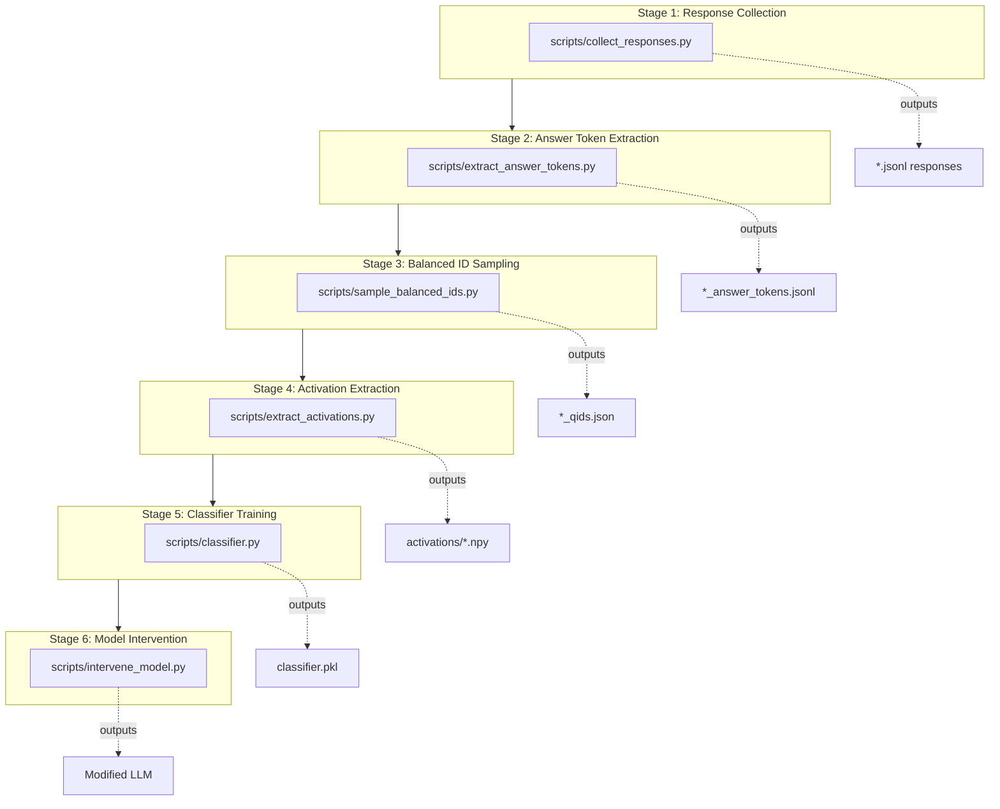
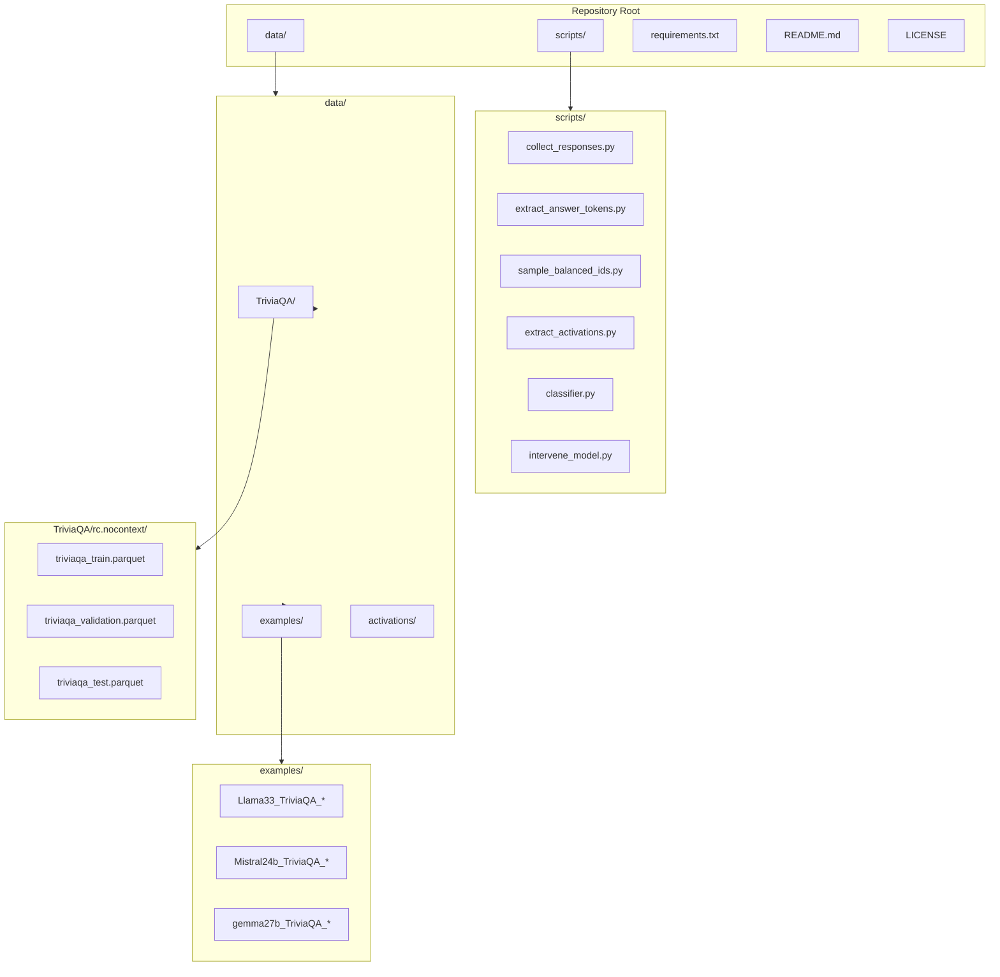
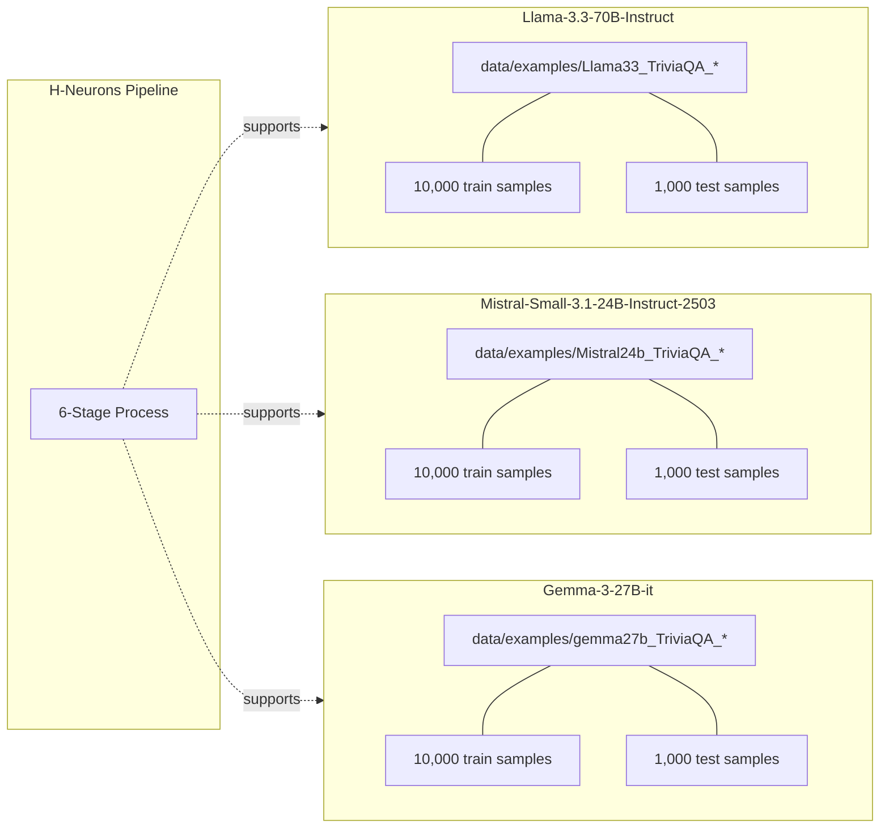
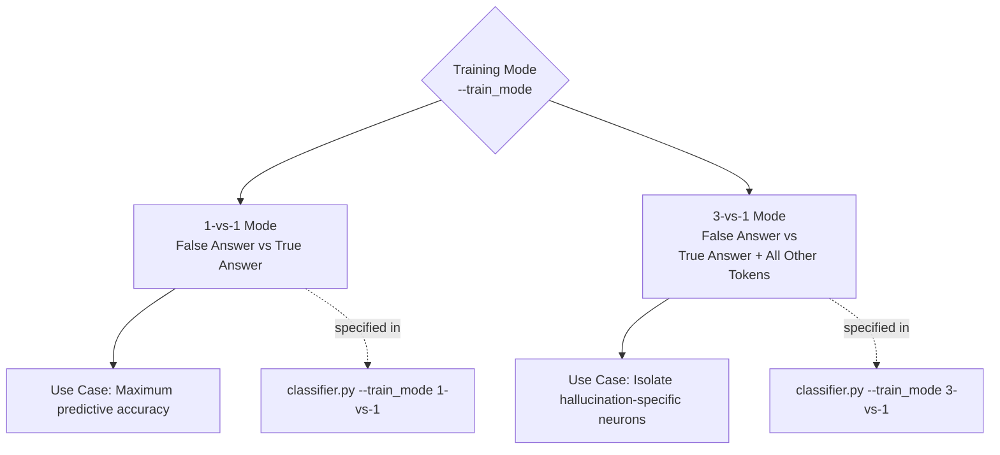
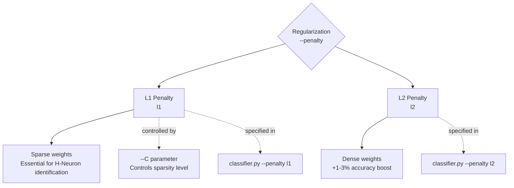
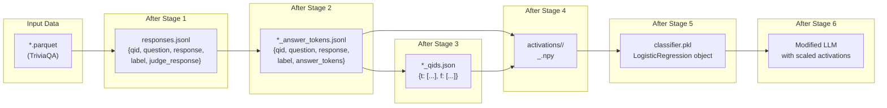

<!-- source: DeepWiki mcp.deepwiki.com · repo thunlp/H-Neurons · page 1 Home · fetched 2026-11-02 -->

# Home

<details>
<summary>Relevant source files</summary>

The following files were used as context for generating this wiki page:

- [LICENSE](LICENSE)
- [README.md](README.md)

</details>


## Purpose and Scope

This wiki documents the **H-Neurons** codebase, a research implementation for identifying and analyzing hallucination-associated neurons in Large Language Models (LLMs). The system provides a complete pipeline for discovering sparse neuron subsets that are causally linked to factual hallucinations, using the CETT (Neuron Contribution) metric and linear classification techniques.

This page provides an architectural overview of the entire system. For installation and setup instructions, see [Getting Started](#2). For theoretical background on H-Neurons and CETT, see [Core Concepts](#3). For step-by-step pipeline execution, see [Pipeline Guide](#4).

**Sources:** [README.md:1-162]()

---

## What are H-Neurons?

**H-Neurons** (Hallucination-Associated Neurons) are a sparse subset of neurons within an LLM's feed-forward network (FFN) layers that exhibit strong causal relationships with hallucination occurrences. The key empirical findings are:

| Property | Description |
|----------|-------------|
| **Sparsity** | A remarkably small fraction of total neurons (<<1%) can predict hallucinations |
| **Predictive Power** | These neurons reliably distinguish between faithful and hallucinated responses |
| **Causality** | Suppressing H-Neurons reduces hallucination rates while preserving general capabilities |
| **Localization** | Concentrated in the FFN `down_proj` layer inputs across transformer blocks |
| **Generalizability** | Detection performance transfers across in-domain and out-of-distribution scenarios |

The identification process relies on the **CETT metric** (Neuron Contribution Quantification), which measures individual neuron contributions during forward passes, particularly at answer token positions.

**Sources:** [README.md:1-21]()

---

## System Architecture Overview

The H-Neurons system implements a **6-stage pipeline** that transforms raw question-answer datasets into actionable neuron-level insights:



**Pipeline Stage Mapping**

Each stage is implemented as a standalone Python script with well-defined inputs and outputs:

| Stage | Script | Primary Input | Primary Output | Purpose |
|-------|--------|---------------|----------------|---------|
| 1 | `collect_responses.py` | TriviaQA `.parquet` | `responses.jsonl` | Generate LLM responses with correctness labels |
| 2 | `extract_answer_tokens.py` | `responses.jsonl` | `answer_tokens.jsonl` | Tag exact answer token positions using LLM judge |
| 3 | `sample_balanced_ids.py` | `answer_tokens.jsonl` | `train_qids.json`, `test_qids.json` | Create balanced True/False sample sets |
| 4 | `extract_activations.py` | `answer_tokens.jsonl`, `*_qids.json` | `activations/*.npy` | Compute CETT values at various token locations |
| 5 | `classifier.py` | `activations/*.npy`, `*_qids.json` | `classifier.pkl` | Train logistic regression to identify H-Neurons |
| 6 | `intervene_model.py` | `classifier.pkl` | Modified model | Suppress H-Neuron activations during inference |

**Sources:** [README.md:22-30](), [README.md:44-147]()

---

## Repository Structure

The codebase is organized into distinct directories for scripts, data, and documentation:



**Key Directory Purposes:**

| Directory | Contents | Description |
|-----------|----------|-------------|
| `scripts/` | 6 Python scripts | Executable pipeline stages (see [Pipeline Guide](#4)) |
| `data/TriviaQA/` | `.parquet` files | Source dataset from HuggingFace (see [TriviaQA Source Dataset](#5.1)) |
| `data/examples/` | `.jsonl`, `.json` files | Pre-processed example data for 3 models (see [Example Data](#5.3)) |
| `data/activations/` | `.npy` files | Extracted CETT activation arrays (see [Activation Extraction](#4.4)) |

**Sources:** [README.md:34-38](), [README.md:50]()

---

## Multi-Model Support

The system has been validated on three LLM architectures, with example data provided for each:



**Provided Example Files:**

Each model has four pre-processed files in `data/examples/`:

| Model | Answer Tokens (Train) | Answer Tokens (Test) | Train QIDs | Test QIDs |
|-------|----------------------|---------------------|------------|-----------|
| Llama33 | `Llama33_TriviaQA_answer_tokens_train.jsonl` | `Llama33_TriviaQA_answer_tokens_test.jsonl` | `Llama33_TriviaQA_train_qids.json` | `Llama33_TriviaQA_test_qids.json` |
| Mistral24b | `Mistral24b_TriviaQA_answer_tokens_train.jsonl` | `Mistral24b_TriviaQA_answer_tokens_test.jsonl` | `Mistral24b_TriviaQA_train_qids.json` | `Mistral24b_TriviaQA_test_qids.json` |
| gemma27b | `gemma27b_TriviaQA_answer_tokens_train.jsonl` | `gemma27b_TriviaQA_answer_tokens_test.jsonl` | `gemma27b_TriviaQA_train_qids.json` | `gemma27b_TriviaQA_test_qids.json` |

The consistent data organization enables comparative analysis of H-Neurons across different model families. For details on multi-model considerations, see [Multi-Model Support](#7.2).

**Sources:** [README.md:50]()

---

## Core Technologies and Dependencies

The implementation leverages specialized libraries for efficient LLM inference, activation extraction, and classification:

**Primary Dependencies:**

| Library | Purpose | Used By |
|---------|---------|---------|
| `vllm` | Fast batched LLM inference | `collect_responses.py` |
| `transformers` | Model loading and tokenization | `extract_answer_tokens.py`, `extract_activations.py` |
| `accelerate` | Distributed model loading | `extract_activations.py` |
| `torch` | Forward hooks and tensor operations | `extract_activations.py` |
| `scikit-learn` | Logistic regression training | `classifier.py` |
| `openai` | LLM-based judging and tagging | `collect_responses.py`, `extract_answer_tokens.py` |
| `pandas` | Parquet file handling | `collect_responses.py`, `sample_balanced_ids.py` |
| `numpy` | Activation array storage | `extract_activations.py`, `classifier.py` |
| `joblib` | Model serialization | `classifier.py` |

**Installation:**

```bash
pip install -r requirements.txt
```

For vLLM installation issues, consult the [official vLLM installation guide](https://docs.vllm.ai/en/latest/getting_started/installation).

**Sources:** [README.md:31-38]()

---

## Key Configuration Decisions

The system exposes several critical configuration choices that significantly impact results:

### Training Mode Selection



**Sources:** [README.md:123-125]()

### Regularization Strategy



**Regularization Parameter `C`:**

The `--C` parameter (inverse regularization strength) controls the trade-off between sparsity and accuracy:
- **Low C**: Aggressive sparsity, few H-Neurons, may miss important neurons
- **High C**: More neurons included, may add noise from general language modeling
- **Recommended**: Grid search to maximize (classification accuracy + TriviaQA performance under intervention)

For comprehensive details, see [Training Modes](#6.1) and [Regularization Options](#6.2).

**Sources:** [README.md:127-135]()

---

## Judging Strategies

The system supports two methods for evaluating response correctness:

| Strategy | Implementation | Pros | Cons | Use Case |
|----------|---------------|------|------|----------|
| **Rule-based** | `--judge_type rule` | Fast, free, deterministic | Less accurate for edge cases | Quick experiments, cost-sensitive scenarios |
| **LLM-based** | `--judge_type llm` | High accuracy, handles nuance | Requires API access, costs | Production research, high-quality datasets |

Both strategies are available in `collect_responses.py` via the `--judge_type` flag. The LLM-based approach uses GPT-4o by default but supports any OpenAI-compatible API. For detailed comparison, see [Judging Strategies](#6.4).

**Sources:** [README.md:45-63]()

---

## Data Flow Overview

The following diagram shows how data transforms through the pipeline stages, mapping natural language concepts to actual file formats:



Each intermediate format is documented in detail in [Intermediate Data Formats](#5.2).

**Sources:** [README.md:44-147]()

---

## Getting Started

To begin using the H-Neurons system:

1. **Install dependencies**: See [Getting Started](#2) for detailed installation instructions
2. **Prepare data**: The TriviaQA dataset is available in `data/TriviaQA/`, see [TriviaQA Source Dataset](#5.1)
3. **Run the pipeline**: Follow the [Pipeline Guide](#4) for step-by-step execution
4. **Understand CETT**: Read [CETT Metric Implementation](#7.1) for the theoretical foundation

**Quick Start Example:**

```bash
# Using provided example data for Llama33
python scripts/extract_activations.py \
    --model_path /path/to/llama-3.3-70b \
    --input_path data/examples/Llama33_TriviaQA_answer_tokens_train.jsonl \
    --train_ids_path data/examples/Llama33_TriviaQA_train_qids.json \
    --output_root data/activations \
    --locations answer_tokens \
    --method mean \
    --use_mag --use_abs

python scripts/classifier.py \
    --train_ids data/examples/Llama33_TriviaQA_train_qids.json \
    --train_ans_acts data/activations/answer_tokens \
    --train_mode 1-vs-1 \
    --penalty l1 \
    --C 1.0 \
    --save_model models/llama33_classifier.pkl
```

**Sources:** [README.md:40-147]()

---

## Research Context

This implementation accompanies the paper:

> Cheng Gao, Huimin Chen, Chaojun Xiao, Zhiyi Chen, Zhiyuan Liu, Maosong Sun. **H-Neurons: On the Existence, Impact, and Origin of Hallucination-Associated Neurons in LLMs**. arXiv:2512.01797, 2025.

**Key Research Contributions:**

1. Empirical demonstration that sparse neuron subsets reliably predict hallucinations
2. Introduction of CETT metric for quantifying neuron-level contributions
3. Evidence of causal links between identified neurons and over-compliance behaviors
4. Generalization analysis across in-domain and out-of-distribution scenarios

The code is released under the MIT License (see [LICENSE:1-21]()) by THUNLP (Tsinghua University Natural Language Processing Lab).

**Sources:** [README.md:10-14](), [README.md:148-162](), [LICENSE:1-21]()

---

