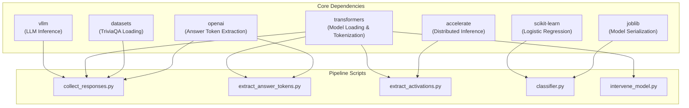
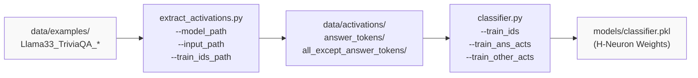
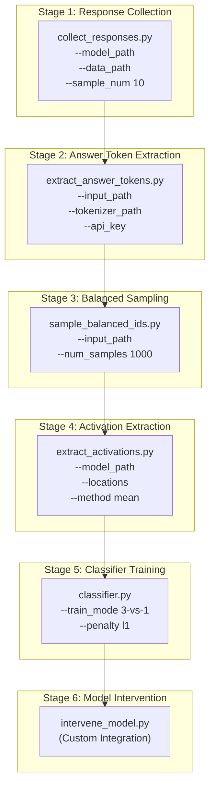

<!-- source: DeepWiki mcp.deepwiki.com · repo thunlp/H-Neurons · page 2 Getting Started · fetched 2026-11-02 -->

# Getting Started

<details>
<summary>Relevant source files</summary>

The following files were used as context for generating this wiki page:

- [README.md](README.md)
- [requirements.txt](requirements.txt)

</details>


This page provides installation instructions, environment setup, and a quick-start guide for running the H-Neurons pipeline. By the end of this guide, you will have a working environment capable of identifying hallucination-associated neurons in large language models.

For detailed explanations of H-Neurons and the CETT metric, see [Core Concepts](#3). For the complete 6-step pipeline, see [Pipeline Guide](#4). For information on data organization and formats, see [Data Organization](#5).

## Purpose and Scope

This guide covers:
- Installing Python dependencies and environment setup
- Verifying your installation
- Running a minimal end-to-end example
- Understanding the basic workflow

This guide does **not** cover:
- Detailed explanation of each pipeline step (see [Pipeline Guide](#4))
- Configuration options and advanced parameters (see [Configuration & Options](#6))
- Data format specifications (see [Data Organization](#5))

---

## Prerequisites

Before starting, ensure you have:

| Requirement | Details |
|------------|---------|
| **Python Version** | Python 3.8 or higher |
| **GPU** | CUDA-compatible GPU with ≥24GB VRAM (for Llama-3.3-70B or similar models) |
| **Disk Space** | ≥100GB for model weights, activations, and intermediate data |
| **API Access** | OpenAI API key (for answer token extraction with GPT-4o) |
| **Model Access** | HuggingFace access to target models (Llama-3.3-70B, Mistral-Small-3.1-24B, Gemma-3-27B) |

**Sources:** [README.md:31-38](), [README.md:42]()

---

## Installation

### Step 1: Clone the Repository

```bash
git clone https://github.com/thunlp/H-Neurons.git
cd H-Neurons
```

### Step 2: Install Dependencies

The project uses `vLLM` for efficient LLM inference. If you encounter installation issues with vLLM, consult the [official vLLM installation guide](https://docs.vllm.ai/en/latest/getting_started/installation).

```bash
pip install -r requirements.txt
```

**Sources:** [README.md:34-38]()

### Dependency Overview

The following diagram shows the core Python packages and their roles in the pipeline:



**Dependency Installation Details**

| Package | Version Constraint | Primary Use |
|---------|-------------------|-------------|
| `vllm` | Latest | High-throughput LLM inference in `collect_responses.py` |
| `transformers` | Latest | Model loading, tokenization across all scripts |
| `datasets` | Latest | Loading TriviaQA parquet files |
| `openai` | Latest | GPT-4o API calls for answer token extraction |
| `accelerate` | Latest | Multi-GPU support in activation extraction |
| `scikit-learn` | Latest | Logistic Regression training in `classifier.py` |
| `joblib` | Latest | Saving/loading `.pkl` classifier models |

**Sources:** [requirements.txt:1-7](), [README.md:32]()

---

## Environment Setup

### Configure API Keys

For answer token extraction with GPT-4o, set your OpenAI API credentials:

```bash
export OPENAI_API_KEY="your-api-key-here"
export OPENAI_BASE_URL="https://api.openai.com/v1"  # or your custom endpoint
```

### Download TriviaQA Dataset

The pipeline uses the TriviaQA `rc.nocontext` dataset. You can either:

1. **Download manually** from the [TriviaQA repository](https://huggingface.co/datasets/trivia_qa) and place in `data/TriviaQA/rc.nocontext/`
2. **Use provided example data** in `data/examples/` (pre-processed for Llama-3.3-70B, Mistral-Small-3.1-24B, Gemma-3-27B)

### Directory Structure Setup

After installation, create the following directory structure:

```bash
mkdir -p data/activations
mkdir -p models
mkdir -p outputs
```

**Sources:** [README.md:50-63]()

---

## Verification

### Test vLLM Installation

Verify vLLM can load a model:

```python
from vllm import LLM
llm = LLM(model="facebook/opt-125m")  # Small test model
print("vLLM installation successful!")
```

### Test Dependencies

```bash
python -c "import transformers, datasets, openai, accelerate, sklearn, joblib; print('All dependencies installed successfully!')"
```

### Verify Example Data

Check that example data files exist:

```bash
ls data/examples/Llama33_TriviaQA_answer_tokens_train.jsonl
ls data/examples/Llama33_TriviaQA_train_qids.json
```

If these files exist, you can proceed to the Quick Start using pre-computed data.

**Sources:** [README.md:50]()

---

## Quick Start Guide

This section demonstrates a minimal end-to-end workflow using the provided Llama-3.3-70B example data. The full pipeline requires 6 steps, but for quick verification, we'll train a classifier using pre-extracted data.

### Workflow Overview



**Sources:** [README.md:40-146]()

### Step-by-Step Quick Start

#### 1. Extract Activations (CETT)

Using the provided Llama-3.3-70B example data, extract neuron-level activations:

```bash
python scripts/extract_activations.py \
    --model_path meta-llama/Llama-3.3-70B-Instruct \
    --input_path data/examples/Llama33_TriviaQA_answer_tokens_train.jsonl \
    --train_ids_path data/examples/Llama33_TriviaQA_train_qids.json \
    --output_root data/activations \
    --locations answer_tokens all_except_answer_tokens \
    --method mean \
    --use_mag --use_abs
```

**What this does:**
- Loads the Llama-3.3-70B model
- Reads question-response pairs from `answer_tokens_train.jsonl`
- Uses question IDs from `train_qids.json` (balanced True/False samples)
- Extracts activations at two locations: `answer_tokens` and `all_except_answer_tokens`
- Saves numpy arrays to `data/activations/answer_tokens/` and `data/activations/all_except_answer_tokens/`

**Expected output structure:**
```
data/activations/
├── answer_tokens/
│   ├── layer_0.npy
│   ├── layer_1.npy
│   └── ...
└── all_except_answer_tokens/
    ├── layer_0.npy
    ├── layer_1.npy
    └── ...
```

**Sources:** [README.md:93-106]()

#### 2. Train H-Neuron Classifier

Train a logistic regression classifier to identify H-Neurons:

```bash
python scripts/classifier.py \
    --model_path meta-llama/Llama-3.3-70B-Instruct \
    --train_ids data/examples/Llama33_TriviaQA_train_qids.json \
    --train_ans_acts data/activations/answer_tokens \
    --train_other_acts data/activations/all_except_answer_tokens \
    --train_mode 3-vs-1 \
    --penalty l1 \
    --C 1.0 \
    --save_model models/classifier.pkl
```

**What this does:**
- Loads activations from `data/activations/answer_tokens/` and `data/activations/all_except_answer_tokens/`
- Uses `3-vs-1` mode: hallucinated answer tokens (class 1) vs. all other token types (class 0)
- Applies `l1` regularization for sparse H-Neuron identification
- Saves the trained classifier to `models/classifier.pkl`

**Expected output:**
```
Train Accuracy: 0.85
Train Precision: 0.82
Train Recall: 0.88
Train F1: 0.85
Train AUROC: 0.91
Number of non-zero neurons: 127
```

**Sources:** [README.md:108-136]()

### Parameter Reference Table

| Parameter | Value in Quick Start | Purpose |
|-----------|---------------------|---------|
| `--model_path` | `meta-llama/Llama-3.3-70B-Instruct` | Target model for analysis |
| `--input_path` | `data/examples/Llama33_TriviaQA_answer_tokens_train.jsonl` | Question-response pairs with answer token annotations |
| `--train_ids_path` | `data/examples/Llama33_TriviaQA_train_qids.json` | Balanced question IDs (True/False samples) |
| `--output_root` | `data/activations` | Root directory for activation storage |
| `--locations` | `answer_tokens all_except_answer_tokens` | Token regions to extract activations from |
| `--method` | `mean` | Aggregation method (mean across tokens) |
| `--use_mag --use_abs` | Flags | Apply magnitude scaling and absolute value in CETT |
| `--train_mode` | `3-vs-1` | Classifier training strategy (see [6.1](#6.1)) |
| `--penalty` | `l1` | Regularization type for sparsity (see [6.2](#6.2)) |
| `--C` | `1.0` | Inverse regularization strength |

**Sources:** [README.md:93-136]()

---

## Command Mapping to Pipeline Stages

The following diagram maps command-line scripts to the 6-stage pipeline:



**Sources:** [README.md:22-30](), [README.md:40-146]()

---

## Next Steps

After completing the quick start:

1. **Run the full pipeline** with custom data: See [Pipeline Guide](#4) for detailed instructions on each stage
2. **Explore configuration options**: See [Configuration & Options](#6) to understand training modes, regularization, and activation extraction parameters
3. **Perform model intervention**: See [Step 6: Model Intervention](#4.6) to scale H-Neurons and reduce hallucinations
4. **Understand the theory**: See [Core Concepts](#3) for detailed explanations of H-Neurons and the CETT metric

**Sources:** [README.md:1-162]()

---

## Troubleshooting

### Common Issues

| Issue | Cause | Solution |
|-------|-------|----------|
| `vllm` installation fails | CUDA version mismatch | Check CUDA compatibility at [vLLM docs](https://docs.vllm.ai/en/latest/getting_started/installation) |
| Out of memory during activation extraction | Model too large for GPU | Use `--batch_size 1` in `extract_activations.py` or reduce model size |
| OpenAI API errors | Invalid API key | Verify `OPENAI_API_KEY` environment variable |
| Missing example data | Incomplete clone | Re-clone repository with `git clone --recursive` |
| FileNotFoundError for activations | Activation extraction not run | Complete Step 1 (extract_activations.py) before Step 2 (classifier.py) |

**Sources:** [README.md:32]()

---

## File Path Reference

Key files referenced in this guide:

| Path | Description |
|------|-------------|
| [requirements.txt:1-7]() | Python dependencies |
| [README.md:31-38]() | Installation instructions |
| [README.md:40-146]() | Full pipeline usage examples |
| `data/examples/Llama33_TriviaQA_answer_tokens_train.jsonl` | Pre-processed Llama-3.3-70B training data |
| `data/examples/Llama33_TriviaQA_train_qids.json` | Balanced question IDs for Llama-3.3-70B |
| `scripts/extract_activations.py` | CETT activation extraction script |
| `scripts/classifier.py` | H-Neuron classifier training script |

**Sources:** [README.md:1-162](), [requirements.txt:1-7]()

---

