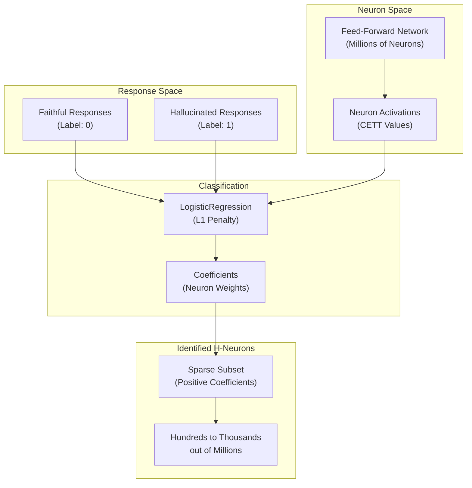
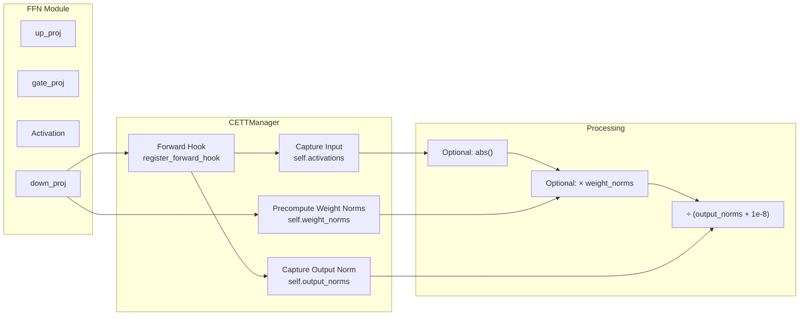
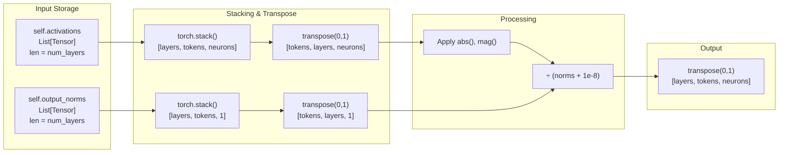
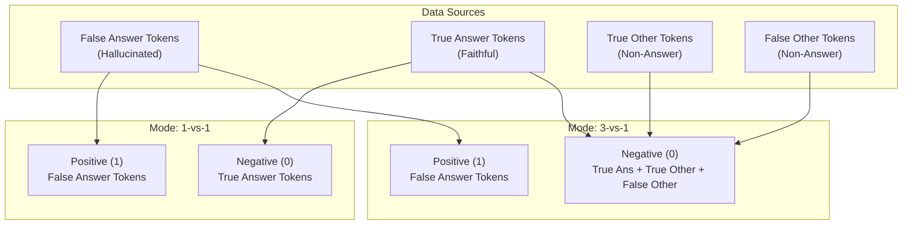
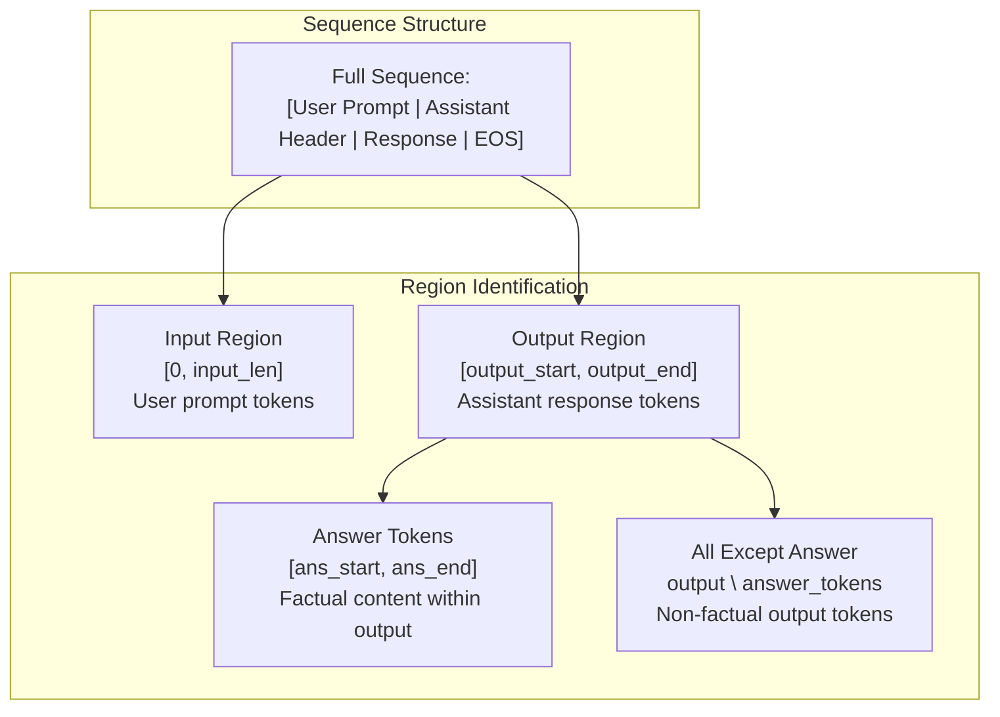
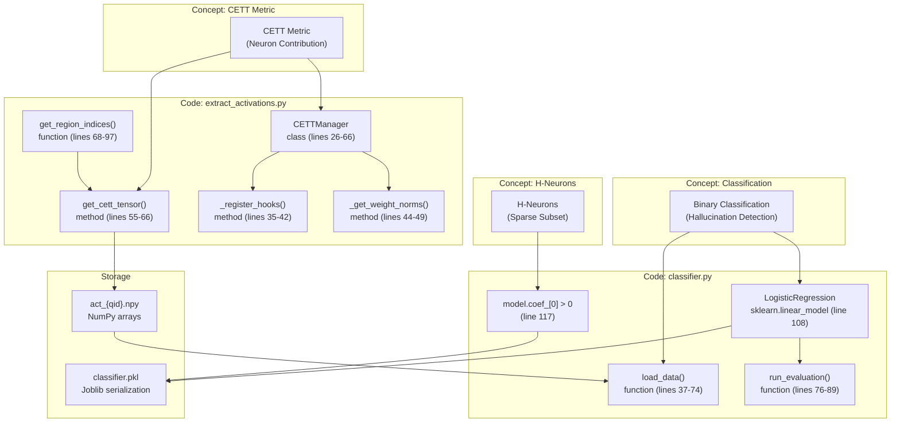

<!-- source: DeepWiki mcp.deepwiki.com · repo thunlp/H-Neurons · page 3 Core Concepts · fetched 2026-11-02 -->

# Core Concepts

<details>
<summary>Relevant source files</summary>

The following files were used as context for generating this wiki page:

- [README.md](README.md)
- [scripts/classifier.py](scripts/classifier.py)
- [scripts/extract_activations.py](scripts/extract_activations.py)

</details>


This page provides a detailed explanation of the theoretical and technical foundations underlying the H-Neurons system. It covers the definition of H-Neurons, the CETT (neuron Contribution) metric used to quantify neuron activity, the hallucination detection methodology, and the mathematical formulations that drive the identification process.

For practical implementation details of the pipeline stages, see [Pipeline Guide](#4). For configuration options and parameter tuning, see [Configuration & Options](#6).

---

## Overview

The H-Neurons framework is built on three core concepts that work together to identify and manipulate neurons associated with hallucination in large language models:

1. **H-Neurons**: A sparse subset of neurons in the feed-forward layers that are causally linked to hallucination occurrences
2. **CETT Metric**: A neuron contribution quantification method that measures each neuron's activation while accounting for layer output normalization
3. **Binary Classification**: A supervised learning approach that distinguishes between hallucinated and faithful responses based on neuron activations

---

## H-Neurons: Hallucination-Associated Neurons

### Definition

**H-Neurons** (Hallucination-associated Neurons) are individual neurons in a language model's feed-forward networks that exhibit significantly different activation patterns when the model generates hallucinated content versus factual content. These neurons are:

- **Sparse**: Only a small fraction of the total neurons in the model (typically hundreds to thousands out of millions)
- **Predictive**: Their activation patterns can reliably predict whether a response contains hallucinations
- **Causal**: Suppressing or scaling their activations directly affects hallucination rates

Sources: [README.md:14-14]()

### Identification Process

H-Neurons are identified through a binary classification task where a linear classifier (Logistic Regression) is trained to distinguish hallucinated responses from faithful ones. Neurons with positive coefficients in the trained classifier are designated as H-Neurons.



**Diagram: H-Neuron Identification Pipeline**

Sources: [scripts/classifier.py:108-117](), [README.md:17-17]()

### Properties

| Property | Description | Code Reference |
|----------|-------------|----------------|
| **Location** | Input to `down_proj` layer in FFN | [scripts/extract_activations.py:36-42]() |
| **Sparsity** | Enforced through L1 regularization | [scripts/classifier.py:108-111]() |
| **Sign** | Positive coefficients indicate H-Neurons | [scripts/classifier.py:117]() |
| **Generalizability** | Effective across in-domain and OOD scenarios | [README.md:20-20]() |

Sources: [scripts/classifier.py:108-117](), [scripts/extract_activations.py:36-42]()

---

## CETT Metric: Neuron Contribution Quantification

### Overview

The **CETT** metric (Neuron Contribution Extraction Through Transformations) quantifies the contribution of individual neurons during inference. It captures neuron activations while accounting for their magnitude, sign, and the overall layer output normalization.

### Implementation: CETTManager Class

The CETT metric is implemented in the `CETTManager` class, which uses forward hooks to capture activations at the `down_proj` layer input.



**Diagram: CETT Metric Computation Pipeline**

Sources: [scripts/extract_activations.py:26-66]()

### Mathematical Formulation

The CETT value for neuron $i$ in layer $l$ at token position $t$ is computed as:

$$
\text{CETT}_{l,t,i} = \frac{|\text{act}_{l,t,i}| \cdot \|\mathbf{w}_i^{\text{down}}\|_2}{\|\mathbf{o}_{l,t}\|_2 + \epsilon}
$$

Where:
- $\text{act}_{l,t,i}$: Activation of neuron $i$ (input to `down_proj`)
- $\mathbf{w}_i^{\text{down}}$: Weight vector for neuron $i$ in `down_proj` layer
- $\mathbf{o}_{l,t}$: Output vector of layer $l$ at token $t$
- $\epsilon = 10^{-8}$: Numerical stability constant

| Component | Symbol | Implementation | Code Location |
|-----------|--------|----------------|---------------|
| Neuron Activation | $\text{act}_{l,t,i}$ | `input[0]` in hook | [scripts/extract_activations.py:37]() |
| Absolute Value | $\|\cdot\|$ | `torch.abs(acts)` | [scripts/extract_activations.py:63]() |
| Weight Norm | $\|\mathbf{w}_i\|_2$ | `torch.norm(module.weight.data, dim=0)` | [scripts/extract_activations.py:48]() |
| Output Norm | $\|\mathbf{o}\|_2$ | `torch.norm(output.detach(), dim=-1)` | [scripts/extract_activations.py:38]() |
| Normalization | $\epsilon$ | `1e-8` | [scripts/extract_activations.py:66]() |

Sources: [scripts/extract_activations.py:55-66]()

### CETT Configuration Options

The CETT computation supports two boolean flags that modify the calculation:

```python
# From extract_activations.py parse_args()
parser.add_argument("--use_mag", action="store_true", default=True)
parser.add_argument("--use_abs", action="store_true", default=True)
```

| Flag | Effect | Mathematical Impact | Use Case |
|------|--------|---------------------|----------|
| `--use_abs` | Apply absolute value | $\text{act} \rightarrow |\text{act}|$ | Ignore activation sign, focus on magnitude |
| `--use_mag` | Multiply by weight norms | $\text{act} \rightarrow \text{act} \cdot \|\mathbf{w}\|_2$ | Weight contribution by downstream impact |

Sources: [scripts/extract_activations.py:22-23](), [scripts/extract_activations.py:63-64]()

### Tensor Shape Transformations

The `CETTManager.get_cett_tensor()` method performs the following transformations:



**Diagram: CETT Tensor Shape Transformations**

Sources: [scripts/extract_activations.py:55-66]()

---

## Hallucination Detection Methodology

### Binary Classification Framework

The H-Neurons system frames hallucination detection as a binary classification problem:

- **Positive Class (Label 1)**: Hallucinated/False responses
- **Negative Class (Label 0)**: Faithful/True responses (and potentially other tokens)

### Training Modes

The system supports two distinct training modes that define what constitutes the negative class:



**Diagram: Training Mode Architectures**

Sources: [scripts/classifier.py:37-73](), [README.md:123-125]()

#### Mode Comparison

| Aspect | 1-vs-1 Mode | 3-vs-1 Mode |
|--------|-------------|-------------|
| **Positive Class** | False answer tokens | False answer tokens |
| **Negative Class** | True answer tokens only | True answer + True other + False other |
| **Purpose** | Maximize prediction accuracy | Isolate hallucination-specific neurons |
| **Data Loading** | [scripts/classifier.py:49-60]() | [scripts/classifier.py:63-72]() |
| **Recommendation** | Highest accuracy detection | Research/mechanistic analysis |
| **Sparsity** | Lower | Higher |

Sources: [README.md:123-125](), [scripts/classifier.py:30-73]()

### Regularization Strategies

The classifier supports two regularization penalties that produce fundamentally different models:

| Penalty | Effect | Coefficient Distribution | Use Case | Code Reference |
|---------|--------|-------------------------|----------|----------------|
| **L1** | Drives most weights to zero | Sparse (hundreds of non-zero) | Identifying specific H-Neurons for intervention | [scripts/classifier.py:108-109]() |
| **L2** | Shrinks all weights uniformly | Dense (all non-zero) | Maximum detection accuracy (+1-3%) | [scripts/classifier.py:108-109]() |

The regularization strength is controlled by the `C` parameter (inverse of regularization strength):

$$
\text{Loss} = \text{LogLoss}(y, \hat{y}) + \frac{1}{C} \cdot R(\mathbf{w})
$$

Where $R(\mathbf{w}) = \|\mathbf{w}\|_1$ for L1 or $R(\mathbf{w}) = \|\mathbf{w}\|_2^2$ for L2.

Sources: [scripts/classifier.py:108-111](), [README.md:127-135]()

---

## Token Region Extraction

### Region Types

The CETT metric can be computed over different token regions within a sequence, allowing focused analysis of specific parts of the model's response:



**Diagram: Token Region Segmentation**

Sources: [scripts/extract_activations.py:68-97]()

### Region Identification Logic

The `get_region_indices()` function identifies token boundaries for each region:

| Region | Start Index | End Index | Implementation |
|--------|-------------|-----------|----------------|
| `input` | 0 | `user_ids.shape[1] - 1` | [scripts/extract_activations.py:75-76]() |
| `output` | `input_len + 1` | `len(full_tokens) - 1` | [scripts/extract_activations.py:80-81]() |
| `answer_tokens` | Found via pattern matching | `ans_start + len(answer_tokens)` | [scripts/extract_activations.py:87-91]() |
| `all_except_answer_tokens` | Concatenate segments | Before and after answer region | [scripts/extract_activations.py:135-141]() |

Sources: [scripts/extract_activations.py:68-97]()

### Aggregation Methods

After extracting CETT values for tokens in a region, the values are aggregated to produce a single vector per layer:

```python
# From extract_activations.py
if args.method == "mean": 
    final_act = selected_cett.mean(dim=1)  # Average over tokens
else: 
    final_act, _ = selected_cett.max(dim=1)  # Max over tokens
```

| Method | Operation | Output Shape | Use Case |
|--------|-----------|--------------|----------|
| `mean` | `torch.mean(dim=1)` | `[layers, neurons]` | Smooth, representative activation |
| `max` | `torch.max(dim=1)` | `[layers, neurons]` | Peak activation detection |

Sources: [scripts/extract_activations.py:149-150]()

---

## Code Entity Mapping

This diagram maps the core concepts to their implementing code entities:



**Diagram: Core Concepts to Code Entity Mapping**

Sources: [scripts/extract_activations.py:26-97](), [scripts/classifier.py:37-117]()

---

## Evaluation Metrics

The classifier's performance is assessed using five standard binary classification metrics:

| Metric | Formula | Implementation | Code Location |
|--------|---------|----------------|---------------|
| **Accuracy** | $\frac{TP + TN}{TP + TN + FP + FN}$ | `accuracy_score(y, preds)` | [scripts/classifier.py:80]() |
| **Precision** | $\frac{TP}{TP + FP}$ | `precision_recall_fscore_support(...)[0]` | [scripts/classifier.py:81]() |
| **Recall** | $\frac{TP}{TP + FN}$ | `precision_recall_fscore_support(...)[1]` | [scripts/classifier.py:81]() |
| **F1 Score** | $\frac{2 \cdot \text{Precision} \cdot \text{Recall}}{\text{Precision} + \text{Recall}}$ | `precision_recall_fscore_support(...)[2]` | [scripts/classifier.py:81]() |
| **AUROC** | Area under ROC curve | `roc_auc_score(y, probs)` | [scripts/classifier.py:82]() |

Where:
- TP = True Positives (correctly identified hallucinations)
- TN = True Negatives (correctly identified faithful responses)
- FP = False Positives (faithful responses misclassified as hallucinations)
- FN = False Negatives (hallucinations misclassified as faithful)

Sources: [scripts/classifier.py:76-89]()

---

## Summary

The H-Neurons framework combines three core technical components:

1. **CETT Metric**: Quantifies neuron contributions through forward hooks on `down_proj` layers, incorporating weight norms and output normalization
2. **Binary Classification**: Trains a Logistic Regression model with L1/L2 regularization to distinguish hallucinated from faithful responses
3. **Sparse Neuron Identification**: Extracts neurons with positive coefficients as H-Neurons, creating an interpretable and causal model of hallucination

This foundation enables both detection (high-accuracy classification) and intervention (targeted neuron manipulation) capabilities. For implementation details, proceed to [Pipeline Guide](#4).

Sources: [README.md:1-162](), [scripts/extract_activations.py:1-156](), [scripts/classifier.py:1-132]()

---

