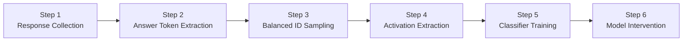
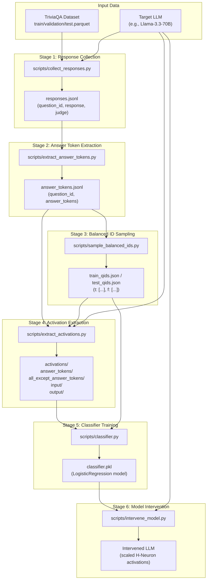
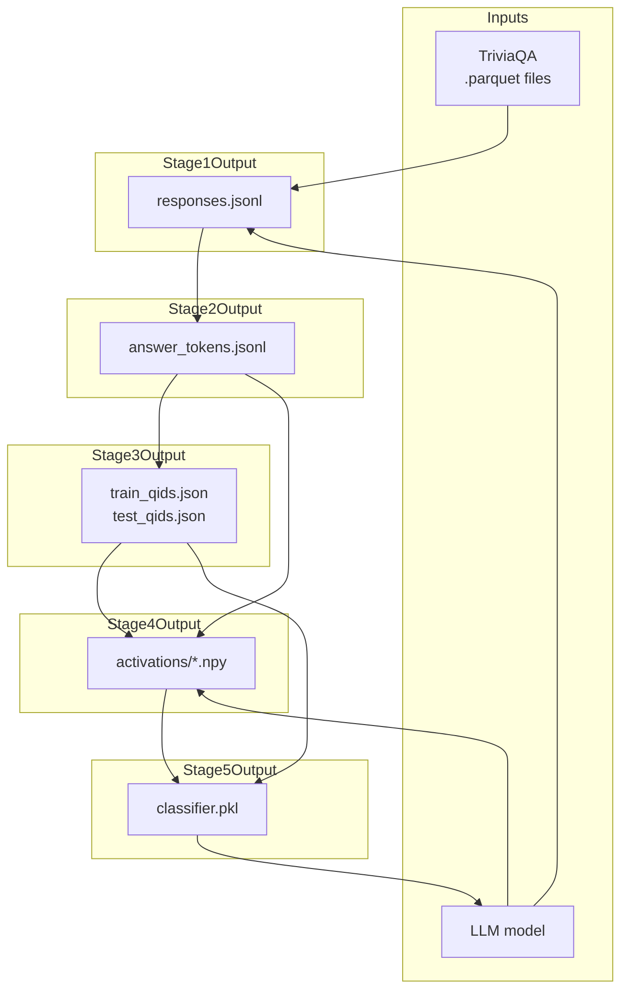
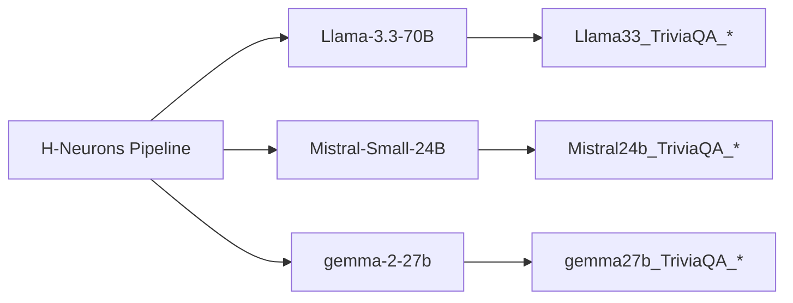

<!-- source: DeepWiki mcp.deepwiki.com · repo thunlp/H-Neurons · page 4 Pipeline Guide · fetched 2026-11-02 -->

# Pipeline Guide

<details>
<summary>Relevant source files</summary>

The following files were used as context for generating this wiki page:

- [README.md](README.md)

</details>


This document provides an overview of the complete H-Neuron identification and intervention pipeline. It describes the six-step workflow for extracting, identifying, and intervening on hallucination-associated neurons in large language models.

For detailed configuration options and parameters used throughout the pipeline, see [Configuration & Options](#6). For theoretical background on H-Neurons and the CETT metric, see [Core Concepts](#3). For step-by-step installation and initial setup, see [Getting Started](#2).

## Overview

The H-Neurons pipeline transforms raw question-answer data into a set of identified neurons that can predict and causally influence hallucination behavior in LLMs. The process consists of six sequential stages, each building upon artifacts produced by the previous stage.

**Pipeline Stages:**



**Sources:** [README.md:22-29]()

## Complete Pipeline Architecture

The following diagram maps each pipeline stage to its corresponding script, input data, and output artifacts:



**Sources:** [README.md:22-146]()

## Pipeline Stages

### Stage 1: Response Collection

**Script:** `scripts/collect_responses.py`

**Purpose:** Generate LLM responses to TriviaQA questions and judge their correctness.

**Key Parameters:**
- `--sample_num`: Number of samples per question (10 for training, 1 for evaluation)
- `--judge_type`: Method for judging correctness (`rule` or `llm`)
- `--max_samples`: Maximum number of questions to process

**Output Format:** JSONL file where each line contains:
```json
{
  "question_id": "string",
  "question": "string",
  "response": "string",
  "judge": "t" or "f"
}
```

For training data, only questions with **consistent** judgments across all samples are retained. For evaluation data, single-sample responses are collected.

**Details:** See [Step 1: Response Collection](#4.1)

**Sources:** [README.md:44-63]()

### Stage 2: Answer Token Extraction

**Script:** `scripts/extract_answer_tokens.py`

**Purpose:** Identify the exact token positions in the response that correspond to factual answer content using LLM-based tagging.

**Key Parameters:**
- `--tokenizer_path`: Path to model tokenizer
- `--api_key`: OpenAI API key for GPT-4o judge
- `--judge_model`: LLM judge model (e.g., `gpt-4o`)

**Output Format:** JSONL file extending the response data:
```json
{
  "question_id": "string",
  "answer_tokens": [int, int, ...]
}
```

**Optional:** This step can be skipped by creating an `answer_tokens.jsonl` with empty lists and using `--locations output` in Stage 4.

**Details:** See [Step 2: Answer Token Extraction](#4.2)

**Sources:** [README.md:66-80]()

### Stage 3: Balanced ID Sampling

**Script:** `scripts/sample_balanced_ids.py`

**Purpose:** Create balanced training/test sets with equal numbers of faithful (t) and hallucinated (f) samples.

**Key Parameters:**
- `--num_samples`: Total number of samples (split equally between t and f)

**Output Format:** JSON file with two lists:
```json
{
  "t": ["qid1", "qid2", ...],
  "f": ["qid3", "qid4", ...]
}
```

**Details:** See [Step 3: Balanced ID Sampling](#4.3)

**Sources:** [README.md:82-91]()

### Stage 4: Activation Extraction

**Script:** `scripts/extract_activations.py`

**Purpose:** Extract neuron-level contribution scores (CETT) from the target LLM using forward hooks.

**Key Parameters:**
- `--locations`: Token regions to extract (`answer_tokens`, `all_except_answer_tokens`, `input`, `output`)
- `--method`: Aggregation method (`mean` or `max`)
- `--use_mag --use_abs`: Apply magnitude and absolute value normalization

**Output Structure:** Directory hierarchy:
```
activations/
├── answer_tokens/
│   ├── qid1.npy
│   └── qid2.npy
├── all_except_answer_tokens/
│   ├── qid1.npy
│   └── qid2.npy
├── input/
└── output/
```

Each `.npy` file contains shape `[num_layers, num_neurons]` activation values.

**Details:** See [Step 4: Activation Extraction](#4.4)

**Sources:** [README.md:93-106]()

### Stage 5: Classifier Training

**Script:** `scripts/classifier.py`

**Purpose:** Train a Logistic Regression classifier to identify H-Neurons and predict hallucinations.

**Key Parameters:**
- `--train_mode`: Training strategy (`1-vs-1` or `3-vs-1`)
- `--penalty`: Regularization type (`l1` for sparsity, `l2` for accuracy)
- `--C`: Regularization strength (controls sparsity in L1)

**Training Modes:**

| Mode | Positive Class | Negative Class | Use Case |
|------|---------------|----------------|----------|
| `1-vs-1` | False answer tokens | True answer tokens | Maximum prediction accuracy |
| `3-vs-1` | False answer tokens | True answer tokens + all other tokens | Isolate hallucination-specific neurons |

**Regularization:**

| Penalty | Effect | Best For |
|---------|--------|----------|
| `l1` | Sparse weights, most neurons = 0 | Identifying specific H-Neurons for intervention |
| `l2` | Dense weights, 1-3% accuracy boost | Pure hallucination detection |

**Output:** `classifier.pkl` containing trained `sklearn.linear_model.LogisticRegression` model.

**Details:** See [Step 5: Classifier Training](#4.5)

**Sources:** [README.md:108-141]()

### Stage 6: Model Intervention

**Script:** `scripts/intervene_model.py`

**Purpose:** Apply neuron-level interventions during LLM inference by scaling H-Neuron activations.

**Intervention Target:** Input to `down_proj` layer at neuron indices with positive weights in the L1 classifier.

**Implementation:** Modify forward pass to scale activations of identified H-Neurons before the `down_proj` transformation.

**Details:** See [Step 6: Model Intervention](#4.6)

**Sources:** [README.md:142-146]()

## Data Flow Between Stages

The pipeline maintains a clear data lineage, with each stage consuming specific artifacts from previous stages:



**Sources:** [README.md:22-146]()

## Execution Patterns

### Full Pipeline Execution

For complete H-Neuron identification from scratch:

1. Run all six stages in sequence
2. Separate executions for training and test data
3. Training data: `--sample_num 10`, consistency filtering enabled
4. Test data: `--sample_num 1`, no filtering

### Training vs. Evaluation Workflow

| Dataset | Sample Count | Purpose | Stages Required |
|---------|--------------|---------|-----------------|
| Training | 10 samples/question | Train classifier | 1-5 |
| Test | 1 sample/question | Evaluate classifier | 1-5 (eval mode) |
| Intervention | N/A | Apply H-Neuron scaling | 6 only |

### Partial Pipeline Execution

**Skip Answer Token Extraction (Stage 2):**
- Manually create `answer_tokens.jsonl` with empty lists
- Set `--locations output` in Stage 4
- Trade-off: Lower accuracy, faster execution

**Evaluation Only (Stage 5):**
- Use `--load_model` to load pre-trained `classifier.pkl`
- Requires test activations from Stage 4
- Skip `--train_ids` and `--save_model`

**Sources:** [README.md:44-141]()

## Multi-Model Support

The pipeline supports parallel execution across different LLM architectures. Each model maintains separate artifact directories:



**Naming Convention:** `{model_name}_TriviaQA_{artifact_type}_{split}.{ext}`

Example artifacts provided in `data/examples/`:
- `Llama33_TriviaQA_answer_tokens_train.jsonl`
- `Mistral24b_TriviaQA_test_qids.json`
- `gemma27b_TriviaQA_answer_tokens_test.jsonl`

**Details:** See [Advanced Topics: Multi-Model Support](#7.2)

**Sources:** [README.md:50]()

## Pipeline Summary Table

| Stage | Script | Primary Input | Primary Output | GPU Required |
|-------|--------|---------------|----------------|--------------|
| 1 | `collect_responses.py` | TriviaQA `.parquet` | `responses.jsonl` | Yes (vLLM) |
| 2 | `extract_answer_tokens.py` | `responses.jsonl` | `answer_tokens.jsonl` | No (API) |
| 3 | `sample_balanced_ids.py` | `answer_tokens.jsonl` | `*_qids.json` | No |
| 4 | `extract_activations.py` | `answer_tokens.jsonl`, `*_qids.json` | `activations/*.npy` | Yes (transformers) |
| 5 | `classifier.py` | `activations/*.npy`, `*_qids.json` | `classifier.pkl` | No (sklearn) |
| 6 | `intervene_model.py` | `classifier.pkl` | Modified LLM | Yes (inference) |

**Sources:** [README.md:22-146]()

---

