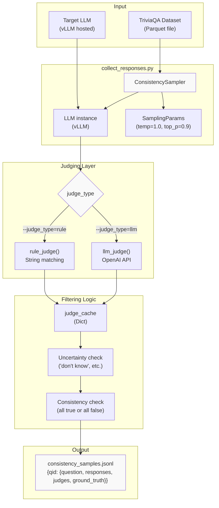
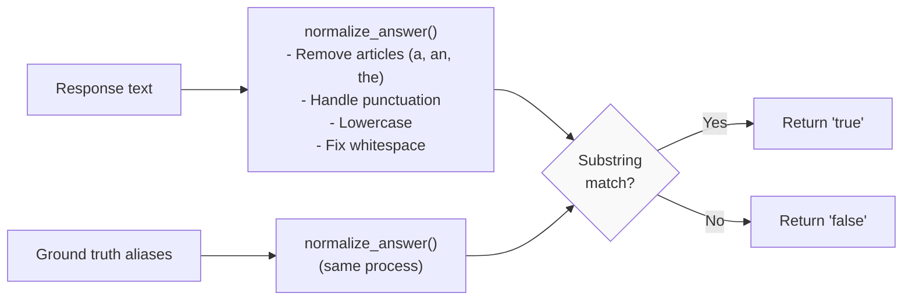
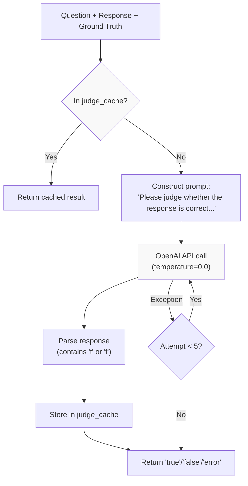
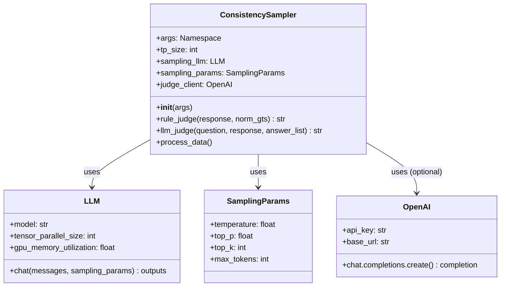
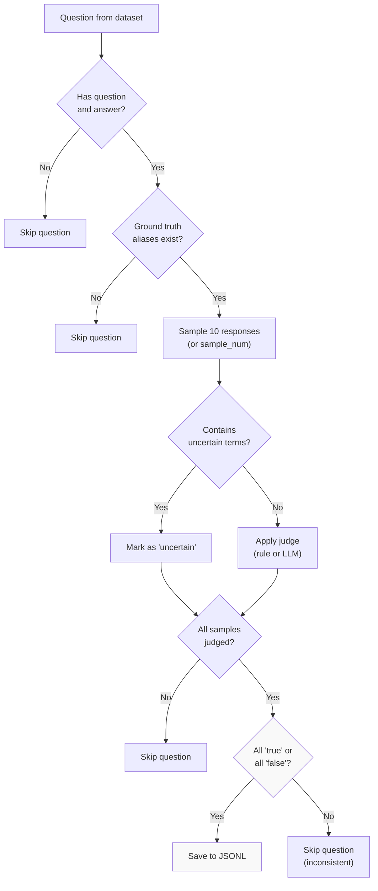
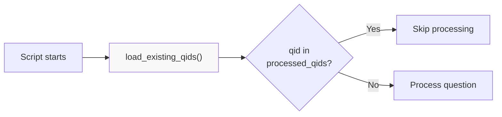

<!-- source: DeepWiki mcp.deepwiki.com · repo thunlp/H-Neurons · page 4.1 Step 1: Response Collection · fetched 2026-11-02 -->

# Step 1: Response Collection

<details>
<summary>Relevant source files</summary>

The following files were used as context for generating this wiki page:

- [README.md](README.md)
- [scripts/collect_responses.py](scripts/collect_responses.py)

</details>


## Purpose and Scope

This page describes the first step of the H-Neurons pipeline: collecting LLM responses from the TriviaQA dataset and judging their correctness. This step generates the raw data needed for subsequent answer token extraction and classifier training.

For information about the complete pipeline structure, see [Pipeline Guide](#4). For details on the TriviaQA dataset structure, see [TriviaQA Source Dataset](#5.1). For information about the output format used in subsequent steps, see [Intermediate Data Formats](#5.2).

**Sources:** [README.md:22-30](), [README.md:44-63]()

## Overview

The response collection step implements a consistency-based sampling strategy to identify questions that the target LLM answers either consistently correctly (faithful) or consistently incorrectly (hallucinated). This consistency filtering is essential for creating a clean training signal for the H-Neuron classifier.

The process is implemented in `scripts/collect_responses.py` and uses the `ConsistencySampler` class to orchestrate sampling from a vLLM-hosted model and judging responses for correctness.

**Sources:** [scripts/collect_responses.py:62-201]()

## Data Flow Architecture



**Diagram: Response Collection Data Flow**

**Sources:** [scripts/collect_responses.py:62-201]()

## Sampling Strategy

The sampling strategy differs between training and evaluation sets to balance data quality with evaluation realism:

| Purpose | Sample Count | Filtering Criterion | Rationale |
|---------|--------------|---------------------|-----------|
| Training | 10 samples per question | Keep only all-correct or all-incorrect | Ensures clean, consistent signal for classifier training |
| Evaluation | 1 sample per question | No filtering | Simulates real-world inference scenario |

For training data, the system performs multiple samplings (default 10) per question using temperature-based sampling (`temperature=1.0, top_p=0.9, top_k=50`). Only questions that are **consistently correct** across all 10 samples or **consistently incorrect** across all 10 samples are retained. This creates a high-confidence training set.

**Sources:** [README.md:46-48](), [scripts/collect_responses.py:76-78](), [scripts/collect_responses.py:156-180]()

## Judging Methods

The system supports two judging strategies controlled by the `--judge_type` parameter:

### Rule-Based Judge

The `rule_judge()` method implements string matching after text normalization:



**Diagram: Rule-Based Judging Process**

The normalization function performs the following transformations:
1. Convert to lowercase
2. Replace underscores with spaces
3. Remove punctuation (including quotes and special characters)
4. Remove articles (a, an, the)
5. Normalize whitespace

**Sources:** [scripts/collect_responses.py:37-45](), [scripts/collect_responses.py:87-93]()

### LLM-Based Judge

The `llm_judge()` method uses an external LLM (typically GPT-4o) to evaluate correctness with retry logic and response caching:



**Diagram: LLM-Based Judging Process**

The LLM judge includes several optimizations:
- **Response caching**: If the model generates identical responses across multiple samples, the judgment is cached to avoid redundant API calls
- **Retry logic**: Up to 5 retry attempts with exponential backoff for API failures
- **Zero-temperature inference**: Ensures deterministic judgment decisions

**Sources:** [scripts/collect_responses.py:95-119](), [scripts/collect_responses.py:154-175]()

## Implementation Architecture



**Diagram: ConsistencySampler Class Architecture**

**Sources:** [scripts/collect_responses.py:62-86]()

### Key Components

| Component | Type | Purpose |
|-----------|------|---------|
| `ConsistencySampler` | Class | Main orchestrator for sampling and judging |
| `sampling_llm` | `vllm.LLM` | vLLM instance for efficient batch inference |
| `sampling_params` | `vllm.SamplingParams` | Temperature and sampling configuration |
| `judge_client` | `openai.OpenAI` | Optional API client for LLM-based judging |
| `judge_cache` | `Dict[str, str]` | Cache for LLM judgments to reduce API calls |

**Sources:** [scripts/collect_responses.py:62-86]()

## Filtering Pipeline

The system applies multiple filters before recording a question:



**Diagram: Question Filtering Logic**

The uncertainty check looks for phrases like "don't know", "cannot", "not provided", "no information" as a pre-filter before applying the main judge. This prevents wasted API calls on clearly uncertain responses.

**Sources:** [scripts/collect_responses.py:121-200](), [scripts/collect_responses.py:163-166]()

## Configuration Options

### Command-Line Arguments

| Argument | Type | Default | Description |
|----------|------|---------|-------------|
| `--model_path` | str | Required | Path to the target LLM for sampling |
| `--data_path` | str | Required | Path to TriviaQA parquet file |
| `--output_path` | str | `data/consistency_samples.jsonl` | Output path for collected responses |
| `--sample_num` | int | 10 | Number of samples per question |
| `--max_samples` | int | None | Maximum number of questions to process |
| `--gpu_util` | float | 0.7 | vLLM GPU memory utilization |
| `--tp_size` | int | Auto-detect | Tensor parallel size for vLLM |
| `--judge_type` | str | `rule` | Judge type: `rule` or `llm` |
| `--api_key` | str | None | API key for LLM judge (required if `judge_type=llm`) |
| `--base_url` | str | `https://api.openai.com/v1` | API base URL for LLM judge |
| `--judge_model` | str | `gpt-4o` | Model name for LLM judge |

**Sources:** [scripts/collect_responses.py:15-31]()

### vLLM Configuration

The system initializes vLLM with the following parameters:

```
LLM(
    model=args.model_path,
    tensor_parallel_size=tp_size,
    gpu_memory_utilization=0.7,
    trust_remote_code=True
)
```

And uses these sampling parameters:

```
SamplingParams(
    temperature=1.0,
    top_p=0.9,
    top_k=50,
    max_tokens=50
)
```

**Sources:** [scripts/collect_responses.py:69-78]()

## Output Format

The script outputs to a JSONL file where each line is a JSON object with a single key-value pair. The key is the question ID, and the value contains:

| Field | Type | Description |
|-------|------|-------------|
| `question` | str | The question text with suffix appended |
| `responses` | List[str] | List of sampled responses (length = `sample_num`) |
| `judges` | List[str] | Corresponding judgments: `"true"`, `"false"`, `"uncertain"`, or `"error"` |
| `ground_truth` | List[str] | All valid answer aliases from TriviaQA |

Example structure:
```json
{
  "q_123": {
    "question": "What is the capital of France? Respond with the answer only, without any explanation.",
    "responses": ["Paris", "Paris", "Paris, France", ...],
    "judges": ["true", "true", "true", ...],
    "ground_truth": ["Paris", "paris"]
  }
}
```

**Sources:** [scripts/collect_responses.py:189-197]()

## Usage Examples

### Training Data Collection (Rule-Based)

```bash
python scripts/collect_responses.py \
    --model_path /path/to/llama-3.3-70b-instruct \
    --data_path data/TriviaQA/rc.nocontext/triviaqa_train.parquet \
    --output_path data/train_samples.jsonl \
    --sample_num 10 \
    --max_samples 10000 \
    --judge_type rule \
    --gpu_util 0.7
```

This configuration:
- Samples 10 responses per question
- Uses rule-based string matching for judging
- Processes up to 10,000 questions
- Uses 70% GPU memory for vLLM

**Sources:** [README.md:52-63]()

### Training Data Collection (LLM-Based)

```bash
python scripts/collect_responses.py \
    --model_path /path/to/llama-3.3-70b-instruct \
    --data_path data/TriviaQA/rc.nocontext/triviaqa_train.parquet \
    --output_path data/train_samples.jsonl \
    --sample_num 10 \
    --max_samples 10000 \
    --judge_type llm \
    --api_key "sk-..." \
    --base_url "https://api.openai.com/v1" \
    --judge_model gpt-4o
```

This configuration uses GPT-4o for more accurate but slower judging. The LLM judge is recommended for higher quality judgments, especially when answer variations are complex.

**Sources:** [README.md:52-63]()

### Evaluation Data Collection

```bash
python scripts/collect_responses.py \
    --model_path /path/to/llama-3.3-70b-instruct \
    --data_path data/TriviaQA/rc.nocontext/triviaqa_test.parquet \
    --output_path data/test_samples.jsonl \
    --sample_num 1 \
    --judge_type llm \
    --api_key "sk-..." \
    --judge_model gpt-4o
```

Note that `--sample_num 1` is used for evaluation sets to simulate real-world single-inference scenarios.

**Sources:** [README.md:46-48]()

## Resumability and Progress Tracking

The script supports resumable execution through the `load_existing_qids()` function, which reads already-processed question IDs from the output file:



**Diagram: Resumable Processing Logic**

This allows the script to be safely interrupted and restarted without losing progress or reprocessing questions.

**Sources:** [scripts/collect_responses.py:47-56](), [scripts/collect_responses.py:125-133]()

## Performance Considerations

### Rule Judge vs LLM Judge Trade-offs

| Aspect | Rule Judge | LLM Judge |
|--------|------------|-----------|
| Speed | Fast (local string matching) | Slow (API calls) |
| Cost | Free | API costs (varies by provider) |
| Accuracy | Lower (exact/substring match only) | Higher (semantic understanding) |
| Best for | Simple factual answers | Complex/paraphrased answers |

### Judge Caching Optimization

The system implements a per-question cache (`judge_cache`) that stores LLM judgments for identical responses. If a model generates the same answer multiple times across the 10 samples (common with lower temperature or deterministic behaviors), the judgment is computed only once.

This optimization can reduce API costs by up to 90% when models exhibit consistent behavior for certain questions.

**Sources:** [scripts/collect_responses.py:154-175]()

### Tensor Parallelism

The script auto-detects available GPUs and sets `tensor_parallel_size` accordingly. For large models (70B+), ensure you have sufficient GPU memory. The `--gpu_util` parameter controls memory allocation to prevent OOM errors.

**Sources:** [scripts/collect_responses.py:67-74]()

---

