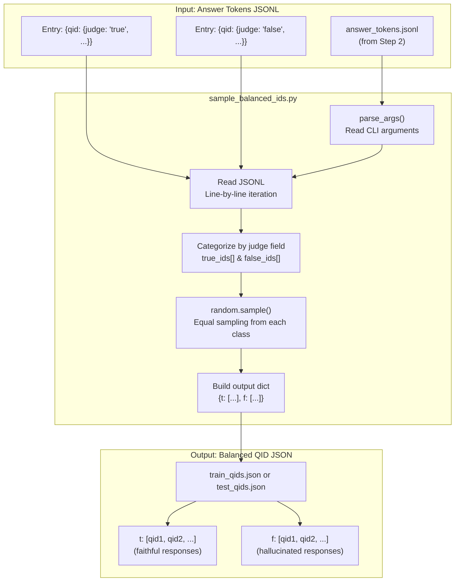
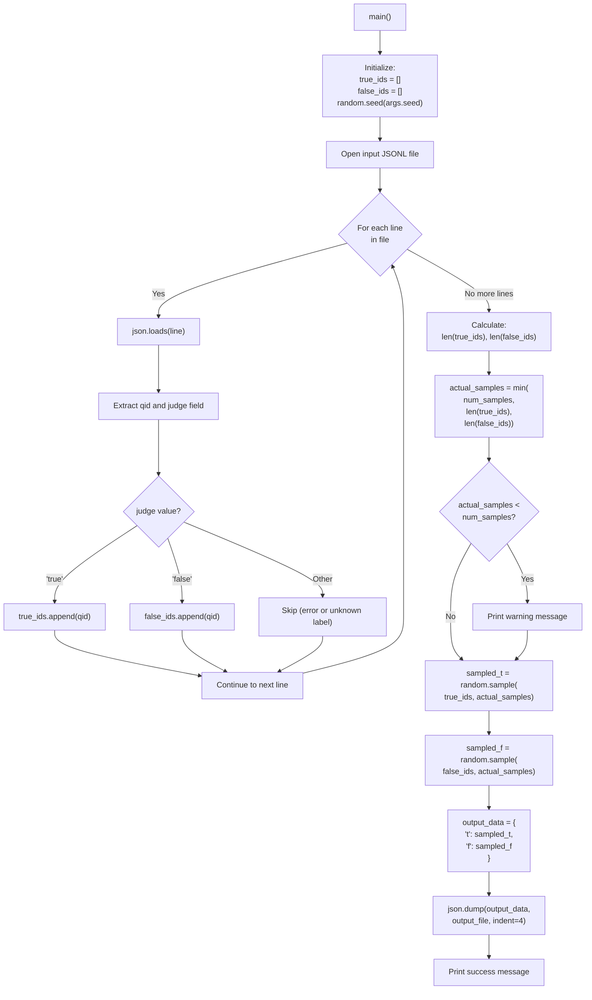

<!-- source: DeepWiki mcp.deepwiki.com · repo thunlp/H-Neurons · page 4.3 Step 3: Balanced ID Sampling · fetched 2026-11-02 -->

# Step 3: Balanced ID Sampling

<details>
<summary>Relevant source files</summary>

The following files were used as context for generating this wiki page:

- [README.md](README.md)
- [scripts/sample_balanced_ids.py](scripts/sample_balanced_ids.py)

</details>


This page describes the third step in the H-Neurons identification pipeline: creating balanced training and test datasets by sampling equal numbers of faithful and hallucinated question IDs. This step ensures that downstream classifier training is not biased toward either class.

For information about the preceding answer token extraction process, see [Step 2: Answer Token Extraction](#4.2). For information about how these balanced IDs are used in activation extraction, see [Step 4: Activation Extraction](#4.4).

## Purpose and Overview

The balanced ID sampling step addresses the class imbalance problem inherent in the collected responses. After collecting responses and extracting answer tokens, the dataset typically contains unequal numbers of faithful ("true") and hallucinated ("false") responses. Training a classifier on imbalanced data can lead to biased predictions favoring the majority class.

This step performs stratified random sampling to create balanced datasets where the number of faithful responses exactly equals the number of hallucinated responses. The script produces JSON files containing question IDs (qids) partitioned into two lists: `"t"` (true/faithful) and `"f"` (false/hallucinated).

**Key Function**: The [scripts/sample_balanced_ids.py]() script implements this balancing operation.

Sources: [README.md:82-91](), [scripts/sample_balanced_ids.py:1-59]()

## Data Flow Architecture

The following diagram illustrates how this step fits within the broader pipeline, showing the transformation from answer tokens to balanced ID sets:



**Diagram: End-to-End Data Flow for Balanced ID Sampling**

This diagram maps the natural language pipeline concept to specific code functions and data structures used in the implementation.

Sources: [scripts/sample_balanced_ids.py:14-56]()

## Input Format

The script expects a JSONL (JSON Lines) file as input, where each line represents a single question's answer token extraction results. This is the output from Step 2 (Answer Token Extraction).

**Input File Structure** (`answer_tokens.jsonl`):

Each line is a JSON object with the following structure:

```json
{
  "question_id_123": {
    "judge": "true",
    "answer_tokens": [15, 16, 17],
    "question": "What is the capital of France?",
    "response": "The capital of France is Paris.",
    "tokenized_response": [1, 450, 3463, 310, 3444, 338, 3681, 29889]
  }
}
```

**Key Fields Used**:
- **Outer key**: The question ID (qid), used as the unique identifier
- **`judge`**: String indicating correctness - either `"true"` (faithful) or `"false"` (hallucinated)

The script only reads the `qid` and `judge` fields; other fields like `answer_tokens`, `question`, and `response` are preserved in the original file but not used during sampling.

Sources: [scripts/sample_balanced_ids.py:22-34]()

## Balancing Algorithm

The following flowchart details the balancing algorithm implemented in the script:



**Diagram: Balancing Algorithm Flowchart Mapping to Code Functions**

The algorithm ensures:
1. **Deterministic Sampling**: Uses `random.seed(args.seed)` for reproducibility [scripts/sample_balanced_ids.py:16]()
2. **Equal Class Representation**: Samples exactly `actual_samples` from each class [scripts/sample_balanced_ids.py:44-45]()
3. **Automatic Adjustment**: If requested `num_samples` exceeds available data, automatically reduces to maximum possible [scripts/sample_balanced_ids.py:39-41]()

Sources: [scripts/sample_balanced_ids.py:14-56]()

## Output Format

The script produces a JSON file containing two lists of question IDs, organized by class label.

**Output File Structure** (`train_qids.json` or `test_qids.json`):

```json
{
    "t": [
        "question_id_001",
        "question_id_042",
        "question_id_089",
        ...
    ],
    "f": [
        "question_id_013",
        "question_id_055",
        "question_id_127",
        ...
    ]
}
```

**Field Descriptions**:

| Field | Type | Description | Usage |
|-------|------|-------------|-------|
| `t` | Array of strings | Question IDs with `judge="true"` (faithful responses) | Used as negative class (label 0) in classifier training |
| `f` | Array of strings | Question IDs with `judge="false"` (hallucinated responses) | Used as positive class (label 1) in classifier training |

**Guarantees**:
- `len(output["t"]) == len(output["f"])` - Perfect class balance
- All IDs are unique within each list
- IDs reference questions that exist in the input JSONL file

Sources: [scripts/sample_balanced_ids.py:47-54]()

## Command-Line Usage

### Basic Usage

```bash
python scripts/sample_balanced_ids.py \
    --input_path data/answer_tokens.jsonl \
    --output_path data/train_qids.json \
    --num_samples 1000
```

### Complete Parameter Reference

| Parameter | Type | Required | Default | Description |
|-----------|------|----------|---------|-------------|
| `--input_path` | string | Yes | - | Path to answer tokens JSONL file from Step 2 |
| `--output_path` | string | No | `data/train_qids.json` | Path where balanced ID JSON will be saved |
| `--num_samples` | integer | No | `1000` | Number of samples per class to select |
| `--seed` | integer | No | `42` | Random seed for reproducible sampling |

### Typical Workflow Examples

**Creating Training Set**:
```bash
python scripts/sample_balanced_ids.py \
    --input_path data/Llama33_TriviaQA_answer_tokens_train.jsonl \
    --output_path data/Llama33_TriviaQA_train_qids.json \
    --num_samples 5000 \
    --seed 42
```

**Creating Test Set**:
```bash
python scripts/sample_balanced_ids.py \
    --input_path data/Llama33_TriviaQA_answer_tokens_test.jsonl \
    --output_path data/Llama33_TriviaQA_test_qids.json \
    --num_samples 500 \
    --seed 123
```

**Output Example**:
```
Reading IDs: 100%|████████████| 15432/15432 [00:02<00:00, 6234.56it/s]
Total available - True: 8234, False: 7198
Successfully saved 10000 balanced IDs to data/train_qids.json
```

Sources: [README.md:82-91](), [scripts/sample_balanced_ids.py:6-12]()

## Implementation Details

### Core Processing Logic

The script implements a two-pass algorithm:

1. **Pass 1: Categorization** [scripts/sample_balanced_ids.py:22-34]()
   - Iterates through all JSONL entries
   - Extracts `qid` (outer dictionary key) and `judge` field
   - Appends to `true_ids[]` or `false_ids[]` based on label
   - Handles parsing errors gracefully with try-except blocks

2. **Pass 2: Sampling** [scripts/sample_balanced_ids.py:39-45]()
   - Determines maximum feasible sample size
   - Uses `random.sample()` for uniform random sampling without replacement
   - Creates output dictionary structure

### Error Handling

The script includes several robustness features:

**Parsing Error Recovery** [scripts/sample_balanced_ids.py:33-34]():
```python
except Exception as e:
    print(f"Skipping line due to error: {e}")
```

**Insufficient Data Warning** [scripts/sample_balanced_ids.py:40-41]():
```python
if actual_samples < args.num_samples:
    print(f"Warning: Only {actual_samples} samples per class available. Sampling maximum possible.")
```

**Automatic Adjustment** [scripts/sample_balanced_ids.py:39]():
```python
actual_samples = min(args.num_samples, len(true_ids), len(false_ids))
```

This ensures the script never fails due to insufficient data in either class.

Sources: [scripts/sample_balanced_ids.py:22-56]()

## Data Organization and Naming Conventions

The balanced ID files follow a consistent naming pattern across different models and dataset splits:

```
data/
├── examples/
│   ├── Llama33_TriviaQA_train_qids.json
│   ├── Llama33_TriviaQA_test_qids.json
│   ├── Mistral24b_TriviaQA_train_qids.json
│   ├── Mistral24b_TriviaQA_test_qids.json
│   ├── gemma27b_TriviaQA_train_qids.json
│   └── gemma27b_TriviaQA_test_qids.json
```

**Naming Convention**: `{model}_{dataset}_{split}_qids.json`

- **`model`**: Target LLM identifier (e.g., `Llama33`, `Mistral24b`, `gemma27b`)
- **`dataset`**: Source dataset name (e.g., `TriviaQA`)
- **`split`**: Data split type (`train` or `test`)
- **`qids`**: Indicates this file contains question IDs

Sources: [README.md:50]()

## Practical Considerations

### Choosing Sample Size

The `--num_samples` parameter controls the number of samples per class (faithful and hallucinated). Total samples = `2 × num_samples`.

**Recommended Values**:

| Use Case | Recommended `num_samples` | Rationale |
|----------|---------------------------|-----------|
| Training Set | 5,000 - 10,000 | Sufficient for stable classifier training; more samples reduce variance |
| Validation Set | 500 - 1,000 | Enough for reliable hyperparameter tuning |
| Test Set | 500 - 1,000 | Provides statistically significant evaluation metrics |

From the example data provided in the repository:
- Training sets typically use ~5,000 samples per class (10,000 total)
- Test sets typically use ~500 samples per class (1,000 total)

### Reproducibility

The `--seed` parameter ensures reproducible sampling [scripts/sample_balanced_ids.py:16]():

- **Same seed + same input** = identical output IDs
- **Different seeds** = different random samples (useful for cross-validation)
- **Default seed (42)** = standard for primary experiments

**Best Practice**: Document the seed used for each experiment to enable exact reproduction of results.

### Class Imbalance in Source Data

The script automatically handles source data imbalance by taking the minimum available count:

**Example Scenario**:
```
Input: 8,234 faithful + 7,198 hallucinated
Request: num_samples=10,000
Result: 7,198 samples per class (14,396 total)
Warning: "Only 7198 samples per class available. Sampling maximum possible."
```

This ensures balanced output even when input is imbalanced, though it may reduce the total dataset size.

Sources: [scripts/sample_balanced_ids.py:36-41](), [README.md:82-91]()

## Integration with Pipeline

### Upstream Dependencies

This step requires:
1. Completed response collection (Step 1)
2. Completed answer token extraction (Step 2)
3. Input file in JSONL format with `judge` field

### Downstream Usage

The output JSON files are consumed by:
1. **Step 4: Activation Extraction** - The `--train_ids_path` parameter in [scripts/extract_activations.py]() loads these IDs to determine which questions to process
2. **Step 5: Classifier Training** - The `--train_ids` parameter in [scripts/classifier.py]() uses these IDs to load the correct activations for training

**Example Pipeline Flow**:
```bash
# Step 2: Extract answer tokens (produces JSONL)
python scripts/extract_answer_tokens.py \
    --input_path data/responses.jsonl \
    --output_path data/answer_tokens.jsonl

# Step 3: Sample balanced IDs (produces JSON)
python scripts/sample_balanced_ids.py \
    --input_path data/answer_tokens.jsonl \
    --output_path data/train_qids.json \
    --num_samples 5000

# Step 4: Extract activations (consumes JSON)
python scripts/extract_activations.py \
    --input_path data/answer_tokens.jsonl \
    --train_ids_path data/train_qids.json \
    --output_root data/activations
```

Sources: [README.md:82-106]()

## File Format Specification

### Input JSONL Schema

Each line must be a valid JSON object:

```
{qid: {"judge": "true"|"false", ...}}
```

**Required fields**:
- Outer key: question ID (string)
- `judge`: correctness label (string: `"true"` or `"false"`)

**Optional fields**: All other fields are ignored during sampling but preserved in the original file.

### Output JSON Schema

```json
{
    "t": ["string", "string", ...],
    "f": ["string", "string", ...]
}
```

**Constraints**:
- `t` and `f` must be arrays of strings
- `len(t) == len(f)` (enforced by algorithm)
- All strings are valid question IDs from input file
- No duplicates within each array

Sources: [scripts/sample_balanced_ids.py:47-54]()

---

