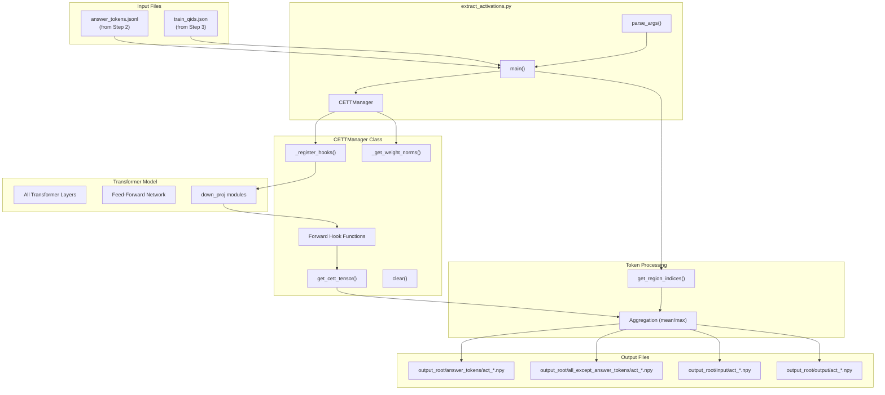
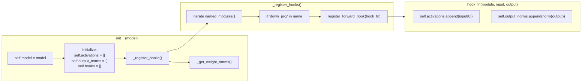
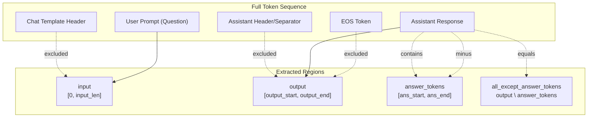
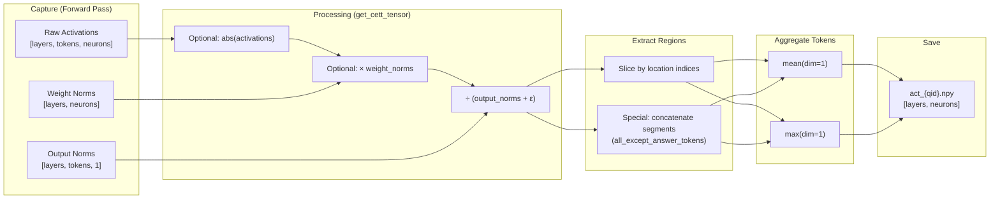
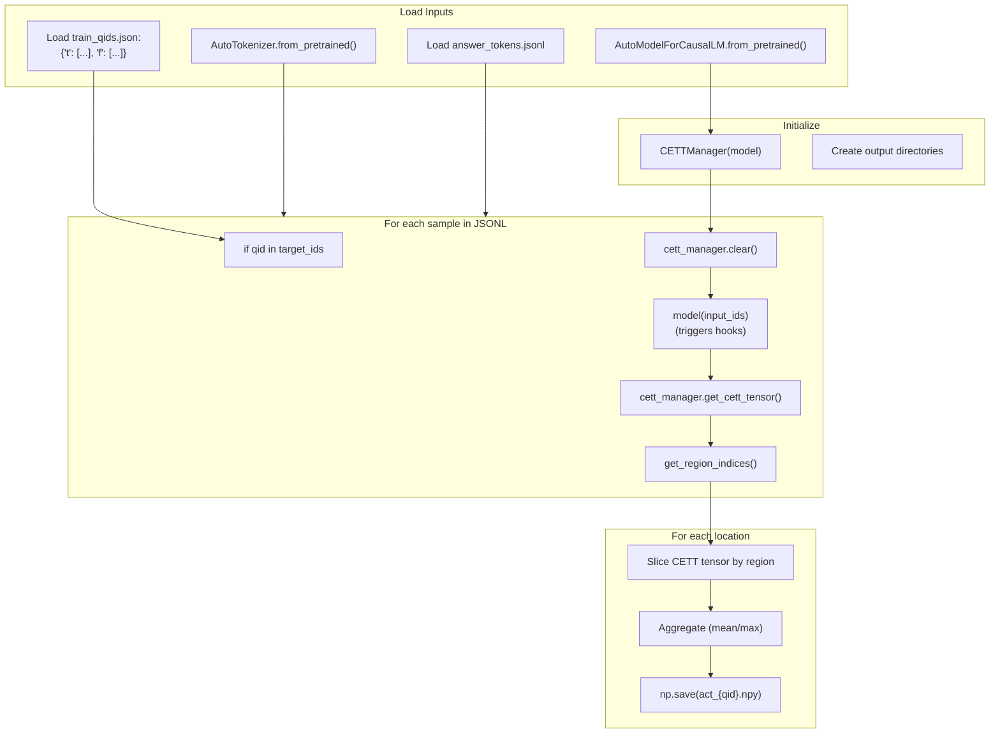
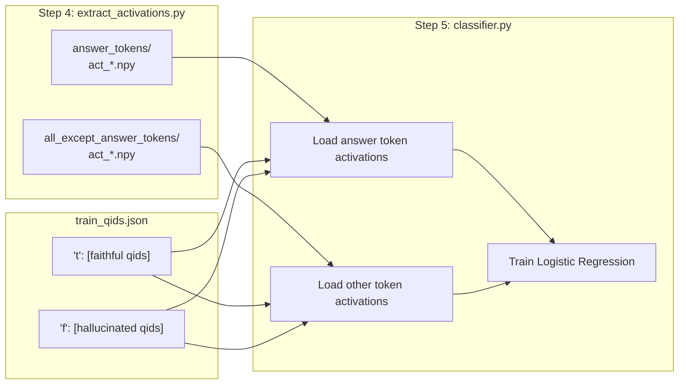

<!-- source: DeepWiki mcp.deepwiki.com · repo thunlp/H-Neurons · page 4.4 Step 4: Activation Extraction · fetched 2026-11-02 -->

# Step 4: Activation Extraction

<details>
<summary>Relevant source files</summary>

The following files were used as context for generating this wiki page:

- [README.md](README.md)
- [scripts/extract_activations.py](scripts/extract_activations.py)

</details>


This page describes the activation extraction stage of the H-Neurons pipeline, which quantifies neuron-level contributions to model outputs using the CETT (Contribution Extraction Through Transformation) metric. This stage processes the balanced dataset created in [Step 3](#4.3) and produces activation tensors that serve as input features for classifier training in [Step 5](#4.5).

For theoretical details about the CETT metric, see [CETT Metric Implementation](#7.1). For general pipeline context, see [Pipeline Guide](#4).

---

## Overview

The activation extraction stage performs the following operations:

1. Loads the model and registers forward hooks on all `down_proj` layers
2. Runs a forward pass for each sample using the question and response
3. Captures neuron activations and output norms at each layer
4. Computes CETT values with optional magnitude scaling and normalization
5. Extracts activations from specified token regions (answer tokens, input, output, etc.)
6. Aggregates multi-token activations into per-sample feature vectors
7. Saves results as `.npy` files for each question ID

The main script is [`scripts/extract_activations.py`](scripts/extract_activations.py:1-156)().

**Sources:** [README.md:93-106](), [scripts/extract_activations.py:1-156]()

---

## CETT Metric

The CETT (Contribution Extraction Through Transformation) metric quantifies each neuron's contribution to the model's output at each token position. The computation involves three components:

| Component | Description | Source |
|-----------|-------------|--------|
| **Activation** | Input to `down_proj` layer (neuron output from `up_proj` and `gate`) | Captured via forward hooks |
| **Weight Norm** | L2 norm of `down_proj` weight for each neuron | Precomputed from model parameters |
| **Output Norm** | L2 norm of `down_proj` output at each token | Captured via forward hooks |

The CETT value for neuron `i` at layer `l` and token position `t` is computed as:

```
CETT[l, t, i] = (|activation[l, t, i]| × weight_norm[l, i]) / (output_norm[l, t] + ε)
```

Where the absolute value and magnitude scaling are optional based on `--use_abs` and `--use_mag` flags.

**Sources:** [scripts/extract_activations.py:26-66]()

---

## Architecture



**Sources:** [scripts/extract_activations.py:99-154]()

---

## CETTManager Class

The [`CETTManager`](scripts/extract_activations.py:26-66)() class manages activation capture and CETT computation. It is initialized with the target model and automatically registers hooks on all `down_proj` layers.

### Initialization and Hook Registration



**Key Methods:**

| Method | Purpose | Returns |
|--------|---------|---------|
| `_register_hooks()` | Attaches forward hooks to all `down_proj` modules | None |
| `_get_weight_norms()` | Precomputes L2 norm of `down_proj` weights per neuron | `torch.Tensor` [layers, neurons] |
| `clear()` | Resets activation and norm buffers between samples | None |
| `get_cett_tensor()` | Computes final CETT tensor from captured data | `torch.Tensor` [layers, tokens, neurons] |

**Sources:** [scripts/extract_activations.py:26-66]()

---

## Location Types

The script supports four location types for extracting activations, specified via `--locations`:

### Location Definitions



### Implementation Details

The [`get_region_indices()`](scripts/extract_activations.py:68-97)() function identifies token spans for each location type:

| Location | Description | Use Case |
|----------|-------------|----------|
| `input` | User prompt tokens (question) | Analyze question-side activations |
| `output` | Assistant response tokens (excluding EOS) | Analyze full response activations |
| `answer_tokens` | Specific factual answer tokens within response | Primary training signal for H-Neurons |
| `all_except_answer_tokens` | Output tokens excluding answer tokens | Negative samples in 3-vs-1 training mode |

**Token Matching Logic:**

For `answer_tokens` location, the script performs exact string matching on decoded tokens ([scripts/extract_activations.py:84-91]()):
1. Normalizes answer tokens by replacing `▁` and `Ġ` with spaces
2. Decodes full sequence tokens individually
3. Searches for exact consecutive token match in output region
4. Returns `None` if no match found (e.g., empty answer_tokens list)

**Sources:** [scripts/extract_activations.py:68-97](), [scripts/extract_activations.py:131-146]()

---

## Aggregation and Processing

### Processing Pipeline



### Configuration Flags

| Flag | Effect | Default | Recommended |
|------|--------|---------|-------------|
| `--use_abs` | Apply absolute value to activations | `True` | Keep enabled |
| `--use_mag` | Scale by weight norms (magnitude) | `True` | Keep enabled |
| `--method mean` | Average activations across token positions | - | Primary method |
| `--method max` | Take maximum activation across token positions | - | Alternative for sparse signals |

**Implementation Notes:**

- The `get_cett_tensor()` method ([scripts/extract_activations.py:55-66]()) handles tensor reshaping for batch size 1
- Division by `output_norms + 1e-8` prevents numerical instability
- Final aggregation reduces [layers, tokens, neurons] → [layers, neurons]
- For `all_except_answer_tokens`, segments are concatenated before aggregation ([scripts/extract_activations.py:136-141]())

**Sources:** [scripts/extract_activations.py:55-66](), [scripts/extract_activations.py:131-153](), [README.md:93-106]()

---

## Running the Script

### Basic Usage

```bash
python scripts/extract_activations.py \
    --model_path /path/to/your/model \
    --input_path data/answer_tokens.jsonl \
    --train_ids_path data/train_qids.json \
    --output_root data/activations \
    --locations answer_tokens all_except_answer_tokens \
    --method mean \
    --use_mag --use_abs
```

### Parameter Reference

| Parameter | Type | Description |
|-----------|------|-------------|
| `--model_path` | `str` | Path to HuggingFace model directory |
| `--input_path` | `str` | Path to `answer_tokens.jsonl` from [Step 2](#4.2) |
| `--train_ids_path` | `str` | Path to `train_qids.json` or `test_qids.json` from [Step 3](#4.3) |
| `--output_root` | `str` | Root directory for saving activation `.npy` files |
| `--locations` | `list[str]` | One or more of: `input`, `output`, `answer_tokens`, `all_except_answer_tokens` |
| `--method` | `str` | Aggregation method: `mean` or `max` |
| `--use_mag` | `flag` | Enable magnitude scaling by weight norms |
| `--use_abs` | `flag` | Apply absolute value to activations |

### Typical Workflows

**For 1-vs-1 Training Mode:**
```bash
# Only need answer_tokens location
--locations answer_tokens
```

**For 3-vs-1 Training Mode:**
```bash
# Need both answer_tokens and all_except_answer_tokens
--locations answer_tokens all_except_answer_tokens
```

**For Analysis/Debugging:**
```bash
# Extract all locations
--locations input output answer_tokens all_except_answer_tokens
```

**Sources:** [README.md:93-106](), [scripts/extract_activations.py:10-24]()

---

## Output Format

### Directory Structure

```
output_root/
├── answer_tokens/
│   ├── act_0.npy
│   ├── act_1.npy
│   └── ...
├── all_except_answer_tokens/
│   ├── act_0.npy
│   ├── act_1.npy
│   └── ...
├── input/
│   └── ...
└── output/
    └── ...
```

The script creates one subdirectory per location type ([scripts/extract_activations.py:111-112]()) and saves one `.npy` file per question ID.

### File Format

Each `.npy` file contains a NumPy array with shape `[layers, neurons]`:

| Dimension | Size | Description |
|-----------|------|-------------|
| `layers` | Number of transformer layers | e.g., 32 for Llama-3-8B, 80 for Llama-3.3-70B |
| `neurons` | FFN intermediate size | e.g., 14,336 for Llama-3-8B, 28,672 for Llama-3.3-70B |

**Data Type:** `float32` (converted from `bfloat16` via `.cpu().float().numpy()`)

**Filename Convention:** `act_{qid}.npy` where `{qid}` is the question ID from the input JSONL file

### Loading Example

```python
import numpy as np

# Load activation for question ID "42"
activation = np.load("data/activations/answer_tokens/act_42.npy")
print(activation.shape)  # e.g., (32, 14336) for Llama-3-8B

# Flatten for classifier input
feature_vector = activation.flatten()  # Shape: (32 * 14336,)
```

**Sources:** [scripts/extract_activations.py:111-153]()

---

## Processing Flow



**Sources:** [scripts/extract_activations.py:99-154]()

---

## Memory and Performance Considerations

### Memory Usage

For a typical configuration (Llama-3-8B with batch size 1):
- **Model:** ~15-16 GB (bfloat16)
- **Activations per sample:** ~2-4 MB (depends on sequence length)
- **Peak memory:** Model size + working memory for one forward pass

### Optimization Strategies

1. **Single Sample Processing:** The script processes one sample at a time to minimize memory footprint ([scripts/extract_activations.py:117-154]())
2. **Immediate Cleanup:** `cett_manager.clear()` is called after each sample to release activation buffers
3. **No Gradient Storage:** All forward passes use `torch.no_grad()` context ([scripts/extract_activations.py:127]())
4. **CPU Offloading:** Final activations are moved to CPU before saving ([scripts/extract_activations.py:153]())

### Typical Runtime

Processing time varies by model size and hardware:
- **Small models (8B parameters):** ~2-5 seconds per sample on A100
- **Large models (70B parameters):** ~10-20 seconds per sample on 8×A100
- **Full dataset (10,000 samples):** ~6-12 hours for 8B models, ~24-48 hours for 70B models

**Sources:** [scripts/extract_activations.py:99-154]()

---

## Integration with Downstream Steps

The extracted activation files serve as input to [Step 5: Classifier Training](#4.5):



**Classifier Loading Logic:**

In [Step 5](#4.5), the classifier script loads activations based on training mode:
- **1-vs-1 mode:** Loads only `answer_tokens/` directory
- **3-vs-1 mode:** Loads both `answer_tokens/` and `all_except_answer_tokens/` directories

The question IDs from `train_qids.json` determine which `.npy` files to load and their labels (0 for faithful, 1 for hallucinated).

**Sources:** [README.md:108-141](), System architecture diagrams

---

