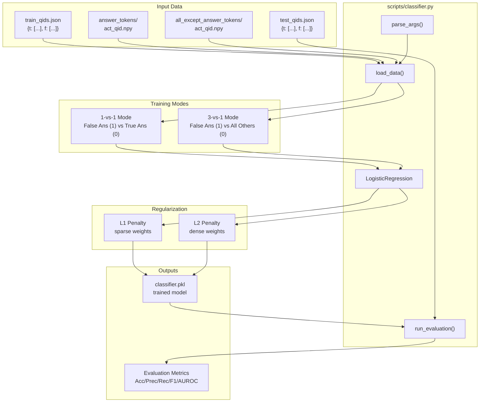
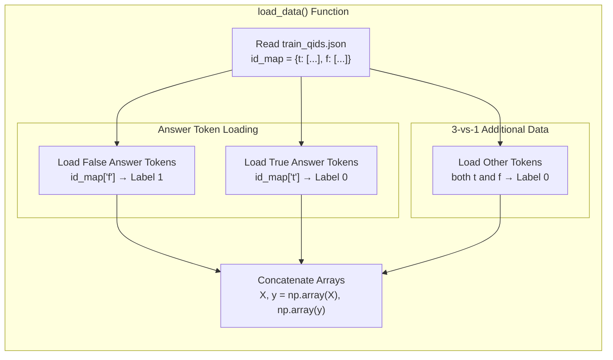
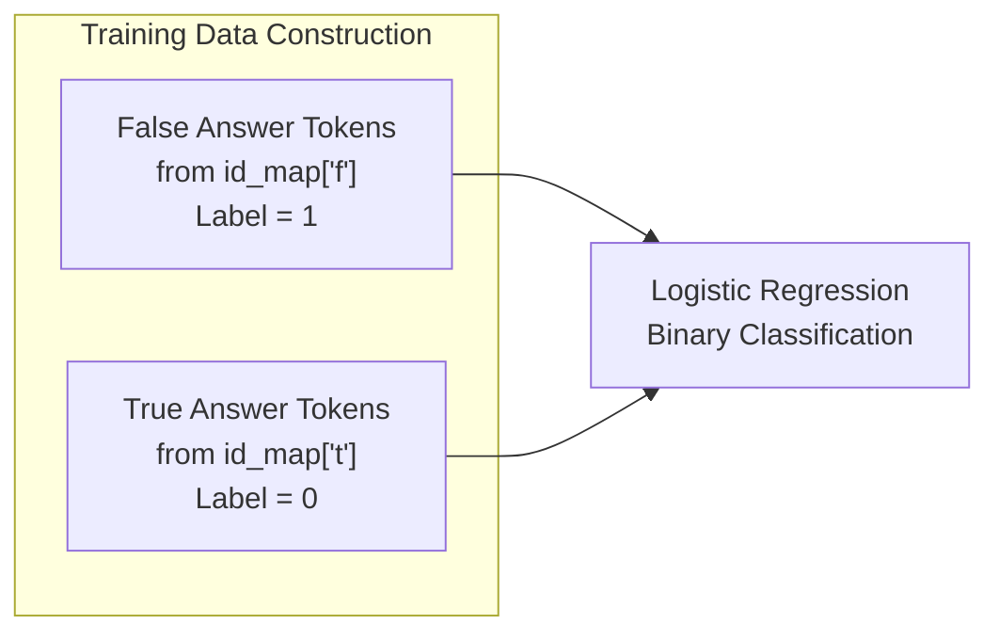
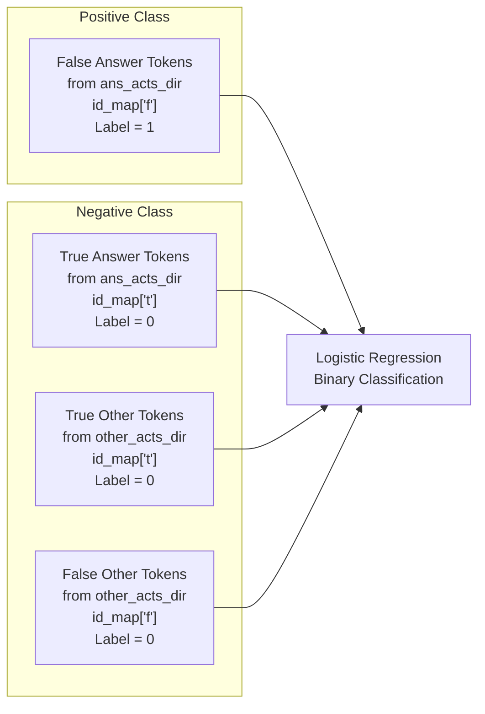
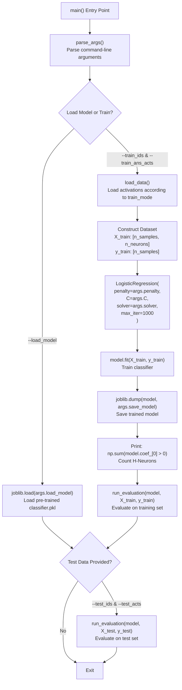
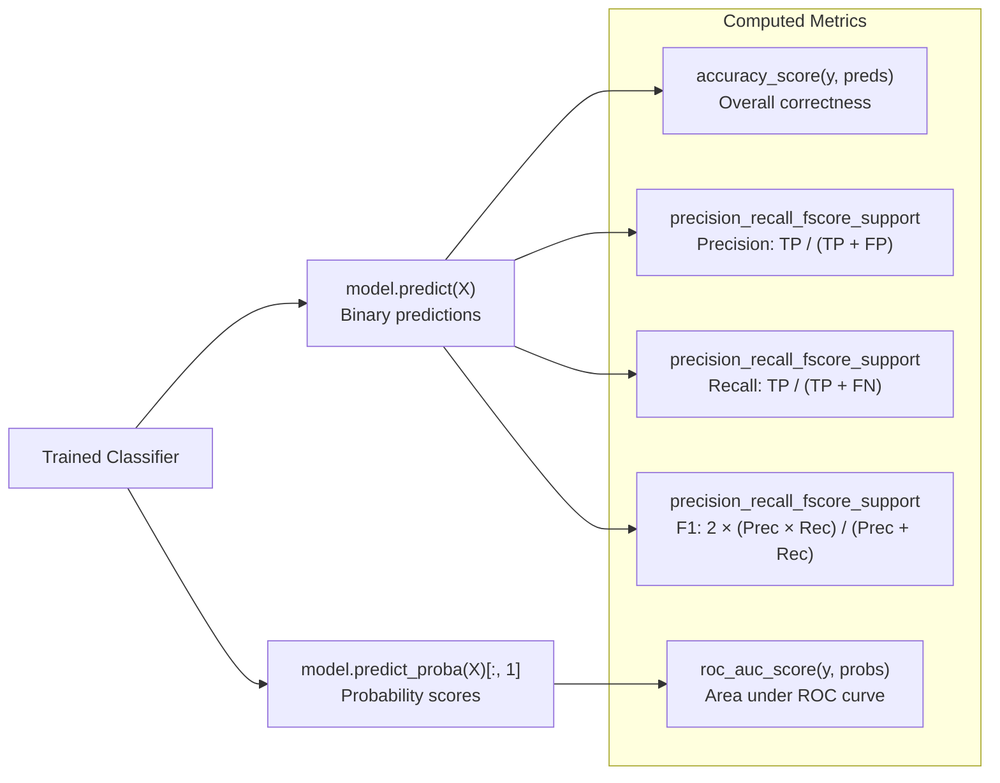

<!-- source: DeepWiki mcp.deepwiki.com · repo thunlp/H-Neurons · page 4.5 Step 5: Classifier Training · fetched 2026-11-02 -->

# Step 5: Classifier Training

<details>
<summary>Relevant source files</summary>

The following files were used as context for generating this wiki page:

- [README.md](README.md)
- [scripts/classifier.py](scripts/classifier.py)

</details>


This page describes the classifier training step of the H-Neurons pipeline, which trains a binary logistic regression model to identify hallucination-associated neurons (H-Neurons) based on neuron activation patterns. This step consumes the activations extracted in [Step 4](#4.4) and produces a trained classifier model that can predict hallucination occurrences.

For detailed explanation of the training mode options (1-vs-1 vs 3-vs-1), see [Training Modes](#6.1). For regularization strategy details (L1 vs L2), see [Regularization Options](#6.2). For model intervention using the trained classifier, see [Step 6: Model Intervention](#4.6).

## Purpose and Scope

The classifier training step serves two primary purposes:

1. **H-Neuron Identification**: When trained with L1 regularization, the classifier identifies a sparse subset of neurons with non-zero weights that are causally associated with hallucinations.

2. **Hallucination Detection**: The trained classifier can predict whether a model response contains hallucinations based on neuron activation patterns.

The primary script for this step is [scripts/classifier.py](). This script implements a configurable training pipeline that supports different training strategies and regularization methods.

**Sources**: [README.md:108-136](), [scripts/classifier.py:1-132]()

## System Architecture

### Classifier Training Pipeline



**Sources**: [scripts/classifier.py:11-35](), [scripts/classifier.py:91-132]()

### Data Loading Architecture



**Sources**: [scripts/classifier.py:37-74]()

## Input Requirements

The classifier training step requires the following inputs:

| Input Type | Argument | Description | Format |
|------------|----------|-------------|--------|
| Model Config | `--model_path` | Path to HuggingFace model for configuration | Directory path |
| Training IDs | `--train_ids` | Question IDs for training set | JSON file with `{t: [...], f: [...]}` structure |
| Answer Activations | `--train_ans_acts` | Directory containing answer token activations | Directory with `act_{qid}.npy` files |
| Other Activations | `--train_other_acts` | Directory containing non-answer token activations (required for 3-vs-1) | Directory with `act_{qid}.npy` files |
| Test IDs | `--test_ids` | Question IDs for evaluation (optional) | JSON file with `{t: [...], f: [...]}` structure |
| Test Activations | `--test_acts` | Directory containing test activations (optional) | Directory with `act_{qid}.npy` files |

**Sources**: [scripts/classifier.py:11-24]()

## Training Modes

The classifier supports two distinct training modes, controlled by the `--train_mode` argument:

### Mode Comparison

| Mode | Positive Class (Label 1) | Negative Class (Label 0) | Use Case |
|------|-------------------------|-------------------------|----------|
| **1-vs-1** | False Answer Tokens | True Answer Tokens | Maximum prediction accuracy |
| **3-vs-1** | False Answer Tokens | True Answer Tokens + True Other Tokens + False Other Tokens | Isolate hallucination-specific neurons |

### 1-vs-1 Mode

This mode creates a binary classifier that distinguishes between hallucinated answer tokens and faithful answer tokens.



**Implementation**: [scripts/classifier.py:48-60]()

**Recommendation**: Use this mode when the goal is to achieve the highest possible prediction accuracy for hallucination detection.

**Sources**: [README.md:123-125](), [scripts/classifier.py:40-41]()

### 3-vs-1 Mode

This mode contrasts hallucinated answer tokens against a combined negative set including faithful answer tokens and all non-answer tokens. This is the mode used in the research paper.



**Implementation**: [scripts/classifier.py:62-72]()

**Recommendation**: Use this mode to identify neurons specifically associated with factual errors, as it contrasts hallucinated content against both correct content and general language modeling tokens.

**Sources**: [README.md:125-126](), [scripts/classifier.py:41-42]()

## Regularization Strategies

The classifier supports two regularization penalties, controlled by the `--penalty` argument:

### L1 Regularization (Lasso)

L1 regularization drives most neuron weights to zero, producing a sparse model.

**Configuration**:
- `--penalty l1`
- `--C <float>` (inverse of regularization strength)
- `--solver liblinear` (default)

**Characteristics**:
- Produces sparse coefficient vector where most neurons have weight = 0
- Enables identification of specific H-Neurons for intervention
- The `C` parameter controls the number of non-zero weights
- Essential for mechanistic interpretability research

**Output**: The trained model contains `coef_[0]` where only a sparse subset of indices have non-zero values. Indices with positive weights are identified as H-Neurons.

**Sources**: [README.md:127-129](), [scripts/classifier.py:31-33]()

### L2 Regularization (Ridge)

L2 regularization penalizes large weights but does not enforce sparsity.

**Configuration**:
- `--penalty l2`
- `--C <float>` (inverse of regularization strength)

**Characteristics**:
- Produces dense coefficient vector where all neurons have non-zero weights
- Typically provides 1-3% accuracy boost over L1
- Does not enable H-Neuron identification
- Use when only hallucination detection is needed

**Sources**: [README.md:129-130](), [scripts/classifier.py:31-33]()

### C Parameter Selection

The `C` parameter (inverse of regularization strength) controls the sparsity-accuracy tradeoff:

| C Value | Effect | Tradeoff |
|---------|--------|----------|
| Low (e.g., 0.1) | High regularization, very sparse model | May exclude important neurons |
| Medium (e.g., 1.0) | Balanced sparsity | Default starting point |
| High (e.g., 10.0) | Low regularization, less sparse | May include general language modeling neurons |

**Recommended Selection Strategy**: Perform grid search to maximize the sum of:
1. Classification accuracy on held-out validation set
2. Model performance on TriviaQA when suppressing identified H-Neurons

**Sources**: [README.md:131-135](), [scripts/classifier.py:32]()

## Training and Evaluation Workflow

### Training Process



**Sources**: [scripts/classifier.py:91-132]()

### Evaluation Metrics

The `run_evaluation()` function computes comprehensive metrics:



**Implementation**: [scripts/classifier.py:76-89]()

**Output Format**:
```
--- Results: {dataset_name} ---
Accuracy:  0.XXXX
Precision: 0.XXXX
Recall:    0.XXXX
F1 Score:  0.XXXX
AUROC:     0.XXXX
```

**Sources**: [scripts/classifier.py:76-89]()

## Model Persistence

### Saving Models

When training a new model with `--save_model`, the script uses `joblib.dump()` to serialize the trained `LogisticRegression` object:

**Implementation**: [scripts/classifier.py:114-117]()

**Output Information**:
- Model file: `classifier.pkl` (or specified path)
- Console output: Number of identified H-Neurons (neurons with `coef_[0] > 0`)

### Loading Models

Pre-trained models can be loaded for evaluation using `--load_model`:

**Implementation**: [scripts/classifier.py:96-98]()

This allows evaluation of a trained classifier on new test data without retraining.

**Sources**: [scripts/classifier.py:96-98](), [scripts/classifier.py:114-117]()

## Command-Line Usage Examples

### Training with 3-vs-1 Mode and L1 Regularization

This configuration identifies sparse H-Neurons for mechanistic analysis:

```bash
python scripts/classifier.py \
    --model_path /path/to/your/model \
    --train_ids data/train_qids.json \
    --train_ans_acts data/activations/answer_tokens \
    --train_other_acts data/activations/all_except_answer_tokens \
    --train_mode 3-vs-1 \
    --penalty l1 \
    --C 1.0 \
    --save_model models/classifier.pkl
```

**Sources**: [README.md:111-121]()

### Training with 1-vs-1 Mode and L2 Regularization

This configuration maximizes detection accuracy:

```bash
python scripts/classifier.py \
    --model_path /path/to/your/model \
    --train_ids data/train_qids.json \
    --train_ans_acts data/activations/answer_tokens \
    --train_mode 1-vs-1 \
    --penalty l2 \
    --C 1.0 \
    --save_model models/detector.pkl
```

**Sources**: [README.md:123-130]()

### Evaluating a Pre-trained Model

```bash
python scripts/classifier.py \
    --model_path /path/to/your/model \
    --load_model models/classifier.pkl \
    --test_ids data/test_qids.json \
    --test_acts data/activations/answer_tokens
```

**Sources**: [scripts/classifier.py:96-98](), [scripts/classifier.py:125-129]()

## Key Implementation Details

### Data Shape Requirements

The `load_data()` function expects activation files with the following structure:

- Each `act_{qid}.npy` file contains a NumPy array of shape `[n_layers, n_neurons_per_layer]`
- The array is flattened to shape `[n_layers * n_neurons_per_layer]` during loading
- All samples must have the same dimensionality

**Implementation**: [scripts/classifier.py:52-53](), [scripts/classifier.py:59]()

### Logistic Regression Configuration

The `LogisticRegression` model is configured with:

| Parameter | Value | Purpose |
|-----------|-------|---------|
| `penalty` | `"l1"` or `"l2"` | Regularization type |
| `C` | User-specified (default 1.0) | Inverse regularization strength |
| `solver` | `"liblinear"` (default) | Optimization algorithm |
| `max_iter` | 1000 | Maximum training iterations |
| `random_state` | 42 | Reproducible results |
| `verbose` | 1 | Training progress output |

**Implementation**: [scripts/classifier.py:108-111]()

**Note**: The `solver` parameter can be changed to `"saga"` if needed for large-scale problems, though `"liblinear"` is the default for compatibility with both L1 and L2 penalties.

**Sources**: [scripts/classifier.py:33](), [scripts/classifier.py:108-111]()

### Evaluation Mode

During evaluation (test set), the script defaults to `1-vs-1` mode regardless of training mode:

**Implementation**: [scripts/classifier.py:128]()

This ensures that evaluation focuses on the binary classification task between faithful and hallucinated answer tokens, which is the standard evaluation scenario.

**Sources**: [scripts/classifier.py:125-129]()

## Output Artifacts

After successful training, the following artifacts are produced:

| Artifact | Type | Description |
|----------|------|-------------|
| `classifier.pkl` | Serialized model | Trained `LogisticRegression` object containing coefficients and parameters |
| Console output | Text | Number of H-Neurons identified (for L1: count of `coef_[0] > 0`) |
| Training metrics | Text | Accuracy, Precision, Recall, F1, AUROC on training set |
| Test metrics | Text | Same metrics on test set (if provided) |

The trained model's coefficient vector (`model.coef_[0]`) has shape `[n_total_neurons]` where:
- `n_total_neurons = n_layers × n_neurons_per_layer`
- For L1 penalty: most values are exactly 0.0
- For L2 penalty: all values are non-zero but small
- Positive weights indicate H-Neurons associated with hallucinations

**Sources**: [scripts/classifier.py:114-119](), [scripts/classifier.py:76-89]()

---

