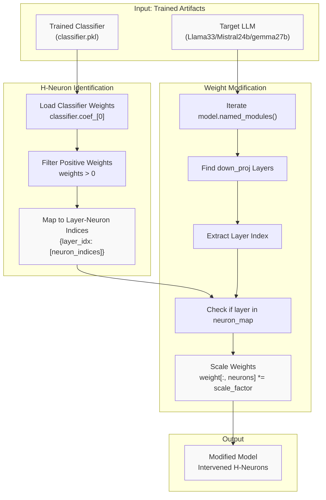
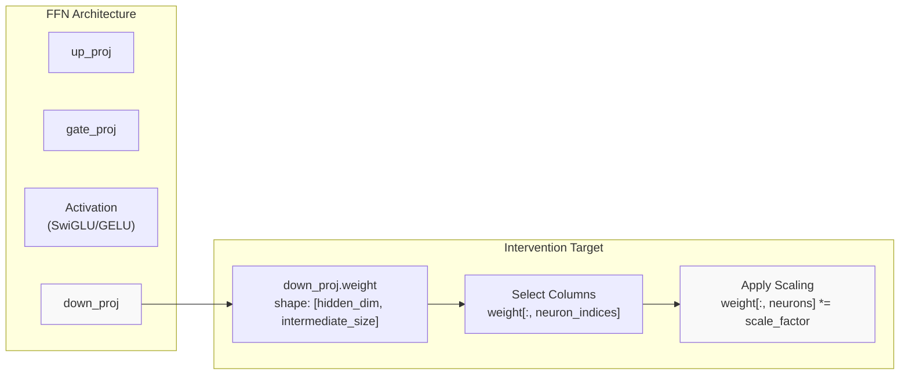
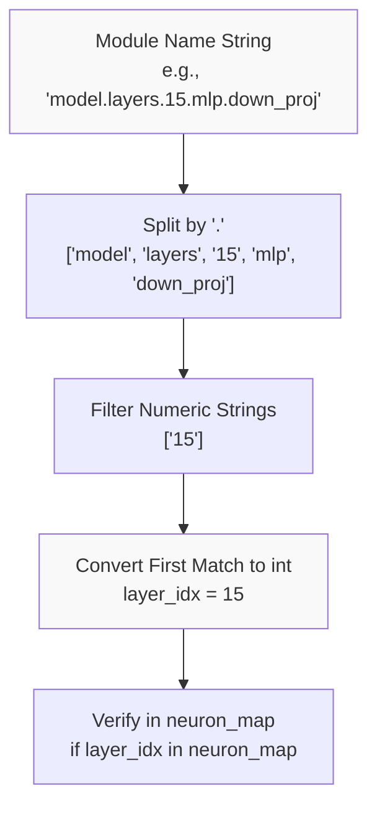
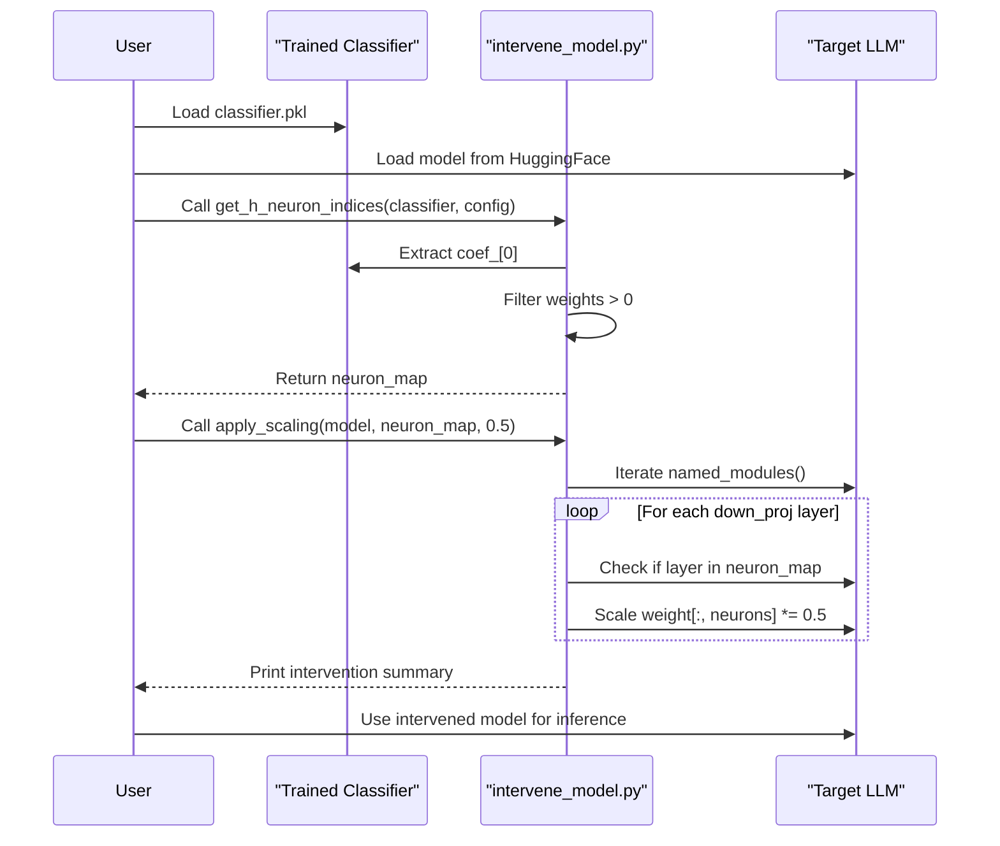
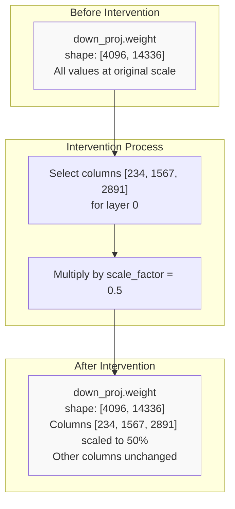

<!-- source: DeepWiki mcp.deepwiki.com · repo thunlp/H-Neurons · page 4.6 Step 6: Model Intervention · fetched 2026-11-02 -->

# Step 6: Model Intervention

<details>
<summary>Relevant source files</summary>

The following files were used as context for generating this wiki page:

- [README.md](README.md)
- [scripts/intervene_model.py](scripts/intervene_model.py)

</details>


## Purpose and Scope

This document explains how to perform neuron-level intervention on language models using the identified H-Neurons from the trained classifier. Model intervention enables you to modify the behavior of specific neurons to reduce hallucination tendencies in LLM outputs.

This page covers the final stage of the H-Neurons pipeline. For information about identifying which neurons to intervene on, see [Step 5: Classifier Training](#4.5). For the theoretical foundation of why intervention works, see [Core Concepts](#3).

**Sources:** [README.md:142-146](), [scripts/intervene_model.py:1-42]()

---

## Intervention Overview

Model intervention operates by **scaling the weights of the `down_proj` layer** at specific neuron positions identified as H-Neurons. The intervention modifies the model's computational graph to dampen or amplify the influence of particular neurons during inference.

### Intervention Architecture



**Sources:** [scripts/intervene_model.py:5-42](), [README.md:142-146]()

---

## H-Neuron Identification

H-Neurons are identified by extracting neurons with **positive weights** from the L1-regularized classifier. The `get_h_neuron_indices` function performs this extraction and organizes the results by layer.

### Identification Process

| Step | Operation | Code Location |
|------|-----------|---------------|
| 1. Load Weights | Extract `coef_[0]` from classifier | [scripts/intervene_model.py:7]() |
| 2. Get Model Config | Retrieve `intermediate_size` parameter | [scripts/intervene_model.py:8]() |
| 3. Filter Positives | Apply condition `weights > 0` | [scripts/intervene_model.py:11]() |
| 4. Flat to 2D Mapping | Convert flat indices to (layer, neuron) pairs | [scripts/intervene_model.py:16-17]() |
| 5. Build Neuron Map | Create dictionary `{layer_idx: [neuron_indices]}` | [scripts/intervene_model.py:14-20]() |

### Index Mapping Logic

The classifier weights are stored as a flat 1D array where each position corresponds to a unique neuron across all layers. The mapping formula is:

```
flat_index = (layer_idx * intermediate_size) + neuron_idx

Therefore:
layer_idx = flat_index // intermediate_size
neuron_idx = flat_index % intermediate_size
```

**Implementation:**

```python
# Extract from intervene_model.py:15-20
for idx in selected_flat_indices:
    layer_idx = int(idx // inter_size)
    neuron_idx = int(idx % inter_size)
    if layer_idx not in neuron_map:
        neuron_map[layer_idx] = []
    neuron_map[layer_idx].append(neuron_idx)
```

**Sources:** [scripts/intervene_model.py:5-22]()

---

## Weight Scaling Mechanism

The intervention modifies the model by scaling specific columns of the `down_proj.weight` matrix. This approach directly modulates the contribution of H-Neurons to the model's output.

### Weight Modification Flow



### Scaling Semantics

| Scale Factor | Effect | Use Case |
|--------------|--------|----------|
| `0.0` | Complete suppression | Ablate H-Neurons entirely |
| `0.1` - `0.5` | Strong dampening | Aggressive hallucination reduction |
| `0.5` - `0.9` | Moderate dampening | Balanced intervention |
| `1.0` | No change | Baseline (no intervention) |
| `> 1.0` | Amplification | Experimental (may increase hallucinations) |

**Sources:** [scripts/intervene_model.py:24-42](), [README.md:144-145]()

---

## Implementation Details

### Function: `get_h_neuron_indices`

**Signature:**
```python
def get_h_neuron_indices(classifier, config)
```

**Parameters:**
- `classifier`: Trained sklearn LogisticRegression object loaded from `.pkl` file
- `config`: Model configuration object (from `transformers.AutoConfig`)

**Returns:**
- Dictionary mapping layer indices to lists of neuron indices: `Dict[int, List[int]]`

**Key Operations:**
1. Extracts coefficient array: `weights = classifier.coef_[0]` [scripts/intervene_model.py:7]()
2. Retrieves intermediate size from config [scripts/intervene_model.py:8]()
3. Filters for positive weights (H-Neurons) [scripts/intervene_model.py:11]()
4. Converts flat indices to structured map [scripts/intervene_model.py:14-20]()

**Sources:** [scripts/intervene_model.py:5-22]()

---

### Function: `apply_scaling`

**Signature:**
```python
def apply_scaling(model, neuron_map, scale_factor)
```

**Parameters:**
- `model`: PyTorch model (e.g., from `transformers.AutoModelForCausalLM`)
- `neuron_map`: Output from `get_h_neuron_indices()`
- `scale_factor`: Float value to multiply weights by

**Returns:**
- None (modifies model in-place)

**Key Operations:**

| Line | Operation | Description |
|------|-----------|-------------|
| [27-28]() | Module Iteration | Loop through all named modules in model |
| [28]() | down_proj Detection | Filter for `torch.nn.Linear` with 'down_proj' in name |
| [30-34]() | Layer Index Extraction | Parse layer index from module name string |
| [36-37]() | Neuron Lookup | Check if layer contains target neurons |
| [39]() | Weight Scaling | Multiply selected columns by scale factor |
| [40]() | Count Tracking | Accumulate number of modified neurons |

**In-Place Modification:**
The function modifies weights directly using:
```python
module.weight.data[:, target_neurons] *= scale_factor
```

This scales all rows (output dimensions) for the specified columns (neuron dimensions).

**Sources:** [scripts/intervene_model.py:24-42]()

---

## Layer Index Extraction

The `apply_scaling` function uses string parsing to extract layer indices from module names. This handles various model architectures with different naming conventions.

### Name Parsing Logic



**Implementation:**
```python
# From intervene_model.py:30-34
parts = name.split('.')
try:
    layer_idx = next(int(p) for p in parts if p.isdigit())
except StopIteration:
    continue
```

**Sources:** [scripts/intervene_model.py:29-34]()

---

## Usage Pattern

### Basic Intervention Workflow



### Example Integration Code

While the repository provides helper functions, you would typically integrate them as follows:

```python
# Pseudocode showing typical usage
import joblib
from transformers import AutoModelForCausalLM, AutoConfig
from intervene_model import get_h_neuron_indices, apply_scaling

# 1. Load trained classifier
classifier = joblib.load("models/classifier.pkl")

# 2. Load target model
model = AutoModelForCausalLM.from_pretrained("/path/to/model")
config = AutoConfig.from_pretrained("/path/to/model")

# 3. Identify H-Neurons
neuron_map = get_h_neuron_indices(classifier, config)

# 4. Apply intervention
scale_factor = 0.5  # Dampen H-Neurons to 50% strength
apply_scaling(model, neuron_map, scale_factor)

# 5. Use intervened model
# model is now ready for inference with suppressed H-Neurons
```

**Sources:** [scripts/intervene_model.py:5-42](), [README.md:142-146]()

---

## Model Architecture Compatibility

The intervention functions work across different model architectures by relying on standard naming conventions for `down_proj` layers.

### Supported Models

| Model Family | Intermediate Size Location | Compatible |
|--------------|---------------------------|------------|
| Llama 3.3 | `config.intermediate_size` | ✓ |
| Mistral 2.4 | `config.intermediate_size` | ✓ |
| Gemma 2.7 | `config.text_config.intermediate_size` | ✓ |

The code handles both cases at [scripts/intervene_model.py:8]():
```python
inter_size = config.intermediate_size if hasattr(config, "intermediate_size") else config.text_config.intermediate_size
```

### Module Name Patterns

Expected module naming pattern:
```
model.layers.{layer_idx}.mlp.down_proj
```

The code extracts the first numeric component from the split name, making it robust to slight variations in naming conventions.

**Sources:** [scripts/intervene_model.py:8](), [scripts/intervene_model.py:29-34]()

---

## Important Considerations

### 1. L1 vs L2 Regularization

Only classifiers trained with **L1 regularization** produce interpretable H-Neuron sets suitable for intervention. L2-regularized classifiers have dense weights across all neurons, making selective intervention infeasible.

**From README:**
> **l1**: Encourages sparsity by driving most neuron weights to zero. This is essential for **identifying a sparse subset of H-Neurons** for downstream analysis.

**Sources:** [README.md:127-129]()

---

### 2. Positive Weight Interpretation

The code specifically filters for `weights > 0` because:
- In the binary classification setup, positive weights indicate neurons that activate more strongly for hallucinated responses (class 1)
- Negative weights indicate neurons that activate for faithful responses (class 0)
- Only positive-weight neurons (H-Neurons) are suppressed during intervention

**Sources:** [scripts/intervene_model.py:10-11]()

---

### 3. In-Place Modification

The `apply_scaling` function modifies the model **in-place**. If you need to preserve the original model:

```python
# Create a copy before intervention
import copy
original_model = copy.deepcopy(model)
apply_scaling(model, neuron_map, scale_factor)
# Now 'model' is modified, 'original_model' is unchanged
```

**Sources:** [scripts/intervene_model.py:38-39]()

---

### 4. Scale Factor Selection

The README mentions that optimal scale factors involve a trade-off:

> We perform a grid search to select \(C\) to maximize the sum of (1) classification accuracy on a held-out set and (2) model performance on TriviaQA when suppressing the identified H-Neurons.

While this refers to the regularization parameter `C`, a similar principle applies to `scale_factor`:
- Too aggressive suppression (scale_factor → 0) may harm general language modeling
- Too mild suppression (scale_factor → 1) may not reduce hallucinations effectively

Recommended starting points:
- Conservative: `scale_factor = 0.7`
- Moderate: `scale_factor = 0.5`
- Aggressive: `scale_factor = 0.3`

**Sources:** [README.md:131-135]()

---

### 5. Intervention Statistics

The `apply_scaling` function prints intervention statistics:

```python
print(f"Intervention complete. Modified {intervened_count} H-Neurons using scale factor {scale_factor}.")
```

This output helps verify:
- Number of neurons modified (should match classifier's non-zero weights)
- Successful application of the specified scale factor

**Sources:** [scripts/intervene_model.py:42]()

---

## Alternative Intervention Approaches

The README notes that direct weight modification (as shown in `intervene_model.py`) is one approach. For real-time inference, you may instead:

### Forward Hook-Based Intervention

Modify activations during the forward pass rather than weights:

```python
# Pseudocode - not in repository
def intervention_hook(module, input, output):
    # input[0] has shape [batch, seq_len, intermediate_size]
    input[0][:, :, target_neurons] *= scale_factor
    return input

# Register hook on down_proj layers
for name, module in model.named_modules():
    if 'down_proj' in name and layer_idx in neuron_map:
        module.register_forward_pre_hook(intervention_hook)
```

This approach:
- Preserves original weights
- Allows dynamic scale factor adjustment
- Enables per-sample intervention strategies

**Note:** The repository's provided functions use weight-based intervention for simplicity.

**Sources:** [README.md:142-145]()

---

## Complete Intervention Example

### Neuron Map Structure

After calling `get_h_neuron_indices`, the neuron map has this structure:

```python
{
    0: [234, 1567, 2891],      # Layer 0: 3 H-Neurons
    5: [445, 892],              # Layer 5: 2 H-Neurons
    12: [1023, 1024, 1025],     # Layer 12: 3 H-Neurons
    ...
}
```

### Weight Modification Visualization



**Sources:** [scripts/intervene_model.py:24-42]()

---

## Troubleshooting

### Common Issues

| Problem | Cause | Solution |
|---------|-------|----------|
| `KeyError` when accessing config | Wrong config attribute name | Check if model uses `intermediate_size` or `text_config.intermediate_size` |
| Zero neurons modified | Layer naming mismatch | Verify module names contain 'down_proj' and numeric layer indices |
| Model performance degraded | Too aggressive scaling | Increase scale_factor (try 0.7 instead of 0.3) |
| No hallucination reduction | Wrong neurons selected | Ensure classifier was trained with L1 penalty, not L2 |

### Verification Steps

1. **Check neuron map size:**
   ```python
   total_hneurons = sum(len(neurons) for neurons in neuron_map.values())
   print(f"Total H-Neurons: {total_hneurons}")
   ```

2. **Verify layer coverage:**
   ```python
   print(f"Layers with H-Neurons: {sorted(neuron_map.keys())}")
   ```

3. **Inspect classifier sparsity:**
   ```python
   non_zero = np.sum(classifier.coef_[0] > 0)
   print(f"Non-zero weights in classifier: {non_zero}")
   ```

**Sources:** [scripts/intervene_model.py:5-42]()

---

