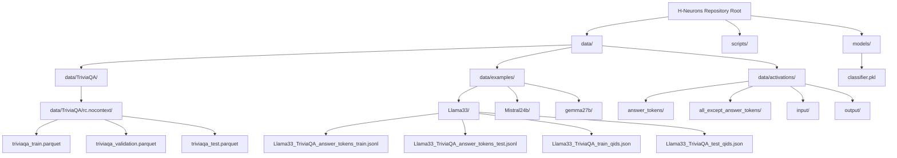
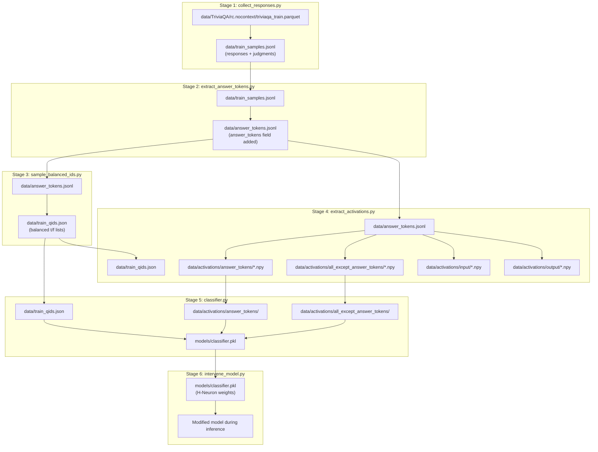

<!-- source: DeepWiki mcp.deepwiki.com · repo thunlp/H-Neurons · page 5 Data Organization · fetched 2026-11-02 -->

# Data Organization

<details>
<summary>Relevant source files</summary>

The following files were used as context for generating this wiki page:

- [README.md](README.md)
- [data/TriviaQA/rc.nocontext/train-00000-of-00001.parquet](data/TriviaQA/rc.nocontext/train-00000-of-00001.parquet)

</details>


This page provides an overview of how data is structured and organized throughout the H-Neurons pipeline. Understanding the data organization is essential for navigating the repository, running the pipeline, and interpreting results.

For detailed information about specific datasets and formats, see:
- **TriviaQA source structure**: [TriviaQA Source Dataset](#5.1)
- **Intermediate file formats**: [Intermediate Data Formats](#5.2)
- **Model-specific example data**: [Example Data: Llama33](#5.3), [Example Data: Mistral24b](#5.4), [Example Data: gemma27b](#5.5)

---

## Directory Structure

The repository organizes data into a hierarchical structure that separates source datasets, intermediate processing artifacts, model-specific examples, activation data, and trained models.



**Directory Hierarchy**

| Directory | Purpose | Contains |
|-----------|---------|----------|
| `data/TriviaQA/rc.nocontext/` | Source dataset | Parquet files for TriviaQA train/validation/test splits |
| `data/examples/` | Pre-computed example data | Model-specific subdirectories with answer tokens and QID files |
| `data/activations/` | Extracted activation data | Location-based subdirectories containing NPY files |
| `scripts/` | Pipeline scripts | Python scripts for each pipeline stage |
| `models/` | Trained classifiers | Serialized `.pkl` files containing trained models |

**Sources:** [README.md:50-80]()

---

## File Naming Conventions

The repository follows consistent naming patterns that encode metadata directly into filenames, making it easy to identify the model, dataset, data type, and split.

### Pattern: Model-Specific Files

```
{MODEL}_{DATASET}_{TYPE}_{SPLIT}.{EXT}
```

**Components:**
- `{MODEL}`: Model identifier (e.g., `Llama33`, `Mistral24b`, `gemma27b`)
- `{DATASET}`: Dataset name (typically `TriviaQA`)
- `{TYPE}`: Data type (e.g., `answer_tokens`, `responses`)
- `{SPLIT}`: Data split (e.g., `train`, `test`, `validation`)
- `{EXT}`: File extension (e.g., `jsonl`, `json`, `parquet`)

**Examples:**

| Filename | Description |
|----------|-------------|
| `Llama33_TriviaQA_answer_tokens_train.jsonl` | Training set answer tokens for Llama-3.3-70B |
| `Mistral24b_TriviaQA_test_qids.json` | Test set question IDs for Mistral-Small-3.1-24B |
| `gemma27b_TriviaQA_answer_tokens_test.jsonl` | Test set answer tokens for Gemma-3-27B |

### Pattern: Activation Files

```
activations/{LOCATION}/{FILENAME_PREFIX}_{LAYER}.npy
```

**Components:**
- `{LOCATION}`: Token extraction location (`answer_tokens`, `all_except_answer_tokens`, `input`, `output`)
- `{FILENAME_PREFIX}`: Typically includes question ID or sample identifier
- `{LAYER}`: Layer index (e.g., `layer_0`, `layer_31`)

**Sources:** [README.md:50](), Diagram 2, Diagram 4

---

## Data Flow Through Pipeline Stages

The following diagram illustrates how data files are created and consumed across the six pipeline stages, showing the actual file paths and naming patterns used in the codebase.



**Key Observations:**

1. **Linear Progression**: Each stage consumes outputs from previous stages, creating a clear dependency chain
2. **Multiple Outputs**: Stage 4 generates multiple activation directories for different token locations
3. **Reusable Artifacts**: Files like `answer_tokens.jsonl` and `train_qids.json` are consumed by multiple downstream stages
4. **Final Model**: The classifier `.pkl` file encodes the identified H-Neuron weights for intervention

**Sources:** [README.md:22-135](), Diagram 1

---

## Storage Locations by Pipeline Stage

This table summarizes what data is stored where after each pipeline stage completes.

| Stage | Script | Input Files | Output Files | Output Location |
|-------|--------|-------------|--------------|-----------------|
| 1 | `collect_responses.py` | `triviaqa_{split}.parquet` | `{split}_samples.jsonl` | User-specified via `--output_path` |
| 2 | `extract_answer_tokens.py` | `{split}_samples.jsonl` | `{split}_answer_tokens.jsonl` | User-specified via `--output_path` |
| 3 | `sample_balanced_ids.py` | `answer_tokens.jsonl` | `{split}_qids.json` | User-specified via `--output_path` |
| 4 | `extract_activations.py` | `answer_tokens.jsonl`, `train_qids.json` | `*.npy` (per layer, per sample) | `{output_root}/{location}/` |
| 5 | `classifier.py` | `train_qids.json`, `activations/*` | `classifier.pkl` | User-specified via `--save_model` |
| 6 | `intervene_model.py` | `classifier.pkl` | Modified model (in-memory) | N/A (runtime intervention) |

### Activation Storage Pattern

When `extract_activations.py` runs with `--locations answer_tokens all_except_answer_tokens input output`, it creates the following structure:

```
data/activations/
├── answer_tokens/
│   ├── sample_0000_layer_00.npy
│   ├── sample_0000_layer_01.npy
│   └── ...
├── all_except_answer_tokens/
│   ├── sample_0000_layer_00.npy
│   └── ...
├── input/
│   ├── sample_0000_layer_00.npy
│   └── ...
└── output/
    ├── sample_0000_layer_00.npy
    └── ...
```

Each `.npy` file contains a 1D NumPy array representing the aggregated CETT values for all neurons in that layer for that specific sample and location.

**Sources:** [README.md:93-106](), Diagram 4

---

## Example Data Organization

The `data/examples/` directory contains pre-computed data for three models, organized in model-specific subdirectories. This allows users to quickly experiment with the pipeline without running the computationally expensive early stages.

```mermaid
graph TB
    EXAMPLES["data/examples/"]
    
    subgraph "Llama33/"
        L33_TR_TOK["Llama33_TriviaQA_answer_tokens_train.jsonl<br/>(10,000 samples)"]
        L33_TE_TOK["Llama33_TriviaQA_answer_tokens_test.jsonl<br/>(1,000 samples)"]
        L33_TR_QID["Llama33_TriviaQA_train_qids.json<br/>(balanced t/f lists)"]
        L33_TE_QID["Llama33_TriviaQA_test_qids.json<br/>(balanced t/f lists)"]
    end
    
    subgraph "Mistral24b/"
        M24_TR_TOK["Mistral24b_TriviaQA_answer_tokens_train.jsonl<br/>(10,000 samples)"]
        M24_TE_TOK["Mistral24b_TriviaQA_answer_tokens_test.jsonl<br/>(1,000 samples)"]
        M24_TR_QID["Mistral24b_TriviaQA_train_qids.json<br/>(balanced t/f lists)"]
        M24_TE_QID["Mistral24b_TriviaQA_test_qids.json<br/>(balanced t/f lists)"]
    end
    
    subgraph "gemma27b/"
        G27_TR_TOK["gemma27b_TriviaQA_answer_tokens_train.jsonl<br/>(10,000 samples)"]
        G27_TE_TOK["gemma27b_TriviaQA_answer_tokens_test.jsonl<br/>(1,000 samples)"]
        G27_TR_QID["gemma27b_TriviaQA_train_qids.json<br/>(balanced t/f lists)"]
        G27_TE_QID["gemma27b_TriviaQA_test_qids.json<br/>(balanced t/f lists)"]
    end
    
    EXAMPLES --> L33_TR_TOK
    EXAMPLES --> L33_TE_TOK
    EXAMPLES --> L33_TR_QID
    EXAMPLES --> L33_TE_QID
    
    EXAMPLES --> M24_TR_TOK
    EXAMPLES --> M24_TE_TOK
    EXAMPLES --> M24_TR_QID
    EXAMPLES --> M24_TE_QID
    
    EXAMPLES --> G27_TR_TOK
    EXAMPLES --> G27_TE_TOK
    EXAMPLES --> G27_TR_QID
    EXAMPLES --> G27_TE_QID
```



**Example Data Characteristics:**

| Model | Training Samples | Test Samples | Pipeline Stage Equivalent |
|-------|------------------|--------------|---------------------------|
| Llama33 | 10,000 | 1,000 | Post-Stage 3 (ready for activation extraction) |
| Mistral24b | 10,000 | 1,000 | Post-Stage 3 (ready for activation extraction) |
| gemma27b | 10,000 | 1,000 | Post-Stage 3 (ready for activation extraction) |

These files allow users to start directly at Stage 4 (activation extraction) without needing to:
1. Sample responses from the models (Stage 1)
2. Extract answer tokens using GPT-4o API (Stage 2)
3. Generate balanced training/test splits (Stage 3)

**Sources:** [README.md:50](), Diagram 2, Diagram 6

---

## File Format Summary

The following table provides a quick reference for all file formats used throughout the pipeline:

| Extension | Format | Used For | Example Path |
|-----------|--------|----------|--------------|
| `.parquet` | Apache Parquet | Source TriviaQA datasets | `data/TriviaQA/rc.nocontext/triviaqa_train.parquet` |
| `.jsonl` | JSON Lines | Responses, answer tokens | `data/examples/Llama33/Llama33_TriviaQA_answer_tokens_train.jsonl` |
| `.json` | JSON | Question ID lists | `data/examples/Llama33/Llama33_TriviaQA_train_qids.json` |
| `.npy` | NumPy Binary | Activation arrays | `data/activations/answer_tokens/sample_0000_layer_00.npy` |
| `.pkl` | Python Pickle | Trained classifiers | `models/classifier.pkl` |

### Format Details

- **`.parquet`**: Columnar storage format for efficient querying of large datasets. See [TriviaQA Source Dataset](#5.1) for schema details.
- **`.jsonl`**: Newline-delimited JSON where each line is a complete JSON object. See [Intermediate Data Formats](#5.2) for field specifications.
- **`.json`**: Standard JSON containing structured data like lists of question IDs grouped by label (true/false).
- **`.npy`**: NumPy's native binary format for fast loading of numerical arrays. Each file contains a single 1D array of neuron activations.
- **`.pkl`**: Serialized scikit-learn models using joblib, containing the trained `LogisticRegression` object with coefficients representing H-Neuron weights.

**Sources:** [README.md:40-135](), Diagram 1

---

## Data Volume Considerations

The size of data artifacts varies significantly across pipeline stages. Understanding storage requirements helps with resource planning.

| Data Type | Approximate Size | Count | Total Storage |
|-----------|------------------|-------|---------------|
| TriviaQA source (single split) | ~50-100 MB | 3 splits | ~150-300 MB |
| Response samples (10k, JSONL) | ~10-50 MB | Per model | ~10-50 MB |
| Answer tokens (10k, JSONL) | ~10-50 MB | Per model | ~10-50 MB |
| Activations (single location, 10k samples) | Variable | 4 locations | Depends on model layers and neuron count |
| Classifier model (.pkl) | <1 MB | 1 | <1 MB |

**Activation Storage Example:**

For a model with 32 layers and 14,336 neurons per layer:
- Single sample, single layer: `14,336 neurons × 4 bytes (float32) = ~57 KB`
- Single sample, all layers: `32 layers × 57 KB = ~1.8 MB`
- 10,000 samples, single location: `10,000 × 1.8 MB = ~18 GB`
- All 4 locations: `4 × 18 GB = ~72 GB`

**Recommendation:** When running on limited storage, extract activations for only the locations needed for your specific training mode. For `1-vs-1` mode, only `answer_tokens` is required. For `3-vs-1` mode, both `answer_tokens` and `all_except_answer_tokens` are needed.

**Sources:** Diagram 4, Diagram 5

---

