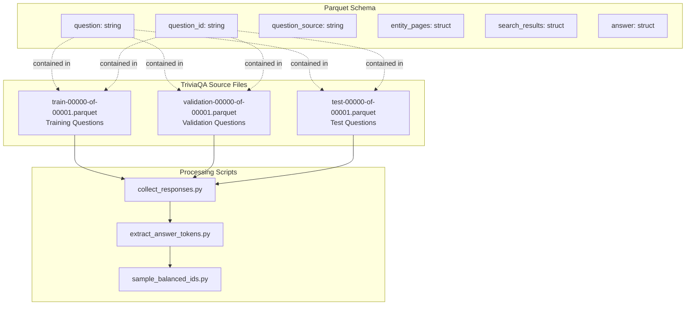
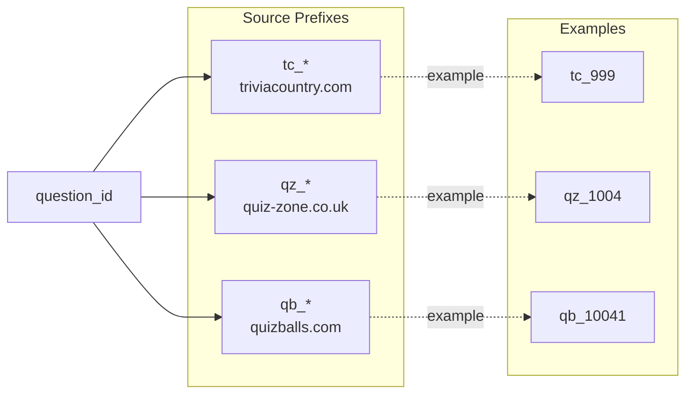
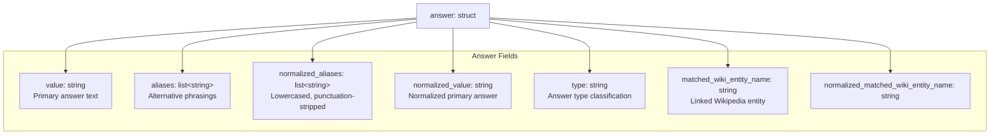
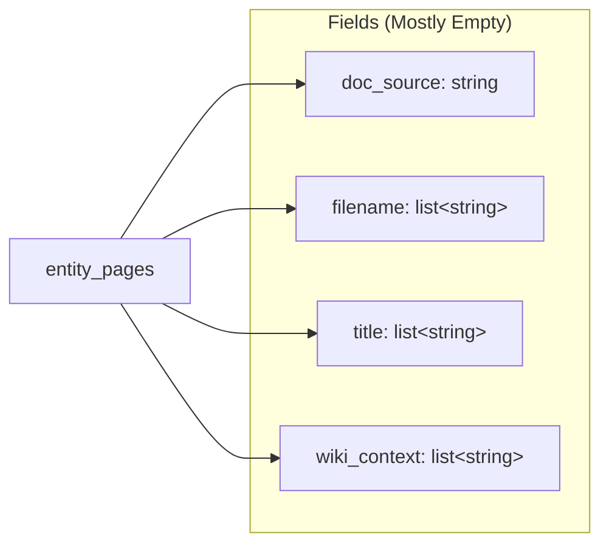
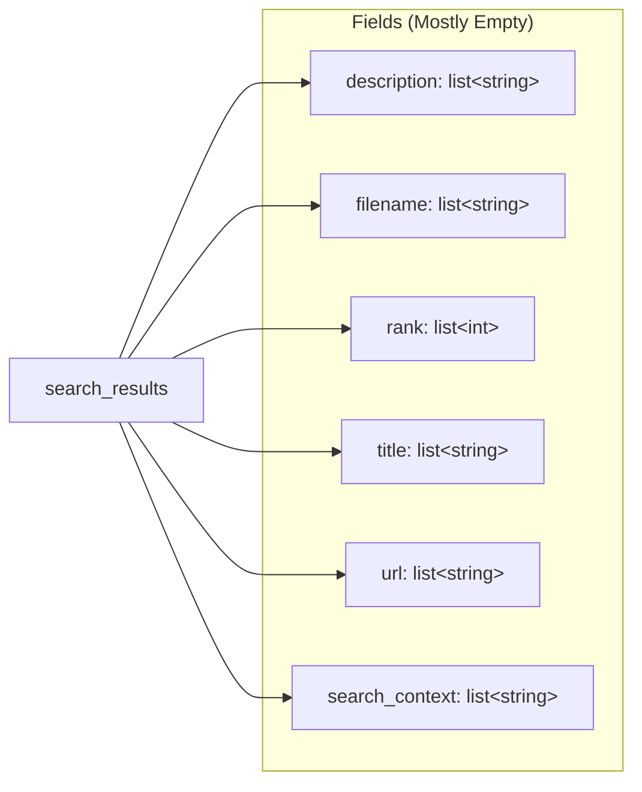
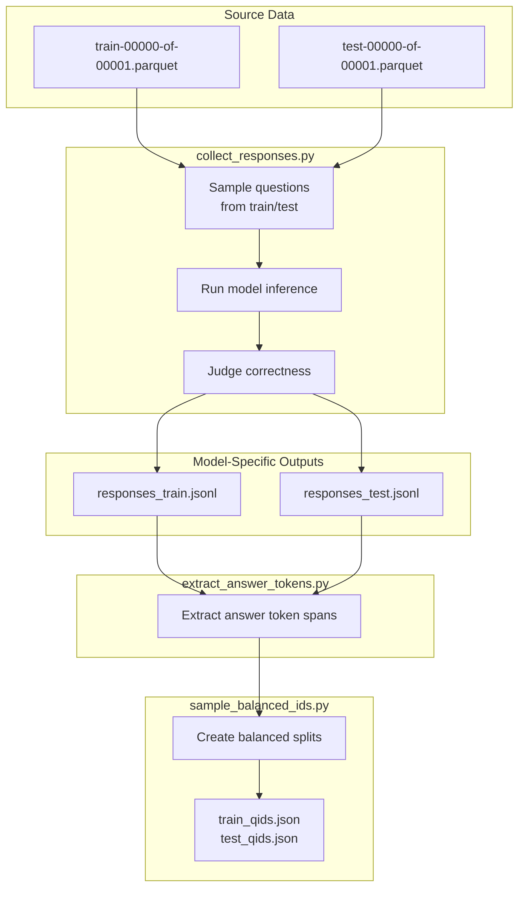
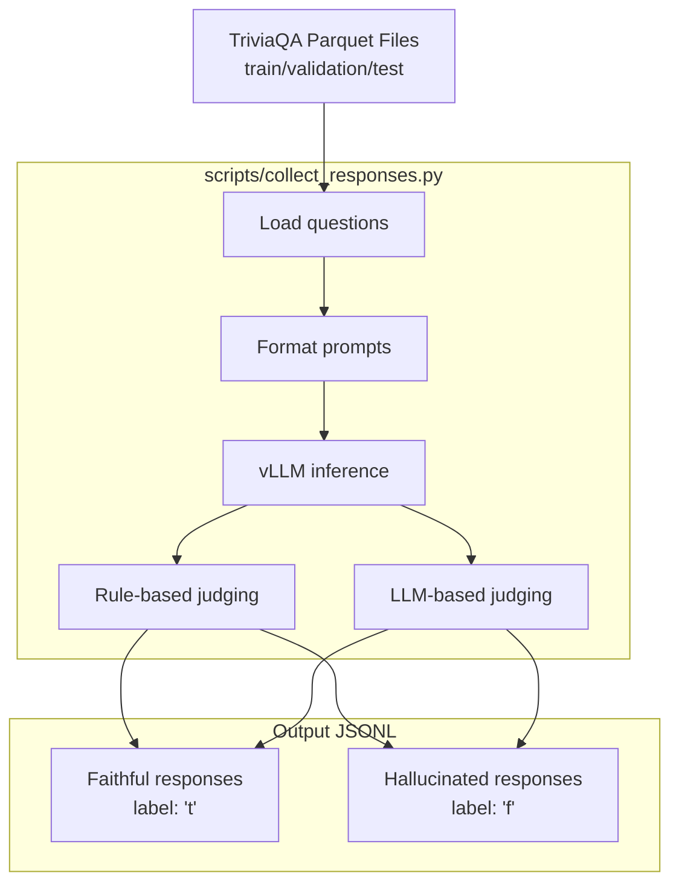

<!-- source: DeepWiki mcp.deepwiki.com · repo thunlp/H-Neurons · page 5.1 TriviaQA Source Dataset · fetched 2026-11-02 -->

# TriviaQA Source Dataset

<details>
<summary>Relevant source files</summary>

The following files were used as context for generating this wiki page:

- [data/TriviaQA/rc.nocontext/test-00000-of-00001.parquet](data/TriviaQA/rc.nocontext/test-00000-of-00001.parquet)
- [data/TriviaQA/rc.nocontext/train-00000-of-00001.parquet](data/TriviaQA/rc.nocontext/train-00000-of-00001.parquet)
- [data/TriviaQA/rc.nocontext/validation-00000-of-00001.parquet](data/TriviaQA/rc.nocontext/validation-00000-of-00001.parquet)

</details>


This page describes the TriviaQA rc.nocontext dataset structure used as the source data for H-Neuron identification. This covers the raw Parquet files located in the `data/TriviaQA/rc.nocontext/` directory. For processed model-specific data formats, see [Intermediate Data Formats](#5.2). For example datasets prepared for specific models, see [Example Data: Llama33](#5.3), [Example Data: Mistral24b](#5.4), and [Example Data: gemma27b](#5.5).

## Dataset Overview

The H-Neurons pipeline uses the TriviaQA "Reading Comprehension without Context" (rc.nocontext) variant as its source dataset. This variant contains questions and answers without supporting evidence documents, making it suitable for testing whether language models hallucinate or produce factual responses based solely on their parametric knowledge.

The dataset is stored in Apache Parquet format with three splits:
- `train-00000-of-00001.parquet` - Training data
- `validation-00000-of-00001.parquet` - Validation data  
- `test-00000-of-00001.parquet` - Test data

**Sources:** [data/TriviaQA/rc.nocontext/test-00000-of-00001.parquet:1-1]()

## Dataset Structure



**Sources:** [data/TriviaQA/rc.nocontext/test-00000-of-00001.parquet:1-100]()

## Schema Structure

The TriviaQA Parquet files follow a hierarchical schema with the following top-level fields:

| Field Name | Data Type | Description |
|------------|-----------|-------------|
| `question` | string | The trivia question text |
| `question_id` | string | Unique identifier with source prefix (tc_, qz_, qb_) |
| `question_source` | string | URL of the source website |
| `entity_pages` | struct | Wikipedia entity metadata (not used in rc.nocontext) |
| `search_results` | struct | Search result metadata (not used in rc.nocontext) |
| `answer` | struct | Ground truth answer with aliases and metadata |

**Sources:** [data/TriviaQA/rc.nocontext/test-00000-of-00001.parquet:1-50]()

## Question ID Format



Question identifiers use prefixes to indicate their source:
- `tc_*` - Questions from triviacountry.com
- `qz_*` - Questions from quiz-zone.co.uk  
- `qb_*` - Questions from quizballs.com

The numeric suffix is a sequential identifier within each source.

**Sources:** [data/TriviaQA/rc.nocontext/test-00000-of-00001.parquet:230-280]()

## Answer Structure

The `answer` field is a nested struct containing multiple representations of the ground truth answer:



### Answer Field Details

| Field | Purpose | Example |
|-------|---------|---------|
| `value` | Primary canonical answer | "Eritrea" |
| `aliases` | Alternative acceptable answers | ["Eritrea", "State of Eritrea"] |
| `normalized_aliases` | Lowercased, stripped variants for matching | ["eritrea", "state of eritrea"] |
| `normalized_value` | Normalized primary answer | "eritrea" |
| `type` | Answer category (often `<unk>`) | `<unk>` |
| `matched_wiki_entity_name` | Wikipedia entity if available | `<unk>` |
| `normalized_matched_wiki_entity_name` | Normalized entity name | `<unk>` |

Most fields in the rc.nocontext variant are set to `<unk>` (unknown) since this variant excludes supporting documents and entity linking.

**Sources:** [data/TriviaQA/rc.nocontext/test-00000-of-00001.parquet:260-280]()

## Entity and Search Metadata

The TriviaQA dataset includes `entity_pages` and `search_results` structs that contain Wikipedia and search engine metadata. In the rc.nocontext variant, these fields are present in the schema but typically empty or minimal:

### entity_pages Structure



### search_results Structure



These metadata fields are not utilized in the H-Neurons pipeline, which focuses on the model's parametric knowledge without external context.

**Sources:** [data/TriviaQA/rc.nocontext/test-00000-of-00001.parquet:260-280]()

## Data Splits and Usage

The three Parquet files serve different purposes in the H-Neurons pipeline:

| Split | File | Typical Usage | Size Characteristics |
|-------|------|---------------|---------------------|
| Train | `train-00000-of-00001.parquet` | Source for collecting responses and training classifiers | Largest split (~10,000+ questions sampled) |
| Validation | `validation-00000-of-00001.parquet` | Optional validation during development | Medium split |
| Test | `test-00000-of-00001.parquet` | Final evaluation and testing | Smaller split (~1,000+ questions sampled) |

The pipeline workflow processes these files as follows:



**Sources:** [data/TriviaQA/rc.nocontext/test-00000-of-00001.parquet:1-100]()

## Sample Data Examples

The dataset contains diverse trivia questions across various domains:

### Geography Questions
- **Question:** "Asmara international airport is in which country?"
- **Question ID:** `tc_1`
- **Answer:** `{"value": "Eritrea", "aliases": ["Eritrea", "State of Eritrea"], ...}`

### History Questions  
- **Question:** "At whose concert were 11 people trampled to death in Cincinnati, Ohio, in 1979?"
- **Question ID:** `tc_2`
- **Answer:** `{"value": "The Who", ...}`

### Arts & Culture Questions
- **Question:** "Andy Warhol's 60s exhibition featured cans of what product?"
- **Question ID:** `tc_3`  
- **Answer:** `{"value": "Campbell's Soup", "aliases": ["Campbell's", "Campbell Soup"], ...}`

Each question provides sufficient information for the model to generate an answer based solely on its parametric knowledge, without requiring external documents.

**Sources:** [data/TriviaQA/rc.nocontext/test-00000-of-00001.parquet:1-50]()

## Integration with Pipeline

The TriviaQA source dataset integrates into the H-Neurons pipeline at the initial response collection stage:



The `question` field becomes the input prompt, and the `answer.normalized_aliases` list is used by judging methods to determine if the model's response is faithful or hallucinated.

**Sources:** [data/TriviaQA/rc.nocontext/test-00000-of-00001.parquet:1-100]()

## File Format and Access

The Parquet format provides efficient columnar storage and fast random access:

- **Format:** Apache Parquet (binary columnar format)
- **Compression:** Snappy compression (typical for Parquet)
- **Access Methods:**
  - Python: `pandas.read_parquet()` or `pyarrow.parquet.read_table()`
  - Direct column access without loading entire file
  
### Loading Example Pattern

```python
# Pattern used in scripts to load TriviaQA data
import pandas as pd

df = pd.read_parquet("data/TriviaQA/rc.nocontext/train-00000-of-00001.parquet")

# Access specific fields
questions = df['question'].tolist()
question_ids = df['question_id'].tolist()
answers = df['answer'].apply(lambda x: x['normalized_aliases']).tolist()
```

This efficient format enables rapid iteration during dataset sampling and response collection phases.

**Sources:** [data/TriviaQA/rc.nocontext/test-00000-of-00001.parquet:1-1]()

---

