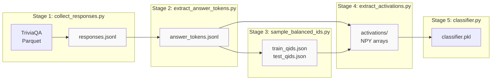
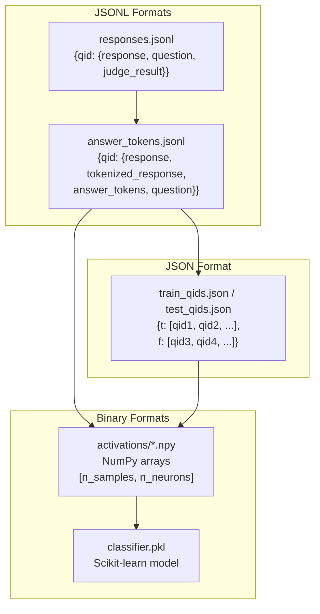
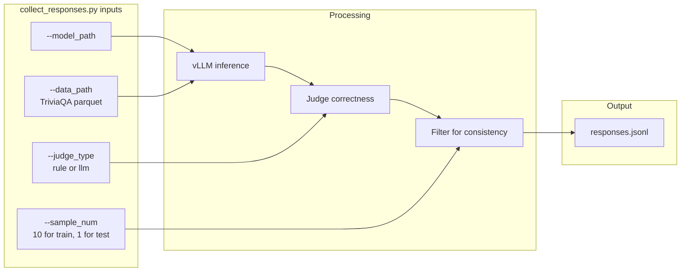
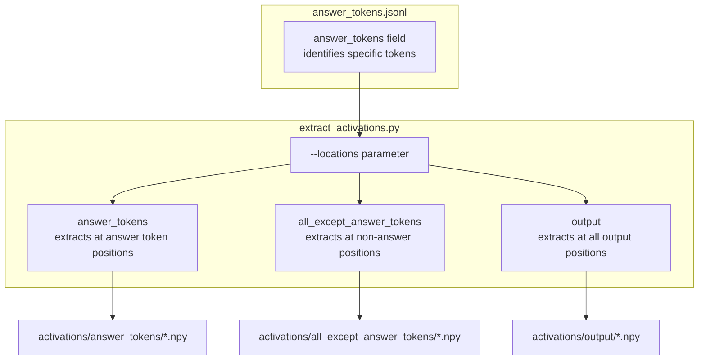
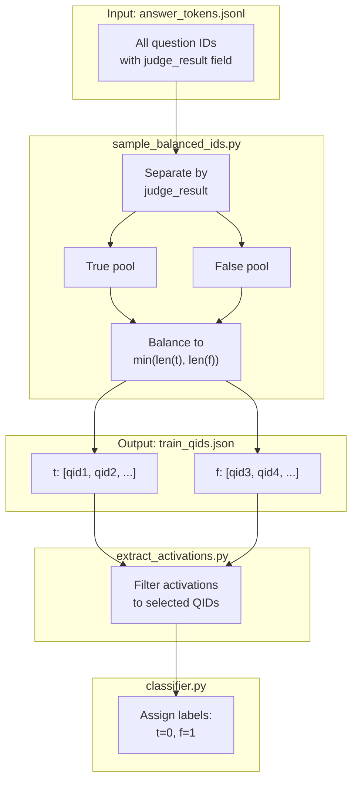
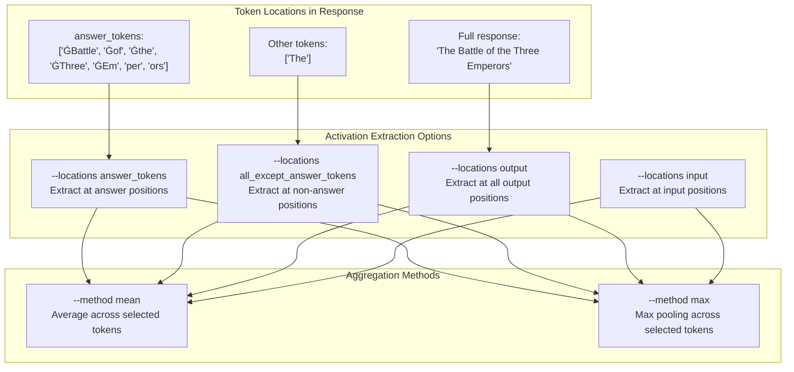
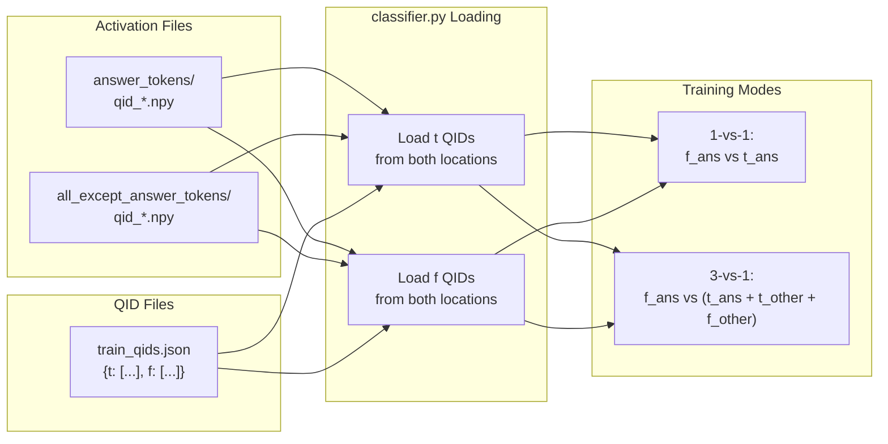
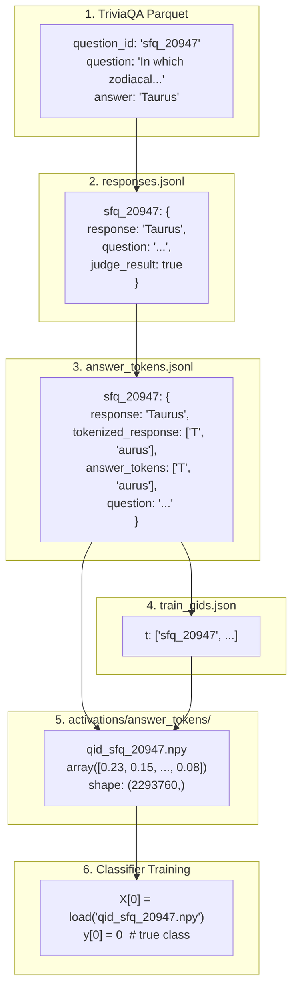

<!-- source: DeepWiki mcp.deepwiki.com · repo thunlp/H-Neurons · page 5.2 Intermediate Data Formats · fetched 2026-11-02 -->

# Intermediate Data Formats

<details>
<summary>Relevant source files</summary>

The following files were used as context for generating this wiki page:

- [README.md](README.md)
- [data/examples/Llama33_TriviaQA_answer_tokens_train.jsonl](data/examples/Llama33_TriviaQA_answer_tokens_train.jsonl)
- [data/examples/Llama33_TriviaQA_train_qids.json](data/examples/Llama33_TriviaQA_train_qids.json)

</details>


This page documents the intermediate data file formats used throughout the H-Neurons identification pipeline. These formats serve as the interface between pipeline stages, storing responses, token annotations, sample selections, and neural activations. For information about the source TriviaQA dataset structure, see [TriviaQA Source Dataset](#5.1). For details on the provided example data files, see sections [5.3](#5.3), [5.4](#5.4), and [5.5](#5.5).

## Pipeline Data Flow

The H-Neurons pipeline processes data through multiple stages, with each stage consuming input files and producing output files in specific formats:



**Data Format Progression**



Sources: [README.md:22-29](), [data/examples/Llama33_TriviaQA_answer_tokens_train.jsonl:1-10](), [data/examples/Llama33_TriviaQA_train_qids.json:1-10]()

---

## Response JSONL Format

The `responses.jsonl` file is produced by `collect_responses.py` and contains the LLM's responses to TriviaQA questions along with correctness judgments.

### File Structure

Each line in the JSONL file is a valid JSON object with the following structure:

```json
{
  "question_id": {
    "response": "String containing the model's generated response",
    "question": "The full question text posed to the model",
    "judge_result": true
  }
}
```

### Field Descriptions

| Field | Type | Description |
|-------|------|-------------|
| `question_id` | String | Unique identifier for the question (outer key), derived from TriviaQA dataset |
| `response` | String | The complete text response generated by the target LLM |
| `question` | String | The original question text, typically appended with "Respond with the answer only, without any explanation." |
| `judge_result` | Boolean | `true` if the response is judged correct/faithful, `false` if hallucinated/incorrect |

### Judging Modes

The `judge_result` field is determined by one of two methods specified via the `--judge_type` parameter:

**Rule-based judging** (`--judge_type rule`):
- Uses fuzzy string matching against ground truth answers
- Fast and deterministic
- May have lower accuracy for nuanced cases

**LLM-based judging** (`--judge_type llm`):
- Uses GPT-4o or another judge model via API
- More accurate semantic evaluation
- Requires API access and incurs costs

### Sampling Strategy

For **training data** (`--sample_num 10`):
- Each question is sampled 10 times
- Only questions with **consistent** judgments across all 10 samples are retained
- This ensures high-confidence examples for training

For **test data** (`--sample_num 1`):
- Each question is sampled once
- Represents realistic single-inference scenarios

### Example Usage Pattern



Sources: [README.md:44-63](), [README.md:45-48]()

---

## Answer Tokens JSONL Format

The `answer_tokens.jsonl` file is produced by `extract_answer_tokens.py` and extends the response format by identifying which specific tokens in the response constitute the actual answer.

### File Structure

Each line contains a JSON object mapping a question ID to its annotated response:

```json
{
  "sfq_20947": {
    "response": "Taurus",
    "tokenized_response": ["T", "aurus"],
    "answer_tokens": ["T", "aurus"],
    "question": "In which zodiacal constellation is the bright star Aldebaran? Respond with the answer only, without any explanation."
  }
}
```

### Field Descriptions

| Field | Type | Description |
|-------|------|-------------|
| `question_id` | String | Unique question identifier (outer key) |
| `response` | String | The original response text from the LLM |
| `tokenized_response` | List[String] | The response split into individual tokens according to the model's tokenizer |
| `answer_tokens` | List[String] | Subset of `tokenized_response` identified as the factual answer tokens |
| `question` | String | The original question text |

### Answer Token Identification

The `answer_tokens` field is populated using GPT-4o (or another judge model) to identify which tokens in the response represent the actual answer versus additional explanation or formatting.

**Empty answer_tokens list**:
When `answer_tokens` is an empty list `[]`, it indicates one of:
- The response contains no factual answer tokens (pure hallucination)
- Answer token extraction was skipped (user chose to train on full output)

**Example cases**:

```json
// Simple answer - all tokens are answer tokens
{"qw_6560": {
  "response": "Oxygen",
  "tokenized_response": ["O", "xygen"],
  "answer_tokens": ["O", "xygen"]
}}

// Complex response - only some tokens are answer tokens
{"tb_1455": {
  "response": "The Battle of the Three Emperors",
  "tokenized_response": ["The", "ĠBattle", "Ġof", "Ġthe", "ĠThree", "ĠEm", "per", "ors"],
  "answer_tokens": ["ĠBattle", "Ġof", "Ġthe", "ĠThree", "ĠEm", "per", "ors"]
}}

// Empty answer tokens - hallucinated or extraction skipped
{"sfq_3640": {
  "response": "Ronnie O'Sullivan",
  "tokenized_response": ["Ron", "nie", "ĠO", "'S", "ullivan"],
  "answer_tokens": []
}}
```

### Token Representation

Tokens include special characters indicating whitespace and subword boundaries:
- `Ġ` prefix indicates a leading space (e.g., `"ĠBattle"` represents `" Battle"`)
- Tokens without prefix are word-initial or continuation subwords
- This follows the tokenizer's native representation (e.g., Llama tokenizer)

### Relationship to Activation Extraction



### Optional Usage

According to the README, extracting exact answer tokens is **optional**:
- Training on answer tokens typically yields **higher prediction accuracy**
- To skip this step, manually create `answer_tokens.jsonl` with empty lists `[]` for all entries
- Then use `--locations output` in Stage 4 to extract activations from all output tokens

Sources: [README.md:66-80](), [data/examples/Llama33_TriviaQA_answer_tokens_train.jsonl:1-100]()

---

## Question IDs JSON Format

The `train_qids.json` and `test_qids.json` files are produced by `sample_balanced_ids.py` and define balanced sets of question IDs for training and evaluation.

### File Structure

A single JSON object with two keys:

```json
{
    "t": [
        "bb_1058",
        "bb_1066",
        "bb_1118",
        "..."
    ],
    "f": [
        "bb_1074",
        "bb_1169",
        "bb_1273",
        "..."
    ]
}
```

### Field Descriptions

| Field | Type | Description |
|-------|------|-------------|
| `t` | List[String] | Question IDs with **faithful/correct** responses (true/positive class) |
| `f` | List[String] | Question IDs with **hallucinated/incorrect** responses (false/negative class) |

### Balancing Constraint

The script ensures `len(t) == len(f)` by randomly sampling from the larger class to match the smaller class size.

**Typical sizes**:
- Training sets: 1,000 questions per class (2,000 total)
- Test sets: 100-1,000 questions per class

### Question ID Format

Question IDs follow the pattern `{prefix}_{number}`:
- `bb_*`: Questions from one dataset source
- `bt_*`: Questions from another source
- `dpql_*`, `jp_*`, `odql_*`, `qb_*`, `qf_*`, `qg_*`, `qw_*`, `qz_*`, `sfq_*`, `tb_*`, `tc_*`, `wh_*`: Various TriviaQA subsets

### Usage in Pipeline



### Example: Creating Balanced Sets

Given an `answer_tokens.jsonl` with:
- 15,000 faithful responses (judge_result=true)
- 8,000 hallucinated responses (judge_result=false)

Running `sample_balanced_ids.py --num_samples 1000` produces:
- `t`: 1,000 randomly selected IDs from the 15,000 faithful pool
- `f`: 1,000 randomly selected IDs from the 8,000 hallucinated pool

### Separate Train and Test Sets

The pipeline typically maintains **separate** QID files:

| File | Purpose | Source Data | Typical Size |
|------|---------|-------------|--------------|
| `train_qids.json` | Classifier training | Training split responses (`--sample_num 10`, consistency filtered) | ~1,000 per class |
| `test_qids.json` | Classifier evaluation | Test split responses (`--sample_num 1`) | ~100-1,000 per class |

This ensures **no data leakage** between training and evaluation.

Sources: [README.md:82-91](), [data/examples/Llama33_TriviaQA_train_qids.json:1-20](), [data/examples/Llama33_TriviaQA_train_qids.json:1004-2006]()

---

## Activation Arrays (NPY Format)

The activation extraction stage produces NumPy `.npy` files containing neuron activation values. These files are organized into subdirectories based on token locations.

### Directory Structure

```
activations/
├── answer_tokens/
│   ├── qid_bb_1058.npy
│   ├── qid_bb_1066.npy
│   └── ...
├── all_except_answer_tokens/
│   ├── qid_bb_1058.npy
│   ├── qid_bb_1066.npy
│   └── ...
├── input/
│   ├── qid_bb_1058.npy
│   └── ...
└── output/
    ├── qid_bb_1058.npy
    └── ...
```

### File Naming Convention

Each `.npy` file is named: `qid_{question_id}.npy`

Example: `qid_sfq_20947.npy` contains activations for question ID `sfq_20947`

### Array Shape and Content

Each `.npy` file contains a 1D NumPy array:

```
Shape: (n_neurons,)
Dtype: float32 or float64
```

Where `n_neurons` is the total number of MLP neurons across all layers:
- For Llama-3.3-70B: 80 layers × 28,672 neurons/layer = 2,293,760 neurons
- For Mistral-Small-24B: 56 layers × 14,336 neurons/layer = 802,816 neurons
- For Gemma-2-27B: 46 layers × 36,864 neurons/layer = 1,695,744 neurons

### Activation Value Computation

The values represent the CETT (Neuron Contribution) metric:

```
CETT_i = |weight_norm_i| × |input_i| / output_norm
```

Where:
- `weight_norm_i`: L2 norm of the `down_proj` weights for neuron `i`
- `input_i`: Input value to `down_proj` for neuron `i`
- `output_norm`: L2 norm of the `down_proj` output vector

**Optional transformations** (via command-line flags):
- `--use_mag`: Multiply by magnitude (default behavior)
- `--use_abs`: Take absolute value of input (default behavior)

### Location-Based Extraction



### Aggregation Strategy

Since each token produces a separate activation vector, the `--method` parameter controls aggregation:

**Mean aggregation** (`--method mean`):
```
activation[i] = mean(activation_i[token_j] for all j in selected_tokens)
```

**Max aggregation** (`--method max`):
```
activation[i] = max(activation_i[token_j] for all j in selected_tokens)
```

### Loading Activations in Python

```python
import numpy as np

# Load single sample
activations = np.load('activations/answer_tokens/qid_sfq_20947.npy')
# Shape: (n_neurons,)

# Load multiple samples for classifier training
qids = ['bb_1058', 'bb_1066', 'bb_1118']
X = np.array([
    np.load(f'activations/answer_tokens/qid_{qid}.npy') 
    for qid in qids
])
# Shape: (n_samples, n_neurons)
```

### Relationship to Classifier Training



Sources: [README.md:93-106]()

---

## Data Format Compatibility

### Cross-Stage Requirements

| Stage | Input Formats | Output Formats | Key Compatibility Requirements |
|-------|--------------|----------------|-------------------------------|
| `collect_responses.py` | TriviaQA Parquet | `responses.jsonl` | Question IDs must match source dataset |
| `extract_answer_tokens.py` | `responses.jsonl` | `answer_tokens.jsonl` | Preserves all question IDs from input |
| `sample_balanced_ids.py` | `answer_tokens.jsonl` | `{split}_qids.json` | QIDs must exist in source JSONL |
| `extract_activations.py` | `answer_tokens.jsonl`, `{split}_qids.json` | `activations/*.npy` | QIDs in JSON must exist in JSONL |
| `classifier.py` | `{split}_qids.json`, `activations/*.npy` | `classifier.pkl` | NPY files must exist for all QIDs |

### Model-Specific Considerations

All intermediate formats are **model-specific**:
- Different models produce different responses for the same questions
- Tokenization differs between models (e.g., Llama vs. Mistral tokenizers)
- Activation dimensionality varies by architecture

**Example**: The same question ID `sfq_20947` appears in:
- `Llama33_TriviaQA_answer_tokens_train.jsonl`
- `Mistral24b_TriviaQA_answer_tokens_train.jsonl`
- `gemma27b_TriviaQA_answer_tokens_train.jsonl`

But with different `response`, `tokenized_response`, and `answer_tokens` values.

### File Naming Conventions

Recommended naming pattern for multi-model experiments:

```
{model}_{dataset}_{stage}_{split}.{ext}

Examples:
- Llama33_TriviaQA_responses_train.jsonl
- Llama33_TriviaQA_answer_tokens_train.jsonl
- Llama33_TriviaQA_train_qids.json
- Mistral24b_TriviaQA_answer_tokens_test.jsonl
```

This pattern is followed in the `data/examples/` directory.

Sources: [README.md:40-141]()

---

## Complete Example Workflow

### Step-by-Step Data Transformation



### Example Data Processing

For a single question through the pipeline:

**Input (TriviaQA)**:
```
question_id: sfq_20947
question: "In which zodiacal constellation is the bright star Aldebaran?"
answer: "Taurus"
```

**Stage 1 Output (responses.jsonl)**:
```json
{"sfq_20947": {
  "response": "Taurus",
  "question": "In which zodiacal constellation is the bright star Aldebaran? Respond with the answer only, without any explanation.",
  "judge_result": true
}}
```

**Stage 2 Output (answer_tokens.jsonl)**:
```json
{"sfq_20947": {
  "response": "Taurus",
  "tokenized_response": ["T", "aurus"],
  "answer_tokens": ["T", "aurus"],
  "question": "In which zodiacal constellation is the bright star Aldebaran? Respond with the answer only, without any explanation."
}}
```

**Stage 3 Output (train_qids.json)**:
```json
{
  "t": ["sfq_20947", "bb_1066", "bb_1118", "..."],
  "f": ["bb_1074", "bb_1169", "bb_1273", "..."]
}
```

**Stage 4 Output (activations/answer_tokens/qid_sfq_20947.npy)**:
```python
array([0.234, 0.156, 0.089, ..., 0.012], dtype=float32)
# Shape: (2293760,) for Llama-3.3-70B
```

**Stage 5 Usage (classifier.py)**:
```python
# Load faithful example
X_true = np.load('activations/answer_tokens/qid_sfq_20947.npy')
y_true = 0  # Label for faithful responses

# Combine with other samples for training
X_train = np.vstack([X_true, X_false_1, X_false_2, ...])
y_train = np.array([0, 1, 1, ...])
```

Sources: [README.md:40-141](), [data/examples/Llama33_TriviaQA_answer_tokens_train.jsonl:1]()

---

