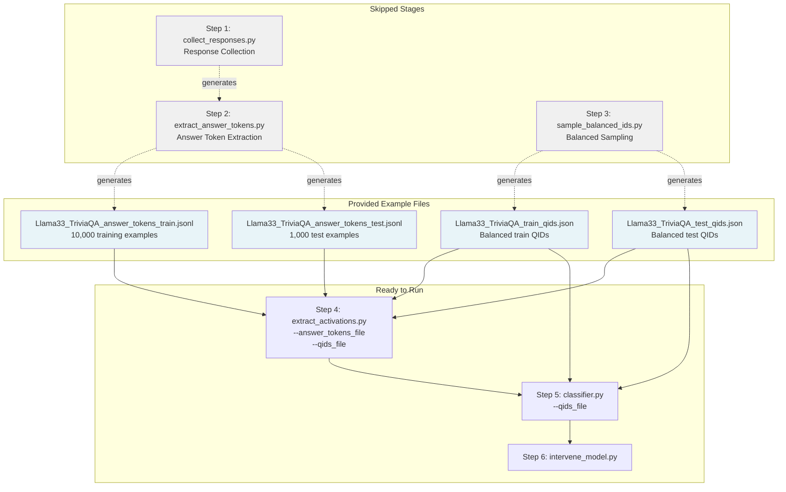
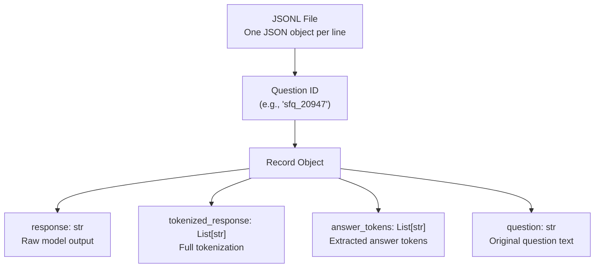
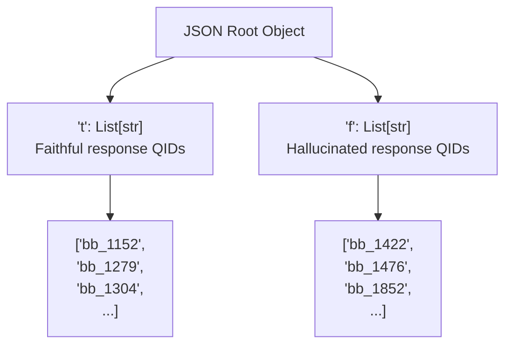
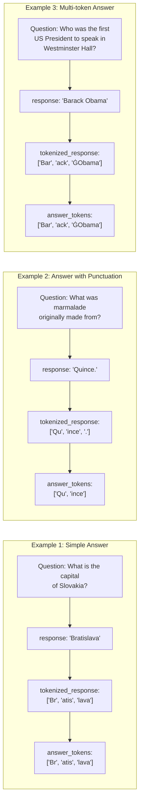

<!-- source: DeepWiki mcp.deepwiki.com · repo thunlp/H-Neurons · page 5.3 Example Data: Llama33 · fetched 2026-11-02 -->

# Example Data: Llama33

<details>
<summary>Relevant source files</summary>

The following files were used as context for generating this wiki page:

- [data/examples/Llama33_TriviaQA_answer_tokens_test.jsonl](data/examples/Llama33_TriviaQA_answer_tokens_test.jsonl)
- [data/examples/Llama33_TriviaQA_answer_tokens_train.jsonl](data/examples/Llama33_TriviaQA_answer_tokens_train.jsonl)
- [data/examples/Llama33_TriviaQA_test_qids.json](data/examples/Llama33_TriviaQA_test_qids.json)
- [data/examples/Llama33_TriviaQA_train_qids.json](data/examples/Llama33_TriviaQA_train_qids.json)

</details>


This page documents the pre-processed example data files provided for the Llama33 model variant (meta-llama/Llama-3.1-8B-Instruct). These files represent completed outputs from Steps 2 and 3 of the H-Neurons identification pipeline, allowing users to skip the time-consuming response collection and answer extraction stages when working with Llama33.

For details on the source TriviaQA dataset structure, see [TriviaQA Source Dataset](#5.1). For comprehensive documentation of intermediate file formats used across all models, see [Intermediate Data Formats](#5.2). For example data from other supported models, see [Example Data: Mistral24b](#5.4) and [Example Data: gemma27b](#5.5).

## Overview of Provided Files

The Llama33 example data consists of three files located in `data/examples/`:

| File Name | Purpose | Pipeline Stage | Records |
|-----------|---------|----------------|---------|
| `Llama33_TriviaQA_answer_tokens_train.jsonl` | Training set with tokenized responses and extracted answer tokens | Step 2 output | ~10,000 |
| `Llama33_TriviaQA_answer_tokens_test.jsonl` | Test set with tokenized responses and extracted answer tokens | Step 2 output | ~1,000 |
| `Llama33_TriviaQA_train_qids.json` | Balanced question IDs split by faithfulness | Step 3 output | 10,000 IDs |
| `Llama33_TriviaQA_test_qids.json` | Balanced question IDs split by faithfulness | Step 3 output | 1,000 IDs |

**Sources:** [data/examples/Llama33_TriviaQA_answer_tokens_train.jsonl:1-200](), [data/examples/Llama33_TriviaQA_answer_tokens_test.jsonl:1-200](), [data/examples/Llama33_TriviaQA_test_qids.json:1-50]()

## Pipeline Integration



The provided example files allow users to begin directly at Step 4 (activation extraction) without needing to run the computationally expensive Steps 1-3. The `answer_tokens` files serve as input to `extract_activations.py`, while the `qids` files specify which examples to use for training versus testing.

**Sources:** High-level system architecture diagrams

## Answer Tokens File Schema

### JSONL Structure

Each line in `Llama33_TriviaQA_answer_tokens_train.jsonl` and `Llama33_TriviaQA_answer_tokens_test.jsonl` is a JSON object with a single top-level key representing the question ID.



**Sources:** [data/examples/Llama33_TriviaQA_answer_tokens_train.jsonl:1-10](), [data/examples/Llama33_TriviaQA_answer_tokens_test.jsonl:1-10]()

### Field Descriptions

| Field | Type | Description | Example |
|-------|------|-------------|---------|
| `response` | `str` | Complete text generated by Llama33 in response to the question | `"Taurus"` |
| `tokenized_response` | `List[str]` | Full response broken into Llama33 tokenizer tokens | `["T", "aurus"]` |
| `answer_tokens` | `List[str]` | Subset of `tokenized_response` identified as the answer span by GPT-4o judge | `["T", "aurus"]` |
| `question` | `str` | Original TriviaQA question with instruction suffix | `"In which zodiacal constellation is the bright star Aldebaran? Respond with the answer only, without any explanation."` |

**Sources:** [data/examples/Llama33_TriviaQA_answer_tokens_train.jsonl:1-5]()

### Example Records

**Faithful Response (answer_tokens non-empty):**
```json
{
  "sfq_20947": {
    "response": "Taurus",
    "tokenized_response": ["T", "aurus"],
    "answer_tokens": ["T", "aurus"],
    "question": "In which zodiacal constellation is the bright star Aldebaran? Respond with the answer only, without any explanation."
  }
}
```

**Hallucinated Response (answer_tokens empty):**
```json
{
  "sfq_3640": {
    "response": "Ronnie O'Sullivan",
    "tokenized_response": ["Ron", "nie", "ĠO", "'S", "ullivan"],
    "answer_tokens": [],
    "question": "Which snooker player has scored a record 709 centuries in professional tournaments? Respond with the answer only, without any explanation."
  }
}
```

In the hallucinated example, the GPT-4o judge determined the response was incorrect (the actual answer is different), so `answer_tokens` is an empty list. This classification determines whether the question ID appears in the `"t"` (true/faithful) or `"f"` (false/hallucinated) list in the QID files.

**Sources:** [data/examples/Llama33_TriviaQA_answer_tokens_train.jsonl:1](), [data/examples/Llama33_TriviaQA_answer_tokens_train.jsonl:5]()

## Question ID File Schema

### JSON Structure

The `Llama33_TriviaQA_train_qids.json` and `Llama33_TriviaQA_test_qids.json` files contain a single JSON object with two keys:



**Sources:** [data/examples/Llama33_TriviaQA_test_qids.json:1-50]()

### Balanced Sampling Statistics

| Split | Total QIDs | Faithful ("t") | Hallucinated ("f") | Balance Ratio |
|-------|------------|----------------|-------------------|---------------|
| Training | 10,000 | 5,000 | 5,000 | 1:1 |
| Test | 1,000 | ~500 | ~500 | ~1:1 |

The balanced 1:1 ratio ensures that classifiers trained on this data do not suffer from class imbalance, which is crucial for the binary classification task (faithful vs. hallucinated) performed in Step 5.

**Sources:** [data/examples/Llama33_TriviaQA_test_qids.json:1-2006]()

### Example Structure

```json
{
  "t": [
    "bb_1152",
    "bb_1279",
    "bb_1304",
    "bb_1470",
    "..."
  ],
  "f": [
    "bb_1422",
    "bb_1476",
    "bb_1852",
    "bb_1887",
    "..."
  ]
}
```

**Sources:** [data/examples/Llama33_TriviaQA_test_qids.json:1-30]()

## Tokenization Details

### Token Format

Llama33 uses the Llama tokenizer which produces tokens with specific formatting conventions:

| Token Pattern | Meaning | Example |
|---------------|---------|---------|
| Leading `Ġ` | Space prefix before word | `"ĠObama"` represents " Obama" |
| No prefix | No preceding space | `"Bar"` in `["Bar", "ack", "ĠObama"]` |
| Punctuation | Often separate tokens | `["."]` |

**Example Tokenization:**
- Input: `"Barack Obama"`
- Tokens: `["Bar", "ack", "ĠObama"]`
- Note: The space before "Obama" is encoded as the `Ġ` prefix

**Sources:** [data/examples/Llama33_TriviaQA_answer_tokens_test.jsonl:7](), [data/examples/Llama33_TriviaQA_answer_tokens_test.jsonl:45]()

### Answer Token Extraction Examples

The `answer_tokens` field contains only the tokens identified as the answer span by the GPT-4o judge:



Note in Example 2 how the GPT-4o judge excluded the period token from `answer_tokens` even though it appeared in `tokenized_response`.

**Sources:** [data/examples/Llama33_TriviaQA_answer_tokens_test.jsonl:6](), [data/examples/Llama33_TriviaQA_answer_tokens_test.jsonl:7](), [data/examples/Llama33_TriviaQA_answer_tokens_test.jsonl:42]()

## Usage in Pipeline

### Step 4: Activation Extraction

The `answer_tokens` files are used by `extract_activations.py` to determine which token positions to extract activations from:

```bash
python scripts/extract_activations.py \
  --model_name meta-llama/Llama-3.1-8B-Instruct \
  --answer_tokens_file data/examples/Llama33_TriviaQA_answer_tokens_train.jsonl \
  --qids_file data/examples/Llama33_TriviaQA_train_qids.json \
  --locations answer_tokens \
  --output_dir activations/Llama33/
```

The script uses:
- `answer_tokens` field to identify which token positions contain the answer
- `tokenized_response` to reconstruct the full input for the model
- Question IDs from `qids_file` to filter which examples to process

**Sources:** Pipeline documentation, [data/examples/Llama33_TriviaQA_answer_tokens_train.jsonl:1-10]()

### Step 5: Classifier Training

The `qids` files specify which examples belong to the faithful ("t") vs. hallucinated ("f") classes:

```bash
python scripts/classifier.py \
  --qids_file data/examples/Llama33_TriviaQA_train_qids.json \
  --activations_dir activations/Llama33/answer_tokens/ \
  --train_mode 1 \
  --penalty l1
```

The classifier loads:
- Activations for question IDs in the `"t"` list → label 0 (faithful)
- Activations for question IDs in the `"f"` list → label 1 (hallucinated)

**Sources:** [data/examples/Llama33_TriviaQA_test_qids.json:1-50]()

## Data Statistics

### Training Set Distribution

The training set contains approximately 10,000 examples across various TriviaQA categories:

| Source Prefix | Description | Approximate Count |
|---------------|-------------|-------------------|
| `sfq_*` | School's Quiz | ~2,500 |
| `qb_*` | Quiz Bowl | ~1,500 |
| `odql_*` | Online Quiz League | ~1,500 |
| `bb_*` | Big Ben | ~1,000 |
| `tc_*`, `qw_*`, `dpql_*`, others | Various sources | ~3,500 |

**Sources:** [data/examples/Llama33_TriviaQA_answer_tokens_train.jsonl:1-200]()

### Test Set Distribution

The test set mirrors the training distribution with ~1,000 examples maintaining similar category proportions.

### Answer Token Length Statistics

Based on examination of the test set:

| Answer Token Count | Percentage | Example |
|-------------------|------------|---------|
| 1 token | ~35% | `["T", "aurus"]` |
| 2 tokens | ~30% | `["Top", "ĠGear"]` |
| 3-4 tokens | ~25% | `["Bar", "ack", "ĠObama"]` |
| 5+ tokens | ~10% | `["There", "ĠIs", "Ġa", "ĠGreen", "ĠHill", "ĠFar", "ĠAway"]` |
| 0 tokens (hallucinated) | ~50% (by design) | `[]` |

**Sources:** [data/examples/Llama33_TriviaQA_answer_tokens_test.jsonl:1-100]()

## File Compatibility

These Llama33 example files follow the same schema as the corresponding files for Mistral24b and gemma27b, with the only differences being:

1. **Model-specific tokenization**: Token boundaries differ based on each model's tokenizer
2. **Response content**: Different models produce different responses to the same questions
3. **Faithfulness labels**: The same question may be answered correctly by one model but not another

All three model variants can be processed by the same pipeline scripts without modification.

**Sources:** File structure comparison across [data/examples/]()

---

