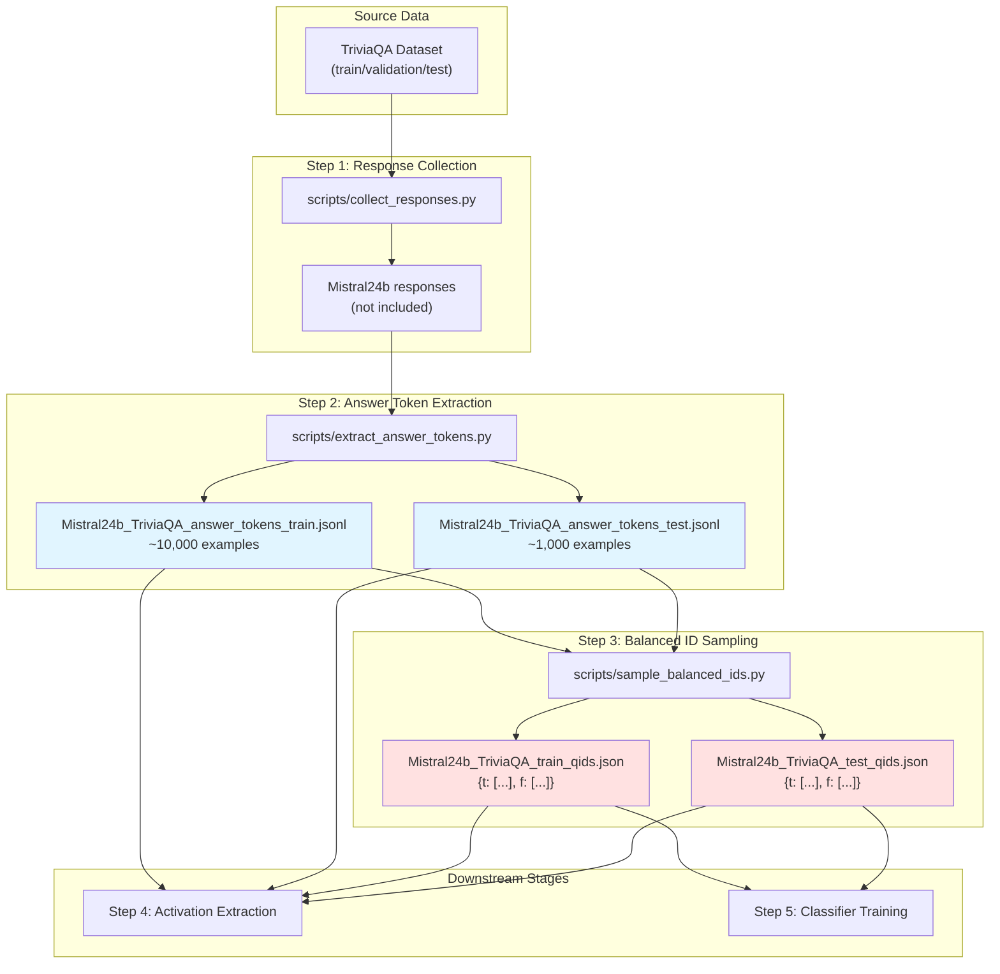
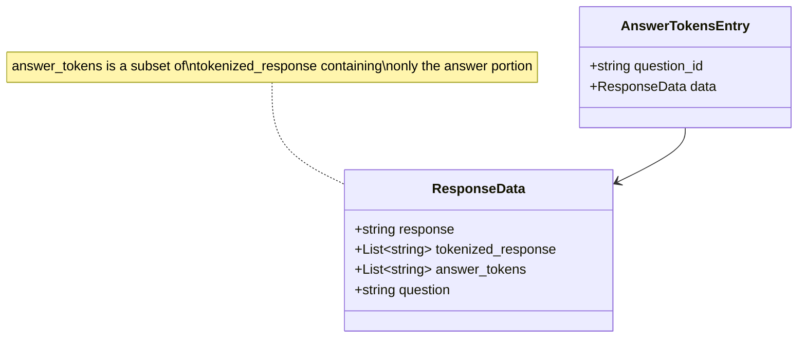
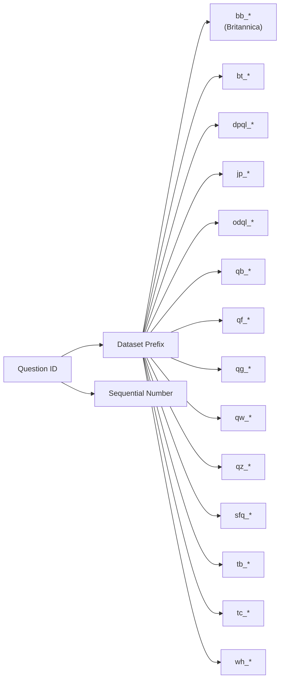
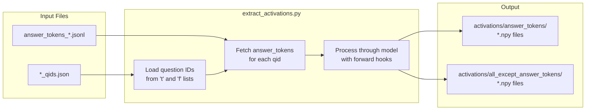
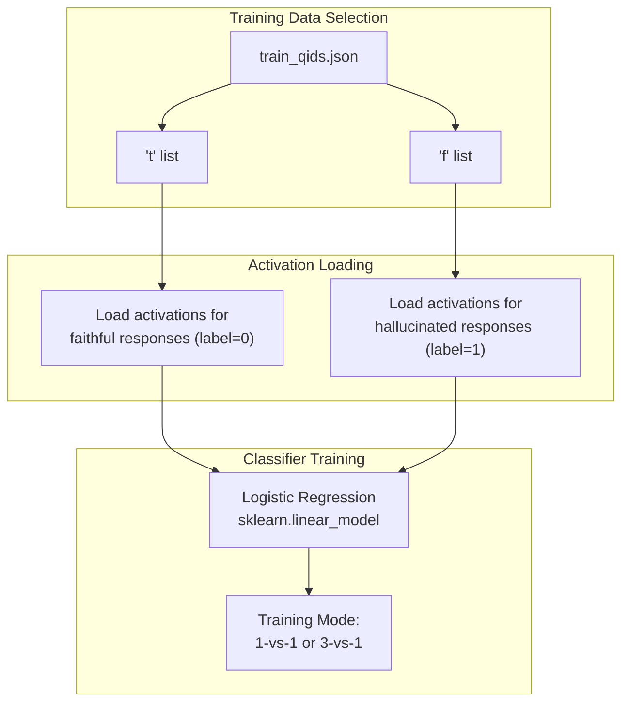

<!-- source: DeepWiki mcp.deepwiki.com · repo thunlp/H-Neurons · page 5.4 Example Data: Mistral24b · fetched 2026-11-02 -->

# Example Data: Mistral24b

<details>
<summary>Relevant source files</summary>

The following files were used as context for generating this wiki page:

- [data/examples/Mistral24b_TriviaQA_answer_tokens_test.jsonl](data/examples/Mistral24b_TriviaQA_answer_tokens_test.jsonl)
- [data/examples/Mistral24b_TriviaQA_answer_tokens_train.jsonl](data/examples/Mistral24b_TriviaQA_answer_tokens_train.jsonl)
- [data/examples/Mistral24b_TriviaQA_test_qids.json](data/examples/Mistral24b_TriviaQA_test_qids.json)
- [data/examples/Mistral24b_TriviaQA_train_qids.json](data/examples/Mistral24b_TriviaQA_train_qids.json)

</details>


This page documents the example data files provided for the Mistral24b model, including their format, structure, and role in the H-Neurons pipeline. For information about the source TriviaQA dataset, see [TriviaQA Source Dataset](#5.1). For details on intermediate data formats, see [Intermediate Data Formats](#5.2). For example data from other models, see [Example Data: Llama33](#5.3) and [Example Data: gemma27b](#5.5).

## Overview

The repository includes pre-processed example data for Mistral24b, allowing users to skip early pipeline stages and begin directly at activation extraction or classifier training. These files represent outputs from Steps 2 and 3 of the pipeline ([Response Collection](#4.1), [Answer Token Extraction](#4.2), and [Balanced ID Sampling](#4.3)).

## File Inventory

The following table lists all Mistral24b example data files:

| File Path | Description | Format | Stage Output |
|-----------|-------------|--------|--------------|
| `data/examples/Mistral24b_TriviaQA_answer_tokens_train.jsonl` | Training set with answer tokens | JSONL | Step 2 |
| `data/examples/Mistral24b_TriviaQA_answer_tokens_test.jsonl` | Test set with answer tokens | JSONL | Step 2 |
| `data/examples/Mistral24b_TriviaQA_train_qids.json` | Balanced training question IDs | JSON | Step 3 |
| `data/examples/Mistral24b_TriviaQA_test_qids.json` | Balanced test question IDs | JSON | Step 3 |

Sources: [data/examples/Mistral24b_TriviaQA_answer_tokens_test.jsonl:1-1000](), [data/examples/Mistral24b_TriviaQA_answer_tokens_train.jsonl:1-1000](), [data/examples/Mistral24b_TriviaQA_test_qids.json:1-10]()

## Data Flow Architecture



Sources: [data/examples/Mistral24b_TriviaQA_answer_tokens_train.jsonl:1](), [data/examples/Mistral24b_TriviaQA_test_qids.json:1-10]()

## Answer Tokens File Format

### JSONL Schema

Each line in `Mistral24b_TriviaQA_answer_tokens_*.jsonl` contains a single JSON object with the following structure:



Sources: [data/examples/Mistral24b_TriviaQA_answer_tokens_test.jsonl:1-10]()

### Example Entries

**Faithful Response Example:**

```json
{
  "sfq_14430": {
    "response": "Martin Chuzzlewit",
    "tokenized_response": ["Martin", "ĠCh", "uzz", "lew", "it"],
    "answer_tokens": ["Martin", "ĠCh", "uzz", "lew", "it"],
    "question": "Giving his name to an adjective meaning sanctimonious and hypocritical, Seth Pecksniff appears in which Charles Dickens novel? Respond with the answer only, without any explanation."
  }
}
```

**Hallucinated Response Example:**

```json
{
  "qb_1703": {
    "response": "George Michael",
    "tokenized_response": ["George", "ĠMichael"],
    "answer_tokens": ["George", "ĠMichael"],
    "question": "Which British singer's wife gave birth to their son Aiden on 16th February 2011? Respond with the answer only, without any explanation."
  }
}
```

Sources: [data/examples/Mistral24b_TriviaQA_answer_tokens_test.jsonl:1](), [data/examples/Mistral24b_TriviaQA_answer_tokens_test.jsonl:16]()

### Tokenization Details

The `tokenized_response` field uses Mistral24b's tokenizer with the following characteristics:

- **Prefix Space Tokens**: Tokens beginning with `Ġ` (e.g., `"ĠMichael"`) indicate a leading space in the original text
- **Subword Tokens**: Multi-word answers are split into subwords (e.g., `"Martin Chuzzlewit"` → `["Martin", "ĠCh", "uzz", "lew", "it"]`)
- **Special Characters**: Unicode characters are preserved (e.g., `"£"` for pound sign, `"é"` for accented characters)
- **Empty answer_tokens**: When `answer_tokens` is an empty list `[]`, it indicates the LLM judge could not identify the answer portion

Sources: [data/examples/Mistral24b_TriviaQA_answer_tokens_test.jsonl:1-50]()

## Question IDs File Format

### JSON Schema

The `Mistral24b_TriviaQA_*_qids.json` files contain a single JSON object with two keys:

```mermaid
graph TB
    ROOT["Root Object"]
    T["'t' key<br/>(faithful responses)"]
    F["'f' key<br/>(hallucinated responses)"]
    T_LIST["List of question IDs<br/>e.g., ['bb_1000', 'bb_1033', ...]"]
    F_LIST["List of question IDs<br/>e.g., ['bb_1052', 'bb_1252', ...]"]
    
    ROOT --> T
    ROOT --> F
    T --> T_LIST
    F --> F_LIST
    
    note for T_LIST "Model's response was<br/>judged as correct"
    note for F_LIST "Model's response was<br/>judged as incorrect"
```

Sources: [data/examples/Mistral24b_TriviaQA_test_qids.json:1-2006]()

### Balanced Sampling

The question IDs are balanced to ensure equal representation:

| Split | Faithful (t) | Hallucinated (f) | Total |
|-------|--------------|------------------|-------|
| Test  | 1,003        | 1,001            | 2,004 |
| Train | ~5,000       | ~5,000           | ~10,000 |

This 50/50 split enables effective binary classification training where both classes have equal prior probability.

Sources: [data/examples/Mistral24b_TriviaQID_test_qids.json:2-2006]()

## Question ID Naming Convention

Question IDs follow a consistent pattern across all datasets:



Examples: `bb_1000`, `sfq_14430`, `qb_1703`, `tc_2509`

Sources: [data/examples/Mistral24b_TriviaQA_test_qids.json:3-1000]()

## Usage in Pipeline Stages

### Stage 4: Activation Extraction

The answer tokens files and qids files are consumed by `scripts/extract_activations.py`:



Sources: [data/examples/Mistral24b_TriviaQA_answer_tokens_test.jsonl:1](), [data/examples/Mistral24b_TriviaQA_test_qids.json:1-10]()

### Stage 5: Classifier Training

The qids files determine which activations are loaded for training:



Sources: [data/examples/Mistral24b_TriviaQA_test_qids.json:2-2006]()

## Dataset Statistics

### Test Set Distribution

| Metric | Value |
|--------|-------|
| Total Examples | 2,004 |
| Faithful Responses | 1,003 (50.05%) |
| Hallucinated Responses | 1,001 (49.95%) |
| Unique Prefixes | 14 |
| Average Tokens per Response | ~3-5 |

### Sample Prefix Distribution (Test Set)

Analysis of the first 100 test examples shows diverse question sources:

| Prefix | Count | Example Question Type |
|--------|-------|----------------------|
| sfq_* | ~25 | General knowledge quiz questions |
| odql_* | ~20 | Oxford/Durham quiz league |
| bb_* | ~15 | Britannica-sourced questions |
| qb_* | ~12 | Quiz bowl questions |
| Others | ~28 | Various quiz databases |

Sources: [data/examples/Mistral24b_TriviaQA_test_qids.json:2-100]()

## File Size and Performance

Approximate file sizes:

| File | Size | Lines |
|------|------|-------|
| `answer_tokens_train.jsonl` | ~5-10 MB | ~10,000 |
| `answer_tokens_test.jsonl` | ~0.5-1 MB | ~2,000 |
| `train_qids.json` | ~100 KB | 1 |
| `test_qids.json` | ~20 KB | 1 |

**Loading Performance**: JSONL files can be streamed line-by-line for memory efficiency, while qids JSON files are small enough to load entirely into memory.

Sources: [data/examples/Mistral24b_TriviaQA_answer_tokens_test.jsonl:1-200](), [data/examples/Mistral24b_TriviaQA_test_qids.json:1-2006]()

## Data Quality Characteristics

### Answer Token Identification

The `answer_tokens` field is determined by an LLM judge (gpt-4o) during Step 2. Key observations:

- **Complete Match**: When the entire response is the answer, `answer_tokens` equals `tokenized_response`
- **Empty Tokens**: Some entries have `answer_tokens: []`, indicating the judge could not identify the answer portion
- **Partial Match**: In rare cases, `answer_tokens` is a proper subset when the response contains explanatory text

Example of empty answer_tokens:

```json
{
  "tc_2190": {
    "response": "\"Love Hangover\"",
    "tokenized_response": ["\"", "Love", "ĠHang", "over", "\""],
    "answer_tokens": [],
    "question": "What was Diana Ross's first solo No 1? Respond with the answer only, without any explanation."
  }
}
```

Sources: [data/examples/Mistral24b_TriviaQA_answer_tokens_test.jsonl:39]()

### Hallucination Examples

Hallucinated responses (from the 'f' list) include:

| Question ID | Question (truncated) | Response | Issue |
|-------------|---------------------|----------|-------|
| qb_1703 | British singer's wife gave birth to Aiden... | George Michael | Factually incorrect |
| odql_2248 | General President of Teamsters? | Sean M. O'Brien | Possibly incorrect timing/person |
| qg_3244 | Paula Abdul replacement on American Idol? | Katrina Perry | Wrong person (should be Katy Perry or Ellen DeGeneres) |

Sources: [data/examples/Mistral24b_TriviaQA_answer_tokens_test.jsonl:16](), [data/examples/Mistral24b_TriviaQA_answer_tokens_test.jsonl:10](), [data/examples/Mistral24b_TriviaQA_test_qids.json:1004-1006]()

## Comparison with Other Models

All three model datasets (Llama33, Mistral24b, gemma27b) follow the same format and structure, enabling comparative analysis:

```mermaid
graph TB
    subgraph "Common Pipeline"
        TRIVIA["TriviaQA Source"]
        STEP2["Step 2: Answer Token Extraction"]
        STEP3["Step 3: Balanced Sampling"]
    end
    
    subgraph "Model-Specific Outputs"
        L33["Llama33_TriviaQA_*"]
        M24["Mistral24b_TriviaQA_*"]
        G27["gemma27b_TriviaQA_*"]
    end
    
    TRIVIA --> STEP2
    STEP2 --> STEP3
    
    STEP3 --> L33
    STEP3 --> M24
    STEP3 --> G27
    
    note for L33 "Different tokenization<br/>Different responses<br/>Same format"
    note for M24 "Different tokenization<br/>Different responses<br/>Same format"
    note for G27 "Different tokenization<br/>Different responses<br/>Same format"
```

The key differences between models are:
- **Tokenization**: Each model's tokenizer produces different subword splits
- **Response Content**: Different models generate different (sometimes hallucinated) answers
- **Answer Quality**: The ratio of faithful to hallucinated responses varies by model

Sources: [data/examples/Mistral24b_TriviaQA_answer_tokens_test.jsonl:1-10]()

---

