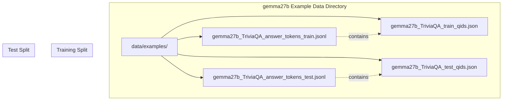
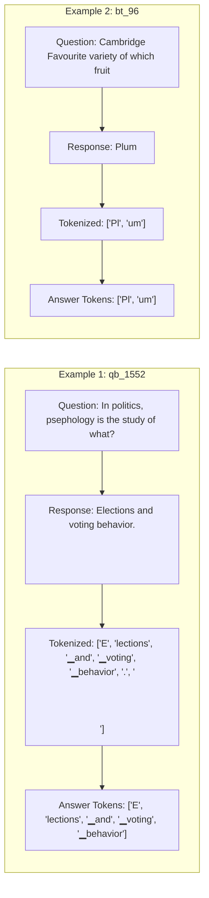
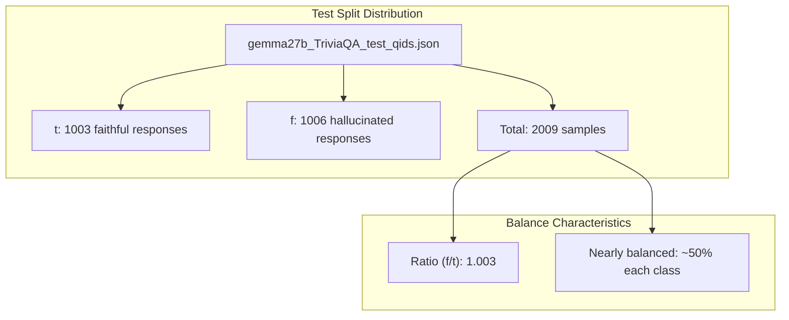
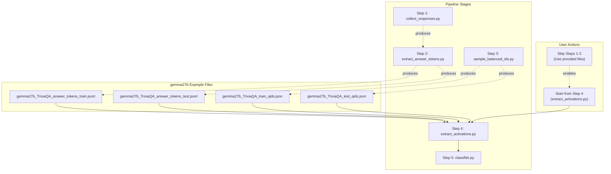
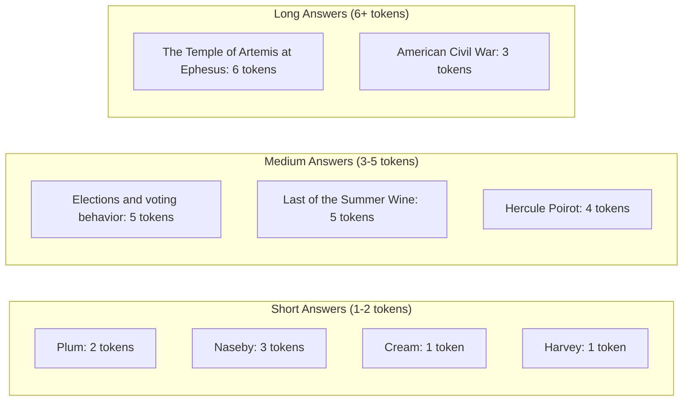
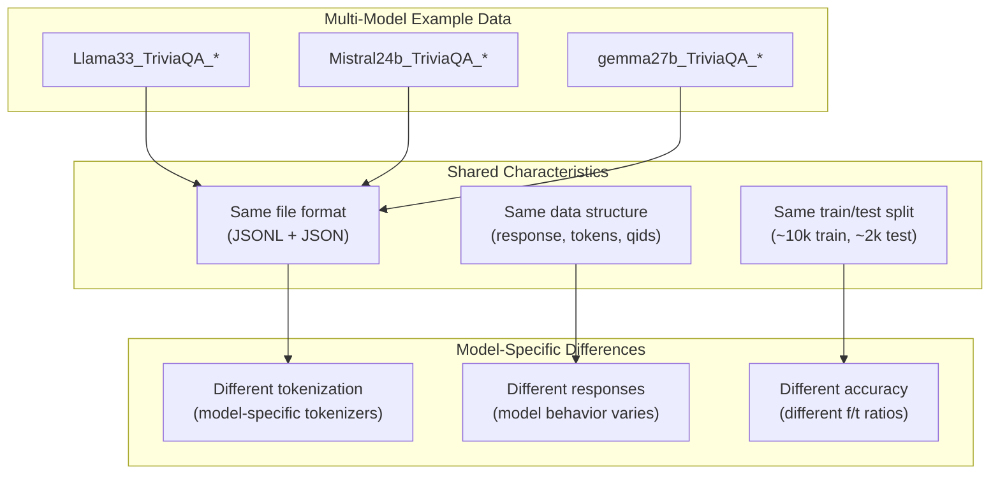

<!-- source: DeepWiki mcp.deepwiki.com · repo thunlp/H-Neurons · page 5.5 Example Data: gemma27b · fetched 2026-11-02 -->

# Example Data: gemma27b

<details>
<summary>Relevant source files</summary>

The following files were used as context for generating this wiki page:

- [data/examples/gemma27b_TriviaQA_answer_tokens_test.jsonl](data/examples/gemma27b_TriviaQA_answer_tokens_test.jsonl)
- [data/examples/gemma27b_TriviaQA_answer_tokens_train.jsonl](data/examples/gemma27b_TriviaQA_answer_tokens_train.jsonl)
- [data/examples/gemma27b_TriviaQA_test_qids.json](data/examples/gemma27b_TriviaQA_test_qids.json)
- [data/examples/gemma27b_TriviaQA_train_qids.json](data/examples/gemma27b_TriviaQA_train_qids.json)

</details>


This page documents the pre-processed example data files provided for the **gemma27b** model. These files serve as reference datasets demonstrating the complete pipeline output from response collection through balanced sampling, ready for activation extraction and classifier training.

For information about the other model-specific example datasets, see [Example Data: Llama33](#5.3) and [Example Data: Mistral24b](#5.4). For details on the underlying data format specifications, see [Intermediate Data Formats](#5.2).

---

## Overview

The gemma27b example data includes three file types produced by the first three pipeline stages:

1. **Answer token files** (`answer_tokens_train.jsonl`, `answer_tokens_test.jsonl`) - Output from Step 2 ([extract_answer_tokens.py](#4.2))
2. **Question ID files** (`train_qids.json`, `test_qids.json`) - Output from Step 3 ([sample_balanced_ids.py](#4.3))

These files enable users to skip the computationally expensive response collection and token extraction stages when experimenting with the gemma27b model on TriviaQA.

**Sources:** [data/examples/gemma27b_TriviaQA_answer_tokens_test.jsonl](), [data/examples/gemma27b_TriviaQA_answer_tokens_train.jsonl](), [data/examples/gemma27b_TriviaQA_test_qids.json]()

---

## File Structure



**File Naming Convention:** `{model}_{dataset}_{content}_{split}.{ext}`

| Component | Value | Description |
|-----------|-------|-------------|
| `model` | `gemma27b` | Target LLM model identifier |
| `dataset` | `TriviaQA` | Source dataset name |
| `content` | `answer_tokens` / `train_qids` / `test_qids` | Data content type |
| `split` | `train` / `test` | Train or test partition |
| `ext` | `jsonl` / `json` | File format |

**Sources:** [data/examples/gemma27b_TriviaQA_answer_tokens_test.jsonl:1](), [data/examples/gemma27b_TriviaQA_answer_tokens_train.jsonl:1](), [data/examples/gemma27b_TriviaQA_test_qids.json:1]()

---

## Answer Tokens Files

### Format Specification

Each line in `answer_tokens_train.jsonl` and `answer_tokens_test.jsonl` contains a JSON object representing one question-response pair:

```json
{
  "<question_id>": {
    "response": "<raw_model_output>",
    "tokenized_response": ["<token1>", "<token2>", ...],
    "answer_tokens": ["<answer_token1>", "<answer_token2>", ...],
    "question": "<question_text>"
  }
}
```

**Field Descriptions:**

| Field | Type | Description |
|-------|------|-------------|
| `question_id` | string | Unique identifier from TriviaQA (e.g., `"qb_1552"`, `"bt_96"`) |
| `response` | string | Complete raw text output from gemma27b model |
| `tokenized_response` | array[string] | Full response split into gemma27b tokens |
| `answer_tokens` | array[string] | Subset of tokens identified as the answer portion |
| `question` | string | Original question with instruction suffix |

**Sources:** [data/examples/gemma27b_TriviaQA_answer_tokens_test.jsonl:1-10]()

---

### Tokenization Examples



**Key Observations:**

- **Subword tokens:** gemma27b uses subword tokenization (e.g., `"Pl"`, `"um"` for "Plum")
- **Space markers:** Leading spaces encoded as `▁` prefix (e.g., `"▁and"`, `"▁voting"`)
- **Trailing content:** Some responses include trailing newlines excluded from answer tokens
- **Variable length:** Answer tokens range from 1 token to 10+ tokens depending on complexity

**Sources:** [data/examples/gemma27b_TriviaQA_answer_tokens_test.jsonl:1-2]()

---

### Sample Data Entries

**Faithful Response (Test Set):**
```json
{
  "odql_1362": {
    "response": "Naseby",
    "tokenized_response": ["N", "ase", "by"],
    "answer_tokens": ["N", "ase", "by"],
    "question": "Which famous battle of 1645 took place when the Parliamentary Army led by Fairfax defeated the Royalist Army led by Prince Rupert? Respond with the answer only, without any explanation."
  }
}
```

**Response with Trailing Content (Test Set):**
```json
{
  "odql_10981": {
    "response": "Red fox.\n\n\n\n",
    "tokenized_response": ["Red", "▁fox", ".", "\n\n\n\n"],
    "answer_tokens": ["Red", "▁fox"],
    "question": "What is Britain's largest native land carnivore? Respond with the answer only, without any explanation."
  }
}
```

**Empty Answer Tokens (Hallucinated Response):**
```json
{
  "bb_946": {
    "response": "Don't Push The Button.",
    "tokenized_response": ["Don", "'", "t", "▁Push", "▁The", "▁Button", "."],
    "answer_tokens": [],
    "question": "What was Tony McCoy's winning mount in the 2010 Grand National? Respond with the answer only, without any explanation."
  }
}
```

**Sources:** [data/examples/gemma27b_TriviaQA_answer_tokens_test.jsonl:3-5,33]()

---

## Question ID Files

### Format Specification

The `train_qids.json` and `test_qids.json` files contain balanced samples of question IDs partitioned by response correctness:

```json
{
  "t": ["<qid1>", "<qid2>", ...],
  "f": ["<qid3>", "<qid4>", ...]
}
```

**Field Descriptions:**

| Key | Type | Description |
|-----|------|-------------|
| `"t"` | array[string] | Question IDs where gemma27b produced **faithful/correct** responses |
| `"f"` | array[string] | Question IDs where gemma27b produced **hallucinated/incorrect** responses |

This binary classification enables training mode configurations in [Step 5: Classifier Training](#4.5):
- **1-vs-1 mode:** Uses `t` vs `f` from answer tokens
- **3-vs-1 mode:** Uses `f` answer tokens vs combined `t` answer tokens, `t` other tokens, and `f` other tokens

**Sources:** [data/examples/gemma27b_TriviaQA_test_qids.json:1-2006]()

---

### Question ID Statistics



**Test Set Breakdown:**

| Category | Count | Percentage |
|----------|-------|------------|
| Faithful responses (`t`) | 1,003 | 49.93% |
| Hallucinated responses (`f`) | 1,006 | 50.07% |
| **Total samples** | **2,009** | **100%** |

The near-perfect balance (50/50 split) ensures unbiased classifier training and evaluation.

**Sources:** [data/examples/gemma27b_TriviaQA_test_qids.json:2-2006]()

---

### Sample Question IDs

**Faithful Response IDs (from `"t"` array):**
```json
[
  "bb_10",      // First ID in test set
  "bb_1037",
  "bb_1070",
  "bb_108",
  "qb_1552",    // Example shown earlier (Elections/voting)
  "odql_1362",  // Example shown earlier (Naseby)
  ...
]
```

**Hallucinated Response IDs (from `"f"` array):**
```json
[
  "bb_1004",
  "bb_105",
  "bb_1137",
  "bb_946",     // Example shown earlier (empty answer_tokens)
  ...
]
```

**ID Prefix Patterns:**

The question IDs encode their source within TriviaQA using prefixes:

| Prefix | Source Dataset Component |
|--------|--------------------------|
| `bb_` | Book/Biography questions |
| `bt_` | British Trivia questions |
| `dpql_` | DPQL collection |
| `jp_` | Jeopardy questions |
| `odql_` | ODQL collection |
| `qb_` | Quiz Bowl questions |
| `qf_` | Quiz Factory questions |
| `qg_` | Quizzer's Guide questions |
| `qw_` | Quiz World questions |
| `qz_` | Quizzer questions |
| `sfq_` | SFQ collection |
| `tb_` | Trivia Bowl questions |
| `tc_` | Trivia Collection questions |
| `wh_` | Who/What/Where questions |

**Sources:** [data/examples/gemma27b_TriviaQA_test_qids.json:3-1003,1004-2005]()

---

## Pipeline Integration



**Usage Workflow:**

1. **Skip expensive steps:** Users can bypass `collect_responses.py` (requires vLLM inference) and `extract_answer_tokens.py` (requires OpenAI API calls)

2. **Direct to activation extraction:** Run `extract_activations.py` with these files as input:
   ```bash
   --answer_tokens_file data/examples/gemma27b_TriviaQA_answer_tokens_train.jsonl
   --qids_file data/examples/gemma27b_TriviaQA_train_qids.json
   ```

3. **Proceed to classifier training:** After extracting activations, use the same QID files for balanced data loading in `classifier.py`

**Sources:** [data/examples/gemma27b_TriviaQA_answer_tokens_train.jsonl](), [data/examples/gemma27b_TriviaQA_train_qids.json](), [data/examples/gemma27b_TriviaQA_test_qids.json]()

---

## Data Characteristics

### Tokenization Patterns

**Subword Segmentation Examples:**

| Word | Tokens | Count |
|------|--------|-------|
| "Elections" | `["E", "lections"]` | 2 |
| "Plum" | `["Pl", "um"]` | 2 |
| "Naseby" | `["N", "ase", "by"]` | 3 |
| "Agamemnon" | `["Ag", "am", "em", "non"]` | 4 |
| "Chiellini" | `["Gior", "gio", "▁Chi", "ellini"]` | 4 |

**Space Encoding:**
- Leading space: `▁` prefix (e.g., `"▁and"`, `"▁voting"`)
- No space: Plain token (e.g., `"E"`, `"lections"`)

**Sources:** [data/examples/gemma27b_TriviaQA_answer_tokens_test.jsonl:1-13]()

---

### Response Length Distribution

**Answer Token Counts (Sample):**



Most answers fall into the 1-5 token range, with factual responses typically being concise.

**Sources:** [data/examples/gemma27b_TriviaQA_answer_tokens_test.jsonl:1-30]()

---

### Hallucination Indicators

**Empty Answer Tokens:**

Some hallucinated responses result in empty `answer_tokens` arrays when the LLM judge determines no valid answer exists:

```json
{
  "bb_946": {"answer_tokens": []},
  "sfq_64": {"answer_tokens": []},
  "wh_978": {"answer_tokens": []}
}
```

This occurs when:
- Model refuses to answer
- Model provides meta-commentary instead of answer
- Model output is irrelevant to question

**Non-Empty Hallucinations:**

Not all hallucinations have empty answer tokens. Some contain plausible but incorrect answers that were still tagged as answer tokens by the judge.

**Sources:** [data/examples/gemma27b_TriviaQA_answer_tokens_test.jsonl:33,64,70]()

---

## File Locations Reference

**Complete File Paths:**

| File | Path | Size |
|------|------|------|
| Train answer tokens | `data/examples/gemma27b_TriviaQA_answer_tokens_train.jsonl` | ~10,000 lines |
| Test answer tokens | `data/examples/gemma27b_TriviaQA_answer_tokens_test.jsonl` | ~2,000 lines |
| Train question IDs | `data/examples/gemma27b_TriviaQA_train_qids.json` | ~10,000 IDs |
| Test question IDs | `data/examples/gemma27b_TriviaQA_test_qids.json` | 2,009 IDs |

**Sources:** [data/examples/gemma27b_TriviaQA_answer_tokens_train.jsonl](), [data/examples/gemma27b_TriviaQA_answer_tokens_test.jsonl](), [data/examples/gemma27b_TriviaQA_test_qids.json]()

---

## Comparison with Other Models



All three models (`Llama33`, `Mistral24b`, `gemma27b`) share:
- Identical file naming conventions
- Compatible data formats
- Same pipeline integration points

Key differences:
- **Tokenization:** Each model uses its own subword vocabulary
- **Response quality:** Hallucination rates vary by model architecture
- **Token boundaries:** Answer token extraction varies with model-specific tokenizers

**Sources:** [data/examples/gemma27b_TriviaQA_answer_tokens_test.jsonl](), [data/examples/gemma27b_TriviaQA_test_qids.json]()

---

